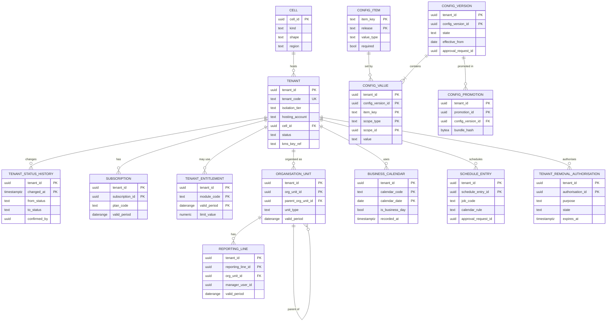
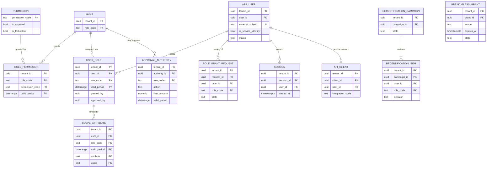
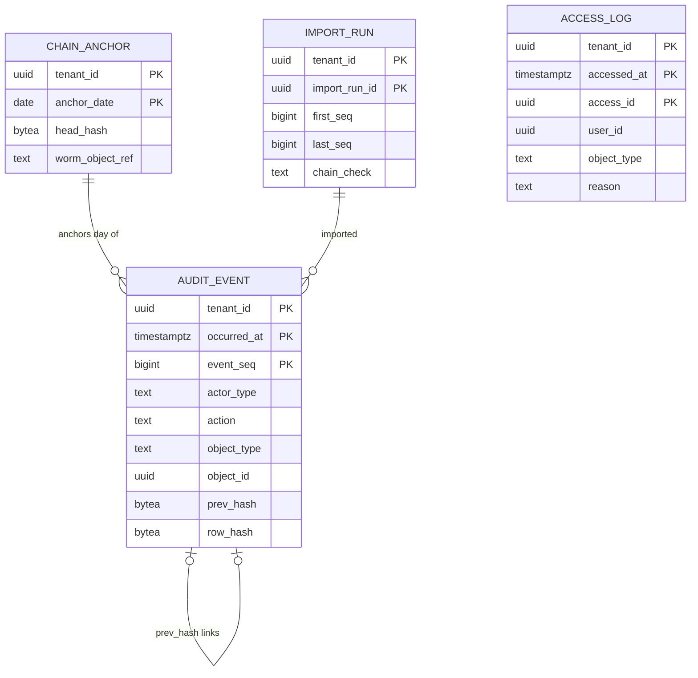

# D01 Platform Administration — `platform`, `identity`, `audit`

Annex of [DA-001](../../docs/05_data_architecture/DA-001_canonical_enterprise_data_model.md) (canonical enterprise data model), Step 15. Status: **Draft** — same status and approver as DA-001; these annexes carry no ID of their own. Only key columns and a few main columns are shown; the full column list of every table is the data dictionary DBE-001 (Step 17).

**How to read:** every tenant table's key starts with `tenant_id` (shown first, `PK`). `||--o{` = one to zero-or-many, `||--|{` = one to one-or-many, `||--o|` = one to zero-or-one, `|o--o|` = optional link to a row of the same kind. A bi-temporal entity that other rows point at (for example a security or an investor) is drawn once, as its anchor; its `_version` table (DA-001 §3.1) is implied. Boxes named `MASTER_…`, `PRODUCT_…` stand for tables in the reference schemas `master` and `product` (foreign keys allowed, DA-001 M4); a link to any other schema is an ID reference and is not drawn as a line.

## Tenant, cell, organisation and configuration (`platform`)

## Users, roles and grants (`identity`)

## Audit (`audit`)

## Notes

- `identity.permission`, `platform.config_item` and `platform.cell` have no tenant column (DA-001 M3). `CONFIG_VALUE` points at `CONFIG_ITEM` by `item_key` and the release of its version (column detail in DBE-001).
- `identity.user_role.approved_by` and `granted_by` point at `identity.app_user` (SOD-05). Cross-schema user references from other modules (for example `created_by`) are ID references (DA-001 M4).
- Not drawn here, to keep the diagram readable (listed in DA-001 §4): `platform.usage_meter`, `platform.code_list`, `platform.code_value`, `platform.feature_flag`, `platform.environment_release`, `platform.notification_channel`.
