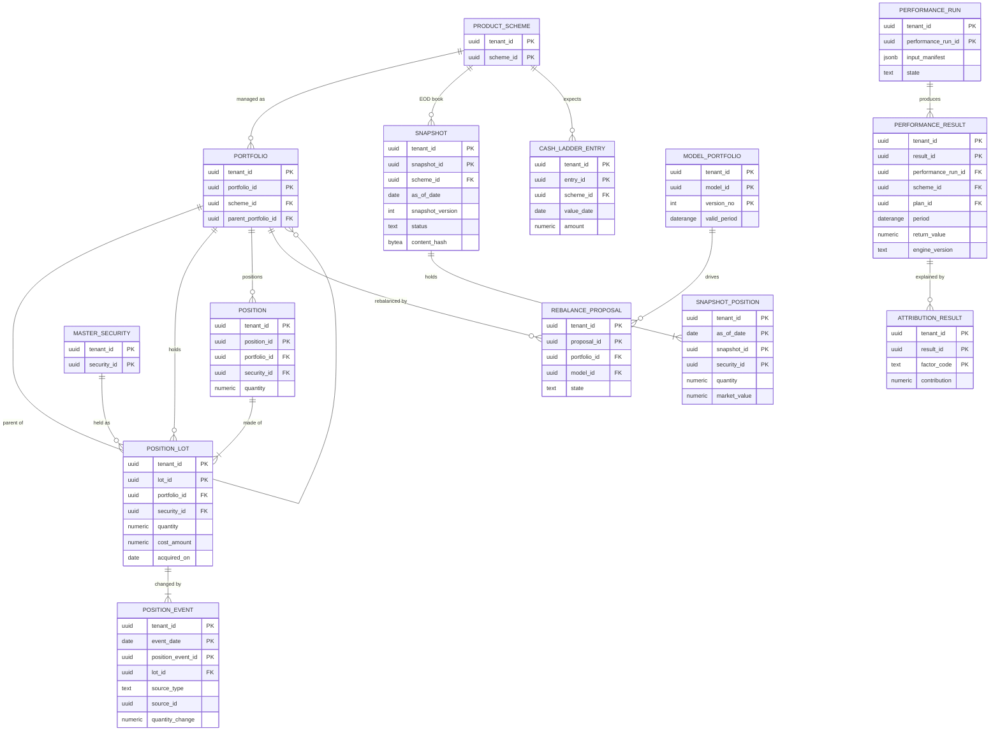

# D04 Portfolio Management — `portfolio`

Annex of [DA-001](../../docs/05_data_architecture/DA-001_canonical_enterprise_data_model.md) (canonical enterprise data model), Step 15. Status: **Draft** — same status and approver as DA-001; these annexes carry no ID of their own. Only key columns and a few main columns are shown; the full column list of every table is the data dictionary DBE-001 (Step 17).

**How to read:** every tenant table's key starts with `tenant_id` (shown first, `PK`). `||--o{` = one to zero-or-many, `||--|{` = one to one-or-many, `||--o|` = one to zero-or-one, `|o--o|` = optional link to a row of the same kind. A bi-temporal entity that other rows point at (for example a security or an investor) is drawn once, as its anchor; its `_version` table (DA-001 §3.1) is implied. Boxes named `MASTER_…`, `PRODUCT_…` stand for tables in the reference schemas `master` and `product` (foreign keys allowed, DA-001 M4); a link to any other schema is an ID reference and is not drawn as a line.

## Positions, snapshots and results

## Notes

- `POSITION_EVENT.source_id` is an ID reference to the trade, corporate action or transfer that caused it (NFR-AUD-004); `PERFORMANCE_RESULT.engine_version` is `FE-10@<version>`.
- `NAV_RUN` freezes the snapshot by event (`NAV_APPROVED`), not by foreign key.
- Not drawn here, to keep the diagram readable (listed in DA-001 §4): `portfolio.exposure_view`.
