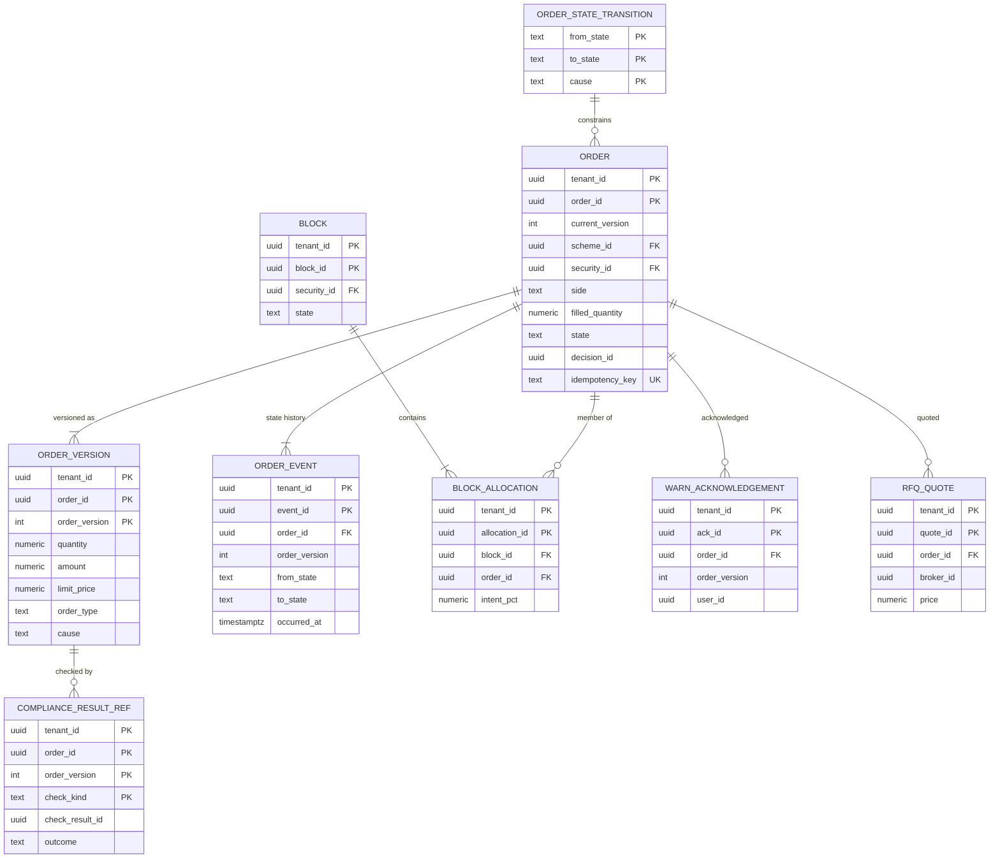

# D05 Order Management System — `trading`

Annex of [DA-001](../../docs/05_data_architecture/DA-001_canonical_enterprise_data_model.md) (canonical enterprise data model), Step 15. Status: **Draft** — same status and approver as DA-001; these annexes carry no ID of their own. Only key columns and a few main columns are shown; the full column list of every table is the data dictionary DBE-001 (Step 17).

**How to read:** every tenant table's key starts with `tenant_id` (shown first, `PK`). `||--o{` = one to zero-or-many, `||--|{` = one to one-or-many, `||--o|` = one to zero-or-one, `|o--o|` = optional link to a row of the same kind. Boxes named `MASTER_…`, `PRODUCT_…` stand for tables in the reference schemas `master` and `product` (foreign keys allowed, DA-001 M4); a link to any other schema is an ID reference and is not drawn as a line.

## Orders, versions and blocks

## Notes

- `ORDER` is `trading."order"`. `decision_id` (to `investment.decision_record`), `check_result_id` (to `compliance.check_result`) and `broker_id` (to `execution.broker`) are ID references (DA-001 M4, DM-20). Scheme and security keys go to the reference schemas.
- `ORDER_STATE_TRANSITION` has no tenant column (product definition list, DA-001 M3); `cause` is `STATE_CHANGE`, `AMEND` or `REROUTE` (DM-5, DM-6).
- Allocation **results** are in `execution.allocation` (DM-7, ADR-0020).
