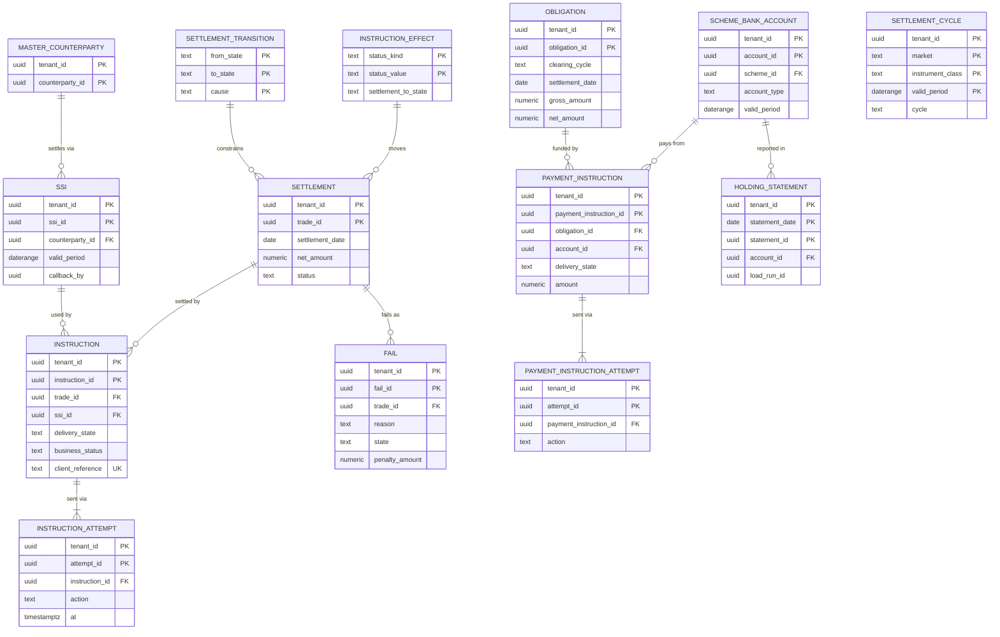

# D07 Settlement Management — `settlement`

Annex of [DA-001](../../docs/05_data_architecture/DA-001_canonical_enterprise_data_model.md) (canonical enterprise data model), Step 15. Status: **Draft** — same status and approver as DA-001; these annexes carry no ID of their own. Only key columns and a few main columns are shown; the full column list of every table is the data dictionary DBE-001 (Step 17).

**How to read:** every tenant table's key starts with `tenant_id` (shown first, `PK`). `||--o{` = one to zero-or-many, `||--|{` = one to one-or-many, `||--o|` = one to zero-or-one, `|o--o|` = optional link to a row of the same kind. A bi-temporal entity that other rows point at (for example a security or an investor) is drawn as one box that **merges its anchor and the columns of its current version**; in the database the anchor holds only the key and the changing columns sit in the implied `_version` table (DA-001 §3.1 rule 1). Business-code unique keys on such entities (PAN keyed hash, ISIN) are exclusion constraints on the version table (rule 3), so they are not marked `UK` in the box. Keys of other bi-temporal tables also include `recorded_at` (rule 2), not shown. Boxes named `MASTER_…`, `PRODUCT_…` stand for tables in the reference schemas `master` and `product` (foreign keys allowed, DA-001 M4); a link to any other schema is an ID reference and is not drawn as a line.

## Settlement records, instructions and standing data

## Notes

- `SETTLEMENT` replaces DDL-000 `settlement.trade` (DM-7) and is keyed by `trade_id`, an ID reference to `execution.trade` (EA-003 T1) — **(ADR-0020)**.
- `SETTLEMENT_TRANSITION` and `INSTRUCTION_EFFECT` are product definition lists with no tenant column (DA-001 M3, DM-10).
- Not drawn here, to keep the diagram readable (listed in DA-001 §4): `settlement.raw_message`, `settlement.load_run`.
