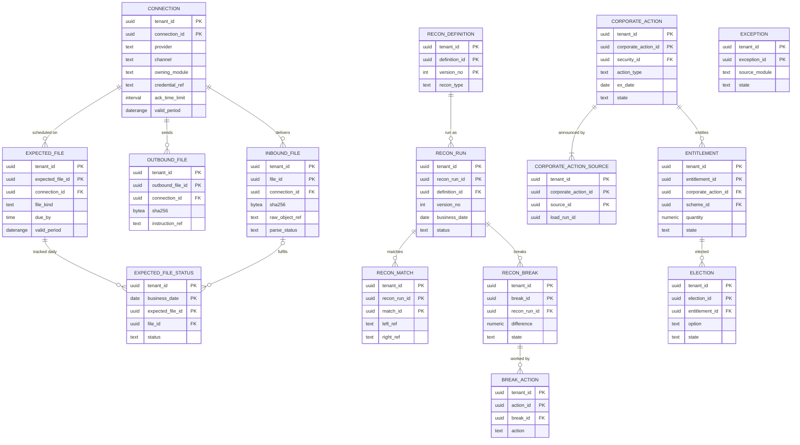
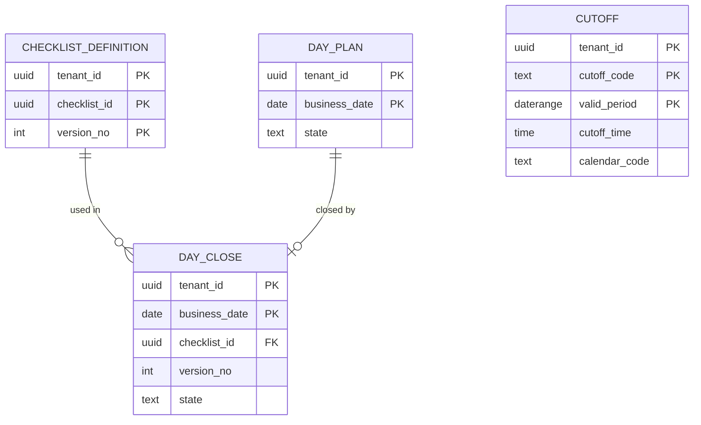
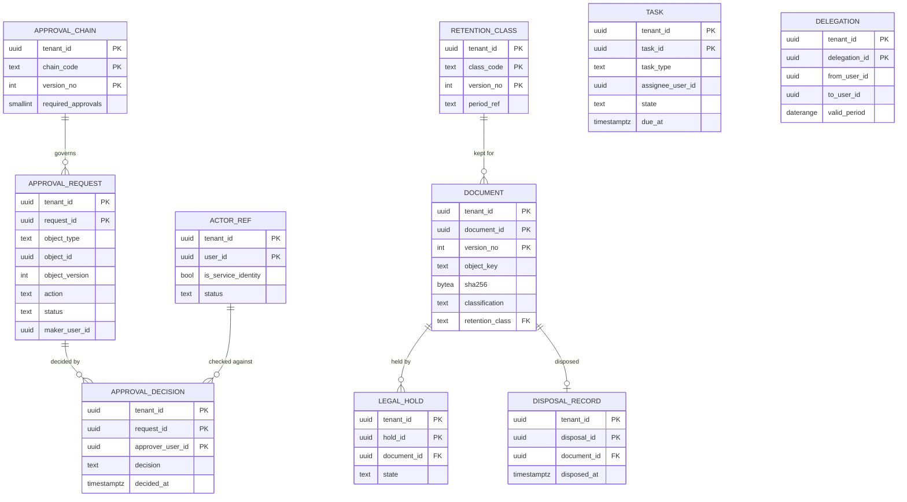

# D12 Fund Operations — `operations`, `workflow`, `documents`

Annex of [DA-001](../../docs/05_data_architecture/DA-001_canonical_enterprise_data_model.md) (canonical enterprise data model), Step 15. Status: **Draft** — same status and approver as DA-001; these annexes carry no ID of their own. Only key columns and a few main columns are shown; the full column list of every table is the data dictionary DBE-001 (Step 17).

**How to read:** every tenant table's key starts with `tenant_id` (shown first, `PK`). `||--o{` = one to zero-or-many, `||--|{` = one to one-or-many, `||--o|` = one to zero-or-one, `|o--o|` = optional link to a row of the same kind. Boxes named `MASTER_…`, `PRODUCT_…` stand for tables in the reference schemas `master` and `product` (foreign keys allowed, DA-001 M4); a link to any other schema is an ID reference and is not drawn as a line.

## Connections, files and reconciliation (`operations`)

## Day plan, cut-offs and checklists (`operations`)

## Approvals and tasks (`workflow`) and documents (`documents`)

## Notes

- `CORPORATE_ACTION`, `ENTITLEMENT`, `ELECTION` are owned by Operations (EA-003 T3, DM-8) — **(ADR-0020)**.
- `OUTBOUND_FILE.instruction_ref` points by ID at the owning module's instruction (DA-001 §3.5). `ACTOR_REF` is Workflow's read model of Identity (DM-20).
- Retention periods are **[VAL]** for REG-001 (Step 25); `RETENTION_CLASS.period_ref` points to the REG-001 entry.
