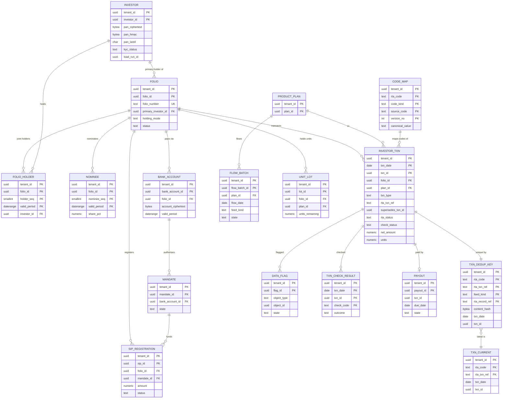
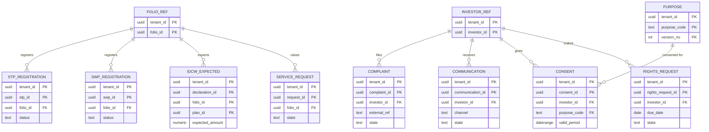

# D13 Investor Management and Servicing — `investor`

Annex of [DA-001](../../docs/05_data_architecture/DA-001_canonical_enterprise_data_model.md) (canonical enterprise data model), Step 15. Status: **Draft** — same status and approver as DA-001; these annexes carry no ID of their own. Only key columns and a few main columns are shown; the full column list of every table is the data dictionary DBE-001 (Step 17).

**How to read:** every tenant table's key starts with `tenant_id` (shown first, `PK`). `||--o{` = one to zero-or-many, `||--|{` = one to one-or-many, `||--o|` = one to zero-or-one, `|o--o|` = optional link to a row of the same kind. A bi-temporal entity that other rows point at (for example a security or an investor) is drawn as one box that **merges its anchor and the columns of its current version**; in the database the anchor holds only the key and the changing columns sit in the implied `_version` table (DA-001 §3.1 rule 1). Business-code unique keys on such entities (PAN keyed hash, ISIN) are exclusion constraints on the version table (rule 3), so they are not marked `UK` in the box. Keys of other bi-temporal tables also include `recorded_at` (rule 2), not shown. Boxes named `MASTER_…`, `PRODUCT_…` stand for tables in the reference schemas `master` and `product` (foreign keys allowed, DA-001 M4); a link to any other schema is an ID reference and is not drawn as a line.

## Investors, folios and transactions

## Servicing, privacy and other registrations

## Notes

- `FOLIO_REF` and `INVESTOR_REF` are the `FOLIO` and `INVESTOR` entities of the first diagram, repeated so the second diagram stays readable.
- Release 1 mirrors the RTA (Q2, D-53): every loaded row carries `load_run_id` and provenance (DA-001 M9). `rta_status`, `check_status` and `PAYOUT` replace the DDL-000 single `state` (DM-13). `TXN_DEDUP_KEY` refuses exact replays across monthly partitions while newer RTA versions are stored as new rows linked by `supersedes_txn_id`; `TXN_CURRENT` points at the latest (DM-9). `DATA_FLAG.object_id` may point at an investor, folio or transaction (shown on the transaction only).
- Personal data columns are encrypted with tenant data keys and searched by keyed hash (DA-001 M22). `PAYOUT.txn_id` is a plain ID column because the partitioned transaction key includes `txn_date`.
- Not drawn here, to keep the diagram readable (listed in DA-001 §4): `investor.unit_balance`, `investor.platform_file`, `investor.platform_file_attempt`, `investor.external_identifier`, `investor.load_run`.
