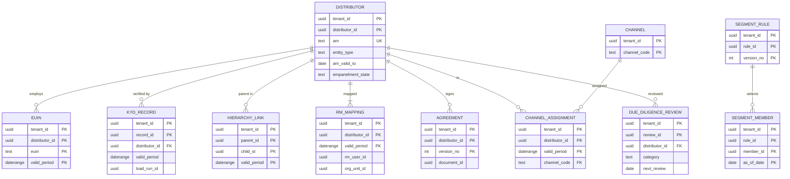
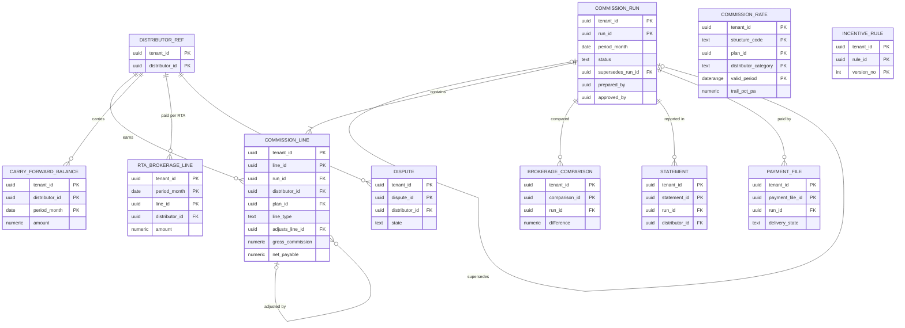

# D14 Distribution Management — `distribution`

Annex of [DA-001](../../docs/05_data_architecture/DA-001_canonical_enterprise_data_model.md) (canonical enterprise data model), Step 15. Status: **Draft** — same status and approver as DA-001; these annexes carry no ID of their own. Only key columns and a few main columns are shown; the full column list of every table is the data dictionary DBE-001 (Step 17).

**How to read:** every tenant table's key starts with `tenant_id` (shown first, `PK`). `||--o{` = one to zero-or-many, `||--|{` = one to one-or-many, `||--o|` = one to zero-or-one, `|o--o|` = optional link to a row of the same kind. Boxes named `MASTER_…`, `PRODUCT_…` stand for tables in the reference schemas `master` and `product` (foreign keys allowed, DA-001 M4); a link to any other schema is an ID reference and is not drawn as a line.

## Distributors and mappings

## Commission and incentives

## Notes

- `DISTRIBUTOR_REF` is the `DISTRIBUTOR` entity of the first diagram. Empanelment states follow FR-D14-017 (DM-14). `COMMISSION_LINE` has its own key, a line type and `adjusts_line_id`; `COMMISSION_RUN` has `supersedes_run_id` (DM-14).
- Staff incentive schemes and results, sales forecasts and opportunities are in DA-001 §4.20 and left out of the diagram for size. `plan_id` goes to `product.plan` (reference schema).
