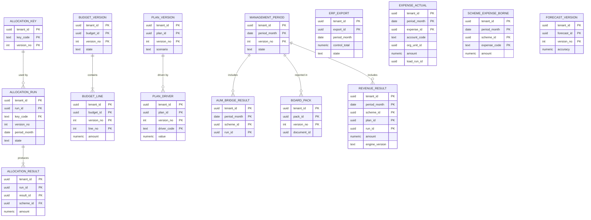

# D15 Finance and Management Reporting — `finance`

Annex of [DA-001](../../docs/05_data_architecture/DA-001_canonical_enterprise_data_model.md) (canonical enterprise data model), Step 15. Status: **Draft** — same status and approver as DA-001; these annexes carry no ID of their own. Only key columns and a few main columns are shown; the full column list of every table is the data dictionary DBE-001 (Step 17).

**How to read:** every tenant table's key starts with `tenant_id` (shown first, `PK`). `||--o{` = one to zero-or-many, `||--|{` = one to one-or-many, `||--o|` = one to zero-or-one, `|o--o|` = optional link to a row of the same kind. Boxes named `MASTER_…`, `PRODUCT_…` stand for tables in the reference schemas `master` and `product` (foreign keys allowed, DA-001 M4); a link to any other schema is an ID reference and is not drawn as a line.

## Expenses, allocation, plans and reporting

## Notes

- `PLAN_VERSION.plan_id` is a finance plan, not a scheme plan (`product.plan`); DBE-001 will name it `finance_plan_id` to avoid the clash.
- `REVENUE_RESULT.engine_version` is `FE-08@<version>`. Employee-level data is masked or aggregated (PRD-015 NFR-PRIV-003).
