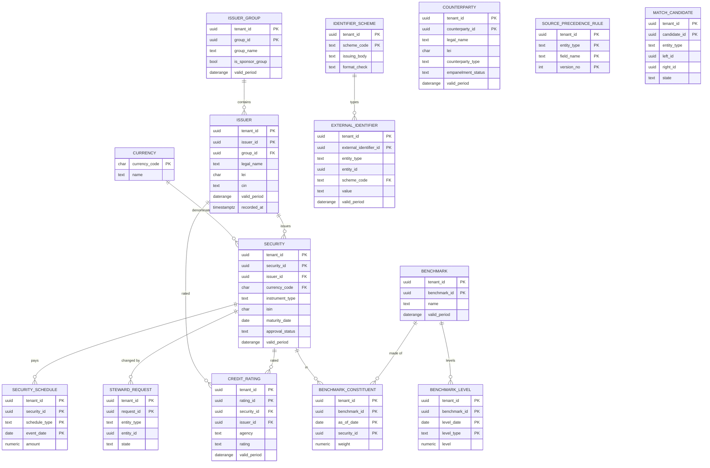
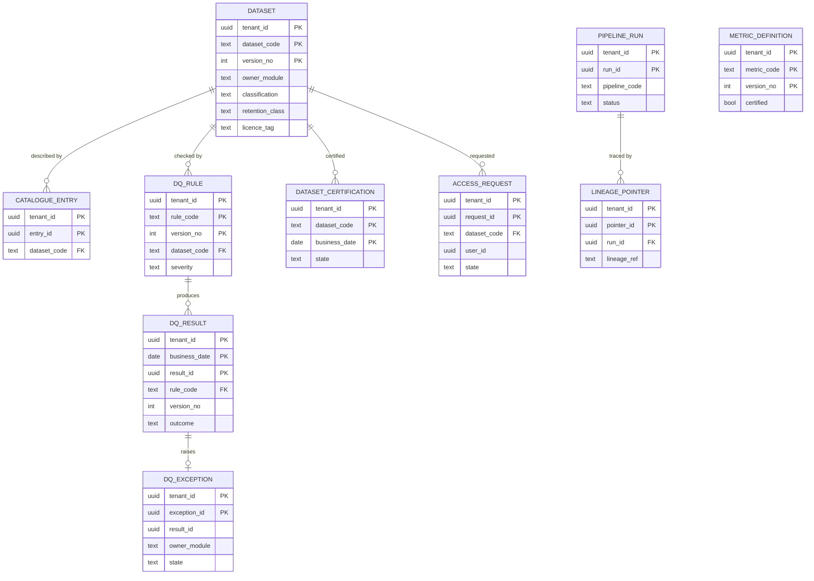

# D16 Enterprise Data Platform — `master`, `analytics`

Annex of [DA-001](../../docs/05_data_architecture/DA-001_canonical_enterprise_data_model.md) (canonical enterprise data model), Step 15. Status: **Draft** — same status and approver as DA-001; these annexes carry no ID of their own. Only key columns and a few main columns are shown; the full column list of every table is the data dictionary DBE-001 (Step 17).

**How to read:** every tenant table's key starts with `tenant_id` (shown first, `PK`). `||--o{` = one to zero-or-many, `||--|{` = one to one-or-many, `||--o|` = one to zero-or-one, `|o--o|` = optional link to a row of the same kind. A bi-temporal entity that other rows point at (for example a security or an investor) is drawn once, as its anchor; its `_version` table (DA-001 §3.1) is implied. Boxes named `MASTER_…`, `PRODUCT_…` stand for tables in the reference schemas `master` and `product` (foreign keys allowed, DA-001 M4); a link to any other schema is an ID reference and is not drawn as a line.

## Golden reference data (`master`)

## Data governance (`analytics`)

## Notes

- `CURRENCY` is the only table here without a tenant column (D-62, DA-001 M3). Golden-record tables are bi-temporal (DM-1): `valid_period` + `recorded_at` / `superseded_at` (shown on `ISSUER`; the same on the others).
- `EXTERNAL_IDENTIFIER` covers master entities only; Product, Distribution and Investor keep their own crosswalk tables of the same shape (DA-001 §3.4, DM-3). `COUNTERPARTY` is referenced by `execution.broker`, `settlement.ssi` and `risk.counterparty_exposure`.
- `DQ_RESULT` is partitioned yearly, so `DQ_EXCEPTION.result_id` is a plain ID column. `EXTERNAL_IDENTIFIER` points at its entity by `(entity_type, entity_id)`, which cannot be a foreign key, so no line is drawn. Which datasets a metric is computed from is part of the metric definition; a link table, if needed, is set in DBE-001.
- Not drawn here, to keep the diagram readable (listed in DA-001 §4): `master.load_run`, `analytics.mv_daily_aum`.
