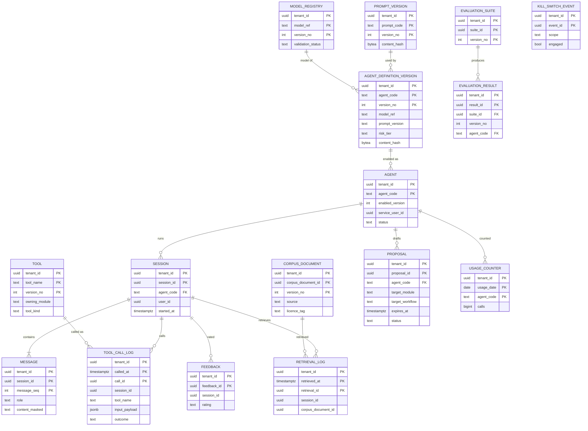

# D17 AI and Decision Intelligence — `ai`

Annex of [DA-001](../../docs/05_data_architecture/DA-001_canonical_enterprise_data_model.md) (canonical enterprise data model), Step 15. Status: **Draft** — same status and approver as DA-001; these annexes carry no ID of their own. Only key columns and a few main columns are shown; the full column list of every table is the data dictionary DBE-001 (Step 17).

**How to read:** every tenant table's key starts with `tenant_id` (shown first, `PK`). `||--o{` = one to zero-or-many, `||--|{` = one to one-or-many, `||--o|` = one to zero-or-one, `|o--o|` = optional link to a row of the same kind. Boxes named `MASTER_…`, `PRODUCT_…` stand for tables in the reference schemas `master` and `product` (foreign keys allowed, DA-001 M4); a link to any other schema is an ID reference and is not drawn as a line.

## Assistants, sessions and governance

## Notes

- Assistant definitions are released by the vendor and copied identically into each tenant (D-73, DM-15). `AGENT.service_user_id` is an ID reference to `identity.app_user` (DM-20). A proposal enters the normal approval of the owning module; it never approves itself (ADR-0008).
- `TOOL_CALL_LOG` and `RETRIEVAL_LOG` are partitioned monthly, so `session_id` there is a plain ID column. Embeddings are in the separate pgvector cluster (ADR-0007), not in this schema.
