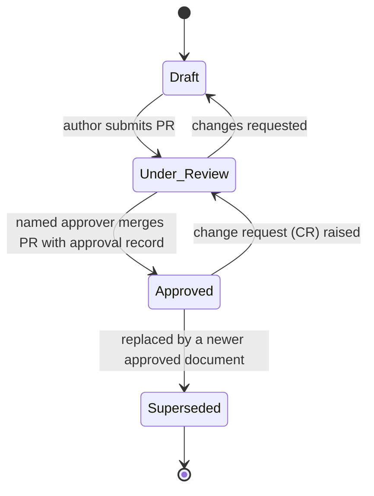

# GOV-001 — Document Control and Identifier Standard

Every document, requirement, domain, table, API, event, rule and test in AMC OS carries a stable unique ID, so any requirement can be traced from business need to release (see [TRACE-001](TRACE-001_traceability_matrix.md)). This standard defines those IDs, the document lifecycle and the current document register.

## 1. Document lifecycle

Rules:

1. A document is **Approved** only when its named approver has approved the pull request that sets `status: Approved`. An AI agent can never set this status (see [GOV-003](GOV-003_ai_assisted_development_policy.md)).
2. An Approved document is never edited in place. Changes go through a Change Request (`CR-nnnn`, [GOV-002 §5](GOV-002_architecture_governance.md#5-change-control-for-approved-specifications)), which bumps the version.
3. Implementation work may depend only on Approved documents. Work that depends on a Draft is marked as such in its PR.
4. Every document starts with the front-matter block shown at the top of this file.

## 2. Document identifiers

Format: `<PREFIX>-<nnn>_<short_name>.md`, stored in the folder shown.

| Prefix | Meaning | Folder |
| --- | --- | --- |
| GOV | Governance, document control, work packages | `docs/00_governance/` |
| TRACE | Traceability matrices | `docs/00_governance/` |
| PS | Product strategy (charter, vision, market) | `docs/01_product_strategy/` |
| BA | Business architecture (capability map, operating model, workflows, roles) | `docs/02_business_architecture/` |
| PRD | Product requirements (master + per-domain) | `docs/03_product_requirements/` |
| EA | Enterprise architecture | `docs/04_enterprise_architecture/` |
| DA | Data architecture (canonical model, lineage, quality) | `docs/05_data_architecture/` |
| DBE | Database engineering (data dictionary, schema standards, partitioning) | `docs/06_database_engineering/` |
| API / INT | API standards / integration specs | `docs/07_api_and_integrations/` |
| FE | Financial engine specifications | `docs/08_financial_engines/` |
| AIML | AI and ML specifications | `docs/09_ai_and_ml/` |
| SEC / REG | Security / regulatory control registry | `docs/10_security_and_regulatory/` |
| INF | Infrastructure and DevOps | `docs/11_infrastructure_and_devops/` |
| QA | Testing and quality | `docs/12_testing_and_quality/` |
| STD | Engineering standards | `docs/13_engineering_standards/` |
| REL / RB | Release governance / runbooks | `docs/14_release_and_operations/` |
| ADR | Architecture decision record (`ADR-nnnn`) | `architecture/adrs/` |
| DDL / MIG / DBT | Reference DDL / migration / database test | `database/ddl`, `database/migrations`, `database/tests` |

## 3. Domain identifiers

The 17 business domains from the master build prompt are fixed IDs. The v0.9 PRD used 15 module numbers; the mapping below is used until WP2 re-keys the PRD by domain.

| Domain ID | Domain | Owning schema(s) | v0.9 PRD source | Gap to close |
| --- | --- | --- | --- | --- |
| D01 | Platform Administration | `platform`, `identity`, `audit` | Common rules C1–C8, Ch 6 | **No dedicated module.** Subscriptions, org hierarchy, environment admin missing (WP2) |
| D02 | Product and Scheme Management | `product` | Module 01 | Regulatory document versioning detail |
| D03 | Investment Management | `investment` | Module 02 | Investment policy management, portfolio strategy |
| D04 | Portfolio Management | `portfolio` | Module 03 | Exposure management, benchmark comparison |
| D05 | Order Management System | `trading` | Module 04 | — |
| D06 | Trading and Execution | `execution` | Module 04 (execution), Module 05 (trade capture) | **Split out** broker management and execution reconciliation (WP2) |
| D07 | Settlement Management | `settlement` | Module 05 | **Split out** settlement calendar and obligations (WP2) |
| D08 | Compliance Management | `compliance` | Module 06 | Breach investigation, corrective actions detail |
| D09 | Risk Management | `risk` | Module 07 | Risk attribution, risk alerts |
| D10 | Fund Accounting | `accounting` | Module 08 | Receivables/payables sub-ledgers |
| D11 | Valuation and NAV | `valuation`, `nav` | Module 09 | Price-source management, NAV reconciliation |
| D12 | Fund Operations | `operations`, `workflow`, `documents` | Module 10 | Operational calendars |
| D13 | Investor Management and Servicing | `investor` | Module 11 | — |
| D14 | Distribution Management | `distribution` | Module 12 | Channel management, sales incentives, segmentation, forecasting |
| D15 | Finance and Management Reporting | `finance` | Module 13 | Expense management, financial planning |
| D16 | Enterprise Data Platform | `analytics` | Module 14 | Data catalogue |
| D17 | AI and Decision Intelligence | `ai` | Module 15, Ch 9 | Dealing assistant, risk assistant, anomaly detection, forecasting |

A domain is never silently omitted: if a domain has no content yet, its PRD section must say so and point to the work package that will fill it.

## 4. Requirement and artefact identifiers

| Artefact | Format | Example | Notes |
| --- | --- | --- | --- |
| Business requirement | `BR-Dxx-nnn` | BR-D11-004 | Why the business needs something |
| Functional requirement | `FR-Dxx-nnn` | FR-D11-012 | Replaces v0.9 `FR-<module>-nn` in WP2 |
| Non-functional requirement | `NFR-<AREA>-nnn` | NFR-PERF-003 | Areas: AVAIL, PERF, SCAL, SEC, PRIV, DR, RET, AUD, OBS, ACC, MAINT |
| User story | `US-Dxx-nnn` | US-D05-002 | |
| Acceptance criterion | `AC-<story>-n` | AC-US-D05-002-1 | Given / When / Then |
| Business rule | `BRL-Dxx-nnn` | BRL-D10-001 | Rules a person approves |
| Workflow | `WF-nnn` | WF-007 (Daily NAV) | v0.9 W1–W17 become WF-001–WF-017 |
| Table | `<schema>.<table>` | `nav.nav_run` | The fully qualified name **is** the ID; never reused after drop |
| API operation | `API-Dxx-nnn` + `METHOD /v1/path` | API-D11-003 `POST /v1/nav-runs/{id}/approve` | One ID per operation |
| Event | `<NAME>.v<n>` | `NAV_APPROVED.v1` | Catalogue in `contracts/events/` |
| Financial engine | `FE-nn` | FE-01 NAV engine | See §5 |
| Regulatory control | `RC-nnnn` | RC-0012 | Registry in `docs/10_security_and_regulatory/` |
| Rule (executable) | `RULE-<code>@v<n>` | RULE-SINGLE_ISSUER_EQUITY@v2 | Lives in `compliance.rule_version` |
| Test case | `TC-<area>-nnn` | TC-NAV-021 | Automated test names include the ID |
| Release | `REL-<yyyy>.<n>` | REL-2027.1 | |
| Change request | `CR-nnnn` | CR-0003 | Changes to Approved documents |
| Capability | `CAP-Dxx-nnn` (level 3: `.m`) | CAP-D04-012.2 | BA-001; owner decision D-13 (20 Nov 2026) |
| Department | `DEP-nn` | DEP-07 | BA-002; owner decision D-13 |
| Dictionary term | `TERM-nnn` | TERM-045 | BA-003; owner decision D-13 |
| Role | `ROLE-nn` | ROLE-11 | BA-005; owner decision D-17 (20 Nov 2026) |

IDs are never reused, even after deletion.

## 5. Financial engine identifiers

| ID | Engine | Primary domain |
| --- | --- | --- |
| FE-01 | NAV engine | D11 |
| FE-02 | Accounting (posting) engine | D10 |
| FE-03 | Portfolio valuation engine | D11 / D04 |
| FE-04 | Compliance rule engine | D08 |
| FE-05 | Risk engine | D09 |
| FE-06 | Settlement engine | D07 |
| FE-07 | Reconciliation engine | D12 |
| FE-08 | Revenue engine | D15 |
| FE-09 | Commission engine | D14 |
| FE-10 | Performance and attribution engine | D04 |

## 6. Labels for facts versus design

Every statement that touches regulation carries one label (carried over from the v0.9 PRD):

- **[REG]** confirmed regulatory requirement, with source.
- **[IND]** industry operational practice, not law.
- **[DES]** our design recommendation.
- **[VAL]** needs legal or compliance validation before it can be built.
- **[ASSUMPTION]** an unverified assumption; must name who can confirm it.

## 7. Document register (as of 19 Nov 2026)

Nothing is Approved yet. v0.9 documents written before this standard are kept as **inputs** and will be split and re-keyed in later work packages.

| ID | Title | Status | WP |
| --- | --- | --- | --- |
| GOV-001 | Document control and identifiers (this) | Draft | WP1 |
| GOV-002 | Architecture governance | Draft | WP1 |
| GOV-003 | AI-assisted development policy | Draft | WP1 |
| GOV-004 | Release gates and operational governance | Draft | WP1 |
| GOV-005 | Work package plan | Draft | WP1 |
| GOV-006 | Gap analysis and step-by-step delivery plan | Draft | WP1 |
| GOV-007 | AI review agent (advisory) | Draft | WP1 |
| GOV-008 | Build loop | Draft | WP1 |
| CR-0001 | Build loop strict auto-merge | Draft | WP1 |
| TRACE-001 | Traceability matrix (structure + seed) | Draft | WP1 |
| PS-001 | Project charter | Draft | WP1 |
| PS-002 | Product vision | Draft | WP2 / Step 1 |
| PS-003 | Market and customer analysis | Draft | WP2 / Step 1 |
| PS-004 | Benchmark capability comparison | Draft | WP2 / Step 1 |
| BA-001 | Business capability map | Draft | WP2 / Step 2 |
| BA-002 | AMC operating model and department hierarchy | Draft | WP2 / Step 3 |
| BA-003 | Domain dictionary (glossary with IDs) | Draft | WP2 / Step 3 |
| BA-004 | End-to-end business workflows (WF-001…WF-043; WF-029/030 cards in PRD-002, WF-031 in PRD-003, WF-032 in PRD-004, WF-033 in PRD-009, WF-034 in PRD-008, WF-035 in PRD-011, WF-036 in PRD-012, WF-037/038 in PRD-013, WF-039 in PRD-014, WF-040 in PRD-015, WF-041/042 in PRD-016, WF-043 in PRD-017) | Draft | WP2 / Step 4 |
| BA-005 | User roles, permissions and segregation of duties | Draft | WP2 / Step 5 |
| PRD-001 | Platform Administration (D01) — product requirements | Draft | WP2 / Step 6 |
| PRD-002 | Product and Scheme Management (D02) — product requirements | Draft | WP2 / Step 6 |
| PRD-003 | Investment Management (D03) — product requirements | Draft | WP2 / Step 7 |
| PRD-004 | Portfolio Management (D04) — product requirements | Draft | WP2 / Step 7 |
| PRD-005 | Order Management System (D05) — product requirements | Draft | WP2 / Step 7 |
| PRD-006 | Trading and Execution (D06) — product requirements | Draft | WP2 / Step 8 |
| PRD-007 | Settlement Management (D07) — product requirements | Draft | WP2 / Step 8 |
| PRD-008 | Compliance Management (D08) — product requirements | Draft | WP2 / Step 8 |
| PRD-009 | Risk Management (D09) — product requirements | Draft | WP2 / Step 8 |
| PRD-010 | Fund Accounting (D10) — product requirements | Draft | WP2 / Step 9 |
| PRD-011 | Valuation and NAV (D11) — product requirements (WF-035 card) | Draft | WP2 / Step 9 |
| PRD-012 | Fund Operations (D12) — product requirements (WF-036 card) | Draft | WP2 / Step 9 |
| PRD-013 | Investor Management and Servicing (D13) — product requirements (WF-037, WF-038 cards) | Draft | WP2 / Step 9 |
| PRD-014 | Distribution Management (D14) — product requirements (WF-039 card) | Draft | WP2 / Step 9 |
| PRD-015 | Finance and Management Reporting (D15) — product requirements (WF-040 card) | Draft | WP2 / Step 9 |
| PRD-016 | Enterprise Data Platform (D16) — product requirements (WF-041, WF-042 cards) | Draft | WP2 / Step 9 |
| PRD-017 | AI and Decision Intelligence (D17) — product requirements (WF-043 card) | Draft | WP2 / Step 9 |
| STD-001 | Coding standards | Draft | WP1 |
| QA-001 | Testing strategy | Draft | WP1 |
| ADR-0001 – ADR-0008 | Foundational architecture decisions | Draft | WP1 |
| PRD-000 | Master PRD v0.9 (input) | Draft — to be re-keyed | WP2 |
| DA-000 | Data and database architecture v0.9 (input) | Draft — to be split | WP4 |
| DDL-000 | Core schema v0.9 (tested on PostgreSQL 16.15) | Draft | WP4 |
| DBT-000 | Integrity and isolation tests v0.9 (24 checks, passing) | Draft | WP4 |
