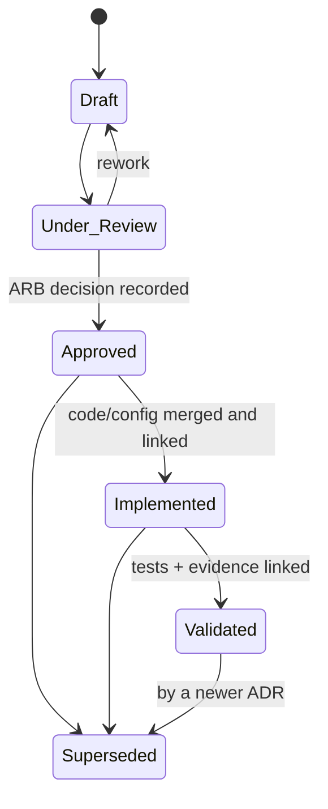

# GOV-002 — Architecture Governance

An Architecture Review Board (ARB) approves every decision that is expensive to reverse: domain boundaries, database design, financial engine specifications, integrations, tenant isolation, security controls and other high-risk choices. Each such decision is written down as an ADR; approved designs change only through a recorded change request.

## 1. Architecture Review Board

| Seat | Role | Vote |
| --- | --- | --- |
| Chair | CTO | Yes; casting vote |
| Members | Chief Enterprise Architect, Principal Software Architect, Data Architect, Cybersecurity Architect, QA Architect | Yes |
| Domain seat (per agenda) | Mutual Fund Domain Architect; for financial engines also the Financial Systems Architect and a Fund Accounting / NAV subject-matter expert | Yes on their items |
| Advisory | Product Manager, DevSecOps lead, Compliance representative for regulatory items | No |

**Quorum:** Chair (or delegate) + 3 voting members, including the Security Architect for any tenant-isolation or security item and the Financial Systems Architect for any financial-engine item.

**Cadence:** weekly during WP1–WP5 (documentation phase); fortnightly afterwards; emergency session within 24 hours for production-impacting decisions.

**Records:** agenda, decisions and dissent are recorded in `architecture/adrs/` (the ADR itself) and a dated minutes file under `docs/00_governance/arb_minutes/`.

> **Current state [ASSUMPTION]:** AMC OS is at founder stage; the people for these seats are not yet named. Until they are, the project owner (Suchit Dubey) acts as sole approver for Draft → Approved, and every such approval is marked `approved_by: project owner (interim)` so it can be re-reviewed when the ARB is staffed.

> **Owner decision D-5 (19 Nov 2026):** paid external experts will review T1 documents (financial engines, compliance rules, NAV/accounting, security, tenant isolation) before the owner approves them. Until then those documents stay Draft.

## 2. What must go to the ARB

| Category | Examples | Needs ADR |
| --- | --- | --- |
| Domain boundaries | Adding, merging or splitting a domain; moving a table between schemas | Yes |
| Database design | New schema, new tenant table pattern, partitioning change, breaking migration | Yes |
| Financial engines | New engine spec or methodology change; precision/rounding change | Yes |
| Integrations | New provider adapter; change to canonical interface | Yes |
| Tenant isolation | Any change to RLS, keys, cell placement, encryption scope | Yes |
| Security controls | AuthN/AuthZ model, key management, network design | Yes |
| Technology | Introducing a technology not in the baseline stack | Yes |
| Service extraction | Moving a module out of the modular monolith | Yes |
| Routine | New API operation inside an approved domain contract style; additive column | No (PR review only) |

## 3. ADR standard

- Location and name: `architecture/adrs/ADR-nnnn_<short-title>.md`, from [ADR-0000 template](../../architecture/adrs/ADR-0000_template.md).
- Lifecycle (from the master build prompt): **Draft → Under Review → Approved → Implemented → Validated → Superseded.**

- Every ADR states context, decision, alternatives considered, consequences, affected domains/documents, and the evidence that will move it to Validated.
- An ADR is never deleted or rewritten after approval; a later ADR supersedes it and both link to each other.

## 4. Review checklist (used by ARB for every item)

1. Is it consistent with the non-negotiable principles (deterministic finance, financial integrity, domain ownership, multi-tenancy, API-first, configuration over customisation)?
2. Does any module write another module's data? (Must be no.)
3. Is tenant context derived from authenticated identity at every layer it touches?
4. Are money amounts NUMERIC/Decimal with stated precision and rounding?
5. Is it reproducible for a past date?
6. Are audit events and maker-checker defined?
7. Are failure modes, retries and idempotency defined?
8. Is it the smallest reliable technology choice?
9. Which tests and evidence will prove it?

## 5. Change control for approved specifications

An Approved document or ADR changes only through a Change Request.

| Field | Content |
| --- | --- |
| CR ID | `CR-nnnn` |
| Documents affected | IDs and versions |
| Change | What changes, exact sections |
| Rationale | Why |
| Impact | Domains, APIs, tables, engines, tests, releases affected (from the traceability matrix) |
| Risk | Financial, security, regulatory, operational |
| Approval | Same approver level as the original document |

Silent changes to approved architecture are a process breach and are reported to the ARB.

## 6. Waivers

A temporary departure from a standard needs a waiver: what, why, compensating control, expiry date (max 90 days), approver. Waivers are listed in `docs/00_governance/waivers.md` and reviewed at every ARB.
