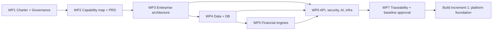

# GOV-005 — Work Package Plan

The seven deliverables of the master build prompt (§22) are produced in seven work packages. Each package ends with a pull request; the next dependent package starts only after that PR is reviewed and its documents are Approved.

## 1. Packages

| WP | Deliverable(s) | Stage | Main outputs | Depends on | Status |
| --- | --- | --- | --- | --- | --- |
| **WP1** | D1 Project Charter; D7 Engineering Governance | A, D | GOV-001–005, TRACE-001, PS-001, STD-001, QA-001, ADR-0001–0008, AGENTS.md, repo structure | — | **In review (this PR)** |
| WP2 | D2 Business Capability Map; D3 Master PRD | A | BA-001 capability map, BA-002 operating model & department hierarchy, BA-003 domain dictionary, BA-004 workflows (WF-001…), BA-005 roles & permissions, PRD-001…PRD-017 (one per domain) re-keyed from PRD-000 | WP1 approved | Not started |
| WP3 | D4 Enterprise System Architecture | B | EA-001 system context, EA-002 layered architecture, EA-003 domain boundaries & service catalogue, EA-004 deployment & cells, EA-005 multi-tenant, EA-006 control plane / data plane, EA-007 event architecture + `contracts/events/`, INT-001 integration architecture | WP2 | Not started |
| WP4 | D5 Enterprise Data & Database Architecture | C | DA-001 canonical model, ERDs in `architecture/erds/`, DBE-001 data dictionary (sensitivity, retention, example rows), DBE-002 DB standards, Alembic migrations reproducing DDL-000 + gaps, DBT referential-integrity tests | WP3 | Not started (v0.9 inputs exist) |
| WP5 | D6 Financial Engine Specifications | D | FE-01…FE-10 using the 15-point template; financial control framework | WP4 | Not started |
| WP6 | Remaining Stage D | D | API-001 API standards + first OpenAPI contracts, SEC-001 security architecture, SEC-002 threat model, REG-001 regulatory control registry, AIML-001 AI architecture, INF-001 infrastructure, CI/CD strategy, runbooks | WP3–WP5 | Not started |
| WP7 | Stage E | E | TRACE-002 full traceability matrix; consistency review; baseline approval for G0–G2 of the first build increment | WP2–WP6 | Not started |

Only after WP7 is approved does production application coding begin (master prompt §22–23). Exploratory spikes are allowed earlier only if labelled as such and kept out of `src/`.

## 2. Use of the v0.9 drafts

The v0.9 PRD (PRD-000), data/database architecture (DA-000), reference DDL (DDL-000) and tests (DBT-000) were written before this programme. They are **inputs**, not approved baselines. WP2 and WP4 split them into per-domain documents, re-key IDs to GOV-001 and close the gaps listed in GOV-001 §3. A partially written Claude Doc "Enterprise Architecture & Financial Engine Specifications" (gap check + layered architecture sections) is also an input to WP3.

## 3. Review checklist for every work package PR

1. Every document has front matter, an ID and an owner.
2. All IDs follow GOV-001; no duplicates.
3. Every domain D01–D17 touched is named; none silently dropped.
4. Regulatory statements labelled [REG]/[IND]/[DES]/[VAL]/[ASSUMPTION] with sources.
5. No invented provider interfaces.
6. Cross-references resolve.
7. Open decisions listed at the end of the PR.
