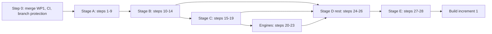

# GOV-006 — Gap Analysis and Step-by-Step Delivery Plan

The master build prompt's governance sections (§15–§18, §20) are now fully written down, but most of the specification work (§4–§14 and Deliverables 2–6 of §22) is still open or exists only as unsplit v0.9 drafts. This document lists every gap by brief section and turns them into 28 small, reviewable steps.

## 1. Repository state (updated 19 Nov 2026, 23:35 IST)

| Branch | Content | Merged to `main`? |
| --- | --- | --- |
| `main` | v0.9 inputs + WP1 (charter, governance, ADRs, folder structure) + Step 0 CI | — |
| Unmerged chain | Step 1 and its review fixes, GOV-007 reviewer, GOV-008 build loop | No — live list and merge order in [LOOP_STATE.md](../../LOOP_STATE.md) |

**Gap 0 (remaining):** branch protection on `main` is not yet switched on (owner action), so nothing yet *forces* the checks in GOV-003 before a merge. CI now runs documentation checks and database tests (Step 0).

## 2. Gap analysis by brief section

Status key: ✅ covered · 🟡 partly covered (v0.9 draft or principle only) · ❌ not started.

| § | Brief section | Status | What exists | Gaps |
| --- | --- | --- | --- | --- |
| 1 | Role | n/a | — | — |
| 2 | Product vision, objectives, benchmarks | 🟡 | PS-001 charter (vision, 10 objectives, customers) | Standalone vision doc (Stage A-2); market and customer analysis (A-3); benchmark capability comparison (SimCorp, Aladdin, Charles River, Murex) not in repo |
| 3.1–3.5 | Non-negotiable principles | ✅ | AGENTS.md, ADR-0002/3/5/8, STD-001 | — |
| 3.6 | Configuration over customisation | ❌ | Principle only | No design for the governed configuration system (what is configurable, versioning, approval, per-tenant overrides) |
| 4 | 17 business domains | 🟡 | PRD-000 covers 15 modules in depth | D01 Platform Administration has no module; D06/D07 not split; ~25 capabilities missing (list in GOV-001 §3, e.g. subscriptions, org hierarchy, environment admin, investment policy management, exposure management, risk attribution, receivables/payables, price-source management, NAV reconciliation, operational calendars, channel management, sales incentives, segmentation, sales forecasting, expense management, data catalogue, dealing assistant, anomaly detection); requirement IDs not re-keyed to domains |
| 5 L1 | Experience (React, 12 workspaces) | ❌ | STD-001 §6 rules only | No workspace specs, navigation, dashboard configuration model, design system |
| 5 L2 | Identity & API management | 🟡 | PRD Ch 6 roles, ADR-0003 | No identity design (Keycloak vs customer IdP, token claims, ABAC policy model, rate limits per tenant) |
| 5 L3 | Domain services | 🟡 | ADR-0002, DA-000 Ch 2 schema ownership | No service catalogue doc (responsibilities, APIs, events, dependencies per service) |
| 5 L4 | Workflow & events | 🟡 | ADR-0006 | **No event catalogue** (the 12 example events and the rest); no Temporal workflow designs; DLQ/retry/compensation policy |
| 5 L5 | Financial engines | ❌ | Engine behaviour scattered in PRD modules | **No engine specs** (FE-01…FE-10) |
| 5 L6 | Enterprise data | 🟡 | ADR-0007, DA-000 Ch 1, 8, 9 | Orchestrator choice (Airflow vs Dagster) open |
| 5 L7 | AI platform | 🟡 | PRD Ch 9, ADR-0008 | Model registry, prompt versioning, model monitoring, evaluation framework design |
| 6 | Hybrid deployment & cells | 🟡 | ADR-0003 (decision level) | Cell capacity, tenant placement, tenant migration between cells, cell upgrades, cell DR, resource limits per tenant, release compatibility, control-plane design; no `platform.cell` table |
| 7 | Data architecture & DB engineering | 🟡 | DA-000; DDL-000 (67 tables + 19 partitions, RLS, triggers); DBT-000 (24 checks pass) | `risk` and `finance` schemas have **no tables**; missing tables for ~30 entities (e.g., subscriptions, org units, configuration, research notes, IC meetings, model portfolios, brokers/counterparties, SSIs, corporate actions, accrual runs, posting rules, unit lots, nominees, bank mandates, joint holders, service requests, complaints, risk runs, budgets, allocations); **no source-system IDs or external identifier crosswalk**; data dictionary lacks **retention, sensitivity, example records**; no Alembic migrations; few referential-integrity tests; lineage spec |
| 8 | Financial engine specs + control framework | ❌ | — | All 10 engines × 15 points; financial control framework (8 controls) as a document with how each is enforced |
| 9 | Regulatory Control Registry | 🟡 | PRD-000 Appendix A (15 entries, 11 fields); `compliance.regulation` table | 6 of the 14 required fields missing (applicable entity, scheme/activity, business interpretation, required control, implemented rule + version, test case, responsible owner); change-management process (AI proposes, human converts); clause-level mapping of MF Regulations 2026 and Master Circular not started |
| 10 | External integrations | 🟡 | PRD-000 Ch 8 (15 providers) | Missing fields: approved interface, retry logic, idempotency, monitoring, operational ownership; canonical data interface and adapter design; "regulatory information sources" adapter |
| 11 | AI & ML governance | 🟡 | PRD-000 Ch 9 (11 agents) | Agent fields missing (input/output schema, model version, evaluation suite); brief adds Dealing assistant and Risk assistant; RAG source metadata spec; **10 ML use cases and model governance not specified** |
| 12 | Security architecture | ❌ | Controls listed in PRD-000 Ch 7 | Security architecture doc; **formal threat model**; mapping to ISO 27001, SOC 2, OWASP ASVS, NIST CSF; incident response; privileged access; key management design |
| 13 | Technology stack | 🟡 | ADR-0004/5/6/7 | ADRs still needed: identity provider, Redis, orchestrator, LangGraph, containers/Kubernetes, Terraform, observability, CI/CD, cloud provider and region |
| 14 | Repo structure & Stages A–E | 🟡 | Structure ✅; Stage A: 1/10 drafted (Step 1, in review), none approved; B 0/10, C 0/14 as split docs, D 2/12 (testing, release governance), E structure only | See plan below |
| 15 | Architecture governance | ✅ | GOV-002 | ARB members not named (interim approver) |
| 16 | Engineering standards | ✅ | STD-001, QA-001 | Service README template; CI enforcement not built |
| 17 | AI-assisted development | ✅ | GOV-003 | Enforcement needs branch protection + CI |
| 18 | Release governance | ✅ | GOV-004 | — |
| 19 | 24-month roadmap | 🟡 | Adopted in PS-001 | Month-by-month plan with build increments and dependencies |
| 20 | Execution protocol | ✅ | AGENTS.md | — |
| 21 | Quality principles | ✅ | AGENTS.md, QA-001 | — |
| 22 | Deliverables 1–7 | 🟡 | D1 ✅, D7 ✅; D3, D5 v0.9 drafts | D2, D4, D6 not started; D3, D5 need splitting and gap closure |
| 23 | Final directive | n/a | — | — |

### Consistency problems found inside the v0.9 drafts

1. PRD-000 uses `FR-<module>-nn` and W1–W17; GOV-001 requires `FR-Dxx-nnn` and WF-nnn.
2. PRD-000 roadmap is 30 months / 10 phases; PS-001 adopts the brief's 24 months.
3. DA-000 leaves "ClickHouse or Snowflake-class", "Flyway or Sqitch" open; ADR-0004/0007 now decide ClickHouse and Alembic.
4. DA-000 ER diagrams show risk and investor child tables that DDL-000 does not create yet.
5. PRD-000 Chapter 9 lists 11 agents; the brief lists 12 including Dealing assistant and Risk assistant, and has no "Portfolio agent" / "Product intelligence agent".

## 3. Step-by-step delivery plan

One step = one pull request, sized to review in about an hour. A step starts only when the steps it depends on are merged.

| Step | Content | Brief § | Depends on |
| --- | --- | --- | --- |
| **0** 🟡 partly done 19 Nov 2026 (WP1 merged, CI added; branch protection pending, owner action) | You merge WP1; switch on branch protection; add CI: DDL + DBT tests on PostgreSQL, Markdown link check, ID-uniqueness check, front-matter check | 15–17 | — |
| **Stage A — business** | | | |
| 1 ✅ merged to `main` 20 Nov 2026 (Draft, not Approved) | PS-002 product vision; PS-003 market & customer analysis with sourced figures; benchmark capability comparison | 2, 14-A | 0 |
| 2 ✅ merged to `main` 20 Nov 2026 (Draft, not Approved) | BA-001 business capability map (all 17 domains, level 1–3 capabilities) | 4, 22-D2 | 0 |
| 3 ✅ merged to `main` 20 Nov 2026 (Draft, not Approved) | BA-002 AMC operating model & department hierarchy; BA-003 domain dictionary (glossary with IDs) | 14-A | 2 |
| 4 ✅ merged to `main` 20 Nov 2026 by the build loop (CR-0001; Draft, not Approved) | BA-004 end-to-end workflows WF-001…WF-0nn (re-keyed + new ones for D01, D06, D07) | 14-A | 2 |
| 5 ✅ merged to `main` 20 Nov 2026 by the build loop (CR-0001; Draft, not Approved) | BA-005 roles & permissions (re-keyed; SoD rules) | 14-A | 3 |
| 6 🔄 in review (branch `wp2-step06-prd-platform-product`) | PRD-001 Platform Administration (new) + PRD-002 Product | 4 | 2–5 |
| 7 | PRD-003 Investment, PRD-004 Portfolio, PRD-005 OMS | 4 | 6 |
| 8 | PRD-006 Trading & Execution, PRD-007 Settlement (split), PRD-008 Compliance, PRD-009 Risk | 4 | 6 |
| 9 | PRD-010 Accounting, PRD-011 Valuation & NAV, PRD-012 Fund Ops, PRD-013 Investor, PRD-014 Distribution, PRD-015 Finance, PRD-016 Data, PRD-017 AI; PRD-000 marked Superseded | 4 | 6 |
| **Stage B — architecture** | | | |
| 10 | EA-001 system context; EA-002 layered architecture incl. 12 frontend workspaces; ADRs for identity provider, Redis, cloud/region | 5, 13 | Stage A |
| 11 | EA-003 domain boundaries & service catalogue; configuration-over-customisation design | 3.6, 5 | 10 |
| 12 | EA-004 deployment & cell architecture; EA-005 multi-tenant; EA-006 control plane / data plane | 6 | 10 |
| 13 | EA-007 event architecture + `contracts/events/` catalogue (all events, v1 schemas); Temporal workflow designs | 5 L4 | 11 |
| 14 | INT-001 integration architecture + one spec per provider with all 14 fields (confirmed facts only) | 10 | 11 |
| **Stage C — data and database** | | | |
| 15 | DA-001 canonical enterprise data model; ERDs per domain in `architecture/erds/` | 7 | Stage B |
| 16 | DDL additions: missing ~30 tables, `risk` and `finance` schemas, external-ID crosswalk, source-system IDs, `platform.cell`, regulatory control registry fields; tests extended | 7, 9 | 15 |
| 17 | DBE-001 data dictionary for every table (incl. retention, sensitivity, example records) | 7 | 16 |
| 18 | Alembic migrations reproducing the DDL (schema-diff check in CI); referential-integrity test suite; seeds | 7, 13 | 16 |
| 19 | DA-002 ingestion, lineage, data quality; DBE-002 partition, index and capacity strategy | 7 | 16 |
| **Stage D — engines** | | | |
| 20 | Financial control framework; FE spec template; FE-01 NAV, FE-03 valuation | 8 | Stage C |
| 21 | FE-02 accounting, FE-04 compliance | 8 | 20 |
| 22 | FE-05 risk, FE-06 settlement, FE-07 reconciliation | 8 | 20 |
| 23 | FE-08 revenue, FE-09 commission, FE-10 performance | 8 | 20 |
| **Stage D — remaining specs** | | | |
| 24 | API-001 API standards; first OpenAPI contracts (platform, product, NAV) | 5, 14-D | 13, 16 |
| 25 | SEC-001 security architecture, SEC-002 threat model, framework mapping; REG-001 regulatory control registry (14 fields, seeded) + change process | 9, 12 | Stage B |
| 26 | AIML-001 AI platform & 12 agents; AIML-002 ML use cases & model governance; INF-001 infrastructure + CI/CD; production runbooks | 11, 13, 14-D | Stage B, C |
| **Stage E** | | | |
| 27 | TRACE-002 full traceability matrix; cross-document consistency review | 14-E | 1–26 |
| 28 | Baseline approval; build-increment-1 plan (platform foundation) with G0–G2 evidence | 19, 22 | 27 |

Indicative pace (assumption, depends on review time): 2–3 steps a week → Stage A–E in about 10–14 weeks, inside the brief's months 1–3 window.

## 4. Decisions and open questions

### Decided by the project owner (19 Nov 2026)

| # | Question | Decision | Effect on plan |
| --- | --- | --- | --- |
| Q1 | Commercial target | **Pilot first:** design capacity 50 AMCs; commercial target 1 pilot AMC, then 3–5 | PS-001 §5.3 adopted; Step 1 market analysis sized accordingly |
| Q2 | Investor book | **Mirror the RTA:** CAMS/KFin remain record keepers; AMC OS holds a synced copy for servicing, analytics and reconciliation | PRD-013 (Step 9) and investor tables (Step 16) specified for mode A only; mode B out of scope |
| Q3 | Reviewers | **Project owner alone** as interim approver | Every approval recorded as `approved_by: project owner (interim)` (GOV-002 §1) |
| Q4 | First build increment | **Platform foundation** (tenants, identity, roles, audit, master data, CI) | Step 28 plans increment 1 as platform foundation, as in brief months 4–6 |

### Still open (defaults apply until answered)

| # | Question | Default |
| --- | --- | --- |
| Q5 | Cloud and region | Cloud-neutral documents; AWS India regions used as the reference design |
| Q6 | Identity provider | Customer's own IdP via OIDC; Keycloak for shared SaaS tenants without one |
| Q7 | Pace and PR size | One step per PR |
