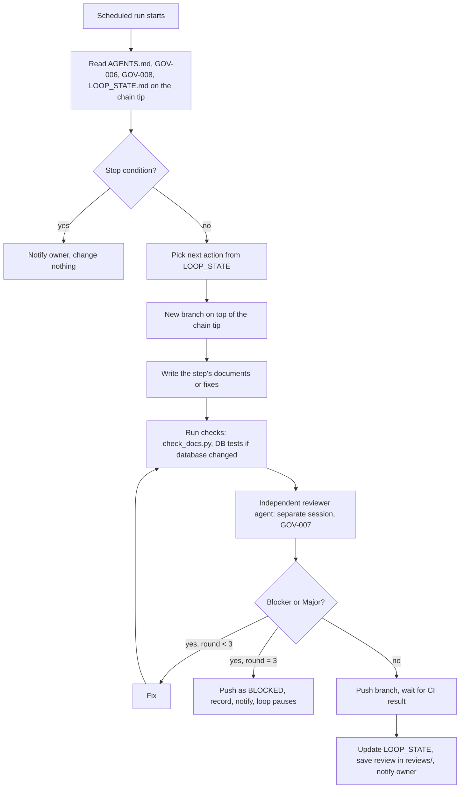

# GOV-008 — Build Loop

A scheduled task runs a fresh AI session every few hours. Each run does exactly one step from the GOV-006 plan: write, get an independent review, fix, test, push a branch, and report. The project owner merges the branches in order. Decisions recorded 19 Nov 2026 (project owner): stack steps, scheduled one step per run, fix and re-review up to 3 rounds, log business gaps and continue.

## 1. One run

## 2. Rules

1. **One step per run.** Never start a second step in the same run.
2. **Stacking.** Each new branch starts from the current chain tip (the newest unmerged branch, or `main` if all are merged). Branch name: `wp<n>-step<NN>-<topic>`; fix rounds for an already-pushed step use `wp<n>-step<NN>b-review-fixes`.
3. **Builds on Draft.** Steps may build on Draft documents from earlier steps (amends GOV-005 §1 for the documentation phase). Approval of documents is still the owner's, and no production code starts before WP7 approval.
4. **Independent review.** The reviewer runs as a separate agent that did not write the change, using `.claude/agents/amc-os-reviewer.md`. Its full output is saved as `reviews/STEP-<NN>_round<k>.md` in the same branch.
5. **Fix rounds.** Blocker or Major → fix and re-review, at most 3 rounds per run. Still failing after round 3 → push the branch with `BLOCKED` in `LOOP_STATE.md`, notify, and pause the loop.
6. **Business gaps.** A fact or rule only the owner can give is written as `[ASSUMPTION]` or `[VAL]` with an open question, added to the "Questions for owner" list in `LOOP_STATE.md`, and the run continues.
7. **Honest reporting.** Only checks actually run are reported as passed. CI status is read from GitHub after push.
8. **Never:** merge, approve, push to `main`, force-push someone else's branch, change a document to Approved, or touch secrets.

## 3. Stop conditions (the run notifies and changes nothing)

| Condition | Why |
| --- | --- |
| `LOOP_STATE.md` says `PAUSED` or `BLOCKED` | Owner must act |
| More than 6 unmerged branches in the chain | Limits rework if the owner changes an early step |
| Last step (28) done | Programme finished; owner approval for WP7 needed |
| CI failed on the chain tip and was not fixed | Never build on a red branch |
| Repository cannot be reached or pushed | Report the error |

The owner restarts a paused loop by editing `LOOP_STATE.md` (Status: RUNNING) on the tip branch, or by asking in chat.

## 4. Notification content

Step done, branch name and pull-request link, CI result, reviewer verdict and finding counts, new questions for the owner, and the next step.
