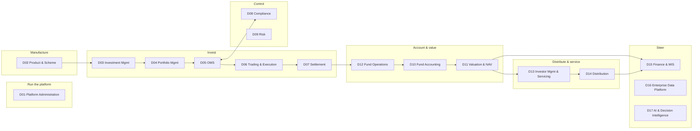

# BA-001 — Business Capability Map

This map lists everything an Indian mutual fund AMC needs AMC OS to do, in three levels: the 17 business domains (level 1), the capabilities the master build prompt names for each domain (level 2), and the smaller pieces each capability breaks into (level 3). Every later document — workflows, roles, per-domain PRDs, services, tables and tests — hangs off the IDs defined here.

**Builds on Draft documents:** GOV-001, GOV-006, PS-001, PRD-000 v0.9 and DA-000 v0.9 — allowed by owner decision D-3 ([GOV-008 §2](../00_governance/GOV-008_build_loop.md#2-rules), rule 3). No document used here is Approved yet.

**What this document is not:** it does not define departments or the operating model (BA-002, Step 3), workflows (BA-004, Step 4), roles and permissions (BA-005, Step 5) or detailed requirements (PRD-001…PRD-017, Steps 6–9). It adds no new regulatory facts. Where a capability touches regulation, the PRD-000 requirement it cites holds the [REG] / [VAL] label and stays the place to check it; the Notes column repeats a label only where it changes what the capability must do. Two parts of brief §22 Deliverable 2 are not covered here: responsibilities per department go to BA-002 (Step 3) and BA-005 (Step 5); which current systems each capability replaces is not yet in any GOV-006 step (§5 C7).

## 1. How to read the map

| Level | What it is | Source | ID format |
| --- | --- | --- | --- |
| L1 | Business domain | Master build prompt §4; IDs from [GOV-001 §3](../00_governance/GOV-001_document_control_and_identifiers.md#3-domain-identifiers) | `D01`…`D17` |
| L2 | Capability | Master build prompt §4, the bullet list under each domain — **wording kept as in the brief**, one row per bullet, none dropped | `CAP-Dxx-nnn` (e.g. `CAP-D11-010` NAV calculations) |
| L3 | Sub-capability | **[DES]** — our breakdown, taken from the PRD-000 v0.9 functional requirements where they exist, otherwise proposed here | `CAP-Dxx-nnn.m` = the m-th item in the L3 cell, written `(.m)` |

Column "v0.9 source" points to the PRD-000 requirement(s) — or, for platform plumbing with no PRD-000 module, the DA-000 schema — that already describe the capability. "**new**" means neither v0.9 document describes it; those are the gaps the per-domain PRDs (Steps 6–9) must fill. Column "Notes" gives the financial engine (FE-nn, [GOV-001 §5](../00_governance/GOV-001_document_control_and_identifiers.md#5-financial-engine-identifiers)), the owner when a capability is shared with another domain (§4), and any boundary from the charter.

**Capability ID format.** `CAP-Dxx-nnn` is not yet in the GOV-001 §4 identifier table. It is proposed here **[DES]** and used in this document; adding it to GOV-001 is an owner decision (Q12 in [LOOP_STATE.md](../../LOOP_STATE.md)). IDs are never reused, as for every other GOV-001 identifier.

Two rules apply to every capability and are not repeated in the rows:

1. **Deterministic numbers.** Any capability that produces an official number (NAV, valuation, accounting, AUM, unit balances, revenue, accruals, risk, compliance results, settlement, reconciliation, commission) does so through a deterministic engine (master prompt §3.1). AI capabilities in D17 read, explain and propose only (PRD-000 C8).
2. **Common rules C1–C8 of PRD-000 Chapter 3** (tenancy, audit, maker-checker, effective dating, decimal money, APIs, idempotency, AI boundary) apply to every L3 capability.

## 2. Overview

The six value streams are taken from PRD-000 §2.1 and mapped to the 17 domains; "Run the platform" is added for D01, which PRD-000 has no module for **[DES]**.

Arrows show the main business hand-offs (PRD-000 §2.5), not system calls. D01, D16 and D17 serve every domain; those links are left out to keep the picture readable.

| Domain | Value stream | Owning schema(s) (GOV-001 §3) | Engines | L2 capabilities | L2 with a v0.9 source | L2 new |
| --- | --- | --- | --- | --- | --- | --- |
| D01 Platform Administration | Run the platform | `platform`, `identity`, `audit` | — | 11 | 8 | 3 |
| D02 Product and Scheme Management | Manufacture | `product` | — | 11 | 11 | 0 |
| D03 Investment Management | Invest | `investment` | — | 10 | 8 | 2 |
| D04 Portfolio Management | Invest | `portfolio` | FE-10 | 11 | 9 | 2 |
| D05 Order Management System | Invest | `trading` | (calls FE-04) | 12 | 12 | 0 |
| D06 Trading and Execution | Invest | `execution` | — | 8 | 8 | 0 |
| D07 Settlement Management | Invest | `settlement` | FE-06 | 8 | 6 | 2 |
| D08 Compliance Management | Control | `compliance` | FE-04 | 13 | 12 | 1 |
| D09 Risk Management | Control | `risk` | FE-05 | 13 | 11 | 2 |
| D10 Fund Accounting | Account & value | `accounting` | FE-02 | 13 | 11 | 2 |
| D11 Valuation and NAV | Account & value | `valuation`, `nav` | FE-01, FE-03 | 15 | 14 | 1 |
| D12 Fund Operations | Account & value | `operations`, `workflow`, `documents` | FE-07 | 11 | 10 | 1 |
| D13 Investor Management and Servicing | Distribute & service | `investor` | — | 16 | 16 | 0 |
| D14 Distribution Management | Distribute & service | `distribution` | FE-09 | 16 | 12 | 4 |
| D15 Finance and Management Reporting | Steer | `finance` | FE-08 | 11 | 9 | 2 |
| D16 Enterprise Data Platform | Steer | `analytics` (+ `master`, see §5 C2) | — | 13 | 12 | 1 |
| D17 AI and Decision Intelligence | Steer | `ai` | — | 17 | 14 | 3 |
| **Total** | | | | **209** | **183** | **26** |

## 3. The capability map

### D01 — Platform Administration

Owning schemas: `platform`, `identity`, `audit`. PRD-000 has no module for this domain (GOV-001 §3 gap); sources are the common rules C1–C8, Chapter 6 (roles) and the DA-000 schema list.

| ID | Capability (L2) | Level-3 capabilities | v0.9 source | Notes |
| --- | --- | --- | --- | --- |
| CAP-D01-001 | Tenant management | (.1) tenant onboarding and offboarding; (.2) tenant profile and isolation tier (shared or dedicated); (.3) tenant settings and feature flags; (.4) tenant data export on exit | C1; DA-000 `platform` | Deployment detail in EA-004/EA-005 (Step 12) |
| CAP-D01-002 | User management | (.1) joiner, mover, leaver lifecycle; (.2) user sync from the customer's identity provider; (.3) periodic access recertification; (.4) service and API client accounts | Ch 6 | |
| CAP-D01-003 | Identity | (.1) single sign-on; (.2) multi-factor authentication policy; (.3) session management; (.4) tenant context taken from the authenticated identity only | Ch 6; C1 | Identity provider choice open (GOV-006 Q6) |
| CAP-D01-004 | Role-based access | (.1) role catalogue (18 business roles + 2 platform roles, PRD-000 §2.3); (.2) role assignment with scope (scheme, desk, region); (.3) segregation-of-duties rules | Ch 6; C3 | Full role design in BA-005 (Step 5) |
| CAP-D01-005 | Permission management | (.1) permission per API operation; (.2) attribute-based scope rules; (.3) data masking by role (e.g. investor personal data); (.4) emergency (break-glass) access with approval and audit | Ch 6 | |
| CAP-D01-006 | Subscription management | (.1) the AMC's plan and module entitlements; (.2) usage metering; (.3) plan changes and renewals | **new** | **[ASSUMPTION]** means the AMC's subscription to AMC OS (DA-000 `platform` holds "plans"), not investor subscriptions — confirm with project owner (Q13) |
| CAP-D01-007 | Organization hierarchy | (.1) legal entities: sponsor, trust, AMC, trustee board; (.2) departments and cost centres; (.3) branches, regions and zones; (.4) effective-dated reporting lines | **new** | D14 maps distributors and RMs onto these branches (CAP-D14-005); departments themselves are defined in BA-002 (Step 3) |
| CAP-D01-008 | Configuration management | (.1) catalogue of what each tenant may configure; (.2) versioned, effective-dated configuration with maker-checker; (.3) promotion of configuration between environments; (.4) configuration audit and difference view | C4 (principle only) | Brief §3.6; design in EA-003 (Step 11) |
| CAP-D01-009 | System administration | (.1) business calendars and holidays (master); (.2) scheduled jobs and batch windows; (.3) notification channel set-up; (.4) reference code lists | DA-000 `platform` | Operational use of calendars is CAP-D12-001 |
| CAP-D01-010 | Audit management | (.1) append-only audit events for every change, approval, export and login; (.2) tamper evidence (hash chain); (.3) audit search and export for auditors; (.4) access logs | C2; DA-000 `audit` | |
| CAP-D01-011 | Environment administration | (.1) environment register per tenant (development, test, UAT, production); (.2) release version per tenant and cell; (.3) maintenance windows; (.4) rules for refreshing non-production data | **new** | Cell and release design in EA-004 (Step 12) and INF-001 (Step 26) |

### D02 — Product and Scheme Management

Owning schema: `product`. Source: PRD-000 Module 01.

| ID | Capability (L2) | Level-3 capabilities | v0.9 source | Notes |
| --- | --- | --- | --- | --- |
| CAP-D02-001 | Scheme master | (.1) scheme identity and codes (AMFI code, ISINs); (.2) key parties (fund managers, custodian, RTA, auditor, trustee reference); (.3) effective-dated fund-manager assignment | FR-01-01 | |
| CAP-D02-002 | Scheme categories | (.1) governed category list mirroring the SEBI categorisation in force; (.2) default rule pack per category; (.3) category-change handling | FR-01-02; BR-01-4 | Labels carried from PRD-000: FR-01-02 [REG], BR-01-4 [VAL] |
| CAP-D02-003 | Plan and option management | (.1) direct and regular plans; (.2) growth and IDCW options; (.3) ISIN, NAV series and TER per plan/option | FR-01-03 | |
| CAP-D02-004 | SID, SAI and KIM document management | (.1) versioned documents linked to the scheme version they describe; (.2) addenda; (.3) filing and observation dates; (.4) website publication; (.5) product disclosure feeds (factsheet, riskometer, portfolio, TER) | FR-01-06; FR-01-13 | Files stored by the document service (CAP-D12-010) |
| CAP-D02-005 | NFO lifecycle | (.1) NFO calendar and offer period; (.2) collection tracking from the RTA; (.3) minimum-subscription check and refund; (.4) allotment and reopening | FR-01-05 | Allotment itself is done by the RTA (PS-001 boundary) |
| CAP-D02-006 | Scheme configuration | (.1) investment minimums and SIP/STP/SWP rules; (.2) exit-load slabs and lock-in; (.3) cut-off times and settlement cycle; (.4) TER schedule; (.5) investment mandate (asset-allocation ranges, permitted instruments) | FR-01-04; FR-01-07 | Mandate is compiled into D08 rules |
| CAP-D02-007 | Benchmark mapping | (.1) primary and additional benchmarks; (.2) TRI variant; (.3) effective dates and data source | FR-01-08 | Index data is master data (CAP-D16-004) |
| CAP-D02-008 | Scheme approvals | (.1) maker-checker by Head of Products and Compliance; (.2) trustee approval evidence | Module 01 point 13 | |
| CAP-D02-009 | Product lifecycle | (.1) lifecycle states from DRAFT to WOUND_UP / MATURED; (.2) suspension of subscriptions; (.3) merger, winding-up and maturity | FR-01-09 | |
| CAP-D02-010 | Scheme changes | (.1) fundamental vs non-fundamental classification; (.2) investor exit-window scheduling; (.3) new scheme version on the effective date | FR-01-10 | FR-01-10 carries [REG] and [VAL] (exit window) |
| CAP-D02-011 | Regulatory document versioning | (.1) difference view between document versions; (.2) link of each version to its approval; (.3) retention of every version | FR-01-06; Module 01 point 15 | GOV-001 §3 gap: "regulatory document versioning detail" |

PRD-000 FR-01-11 (product performance) and FR-01-12 (product profitability) are views over CAP-D04-009 and CAP-D15-005; they are not separate capabilities.

### D03 — Investment Management

Owning schema: `investment`. Source: PRD-000 Module 02.

| ID | Capability (L2) | Level-3 capabilities | v0.9 source | Notes |
| --- | --- | --- | --- | --- |
| CAP-D03-001 | Investment research | (.1) coverage list by analyst; (.2) structured investment thesis; (.3) valuation model and target price or yield | FR-02-05 | |
| CAP-D03-002 | Research documents | (.1) notes, models, management-meeting notes; (.2) broker research references (licence-aware); (.3) search | FR-02-08 | |
| CAP-D03-003 | Security analysis | (.1) security and issuer views; (.2) credit analysis of debt issuers; (.3) peer comparison | FR-02-01; FR-02-02 | Security and issuer golden records are owned by CAP-D16-004 (§5 C2) |
| CAP-D03-004 | Investment recommendations | (.1) Buy / Add / Hold / Reduce / Sell with target, horizon and conviction; (.2) version history; (.3) hit-rate tracking; (.4) analyst-to-fund-manager suggestions | FR-02-06; FR-02-09 | |
| CAP-D03-005 | Investment committee workflows | (.1) agenda and papers; (.2) quorum and conflict-of-interest declarations; (.3) votes and minutes; (.4) action items | FR-02-07 | |
| CAP-D03-006 | Investment decisions | (.1) decision record with fund-manager rationale; (.2) link decision → order → trade | FR-02-10 | FR-02-10 carries [REG] / [VAL] |
| CAP-D03-007 | Research approval | (.1) maker-checker before research is published; (.2) approval of universe additions; (.3) debt-issuer credit approval and review expiry | FR-02-03; BR-02-3 | |
| CAP-D03-008 | Portfolio strategy | (.1) house view and strategy per scheme; (.2) strategy targets handed to D04 | **new** | GOV-001 §3 gap |
| CAP-D03-009 | Investment policy management | (.1) investment policy per scheme and house; (.2) approved universe per scheme; (.3) restricted and watch lists; (.4) internal limits proposed to D08 | FR-02-03; FR-02-04 | Policy documents themselves are new (GOV-001 §3 gap). Restricted-list entries are owned by Compliance (FR-02-04) |
| CAP-D03-010 | Research intelligence | (.1) AI research summaries (via CAP-D17-002); (.2) news and filing alerts for covered names; (.3) research usage analytics | **new** (Module 02 point 16 lists AI only) | |

### D04 — Portfolio Management

Owning schema: `portfolio`. Source: PRD-000 Module 03.

| ID | Capability (L2) | Level-3 capabilities | v0.9 source | Notes |
| --- | --- | --- | --- | --- |
| CAP-D04-001 | Portfolio master | (.1) one portfolio per scheme; (.2) sub-portfolios (side pocket, segregated portfolio, derivative sleeve) | FR-03-01 | |
| CAP-D04-002 | Portfolio holdings | (.1) holdings book with lots and cost; (.2) traded vs settled quantities; (.3) intraday position updated on every fill; (.4) cash position and cash ladder (T to T+n) | FR-03-02; FR-03-03; FR-03-08 | |
| CAP-D04-003 | Asset allocation | (.1) target ranges by asset class from the mandate; (.2) actual vs target drift | FR-03-04 | Mandate from CAP-D02-006 |
| CAP-D04-004 | Security allocation | (.1) target weights by security and sector; (.2) drift by security | FR-03-04 | |
| CAP-D04-005 | Portfolio construction | (.1) model portfolios; (.2) construction within constraints by a deterministic optimiser (not AI); (.3) what-if simulation | FR-03-05; FR-03-06; FR-03-07; FR-03-11 | |
| CAP-D04-006 | Rebalancing | (.1) rebalance proposals; (.2) fund-manager acceptance; (.3) hand-off of accepted proposals to OMS as orders | FR-03-06 | Orders then follow D05 approvals |
| CAP-D04-007 | Exposure management | (.1) exposure by sector, issuer, group, rating and asset class; (.2) gross and net exposure including derivatives; (.3) exposure vs internal targets | **new** | GOV-001 §3 gap. Limits are D08 (CAP-D08-005); risk measures are D09 (CAP-D09-006) |
| CAP-D04-008 | Benchmark comparison | (.1) active weights vs benchmark; (.2) relative return vs benchmark | **new** | GOV-001 §3 gap. Benchmark constituents from CAP-D16-004 |
| CAP-D04-009 | Performance attribution | (.1) return calculation; (.2) equity attribution (allocation, selection, interaction); (.3) fixed-income attribution (duration, curve, spread, carry) | FR-03-09 | FE-10 |
| CAP-D04-010 | Portfolio monitoring | (.1) drift and limit-headroom alerts; (.2) intraday cash and position watch; (.3) CIO overview across schemes | FR-03-04 (drift) | |
| CAP-D04-011 | Historical holdings | (.1) immutable end-of-day snapshot after NAV approval; (.2) point-in-time holdings queries | FR-03-10 | |

### D05 — Order Management System

Owning schema: `trading`. Source: PRD-000 Module 04 (order part).

| ID | Capability (L2) | Level-3 capabilities | v0.9 source | Notes |
| --- | --- | --- | --- | --- |
| CAP-D05-001 | Order creation | (.1) single, basket and model-driven orders; (.2) order types; (.3) mandatory link to an investment decision record | FR-04-01; FR-04-02 | Decision record from CAP-D03-006 |
| CAP-D05-002 | Order validation | (.1) static checks (lot size, tick size, instrument status); (.2) cash and holdings availability | FR-04-04 | |
| CAP-D05-003 | Order approval | (.1) approval hierarchy by order size and type; (.2) approval queue | FR-04-06 | |
| CAP-D05-004 | Order amendments | (.1) amend before and after release; (.2) re-check on amendment | FR-04-03 | |
| CAP-D05-005 | Order cancellation | (.1) cancel request; (.2) cancel confirmation from the execution side | FR-04-03 | |
| CAP-D05-006 | Order routing | (.1) block orders; (.2) broker selection and pre-trade allocation intent; (.3) release to execution (D06) | FR-04-07; FR-04-08 | |
| CAP-D05-007 | Order status | (.1) order state machine; (.2) fill status received from D06 | FR-04-13 | |
| CAP-D05-008 | Order history | (.1) order versions; (.2) order events | FR-04-13 | |
| CAP-D05-009 | Maker-checker | (.1) maker ≠ checker on orders; (.2) emergency override needing CIO + Compliance approval | C3; BR-02-1 | Generic approval mechanism is CAP-D12-011 |
| CAP-D05-010 | Pre-trade compliance | (.1) compliance check called on every order; (.2) pass / warn / block handling; (.3) override with approval | FR-04-05 | Rule evaluation owned by D08 (CAP-D08-006, FE-04) |
| CAP-D05-011 | Post-trade compliance | (.1) post-trade check triggered after allocation; (.2) result shown on the order | FR-04-12 | Rule evaluation owned by D08 (CAP-D08-007) |
| CAP-D05-012 | Order audit | (.1) full order audit trail; (.2) dealing-room controls | FR-04-13; FR-04-14 | |

### D06 — Trading and Execution

Owning schema: `execution`. Source: PRD-000 Module 04 (execution part) and Module 05 (trade capture). This domain is split out of the v0.9 modules (GOV-001 §3).

| ID | Capability (L2) | Level-3 capabilities | v0.9 source | Notes |
| --- | --- | --- | --- | --- |
| CAP-D06-001 | Broker management | (.1) broker empanelment status and limits; (.2) brokerage rate schedule; (.3) broker evaluation | FR-05-11 | Counterparty records sit in `master` in DA-000 (§5 C2) |
| CAP-D06-002 | Execution management | (.1) execution (fill) capture; (.2) partial fills; (.3) execution-quality review | FR-04-09 | (.3) is new |
| CAP-D06-003 | Trade confirmation | (.1) match broker contract note to the AMC trade; (.2) tolerance rules; (.3) mismatch → break | FR-04-11; FR-05-03 | |
| CAP-D06-004 | Trade allocation | (.1) allocate block fills to schemes per the pre-trade allocation intent; (.2) allocation fairness checks, with deviations approved by Head of Dealing and Compliance | FR-04-10 | FR-04-10 carries [REG] / [VAL] (fair allocation among schemes) |
| CAP-D06-005 | Execution reconciliation | (.1) orders vs fills vs contract notes, trade by trade, same day | FR-05-07 | Uses FE-07 (owned by D12); boundary with CAP-D12-005 in §4 |
| CAP-D06-006 | Broker communication | (.1) order and fill messages with brokers; (.2) contract-note intake | FR-10-02 | Message formats per broker to be confirmed with each broker (INT-001, Step 14) |
| CAP-D06-007 | Trade lifecycle | (.1) trade capture, including externally booked trades (primary market, IPO, inter-scheme transfer, repo/TREPS) with maker-checker; (.2) link of trade to execution and order; (.3) hand-off to settlement | FR-05-01; FR-05-02 | |
| CAP-D06-008 | Trade exception handling | (.1) trade break queue; (.2) cancel or correct a trade with maker-checker | FR-05-03 (breaks) | |

### D07 — Settlement Management

Owning schema: `settlement`. Source: PRD-000 Module 05. Split out of the v0.9 modules (GOV-001 §3).

| ID | Capability (L2) | Level-3 capabilities | v0.9 source | Notes |
| --- | --- | --- | --- | --- |
| CAP-D07-001 | Settlement calendar | (.1) settlement cycle per instrument and market; (.2) settlement holidays | **new** | Cycles carry [REG] / [VAL] in FR-05-04; FE-06 |
| CAP-D07-002 | Settlement obligations | (.1) obligation per scheme, counterparty and date; (.2) gross vs net obligations | **new** | Net settlement status carries [REG] / [VAL] in FR-05-09; FE-06 |
| CAP-D07-003 | Cash settlement | (.1) pay-in and pay-out schedules by bank account; (.2) net settlement where enabled | FR-05-09 | FE-06 |
| CAP-D07-004 | Securities settlement | (.1) delivery-versus-payment instructions to the custodian; (.2) standard settlement instructions (SSIs) with maker-checker | FR-05-04; FR-05-11 | FE-06 |
| CAP-D07-005 | Payment tracking | (.1) payment status per instruction; (.2) link to bank confirmation | FR-10-03 | |
| CAP-D07-006 | Settlement confirmation | (.1) settlement status state machine; (.2) custodian confirmations; (.3) operations view of settlement status across all schemes | FR-05-05; FR-10-06 | |
| CAP-D07-007 | Settlement reconciliation | (.1) settled trades vs custodian; (.2) cash settled vs bank | FR-05-08 | Uses FE-07 (owned by D12) |
| CAP-D07-008 | Failed settlement management | (.1) reason codes, ageing and owner; (.2) penalty and close-out tracking; (.3) effect on cash ladder and NAV | FR-05-06; FR-10-08 | Who bears the cost is [VAL] in FR-05-06 |

### D08 — Compliance Management

Owning schema: `compliance`. Engine: FE-04. Source: PRD-000 Module 06. The brief requires regulatory rules to be effective-dated, version-controlled, tested and approved.

| ID | Capability (L2) | Level-3 capabilities | v0.9 source | Notes |
| --- | --- | --- | --- | --- |
| CAP-D08-001 | Regulatory rule registry | (.1) regulation register; (.2) rule definition language; (.3) rule versioning, testing and approval; (.4) effective dating | FR-06-01; FR-06-02; FR-06-13 | Registry fields completed in REG-001 (Step 25) |
| CAP-D08-002 | Internal investment restrictions | (.1) house limits stricter than regulation; (.2) approval of internal limits | **new** | Proposed by D03 (CAP-D03-009) |
| CAP-D08-003 | Scheme-specific restrictions | (.1) scheme-level rules; (.2) mandate checks compiled from the scheme configuration | FR-06-03; FR-06-07 | |
| CAP-D08-004 | Issuer limits | (.1) single-issuer limits; (.2) issuer-group limits; (.3) sponsor-group limits | FR-06-04 | Limit values come only from the registry, never from this map |
| CAP-D08-005 | Exposure limits | (.1) sector limits; (.2) rating limits; (.3) liquidity limits; (.4) derivative limits | FR-06-05; FR-06-06 | (.4) is new |
| CAP-D08-006 | Pre-trade compliance | (.1) rule evaluation for a proposed order; (.2) result with explanation | FR-06-08 | FE-04; called by CAP-D05-010 |
| CAP-D08-007 | Post-trade compliance | (.1) evaluation of the actual portfolio; (.2) detection of passive breaches after price or flow changes | FR-06-09 | FE-04 |
| CAP-D08-008 | Regulatory monitoring | (.1) tracking of new circulars; (.2) impact assessment; (.3) rule change request | Ch 9 (Compliance Copilot) | AI may only propose (PRD-000 Ch 9) |
| CAP-D08-009 | Breach detection | (.1) breach record created from a failed check; (.2) severity and notification | FR-06-10 | |
| CAP-D08-010 | Breach investigation | (.1) root-cause analysis; (.2) active vs passive classification | FR-06-10 | |
| CAP-D08-011 | Corrective actions | (.1) corrective action plan and owner; (.2) cure-deadline tracking; (.3) temporary exemptions with expiry and overrides with reasons | FR-06-10; FR-06-11 | Deadlines are regulatory → [VAL] until REG-001 |
| CAP-D08-012 | Evidence management | (.1) evidence attached to checks, breaches and approvals; (.2) evidence pack for auditors and Trustees | FR-06-14 | |
| CAP-D08-013 | Compliance reporting | (.1) regulatory reports; (.2) internal compliance dashboards | FR-06-12 | |

### D09 — Risk Management

Owning schema: `risk`. Engine: FE-05. Source: PRD-000 Module 07.

| ID | Capability (L2) | Level-3 capabilities | v0.9 source | Notes |
| --- | --- | --- | --- | --- |
| CAP-D09-001 | Market risk | (.1) value-at-risk and expected shortfall; (.2) volatility and drawdown; (.3) tracking error; (.4) risk model and parameter versions (used by all D09 capabilities) | FR-07-01; FR-07-06; FR-07-07 | |
| CAP-D09-002 | Credit risk | (.1) rating distribution; (.2) credit-spread sensitivity; (.3) early-warning indicators | FR-07-02 | ML score only as an additional signal (FR-07-02) |
| CAP-D09-003 | Liquidity risk | (.1) days to liquidate; (.2) redemption-at-risk vs liquid assets; (.3) liquidity stress tests | FR-07-03 | Methodology [REG] / [VAL] in FR-07-03 |
| CAP-D09-004 | Concentration risk | (.1) top-N weights; (.2) sector, issuer and group concentration | FR-07-04 | |
| CAP-D09-005 | Counterparty risk | (.1) exposure to brokers, repo counterparties, banks and clearing corporations | FR-07-08 | |
| CAP-D09-006 | Portfolio exposure | (.1) risk-factor exposure; (.2) beta and factor exposure | FR-07-01 | Position-level exposure views are D04 (CAP-D04-007) |
| CAP-D09-007 | Duration | (.1) modified and Macaulay duration; (.2) convexity; (.3) portfolio yield to maturity | FR-07-05 | |
| CAP-D09-008 | Interest-rate sensitivity | (.1) PV01 / DV01; (.2) key-rate durations | FR-07-05 | |
| CAP-D09-009 | Stress testing | (.1) historical scenarios; (.2) hypothetical shocks; (.3) redemption shocks | FR-07-09 | |
| CAP-D09-010 | Scenario analysis | (.1) user-defined what-if on current or proposed portfolios | FR-07-10 | |
| CAP-D09-011 | Risk attribution | (.1) risk contribution by security, sector and factor | **new** | GOV-001 §3 gap |
| CAP-D09-012 | Risk reporting | (.1) daily risk dashboard; (.2) riskometer input; (.3) Risk Committee and Trustee packs | FR-07-11 | Riskometer carries [REG] / [VAL] in FR-07-11 |
| CAP-D09-013 | Risk alerts | (.1) threshold alerts on risk measures; (.2) alert routing and acknowledgement | **new** | GOV-001 §3 gap; thresholds are owner/Risk inputs, never invented |

### D10 — Fund Accounting

Owning schema: `accounting`. Engine: FE-02. Source: PRD-000 Module 08.

| ID | Capability (L2) | Level-3 capabilities | v0.9 source | Notes |
| --- | --- | --- | --- | --- |
| CAP-D10-001 | Chart of accounts | (.1) account structure per scheme; (.2) effective-dated account changes | FR-08-01 | |
| CAP-D10-002 | Journal management | (.1) journal batches and entries; (.2) posting rules; (.3) reversal entries | FR-08-03; FR-08-10 | FE-02 |
| CAP-D10-003 | Double-entry ledger | (.1) balanced entries enforced; (.2) posted entries never changed; (.3) trade accounting; (.4) valuation adjustments; (.5) capital-stock (unit capital) accounting | FR-08-05; FR-08-09; FR-08-12 | FE-02 |
| CAP-D10-004 | General ledger | (.1) ledger balances by account, scheme and date | FR-08-02 | |
| CAP-D10-005 | Accruals | (.1) daily accrual runs; (.2) accrual reversal on payment | FR-08-06; FR-08-07 | FE-02 |
| CAP-D10-006 | Income recognition | (.1) interest and dividend income; (.2) amortisation | FR-08-07 | |
| CAP-D10-007 | Expense recognition | (.1) TER and other scheme-expense accruals | FR-08-06 | Rates from scheme configuration (CAP-D02-006) |
| CAP-D10-008 | Corporate actions | (.1) accounting entries for corporate actions | FR-08-08 | Event processing is D12 (CAP-D12-007) |
| CAP-D10-009 | Receivables | (.1) receivables sub-ledger; (.2) ageing | **new** | GOV-001 §3 gap |
| CAP-D10-010 | Payables | (.1) payables sub-ledger; (.2) ageing | **new** | GOV-001 §3 gap |
| CAP-D10-011 | Trial balance | (.1) trial balance per scheme and date | FR-08-11 | |
| CAP-D10-012 | Accounting reconciliation | (.1) ledger vs sub-ledgers; (.2) ledger vs custodian and bank | FR-08-13 | Uses FE-07 (owned by D12) |
| CAP-D10-013 | Period closing | (.1) daily close; (.2) monthly close; (.3) period lock | FR-08-04 | Workflow W8 in PRD-000 |

### D11 — Valuation and NAV

Owning schemas: `valuation`, `nav`. Engines: FE-03 (valuation), FE-01 (NAV). Source: PRD-000 Module 09. The brief requires the NAV engine to be deterministic, independently testable and reproducible.

| ID | Capability (L2) | Level-3 capabilities | v0.9 source | Notes |
| --- | --- | --- | --- | --- |
| CAP-D11-001 | Security prices | (.1) price ingestion from approved sources | FR-09-01 | |
| CAP-D11-002 | Price validation | (.1) stale, missing and jump checks; (.2) price override with maker-checker | FR-09-02 | |
| CAP-D11-003 | Price-source management | (.1) source hierarchy per asset class; (.2) source precedence and fallback | **new** | GOV-001 §3 gap; partial input in PRD-000 Module 09 exceptions (fallback hierarchy) and Module 02 exceptions (source precedence) |
| CAP-D11-004 | Valuation policies | (.1) valuation policy per asset class; (.2) policy versions and approval | FR-09-03 | Policy content is regulatory → [VAL] until FE-03 (Step 20) |
| CAP-D11-005 | Fair valuation workflows | (.1) fair-value proposal; (.2) valuation committee approval | FR-09-03 | |
| CAP-D11-006 | Accrued income | (.1) accrued income included in net assets | FR-09-05 | Accruals are computed and posted by D10 (CAP-D10-005) |
| CAP-D11-007 | Accrued expenses | (.1) accrued expenses included in net assets | FR-09-05 | As above |
| CAP-D11-008 | Assets and liabilities | (.1) assets and liabilities statement per scheme and date | FR-09-06 | |
| CAP-D11-009 | Unit balances | (.1) units outstanding per plan and option | FR-09-07 | Taken from the RTA mirror (CAP-D13-011) |
| CAP-D11-010 | NAV calculations | (.1) holdings valuation; (.2) NAV per plan and option | FR-09-03; FR-09-04; FR-09-08 | FE-03 and FE-01 |
| CAP-D11-011 | NAV validation | (.1) tolerance checks against the previous day and the market; (.2) explanation of movement | FR-09-09 | |
| CAP-D11-012 | NAV approvals | (.1) maker-checker NAV approval | FR-09-10 | |
| CAP-D11-013 | NAV publication | (.1) publication to RTA, AMFI and website | FR-09-11 | |
| CAP-D11-014 | Historical NAV | (.1) reconstruction of any past NAV; (.2) NAV correction and restatement with audit | FR-09-12; FR-09-13 | Workflow W17 in PRD-000 |
| CAP-D11-015 | NAV reconciliation | (.1) AMC NAV vs NAV received from an outsourced fund accountant or the RTA | FR-10-07 (NAV type) | Uses FE-07 (owned by D12); GOV-001 §3 gap |

### D12 — Fund Operations

Owning schemas: `operations`, `workflow`, `documents`. Engine: FE-07 (reconciliation). Source: PRD-000 Module 10.

| ID | Capability (L2) | Level-3 capabilities | v0.9 source | Notes |
| --- | --- | --- | --- | --- |
| CAP-D12-001 | Operational calendars | (.1) daily operations calendar; (.2) cut-off times; (.3) expected file arrival schedule | **new** | GOV-001 §3 gap; uses the calendar master in CAP-D01-009 |
| CAP-D12-002 | Daily fund operations | (.1) daily closing checklist; (.2) scheme bank-account cash management; (.3) inbound and outbound file register | FR-10-04; FR-10-10 | |
| CAP-D12-003 | Reconciliation | (.1) reconciliation definitions, keys and tolerances; (.2) matching runs; (.3) break workflow; (.4) unit reconciliation (AMC mirror vs RTA) | FR-10-07 | FE-07 — the one reconciliation engine every domain uses |
| CAP-D12-004 | Custodian reconciliation | (.1) holdings vs custodian; (.2) transactions vs custodian | FR-05-08; FR-10-01 | |
| CAP-D12-005 | Broker reconciliation | (.1) broker statements: brokerage bills and balances with the broker | FR-10-02 | Trade-by-trade matching is CAP-D06-005 (§4) |
| CAP-D12-006 | Bank reconciliation | (.1) ledger cash vs bank statements | FR-10-03 | |
| CAP-D12-007 | Corporate-action processing | (.1) golden corporate-action record from several sources; (.2) entitlements; (.3) elections (fund-manager decision); (.4) entitlement reconciliation with custodian | FR-05-10; FR-10-05 | Accounting is D10 (CAP-D10-008); see §5 C3 |
| CAP-D12-008 | Exception management | (.1) single exception queue with severity, SLA, owner and ageing; (.2) failed transaction handling | FR-10-08; FR-10-09 | |
| CAP-D12-009 | Operational approvals | (.1) maker-checker on operations actions (force-match, payment release) | C3 | |
| CAP-D12-010 | Document management | (.1) document metadata and versions; (.2) retention class; (.3) storage in object store | DA-000 `documents` | Used by every domain |
| CAP-D12-011 | Workflow management | (.1) workflow definitions; (.2) tasks and queues; (.3) generic maker-checker approvals | DA-000 `workflow` | Used by every domain |

### D13 — Investor Management and Servicing

Owning schema: `investor`. Source: PRD-000 Module 11.

**Boundary (owner decision Q2, PS-001 §3):** CAMS / KFin remain the registrar (RTA) of record. For every investor-transaction capability below, AMC OS holds a synchronised copy for servicing, analytics and reconciliation; it does not process the transaction as record keeper. PRD-000 FR-11-13 (unit allotment) is written as if AMC OS computes allotments; PRD-013 (Step 9) must re-scope it to "mirror and reconcile" (§5 C5).

| ID | Capability (L2) | Level-3 capabilities | v0.9 source | Notes |
| --- | --- | --- | --- | --- |
| CAP-D13-001 | Investor master | (.1) individual and non-individual investors; (.2) tax status and residency; (.3) FATCA / CRS self-certification data | FR-11-01; FR-11-04 | Personal data masked by role (CAP-D01-005) |
| CAP-D13-002 | Folio management | (.1) folio and holders; (.2) nominees; (.3) bank accounts and mandates | FR-11-02; FR-11-05; FR-11-06 | |
| CAP-D13-003 | KYC integration | (.1) KYC status from the KRA; (.2) re-KYC triggers; (.3) CKYC records | FR-11-03 | Via approved channels only (PS-001 boundary) |
| CAP-D13-004 | Purchase transactions | (.1) mirror of purchases and allotments from the RTA; (.2) channel and distributor tagging | FR-11-07; FR-11-13 | RTA is record keeper |
| CAP-D13-005 | Redemption transactions | (.1) mirror of redemptions; (.2) payout tracking against the deadline | FR-11-08 | RTA is record keeper |
| CAP-D13-006 | Switch transactions | (.1) switch as linked redemption and purchase | FR-11-09 | RTA is record keeper |
| CAP-D13-007 | SIP | (.1) SIP registration and instalment status; (.2) mandate failures | FR-11-10 | RTA is record keeper |
| CAP-D13-008 | STP | (.1) STP schedules and linked transactions | FR-11-11 | RTA is record keeper |
| CAP-D13-009 | SWP | (.1) SWP schedules and linked transactions | FR-11-11 | RTA is record keeper |
| CAP-D13-010 | IDCW-related workflows | (.1) record date and rate (an approved input); (.2) payout vs reinvestment; (.3) unclaimed amounts tracking | FR-11-12 | |
| CAP-D13-011 | Unit balances | (.1) unit holdings per folio, plan and option with lot history; (.2) reconciliation to the RTA | FR-11-14 | Reconciliation via CAP-D12-003 |
| CAP-D13-012 | Transaction history | (.1) full transaction history per folio; (.2) statements | FR-11-14; FR-11-15 | |
| CAP-D13-013 | Investor communication | (.1) templates and consents; (.2) channels and delivery tracking; (.3) regulatory communications | FR-11-17 | |
| CAP-D13-014 | Service requests | (.1) request intake; (.2) SLA by request type | FR-11-15 | |
| CAP-D13-015 | Complaints | (.1) intake from all channels; (.2) categorisation, escalation and root cause; (.3) turnaround tracking and reporting | FR-11-16 | Timelines [REG] / [VAL] in FR-11-16 |
| CAP-D13-016 | Transaction status | (.1) status of each transaction across channel, RTA and payment | FR-11-07; FR-11-08 | |

### D14 — Distribution Management

Owning schema: `distribution`. Engine: FE-09 (commission). Source: PRD-000 Module 12.

| ID | Capability (L2) | Level-3 capabilities | v0.9 source | Notes |
| --- | --- | --- | --- | --- |
| CAP-D14-001 | Distributor master | (.1) distributor entity and type; (.2) empanelment and agreements; (.3) due-diligence category | FR-12-01 | |
| CAP-D14-002 | ARN and EUIN records | (.1) ARN validity and certification; (.2) EUIN under corporate ARNs; (.3) daily validity check | FR-12-02; FR-12-03 | |
| CAP-D14-003 | Distributor hierarchy | (.1) parent and sub-distributor links, effective-dated | FR-12-04 | |
| CAP-D14-004 | Channel management | (.1) channel definitions (banks, national distributors, independent advisers, digital); (.2) channel ownership and targets | **new** | GOV-001 §3 gap |
| CAP-D14-005 | Relationship manager management | (.1) distributor → RM → branch mapping, effective-dated; (.2) history kept so past reports do not change | FR-12-05 | Branches from CAP-D01-007 |
| CAP-D14-006 | Sales tracking | (.1) gross sales by channel, scheme, distributor and RM; (.2) SIP and lump-sum sales | FR-12-06; FR-12-08 | |
| CAP-D14-007 | Business development | (.1) distributor activation and opportunity pipeline | FR-12-13 | |
| CAP-D14-008 | AUM tracking | (.1) daily average and month-end AUM by distributor and scheme | FR-12-09 | From RTA holdings |
| CAP-D14-009 | Net flow analysis | (.1) net sales = gross sales − redemptions, defined in the metric registry | FR-12-07 | Definition in CAP-D16-012 |
| CAP-D14-010 | Distributor commissions | (.1) commission structures and rate cards, effective-dated; (.2) payouts and payment files; (.3) claw-backs | FR-12-10 | Rates are owner/AMC inputs; regulatory items [REG] / [VAL] in FR-12-10 |
| CAP-D14-011 | Commission calculation | (.1) daily trail accrual; (.2) monthly commission run | FR-12-10 | FE-09 |
| CAP-D14-012 | Distributor productivity | (.1) distributor scorecards; (.2) RM scorecards | FR-12-11; FR-12-12 | |
| CAP-D14-013 | Sales incentives | (.1) incentive schemes for sales staff; (.2) incentive calculation and approval | **new** | GOV-001 §3 gap |
| CAP-D14-014 | Distributor segmentation | (.1) segment rules; (.2) segment membership over time | **new** | GOV-001 §3 gap |
| CAP-D14-015 | Sales forecasting | (.1) sales forecast by channel and scheme | **new** | GOV-001 §3 gap; ML only as a side-by-side view (CAP-D17-016) |
| CAP-D14-016 | Channel analytics | (.1) churn early warning; (.2) market share from industry data | FR-12-14; FR-12-15 | |

### D15 — Finance and Management Reporting

Owning schema: `finance`. Engine: FE-08 (revenue). Source: PRD-000 Module 13. **Boundary (PS-001 §3):** the AMC company's own statutory books stay in its corporate ERP; D15 produces management figures.

| ID | Capability (L2) | Level-3 capabilities | v0.9 source | Notes |
| --- | --- | --- | --- | --- |
| CAP-D15-001 | Revenue management | (.1) AMC fee revenue per scheme, plan and day from accounting accruals; (.2) revenue by channel and distributor tier | FR-13-01; FR-13-02 | FE-08 |
| CAP-D15-002 | Expense management | (.1) AMC operating expense capture; (.2) scheme expenses borne by the AMC | **new** (FR-13-03 covers allocation only) | GOV-001 §3 gap |
| CAP-D15-003 | Budgeting | (.1) annual budget by scheme, channel and cost centre; (.2) budget versions | FR-13-06 | |
| CAP-D15-004 | Financial planning | (.1) multi-year plan; (.2) plan scenarios | **new** | GOV-001 §3 gap |
| CAP-D15-005 | Profitability | (.1) contribution margin by scheme, channel, branch and RM | FR-13-08 | |
| CAP-D15-006 | Cost allocation | (.1) driver-based allocation with versioned keys | FR-13-03 | |
| CAP-D15-007 | Incremental yield | (.1) book yield and net yield; (.2) incremental yield on new flows | FR-13-05 | |
| CAP-D15-008 | Revenue forecasting | (.1) driver-based AUM and revenue forecast; (.2) optional ML forecast shown side by side | FR-13-07 | ML via CAP-D17-016 |
| CAP-D15-009 | Management reporting | (.1) management P&L; (.2) AUM bridge; (.3) TER analytics; (.4) board packs | FR-13-04; FR-13-10 | |
| CAP-D15-010 | Business performance | (.1) employee and RM productivity | FR-13-09 | |
| CAP-D15-011 | Executive dashboards | (.1) CEO, CFO, CIO and sales-head dashboards on certified metrics | FR-13-11 | |

### D16 — Enterprise Data Platform

Owning schema: `analytics` (GOV-001 §3); `master` proposed (§5 C2). Source: PRD-000 Module 14.

| ID | Capability (L2) | Level-3 capabilities | v0.9 source | Notes |
| --- | --- | --- | --- | --- |
| CAP-D16-001 | Data ingestion | (.1) batch files and APIs; (.2) change data capture and domain events; (.3) idempotent loads | FR-14-01 | |
| CAP-D16-002 | Data integration | (.1) provider adapters to a canonical interface; (.2) schema registry | FR-14-01 | Adapter design in INT-001 (Step 14) |
| CAP-D16-003 | Data validation | (.1) schema validation; (.2) control totals | FR-14-06 | |
| CAP-D16-004 | Master data management | (.1) golden records for security, issuer, counterparty, benchmark and index; (.2) match-merge and survivorship; (.3) data-steward queues; (.4) external identifier crosswalk | FR-14-04 | (.4) is a gap listed in GOV-006 §2 (brief §7 row) |
| CAP-D16-005 | Canonical data model | (.1) canonical enterprise model; (.2) model versioning | DA-000 Ch 1 | DA-001 (Step 15) |
| CAP-D16-006 | Data lineage | (.1) column-level lineage from source to report | FR-14-07 | |
| CAP-D16-007 | Data quality | (.1) data-quality rules and thresholds; (.2) certified vs uncertified outputs | FR-14-06 | |
| CAP-D16-008 | Data catalog | (.1) searchable catalogue of datasets with owner and definition | **new** | GOV-001 §3 gap |
| CAP-D16-009 | Data governance | (.1) classification and ownership; (.2) retention; (.3) access policies and purpose tags | FR-14-08 | |
| CAP-D16-010 | Data warehouse | (.1) raw, standardised and curated zones; (.2) facts and conformed dimensions | FR-14-02; FR-14-03 | |
| CAP-D16-011 | Analytical data models | (.1) semantic layer exposed to BI tools, APIs and AI | FR-14-11 | |
| CAP-D16-012 | Metric registry | (.1) metric definitions with owner, version and certification | FR-14-05 | |
| CAP-D16-013 | Historical data management | (.1) daily snapshots and point-in-time queries; (.2) governed report catalogue | FR-14-09; FR-14-10 | |

### D17 — AI and Decision Intelligence

Owning schema: `ai`. Source: PRD-000 Module 15 and Chapter 9. **Every capability here reads, explains or proposes; none approves, posts, trades or publishes** (master prompt §3.1; PRD-000 C8, FR-15-04). Proposals enter the owning domain's normal approval workflow.

| ID | Capability (L2) | Level-3 capabilities | v0.9 source | Notes |
| --- | --- | --- | --- | --- |
| CAP-D17-001 | AI gateway | (.1) agent registry; (.2) tool gateway with permission checks; (.3) safety controls; (.4) full session audit; (.5) agent evaluation and release gates (golden sets, red-team prompts, cross-tenant leakage tests) | FR-15-01; FR-15-02; FR-15-06; FR-15-07; FR-15-08; Ch 9 §9.4 | |
| CAP-D17-002 | Research copilot | (.1) cited research dossiers and earnings digests | Ch 9 (Research Agent) | Serves D03 |
| CAP-D17-003 | CIO copilot | (.1) morning brief and "what changed"; (.2) blocked-order explanations | Ch 9 | Read-only |
| CAP-D17-004 | Dealing assistant | (.1) order and execution context for dealers | **new** | Brief adds it (GOV-006 §2 consistency point 5) |
| CAP-D17-005 | Compliance copilot | (.1) circular summaries; (.2) draft register entries and rule changes; (.3) breach explanations | Ch 9 | Drafts only; zero auto-activation |
| CAP-D17-006 | Risk assistant | (.1) explanation of risk measures and changes | **new** | Brief adds it (GOV-006 §2 consistency point 5) |
| CAP-D17-007 | NAV operations assistant | (.1) pre-approval checklist summary; (.2) NAV movement explanation | Ch 9 | NAV approver decides |
| CAP-D17-008 | Reconciliation assistant | (.1) suggested matches with confidence; (.2) root-cause hints | Ch 9 | Analyst accepts; force-match still maker-checker |
| CAP-D17-009 | Investor service assistant | (.1) draft replies; (.2) complaint classification | Ch 9 | No data changes |
| CAP-D17-010 | Distribution intelligence | (.1) next-best actions; (.2) meeting briefs | Ch 9 | RM decides |
| CAP-D17-011 | CFO copilot | (.1) variance explanations; (.2) board-pack drafts | Ch 9 | |
| CAP-D17-012 | CEO copilot | (.1) plain-language answers on certified metrics with citations | Ch 9 | Refuses uncertified data |
| CAP-D17-013 | RAG knowledge system | (.1) tenant-scoped retrieval; (.2) grounding and citations | FR-15-03; FR-15-05 | Tenant isolation applies to retrieval (master prompt §3.4) |
| CAP-D17-014 | Predictive models | (.1) distributor churn score; (.2) credit early-warning score (additional signal only); (.3) model registry and monitoring | FR-12-14; FR-07-02 | Model governance in AIML-002 (Step 26) |
| CAP-D17-015 | Anomaly detection | (.1) anomaly flags on prices, flows and operations data | **new** | GOV-001 §3 gap |
| CAP-D17-016 | Forecasting | (.1) ML forecasts shown next to deterministic forecasts | FR-13-07 | Never the official figure |
| CAP-D17-017 | Workflow recommendations | (.1) proposals routed into the owning domain's workflow | FR-15-04 | |

## 4. Shared capabilities — who owns what **[DES]**

Some capability names appear in more than one domain in the brief. Each has exactly one owner; other domains use it through its API or events (master prompt §3.3). These are proposals for EA-003 (Step 11) to confirm.

| Topic | Owner (does the work) | Users | Rule |
| --- | --- | --- | --- |
| Pre-trade and post-trade compliance | D08 (CAP-D08-006, -007; FE-04) | D05 (CAP-D05-010, -011) | D05 calls the check and acts on the result; it never holds rule logic |
| Reconciliation | D12 (CAP-D12-003; FE-07) | CAP-D06-005, CAP-D07-007, CAP-D10-012, CAP-D11-015, CAP-D13-011 | One engine and one break workflow; each domain defines its own reconciliation sets |
| Execution vs broker reconciliation | D06 (CAP-D06-005) trade-by-trade on the trade date | D12 (CAP-D12-005) broker statements and bills | Split proposed here; PRD-000 FR-05-07 (trade level) and FR-10-02 (brokerage bills) |
| Corporate actions | D12 (CAP-D12-007) event and entitlement | D10 (CAP-D10-008) accounting; D04 positions | See §5 C3 on schema |
| Accrued income and expenses | D10 (CAP-D10-005) computes and posts | D11 (CAP-D11-006, -007) includes them in NAV | NAV never recomputes accruals |
| Unit balances | D13 (CAP-D13-011) investor-level, mirrored from RTA | D11 (CAP-D11-009) scheme-level units outstanding | Same units, two grains; reconciled through CAP-D12-003 |
| Maker-checker and approvals | D12 (CAP-D12-011) generic mechanism | Every domain (e.g. CAP-D05-009) | Domain sets who may approve; the mechanism enforces maker ≠ checker |
| Documents | D12 (CAP-D12-010) storage and retention | D02 (SID/SAI/KIM), D03, D08 evidence | Domain owns content and approval |
| Calendars | D01 (CAP-D01-009) calendar master | D07 (CAP-D07-001), D12 (CAP-D12-001) | One holiday source |
| Exposure | D04 (CAP-D04-007) position view | D08 (CAP-D08-005) limits; D09 (CAP-D09-006) risk measures | Three different questions on the same holdings |
| Benchmarks | D16 (CAP-D16-004) index data | D02 (CAP-D02-007) mapping; D04 (CAP-D04-008) comparison; D09 tracking error | |
| Commission and revenue | D14 (CAP-D14-011; FE-09) commission; D15 (CAP-D15-001; FE-08) revenue | D15 uses commission as a cost (CAP-D15-006) | |
| Organisation units | D01 (CAP-D01-007) | D14 (CAP-D14-005), D15 cost centres | |

## 5. Consistency points found (to be closed in later steps)

| # | Point | Where it is closed |
| --- | --- | --- |
| C1 | 26 of 209 level-2 capabilities have no v0.9 source (marked **new** above). GOV-006 §2 row 4 estimated "~25 capabilities missing"; this map names each one. A further set of rows has a v0.9 source but adds new level-3 items (stated in the Notes column) | Per-domain PRDs, Steps 6–9 |
| C2 | The `master` schema (security, issuer, counterparty, benchmark data — DA-000 Ch 2) has no owning domain in GOV-001 §3. Proposed: D16 Master data management (CAP-D16-004) **[DES]** | EA-003 (Step 11); GOV-001 table change is the owner's |
| C3 | DA-000 puts corporate actions, trades, contract notes and SSIs in the `settlement` schema, but the brief places corporate-action processing in D12 and trade confirmation in D06 | EA-003 (Step 11), DA-001 (Step 15) |
| C4 | PRD-000 Ch 9 has a Portfolio Agent and a Product Intelligence Agent that the brief's D17 list does not name; the brief's Dealing assistant and Risk assistant are not in PRD-000 (GOV-006 §2 point 5). This map follows the brief; the two PRD-000 agents are not placed yet | Dealing assistant and Risk assistant: closed by PRD-017 (Step 9c, FR-D17-010, FR-D17-011). The two PRD-000 agents: open — owner question Q57; AIML-001 (Step 26) |
| C5 | PRD-000 FR-11-13 describes AMC OS computing unit allotments, which conflicts with owner decision Q2 (mirror the RTA) | Closed by PRD-013 (Step 9a, FR-D13-013 unit allotment check) |
| C6 | `CAP-Dxx-nnn` capability IDs are not in GOV-001 §4 (Q12) | Owner |
| C7 | Brief §22 Deliverable 2 asks for the "systems" of the operating model. No GOV-006 step yet lists which current systems (spreadsheets, vendor products) each capability replaces; PS-001 objective O2 measures this. Proposed: add it to BA-002 (Step 3) | Owner (Q14) |

## 6. Out of scope (from PS-001 §3)

The map deliberately has no capability for: acting as the RTA of record; custody, broking, exchange, clearing or banking; running the KRA / CKYC registry; algorithmic execution; the AMC company's statutory books; and AI that executes, approves, posts or publishes. Where a capability touches one of these, it instructs, mirrors or reconciles only (see D13 boundary, D15 boundary, CAP-D06-006, CAP-D13-003).

## 7. How later steps use this map

- **BA-002 / BA-003 (Step 3):** departments are mapped to the capabilities they own; capability names enter the domain dictionary.
- **BA-004 (Step 4):** each workflow lists the `CAP-` IDs it uses.
- **BA-005 (Step 5):** permissions are grouped by capability.
- **PRD-001…PRD-017 (Steps 6–9):** every `FR-Dxx-nnn` names its `CAP-` ID; every **new** row here gets requirements.
- **TRACE-002 (Step 27):** capability becomes the first column of the traceability chain (capability → requirement → API / table / event → test).

## Sources

All sources are inside this repository; no external facts are introduced.

| # | Source | Used for |
| --- | --- | --- |
| 1 | [MASTER_BUILD_PROMPT.md](../../MASTER_BUILD_PROMPT.md) §3, §4, §22 Deliverable 2 | L1 domains, L2 capability list (verbatim), principles |
| 2 | [GOV-001](../00_governance/GOV-001_document_control_and_identifiers.md) §3–§5 | Domain IDs, schemas, engine IDs, known gaps |
| 3 | [GOV-006](../00_governance/GOV-006_gap_analysis_and_delivery_plan.md) §2–§4 | Gap list, step scope, owner decisions Q1–Q4 |
| 4 | [PS-001](../01_product_strategy/PS-001_project_charter.md) §3 | Product boundaries |
| 5 | [PRD-000 v0.9](../03_product_requirements/PRD-000_master_prd_v0.9.md) Ch 2, 3, 6, 9 | L3 breakdown, FR mapping, value streams, labels |
| 6 | [DA-000 v0.9](../05_data_architecture/DA-000_data_and_database_architecture_v0.9.md) Ch 2 | Schema ownership |
