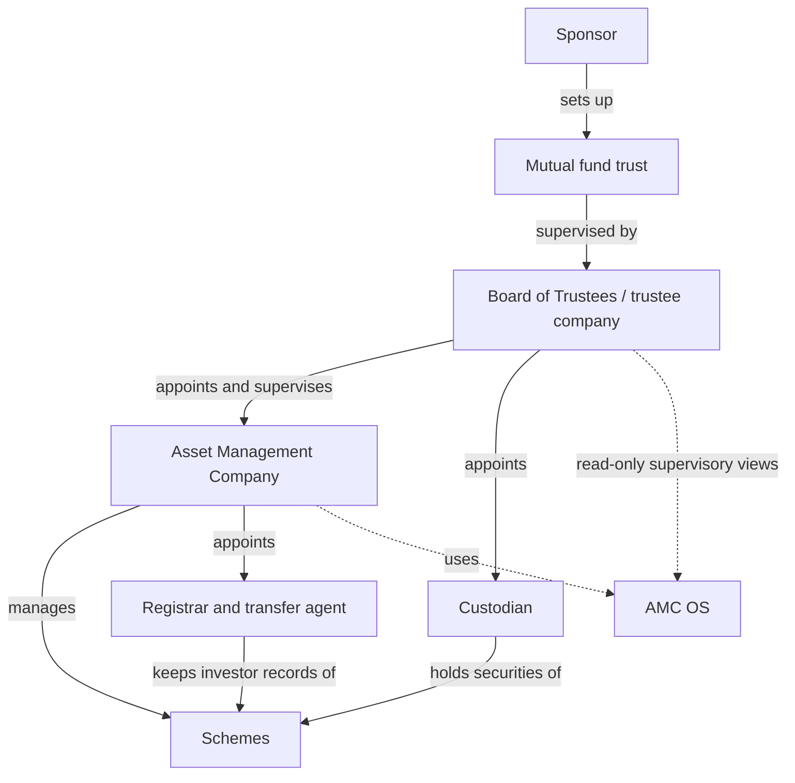
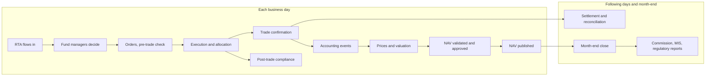

# BA-002 — AMC Operating Model and Department Hierarchy

This document describes how an Indian mutual fund AMC is organised and run, so that AMC OS fits the way the business actually works: the legal structure around the AMC, its boards and committees, its departments, which department owns each business capability in [BA-001](BA-001_business_capability_map.md), the daily and monthly rhythm of work, the outside parties it deals with, and which current systems each domain of AMC OS replaces, connects to or mirrors.

**Builds on Draft documents:** BA-001, PS-001, PS-003, GOV-001, GOV-006, PRD-000 v0.9 (Chapter 2, §1.3, Chapter 6) — allowed by owner decision D-3 ([GOV-008 §2](../00_governance/GOV-008_build_loop.md#2-rules), rule 3). No document used here is Approved yet.

**What this document is not:** it does not define user roles and permissions (BA-005, Step 5) or step-by-step workflows (BA-004, Step 4). It is a **reference model** of a typical AMC **[IND]**, not a rule: every AMC organises itself differently, so departments, reporting lines and committees are tenant configuration in AMC OS (CAP-D01-007 Organization hierarchy, CAP-D01-008 Configuration management), never hard-coded. Regulatory statements are kept to the few this model depends on; clause-level mapping of the SEBI (Mutual Funds) Regulations, 2026 is REG-001 (Step 25).

## 1. Legal structure around the AMC

A mutual fund in India is set up as a trust. The sponsor establishes the trust; the trustees hold the scheme assets in trust for unitholders and supervise the AMC; the AMC manages the schemes; a custodian holds the securities; a registrar and transfer agent (RTA) keeps the investor records. **[REG]** The current rulebook is the SEBI (Mutual Funds) Regulations, 2026, which replaced the earlier mutual fund regulations [S2] and apply from 1 April 2026 [S3] (secondary). The roles below follow PRD-000 §2.1, which carries the same label. Who appoints the custodian and the RTA (the "appoints" arrows below), and the exact duties per clause, are **[VAL]** until REG-001 (Step 25).

| Party | Role in the structure | How it uses AMC OS **[DES]** |
| --- | --- | --- |
| Sponsor | Establishes the mutual fund; usually also the AMC's shareholder **[IND]** | Not a user |
| Board of Trustees (or trustee company) | Supervises the AMC on behalf of unitholders | Read-only supervisory views and reports (PRD-000 §2.1) |
| AMC (tenant) | Runs the schemes and the business | The tenant: every department in §3 |
| Custodian | Holds and settles the schemes' securities | External party; integrated (§6) |
| RTA (CAMS or KFin, PS-003 §1) | Record keeper for investors and their units | External; AMC OS **mirrors** its records (GOV-006 Q2, mode A) |
| AMC OS vendor (platform operator) | Runs the platform | No default access to tenant business data (PRD-000 SOD-09) |

## 2. Boards and committees

AMC OS needs to know which bodies approve what, because their decisions are inputs to workflows (for example a valuation-committee decision on a fair value, or an investment-committee approval of a universe addition). Committee membership, quorum and meeting records are configuration per tenant **[DES]**.

| Body | What it does in the operating model | Label and source | Where AMC OS supports it |
| --- | --- | --- | --- |
| Board of the AMC | Governs the AMC; receives risk, compliance and market-abuse escalations | **[REG]** Risk reviews are placed before the AMC board and trustees [S4]; market-abuse escalations go to the board and trustees [S5] (secondary) | Board packs from CAP-D08-013, CAP-D09-012, CAP-D15-009 |
| Board of Trustees | Supervises the AMC. Core duties include fair fees and expenses, peer performance review, systems against mis-selling, managing conflicts of interest, and systems against market misconduct by AMC staff | **[REG]** SEBI circular of 7 Jul 2023, effective 1 Jan 2024 [S6] (secondary) | Read-only views; evidence from CAP-D08-012 |
| Unitholder Protection Committee (UHPC) | Committee whose responsibilities are set by SEBI to protect unitholders' interests | **[REG]** exists "as mandated by the Mutual Fund Regulations" [S6] (secondary); which board it sits under and its membership are **[VAL]** | Reports from CAP-D13-015 (complaints), CAP-D08-013 |
| Investment Committee | Approves investment policy, universe and major decisions; members vote, Head of Research / CIO acts as checker | **[IND]** (PRD-000 Module 02); who chairs is **[ASSUMPTION]** (CIO; confirm: Product Manager, pilot discovery) | CAP-D03-005 Investment committee workflows |
| Risk Management Committee | Oversees the risk management framework | **[VAL]** — the 2021 risk framework assigns roles to the AMC board and trustees [S4]; whether a separate committee is required is not confirmed | CAP-D09-012 Risk reporting |
| Valuation Committee | Approves valuation policies and fair values | **[IND]**; exact mandate **[VAL]** | CAP-D11-004, CAP-D11-005 |
| Audit Committee | Oversees internal and concurrent audit | **[IND]**; requirement **[VAL]** | Read-only audit access (CAP-D01-010) |
| IT / technology committee | Oversees technology and cyber security | **[VAL]** — CSCRF puts obligations on the boards of regulated entities [S7]; a named committee is not confirmed | Reports from INF/SEC documents (Steps 25–26) |

**Senior roles with a regulatory basis** (used in §3):

- **Chief Compliance Officer (CCO).** **[REG]** The CEO/MD (or equivalent) and the CCO are responsible for the AMC's institutional mechanism against market abuse, including review of recorded communications and dealing-room access logs (SEBI circular of 5 Aug 2024) [S5] (secondary).
- **Risk officer.** **[REG]** SEBI's 2021 risk management framework asked mutual funds to appoint a dedicated risk officer [S8] (secondary) and requires at least one CXO-level officer to be responsible for the risk management of specific functions [S4] (secondary summary). The title "Chief Risk Officer" and its reporting line are **[VAL]**.
- **Chief Information Security Officer (CISO).** **[REG]** SEBI's Cybersecurity and Cyber Resilience Framework (CSCRF) applies to mutual funds / AMCs and requires market infrastructure institutions and **Qualified** regulated entities to designate a CISO [S7]. Whether a given AMC is a Qualified RE is **[VAL]**. This narrows PRD-000 §2.2, which says CSCRF requires a CISO without that condition (§8, C2).

## 3. Department hierarchy

Department IDs `DEP-nn` are proposed here **[DES]** so that capabilities, roles (BA-005) and workflows (BA-004) can point to a department. They are not yet in the GOV-001 §4 identifier table (owner question Q15 in [LOOP_STATE.md](../../LOOP_STATE.md)). The hierarchy refines PRD-000 §2.2 **[IND]**.

```mermaid
flowchart TB
  BRD[Board of AMC] --> CEO[CEO / MD]
  CEO --> D01[DEP-01 CEO office and strategy]
  CEO --> CIO[CIO]
  CIO --> D02[DEP-02 Equity investments]
  CIO --> D03[DEP-03 Fixed income investments]
  CIO --> D04[DEP-04 Investment research]
  CIO --> D05[DEP-05 Dealing desk]
  CEO --> COO[COO]
  COO --> D06[DEP-06 Fund operations and settlement]
  COO --> D07[DEP-07 Fund accounting and NAV]
  COO --> D08[DEP-08 Investor services]
  CEO --> CCO[CCO]
  CCO --> D09[DEP-09 Compliance]
  CCO --> D10[DEP-10 Legal and secretarial]
  CEO --> CRO[Risk officer]
  CRO --> D11[DEP-11 Risk management]
  CEO --> CBO[CBO / Head of Sales]
  CBO --> D12[DEP-12 Sales and distribution]
  CEO --> HP[Head of Products]
  HP --> D13[DEP-13 Products and marketing]
  CEO --> CFO[CFO]
  CFO --> D14[DEP-14 Finance]
  CEO --> CTO[CTO]
  CTO --> D15[DEP-15 Technology]
  CTO --> D17[DEP-17 Data and analytics]
  CEO --> CISO[CISO]
  CISO --> D16[DEP-16 Information security]
  BRD --> D18[DEP-18 Internal audit]
  CEO --> D19[DEP-19 Human resources and administration]
```

CBO = Chief Business Officer. Reporting lines are the common pattern **[IND]**, not a rule. Common variations a tenant must be able to configure: research sitting inside the equity and fixed income teams; the dealing desk reporting to the COO instead of the CIO; legal reporting to the CEO; fund accounting outsourced to the custodian (§5); data and analytics under strategy instead of technology.

| ID | Department | Head (reports to) | Main responsibilities | PRD-000 roles (§2.3) |
| --- | --- | --- | --- | --- |
| DEP-01 | CEO office and strategy | CEO / MD | Strategy, business performance, executive reporting, organisation structure | CEO |
| DEP-02 | Equity investments | CIO | Manage equity and hybrid schemes: strategy, portfolio construction, orders | CIO, Fund Manager |
| DEP-03 | Fixed income investments | CIO | Manage debt, money-market and liquid schemes: strategy, credit view, orders | CIO, Fund Manager |
| DEP-04 | Investment research | CIO | Equity and credit research, recommendations, approved universe proposals | Research Analyst |
| DEP-05 | Dealing desk | CIO (variation: COO) | Order execution with brokers, allocation, broker panel | Dealer |
| DEP-06 | Fund operations and settlement | COO | Settlement, corporate actions, reconciliations, operational calendars, exceptions | COO (head of DEP-06 to DEP-08), Operations Analyst |
| DEP-07 | Fund accounting and NAV | COO | Books of each scheme, valuation, daily NAV, period close | Fund Accountant |
| DEP-08 | Investor services | COO | Investor service, complaints, transaction status, RTA oversight | Investor Service Executive |
| DEP-09 | Compliance | CCO | Investment-limit monitoring, breaches, regulatory reporting, market-abuse surveillance | Compliance Officer |
| DEP-10 | Legal and secretarial | CCO (variation: CEO) | Scheme documents, contracts, board and trustee secretarial work | — (new; uses Compliance Officer role until BA-005) |
| DEP-11 | Risk management | Risk officer | Investment, liquidity, credit, operational and enterprise risk; performance measurement | Risk Manager |
| DEP-12 | Sales and distribution | CBO (Chief Business Officer) / Head of Sales | Channels, distributors, RMs, sales tracking, distribution operations and commission | Distributor Manager, RM |
| DEP-13 | Products and marketing | Head of Products | Scheme design and launch, scheme master, scheme documents, product disclosures | Product Manager |
| DEP-14 | Finance | CFO | AMC revenue and expenses, budgets, profitability, tax, treasury of AMC's own funds | CFO |
| DEP-15 | Technology | CTO | AMC OS tenant administration, users, configuration, integrations, workflows | CTO, Technology Administrator, Tenant Administrator |
| DEP-16 | Information security | CISO | Identity and access policy, security monitoring, audit-log integrity | — (new in BA-005) |
| DEP-17 | Data and analytics | CTO (variation: strategy) | Data platform, master data, data quality, metric definitions, AI models | — (new in BA-005) |
| DEP-18 | Internal audit | Board of AMC (audit committee) | Independent audit; read-only access | Auditor |
| DEP-19 | Human resources and administration | CEO / MD | People and office administration | — (outside AMC OS scope; listed so no department is silently missing) |

## 4. Which department owns each capability **[DES]**

Each of the 209 level-2 capabilities in BA-001 has exactly one **accountable** department: it defines how the capability should work, owns its data and accepts changes to it. Other departments use the capability or approve within it. "DEP-02 / DEP-03" means the equity or fixed income department, depending on the asset class of the scheme; the CIO is accountable for both. The table lists capability numbers by domain (for example "D05: 006" means CAP-D05-006).

Every capability ID in BA-001 appears exactly once in the "Capabilities" column (checked by script during Step 3; see §9).

| Domain | Capabilities (CAP-Dxx-…) | Accountable department | Main other departments (users, approvers) |
| --- | --- | --- | --- |
| D01 | 001, 002, 004, 005, 006, 008, 009, 011 | DEP-15 Technology | DEP-16 (access policy), DEP-09 (segregation-of-duties review), DEP-14 (subscription cost, 006) |
| D01 | 003, 010 | DEP-16 Information security | DEP-15; DEP-18 and DEP-09 read audit (010) |
| D01 | 007 | DEP-01 CEO office and strategy | DEP-14 (cost centres), DEP-12 (branches, regions, zones), DEP-19 (people) |
| D02 | 001–011 | DEP-13 Products and marketing | DEP-09 and DEP-10 (document and scheme approvals), DEP-02 / DEP-03 (mandate, benchmark), DEP-06 and DEP-08 (cut-offs, loads), DEP-12 (NFO) |
| D03 | 001, 002, 003, 004, 007, 010 | DEP-04 Investment research | DEP-02 / DEP-03 (consumers of research), DEP-09 (restricted list) |
| D03 | 005, 006, 008, 009 | DEP-02 / DEP-03 (CIO) | DEP-04, DEP-09 (limits proposed to compliance), DEP-11 |
| D04 | 001–008, 010, 011 | DEP-02 / DEP-03 (CIO) | DEP-11 (exposure, monitoring), DEP-09 |
| D04 | 009 | DEP-11 Risk management | DEP-02 / DEP-03, DEP-13 (product performance views) |
| D05 | 001, 003, 004, 005 | DEP-02 / DEP-03 (fund managers) | DEP-05 |
| D05 | 002, 006, 007, 008, 009, 012 | DEP-05 Dealing desk | DEP-02 / DEP-03, DEP-09 (audit) |
| D05 | 010, 011 | DEP-09 Compliance | DEP-05, DEP-02 / DEP-03 (D05 calls the D08 check, BA-001 §4) |
| D06 | 001, 002, 004, 006, 007, 008 | DEP-05 Dealing desk | DEP-09 and DEP-11 (broker panel, 001), DEP-06 |
| D06 | 003, 005 | DEP-06 Fund operations and settlement | DEP-05 |
| D07 | 001–008 | DEP-06 Fund operations and settlement | DEP-07, DEP-14 (cash) |
| D08 | 001–013 | DEP-09 Compliance | DEP-10 (rule interpretation, 001), DEP-02 / DEP-03 and DEP-11 (internal limits, 002) |
| D09 | 001–013 | DEP-11 Risk management | DEP-02 / DEP-03, DEP-09 |
| D10 | 001–013 | DEP-07 Fund accounting and NAV | DEP-06, DEP-14 |
| D11 | 001–015 | DEP-07 Fund accounting and NAV | Valuation Committee (004, 005), DEP-11, DEP-13 (publication on website, 013) |
| D12 | 001–010 | DEP-06 Fund operations and settlement | DEP-07 (reconciliation sets), DEP-10 (document retention, 010) |
| D12 | 011 | DEP-15 Technology | All departments (workflow users) |
| D13 | 001–016 | DEP-08 Investor services | DEP-09 (KYC, AML, complaints escalation), DEP-12 |
| D14 | 001–016 | DEP-12 Sales and distribution | DEP-14 (checker for commission runs, PRD-000 SOD-07), DEP-09 (distributor due diligence) |
| D15 | 001–009 | DEP-14 Finance | DEP-12 (commission cost), DEP-13 (product profitability) |
| D15 | 010, 011 | DEP-01 CEO office and strategy | DEP-14 |
| D16 | 001–013 | DEP-17 Data and analytics | DEP-06 (security master operations, 004), DEP-15 |
| D17 | 001, 017 | DEP-15 Technology | DEP-16, DEP-09 (AI controls) |
| D17 | 002 | DEP-04 Investment research | DEP-17 |
| D17 | 003 | DEP-02 / DEP-03 (CIO) | DEP-17 |
| D17 | 004 | DEP-05 Dealing desk | DEP-17 |
| D17 | 005 | DEP-09 Compliance | DEP-17 |
| D17 | 006 | DEP-11 Risk management | DEP-17 |
| D17 | 007 | DEP-07 Fund accounting and NAV | DEP-17 |
| D17 | 008 | DEP-06 Fund operations and settlement | DEP-17 |
| D17 | 009 | DEP-08 Investor services | DEP-17 |
| D17 | 010 | DEP-12 Sales and distribution | DEP-17 |
| D17 | 011 | DEP-14 Finance | DEP-17 |
| D17 | 012 | DEP-01 CEO office and strategy | DEP-17 |
| D17 | 013, 014, 015, 016 | DEP-17 Data and analytics | DEP-11 (model risk), DEP-15 |

For D17, the accountable department is the business owner of the assistant (it decides what the assistant may be used for and accepts its evaluation results). Model governance itself is specified in AIML-001 / AIML-002 (Step 26). AI assistants never approve, post or publish (BA-001 §1, rule 1).

**Capabilities per department** (count of L2 capabilities, from the table): DEP-01: 4 · DEP-02 / DEP-03: 19 · DEP-04: 7 · DEP-05: 13 · DEP-06: 21 · DEP-07: 29 · DEP-08: 17 · DEP-09: 16 · DEP-11: 15 · DEP-12: 17 · DEP-13: 11 · DEP-14: 10 · DEP-15: 11 · DEP-16: 2 · DEP-17: 17 · Total 209. DEP-10, DEP-18 and DEP-19 own no capability; DEP-10 and DEP-18 are users and approvers.

## 5. Systems: what AMC OS replaces, connects to or mirrors

This answers the "systems" part of master prompt §22 Deliverable 2 (BA-001 §5 C7). It is the working default for owner question **Q14** until he answers. The "Typical system today" column restates the problems in PRD-000 §1.3, which are industry observations **[IND]** without a cited source; the remaining entries are **[ASSUMPTION]** to be confirmed by the Product Manager in discovery with the pilot AMC (PS-001 §5.3). No vendor product is named here; vendor comparison is PS-004.

Stance: **Replace** = AMC OS becomes the AMC's system for this work · **Connect** = an outside system stays the system of record and AMC OS exchanges data with it (INT-001, Step 14) · **Mirror** = AMC OS keeps a synced copy for servicing, analytics and reconciliation (GOV-006 Q2).

| Domain | Typical system today | Stance | Note |
| --- | --- | --- | --- |
| D01 Platform Administration | Separate user admin in each vendor system; access reviews in spreadsheets **[ASSUMPTION]** | Replace (for AMC OS itself) | The AMC's corporate identity provider stays (Connect; GOV-006 Q6) |
| D02 Product and Scheme | Scheme data spread across spreadsheets, documents, RTA and custodian set-ups **[ASSUMPTION]** | Replace (scheme master) | RTA and custodian keep their own set-up, fed from AMC OS (Connect) |
| D03 Investment Management | Research in documents, email and spreadsheets **[ASSUMPTION]** | Replace (internal research store) | Licensed vendor research and data stay with the vendor (Connect) |
| D04 Portfolio Management | Front-office vendor system, separate from back office (PRD-000 §1.3) **[IND]** | Replace | |
| D05 Order Management | Front-office vendor OMS; limits partly in spreadsheets (PRD-000 §1.3) **[IND]** | Replace | |
| D06 Trading and Execution | Vendor OMS plus broker and exchange platforms **[ASSUMPTION]** | Replace AMC side; Connect to brokers and exchanges | No algorithmic execution (PS-001 §3) |
| D07 Settlement | Custodian portals and spreadsheets **[ASSUMPTION]** | Replace tracking; Connect to custodian | Custodian settles; AMC OS instructs, tracks and reconciles |
| D08 Compliance | Spreadsheets and partial OMS checks (PRD-000 §1.3) **[IND]** | Replace | |
| D09 Risk | Vendor risk tools and spreadsheets **[ASSUMPTION]** | Replace (risk measures) | Market data from vendors (Connect) |
| D10 Fund Accounting | Fund accounting system run in-house or by the custodian; NAV re-checked manually (PRD-000 §1.3) **[IND]** | Replace where in-house; **Mirror and validate** where outsourced **[ASSUMPTION]** | How often fund accounting is outsourced is not known (Q16) |
| D11 Valuation and NAV | Same as D10 | Same as D10 | |
| D12 Fund Operations | Reconciliations between systems, largely manual (PRD-000 §1.3) **[IND]** | Replace | |
| D13 Investor Management | RTA systems (CAMS, KFin) are the record keeper (PRD-000 §1.3) **[IND]** | Mirror | Owner decision Q2: RTA stays record keeper |
| D14 Distribution | Distributor and transaction data from the RTA, analysed in spreadsheets **[ASSUMPTION]** | Replace analytics and commission calculation | Who computes commission today (AMC or RTA) is not known **[ASSUMPTION]**, confirm in discovery |
| D15 Finance and MIS | MIS built manually in Excel (PRD-000 §1.3) **[IND]**; AMC's own books in a corporate ERP **[ASSUMPTION]** | Replace MIS; Connect to the ERP | AMC's statutory books are out of scope (PS-001 §3) |
| D16 Enterprise Data | MIS depends on RTA files arriving (PRD-000 §1.3) **[IND]**; no governed data platform **[ASSUMPTION]** | Replace / new | |
| D17 AI | AI tools used ad hoc with no controls (PRD-000 §1.3) **[IND]** | Replace with a governed AI gateway | |

A per-capability systems list (rather than per domain) is left to discovery with the pilot AMC; BA-004 workflows will name the external system at each hand-off.

## 6. Outside parties

Who the AMC deals with, which department owns the relationship, and how AMC OS deals with them. Interfaces are not specified here: every provider interface is "Confirm with <provider>" until INT-001 (Step 14). The list follows PRD-000 §2.6.

| Party | What they do for the AMC | Owning department | AMC OS relation |
| --- | --- | --- | --- |
| SEBI | Regulator | DEP-09 | Regulatory reports and filings prepared (CAP-D08-013); rule changes entered by humans (CAP-D08-001) |
| AMFI | Industry association; NAV publication, distributor registration (ARN) | DEP-09, DEP-07, DEP-12 | NAV publication (CAP-D11-013); ARN data (CAP-D14-002) |
| Trustees | Supervision | DEP-10 | Read-only views (§1) |
| RTAs (CAMS, KFin) | Investor records, transactions, unit allotment | DEP-08 | Mirror (CAP-D13-*) |
| Custodians | Safekeeping, settlement, corporate-action information | DEP-06 | Connect (D07, CAP-D12-004) |
| Brokers | Trade execution | DEP-05 | Connect (D06) |
| Stock exchanges, clearing corporations, depositories | Trading, clearing and holding of securities | DEP-05, DEP-06 | Connect (D06, D07) |
| Banks and payment aggregators | Scheme and AMC bank accounts, payments | DEP-06, DEP-14 | Connect (CAP-D07-003, CAP-D12-006) |
| KRAs, CKYC registry | Investor KYC records | DEP-08 | Connect through the RTA or directly (CAP-D13-003); never run as a registry (PS-001 §3) |
| Credit rating agencies, valuation agencies, data vendors | Ratings, prices, reference and market data | DEP-07, DEP-17 | Connect (CAP-D11-003, CAP-D16-001) |
| Distributors (MFDs, banks, national distributors), RIAs | Sell schemes to investors | DEP-12 | Distributor master and commission (D14) |
| Statutory and concurrent auditors | Audit | DEP-07, DEP-18 | Read-only audit access (CAP-D01-010) |
| Investors | Unitholders | DEP-08 | Through RTA mirror and investor communications (CAP-D13-013) |

## 7. Operating rhythm

The core business processes of PRD-000 §2.4 (P1–P13), with the department and capabilities that carry them. Times of day and cut-offs are not given here: they are regulatory or scheme parameters **[VAL]** held in configuration (PRD-000 "rule for engineers"). Each process becomes one or more `WF-nnn` workflows in BA-004 (Step 4).

| # | Process | Frequency **[IND]** | Accountable department | Main capabilities |
| --- | --- | --- | --- | --- |
| P1 | Scheme launch (NFO) | Per scheme | DEP-13 | CAP-D02-005, CAP-D02-004, CAP-D02-008 |
| P2 | Research → investment committee → approved universe | Continuous / weekly | DEP-04, DEP-02 / DEP-03 | CAP-D03-001, CAP-D03-005, CAP-D03-007 |
| P3 | Portfolio construction and rebalancing | Daily / event-driven | DEP-02 / DEP-03 | CAP-D04-005, CAP-D04-006 |
| P4 | Order → pre-trade compliance → execution → allocation | Intraday | DEP-05 | CAP-D05-001, CAP-D08-006, CAP-D06-002, CAP-D06-004 |
| P5 | Trade settlement and custodian reconciliation | Trade date and following days | DEP-06 | CAP-D07-002, CAP-D07-006, CAP-D12-004 |
| P6 | Daily NAV calculation, validation, approval, publication | Every business day | DEP-07 | CAP-D11-010 to CAP-D11-013 |
| P7 | Daily and monthly accounting close | Daily / monthly | DEP-07 | CAP-D10-011, CAP-D10-013 |
| P8 | Corporate actions | Event-driven | DEP-06 | CAP-D12-007, CAP-D10-008 |
| P9 | Investor purchase, redemption, switch, SIP, STP, SWP | Daily | RTA (outside), DEP-08 oversight | CAP-D13-004 to CAP-D13-009 |
| P10 | Distributor commission | Monthly **[ASSUMPTION]** (confirm: Product Manager, pilot discovery) | DEP-12 (checker DEP-14) | CAP-D14-010, CAP-D14-011 |
| P11 | Compliance monitoring and breach resolution | Daily / event | DEP-09 | CAP-D08-007, CAP-D08-009 to CAP-D08-011 |
| P12 | Regulatory reporting | Daily / monthly / quarterly | DEP-09 | CAP-D08-013 |
| P13 | Management reporting (MIS) | Daily / monthly | DEP-14, DEP-01 | CAP-D15-009, CAP-D15-011 |

The picture shows order of dependence (PRD-000 §2.5), not clock times.

## 8. Consistency points found (to be closed in later steps)

| # | Point | Where it is closed |
| --- | --- | --- |
| C1 | PRD-000 §2.3 has no roles for Legal and secretarial (DEP-10), Information security (DEP-16) or Data and analytics (DEP-17), although these departments own or approve capabilities here | BA-005 (Step 5) |
| C2 | PRD-000 §2.2 states that CSCRF requires a designated CISO; the CSCRF summary used here [S7] limits that to MIIs and Qualified REs | REG-001, SEC-001 (Step 25); PRD re-key (Steps 6–9) |
| C3 | PRD-000 §2.2 marks the risk officer **[REG — VAL exact CRO reporting line]**; this document keeps the reporting line **[VAL]** and names the department "Risk management" | REG-001 (Step 25) |
| C4 | Department IDs `DEP-nn` and term IDs `TERM-nnn` (BA-003) are not in GOV-001 §4 | Owner (Q15) |
| C5 | Whether fund accounting and NAV are often outsourced to the custodian changes the D10/D11 stance (§5) and the first-purchase story in PS-003 §3 | Owner / discovery (Q16) |

## 9. How this document was checked

- Every `CAP-` ID in BA-001 appears exactly once in §4, and the per-department counts add up to 209: checked with a Python script that reads both files (Step 3, 20 Nov 2026).
- Every `DEP-` ID used in §4 and §7 is defined in §3.

## Sources

S2 and S4–S7 were opened on 20 Nov 2026 (IST) and the cited wording matched. S1, S3 and S8 were **not opened**: S1 is the SEBI page of the regulation (to be read clause by clause in REG-001), and S3 and S8 are cited only for what their headlines say. Secondary sources (press, law-firm or publisher summaries of a SEBI document) are marked "secondary"; the SEBI originals are to be checked clause by clause in REG-001 (Step 25).

| # | Source | Used for |
| --- | --- | --- |
| S1 | [SEBI — Securities and Exchange Board of India (Mutual Funds) Regulations, 2026](https://www.sebi.gov.in/legal/regulations/apr-2026/securities-and-exchange-board-of-india-mutual-funds-regulations-2026_100744.html) | Name of the current rulebook (primary; not opened in this step, to be read clause by clause in REG-001) |
| S2 | [Taxscan — Mutual Funds Regulations 2026: SEBI introduces comprehensive framework (16 Jan 2026)](https://www.taxscan.in/top-stories/mutual-funds-regulations-2026-sebi-introduces-comprehensive-framework-governing-amcs-trustees-and-mutual-fund-schemes-1441993) — secondary | Replaces the earlier regulations |
| S3 | [Business Standard — New MF rules from April 1 (16 Jan 2026)](https://www.business-standard.com/markets/mutual-fund/new-mf-rules-from-april-1-sebi-allows-performance-linked-expense-charging-126011601076_1.html) — press, secondary | Effective from 1 April 2026 |
| S4 | [SCC Online — SEBI issues risk management framework for mutual funds (29 Sep 2021; circular of 27 Sep 2021)](https://www.scconline.com/blog/post/2021/09/29/sebi-issues-risk-management-framework-for-mutual-funds/) — secondary | Roles of AMC board and trustees; CXO responsibility for risk |
| S5 | [Taxmann — AMCs must have surveillance, controls and escalation processes (SEBI circular SEBI/HO/IMD/IMD-PoD-1/P/CIR/2024/107, 5 Aug 2024)](https://taxmann.com/post/blog/amcs-must-have-surveillance-controls-and-escalation-processes-to-detect-and-prevent-potential-market-abuse-sebi) — secondary | CEO/MD and CCO responsibility; escalation to board and trustees |
| S6 | [Taxmann — SEBI carves out core roles and responsibilities for trustees (circular SEBI/HO/IMD/IMD-PoD-1/P/CIR/2023/117, 7 Jul 2023)](https://taxmann.com/post/blog/sebi-carves-out-core-roles-and-responsibilities-for-trustees-of-mutual-funds) — secondary | Trustees' core duties; UHPC |
| S7 | [Cyril Amarchand Mangaldas — client alert on SEBI CSCRF (4 Sep 2024)](https://cyrilshroff.com/wp-content/uploads/2024/09/Client-Alert-Cybersecurity-and-Cyber-Resilience-Framework.pdf) — secondary | CSCRF applies to MFs/AMCs; CISO for MIIs and Qualified REs; board obligations |
| S8 | [Business Standard — Sebi beefs up risk management norms, asks MFs to appoint dedicated officer (27 Sep 2021)](https://www.business-standard.com/amp/article/markets/sebi-beefs-up-risk-management-norms-asks-mfs-to-appoint-dedicated-officer-121092701209_1.html) — press, secondary | Dedicated risk officer |
| R1 | [BA-001](BA-001_business_capability_map.md), [PRD-000 v0.9](../03_product_requirements/PRD-000_master_prd_v0.9.md) Ch 2, §1.3, Ch 6, [PS-001](../01_product_strategy/PS-001_project_charter.md) §3, §5.3, [PS-003](../01_product_strategy/PS-003_market_and_customer_analysis.md) | Capabilities, roles, processes, boundaries, problems today |
