# BA-004 — End-to-End Business Workflows

This document lists the business workflows of AMC OS from start to finish: what starts each one, who does what, which capabilities ([BA-001](BA-001_business_capability_map.md)) and departments ([BA-002](BA-002_amc_operating_model.md)) take part, which outside party or system sits at each hand-off, where people must approve, what can go wrong, and what is recorded. It gives each workflow its permanent `WF-nnn` ID ([GOV-001 §4](../00_governance/GOV-001_document_control_and_identifiers.md#4-requirement-and-artefact-identifiers)).

**Builds on Draft documents:** BA-001, BA-002, BA-003, PS-001, GOV-001, GOV-006 and PRD-000 v0.9 (Chapter 4, Chapter 3 Modules 04, 05 and 10, Chapter 6) — allowed by owner decision D-3 ([GOV-008 §2](../00_governance/GOV-008_build_loop.md#2-rules), rule 3). No document used here is Approved yet. Owner decisions D-7, D-8, D-14, D-15 and D-16 of 20 Nov 2026 ([LOOP_STATE.md](../../LOOP_STATE.md)) are applied where they touch a workflow.

**What this document is not:** it does not define user roles and permissions (BA-005, Step 5), detailed requirements (PRD-001…PRD-017, Steps 6–9), event schemas or Temporal workflow designs (EA-007, Step 13), provider interfaces (INT-001, Step 14) or calculation methods (FE-01…FE-10, Steps 20–23). It adds **no new regulatory fact**. Every cut-off, deadline, threshold, settlement cycle or timeline a workflow depends on is a parameter held in versioned configuration; where PRD-000 already labels it, the label is carried over unchanged, and otherwise it is **[VAL]** until REG-001 (Step 25).

## 1. How to read a workflow

Each workflow has a card and, where it helps, a Mermaid diagram.

| Card field | Meaning |
| --- | --- |
| Trigger | What starts the workflow |
| Initiator | Who starts it — a role from PRD-000 §2.3, or a named head of department taken from the PRD-000 diagrams and Chapter 6 (for example Head of Dealing), or "system". BA-005 (Step 5) re-keys them all |
| Departments | **Accountable** department (BA-002 §3) first, then the other departments that act or approve |
| Capabilities | Level-2 `CAP-` IDs used (BA-001); a level-3 item is written `(.m)` where it matters |
| Hand-offs (outside) | The outside party or system at each hand-off (BA-002 §6). The interface is never specified here: "Confirm with <provider>" until INT-001 (Step 14) |
| Preconditions | What must be true before it can start |
| Final state | What is true when it ends normally |
| Approvals | Maker-checker and segregation-of-duties rules (PRD-000 SOD-01…SOD-11) that apply |
| Exceptions | What can go wrong and where it goes |
| Audit | What is recorded beyond the standard audit event |
| Source | The v0.9 workflow it re-keys, or **new** |

**Rules that apply to every workflow** (not repeated in the cards):

1. **Audit.** Every step that changes state writes an append-only audit event (PRD-000 rule C2; CAP-D01-010).
2. **Maker ≠ checker.** Every approval is by a different person from the maker (SOD-01), through the one approval mechanism of CAP-D12-011.
3. **AI drafts, people decide.** An AI assistant (D17) may draft, explain or suggest inside a workflow, but never approves, posts, publishes or executes (SOD-10; master prompt §3.1). The diagrams name the assistant where PRD-000 has one.
4. **Deterministic numbers.** Every official number in a workflow (NAV, prices used, units, accruals, compliance results, settlement amounts, commission) comes from a deterministic engine (FE-01…FE-10), never from AI.
5. **Tenant context.** Every workflow runs inside one tenant; tenant context comes from the authenticated identity only (master prompt §3.4). The only workflows that cross the tenant boundary are WF-019 and WF-022, run by the platform operator, and they never read business data without the tenant's approval (SOD-09).
6. **Events.** The event names in diagrams (for example `trading.trade.confirmed`) are the v0.9 names from PRD-000 §2.5. They are renamed to the GOV-001 format `<NAME>.v<n>` in the event catalogue (EA-007, Step 13); see §5, C4.
7. **Systems stance.** Where AMC OS replaces, connects to or mirrors an outside system, the stance per domain is BA-002 §5, kept per domain by owner decision D-15. Fund accounting and NAV follow D-16: AMC OS replaces them where the AMC does them in-house, and mirrors and validates them where they are outsourced to the custodian (variants in WF-007 and WF-008).

## 2. Workflow register

v0.9 workflows W1–W17 become WF-001–WF-017 as GOV-001 §4 states. PRD-000 also contains **W6b Trade settlement**, which GOV-001 did not count; it becomes **WF-018**. New workflows for D01, D06 and D07 are **WF-019…WF-028** **[DES]**. WF-029 and WF-030 (D02) were added by PRD-002 (Step 6), which holds their cards (PRD-002 §6.2–§6.3); WF-031 (D03) and WF-032 (D04) were added by PRD-003 and PRD-004 (Step 7), which hold their cards (§6.2 of each); WF-033 (D09) and WF-034 (D08) were added by PRD-009 and PRD-008 (Step 8), which hold their cards (§6.2 of each). IDs are never reused.

| WF | Workflow | v0.9 source | Main domains | Accountable department | BA-002 process |
| --- | --- | --- | --- | --- | --- |
| WF-001 | Scheme launch (NFO) | W1 | D02 | DEP-13 Products and marketing | P1 |
| WF-002 | Investment research and approval | W2 | D03 | DEP-04 Investment research | P2 |
| WF-003 | Portfolio construction | W3 | D04 | DEP-02 / DEP-03 (CIO) | P3 |
| WF-004 | Order creation and execution | W4 | D05, D06 | DEP-05 Dealing desk | P4 |
| WF-005 | Pre-trade compliance | W5 | D08 | DEP-09 Compliance | P4 |
| WF-006 | Post-trade compliance | W6 | D08 | DEP-09 Compliance | P11 |
| WF-007 | Daily NAV | W7 | D11 | DEP-07 Fund accounting and NAV | P6 |
| WF-008 | Accounting closure (daily and monthly) | W8 | D10 | DEP-07 Fund accounting and NAV | P7 |
| WF-009 | Corporate actions | W9 | D12, D10 | DEP-06 Fund operations and settlement | P8 |
| WF-010 | Investor purchase | W10 | D13 | DEP-08 Investor services | P9 |
| WF-011 | Investor redemption | W11 | D13 | DEP-08 Investor services | P9 |
| WF-012 | SIP processing | W12 | D13 | DEP-08 Investor services | P9 |
| WF-013 | Distributor commission | W13 | D14 | DEP-12 Sales and distribution | P10 |
| WF-014 | Compliance breach resolution | W14 | D08 | DEP-09 Compliance | P11 |
| WF-015 | Reconciliation | W15 | D12 | DEP-06 Fund operations and settlement | P5 (part) |
| WF-016 | Regulatory reporting | W16 | D08 | DEP-09 Compliance | P12 |
| WF-017 | NAV correction (exception) | W17 | D11 | DEP-07 Fund accounting and NAV | P6 (exception) |
| WF-018 | Trade settlement | W6b | D07 | DEP-06 Fund operations and settlement | P5 |
| WF-019 | Tenant onboarding and offboarding | **new** | D01 | DEP-15 Technology | — |
| WF-020 | User access lifecycle (joiner, mover, leaver, recertification) | **new** | D01 | DEP-15 Technology | — |
| WF-021 | Configuration change and promotion | **new** | D01 | DEP-15 Technology | — |
| WF-022 | Break-glass support access | **new** | D01 | DEP-15 Technology | — |
| WF-023 | Broker empanelment and review | **new** | D06 | DEP-05 Dealing desk | P4 (supporting) |
| WF-024 | Externally booked trade capture | **new** | D06 | DEP-05 Dealing desk | P4 |
| WF-025 | Trade confirmation, execution reconciliation and trade exceptions | **new** | D06 | DEP-06 Fund operations and settlement | P4, P5 |
| WF-026 | Settlement obligations and funding | **new** | D07 | DEP-06 Fund operations and settlement | P5 |
| WF-027 | Failed settlement management | **new** | D07 | DEP-06 Fund operations and settlement | P5 |
| WF-028 | Settlement instruction (SSI) and bank-detail change | **new** | D07 | DEP-06 Fund operations and settlement | P5 (supporting) |
| WF-029 | Scheme change (fundamental and non-fundamental) — card in [PRD-002](../03_product_requirements/PRD-002_product_and_scheme_management.md) §6.2 | PRD-000 Module 01 point 6 | D02 | DEP-13 Products and marketing | P1 (supporting) |
| WF-030 | Scheme merger, winding-up and maturity — card in PRD-002 §6.3 | **new** | D02 | DEP-13 Products and marketing | P1 (supporting) |
| WF-031 | Investment policy review — card in [PRD-003](../03_product_requirements/PRD-003_investment_management.md) §6.2 | **new** | D03 | DEP-02 / DEP-03 (CIO) | P2 (supporting) |
| WF-032 | Performance measurement and attribution — card in [PRD-004](../03_product_requirements/PRD-004_portfolio_management.md) §6.2 | **new** | D04 | DEP-11 Risk management | P3 (supporting) |
| WF-033 | Daily risk run and risk alerts — card in [PRD-009](../03_product_requirements/PRD-009_risk_management.md) §6.2 | **new** | D09 | DEP-11 Risk management | — (no BA-002 process covers risk monitoring) |
| WF-034 | Compliance rule change lifecycle — card in [PRD-008](../03_product_requirements/PRD-008_compliance_management.md) §6.2 | **new** | D08 | DEP-09 Compliance | P11 (supporting) |

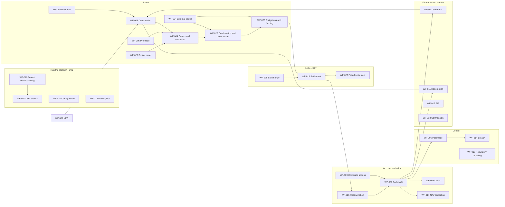

The picture shows which workflow feeds which, not clock times.

## 3. Re-keyed workflows (from PRD-000 Chapter 4)

The diagrams are carried over from PRD-000 Chapter 4 with these kinds of change, and no others: (1) workflow references use `WF-` IDs; (2) AI agents carry the D17 names of BA-001 (Research Agent → Research copilot, NAV Agent → NAV operations assistant, Reconciliation Agent → Reconciliation assistant, Copilot → Compliance copilot), and the Portfolio Agent is removed (WF-003, §5.2 C5); (3) investor and NFO steps say the RTA allots and AMC OS mirrors (owner decision Q2; WF-001, WF-010); (4) broker messages are generic because FIX per broker is an **[ASSUMPTION]** (WF-004); (5) trade confirmation hands off to D06 (WF-025) instead of settlement, and WF-018 starts after it (§5.2 C2). Cards are new: they add departments, capabilities, outside hand-offs and approvals.

### WF-001 — Scheme launch (NFO)

| Field | Detail |
| --- | --- |
| Trigger | Board-approved product plan |
| Initiator | Product Manager |
| Departments | **DEP-13**; DEP-09 and DEP-10 (document and scheme approvals), DEP-02 / DEP-03 (mandate, benchmark), DEP-06 and DEP-08 (cut-offs, loads, RTA set-up), DEP-07 (books opened), DEP-12 (NFO sales) |
| Capabilities | CAP-D02-001, CAP-D02-002, CAP-D02-003, CAP-D02-004, CAP-D02-005, CAP-D02-006, CAP-D02-007, CAP-D02-008, CAP-D02-009, CAP-D08-003, CAP-D16-004, CAP-D13-011, CAP-D10-003 (.5), CAP-D04-001, CAP-D11-010 |
| Hand-offs (outside) | Trustees (approval evidence); SEBI (SID/KIM filing and observations); depository (ISINs); RTA (scheme set-up, daily NFO collections, allotment); stock exchanges (MF platform set-up). Who initiates NFO refunds (RTA or AMC through its bank) is **[ASSUMPTION]** — confirm: Product Manager, pilot discovery |
| Preconditions | Category available under current categorisation rules; fund manager, benchmark, custodian, RTA configured; no conflicting scheme in the same category (one-scheme-per-category rule **[REG — VAL exceptions]**, PRD-000 W1) |
| Final state | Scheme `ACTIVE`, units allotted by the RTA and mirrored, holdings and ledger opened, NAV series started |
| Approvals | Head of Products, then Compliance (CAP-D02-008 (.1)); trustee approval evidence attached (.2) |
| Exceptions | SEBI observation loop; RTA set-up rejection; minimum subscription not met → refund within the regulatory timeline **[VAL]** and scheme `CANCELLED` |
| Audit | Scheme versions, approvals, SEBI filing references, NFO collections, allotment run |
| Source | W1 |

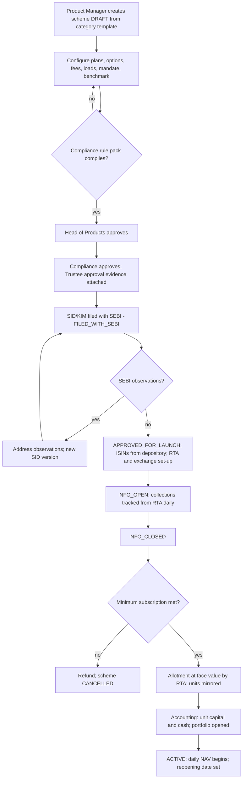

**Validation** (PRD-000 W1): ISIN per plan and option present; fee schedule within the TER cap rule; mandate ranges consistent (minimums ≤ 100%).

### WF-002 — Investment research and approval

| Field | Detail |
| --- | --- |
| Trigger | Analyst identifies a new security or issuer, or a review date falls due |
| Initiator | Research Analyst |
| Departments | **DEP-04**; DEP-02 / DEP-03 (users of research), Investment Committee (BA-002 §2), DEP-09 (restricted list, internal limits) |
| Capabilities | CAP-D03-001, CAP-D03-002, CAP-D03-003, CAP-D03-004, CAP-D03-005, CAP-D03-007, CAP-D03-009, CAP-D08-002, CAP-D16-004, CAP-D17-002 |
| Hand-offs (outside) | Data vendors and credit rating agencies (licensed research, ratings — Connect, BA-002 §5) |
| Preconditions | Security and issuer exist in the master (else a data-steward request, CAP-D16-004 (.3)) |
| Final state | Security in the `APPROVED` universe with limits, or `REJECTED` with reasons |
| Approvals | Head of Research within delegated authority; otherwise Investment Committee vote with quorum and conflict declarations (CAP-D03-005). Delegated authority levels are tenant configuration **[ASSUMPTION]** — confirm: Product Manager, pilot discovery |
| Exceptions | Quorum or conflict declarations not satisfied → back to committee |
| Audit | Research note versions, IC agenda, votes, minutes, decision record |
| Source | W2 |

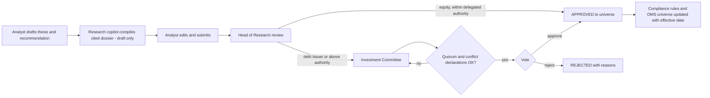

### WF-003 — Portfolio construction

| Field | Detail |
| --- | --- |
| Trigger | New money, model change, index rebalance, drift alert |
| Initiator | Fund Manager |
| Departments | **DEP-02 / DEP-03**; DEP-11 (exposure, monitoring), DEP-09 (what-if) |
| Capabilities | CAP-D03-008, CAP-D04-002 (.4), CAP-D04-003, CAP-D04-004, CAP-D04-005, CAP-D04-006, CAP-D04-007, CAP-D04-010, CAP-D08-006, CAP-D03-006 |
| Hand-offs (outside) | None directly; provisional investor flows arrive from the RTA through the D13 mirror |
| Preconditions | Start-of-day snapshot loaded; cash ladder current; universe approved |
| Final state | A set of `DRAFT` orders linked to a decision record |
| Approvals | None inside this workflow; the orders follow WF-004 approvals |
| Exceptions | Compliance what-if returns BLOCK → targets revised |
| Audit | Targets, optimiser input and output, what-if result, decision record |
| Source | W3. PRD-000 names a "Portfolio Agent" that explains the trade list; the brief's D17 list has no such assistant, so it is not placed yet (BA-001 §5 C4, AIML-001 Step 26) |

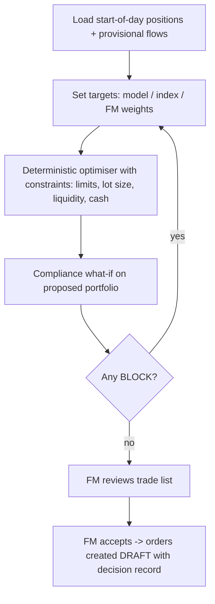

### WF-004 — Order creation and execution

| Field | Detail |
| --- | --- |
| Trigger | Fund Manager accepts orders (from WF-003 or directly) |
| Initiator | Fund Manager; executed by Dealer |
| Departments | **DEP-05** (execution); DEP-02 / DEP-03 own order creation, amendment and cancellation (BA-002 §4), DEP-09 (compliance results) |
| Capabilities | CAP-D05-001 to CAP-D05-012, CAP-D06-002, CAP-D06-004, CAP-D06-006 (.1), CAP-D06-007 (.2, .3), CAP-D08-006, CAP-D08-007, CAP-D17-004 |
| Hand-offs (outside) | Brokers (orders and fills; PRD-000 FR-10-02 assumes FIX — **[ASSUMPTION]** per broker, confirm with each broker in INT-001); stock exchanges through the broker |
| Preconditions | Security in the universe and not restricted; broker empanelled (WF-023); market open |
| Final state | Order `CLOSED`; trades allocated and passed to WF-025 for confirmation and then to settlement |
| Approvals | Approval above the order threshold (CAP-D05-003; thresholds are tenant configuration **[ASSUMPTION]**); FM who originates ≠ dealer who executes (SOD-03, default on); allocation deviation needs Head of Dealing + Compliance (FR-04-10 **[REG — fair allocation among schemes; VAL exact clause]**) |
| Exceptions | Broker reject → re-route; connection loss → resend with sequence recovery; late fill after cancel → exception queue (CAP-D12-008); allocation deviation → approval above |
| Audit | Every order version, compliance result with rule versions, approvals, fills, allocation |
| Source | W4 |

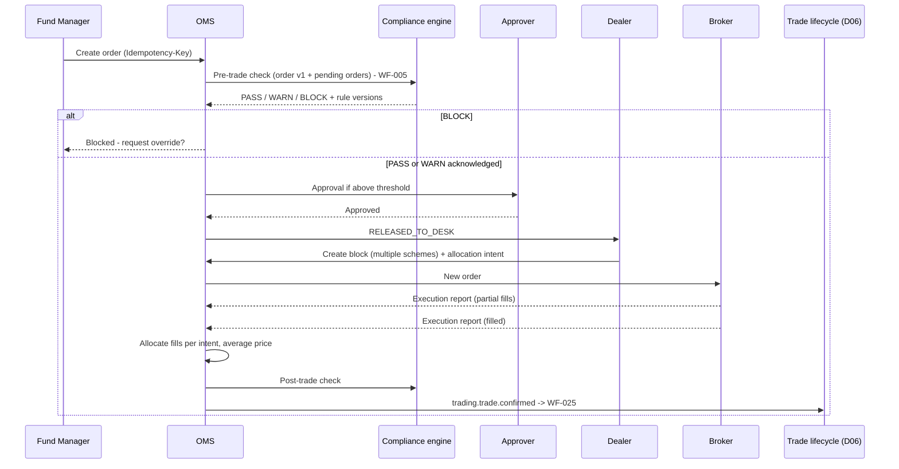

### WF-005 — Pre-trade compliance

| Field | Detail |
| --- | --- |
| Trigger | Order create or amend; what-if from WF-003 |
| Initiator | System |
| Departments | **DEP-09**; DEP-02 / DEP-03 and DEP-05 (act on the result) |
| Capabilities | CAP-D08-006, CAP-D08-001 (.3, .4), CAP-D08-002, CAP-D08-003, CAP-D08-004, CAP-D08-005, CAP-D08-011 (.3), CAP-D08-012, CAP-D05-010 |
| Hand-offs (outside) | None |
| Preconditions | Rule versions effective for the trade date; positions and prices available |
| Final state | Order proceeds (PASS, or WARN acknowledged) or is `COMPLIANCE_BLOCKED` |
| Approvals | Override of a BLOCK needs two distinct approvers from Compliance and Investment (CCO + CIO or delegates; SOD-04) |
| Exceptions | Data incomplete → result `INDETERMINATE`, treated as BLOCK |
| Audit | Input hash, rule and parameter versions, measured value and threshold per rule |
| Source | W5 |

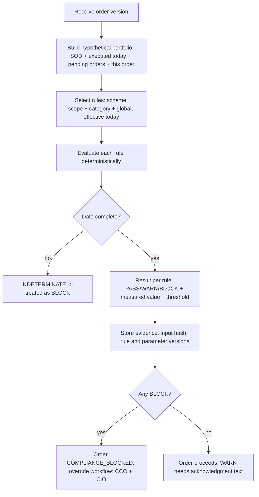

### WF-006 — Post-trade compliance

| Field | Detail |
| --- | --- |
| Trigger | End of day after NAV approval (WF-007); intraday on market moves |
| Initiator | System |
| Departments | **DEP-09**; DEP-02 / DEP-03 (owner of passive breaches) |
| Capabilities | CAP-D08-007, CAP-D08-009, CAP-D08-010 (.2), CAP-D08-012, CAP-D05-011, CAP-D04-011 |
| Hand-offs (outside) | None |
| Preconditions | Approved end-of-day snapshot |
| Final state | Breaches opened (to WF-014) or previously open breaches closed as cured |
| Approvals | None (detection only) |
| Exceptions | Active breach (caused by the AMC's own trade) → immediate escalation to CCO and CIO |
| Audit | Run record, rule versions, result per rule, breaches opened and closed |
| Source | W6 |

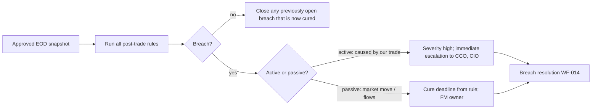

### WF-007 — Daily NAV

| Field | Detail |
| --- | --- |
| Trigger | Business-day scheduler after market close and receipt of prices |
| Initiator | System; the NAV preparer (Fund Accountant) owns the run |
| Departments | **DEP-07**; Valuation Committee (fair values), DEP-11, DEP-13 (website publication) |
| Capabilities | CAP-D11-001, CAP-D11-002, CAP-D11-003, CAP-D11-006, CAP-D11-007, CAP-D11-008, CAP-D11-009, CAP-D11-010, CAP-D11-011, CAP-D11-012, CAP-D11-013, CAP-D10-005, CAP-D10-011, CAP-D12-003, CAP-D13-011, CAP-D04-011, CAP-D17-007 |
| Hand-offs (outside) | Price vendors and valuation agencies (prices in); RTA (units outstanding in; NAV out); AMFI, stock exchanges and the AMC website (NAV out). Formats: confirm with each provider |
| Preconditions | All trades of the day booked; prices received and validated; accruals run; units outstanding from the RTA (provisional allowed with a flag); critical reconciliation breaks closed or waived |
| Final state | `PUBLISHED` NAV per plan and option; end-of-day snapshot frozen |
| Approvals | Approver ≠ preparer; approver cannot hold the Dealer or Fund Manager role in the same tenant (SOD-02); price override maker-checker (CAP-D11-002 (.2)) |
| Exceptions | Price problems → valuation team override with justification; validation gate fails → `VALIDATION_FAILED`, fix and rerun; publication channel fails → retry and alert (detail in FE-01, Step 20) |
| Audit | Run record, every component, validation results, approver, publication acknowledgments |
| Source | W7 |

**Variant for outsourced fund accounting (owner decision D-16).** Where the custodian calculates the NAV, AMC OS does not replace that calculation: it receives the custodian's NAV and components, recalculates independently, and reconciles the two (CAP-D11-015, through CAP-D12-003). Differences become breaks. Who approves and publishes in this arrangement (the AMC on the custodian's figure, or the custodian under the AMC's oversight) varies by contract **[ASSUMPTION]** — confirm: Product Manager, pilot discovery.

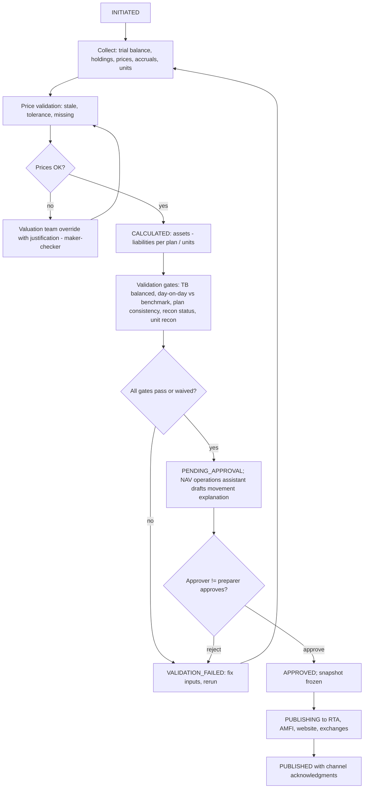

### WF-008 — Accounting closure (daily and monthly)

| Field | Detail |
| --- | --- |
| Trigger | Daily: NAV published (WF-007). Monthly: month-end calendar date |
| Initiator | Fund Accountant |
| Departments | **DEP-07**; DEP-06 (reconciliations), DEP-14 (CFO, for reopening) |
| Capabilities | CAP-D10-013, CAP-D10-005, CAP-D10-004, CAP-D10-011, CAP-D10-012, CAP-D12-004, CAP-D12-006, CAP-D12-003 (.4) |
| Hand-offs (outside) | Bank and custodian statements; RTA unit data (all through WF-015) |
| Preconditions | Monthly: all daily periods soft-closed |
| Final state | Daily: period `SOFT_CLOSED`, next day opened. Monthly: period `CLOSED`; financial statement data generated |
| Approvals | Head of Fund Accounting approves the monthly close; reopening needs CFO + Head of Fund Accounting with a reason, and every posting during a reopen is tagged |
| Exceptions | Trial balance variance unexplained → back to true-ups |
| Audit | Checklist, true-up entries, reconciliation results, sign-off, any reopen with reason |
| Source | W8. Variant for outsourced fund accounting (D-16): the books stay with the custodian; AMC OS mirrors the trial balance and reconciles it (CAP-D10-012), and the monthly sign-off records the AMC's review **[ASSUMPTION]** — confirm in pilot discovery |

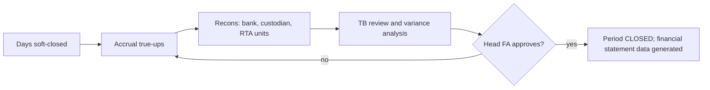

### WF-009 — Corporate actions

| Field | Detail |
| --- | --- |
| Trigger | Corporate-action announcement from an exchange, data vendor or custodian |
| Initiator | Operations Analyst |
| Departments | **DEP-06**; DEP-02 / DEP-03 (elections), DEP-07 (accounting) |
| Capabilities | CAP-D12-007, CAP-D10-008, CAP-D10-006, CAP-D04-002, CAP-D12-004, CAP-D16-004 (.3) |
| Hand-offs (outside) | Stock exchanges, data vendors, custodian (announcements in; entitlement confirmation in) |
| Preconditions | Holdings on record date available |
| Final state | Entitlements booked on ex-date and pay-date and reconciled with the custodian |
| Approvals | Fund Manager election for voluntary actions by the deadline |
| Exceptions | Sources disagree → data steward; entitlement mismatch with custodian → break (WF-015) |
| Audit | Source announcements, golden record, election, entitlement calculation, postings |
| Source | W9 |

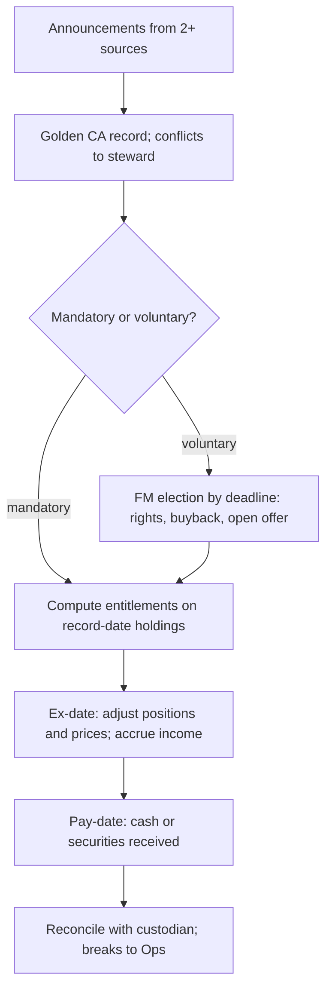

### WF-010 — Investor purchase

| Field | Detail |
| --- | --- |
| Trigger | Purchase received on any channel (at the RTA) |
| Initiator | Investor or distributor |
| Departments | **DEP-08**; DEP-12 (distributor tagging), DEP-07 (unit capital) |
| Capabilities | CAP-D13-004, CAP-D13-001, CAP-D13-002, CAP-D13-003, CAP-D13-011, CAP-D13-016, CAP-D14-002, CAP-D11-013, CAP-D10-003 (.5), CAP-D12-003 (.4) |
| Hand-offs (outside) | RTA (record keeper: time-stamp, KYC check, funds realisation, allotment); KRA through the RTA; banks and payment channels through the RTA |
| Preconditions | KYC valid; folio exists or is new; scheme open for subscription |
| Final state | Units allotted by the RTA and mirrored; investor ledger mirror updated; capital stock posted |
| Approvals | None (mirror) |
| Exceptions | AMC OS recalculation differs from the RTA beyond rounding → unit break to Operations |
| Audit | Provisional and final feeds, validation result, recalculation, break if any |
| Source | W10. The unit recalculation is a check of the RTA's figure, not an allotment, in line with owner decision Q2 (mirror the RTA); BA-001 §5 C5 is closed in PRD-013 (Step 9). The applicable-NAV rule is regulatory **[VAL]** |

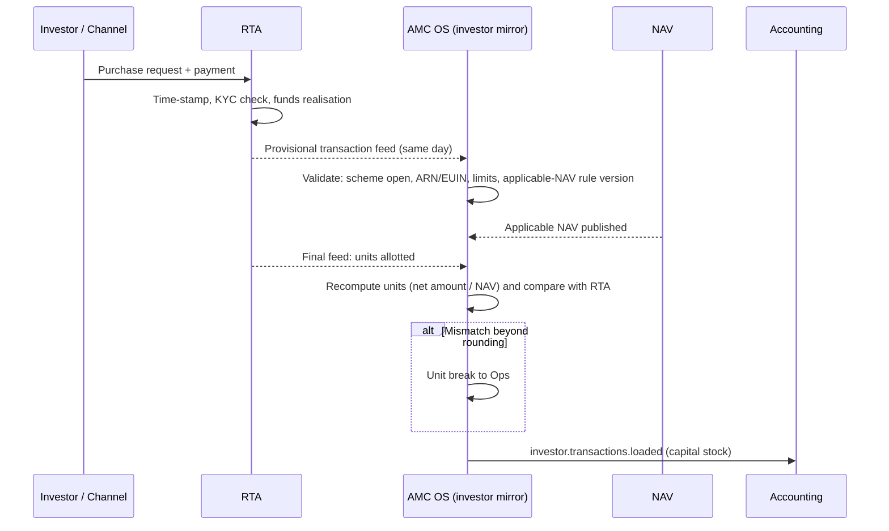

### WF-011 — Investor redemption

| Field | Detail |
| --- | --- |
| Trigger | Redemption request (at the RTA) |
| Initiator | Investor or distributor |
| Departments | **DEP-08**; DEP-06 (scheme cash and payout), DEP-07 (payables), DEP-02 / DEP-03 (cash ladder) |
| Capabilities | CAP-D13-005, CAP-D13-011, CAP-D13-016, CAP-D02-006 (.2), CAP-D11-013, CAP-D10-010, CAP-D04-002 (.4), CAP-D12-002 (.2), CAP-D12-009 |
| Hand-offs (outside) | RTA (request, time-stamp, computation); bank (payout) |
| Preconditions | Units free of lock-in and lien; KYC not on hold |
| Final state | Units extinguished; payout `PAID` within the regulatory timeline **[VAL]** |
| Approvals | Payout file released by two authorisers (CAP-D12-009) |
| Exceptions | Units not available → `REJECTED` with reason; bank failure → `PAYOUT_FAILED`, bank-detail check, re-initiate; timeline missed → delay-interest calculation **[VAL]** |
| Audit | Request, cut-off applied, NAV used, load and tax, payout file, bank result |
| Source | W11. Under mirror mode (Q2) the RTA computes the redemption; AMC OS recomputes as a check. Whether the payout file goes from AMC OS to the AMC's bank or is sent by the RTA is **[ASSUMPTION]** — confirm: Product Manager, pilot discovery. TDS for NRI investors is **[VAL]** |

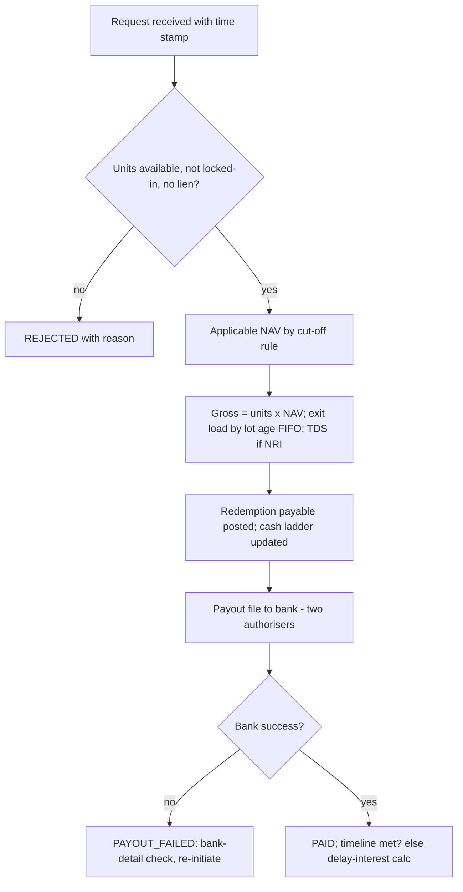

### WF-012 — SIP processing

| Field | Detail |
| --- | --- |
| Trigger | SIP instalment date |
| Initiator | System (through the RTA and mandate rails) |
| Departments | **DEP-08**; DEP-12 (SIP book and distributor metrics) |
| Capabilities | CAP-D13-007, CAP-D13-004, CAP-D13-002 (.3), CAP-D13-013, CAP-D14-006 |
| Hand-offs (outside) | RTA; debit rails named in PRD-000 W12 (e-NACH, UPI AutoPay) through the RTA and banks — confirm with RTA |
| Preconditions | Active SIP registration with a valid mandate |
| Final state | Instalment `PROCESSED` or `FAILED` |
| Approvals | None (mirror) |
| Exceptions | Debit failure → failure count +1; consecutive failures at the configured limit → SIP `CANCELLED` and investor and distributor notified **[VAL]** |
| Audit | Instalment status, failure reasons, cancellation |
| Source | W12 |

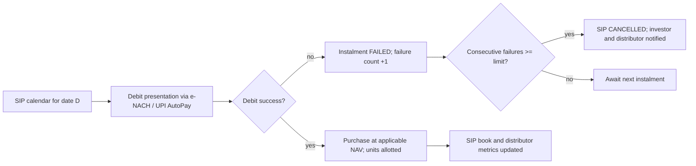

### WF-013 — Distributor commission

| Field | Detail |
| --- | --- |
| Trigger | Month-end (frequency **[ASSUMPTION]**, BA-002 §7 P10) |
| Initiator | Distributor Manager (distribution operations) |
| Departments | **DEP-12**; DEP-14 (checker), DEP-09 (distributor due diligence) |
| Capabilities | CAP-D14-010, CAP-D14-011, CAP-D14-002, CAP-D14-003, CAP-D14-008, CAP-D15-006, CAP-D12-009 |
| Hand-offs (outside) | RTA (AUM, transactions, the RTA's own brokerage computation); AMFI (ARN validity — source **[ASSUMPTION]**, confirm in INT-001); bank (payment file); distributors (statements) |
| Preconditions | Month's AUM and transactions final from the RTA; ARN validity loaded; commission structure versions approved |
| Final state | Payout file paid; statements published to distributors; GST and TDS booked **[VAL]** |
| Approvals | Maker in distribution operations, checker in Finance; payment release by two bank-mandate signatories (SOD-07) |
| Exceptions | Variance with the RTA computation beyond tolerance → commission breaks; fix inputs and rerun. Tolerance is tenant configuration **[ASSUMPTION]** |
| Audit | Rate versions used per day, run record, variance, approvals, payment file |
| Source | W13. Who computes commission today (AMC or RTA) is not known (BA-002 §5) |

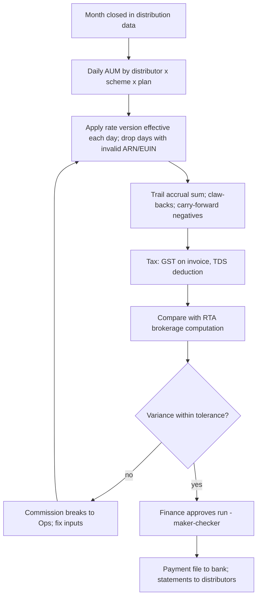

### WF-014 — Compliance breach resolution

| Field | Detail |
| --- | --- |
| Trigger | Breach opened by WF-006 |
| Initiator | System; owner is the Fund Manager |
| Departments | **DEP-09**; DEP-02 / DEP-03 (cure plan), DEP-01 (CEO, for regularisation) |
| Capabilities | CAP-D08-009, CAP-D08-010, CAP-D08-011, CAP-D08-012, CAP-D08-013, CAP-D17-005 |
| Hand-offs (outside) | Trustees (reporting); SEBI where a breach is reportable **[VAL]** |
| Preconditions | Breach record exists |
| Final state | `RESOLVED` with evidence, or `REGULARISED` by approved exception; reported to Trustees |
| Approvals | Compliance approves the cure plan; regularisation needs CCO + CEO |
| Exceptions | Cure deadline passed → `ESCALATED`. Cure deadlines are regulatory **[VAL]** (BA-001 CAP-D08-011) |
| Audit | Every state change, plan versions, evidence, approvals, Trustee report |
| Source | W14 |

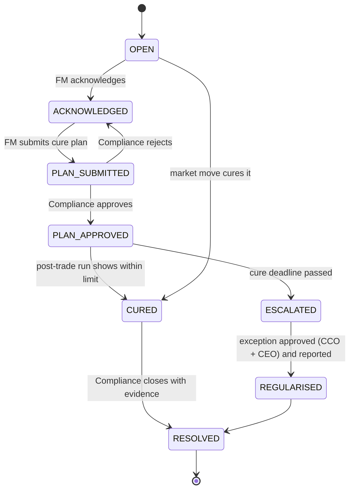

### WF-015 — Reconciliation

| Field | Detail |
| --- | --- |
| Trigger | Inbound file arrival or schedule (CAP-D12-001 (.3)) |
| Initiator | System; Operations Analyst for breaks |
| Departments | **DEP-06**; DEP-07 (accounting and NAV reconciliation sets), DEP-08 (unit reconciliation) |
| Capabilities | CAP-D12-003, CAP-D12-004, CAP-D12-005, CAP-D12-006, CAP-D12-002 (.3), CAP-D12-008, CAP-D12-009, CAP-D16-001, CAP-D16-003, CAP-D17-008 |
| Hand-offs (outside) | Custodian, banks, brokers, RTA (statements and files in). File formats: confirm with each provider |
| Preconditions | Reconciliation definition (keys, tolerances) approved for the set |
| Final state | All items matched, or breaks resolved or written off |
| Approvals | Force-match and write-off by maker-checker (CAP-D12-009) |
| Exceptions | File fails schema validation → quarantine and alert; duplicate file → rejected by hash |
| Audit | File hash, run, match results, break actions, approvals |
| Source | W15. One engine (FE-07) and one break workflow for every domain (BA-001 §4) |

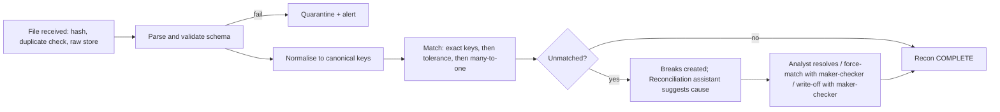

### WF-016 — Regulatory reporting

| Field | Detail |
| --- | --- |
| Trigger | Reporting calendar (daily, monthly, quarterly, event) |
| Initiator | System; Compliance owns |
| Departments | **DEP-09**; DEP-17 (certified datasets), report-specific data owners |
| Capabilities | CAP-D08-013, CAP-D08-012, CAP-D16-007, CAP-D16-013 (.2), CAP-D17-005 |
| Hand-offs (outside) | SEBI, stock exchanges, AMFI (submission channels — confirm with each recipient; report list in REG-001, Step 25) |
| Preconditions | Report definition version for the period exists |
| Final state | Report filed; acknowledgment stored as evidence |
| Approvals | CCO approves (maker-checker) |
| Exceptions | Validation fails → fix data upstream and rerun |
| Audit | Report definition version, data snapshot, validations, approval, submission, acknowledgment |
| Source | W16 |

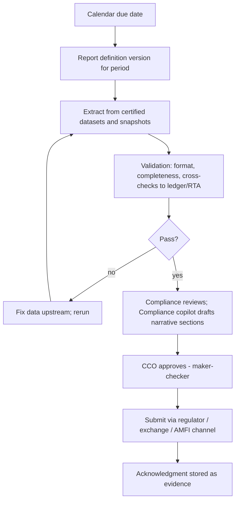

### WF-017 — NAV correction (exception)

| Field | Detail |
| --- | --- |
| Trigger | Error found in a published NAV |
| Initiator | Fund Accountant or Compliance Officer |
| Departments | **DEP-07**; DEP-09, DEP-01 (CEO), DEP-08 (investor impact), DEP-10 (Trustee intimation) |
| Capabilities | CAP-D11-014, CAP-D11-010, CAP-D11-012, CAP-D11-013, CAP-D10-002 (.3), CAP-D13-004, CAP-D13-005, CAP-D08-012, CAP-D08-013 |
| Hand-offs (outside) | RTA (reprocessing of affected transactions); AMFI and website (corrected NAV); Trustees; SEBI **[VAL]** |
| Preconditions | Original NAV run and its inputs are reproducible (CAP-D11-014 (.1)) |
| Final state | Corrected NAV published (if required); affected transactions reprocessed; investors or scheme compensated per policy; regulator and Trustees informed |
| Approvals | Head of Fund Accounting, Compliance, CEO; Trustee intimation |
| Exceptions | Below the materiality threshold → record, fix forward, report internally. Thresholds and compensation are **[REG — NAV error thresholds and compensation; VAL]** (PRD-000 W17) |
| Audit | Correction run, impact per plan and date, affected transactions, compensation, approvals, evidence pack |
| Source | W17 |

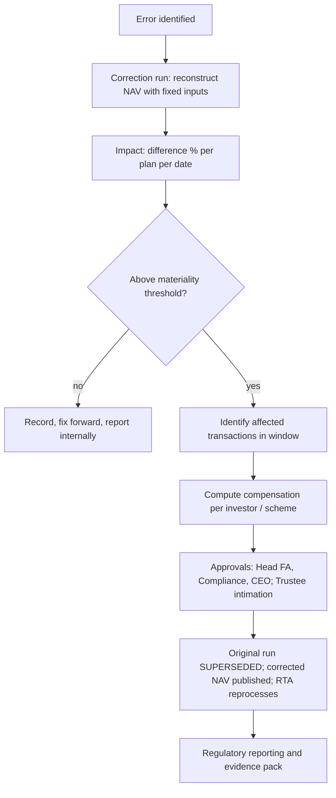

### WF-018 — Trade settlement

| Field | Detail |
| --- | --- |
| Trigger | Trade matched to its contract note (WF-025), or an externally booked trade confirmed by maker-checker against its evidence (WF-024) |
| Initiator | System; Operations Analyst for exceptions |
| Departments | **DEP-06**; DEP-07 (settlement journals) |
| Capabilities | CAP-D07-004, CAP-D07-006, CAP-D07-007, CAP-D07-003, CAP-D10-003 (.3), CAP-D10-009, CAP-D10-010, CAP-D04-002 (.2) |
| Hand-offs (outside) | Custodian (instructions out; acknowledgment, matched, settled or failed status in). The custodian deals with the clearing corporation and depository **[ASSUMPTION]** — confirm with each custodian |
| Preconditions | Valid SSI for the counterparty (WF-028); settlement date from the calendar (WF-026) |
| Final state | `SETTLED`; holdings and cash final; accounting events posted |
| Approvals | None for straight-through instructions; re-instruction after a fail follows WF-027 |
| Exceptions | `FAILED` or `PARTIALLY_SETTLED` → WF-027 |
| Audit | Instruction, every status message, journals posted |
| Source | W6b. Status sequence from PRD-000 FR-05-05: `PENDING_INSTRUCTION → INSTRUCTED → ACKNOWLEDGED → MATCHED → SETTLED / PARTIALLY_SETTLED / FAILED`. PRD-000 put contract-note matching in this workflow; it moves to WF-025 because BA-001 places trade confirmation in D06 (§5, C3) |

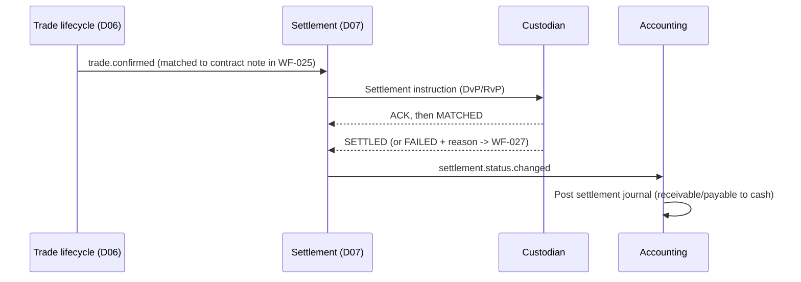

## 4. New workflows (D01, D06, D07) **[DES]**

These workflows are proposed here; nothing in PRD-000 Chapter 4 describes them. Their steps follow the level-3 capabilities in BA-001 and the SoD rules of PRD-000 Chapter 6. Any number they need (frequencies, durations, limits) is tenant configuration and is marked **[ASSUMPTION]** with who confirms it.

### WF-019 — Tenant onboarding and offboarding

| Field | Detail |
| --- | --- |
| Trigger | Onboarding: a signed AMC OS subscription (owner decision D-14: D01 "Subscription management" is the AMC's subscription to AMC OS). Offboarding: contract end or termination |
| Initiator | Platform Operator (the vendor) creates the tenant; the AMC's Tenant Administrator completes set-up |
| Departments | **DEP-15**; DEP-16 (identity and access policy), DEP-01 (organisation hierarchy), DEP-14 (subscription cost) |
| Capabilities | CAP-D01-001, CAP-D01-006, CAP-D01-007, CAP-D01-003, CAP-D01-002 (.2), CAP-D01-009, CAP-D01-011 (.1), CAP-D01-008, CAP-D01-010 |
| Hand-offs (outside) | The AMC's own identity provider through OIDC or SAML, or Keycloak for an AMC without one (owner decision D-8); hosting in AWS Mumbai with Hyderabad for disaster recovery (owner decision D-7). Cell placement and provisioning detail: EA-004 / EA-005 (Step 12) |
| Preconditions | Contract signed; isolation tier chosen (shared or dedicated cell, ADR-0003); subscription plan and modules recorded |
| Final state | Onboarding: tenant `ACTIVE`, first Tenant Administrator signed in, organisation hierarchy and calendars set. Offboarding: tenant `OFFBOARDED`, data exported to the AMC and then deleted or retained as the contract and law require |
| Approvals | Activation needs confirmation from both the platform operator and the AMC's Tenant Administrator. The platform operator never reads tenant business data during set-up (SOD-09) |
| Exceptions | Identity connection test fails → stays in `SETUP`; no capacity in the chosen cell → new cell (EA-004); export not confirmed by the AMC → tenant stays `SUSPENDED` until the time limit in the contract **[ASSUMPTION]**, then `OFFBOARDED` with records kept as the law requires **[VAL]** |
| Audit | Tenant record versions, plan and modules, placement, identity test results, activation confirmations, export and deletion evidence |
| Source | **new** |

The organisation hierarchy starts from the BA-002 reference model (departments DEP-01…DEP-19) as an editable template; the AMC changes it to match its own structure (BA-002 §3). Export format, the time the AMC has to take its data, and how long records are kept after exit are **[ASSUMPTION]** — confirm: project owner (contract terms) and REG-001 (record-retention rules, **[VAL]**).

```mermaid
stateDiagram-v2
  [*] --> DRAFT: platform operator records tenant, tier, plan and modules
  DRAFT --> PROVISIONING: placement in a shared or dedicated cell
  PROVISIONING --> SETUP: keys, storage and database ready
  SETUP --> SETUP: identity connection tested; org hierarchy, calendars, environments set
  SETUP --> ACTIVE: operator and Tenant Administrator both confirm
  ACTIVE --> SUSPENDED: notice of exit (read-only)
  SUSPENDED --> SUSPENDED: data export delivered
  SUSPENDED --> OFFBOARDED: AMC confirms export, or the contract time limit passes; delete or retain per contract and law
  OFFBOARDED --> [*]
```

### WF-020 — User access lifecycle (joiner, mover, leaver, recertification)

| Field | Detail |
| --- | --- |
| Trigger | Joiner, mover or leaver change in the AMC's identity provider; recertification due date |
| Initiator | Technology Administrator (role requests); role owners (recertification) |
| Departments | **DEP-15**; DEP-16 (access policy), DEP-09 (segregation-of-duties review), every department head (recertifies own staff) |
| Capabilities | CAP-D01-002, CAP-D01-003, CAP-D01-004, CAP-D01-005, CAP-D01-010 |
| Hand-offs (outside) | The AMC's identity provider (D-8). How user changes reach AMC OS (pushed by the identity provider or read at sign-in) depends on the provider — confirm with each identity provider (EA-002 identity design, Step 10) |
| Preconditions | Tenant `ACTIVE`; role catalogue defined (BA-005, Step 5) |
| Final state | User holds exactly the approved roles and scopes; a leaver has no active session or role |
| Approvals | Role grants approved by the Tenant Administrator (in small-team mode also by an Information Security Officer before the grant takes effect, blocking; a Compliance Officer for a grant to the AMC's only ISO — BA-005 SOD-16, owner decisions D-19…D-25); the Technology Administrator cannot grant roles to themselves and cannot hold business roles (SOD-05). Conflicting combinations (for example SOD-02, SOD-03) are blocked at request time; the nightly toxic-combination scan reports to Compliance (SOD-11) |
| Exceptions | Request conflicts with a SoD rule → rejected with the rule shown. No SoD exception can be granted, except SOD-03 and small-team mode (BA-005 §5.1, owner decision D-18). Recertification not done by the due date → escalation to DEP-16; whether access is then removed automatically is a tenant setting **[ASSUMPTION]** |
| Audit | Every request, approval, grant, removal, recertification decision and session revocation |
| Source | **new** (CAP-D01-002 (.1), (.3)) |

```mermaid
flowchart TD
  A[Change in AMC identity provider] --> B{Joiner, mover or leaver?}
  B -- joiner --> C[User created with no role]
  B -- mover --> D[Roles outside new job flagged for removal]
  B -- leaver --> L[Sessions revoked; all roles removed]
  C --> E[Role request with scope: scheme, desk, region]
  D --> E
  E --> F{SoD conflict?}
  F -- yes --> G[Rejected, rule shown]
  F -- no --> H{Tenant Administrator approves? requester != approver}
  H -- no --> G
  H -- yes --> I[Role active]
  R[Recertification due] --> S[Role owner certifies or revokes each grant]
  S --> T{Done by due date?}
  T -- no --> U[Escalate to DEP-16]
  T -- yes, kept --> I
  T -- yes, revoked --> V[Role removed]
```

Recertification frequency is a tenant setting **[ASSUMPTION]** — confirm: DEP-16 of the pilot AMC.

### WF-021 — Configuration change and promotion

| Field | Detail |
| --- | --- |
| Trigger | Need to change a tenant setting (for example approval levels, notification channels, feature flags, operational cut-off parameters) |
| Initiator | Technology Administrator or the business owner of the setting |
| Departments | **DEP-15**; the department that owns the setting in the configuration catalogue approves (for example DEP-09 for compliance parameters, DEP-07 for NAV tolerances) |
| Capabilities | CAP-D01-008, CAP-D01-011, CAP-D01-001 (.3), CAP-D01-010 |
| Hand-offs (outside) | None |
| Preconditions | The setting is in the catalogue of what a tenant may configure (CAP-D01-008 (.1)); the catalogue names its owner |
| Final state | New configuration version effective in production from its effective date; the previous version kept |
| Approvals | Maker ≠ checker; the checker comes from the owning department. A regulatory parameter (cut-off, timeline, limit) also needs a Compliance checker **[DES]** |
| Exceptions | Validation against the catalogue fails → rejected; test in UAT fails → back to maker; a mistake found later is fixed by a new version, never by editing history |
| Audit | Old and new values (difference view), effective date, maker, checker, environments promoted through |
| Source | **new** (CAP-D01-008 (.2)–(.4), CAP-D01-011). Compliance rules are **not** changed through this workflow: they follow the rule lifecycle of CAP-D08-001 (author ≠ approver, tests must pass; SOD-08). Full design: EA-003 configuration-over-customisation (Step 11) |

```mermaid
flowchart LR
  A[Maker drafts new version with effective date] --> B[Validate against catalogue]
  B -->|fail| A
  B --> C[Apply in test / UAT environment]
  C --> D{Tested OK?}
  D -- no --> A
  D -- yes --> E{Owner-department checker approves?}
  E -- no --> A
  E -- yes --> F[Promote to production; effective from date]
  F --> G[Difference view and audit; previous version kept]
```

### WF-022 — Break-glass support access

| Field | Detail |
| --- | --- |
| Trigger | A support incident that cannot be solved without seeing a tenant's business data |
| Initiator | Platform Operator (vendor support or SRE staff) |
| Departments | **DEP-15** (accountable for CAP-D01-005, BA-002 §4; its Tenant Administrator approves); DEP-16 (sets the approval policy and reviews every use) |
| Capabilities | CAP-D01-005 (.4), CAP-D01-003, CAP-D01-010 |
| Hand-offs (outside) | The vendor's support team (outside the tenant) |
| Preconditions | Incident record exists; the request states scope (which data) and duration |
| Final state | Access expired; access report delivered to the tenant |
| Approvals | Tenant approval is required; access is time-boxed (at most 4 hours), fully logged and reported to the tenant (SOD-09 **[DES; CSCRF alignment VAL]**) |
| Exceptions | Tenant refuses → incident handled without data access; time box reached → access ends automatically; a longer need → a new request |
| Audit | Request, approval, every action taken during access, expiry, report |
| Source | **new** (PRD-000 SOD-09 made into a workflow) |

```mermaid
flowchart LR
  A[Operator requests access: incident, scope, duration] --> B{Tenant approves?}
  B -- no --> C[Handle without data access]
  B -- yes --> D[Time-boxed access granted]
  D --> E[Every action logged]
  E --> F[Access expires automatically]
  F --> G[Report to tenant; DEP-16 review]
```

### WF-023 — Broker empanelment and review

| Field | Detail |
| --- | --- |
| Trigger | Proposal to add a broker; periodic review date; incident with a broker |
| Initiator | Dealer (Head of Dealing) |
| Departments | **DEP-05**; DEP-09 and DEP-11 (broker panel review, BA-002 §4), DEP-06 (settlement instructions) |
| Capabilities | CAP-D06-001, CAP-D06-002 (.3), CAP-D06-006, CAP-D09-005, CAP-D16-004, CAP-D07-004 (.2) |
| Hand-offs (outside) | Broker (documents and connectivity test — confirm with each broker); stock exchanges (membership status — source **[ASSUMPTION]**, confirm in INT-001) |
| Preconditions | Counterparty record exists in the master or is requested (CAP-D16-004 (.1)) |
| Final state | Broker `ACTIVE` with approved limits and brokerage rate schedule, or `SUSPENDED` / `REMOVED` after review |
| Approvals | Empanelment approved by the body the AMC names in its policy **[ASSUMPTION]** (for example the Investment Committee) — confirm: Product Manager, pilot discovery. Limits and rate schedules are maker-checker versions |
| Exceptions | Due diligence incomplete → stays `PROPOSED`; connectivity test fails → not routable; a suspended broker is blocked for new orders in WF-004 |
| Audit | Due-diligence pack, reviews, approval, limit and rate versions, evaluation results |
| Source | **new** (PRD-000 FR-05-11 describes the record; this is its workflow) |

```mermaid
stateDiagram-v2
  [*] --> PROPOSED: Head of Dealing proposes with due-diligence pack
  PROPOSED --> UNDER_REVIEW: counterparty master record; risk and compliance review
  UNDER_REVIEW --> PROPOSED: information missing
  UNDER_REVIEW --> APPROVED: approving body decides
  APPROVED --> ACTIVE: limits, rates, SSIs (WF-028) and connectivity test done
  ACTIVE --> UNDER_REVIEW: periodic review or incident
  UNDER_REVIEW --> SUSPENDED: review finds issues
  SUSPENDED --> ACTIVE: issues closed and re-approved
  SUSPENDED --> REMOVED
  REMOVED --> [*]
```

Review frequency and evaluation criteria (execution quality, service, errors) are AMC policy **[ASSUMPTION]** — confirm: Head of Dealing of the pilot AMC.

### WF-024 — Externally booked trade capture

| Field | Detail |
| --- | --- |
| Trigger | A trade that did not go through the OMS-to-broker flow: primary-market allotment, IPO allotment, inter-scheme transfer, repo or TREPS (PRD-000 FR-05-01) |
| Initiator | Dealer or Operations Analyst (maker) |
| Departments | **DEP-05**; DEP-06 (operations maker for some types), DEP-09 (inter-scheme transfers) |
| Capabilities | CAP-D06-007, CAP-D05-010, CAP-D08-006, CAP-D12-010 |
| Hand-offs (outside) | Source evidence from the issuer, registrar, exchange or counterparty (allotment advice, deal confirmation) |
| Preconditions | Supporting document attached; security exists in the master |
| Final state | Trade `CONFIRMED`, linked to its evidence. A type that has a broker contract note goes to WF-025 for matching first; a type without one (for example IPO allotment, inter-scheme transfer, repo/TREPS — which types have one is **[ASSUMPTION]**, confirm: DEP-06 of the pilot AMC) is confirmed by the checker against its evidence and goes straight to settlement (WF-026, WF-018) and accounting |
| Approvals | Maker-checker on every entry (FR-05-01) |
| Exceptions | Checker rejects → back to maker; pre-trade check BLOCK (where the type requires a check) → WF-005 override path |
| Audit | Entry, evidence, checker decision, compliance result |
| Source | **new** (CAP-D06-007 (.1)). Which types need a pre-trade check, and the rules for inter-scheme transfers, are regulatory **[VAL]** until REG-001 (Step 25) |

```mermaid
flowchart LR
  A[Maker enters trade with evidence] --> B{Type needs pre-trade check?}
  B -- yes --> C[WF-005 pre-trade check]
  C -->|BLOCK| X[Override path or cancel]
  C -->|PASS/WARN| D
  B -- no --> D{Checker approves?}
  D -- no --> A
  D -- yes --> E[Trade CONFIRMED]
  E --> G{Broker contract note for this type?}
  G -- yes --> H[Match in WF-025]
  G -- no --> F[To settlement WF-026 / WF-018 and accounting]
```

### WF-025 — Trade confirmation, execution reconciliation and trade exceptions

| Field | Detail |
| --- | --- |
| Trigger | Contract note received from the broker; end of trade date |
| Initiator | System; Operations Analyst for breaks; Dealer for trade corrections |
| Departments | **DEP-06** (CAP-D06-003, CAP-D06-005); DEP-05 (trade exception handling, CAP-D06-008) |
| Capabilities | CAP-D06-003, CAP-D06-005, CAP-D06-006 (.2), CAP-D06-008, CAP-D12-003, CAP-D08-007, CAP-D10-002 (.3) |
| Hand-offs (outside) | Brokers (contract notes in; corrected contract notes). PRD-000 FR-10-02 says contract notes may arrive as files or as emailed PDFs — confirm with each broker |
| Preconditions | Trade allocated (WF-004) or captured (WF-024) |
| Final state | Each trade matched to its contract note within tolerance and handed to settlement; order vs fill vs contract-note reconciliation complete for the day |
| Approvals | Trade cancel or correct is maker-checker (CAP-D06-008 (.2)); force-match follows WF-015 maker-checker |
| Exceptions | Mismatch (quantity, price, charges) → break in the trade break queue; broker corrects its contract note, or the AMC corrects its trade. A correction after allocation re-runs post-trade compliance and posts a reversal and a new entry in accounting (never an edit) |
| Audit | Contract note, match result, break actions, correction approvals |
| Source | **new** (CAP-D06-003, CAP-D06-005, CAP-D06-008; PRD-000 FR-04-11, FR-05-03, FR-05-07). Matching tolerances for charges are tenant configuration **[ASSUMPTION]** — confirm: DEP-06 of the pilot AMC |

```mermaid
flowchart TD
  A[Contract note received] --> B[Match to AMC trade: trade ID, quantity, price, charges]
  B --> C{Within tolerance?}
  C -- yes --> D[Trade matched -> settlement WF-026 / WF-018]
  C -- no --> E[Break in trade break queue]
  E --> F{Who is wrong?}
  F -- broker --> G[Broker sends corrected contract note] --> B
  F -- AMC --> H[Trade correction - maker-checker]
  H --> I[Post-trade compliance re-run; reversal + new accounting entry]
  I --> B
  J[End of trade date] --> K[Orders vs fills vs contract notes, trade by trade - FE-07]
  K --> L{All matched?}
  L -- no --> E
  L -- yes --> M[Execution reconciliation complete]
```

### WF-026 — Settlement obligations and funding

| Field | Detail |
| --- | --- |
| Trigger | Start of each business day; each newly matched trade |
| Initiator | System; Operations Analyst |
| Departments | **DEP-06**; DEP-07 (books), DEP-14 (cash, where the AMC's treasury is involved), DEP-02 / DEP-03 (funding decisions on shortfall) |
| Capabilities | CAP-D07-001, CAP-D07-002, CAP-D07-003, CAP-D07-005, CAP-D01-009 (.1), CAP-D12-001, CAP-D04-002 (.4), CAP-D12-009 |
| Hand-offs (outside) | Banks (payment instructions out, confirmations in); custodian and clearing corporation (obligations) — confirm with each provider |
| Preconditions | Settlement calendar loaded (one holiday source, BA-001 §4); trades matched (WF-025, WF-024) |
| Final state | For each settlement date: obligations known per scheme, counterparty and date; scheme bank accounts funded; payments confirmed |
| Approvals | Payment instructions released by maker-checker (CAP-D12-009); the number of authorisers per payment is the AMC's bank mandate **[ASSUMPTION]** |
| Exceptions | Funding shortfall in a scheme → alert to Operations and the Fund Manager; payment release stays blocked until the Fund Manager's funding decision is made and the funding check passes (which funding options a scheme may use is regulatory and scheme policy **[VAL]**); payment not confirmed by the bank → WF-027 if it causes a settlement fail |
| Audit | Obligations per date, funding check, payment instructions, bank confirmations |
| Source | **new** (CAP-D07-001, CAP-D07-002 are **new** in BA-001). Settlement cycles per instrument are **[REG — settlement cycles set by SEBI/exchanges; VAL current cycle and MF applicability]** (PRD-000 FR-05-04); net settlement of funds is **[REG — implementation details VAL]** (FR-05-09) |

```mermaid
flowchart LR
  A[Settlement calendar per instrument and market] --> B[Obligations per scheme, counterparty, date]
  B --> C{Net settlement enabled?}
  C -- yes --> D[Net obligation per scheme and date]
  C -- no --> E[Gross obligations]
  D --> F[Funding check vs scheme bank balance and cash ladder]
  E --> F
  F --> G{Shortfall?}
  G -- yes --> H[Alert Ops and FM; payment release blocked]
  H --> H2[FM funding decision: sell, use other funding per scheme policy, or defer the trade]
  H2 --> F
  G -- no --> I[Pay-in / pay-out schedule; payment instructions - maker-checker]
  I --> J[Payment tracking: bank confirmation]
  J --> K[Status to settlement WF-018 and accounting]
```

### WF-027 — Failed settlement management

| Field | Detail |
| --- | --- |
| Trigger | Custodian reports `FAILED` or `PARTIALLY_SETTLED`, or no confirmation by the expected time |
| Initiator | System; Operations Analyst owns each fail |
| Departments | **DEP-06**; DEP-07 (NAV and accounting impact), DEP-05 (counterparty follow-up), DEP-02 / DEP-03 (cash and position impact) |
| Capabilities | CAP-D07-008, CAP-D07-006, CAP-D07-007, CAP-D12-008, CAP-D04-002 (.4), CAP-D10-002 |
| Hand-offs (outside) | Custodian (fail reason, re-instruction); broker or counterparty; clearing corporation for close-out or auction **[ASSUMPTION]** — confirm with each provider |
| Preconditions | Settlement instruction exists (WF-018) |
| Final state | One of the end states in PRD-000 FR-05-05: `RE_INSTRUCTED` and then `SETTLED`, `BOUGHT_IN`, `CLOSED_OUT` or `CANCELLED`; impact on cash ladder and NAV recorded |
| Approvals | Cancellation or write-off of a fail by maker-checker (CAP-D12-009) **[DES]** |
| Exceptions | Fail ages beyond the AMC's escalation limit → escalation in the exception queue **[ASSUMPTION]** (limit is tenant configuration) |
| Audit | Reason code, owner, ageing, every action, penalty, close-out, journals |
| Source | **new** as a workflow (PRD-000 FR-05-06, FR-10-08). Who bears a penalty (scheme or AMC) is **[VAL]** (FR-05-06); close-out and auction rules are exchange and clearing rules **[VAL]** |

```mermaid
flowchart TD
  A[Fail reported or confirmation overdue] --> B[Fail record: reason code, owner, ageing]
  B --> C[Impact: cash ladder and NAV flagged]
  C --> D{Action}
  D -- re-instruct --> E[RE_INSTRUCTED -> WF-018]
  D -- counterparty fails to deliver --> F[Bought-in or closed-out per exchange rules]
  D -- trade void --> G[CANCELLED - maker-checker]
  F --> H[Penalty recorded; who bears cost per policy - VAL]
  E --> I[Accounting entries; reconciliation WF-015]
  G --> I
  H --> I
```

### WF-028 — Settlement instruction (SSI) and bank-detail change

| Field | Detail |
| --- | --- |
| Trigger | New counterparty, or a change to a counterparty's standard settlement instruction or a scheme bank account |
| Initiator | Operations Analyst (maker) |
| Departments | **DEP-06**; DEP-14 (checker, SOD-06) |
| Capabilities | CAP-D07-004 (.2), CAP-D12-009, CAP-D12-010, CAP-D16-004 |
| Hand-offs (outside) | Counterparty or bank (request and supporting document; call-back verification) |
| Preconditions | Supporting document from the counterparty or bank |
| Final state | New SSI or bank-detail version effective from its date; old version kept |
| Approvals | Maker in Operations, checker in Finance or the Operations manager, plus a call-back flag (SOD-06) |
| Exceptions | Call-back does not confirm → rejected and reported to DEP-16 as a possible fraud attempt **[DES]**; checker rejects → back to maker |
| Audit | Request, document, call-back record, approval, effective date |
| Source | **new** (PRD-000 FR-05-11 and SOD-06 made into a workflow). Call-back uses contact details already on record, never those in the change request **[DES]** |

```mermaid
flowchart LR
  A[Maker enters change with document] --> B[Call-back to counterparty on contact already on record]
  B --> C{Confirmed?}
  C -- no --> D[Rejected; report to DEP-16]
  C -- yes --> E{Checker approves? maker != checker}
  E -- no --> A
  E -- yes --> F[New version effective from date; old version kept]
```

## 5. Coverage and consistency points

### 5.1 Coverage by domain

Every domain appears in at least one workflow (checked by script; see §6). Domains with only a supporting role here get their own workflows in the per-domain PRDs:

| Domain | Workflows | Gap |
| --- | --- | --- |
| D01 | WF-019, WF-020, WF-021, WF-022, WF-026 (calendar master) | — |
| D02 | WF-001, WF-011, WF-029, WF-030 | — (WF-029 and WF-030 added by PRD-002, Step 6) |
| D03 | WF-002, WF-003, WF-031 | — (WF-031 added by PRD-003, Step 7) |
| D04 | WF-001, WF-003, WF-006, WF-007, WF-009, WF-011, WF-018, WF-026, WF-027, WF-032 | — (WF-032 added by PRD-004, Step 7) |
| D05 | WF-004, WF-005, WF-006, WF-024 | — |
| D06 | WF-004, WF-023, WF-024, WF-025 | — |
| D07 | WF-018, WF-023, WF-026, WF-027, WF-028 | — |
| D08 | WF-001, WF-002, WF-003, WF-004, WF-005, WF-006, WF-014, WF-016, WF-017, WF-024, WF-025, WF-034 | — (WF-034 added by PRD-008, Step 8; registry fields in REG-001, Step 25) |
| D09 | WF-023, WF-033 | — (WF-033 added by PRD-009, Step 8) |
| D10 | WF-001, WF-007, WF-008, WF-009, WF-010, WF-011, WF-017, WF-018, WF-025, WF-027 | — |
| D11 | WF-001, WF-007, WF-010, WF-011, WF-017 | Fair valuation (CAP-D11-005) → PRD-011 (Step 9) |
| D12 | WF-007, WF-008, WF-009, WF-010, WF-011, WF-013, WF-015, WF-024, WF-025, WF-026, WF-027, WF-028 | — |
| D13 | WF-001, WF-007, WF-010, WF-011, WF-012, WF-017 | Switch, STP, SWP, IDCW, service requests and complaints (CAP-D13-006, -008, -009, -010, -014, -015) → PRD-013 (Step 9) |
| D14 | WF-010, WF-012, WF-013 | — |
| D15 | WF-013 (commission as cost) only | **Monthly MIS and revenue** (BA-002 P13; CAP-D15-001, CAP-D15-009) have no workflow → PRD-015 (Step 9) |
| D16 | WF-001, WF-002, WF-009, WF-015, WF-016, WF-023, WF-028 | — |
| D17 | WF-002, WF-004, WF-007, WF-014, WF-015, WF-016 | — |

BA-002 §7 processes P1–P12 each map to at least one workflow (§2 register); **P13 Management reporting** has none yet (D15 row above).

### 5.2 Consistency points found (to be closed in later steps)

| # | Point | Where it is closed |
| --- | --- | --- |
| C1 | PRD-000 Chapter 4 says "seventeen workflows" but contains 18 (W1–W17 plus W6b). GOV-001 §4 maps only W1–W17; W6b becomes WF-018 here | PRD re-key (Steps 6–9) marks PRD-000 Chapter 4 superseded by BA-004 |
| C2 | PRD-000 W6b puts contract-note matching inside settlement, and DA-000 puts trades and contract notes in the `settlement` schema; BA-001 places trade confirmation in D06. BA-004 follows BA-001 (WF-025 before WF-018) | EA-003 (Step 11), DA-001 (Step 15) — same as BA-001 §5 C3 |
| C3 | PRD-000 W10 and W11 describe AMC OS computing units and redemption amounts; under owner decision Q2 (mirror the RTA) these are checks of the RTA's figures. Who sends the redemption payout file is not known | PRD-013 (Step 9); pilot discovery |
| C4 | Event names in PRD-000 (lower-case, dotted, e.g. `trading.trade.confirmed`) differ from the GOV-001 §4 format `<NAME>.v<n>` (e.g. `NAV_APPROVED.v1`) | EA-007 event catalogue (Step 13) |
| C5 | PRD-000 W3 names a "Portfolio Agent" that is not in the brief's D17 list | AIML-001 (Step 26) — same as BA-001 §5 C4 |
| C6 | D09 Risk and D15 Finance have no end-to-end workflow in PRD-000; BA-002 P13 has no workflow | D09 part closed by PRD-009 (Step 8, WF-033); D15 and P13 → PRD-015 (Step 9) |
| C7 | Approval thresholds, delegated authority, recertification and review frequencies, tolerances and escalation limits named in the cards are tenant configuration with no values yet **[ASSUMPTION]** | Pilot discovery; BA-005 (Step 5) for who approves |
| C8 | QA-001 still limits end-to-end workflow tests to WF-001…WF-017; BA-004 defines WF-001…WF-028, including the control workflows WF-020, WF-022 and WF-028 | Next QA-001 revision |
| C9 | BA-003 TERM-078 calls SSI "Standing Settlement Instructions" and maps it to CAP-D07-002; BA-001 and BA-004 use "standard settlement instruction" under CAP-D07-004 (.2) | Next BA-003 revision |

## 6. How this document was checked

- Every `CAP-` ID listed in a card exists in BA-001; every `DEP-` ID exists in BA-002 §3; every `WF-` ID is unique (checked with a Python script that reads BA-001, BA-002 and this file, 20 Nov 2026).
- The domain coverage in §5.1 was produced by the same script from the card "Capabilities" rows.
- No new regulatory fact was added: every **[REG]** label above is carried over from PRD-000 with its **[VAL]** qualifier.

## Sources

All sources are inside this repository; no external facts are introduced.

| # | Source | Used for |
| --- | --- | --- |
| R1 | [PRD-000 v0.9](../03_product_requirements/PRD-000_master_prd_v0.9.md) Chapter 4 (W1–W17, W6b), Chapter 3 Modules 04, 05, 10 (FR-04-09…11, FR-05-01…11, FR-10-02…08), Chapter 6 (SOD-01…SOD-11), §2.3–§2.6 | Re-keyed workflows, diagrams, labels, roles, SoD rules, event names |
| R2 | [BA-001](BA-001_business_capability_map.md) §3, §4, §5 | Capability IDs, shared-capability owners, consistency points |
| R3 | [BA-002](BA-002_amc_operating_model.md) §2–§7 | Departments, accountable departments, systems stance, outside parties, processes P1–P13 |
| R4 | [BA-003](BA-003_domain_dictionary.md) | Terms (break, maker-checker, mirror, SSI, contract note, NAV correction) |
| R5 | [GOV-001](../00_governance/GOV-001_document_control_and_identifiers.md) §4, [GOV-006](../00_governance/GOV-006_gap_analysis_and_delivery_plan.md) §3, [PS-001](../01_product_strategy/PS-001_project_charter.md) §3 | `WF-` ID format, step scope, product boundaries |
| R6 | [LOOP_STATE.md](../../LOOP_STATE.md) owner decisions D-7, D-8, D-14, D-15, D-16 (20 Nov 2026) | Hosting, identity, subscription meaning, systems stance, fund-accounting variant |
