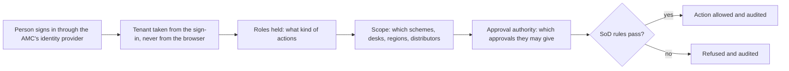

# BA-005 — User Roles, Permissions and Segregation of Duties

This document says who may do what in AMC OS: the roles people (and machines) hold, how a role is narrowed to the right schemes, desks or distributors, which domain each role can read, change or approve, who approves each step of the workflows in [BA-004](BA-004_end_to_end_workflows.md), and the segregation-of-duties (SoD) rules that stop one person from doing two conflicting things.

**Builds on Draft documents:** PRD-000 v0.9 Chapter 6 (the role matrix and SOD-01…SOD-11, re-keyed here), §2.1 and §2.3; BA-001, BA-002, BA-003, BA-004; GOV-001 — allowed by owner decision D-3 ([GOV-008 §2](../00_governance/GOV-008_build_loop.md#2-rules), rule 3). No document used here is Approved yet. Owner decision D-8 (each AMC's own identity provider) is applied in §2.

**What this document is not:** it is not the technical access-control design (token claims, policy engine, how scopes are checked in each service — EA-002 identity design, Step 10, and SEC-001, Step 25), nor the full list of API permissions (one per API operation, written with the OpenAPI contracts, Step 24). Every role, scope and approval level here is **tenant configuration** (CAP-D01-004, CAP-D01-005): this is the default an AMC starts from, not a fixed structure. It adds no new regulatory fact; where a role rests on regulation (CCO, risk officer, CISO) the label stays the one in BA-002 §2.

## 1. How access works (in plain terms) **[DES]**

1. **Role** — a job function (for example Fund Accountant). It decides the kind of action: read, create, approve and so on (RBAC, PRD-000 Chapter 6).
2. **Scope** — attributes that narrow the role (ABAC): a Fund Manager only for the schemes they manage, an RM only for mapped distributors, a Dealer only for their desk. "own" in the matrix means "within the user's scope".
3. **Approval authority** — an extra attribute on a role assignment that lets a person give a named approval (for example "Head of Fund Accounting" on a Fund Accountant). This replaces PRD-000's loose notes such as "A senior", "A manager", "A Head FA" (§4).
4. **SoD rules** — checked at the moment of the action and when roles are granted (§5).
5. **Audit** — every allowed or refused action that touches business data, every approval and every role change is an audit event (CAP-D01-010).

Action letters are those of PRD-000 Chapter 6: **R** read · **C** create · **U** update · **D** delete (only where the law allows — financial records are never deleted, only reversed) · **S** submit · **A** approve · **J** reject · **O** override · **E** export · **X** administer · **—** none.

## 2. Role catalogue

Role IDs `ROLE-nn` are proposed here **[DES]** so that permissions, workflows and tests can point to a role. They are not yet in the GOV-001 §4 identifier table (owner question Q17 in [LOOP_STATE.md](../../LOOP_STATE.md)). ROLE-01…ROLE-18 are the 18 business roles of PRD-000 §2.3 in the same order; ROLE-19 and ROLE-20 are its two platform roles; ROLE-21…ROLE-27 are new.

| ID | Role | Usual department (BA-002 §3) | Purpose | Source |
| --- | --- | --- | --- | --- |
| ROLE-01 | CEO | DEP-01 | Oversight; material approvals (regularisation, material NAV correction) | PRD-000 §2.3 |
| ROLE-02 | COO | Head of DEP-06, DEP-07, DEP-08 | Oversight of operations, accounting and investor services | PRD-000 §2.3 |
| ROLE-03 | CIO | Head of DEP-02, DEP-03, DEP-04, DEP-05 | Investment approvals, order approval above threshold, override with CCO | PRD-000 §2.3 |
| ROLE-04 | CFO | DEP-14 | Fees, period reopen, commission approval | PRD-000 §2.3 |
| ROLE-05 | CTO | DEP-15, DEP-17 | Technical configuration approval | PRD-000 §2.3 |
| ROLE-06 | Fund Manager | DEP-02 / DEP-03 | Portfolio decisions and orders for own schemes | PRD-000 §2.3 |
| ROLE-07 | Research Analyst | DEP-04 | Research, recommendations | PRD-000 §2.3 |
| ROLE-08 | Dealer | DEP-05 | Execution, blocks, allocation | PRD-000 §2.3 |
| ROLE-09 | Compliance Officer | DEP-09 | Rules, breaches, regulatory reports | PRD-000 §2.3 |
| ROLE-10 | Risk Manager | DEP-11 | Risk measures and reports | PRD-000 §2.3 |
| ROLE-11 | Fund Accountant | DEP-07 | Books, valuation, NAV preparation | PRD-000 §2.3 |
| ROLE-12 | Operations Analyst | DEP-06 | Settlement, corporate actions, reconciliations, exceptions | PRD-000 §2.3 |
| ROLE-13 | Product Manager | DEP-13 | Scheme set-up and documents | PRD-000 §2.3 |
| ROLE-14 | Distributor Manager | DEP-12 | Distributor master, commission runs | PRD-000 §2.3 |
| ROLE-15 | Relationship Manager (RM) | DEP-12 | Own distributors | PRD-000 §2.3 |
| ROLE-16 | Investor Service Executive | DEP-08 | Investor servicing on the RTA mirror | PRD-000 §2.3 |
| ROLE-17 | Technology Administrator | DEP-15 | Users, connections, configuration (no business roles, SOD-05) | PRD-000 §2.3 |
| ROLE-18 | Auditor | DEP-18 (and external auditors) | Read-only, with export for audit | PRD-000 §2.3 |
| ROLE-19 | Tenant Administrator | DEP-15 | AMC-side approval of role grants, tenant activation, break-glass | PRD-000 §2.3 (platform role) |
| ROLE-20 | Platform Operator | Outside the tenant (AMC OS vendor) | Runs the platform; no default access to business data (SOD-09) | PRD-000 §2.3 (platform role) |
| ROLE-21 | Legal Officer | DEP-10 | Scheme-document and contract review; secretarial work for boards and trustees | **new** (BA-002 §8 C1) |
| ROLE-22 | Information Security Officer | DEP-16 | Access policy, access reviews, break-glass review, audit-log integrity | **new** (BA-002 §8 C1) |
| ROLE-23 | Data Steward | DEP-17 | Master data, data quality, metric definitions | **new** (BA-002 §8 C1; BA-001 CAP-D16-004 (.3) steward queues) |
| ROLE-24 | Finance Officer | DEP-14 | Checker in Finance for commission runs and settlement-instruction changes | **new** — PRD-000 SOD-06 and SOD-07 name a checker "in Finance", but §2.3 has no Finance role below the CFO |
| ROLE-25 | Trustee (read-only) | Board of Trustees (outside the AMC) | Supervisory views and reports | **new** — PRD-000 §2.1 and BA-002 §1 give trustees read-only views |
| ROLE-26 | AI agent identity | Non-human | An AI assistant acting through the AI gateway with the calling user's scope | **new** as a role; rule from SOD-10 |
| ROLE-27 | Service account | Non-human | System-to-system calls (integrations, scheduled jobs) | **new** (BA-001 CAP-D01-002 (.4)) |

Notes:

- **Identity.** People sign in through the AMC's own identity provider (OIDC or SAML), or Keycloak for an AMC without one (owner decision D-8). Roles and scopes are held in AMC OS, not in the identity provider **[DES]**; how they are mapped is EA-002 (Step 10).
- **Departments are not roles.** A department (DEP-nn) groups people; a role says what they may do. A person in DEP-07 normally holds ROLE-11, but an AMC may configure differently.
- **Committees are not roles.** Investment Committee or Valuation Committee membership is an attribute with an effective date (BA-002 §2); it allows voting in that committee's workflow only.
- **DEP-19 (HR and administration)** has no role, as it uses no AMC OS capability (BA-002 §3).
- Which tasks ROLE-21…ROLE-24 do in a given AMC is **[ASSUMPTION]** — confirm: Product Manager, pilot discovery.

## 3. What each role may do, by domain

The table re-keys the PRD-000 Chapter 6 matrix from its 14 columns to the 17 domains. The rules for the re-keying are:

1. Each PRD-000 column goes to the domain(s) it covers: "Users & config" → D01; "Product & Scheme" → D02; "Research & Universe" → D03; "Portfolio" → D04; "Orders (OMS)" → D05 **and** D06; "Settlement & Ops" → D07 **and** D12; "Compliance rules & breaches" → D08; "Risk" → D09; "Accounting" → D10; "NAV" → D11; "Investor data (PII)" → D13; "Distribution & Commission" → D14; "Finance & MIS" → D15; "AI agents" → D17.
2. PRD-000 has no column for **D16 Enterprise Data**; the D16 column is new **[DES]**.
3. Cells marked **†** are changed or new here **[DES]**; all other cells are copied unchanged from PRD-000.

| Role | D01 | D02 | D03 | D04 | D05 | D06 | D07 | D08 | D09 | D10 | D11 | D12 | D13 | D14 | D15 | D16 | D17 |
| --- | --- | --- | --- | --- | --- | --- | --- | --- | --- | --- | --- | --- | --- | --- | --- | --- | --- |
| CEO | — | R A(material) | R | R | R | R | R | R A(regularise) | R | R | R A(material correction) | R | R masked | R | R E | R (certified)† | R use |
| COO | — | R | R | R | R | R | R A J E | R | R | R A(reopen with CFO) | R A J | R A J E | R masked | R | R E | R (certified)† | R use |
| CIO | — | R A(mandate) | R C U A J | R A | R A J O(with CCO) | R† | R | R | R | R | R | R | — | — | R | R (certified)† | R use |
| CFO | — | R A(fees) | — | R | R | R | R | R | R | R A(period) | R | R | R masked | R A(commission) | R C U A E | R (certified)† | R use |
| CTO | R A(tech config) | R | — | — | — | — | R (tech) | — | — | — | — | R (tech) | — | — | R | R A(tech config)† | R X(config) |
| Fund Manager | — | R | R C(recommend) | R C U own | R C U S own | R own† | R own | R own; S cure plan | R own | R own | R own | R own | — | — | R own | R (certified, own scope)† | R use |
| Research Analyst | — | R | R C U S own | R | — | — | — | R | R | — | — | — | — | — | — | R (certified, own scope)† | R use |
| Dealer | — | R | R | R | R U (route, block, allocate) | R C U S (route, block, allocate, external trades)† | R | R results | — | — | — | R | — | — | — | R (certified, own scope)† | R use |
| Compliance Officer | — | R A J | R C U (restricted list) A | R | R O(with 2nd approver) | R† | R | R C U S A J | R | R | R A(correction) | R | R masked E(audit) | R A(due diligence) | R | R (certified, own scope)† | R use, R logs |
| Risk Manager | — | R | R | R | R | R | R | R | R C U S A(CRO) | R | R | R | — | — | R | R (certified, own scope)† | R use |
| Fund Accountant | — | R | — | R | R | R | R | R | R | R C S (A senior) | R C S (A Head FA) | R | R masked | — | R | R (certified, own scope)† | R use |
| Operations Analyst | — | R | R | R | R | R C U S (confirmation, breaks, external trades)† | R C U S (A manager) | R | — | R | R | R C U S (A manager) | R masked | R | — | R (certified, own scope)† | R use |
| Product Manager | — | R C U S (A head) | R | R | — | — | — | R | R | — | R | — | — | R | R | R (certified, own scope)† | R use |
| Distributor Manager | — | R | — | — | — | — | — | — | — | — | R | — | — | R C U S | R own | R (certified, own scope)† | R use |
| RM | — | R | — | — | — | — | — | — | — | — | R | — | — | R own | R own | R (certified, own scope)† | R use |
| Investor Service Executive | — | R | — | — | — | — | — | — | — | — | R | — | R C U S (A supervisor); unmask with reason | — | — | R (certified, own scope)† | R use |
| Technology Administrator | C U S (A Tenant Admin) | — | — | — | — | — | R (connections) C U S | — | — | — | — | R (connections) C U S | — | — | — | C U S (pipelines, connections)† | X (agent config, not data) |
| Auditor | R (audit log) | R | R | R | R | R | R | R | R | R E | R E | R | R masked E | R E | R E | R E† | R logs |

**Changed or new cells (†), with reasons:**

| Role | Domain | PRD-000 cell | Here | Reason |
| --- | --- | --- | --- | --- |
| Dealer | D06 | R U (route, block, allocate) | R C U S (route, block, allocate, external trades) | Dealer is a maker for externally booked trades (WF-024) |
| Operations Analyst | D06 | R | R C U S (confirmation, breaks, external trades) | DEP-06 is accountable for trade confirmation and execution reconciliation (BA-002 §4; WF-025) and is a maker in WF-024 |
| Fund Manager | D06 | R C U S own (copied from Orders) | R own | Execution is the dealer's job; create/submit rights on execution would weaken SOD-03 |
| CIO | D06 | R A J O(with CCO) (copied from Orders) | R | Approval and override act on the order (D05); there is no execution-level approval or override |
| Compliance Officer | D06 | R O(with 2nd approver) (copied from Orders) | R | As for the CIO: the compliance override acts on the order in D05 (WF-005) |
| CEO, COO, CIO, CFO | D16 | — (no column) | R (certified) | Read certified datasets and metrics (CAP-D16-007, CAP-D16-012) |
| CTO | D16 | — (no column) | R A(tech config) | Same as the CTO's D01 right |
| Technology Administrator | D16 | — (no column) | C U S (pipelines, connections) | Same as the Technology Administrator's connection rights in D07/D12 |
| Auditor | D16 | — (no column) | R E | Same as the Auditor's rights elsewhere |
| All other business roles | D16 | — (no column) | R (certified, own scope) | Read certified datasets and metrics within the role's own scope (CAP-D16-007, CAP-D16-012); no change rights |

**New roles (not in the PRD-000 matrix)** **[DES]**:

| Role | Rights |
| --- | --- |
| ROLE-19 Tenant Administrator | D01: R A J (approves role grants, configuration on the technical side, tenant activation, break-glass requests). Holds no business role and no other role (SOD-16). The first Tenant Administrator is named by the AMC at onboarding and confirmed in WF-019; later Tenant Administrator grants are approved by another Tenant Administrator (SOD-16), so an AMC needs at least two **[DES]** |
| ROLE-20 Platform Operator | Platform level only: X on tenants, cells and releases; **no** right on any tenant's business data. Break-glass access only through WF-022 (SOD-09) |
| ROLE-21 Legal Officer | D02: R A J (scheme documents, with Compliance); D08: R; D01: — ; other domains: R where a document under review needs it **[ASSUMPTION]** |
| ROLE-22 Information Security Officer | D01: R, recertification review, access-policy configuration (A); audit log: R E; D17: R logs. No business-data change rights |
| ROLE-23 Data Steward | D16: R C U S (master data, data quality rules, metric drafts); metric certification needs a checker from the metric's business owner (CAP-D16-012) **[DES]** |
| ROLE-24 Finance Officer | D14: R A J (checker of commission runs, SOD-07); D07: A J (checker of settlement-instruction and bank-detail changes, SOD-06); D15: R C U S |
| ROLE-25 Trustee (read-only) | R on supervisory reports and evidence packs (CAP-D08-012 (.2), CAP-D09-012 (.3), CAP-D15-009 (.4)); investor personal data masked; nothing else |
| ROLE-26 AI agent identity | The read tools the AI gateway allows, plus tools that create **proposals or drafts** (for example proposed orders, proposed matches, draft register entries, draft replies — PRD-000 §9.3) that enter the owning domain's normal human approval workflow (ADR-0008 decision 3); always inside the calling user's scope (CAP-D17-001 (.2)); **never** A, O, post, publish or execute in any domain (SOD-10) |
| ROLE-27 Service account | Only the API operations its integration needs; never A or O **[DES]**; owner named for each account; reviewed in every recertification (WF-020) |

**Market-abuse oversight.** BA-002 §2 records **[REG]** (secondary source) that the CEO/MD and the CCO are responsible for the AMC's mechanism against market abuse, including review of recorded communications and dealing-room access logs. Where those logs are held in AMC OS (for example dealing-desk access in the audit log), the CEO and the Compliance Officer with the CCO authority get read access to them **[DES]**. Which of these records AMC OS holds at all is open (§7 C6).

**Personal data and exports** (from PRD-000 Chapter 6, unchanged): investor personal data is masked by role; an Investor Service Executive may unmask with a recorded reason; every export is watermarked with user and time; personal-data exports need a reason and approval; a bulk export above a threshold raises an alert (the threshold is tenant configuration **[ASSUMPTION]**).

## 4. Approval authorities and who approves each workflow step

PRD-000 and BA-004 name approvers such as "Head of Fund Accounting" or "Operations Manager" that are not roles. Here each one is an **approval authority** held on top of a role **[DES]**:

| Approval authority | Held with role | Department | Replaces PRD-000 note | Used in |
| --- | --- | --- | --- | --- |
| Head of Products | ROLE-13 Product Manager | DEP-13 | "A head" (Product & Scheme) | WF-001 |
| Head of Research | ROLE-07 Research Analyst (or ROLE-03 CIO) | DEP-04 | — | WF-002 |
| Head of Dealing | ROLE-08 Dealer | DEP-05 | — | WF-004, WF-023, WF-025 |
| Head of Fund Accounting | ROLE-11 Fund Accountant | DEP-07 | "A Head FA" | WF-007, WF-008, WF-017 |
| Senior Fund Accountant | ROLE-11 Fund Accountant | DEP-07 | "A senior" | Accounting approvals; price overrides (WF-007) |
| Operations Manager | ROLE-12 Operations Analyst | DEP-06 | "A manager" | WF-015, WF-024, WF-027, WF-028 |
| Investor Service Supervisor | ROLE-16 Investor Service Executive | DEP-08 | "A supervisor" | Investor service approvals |
| Chief Compliance Officer (CCO) | ROLE-09 Compliance Officer | DEP-09 | CCO in SOD-04 | WF-005, WF-014, WF-016 |
| Risk officer | ROLE-10 Risk Manager | DEP-11 | "A(CRO)" | Risk report approval |
| Committee member | Any role + membership | Investment or Valuation Committee | — | WF-002, fair values (WF-007) |
| Bank-mandate signatory | As named in the AMC's bank mandate; how many must sign each payment is **[ASSUMPTION]** (BA-004 WF-026) | DEP-06, DEP-14 | "two bank-mandate signatories" (SOD-07) | WF-011, WF-013, WF-026 |

The approval actions of BA-004, with the permission name in PRD-000's `domain.object.action` style (the domain part uses the owning schema from GOV-001 §3). Final API permission names are set with the OpenAPI contracts (Step 24).

| Permission | Capability | Workflow | Maker | Checker (≠ maker) | SoD rule |
| --- | --- | --- | --- | --- | --- |
| `product.scheme.approve` | CAP-D02-008 | WF-001 | Product Manager | Head of Products, then Compliance Officer; trustee evidence attached | SOD-01 |
| `investment.universe.approve` | CAP-D03-007 | WF-002 | Research Analyst | Head of Research, or Investment Committee vote | SOD-01 |
| `trading.order.approve` | CAP-D05-003 | WF-004 | Fund Manager | CIO (above the order threshold, tenant configuration **[ASSUMPTION]**) | SOD-01 (SOD-03 applies when the dealer takes the order, not here) |
| `execution.allocation.approve_deviation` | CAP-D06-004 | WF-004 | Dealer | Head of Dealing **and** Compliance Officer | SOD-01 |
| `compliance.pretrade.override` | CAP-D08-011 | WF-005 | Fund Manager (requests) | CCO **and** CIO (or delegates) | SOD-04 |
| `execution.trade.approve_external` | CAP-D06-007 | WF-024 | Dealer or Operations Analyst | A second Dealer, or the Operations Manager **[DES]** | SOD-01 |
| `execution.trade.correct` | CAP-D06-008 | WF-025 | Dealer or Operations Analyst | Head of Dealing **[DES]** | SOD-01 |
| `execution.broker.approve` | CAP-D06-001 | WF-023 | Head of Dealing | Body named in the AMC's broker policy **[ASSUMPTION]** (BA-004 WF-023) | SOD-14 |
| `settlement.ssi.approve` | CAP-D07-004 | WF-028 | Operations Analyst | Finance Officer or Operations Manager, after call-back | SOD-06 |
| `settlement.payment.release` | CAP-D07-003, CAP-D12-009 | WF-026 | Operations Analyst | Bank-mandate signatories (number **[ASSUMPTION]**) | SOD-01 |
| `settlement.fail.cancel` | CAP-D07-008, CAP-D12-009 | WF-027 | Operations Analyst | Operations Manager | SOD-01 |
| `valuation.price.override` | CAP-D11-002 | WF-007 | Fund Accountant | Senior Fund Accountant | SOD-01 |
| `nav.run.approve` | CAP-D11-012 | WF-007 | Fund Accountant (preparer) | Head of Fund Accounting | SOD-01, SOD-02 |
| `nav.correction.approve` | CAP-D11-014 | WF-017 | Fund Accountant or Compliance Officer | Head of Fund Accounting, Compliance Officer **and** CEO | SOD-01 |
| `accounting.period.close` | CAP-D10-013 | WF-008 | Fund Accountant | Head of Fund Accounting | SOD-01 |
| `accounting.period.reopen` | CAP-D10-013 | WF-008 | Fund Accountant | CFO **and** Head of Fund Accounting | SOD-01 |
| `compliance.breach.approve_plan` | CAP-D08-011 | WF-014 | Fund Manager | Compliance Officer | SOD-01 |
| `compliance.breach.regularise` | CAP-D08-011 | WF-014 | Compliance Officer | CCO **and** CEO | SOD-01 |
| `compliance.report.approve` | CAP-D08-013 | WF-016 | Compliance Officer | CCO | SOD-01 |
| `compliance.rule.approve` | CAP-D08-001 | (rule lifecycle, PRD-008 Step 8) | Compliance Officer (author) | Another Compliance Officer; tests must pass | SOD-08 |
| `operations.break.force_match` | CAP-D12-009 | WF-015 | Operations Analyst | Operations Manager | SOD-01 |
| `operations.payout.release` | CAP-D12-009 | WF-011 | Operations Analyst | Two authorisers (bank-mandate signatories) | SOD-01 |
| `distribution.commission_run.approve` | CAP-D14-011 | WF-013 | Distributor Manager | Finance Officer or CFO; payment by two signatories | SOD-07 |
| `platform.role_grant.approve` | CAP-D01-004 | WF-020 | Technology Administrator | Tenant Administrator (another Tenant Administrator for a Tenant Administrator grant) | SOD-05, SOD-16 |
| `platform.access.recertify` | CAP-D01-002 | WF-020 | Role owner (department head) | — (review; reported to DEP-16) | SOD-13 |
| `platform.config.approve` | CAP-D01-008 | WF-021 | Technology Administrator or setting owner | Checker from the department that owns the setting; plus Compliance Officer for a regulatory parameter | SOD-12 |
| `platform.breakglass.approve` | CAP-D01-005 | WF-022 | Platform Operator | Tenant Administrator | SOD-09, SOD-15 |
| `platform.tenant.activate` | CAP-D01-001 | WF-019 | Platform Operator | Tenant Administrator | SOD-15 |

## 5. Segregation-of-duties rules

SOD-01…SOD-11 are carried over from PRD-000 Chapter 6 unchanged (labels included). SOD-12…SOD-16 are new **[DES]**, written for the BA-004 workflows that PRD-000 did not have.

| ID | Rule | Checked when | Source |
| --- | --- | --- | --- |
| SOD-01 | Maker ≠ checker on every maker-checker action; enforced in the service and by a database check on approval rows (`approved_by <> created_by`) | Every approval | PRD-000 |
| SOD-02 | NAV preparer ≠ NAV approver; the NAV approver cannot have the Dealer or Fund Manager role in the same tenant | NAV approval; role grant | PRD-000 |
| SOD-03 | The Fund Manager who originates an order cannot be the dealer who executes it (tenant-configurable; default on) | Order release; role grant | PRD-000 |
| SOD-04 | A compliance override needs two distinct approvers from Compliance and Investment (CCO + CIO or delegates) | Override | PRD-000 |
| SOD-05 | The Technology Administrator cannot grant roles to themselves; role grants need Tenant Administrator approval; the Technology Administrator cannot hold business roles | Role grant | PRD-000 |
| SOD-06 | Bank / SSI master changes: maker in Operations, checker in Finance or the Operations Manager, plus call-back flag | SSI or bank-detail change (WF-028) | PRD-000 |
| SOD-07 | Commission run: maker in distribution operations, checker in Finance; payment release needs two bank-mandate signatories | WF-013 | PRD-000 |
| SOD-08 | Rule author ≠ rule approver; the rule tester may be the author but approval requires passing tests | Rule approval | PRD-000 |
| SOD-09 | Platform operators have zero default access to tenant business data; break-glass access needs tenant approval, is time-boxed (≤ 4 h), fully logged and reported to the tenant **[DES; CSCRF alignment VAL]** | WF-022 | PRD-000 |
| SOD-10 | AI agent identities hold no A, O, post, publish or execute permissions in any domain | Role grant to ROLE-26 | PRD-000 |
| SOD-11 | Toxic-combination scan: a nightly job flags users holding conflicting roles and reports to Compliance | Nightly | PRD-000 |
| SOD-12 | A configuration change is checked by someone from the department that owns the setting; a regulatory parameter also needs a Compliance Officer as checker | WF-021 | **new** (BA-004 WF-021) |
| SOD-13 | Nobody certifies their own access in a recertification | WF-020 | **new** (BA-004 WF-020) |
| SOD-14 | The person who proposes a broker (Head of Dealing) is not the only approver of its empanelment | WF-023 | **new** (BA-004 WF-023) |
| SOD-15 | A platform operator can never be the checker for a tenant action; tenant activation and break-glass access need confirmation by the tenant's own Tenant Administrator | WF-019, WF-022 | **new** (BA-004 WF-019, WF-022) |
| SOD-16 | Nobody approves a role grant, scope change or approval authority for themselves; a grant of the Tenant Administrator role is approved by another Tenant Administrator and reported to the Information Security Officer; the Tenant Administrator holds no other role | WF-020; role grant | **new** (review STEP-05 round 1) |

**Conflicting role pairs** checked at grant time and by the SOD-11 nightly scan (from SOD-02, SOD-03, SOD-05, SOD-09, SOD-10, SOD-16):

| Role A | Cannot also hold | Rule |
| --- | --- | --- |
| A Fund Accountant with the Head of Fund Accounting authority (NAV approver) | Dealer, Fund Manager | SOD-02 |
| Fund Manager | Dealer (for the same schemes), unless the tenant switches SOD-03 off | SOD-03 |
| Technology Administrator | Any other role (ROLE-01…ROLE-16, ROLE-18, ROLE-19, ROLE-21…ROLE-25) | SOD-05 (PRD-000: no business roles; extended to the new roles and to Tenant Administrator so one person cannot both make and approve role grants) |
| Tenant Administrator | Any other role | SOD-16 |
| AI agent identity | Any approval authority | SOD-10 |
| Platform Operator | Any role inside a tenant | SOD-09, SOD-15 |

### 5.1 Can a SoD rule ever be waived?

PRD-000 says only that SOD-03 can be switched off by the tenant. Whether any other rule may be waived, by whom and for how long, is the owner's decision (question **Q18** in LOOP_STATE.md). **Default used until he answers [ASSUMPTION]:** no rule other than SOD-03 can be waived; SOD-03 is switched off only by a configuration change (WF-021) checked by a Compliance Officer, and the switch-off is shown in the SOD-11 nightly report.

## 6. Points BA-004 left for this document

| BA-004 open point | Answer here |
| --- | --- |
| Who may grant a SoD exception (WF-020) | §5.1 — default "only SOD-03, by configuration"; owner question Q18 |
| Named heads used as initiators and approvers (Head of Dealing, Head of Fund Accounting, Operations Manager…) | §4 approval authorities |
| Approver of configuration changes (WF-021) | §4 `platform.config.approve` and SOD-12 |
| Approver of broker empanelment (WF-023) | Still the body named in the AMC's broker policy **[ASSUMPTION]**, confirm in pilot discovery; SOD-14 added |
| Checker "in Finance" (SOD-06, SOD-07) with no Finance role in PRD-000 | ROLE-24 Finance Officer |

## 7. Consistency points found (to be closed in later steps)

| # | Point | Where it is closed |
| --- | --- | --- |
| C1 | `ROLE-nn` IDs are not in GOV-001 §4 | Owner (Q17) |
| C2 | PRD-000 Chapter 6 has 14 columns, not 17 domains; D06/D07/D12 share columns, D16 has none. The re-keying in §3 copies the shared column into each domain (with the D06 corrections marked †). **This differs from BA-001 §7**, which says BA-005 groups permissions by capability: here only the approval permissions in §4 carry `CAP-` IDs; rights per capability inside each domain are set in the per-domain PRDs | PRD-001…PRD-017 (Steps 6–9) |
| C3 | A small new AMC (owner decision D-11: new AMCs first) may have too few people to keep every SoD rule (SOD-16 alone needs two Tenant Administrators) (for example a two-person accounting team cannot have separate preparer, senior and head). How AMC OS should support very small teams without weakening SOD-01 is open | Pilot discovery; owner (Q18) |
| C4 | PRD-000 SOD-09 is labelled "CSCRF alignment VAL"; BA-002 §2 notes CSCRF obligations depend on whether an AMC is a Qualified RE | REG-001, SEC-001 (Step 25) |
| C5 | BA-003 has no terms for "role", "scope" or "approval authority" | Next BA-003 revision |
| C6 | Which market-abuse records (recorded communications, dealing-room access logs) AMC OS holds, as opposed to the AMC's telephony or physical-access systems | SEC-001, REG-001 (Step 25); pilot discovery |

## 8. How this document was checked

- The §3 matrix was generated by a Python script from the PRD-000 Chapter 6 table, so the copied cells are exactly PRD-000's; only the cells marked † were set by hand, and each is listed in the change table.
- Every `CAP-`, `DEP-`, `WF-` and `SOD-` ID used here exists in BA-001, BA-002, BA-004 or this document; every department DEP-01…DEP-18 has at least one role (checked by script, 20 Nov 2026).

## Sources

All sources are inside this repository; no external facts are introduced.

| # | Source | Used for |
| --- | --- | --- |
| R1 | [PRD-000 v0.9](../03_product_requirements/PRD-000_master_prd_v0.9.md) Chapter 6, §2.1, §2.3 | Roles, matrix, legend, SOD-01…SOD-11, export controls |
| R2 | [BA-004](BA-004_end_to_end_workflows.md) §3, §4 | Approval steps per workflow; open points |
| R3 | [BA-002](BA-002_amc_operating_model.md) §1–§4, §8 | Departments, committees, accountable departments, missing roles (C1) |
| R4 | [BA-001](BA-001_business_capability_map.md) §3 | Capability IDs (CAP-D01-002…005, CAP-D16-004, CAP-D17-001) |
| R5 | [GOV-001](../00_governance/GOV-001_document_control_and_identifiers.md) §3, §4 | Schema names, identifier formats |
| R6 | [LOOP_STATE.md](../../LOOP_STATE.md) owner decisions D-8, D-11 | Identity provider; first target segment |
