# AMC OS — Product Requirements Document (PRD)

Nov 19, 2026 · @Suchit

## How to read this PRD

> **Re-keying status (added 21 Nov 2026, build loop Step 9c).** All 15 modules of Chapter 3, Chapter 4 (W1–W17, W6b), the Chapter 5 stories, the Chapter 6 matrix and 9 of the 11 Chapter 9 agents are now re-keyed into the per-domain documents [PRD-001](PRD-001_platform_administration.md) … [PRD-017](PRD-017_ai_and_decision_intelligence.md), [BA-004](../02_business_architecture/BA-004_end_to_end_workflows.md) and [BA-005](../02_business_architecture/BA-005_roles_and_permissions.md) (GOV-006 Steps 4–9); read those for these parts. **Not yet re-keyed, so this file is still the source for them:** the Portfolio Agent and Product Intelligence Agent (Chapter 9, PRD-017 C4), Chapter 7 rows not carried into the per-domain NFR sections, Chapter 8 external integrations (INT-001, Step 14), Chapter 10 roadmap and Appendix A regulatory register (REG-001, Step 25). The text below is kept unchanged as the v0.9 source. GOV-006 Step 9 says to mark this PRD "Superseded", but GOV-001 §1 allows Superseded only when a newer **Approved** document replaces it, and none is Approved yet; the status change is left to the project owner (owner question Q60).

AMC OS is a multi-tenant, API-first operating system for Indian mutual fund AMCs, built around deterministic financial engines with AI kept strictly in an advisory role. This PRD is Deliverable One. Deliverable Two (Database Architecture) is a separate doc, with full PostgreSQL DDL delivered as a .sql file.

**Version:** 0.9 draft for architecture review. **Regulatory baseline:** SEBI (Mutual Funds) Regulations, 2026 (in force from 1 April 2026) and the SEBI Master Circular for Mutual Funds dated 20 March 2026, plus later circulars listed in the Appendix.

Every requirement that touches regulation carries one of four labels:

| Label | Meaning | Who signs off |
| --- | --- | --- |
| **\[REG\]** Confirmed regulatory requirement | Traced to a named SEBI/AMFI/RBI/statutory source | Compliance, then legal |
| **\[IND\]** Industry operational practice | How Indian AMCs and RTAs usually operate; not law | Operations head |
| **\[DES\]** Product design recommendation | Our architectural choice | Product + CTO |
| **\[VAL\]** Needs legal / compliance validation | A threshold, timeline or method we must not hard-code until confirmed | Compliance officer |

**Rule for engineers:** no regulatory number (limit, cut-off time, percentage, timeline) is hard-coded. Every such number lives in the Regulatory Rule Registry (Module 06) as an effective-dated, versioned, approved parameter. Numbers quoted in this PRD are illustrative unless marked \[REG\] with a source.

**Plain-language glossary of terms used often:**

- **Tenant** — one AMC using the platform. Each tenant's data is walled off from every other tenant.
- **Maker-checker** — one person prepares (maker), a different person approves (checker). The system blocks the same person doing both.
- **Deterministic engine** — code that gives the exact same answer every time for the same inputs. All money numbers come from these, never from AI.
- **Effective-dated** — a value that knows the date range it applies to, so past NAVs can be recalculated exactly as they were.
- **Idempotent** — sending the same request twice has the same effect as sending it once (no double orders, no double journal entries).
- **Modular monolith** — one deployable application split into strict internal modules with their own data; can be split into separate services later.

**Gap in the source brief:** the uploaded master prompt ends mid-word in Deliverable Two, Chapter 9 ("Archival. Co…"). Anything after that point was not received. The Database doc covers the remaining Chapter 9 items plus the likely next topics (compression, concurrency, backup, security, testing) as best effort. Please send the rest of the brief if it had further chapters.

## Chapter 1 — Executive Summary

### 1.1 Product overview

AMC OS is one platform that runs an Indian mutual fund AMC end to end: from launching a scheme, to researching and buying securities, to striking the daily NAV, to servicing investors and paying distributors. It replaces today's patchwork of a separate OMS, a separate fund-accounting system, spreadsheets for compliance and risk, RTA reports for investor data, and Excel for MIS.

It is sold as multi-tenant SaaS. Many AMCs share the same software, but each AMC's data, users, AI context and audit trail are fully isolated. Large AMCs can opt for a dedicated database or a dedicated deployment.

### 1.2 Product vision

*"Every number an AMC reports — NAV, AUM, exposure, revenue, commission — is produced by one auditable system, reproducible to the paisa for any past date, and explained in plain language on demand."*

### 1.3 Problem statement

| Problem today | Effect on the AMC | AMC OS answer |
| --- | --- | --- |
| Front office (OMS), middle office (compliance/risk) and back office (fund accounting, NAV) run on different vendors' systems | Daily reconciliations between systems; breaks found late; manual re-keying | One canonical data model; holdings, trades and ledger share the same identifiers |
| Investment limits checked in spreadsheets or partially in the OMS | Breaches found post-trade; regulatory risk | Rule engine with versioned, effective-dated rules run pre-trade and post-trade on the same code |
| NAV computed by fund accountant/custodian, then re-checked manually | Late NAV, error risk, costly NAV corrections | Deterministic NAV engine with automated validation gates and maker-checker approval |
| Investor and distributor data sits with the RTA (CAMS/KFin) | AMC analytics depend on RTA files arriving; slow MIS | Daily RTA feed ingestion into a governed warehouse with a metric registry |
| MIS built manually in Excel | Days of turnaround; inconsistent definitions of AUM, net sales, yield | Single semantic layer; one definition per metric, versioned |
| AI tools used ad hoc with no controls | Risk of wrong numbers, data leaks between entities | AI only reads deterministic outputs, works through approved tools, and every action is logged and human-approved |

### 1.4 Target customers

1. **Primary:** SEBI-registered mutual fund AMCs in India — mid-size and emerging AMCs (fastest decision cycles, weakest legacy lock-in), then large AMCs module by module.
2. **New entrants:** AMCs licensed under the newer sponsor routes and "MF Lite" (passive-only) regime **\[VAL: confirm current eligibility terms in MF Regulations 2026\]** who need a full stack quickly.
3. **Module buyers:** AMCs that keep their existing OMS or fund accounting but buy Compliance, Risk, Distribution Analytics or AI modules.
4. **Adjacent (later):** Specialized Investment Fund (SIF) arms of AMCs, PMS and AIF managers within the same groups.

### 1.5 Value proposition

- **For the CIO / fund managers:** pre-trade compliance in under a second; one view of portfolio, cash and limits.
- **For the COO / operations:** NAV ready earlier with fewer manual checks; reconciliation breaks auto-classified.
- **For the CFO:** scheme-level profitability, TER and yield analytics from the ledger, not from spreadsheets.
- **For Compliance:** every rule versioned and traceable to its circular; evidence packs generated automatically.
- **For the CEO / board:** one trusted set of numbers; an AI copilot that explains them and cites the source.
- **For the CTO:** API-first, modular, cloud-native, SEBI CSCRF-aligned security.

### 1.6 Competitive differentiation

1. **Front-to-back on one data model** — most Indian AMCs integrate 4–6 vendor systems.
2. **Regulation as versioned configuration** — rules are data with effective dates, test cases and approvals, not hard-coded logic.
3. **Historical reproducibility** — any NAV, exposure or report can be re-run "as of" any past date with the rule and price versions then in force.
4. **Governed AI** — agents are tenant-isolated, tool-restricted and cannot move money or approve anything.
5. **India-native** — RTA, KRA/CKYC, AMFI, exchange MF platforms and SEBI reporting formats are first-class.

### 1.7 Product boundaries (what AMC OS is NOT)

- **Not an RTA.** CAMS / KFin remain the Registrar and Transfer Agent of record for investor unit-holding unless the AMC chooses otherwise. AMC OS holds a synchronized investor and transaction ledger for servicing, analytics and reconciliation. **\[IND\]** A future "RTA-grade" mode is a separate regulatory decision. **\[VAL\]**
- **Not a custodian, broker, exchange or bank.** It sends instructions to them and reconciles their confirmations.
- **Not a KRA or CKYC registry.** It queries and uploads through their approved channels.
- **Not an execution venue or algorithmic trading engine.** It routes orders to brokers; algo execution is the broker's.
- **Not a statutory accounting system for the AMC company itself.** It produces scheme accounts and AMC management P\&L; the AMC's corporate GL (e.g., SAP/Tally) remains separate, with an export interface.
- **AI never** executes trades, approves transactions, posts journals, publishes NAV, changes rules or overrides compliance.

## Chapter 2 — Business Architecture

### 2.1 AMC business operating model

An Indian mutual fund has three legal layers: the **Sponsor** sets up the **Trust** (overseen by the **Trustees**), which appoints the **AMC** to manage the schemes. **\[REG — MF Regulations 2026\]** The AMC runs the business; the Trustees supervise it; the Custodian holds the assets; the RTA keeps investor records. AMC OS serves the AMC and gives Trustees read-only supervisory views.

The AMC's work falls into six value streams:

| Value stream | What it does | AMC OS modules |
| --- | --- | --- |
| Manufacture | Design, launch and maintain schemes | 01 Product & Scheme |
| Invest | Research, decide, construct portfolios, trade | 02 Investment, 03 Portfolio, 04 OMS, 05 Trading & Settlement |
| Control | Keep within regulation and mandate; measure risk | 06 Compliance, 07 Risk |
| Account & value | Book every event, value the fund, publish NAV | 08 Fund Accounting, 09 NAV, 10 Fund Operations |
| Distribute & service | Gather assets, serve investors, pay distributors | 11 Investor, 12 Distribution |
| Steer | Measure profit, plan, decide | 13 Finance & MIS, 14 Data & Analytics, 15 AI |

### 2.2 Department hierarchy

- **Board of AMC** and **Board of Trustees** (supervisory)
- **CEO / MD**
  - **CIO** — Equity Investments (fund managers, research analysts), Fixed Income Investments (fund managers, credit analysts), Dealing desk (equity dealers, debt dealers)
  - **COO** — Fund Operations, Fund Accounting & NAV, Investor Services, Settlement, Technology operations (often)
  - **CFO** — Finance, FP&A, Taxation, Treasury (AMC own funds)
  - **Chief Compliance Officer** — Compliance monitoring, Regulatory reporting, Legal & Secretarial (sometimes separate)
  - **Chief Risk Officer** — Investment risk, Operational risk, Enterprise risk **\[REG — risk management framework under MF Master Circular; VAL exact CRO reporting line\]**
  - **CBO / Head of Sales** — National/zonal/regional/branch sales, RMs, Distributor management, Channel heads (Banks, National Distributors, IFAs, Digital)
  - **Head of Products** — Product design, Product marketing
  - **CTO / CISO** — Technology, Information Security **\[REG — CSCRF requires a designated CISO\]**
  - **Strategy / MD's Office, Internal Audit, HR, Marketing**

### 2.3 User roles (summary; full matrix in Chapter 6)

18 business roles are defined: CEO, COO, CIO, CFO, CTO, Fund Manager, Research Analyst, Dealer, Compliance Officer, Risk Manager, Fund Accountant, Operations Analyst, Product Manager, Distributor Manager, RM, Investor Service Executive, Technology Administrator, Auditor. Two platform roles sit above tenants: **Platform Operator** (our SRE team — no business-data access by default) and **Tenant Administrator** (AMC-side user admin).

### 2.4 Core business processes

| # | Process | Frequency | Owner |
| --- | --- | --- | --- |
| P1 | Scheme launch (NFO) | Per scheme | Head of Products |
| P2 | Research → investment committee → approved universe | Continuous / weekly | CIO |
| P3 | Portfolio construction and rebalancing | Daily / event-driven | Fund Manager |
| P4 | Order → pre-trade compliance → execution → allocation | Intraday | Dealer |
| P5 | Trade settlement and custodian reconciliation | T, T+1 | Operations |
| P6 | Daily NAV calculation, validation, approval, publication | Every business day | Fund Accounting |
| P7 | Daily / monthly accounting close | Daily / monthly | Fund Accounting |
| P8 | Corporate actions | Event-driven | Operations |
| P9 | Investor purchase / redemption / switch / SIP / STP / SWP | Daily | RTA + Investor Services |
| P10 | Distributor commission | Monthly | Distribution Ops + Finance |
| P11 | Compliance monitoring and breach resolution | Daily / event | Compliance |
| P12 | Regulatory reporting | Daily / monthly / quarterly | Compliance |
| P13 | Management reporting (MIS) | Daily / monthly | Strategy / Finance |

### 2.5 Interdepartmental dependencies

The most important hand-offs, each of which is a system event in AMC OS:

1. **Investor flows → Fund Manager:** net subscriptions/redemptions from the RTA set tomorrow's investable cash. *Event:* `investor.flows.provisional` (intraday) and `investor.flows.final`.
2. **Fund Manager → Dealer:** approved orders. *Event:* `oms.order.released`.
3. **Compliance → Dealer:** pass / warn / block before release. *Event:* `compliance.pretrade.result`.
4. **Dealer → Operations:** executed and allocated trades. *Event:* `trading.trade.confirmed`.
5. **Operations → Fund Accounting:** settled trades, corporate actions, cash. *Event:* `settlement.status.changed`.
6. **Fund Accounting → NAV:** closed day ledger. *Event:* `accounting.day.closed`.
7. **NAV → RTA / AMFI / website:** approved NAV. *Event:* `nav.published`.
8. **RTA → Distribution / Finance:** transaction-level data for commission and revenue. *Event:* `investor.transactions.loaded`.
9. **Finance → Product / Sales:** TER, yield and profitability. *Event:* `finance.period.closed`.

### 2.6 Stakeholders

| Internal | External |
| --- | --- |
| Board of AMC, Trustees, CEO, CXOs, fund managers, analysts, dealers, compliance, risk, ops, fund accounting, investor services, sales, RMs, finance, strategy, IT, internal audit | SEBI, AMFI, RTAs (CAMS, KFin), custodians, brokers, stock exchanges (NSE, BSE) and their MF platforms, clearing corporations (NCL, ICCL), depositories (NSDL, CDSL), banks and payment aggregators, KRAs, CKYC registry (CERSAI), credit rating agencies, valuation agencies, data vendors (FactSet etc.), statutory and concurrent auditors, distributors (MFDs, banks, national distributors, RIAs), investors |

## Chapter 3 — Functional Requirements

Each of the 15 modules below is specified against the same 18 points. Requirement IDs use the form `FR-<module>-<nn>`; priority is **M** (must, release-blocking) or **S** (should). Common rules that apply to every module are stated once here and not repeated:

- **C1 Tenancy.** Every record carries `tenant_id`; every query is filtered by PostgreSQL row-level security. **\[DES\]**
- **C2 Audit.** Every create, update, state change, approval, export and login writes an append-only audit event with actor, time, before/after values and reason. **\[REG — record keeping under MF Regulations 2026; DES for format\]**
- **C3 Maker-checker.** Any action marked "MC" needs a second, different user with the approver permission. Same user cannot make and check. **\[DES; IND\]**
- **C4 Effective dating.** Master data, rules, rates and prices are effective-dated; history is never overwritten. **\[DES\]**
- **C5 Money.** All amounts are `NUMERIC`; units to 4 decimals and NAV to 4 decimals by default, configurable per scheme. **\[VAL — confirm current decimal conventions for units and NAV with RTA and the Master Circular\]**
- **C6 APIs.** Every capability is available by REST API (OpenAPI 3.1) and emits domain events; the UI uses the same APIs. **\[DES\]**
- **C7 Idempotency.** Every write API accepts an `Idempotency-Key` header. **\[DES\]**
- **C8 AI boundary.** AI features may read and propose, never approve or post. **\[DES — brief principle 3.1\]**

### Module 01 — Product and Scheme Management

| Point | Specification |
| --- | --- |
| 1. Objective | Be the single source of truth for every scheme, plan and option: what it is, what it may invest in, what it charges, and what state it is in. |
| 2. Business problem | Scheme facts are scattered across SID PDFs, RTA masters, the OMS and spreadsheets. A change in benchmark or exit load is updated in some places and not others. |
| 3. Primary users | Product Manager, Head of Products, Compliance Officer, Legal, CIO (mandate), Fund Accounting (fees), RTA (via interface) |
| 4. Roles | Product Manager (maker), Head of Products (checker), Compliance Officer (regulatory checker), Trustee viewer (read) |
| 11. API dependencies | `product-svc`: `/schemes`, `/schemes/{id}/plans`, `/schemes/{id}/versions`, `/nfos`, `/documents`; consumes `compliance-svc` rule templates; publishes `product.scheme.activated`, `product.scheme.amended` |
| 12. Database dependencies | Schema `product` (owned); reads `master.benchmark`, `master.category`; writes documents to object store via `documents` |
| 13. Approvals | New scheme, amendment, fee change, benchmark change, merger, winding-up: MC by Head of Products + Compliance; Trustee approval record captured as evidence |

**5. Functional capabilities**

- **FR-01-01 (M) Scheme master:** legal name, short name, AMFI scheme code, ISINs per plan/option, SEBI category and sub-category, open/close/interval type, launch date, face value, base currency, fund managers (effective-dated), custodian, RTA, auditor, trustee approval reference.
- **FR-01-02 (M) Scheme categorization:** category taken from a governed list that mirrors the SEBI categorization circular in force (currently the 26 Feb 2026 circular, which superseded clause 2.6 of the June 2024 Master Circular). Category carries its default investment-limit rule pack. **\[REG\]**
- **FR-01-03 (M) Plans and options:** Direct / Regular plans; Growth / IDCW (payout, reinvestment, transfer) options; each with its own ISIN, NAV series and TER.
- **FR-01-04 (M) Scheme configuration:** minimum investment, additional purchase, SIP/STP/SWP frequencies and minimums, exit load slabs (effective-dated), lock-in (e.g., ELSS), cut-off times, settlement cycle, benchmark(s), TER schedule, side-pocket eligibility.
- **FR-01-05 (M) NFO management:** NFO calendar, offer period, minimum subscription amount, allotment date, collection tracking from RTA, refund if minimum not met, conversion to open-ended on reopening date.
- **FR-01-06 (M) SID, KIM, SAI document management:** versioned documents, each linked to the scheme version it describes; addenda; filing and observation dates with SEBI; publication to website.
- **FR-01-07 (M) Investment mandate:** asset-allocation ranges (min/max % per asset class), permitted instruments, derivatives use, overseas limits, credit-quality limits — compiled into compliance rules automatically.
- **FR-01-08 (M) Benchmark configuration:** primary and additional benchmarks, TRI variant, effective dates, data source.
- **FR-01-09 (M) Scheme lifecycle states:** `DRAFT → IN_REVIEW → FILED_WITH_SEBI → SEBI_OBSERVATIONS → APPROVED_FOR_LAUNCH → NFO_OPEN → NFO_CLOSED → ALLOTTED → ACTIVE → (SUSPENDED_SUBSCRIPTIONS) → MERGING → WOUND_UP / MATURED`.
- **FR-01-10 (M) Amendments:** fundamental-attribute change workflow (with investor exit-option window), non-fundamental change, each creating a new scheme version. **\[REG — fundamental attribute change rules; VAL exact exit window\]**
- **FR-01-11 (S) Product performance:** returns vs benchmark and peers (CAGR, rolling, SIP returns), from the Performance engine (Module 07/14).
- **FR-01-12 (S) Product profitability:** revenue, distributor cost, opex allocation per scheme from Module 13.
- **FR-01-13 (M) Product disclosures:** factsheet, riskometer, portfolio disclosure, TER disclosure data feeds; disclosure calendar.

**6. Detailed workflow — scheme amendment**

1. Product Manager opens amendment on an `ACTIVE` scheme; system clones current version to `DRAFT` v(n+1).
2. PM edits fields; system flags if any field is tagged "fundamental attribute".
3. Compliance Copilot (AI) drafts the impact note and lists affected rules; PM reviews.
4. Submit → Head of Products approves → Compliance approves → Trustee approval evidence uploaded.
5. If fundamental: exit window scheduled; investor communication triggered (Module 11); effective date set after window.
6. On effective date, scheduler activates v(n+1); dependent rules, fees and loads switch automatically; event `product.scheme.amended` emitted.

**7. User stories**

- As a Product Manager, I want to configure a new scheme from a category template, so that its limits and disclosures are correct from day one.
- As a Compliance Officer, I want to see every scheme field change with its approval chain, so that I can evidence governance to SEBI and Trustees.
- As a Fund Accountant, I want the TER and exit-load schedule effective-dated, so that accruals use the right rate on each day.

**8. Business rules**

- BR-01-1 One active version per scheme per date. Versions never overlap.
- BR-01-2 A scheme cannot move to `NFO_OPEN` without an approved SID version and a configured benchmark, RTA, custodian and fund manager.
- BR-01-3 Exit load and TER changes apply prospectively only.
- BR-01-4 A category change is a fundamental change. **\[VAL\]**
- BR-01-5 TER caps are rules in the Rule Registry (MF Regulations 2026 introduced a restructured expense framework); the product module stores the scheme's chosen TER, the rule engine checks it against the cap. **\[REG — VAL slab values\]**

**9. Input data:** category list, SID/KIM/SAI documents, trustee approvals, benchmark master, fee schedules, RTA scheme codes, AMFI codes.

**10. Output data:** scheme master API, scheme versions, plan/option ISIN map, rule packs, disclosure feeds, RTA scheme-master file.

**14. Exceptions:** missing ISIN from depository → scheme blocked at `APPROVED_FOR_LAUNCH`; NFO minimum not met → refund workflow; RTA rejects master file → reconciliation break raised.

**15. Audit:** every version kept forever; diff view between any two versions; approval chain with timestamps.

**16. AI opportunities:** Product Intelligence Agent — gap analysis vs industry categories, draft SID sections from structured data (human-edited), peer launch tracking.

**17. NFRs:** scheme read API p95 < 100 ms; version history retained for scheme life + retention period **\[VAL\]**.

**18. Acceptance criteria**

- Given a scheme in `ACTIVE` state, when a PM changes the exit load and both approvers approve with effective date D, then redemptions with transaction date before D use the old slab and on/after D use the new slab.
- Given a user who created an amendment, when that same user tries to approve it, then the system rejects with `SOD_VIOLATION`.

### Module 02 — Investment Management

| Point | Specification |
| --- | --- |
| 1. Objective | Turn research into governed, documented investment decisions, and control which securities each scheme may hold. |
| 2. Business problem | Research lives in emails and PDFs; the approved universe sits in a spreadsheet; SEBI and Trustees ask "why was this bought?" and the answer is hard to reconstruct. |
| 3. Primary users | Research Analysts, Credit Analysts, Fund Managers, CIO, Investment Committee, Compliance (restricted list) |
| 4. Roles | Analyst (maker), Head of Research / CIO (checker), Investment Committee member (voter), Compliance (restricted-list owner) |
| 11. API dependencies | `investment-svc`: `/securities`, `/issuers`, `/universe`, `/research-notes`, `/recommendations`, `/ic-meetings`, `/decisions`; consumes `master` security/issuer data and FactSet/vendor feeds |
| 12. Database dependencies | Schemas `master` (security, issuer, issuer group, rating — owned by Master Data service), `investment` (owned) |
| 13. Approvals | Universe additions (MC: analyst → CIO/IC); credit approvals for debt issuers (IC vote with quorum); restricted list changes (Compliance MC) |

**5. Functional capabilities**

- **FR-02-01 (M) Security master:** ISIN, symbol per exchange, instrument type (equity, bond, CP, CD, T-bill, G-sec, SDL, REIT/InvIT, ETF, MF unit, derivative, repo/TREPS), face value, coupon schedule, maturity, call/put dates, day-count convention, listing status, sector (AMFI/industry classification), market-cap category (from AMFI half-yearly list), rating history.
- **FR-02-02 (M) Issuer master:** legal entity, LEI, CIN, issuer group (for group exposure), sector, sponsor-group flag (for related-party limits), ratings by agency.
- **FR-02-03 (M) Investment universe:** per scheme or scheme-group; states `PROPOSED → APPROVED → WATCHLIST → SUSPENDED → REMOVED`.
- **FR-02-04 (M) Approved and restricted lists:** restricted list (insider/MNPI, sponsor group, regulatory bans) blocks orders hard at OMS; grey/watch list warns.
- **FR-02-05 (M) Investment thesis:** structured template (thesis, valuation, target price/yield, risks, triggers, review date) plus attachments.
- **FR-02-06 (M) Analyst recommendations:** Buy/Add/Hold/Reduce/Sell with target, horizon, conviction; version history; hit-rate tracking.
- **FR-02-07 (M) Investment committee workflow:** agenda, papers, quorum rules, votes, minutes, decision records, action items.
- **FR-02-08 (M) Research documentation:** notes, models, meeting notes with management, broker research references (licensing-aware), searchable.
- **FR-02-09 (S) Portfolio recommendations:** analyst-to-FM suggestions linked to scheme portfolios.
- **FR-02-10 (M) Investment decision records:** every order must link to a decision record (FM rationale); evidence for dealing-room and Trustee review. **\[REG — documentation of investment decisions; VAL exact Master Circular clause\]**

**6. Workflow — credit approval for a new debt issuer**

1. Credit Analyst creates issuer proposal with financials, rating rationale, covenants, proposed limit.
2. Research Agent (AI) assembles a draft dossier from filings and news; analyst edits and owns it.
3. Risk Manager adds credit-risk score (deterministic model, Module 07).
4. IC meeting scheduled; members vote in system; quorum and conflict-of-interest declarations captured.
5. On approval, issuer limit and universe status update with effective date; Compliance rules pick up the new limit.
6. Review date set; overdue reviews move issuer to `WATCHLIST` automatically.

**7. User stories**

- As a Research Analyst, I want to publish a recommendation with a target price, so that FMs and the CIO see it with its history.
- As a CIO, I want every trade linked to a decision record, so that I can answer "why" for any holding.
- As a Compliance Officer, I want to add a security to the restricted list with immediate effect, so that no order can be placed in it.

**8. Business rules**

- BR-02-1 An order on a security not in the scheme's approved universe is blocked unless an emergency override with CIO + Compliance MC exists.
- BR-02-2 Restricted-list entries take effect within 5 seconds across OMS sessions. **\[DES\]**
- BR-02-3 Debt issuer approvals expire after the review period (configurable). **\[IND\]**
- BR-02-4 Market-cap classification uses the latest AMFI list effective for the period. **\[REG — categorization circular; VAL refresh dates\]**

**9. Input:** vendor reference data (FactSet etc.), exchange masters, depository ISIN master, rating agency feeds, AMFI market-cap list, analyst inputs.

**10. Output:** golden security and issuer records, universe per scheme, restricted list, recommendations, IC minutes, decision records.

**14. Exceptions:** conflicting vendor data → data-steward queue with source precedence rules; rating downgrade below threshold → auto alert to Risk, Compliance, FM.

**15. Audit:** full history of universe and restricted-list changes with reason codes; IC votes immutable.

**16. AI:** Research Agent (summaries, earnings-call digests, peer comparisons — all cited), CIO Copilot (portfolio-wide view of recommendations).

**17. NFRs:** security master lookup p95 < 50 ms; restricted list propagation < 5 s.

**18. Acceptance criteria**

- Given a security on the restricted list, when a dealer submits a buy order in any scheme, then the order is rejected with code `RESTRICTED_SECURITY` and an audit event is written.
- Given an IC meeting without quorum, when votes are recorded, then the decision cannot move to `APPROVED`.

### Module 03 — Portfolio Management

| Point | Specification |
| --- | --- |
| 1. Objective | Give fund managers an accurate, real-time book of holdings and cash, and tools to construct and rebalance portfolios within limits. |
| 2. Business problem | FMs use a start-of-day file plus mental arithmetic for intraday trades and expected flows; cash forecasts are rough; rebalancing is Excel. |
| 3. Primary users | Fund Managers, CIO, Dealers (read), Risk, Compliance (read) |
| 4. Roles | FM (owner of scheme portfolio), Co-FM, CIO (oversight), Risk/Compliance (read) |
| 11. API dependencies | `portfolio-svc`: `/portfolios/{scheme}/positions?asOf=`, `/cash-ladder`, `/models`, `/rebalance-proposals`, `/what-if`; consumes trades (trading), settlements, corporate actions, investor flows, prices (valuation) |
| 12. Database dependencies | Schema `portfolio` (owned: position lots, snapshots, models, targets); reads `trading`, `valuation`, `investor` flow summaries via events |
| 13. Approvals | Model portfolio changes (FM → CIO); rebalance proposals generate orders that go through OMS approvals |

**5. Functional capabilities**

- **FR-03-01 (M) Portfolio master:** one portfolio per scheme (plus sub-portfolios: side-pocket, segregated, derivative sleeve).
- **FR-03-02 (M) Holdings book:** positions by security with quantity, cost (lot-level, FIFO/weighted average per accounting policy), accrued interest, market value, % NAV, settled vs traded quantities.
- **FR-03-03 (M) Real-time position:** start-of-day + executed trades + expected corporate actions = intraday position, updated on every fill.
- **FR-03-04 (M) Security allocations and target weights:** target % per security/sector/asset class; drift = actual − target.
- **FR-03-05 (S) Model portfolios:** shared models applied to multiple schemes (e.g., index funds, ETFs).
- **FR-03-06 (M) Portfolio construction / rebalancing:** generate proposed orders to move toward targets subject to constraints (limits, lot sizes, liquidity, min trade size, tax lots); deterministic optimizer, not AI.
- **FR-03-07 (M) Investment constraints:** pulls compliance rules so proposals never breach.
- **FR-03-08 (M) Cash management:** cash ladder T to T+n: opening cash, settlements due, investor subscriptions/redemptions (provisional and final from RTA), IDCW payouts, expenses, margin calls, TREPS/repo maturities.
- **FR-03-09 (S) Performance attribution:** Brinson (allocation, selection, interaction) for equity; duration/curve/spread/carry for debt; daily and period.
- **FR-03-10 (M) Portfolio snapshots:** immutable end-of-day snapshot after NAV approval, used for history, disclosure and AI.
- **FR-03-11 (S) What-if:** simulate trades and see effect on limits, risk, duration, cash.

**6. Workflow — daily rebalance of an index fund**

1. 08:30 SOD: snapshot of yesterday's approved holdings loaded; provisional flows from RTA received.
2. Index weights loaded from index provider feed for effective date.
3. Optimizer computes trades to minimize tracking error subject to cash and lot sizes.
4. FM reviews proposal; Portfolio Agent (AI) explains largest drifts in plain language.
5. FM accepts → orders created in OMS as `DRAFT` with decision record auto-linked.
6. OMS flow (Module 04) takes over.

**7. User stories**

- As a Fund Manager, I want a live cash ladder including today's expected redemptions, so that I never overdraw the scheme.
- As a CIO, I want to see drift from model across all schemes, so that I can direct rebalancing.
- As a Risk Manager, I want end-of-day immutable snapshots, so that every risk number can be reproduced.

**8. Business rules**

- BR-03-1 Positions are derived only from events (trades, settlements, corporate actions, transfers); no direct edits. Adjustments need an `ADJUSTMENT` event with MC.
- BR-03-2 Snapshot for date D is frozen when NAV for D is approved; later corrections create a new snapshot version linked to a NAV correction.
- BR-03-3 Cash ladder must never show negative projected cash without an alert. Borrowing rules from the Rule Registry (e.g., intraday borrowing permitted per SEBI circular of 10 July 2026) **\[REG — VAL conditions\]**.

**9. Input:** trades, fills, settlements, corporate actions, prices, investor flows, index constituents, targets.

**10. Output:** positions API, cash ladder, rebalance proposals, snapshots, attribution results.

**14. Exceptions:** position mismatch vs custodian → reconciliation break (Module 10); missing price → stale price flagged, valuation uses fallback hierarchy.

**15. Audit:** each position change linked to its source event; snapshot hash stored.

**16. AI:** Portfolio Agent — explain drift, flag concentration build-up, summarize what changed since yesterday.

**17. NFRs:** intraday position update < 1 s after fill; positions API p95 < 150 ms for a 300-security scheme.

**18. Acceptance criteria**

- Given a partial fill of 4,000 of 10,000 shares, when the fill arrives, then the intraday position increases by 4,000 within 1 second and cash ladder updates for the settlement date.
- Given an approved NAV for date D, when someone tries to change a D position, then the system refuses and requires a NAV-correction workflow.

### Module 04 — Order Management System (OMS)

| Point | Specification |
| --- | --- |
| 1. Objective | Take an investment decision to a compliant, approved, routed, executed and allocated trade, with a complete audit trail. |
| 2. Business problem | Orders move across email, phone and vendor OMS screens; compliance checks run separately; block-trade allocation fairness across schemes is hard to prove. |
| 3. Primary users | Fund Managers (originate), Dealers (execute), CIO (approve large orders), Compliance (overrides), Operations (post-trade) |
| 4. Roles | FM (order maker), Co-FM/CIO (order checker above thresholds), Dealer (execution), Compliance Officer (override approver), Head of Dealing |
| 11. API dependencies | `oms-svc`: `/orders`, `/orders/{id}/amend`, `/orders/{id}/cancel`, `/blocks`, `/allocations`, `/executions`; sync call to `compliance-svc /pretrade/check`; FIX 4.4 gateway to brokers; exchange connectivity via brokers; publishes `oms.order.*`, `trading.execution.received` |
| 12. Database dependencies | Schemas `trading` (orders, order events, blocks, allocations — owned by OMS), `execution` (fills, broker messages — owned by Execution Gateway) |
| 13. Approvals | Order approval thresholds by size (% of scheme AUM, notional), instrument (unlisted debt, derivatives), and soft-limit warnings; Compliance override needs CCO-level MC |

**5. Functional capabilities**

- **FR-04-01 (M) Order creation:** from rebalance proposal, from model, manual, or bulk upload. Fields: scheme, security, side (Buy/Sell; for derivatives Buy/Sell open/close), quantity or amount, order type, limit price, time-in-force, broker preference, decision record ID, reason.
- **FR-04-02 (M) Order types:** Market, Limit, Stop-loss limit (where broker supports), VWAP/TWAP instruction (broker algo), Negotiated (debt RFQ / OTC), Primary market (IPO/bond issue application). **\[IND\]**
- **FR-04-03 (M) Modification and cancellation:** amend quantity/price before full execution; cancel unexecuted remainder; every change re-runs compliance.
- **FR-04-04 (M) Validation:** lot size, tick size, price band check, security status, settlement-holiday check, sufficient holdings for sells (no short selling in cash equity), available projected cash for buys.
- **FR-04-05 (M) Pre-trade compliance:** synchronous call; result PASS / WARN / BLOCK per rule; WARN requires acknowledgment text; BLOCK requires override workflow.
- **FR-04-06 (M) Approval hierarchy:** configurable matrix; auto-approve within FM authority.
- **FR-04-07 (M) Block orders and broker allocation:** combine same-security orders from multiple schemes into one block; pre-trade allocation intent recorded; broker selection by approved broker list, broker limits (% of turnover per broker), and best-execution policy.
- **FR-04-08 (M) Routing:** FIX to broker OMS; for debt, RFQ platforms / phone with dealer-entered quotes (at least N quotes per policy) **\[IND; VAL any regulatory minimum\]**.
- **FR-04-09 (M) Execution capture:** fills with price, quantity, time, exchange, trade ID; partial executions accumulate.
- **FR-04-10 (M) Post-trade allocation:** allocate block fills to schemes pro-rata to intent (or by documented rule); average price per scheme; deviations need Head of Dealing + Compliance approval. **\[REG — fair allocation among schemes; VAL exact clause\]**
- **FR-04-11 (M) Trade confirmation:** match broker contract note to allocations; status to Trading & Settlement.
- **FR-04-12 (M) Post-trade checks:** run full compliance on actual post-trade positions; inter-scheme transfer checks.
- **FR-04-13 (M) Order lifecycle and audit trail:** every state transition stored as an order event with actor, time, and payload.
- **FR-04-14 (M) Dealing-room controls:** recorded-line reference capture for phone orders, dealer personal-trading pre-clearance link. **\[REG — VAL\]**

**Order state machine**

`DRAFT → PENDING_COMPLIANCE → (COMPLIANCE_BLOCKED → OVERRIDE_REQUESTED → OVERRIDE_APPROVED | REJECTED) → PENDING_APPROVAL → APPROVED → RELEASED_TO_DESK → ROUTED → PARTIALLY_FILLED → FILLED → ALLOCATED → CONFIRMED → CLOSED`; side exits: `CANCEL_REQUESTED → CANCELLED`, `EXPIRED`, `REJECTED_BY_BROKER`. Transitions not in the table are refused by the database trigger and the service.

**6. Workflow:** see Chapter 4, workflow W4 (order creation and execution).

**7. User stories**

- As a Fund Manager, I want to see compliance results before I submit, so that I do not waste the desk's time with orders that will be blocked.
- As a Dealer, I want to combine orders from five schemes into one block, so that we get one execution price and fair allocation.
- As a Compliance Officer, I want every override to carry a reason and two approvers, so that overrides stand up to inspection.

**8. Business rules**

- BR-04-1 No order reaches a broker without a PASS or an approved override from compliance for its current version.
- BR-04-2 FM cannot be the dealer on the same order (configurable SoD). **\[IND\]**
- BR-04-3 Allocation of a block must be decided before execution (intent) and allocated by that intent after execution unless an approved deviation exists.
- BR-04-4 An amended order is a new order version; compliance result from v1 does not cover v2.
- BR-04-5 Every message to/from a broker is stored raw (FIX) for at least the retention period. **\[VAL period\]**

**9. Input:** decision records, positions, cash ladder, rules, broker list, market data.

**10. Output:** orders, versions, events, blocks, allocations, executions, confirmations to settlement.

**14. Exceptions:** broker reject; FIX session drop (auto-reconnect, sequence-gap recovery); duplicate fill (idempotent by exec ID); late fill after cancel (exception queue); price outside band.

**15. Audit:** order event store, raw FIX archive, compliance result snapshots per order version, override evidence.

**16. AI:** CIO Copilot explains why an order was blocked; Portfolio Agent drafts orders (never submits).

**17. NFRs:** order create to compliance result p95 < 500 ms; 2,000 orders/min peak per tenant; zero lost fills.

**18. Acceptance criteria**

- Given a block of 3 scheme orders with intent 50/30/20 and a fill of 1,000 shares, when allocation runs, then schemes receive 500/300/200 at the same average price.
- Given an order in `FILLED`, when a user tries to set it to `DRAFT`, then the transition is rejected and logged.

### Module 05 — Trading and Settlement

| Point | Specification |
| --- | --- |
| 1. Objective | Turn executed trades into settled positions and cash, on time, and catch every failure early. |
| 2. Business problem | Settlement instructions to custodians are often file-based and manually checked; failed trades are discovered late; broker, custodian and AMC records disagree. |
| 3. Primary users | Settlement team (Operations), Fund Accounting, Dealers (fails), Treasury/cash ops |
| 4. Roles | Operations Analyst (maker), Operations Manager (checker), Fund Accountant (read), Auditor (read) |
| 11. API dependencies | `settlement-svc`: `/trades`, `/settlement-instructions`, `/settlement-status`, `/fails`, `/counterparties`, `/corporate-actions`; outbound to custodian (SWIFT ISO 15022/20022 or custodian API/SFTP), clearing corporations' reports via brokers/custodian |
| 12. Database dependencies | Schema `settlement` (owned); reads `trading` confirmed trades via events; writes nothing in accounting directly — emits events |
| 13. Approvals | Settlement instructions above threshold or manual instructions (MC); cancellation/amendment of instructions (MC); write-off of fail costs (Ops Head + Finance) |

**5. Functional capabilities**

- **FR-05-01 (M) Trade capture:** confirmed trades from OMS; also externally booked trades (primary market, IPO allotments, inter-scheme transfers, repo/TREPS) via controlled entry with MC.
- **FR-05-02 (M) Execution records:** link every trade to its execution(s) and order.
- **FR-05-03 (M) Trade confirmation/affirmation:** match broker contract note (trade ID, qty, price, brokerage, stamp duty, STT, GST, exchange charges) to AMC trade; tolerance rules; mismatches create breaks.
- **FR-05-04 (M) Settlement instructions:** generate DvP/RvP instructions to custodian with settlement date per instrument cycle (equity T+1 currently; T+0 optional segment; debt per platform). **\[REG — settlement cycles set by SEBI/exchanges; VAL current cycle and MF applicability\]**
- **FR-05-05 (M) Settlement status:** `PENDING_INSTRUCTION → INSTRUCTED → ACKNOWLEDGED → MATCHED → SETTLED | PARTIALLY_SETTLED | FAILED → (RE_INSTRUCTED | BOUGHT_IN | CLOSED_OUT | CANCELLED)`.
- **FR-05-06 (M) Failed settlement management:** reason codes, ageing, owner, penalty/close-out tracking, impact on cash ladder and NAV (accrual of penalty if borne by scheme vs AMC). **\[VAL who bears cost\]**
- **FR-05-07 (M) Broker reconciliation:** daily trade-level match vs broker files.
- **FR-05-08 (M) Custodian reconciliation:** holdings and cash vs custodian statements (see Module 10 engine).
- **FR-05-09 (M) Cash settlement:** pay-in/pay-out schedules by bank account; net settlement where enabled — SEBI issued a framework for net settlement of funds for MF scheme cash-market transactions on 5 Nov 2026 **\[REG — implementation details VAL\]**.
- **FR-05-10 (M) Corporate actions:** announcement capture (from exchange/vendor/custodian), validation, entitlement calculation, elections (rights, buybacks, tender offers — FM decision), booking on ex-date and pay-date.
- **FR-05-11 (M) Counterparty management:** brokers, custodians, banks, CCPs, debt counterparties; empanelment status, limits, SSIs (standard settlement instructions) with MC on change.

**7. User stories**

- As an Operations Analyst, I want every trade automatically matched with the broker's contract note, so that I only work on the exceptions.
- As a Fund Manager, I want to see failed settlements that affect my cash tomorrow, so that I can plan.
- As an Auditor, I want any SSI change to show who changed it and who approved it, so that payment-fraud risk is controlled.

**8. Business rules**

- BR-05-1 SSI (bank/demat details) changes are MC and take effect only after a call-back verification flag is set. **\[DES; IND\]**
- BR-05-2 A trade settles in accounting only on custodian confirmation, not on instruction.
- BR-05-3 Corporate-action entitlements are computed on record-date holdings using settled + pending-settlement positions per exchange rules.
- BR-05-4 Charges (STT, stamp duty, GST) are calculated by a versioned tax-rate table, compared to broker values within tolerance. **\[REG — tax rates; VAL\]**

**9. Input:** confirmed trades, contract notes, custodian messages, CA announcements, bank statements.

**10. Output:** settlement instructions, statuses, fails register, CA entitlements, events to accounting and portfolio.

**14. Exceptions:** custodian NACK, short delivery, auction, bank payment failure, CA data conflicts between sources (steward queue).

**15. Audit:** full message history per instruction; SSI change log; CA election evidence.

**16. AI:** Reconciliation Agent proposes break causes and matches; NAV Ops Agent summarizes fails affecting NAV.

**17. NFRs:** instructions generated within 5 min of trade confirmation; 100% of trades instructed before custodian cut-off **\[VAL cut-offs\]**.

**18. Acceptance criteria**

- Given a contract note where brokerage differs from expected by more than tolerance, when matching runs, then a break with type `CHARGE_MISMATCH` is created and the trade is not auto-affirmed.
- Given a failed settlement, when the status changes to `FAILED`, then the cash ladder and the next NAV run both reflect the unsettled position.

### Module 06 — Compliance Management

| Point | Specification |
| --- | --- |
| 1. Objective | Prevent breaches before trades, detect breaches after market moves, and prove compliance with evidence — using rules that are versioned and traceable to their source. |
| 2. Business problem | Limits are coded in vendor OMS or spreadsheets; rule changes after a circular are slow and untested; evidence for inspections is assembled manually. |
| 3. Primary users | Compliance Officers, CCO, Fund Managers/Dealers (results), Risk, Trustees (reports), Internal Audit |
| 4. Roles | Rule Author (Compliance analyst), Rule Approver (CCO), Rule Tester, Breach Owner (FM), Breach Approver (Compliance) |
| 11. API dependencies | `compliance-svc`: `/rules`, `/rules/{id}/versions`, `/rule-tests`, `/pretrade/check`, `/posttrade/run`, `/breaches`, `/exceptions`, `/evidence`, `/regulatory-reports`; reads positions, prices, security/issuer master, scheme mandate |
| 12. Database dependencies | Schema `compliance` (owned: regulation register, rules, versions, parameters, test cases, results, breaches) |
| 13. Approvals | New/changed rule: author → tester (test suite pass) → CCO approval → scheduled effective date. Breach closure: FM plan → Compliance approval. Override: CCO (or delegate) + CIO. |

**5. Functional capabilities**

- **FR-06-01 (M) Regulatory rule registry:** each regulation item recorded with source, document title, reference, publication date, effective date, domain, system control, responsible department, validation requirement, verification status (the 10 fields from the brief).
- **FR-06-02 (M) Rule definition language:** rules expressed in a typed, declarative DSL (not free code): *scope* (schemes/categories), *measure* (e.g., `exposure(issuer) / net_assets`), *grouping* (issuer, group, sector, rating, instrument), *operator & threshold* (parameters by effective date), *severity* (BLOCK/WARN/INFO), *timing* (pre/post/both), *cure period* for passive breaches.
- **FR-06-03 (M) Scheme-level restrictions:** from mandate (Module 01) and SID.
- **FR-06-04 (M) Concentration rules:** single issuer, issuer group, sector, single security, top-N, related-party (sponsor group), unlisted/unrated securities, derivatives exposure, overseas, REIT/InvIT, other MF units. **\[REG — Seventh Schedule-type investment restrictions under MF Regulations 2026; VAL all thresholds\]**
- **FR-06-05 (M) Credit rating restrictions:** rating-based limits; downgrade triggers; segregated-portfolio (side-pocket) eligibility on credit event. **\[REG — VAL\]**
- **FR-06-06 (M) Liquidity restrictions:** minimum liquid assets per category; liquidity-stress-test outputs (from Risk) as rule inputs. **\[REG — VAL\]**
- **FR-06-07 (M) Investment mandate checks:** asset allocation bands; category-defining minimums (e.g., large-cap minimum for a large-cap fund).
- **FR-06-08 (M) Pre-trade validation:** against hypothetical post-trade portfolio including pending orders.
- **FR-06-09 (M) Post-trade validation:** end-of-day and intraday on actual holdings and market values.
- **FR-06-10 (M) Breach management:** active vs passive breach classification, owner, cure deadline (rebalancing timelines from rules), escalation, reporting to Trustees.
- **FR-06-11 (M) Exception workflows:** temporary exemptions with expiry; overrides with reasons.
- **FR-06-12 (M) Regulatory reporting:** report definitions mapped to data; scheduled generation; e.g., SEBI offsite inspection formats (Format 10 under the Master Circular as on 20 Mar 2026), monthly/quarterly compliance reports, Trustee reports. **\[REG\]**
- **FR-06-13 (M) Rule versioning and testing:** each rule version has golden test cases (portfolio + expected result); version cannot be approved unless tests pass; back-test on last N days to show impact.
- **FR-06-14 (M) Evidence management:** every check result stored with inputs hash, rule version, parameter values, timestamp; evidence packs exportable per inspection request.

**7. User stories**

- As a Compliance Officer, I want to encode a new SEBI limit with an effective date and test it before go-live, so that it applies on the right day and does not break trading.
- As a Fund Manager, I want to know the cure deadline for a passive breach, so that I can plan orderly rebalancing.
- As a Trustee, I want a monthly list of breaches and overrides with resolutions, so that I can discharge my oversight duty.

**8. Business rules**

- BR-06-1 Rule engine is deterministic; same inputs + same rule version = same result, always.
- BR-06-2 Parameters are never edited in place; a new parameter version with effective date is created.
- BR-06-3 Every rule must link to at least one regulation-register item or internal policy item.
- BR-06-4 Rule changes take effect from start of a business day; no mid-day switch unless emergency MC.
- BR-06-5 Pre-trade and post-trade use the same rule code.

**9. Input:** register items, mandate, positions, orders, prices, master data, risk outputs.

**10. Output:** check results, breaches, exception register, regulatory reports, evidence packs.

**14. Exceptions:** missing data for a rule (e.g., no rating) → result `INDETERMINATE` treated as BLOCK pre-trade by default **\[DES\]**; rule engine timeout → order held, not passed.

**15. Audit:** immutable results; rule diff history; who approved which version.

**16. AI:** Compliance Copilot — reads new SEBI circulars, drafts register entries and candidate rule changes for human authoring; explains breaches. Cannot approve or activate rules.

**17. NFRs:** pre-trade check p95 < 300 ms for 150 active rules; post-trade full run for 100 schemes < 5 min.

**18. Acceptance criteria**

- Given rule version v2 effective from D, when a pre-trade check runs on D−1, then v1 is used; on D, v2 is used; both results record the version.
- Given a rule version without passing tests, when the CCO tries to approve, then approval is refused.

### Module 07 — Risk Management

| Point | Specification |
| --- | --- |
| 1. Objective | Measure every material risk in every scheme daily with reproducible, versioned models, and alert before limits are hit. |
| 2. Business problem | Risk metrics come from different tools with different data; stress tests are quarterly Excel; the Risk Management Committee sees stale numbers. |
| 3. Primary users | Risk Managers, CRO, CIO, FMs, Compliance, Risk Management Committee, Trustees |
| 4. Roles | Risk Analyst (runs, maker), CRO (model/limit approver), Model Validator (independent), FM (read own schemes) |
| 11. API dependencies | `risk-svc`: `/risk-runs`, `/metrics?scheme&asOf`, `/limits`, `/stress-scenarios`, `/stress-results`, `/models`; reads snapshots, prices, curves, factor data, investor-concentration data |
| 12. Database dependencies | Schema `risk` (owned); heavy time series in analytical store (ClickHouse/warehouse) with results summarized back |
| 13. Approvals | New model or model version: developer → independent validator → CRO. Risk-limit changes: CRO + Risk Committee evidence. Scenario library changes: CRO. |

**5. Functional capabilities**

- **FR-07-01 (M) Market risk:** historical and parametric VaR / Expected Shortfall per scheme; beta; factor exposures.
- **FR-07-02 (M) Credit risk:** rating distribution, issuer PD/LGD proxies, credit-spread sensitivity, watchlist migration, early-warning signals (deterministic indicators; ML score as an *additional* signal only).
- **FR-07-03 (M) Liquidity risk:** days-to-liquidate by security (using % of ADV assumptions), portfolio liquidation profile, redemption-at-risk vs liquid assets, investor concentration (top-10 investors %), liquidity stress tests per SEBI/AMFI methodology. **\[REG — stress-test disclosure requirements; VAL methodology version\]**
- **FR-07-04 (M) Concentration risk:** HHI, top-N weights, sector/issuer/group concentration, effective number of holdings.
- **FR-07-05 (M) Interest-rate risk:** duration, **modified duration**, Macaulay duration, convexity, PV01/DV01, key-rate durations, YTM, portfolio YTM.
- **FR-07-06 (M) Volatility:** realised volatility (various windows), downside deviation, max drawdown.
- **FR-07-07 (M) Tracking error:** ex-post and ex-ante vs benchmark; tracking difference for index funds/ETFs (disclosure item). **\[REG — VAL\]**
- **FR-07-08 (M) Counterparty risk:** exposure to brokers, repo counterparties, banks (deposits), CCPs.
- **FR-07-09 (M) Stress testing:** historical scenarios (e.g., 2008, 2013 taper, 2020 COVID, 2018 IL&FS credit event), hypothetical shocks (rates +x bp, spreads +y bp, equity −z%), redemption shocks.
- **FR-07-10 (M) Scenario analysis:** user-defined what-if on current or proposed portfolios.
- **FR-07-11 (M) Risk reporting:** daily risk dashboard, risk-o-meter computation input **\[REG — riskometer methodology; VAL\]**, Risk Committee pack, Trustee pack.

**8. Business rules**

- BR-07-1 All risk calculations run on approved end-of-day snapshots and versioned market data; each result stores model version, data versions and parameters.
- BR-07-2 No model goes live without independent validation record.
- BR-07-3 Risk limits (internal) live in the same rule engine as compliance rules, tagged `INTERNAL_RISK`.
- BR-07-4 Formula library is code-reviewed and unit-tested against reference values (e.g., duration of a known bond).

**7. User stories:** As a CRO, I want daily liquidity-stress results for every open-ended scheme, so that I can act before a redemption wave. As an FM, I want PV01 of my proposed trade before I place it, so that I stay within duration bands.

**9/10. Inputs/Outputs:** snapshots, prices, yield curves, spreads, index data, investor concentration → metrics, alerts, stress results, reports.

**14. Exceptions:** missing curve point → interpolation with flag; model failure → last good result shown as stale, alert raised.

**15. Audit:** every run reproducible from stored inputs; model inventory with validation history.

**16. AI:** CIO/Risk Copilot explains movements ("VaR up 18% because …"), drafts Risk Committee commentary; ML early-warning credit scores shown with explanation and never auto-trigger trades.

**17. NFRs:** daily run for 100 schemes × 50 metrics within 30 min after NAV approval; ad-hoc what-if < 10 s.

**18. Acceptance criteria:** Given a reference bond with known modified duration, when the engine computes it, then the result matches to 6 decimal places. Given a model version without validator sign-off, when activation is attempted, then it is refused.

### Module 08 — Fund Accounting

| Point | Specification |
| --- | --- |
| 1. Objective | Keep a complete double-entry ledger for every scheme, so that NAV, financial statements and audits all come from the same books. |
| 2. Business problem | Scheme accounting often sits with the custodian/fund-accounting provider; AMC has limited real-time visibility; reversals and corrections are opaque. |
| 3. Primary users | Fund Accountants, Head of Fund Accounting, CFO, Statutory/Concurrent Auditors |
| 4. Roles | Fund Accountant (maker), Senior Fund Accountant (checker), Head of Fund Accounting (period close approver), Auditor (read) |
| 11. API dependencies | `accounting-svc`: `/coa`, `/journal-batches`, `/journals`, `/periods`, `/trial-balance?scheme&asOf`, `/accrual-runs`, `/reversals`; consumes events from settlement, corporate actions, investor (capital stock), valuation, fees |
| 12. Database dependencies | Schema `accounting` (owned). Only the posting engine can insert journal lines; no updates or deletes on posted lines. |
| 13. Approvals | Manual journals (MC always); automated postings auto-approved if rule-generated and balanced; period close (Head of Fund Accounting); reopen period (CFO + Head FA) |

**5. Functional capabilities**

- **FR-08-01 (M) Chart of accounts:** standard MF COA template (assets: investments by class, receivables, cash/bank, accrued income; liabilities: payables for purchases, redemptions payable, accrued expenses, distribution payable; unit capital, reserves, unrealised appreciation reserve, equalisation; income; expenses), cloned per scheme; mapped to SEBI financial-statement format. **\[REG — Eleventh Schedule-type accounting formats under MF Regulations; VAL schedule numbers under 2026 regs\]**
- **FR-08-02 (M) General ledger:** per scheme, per plan where required (plan-level unit capital and expenses), multi-dimensional (scheme, plan, security, counterparty).
- **FR-08-03 (M) Journal batches and entries:** batch → entries → lines; each line debit or credit, positive amount, account, dimensions; batch must balance to zero per scheme.
- **FR-08-04 (M) Accounting periods:** daily (NAV day), monthly, half-yearly, yearly; states `OPEN → SOFT_CLOSED → CLOSED → (REOPENED)`.
- **FR-08-05 (M) Trade accounting:** trade-date accounting for investments; cost incl. charges per policy; realised gain/loss on sale (average cost or as per policy).
- **FR-08-06 (M) Expense accrual:** daily accrual of TER components (management fee, other expenses, GST) by plan, capped by rule engine; brokerage/transaction-cost rules. **\[REG — TER caps under 2026 restructured expense framework; VAL\]**
- **FR-08-07 (M) Income accrual:** coupon accrual by day count; dividend income on ex-date; discount amortisation for money-market instruments; interest on deposits/TREPS.
- **FR-08-08 (M) Corporate actions accounting:** bonus, split, rights, merger, demerger, buyback, redemption, call/put.
- **FR-08-09 (M) Valuation adjustments:** daily mark-to-market into unrealised appreciation/depreciation accounts.
- **FR-08-10 (M) Reversal entries:** corrections by reversal + new entry only; reversal links to original; reason code.
- **FR-08-11 (M) Trial balance:** any scheme, any date, any plan; must balance.
- **FR-08-12 (M) Capital stock accounting:** subscriptions, redemptions, switches at applicable NAV; equalisation; IDCW distribution.
- **FR-08-13 (M) Accounting reconciliation:** ledger vs portfolio holdings, cash vs bank, unit capital vs RTA units, receivables/payables vs settlement.

**8. Business rules**

- BR-08-1 Every batch balances (sum debits = sum credits) per scheme and currency; enforced by a deferred database constraint trigger.
- BR-08-2 No posting into a CLOSED period; corrections post into the current open period with a back-dated `effective_date` only through the NAV-correction workflow.
- BR-08-3 Journals are immutable once posted.
- BR-08-4 Posting rules (event type → debit/credit template) are versioned config with MC.

**7. User stories:** As a Fund Accountant, I want trades to post automatically from settlement events, so that I only handle exceptions. As an Auditor, I want to drill from a trial-balance line to the source trade, so that I can verify it.

**9/10.** Inputs: events, rates, price/valuation results, fee schedules. Outputs: journals, TB, ledgers, financial-statement data, accounting events to NAV.

**14. Exceptions:** unbalanced batch → rejected entire batch; unmapped event type → suspense account + alert (never silent).

**15. Audit:** line-level lineage to source event; posting-rule version on each line.

**16. AI:** NAV Ops Agent explains unusual expense/income movements; CFO Copilot summarizes scheme P&L. AI never creates journals.

**17. NFRs:** 1 million journal lines/day per large tenant; TB for any scheme/date < 3 s.

**18. Acceptance criteria:** Given a batch whose debits exceed credits by ₹0.01, when posting is attempted, then the whole batch is rejected. Given a posted journal, when an UPDATE is attempted at database level, then it fails with a permission or trigger error.

### Module 09 — NAV Management

| Point | Specification |
| --- | --- |
| 1. Objective | Compute, validate, approve and publish NAV for every plan and option every business day, on time, correctly, and reproducibly. |
| 2. Business problem | NAV is the most visible number an AMC produces. Late or wrong NAV hurts investors, triggers compensation and draws regulatory scrutiny. |
| 3. Primary users | Fund Accountants, Head of Fund Accounting, COO, Compliance (corrections), RTA/AMFI (consumers) |
| 4. Roles | NAV Preparer (maker), NAV Approver (checker — Head FA or delegate), NAV Publisher (system after approval), Valuation Committee (policy) |
| 11. API dependencies | `nav-svc`: `/nav-runs`, `/nav-runs/{id}/validate`, `/approve`, `/publish`, `/navs?plan&date`, `/nav-corrections`; `valuation-svc`: `/prices`, `/price-overrides`, `/valuations`; publishes to RTA, AMFI, website, exchanges (ETFs/iNAV) |
| 12. Database dependencies | Schemas `valuation` (prices, curves, valuation results), `nav` (runs, components, results, publication); reads `accounting` TB, `investor` units outstanding |
| 13. Approvals | Every NAV run (MC). Price overrides (Valuation team MC + Valuation Committee for policy deviations). NAV correction (Head FA + Compliance + CEO above materiality). |

**5. Functional capabilities**

- **FR-09-01 (M) Price ingestion:** exchange closing prices (NSE/BSE), valuation agency prices for debt and money-market securities (AMFI-appointed agencies), FX rates, index levels, overseas prices. **\[REG — debt valuation by agencies; VAL agency list\]**
- **FR-09-02 (M) Price validation:** stale check (unchanged for N days), tolerance vs previous day and vs alternate source, missing price, corporate-action adjustment check.
- **FR-09-03 (M) Security valuation:** valuation hierarchy per instrument type per Valuation Policy (versioned); fair-value overrides with justification. Gold/silver valuation method changed effective 1 Apr 2026. **\[REG — VAL method\]**
- **FR-09-04 (M) Holdings valuation:** quantity × price (+ accrued interest), FX conversion.
- **FR-09-05 (M) Income and expense accrual:** consumed from Module 08 accrual runs for the day.
- **FR-09-06 (M) Assets and liabilities:** all balance-sheet lines from TB as of NAV date.
- **FR-09-07 (M) Units outstanding:** from investor/RTA capital-stock feed for the NAV date, per plan/option.
- **FR-09-08 (M) NAV calculation:** `NAV per unit = (Total assets − Total liabilities) / Units outstanding` per plan/option, with plan-level expense allocation; rounding per configured decimals **\[VAL\]**; computed by deterministic engine with `NUMERIC` precision and documented rounding (round half-up at the final step only).
- **FR-09-09 (M) NAV validation:** day-on-day change vs benchmark move (tolerance band), change vs other plans of same scheme, TB balanced, all prices validated, all trades booked, reconciliation breaks above materiality closed or acknowledged, units reconciled with RTA.
- **FR-09-10 (M) NAV approval:** MC; approver sees validation results and AI-written explanation of movement.
- **FR-09-11 (M) NAV publication:** to RTA, AMFI and website by regulatory deadline (e.g., same-day publication timelines) **\[REG — VAL current deadlines in Master Circular\]**; status per channel with acknowledgment.
- **FR-09-12 (M) Historical NAV reconstruction:** recompute NAV for any past date using stored versions of prices, holdings snapshot, TB and rules; must equal published NAV unless a correction exists.
- **FR-09-13 (M) NAV correction and audit:** error identification, impact calc per affected transaction, materiality test vs threshold, investor compensation calculation, reprocessing via RTA, regulatory/Trustee reporting. **\[REG — NAV error treatment; VAL thresholds\]**

**NAV run states:** `INITIATED → DATA_COLLECTED → CALCULATED → VALIDATION_FAILED | VALIDATED → PENDING_APPROVAL → APPROVED → PUBLISHING → PUBLISHED`; `SUPERSEDED` when a correction run replaces it; `CANCELLED` before approval.

**8. Business rules**

- BR-09-1 Only one APPROVED NAV per plan per date that is not SUPERSEDED.
- BR-09-2 Published NAVs are never deleted or updated; corrections create a new run linked to the original.
- BR-09-3 Approver ≠ preparer.
- BR-09-4 An AI agent may never call approve or publish endpoints; its service identity lacks those scopes.

**7. User stories:** As a Head of Fund Accounting, I want all validation checks green before I approve, so that I approve with confidence. As a Compliance Officer, I want to reproduce last March's NAV exactly, so that I can answer a SEBI query.

**14. Exceptions:** price missing at cut-off → fallback hierarchy then Valuation Committee approval; RTA units late → provisional units flagged; publication channel failure → retry and alert, manual upload as fallback.

**15. Audit:** every NAV component stored; input hashes; approval record.

**16. AI:** NAV Operations Agent — pre-checks, explains movement ("NAV +0.82%: equity +0.95% contribution, expenses −0.01%"), drafts exception notes.

**17. NFRs:** NAV for 500 plans computed in < 10 min after data complete; reconstruction of any past date < 2 min per scheme.

**18. Acceptance criteria:** Given stored inputs for date D, when NAV is reconstructed, then it equals the published NAV to all stored decimals. Given a NAV run with a failed validation, when approval is attempted, then it is refused unless each failure has an approved waiver.

### Module 10 — Fund Operations

| Point | Specification |
| --- | --- |
| 1. Objective | Run the daily operational heartbeat: connect to custodians, brokers and banks, reconcile everything, handle exceptions, and close the day. |
| 2. Business problem | Ops teams spend most of the day matching files from 10+ counterparties; exceptions are tracked in email; the day-close checklist is manual. |
| 3. Primary users | Operations Analysts, Operations Manager, COO, Fund Accounting |
| 4. Roles | Ops Analyst (maker), Ops Manager (checker), COO (escalation), Fund Accountant (consumer) |
| 11. API dependencies | `operations-svc`: `/connections`, `/files`, `/recon-runs`, `/breaks`, `/exceptions`, `/day-close`; connector framework (SFTP, API, SWIFT, email-ingest with parsing) |
| 12. Database dependencies | Schema `operations` (owned: connection configs, inbound/outbound file register, recon definitions, runs, breaks, day-close checklist) |
| 13. Approvals | Break write-off / force-match (MC); connection config changes (Tech Admin + Ops Manager MC); day-close sign-off (Ops Manager) |

**5. Functional capabilities**

- **FR-10-01 (M) Custodian connectivity:** holdings, transactions, cash statements, corporate-action notices, settlement status (SWIFT MT5xx/ISO 20022 semt/sese, or custodian API/SFTP). Integration details per custodian must be confirmed. **\[VAL with each custodian\]**
- **FR-10-02 (M) Broker connectivity:** FIX for orders/fills; contract notes (file/email PDF parse); brokerage bills.
- **FR-10-03 (M) Bank connectivity:** bank statements (MT940/CAMT.053 or bank API), payment initiation (redemptions, expenses) via host-to-host with MC and dual authorisation.
- **FR-10-04 (M) Cash management:** scheme bank accounts master, balances, sweep/TREPS placement instructions (FM decision, Ops execution).
- **FR-10-05 (M) Corporate actions operations:** golden CA record from multiple sources, elections workflow, entitlement reconciliation with custodian.
- **FR-10-06 (M) Settlement tracking:** ops view across Module 05.
- **FR-10-07 (M) Operational reconciliation engine:** configurable two-way and three-way matching (keys, tolerances, many-to-one), types: holdings (AMC vs custodian), cash (ledger vs bank), trades (OMS vs broker vs custodian), units (AMC vs RTA), NAV (AMC vs fund accountant if outsourced), fees (AMC vs distributor/RTA bills).
- **FR-10-08 (M) Failed transaction handling:** redemption payment failures, SIP mandate failures (from RTA), settlement fails.
- **FR-10-09 (M) Operational exceptions:** single exception queue with category, severity, SLA, owner, ageing.
- **FR-10-10 (M) Daily closing workflow:** configurable checklist (all files received, recons run, breaks under threshold, NAV published, payments released); each step auto-checked where possible; day cannot be closed with open critical items.

**Break states:** `OPEN → ASSIGNED → INVESTIGATING → (PROPOSED_RESOLUTION) → RESOLVED | WRITTEN_OFF (MC) | AUTO_CLEARED`; ageing buckets 0–1, 2–3, 4–7, >7 days.

**8. Business rules:** BR-10-1 Inbound files are stored raw, checksummed and never altered; parsing results stored separately. BR-10-2 Duplicate file detection by hash + sender + business date. BR-10-3 Payments require two authorisers from the bank-mandate list. **\[IND\]** BR-10-4 A force-match needs a reason and MC.

**7. User stories:** As an Ops Analyst, I want the system to auto-match 95% of holdings, so that I only investigate genuine breaks. As a COO, I want a live day-close board, so that I know what blocks NAV.

**14. Exceptions:** file not received by expected time → alert + escalation; parsing failure → quarantine; counterparty format change → connector version flagged.

**15. Audit:** file register, recon run inputs/outputs, break history.

**16. AI:** Reconciliation Agent suggests matches and root causes (e.g., "custodian still shows pre-split quantity"), drafts emails to counterparties; human accepts.

**17. NFRs:** recon of 1 million rows < 2 min; connector uptime 99.9%.

**18. Acceptance criteria:** Given a holdings file where one ISIN differs by quantity, when recon runs, then exactly one break of type `QTY_MISMATCH` is created with both values. Given open critical breaks, when day-close is attempted, then it is refused.

### Module 11 — Investor Management and Servicing

| Point | Specification |
| --- | --- |
| 1. Objective | Give the AMC a complete, accurate, near-real-time view of every investor, folio and transaction, and run service requests and complaints within SLA. |
| 2. Business problem | The RTA holds the investor book; the AMC sees it through daily files and RTA portals; servicing and analytics depend on RTA turnaround. |
| 3. Primary users | Investor Service Executives, Investor Services Head, Compliance (complaints), Sales/RMs (read, masked), Finance |
| 4. Roles | ISE (maker), Investor Services Supervisor (checker), Grievance Officer, Compliance (read), Data Protection Officer |
| 11. API dependencies | `investor-svc`: `/investors`, `/folios`, `/transactions`, `/sips`, `/mandates`, `/service-requests`, `/complaints`, `/communications`; integrations: RTA (CAMS/KFin) feeds and APIs, exchange MF platforms (BSE StAR MF, NSE NMF II / MFSS), MF Central, KRA, CKYC, payment gateways, NPCI (UPI AutoPay, e-NACH) via RTA/banks, SEBI SCORES |
| 12. Database dependencies | Schema `investor` (owned; PII columns encrypted; partitioned transactions) |
| 13. Approvals | Changes to bank mandate, nominee, address, contact (investor-initiated, verified by OTP/KYC per RTA process; AMC-side corrections MC); manual transaction reprocessing (MC + Compliance) |

**Operating model choice \[DES; VAL\]:** In mode A (default) the RTA is system of record; AMC OS mirrors the investor book daily (T+0 evening provisional, T+1 final) and runs servicing workflows that hand off to the RTA. In mode B (future) AMC OS is the transaction engine for the RTA. All requirements below hold in mode A unless marked (B).

**5. Functional capabilities**

- **FR-11-01 (M) Investor master:** individual/non-individual, PAN (encrypted, tokenised), name, DOB/incorporation date, tax status, residency (resident/NRI/FPI), contact (masked by role), KYC status and source (KRA), CKYC number, UBO details for non-individuals.
- **FR-11-02 (M) Folio management:** folio per AMC, holders (first/second/third), mode of holding, plan-option holdings, bank accounts, nominees, demat linkage for units in demat.
- **FR-11-03 (M) KYC:** status from KRA (validated/registered/on-hold), re-KYC triggers, CKYC download/upload. **\[REG — KYC under SEBI KYC framework and PMLA; VAL current KRA validation rules\]**
- **FR-11-04 (M) FATCA/CRS:** self-certification data, indicia checks, reportable account flags, annual reporting dataset. **\[REG — Income-tax Rules 114F–114H; VAL\]**
- **FR-11-05 (M) Nomination:** up to the permitted number of nominees with percentages; opt-out declaration. **\[REG — SEBI nomination circulars; VAL current maximum\]**
- **FR-11-06 (M) Bank mandate:** multiple bank accounts, default payout account, penny-drop/verification status, e-NACH/UPI AutoPay mandates for SIP.
- **FR-11-07 (M) Purchase:** lumpsum/additional; channel (direct, distributor, exchange, MF Central, RIA); cut-off time and applicable NAV rules based on realisation of funds. **\[REG — applicable NAV / cut-off rules; VAL\]**
- **FR-11-08 (M) Redemption:** amount/units/all; exit load from scheme config; TDS for NRIs; payout timeline tracking vs regulatory deadline. **\[REG — redemption payout timeline; VAL\]**
- **FR-11-09 (M) Switch:** inter-scheme / inter-plan; treated as redemption + purchase with linked IDs.
- **FR-11-10 (M) SIP:** registration, instalment schedule, mandate link, pause, top-up, cancellation, auto-termination after N consecutive failures **\[VAL\]**, instalment status.
- **FR-11-11 (M) STP and SWP:** schedules, triggers, linked transactions.
- **FR-11-12 (M) IDCW workflows:** record date, rate per unit (declared by Trustees), payout vs reinvestment, TDS, unclaimed tracking.
- **FR-11-13 (M) Unit allotment:** units = net amount / applicable NAV, rounded down to configured decimals **\[VAL\]**; stamp duty on purchases. **\[REG — stamp duty; VAL rate\]**
- **FR-11-14 (M) Investor ledger:** unit-level holding per folio-plan-option with lot history (for capital-gains statements and exit-load ageing; FIFO).
- **FR-11-15 (M) Service requests:** change requests, statements (CAS via depositories/RTA), duplicate documents; SLA by type.
- **FR-11-16 (M) Complaints:** intake (email, web, SCORES, SMART ODR), categorisation, TAT tracking, escalation, root-cause; reporting. **\[REG — investor grievance redressal timelines; VAL\]**
- **FR-11-17 (M) Investor communication:** templates, consents, channels (email/SMS/WhatsApp where permitted), delivery tracking; regulatory communications (fundamental-attribute change notice).

**Investor transaction states:** `RECEIVED → VALIDATED → (REJECTED) → FUNDS_PENDING → FUNDS_REALISED → NAV_APPLIED → PROCESSED (units allotted / redeemed) → PAYOUT_INITIATED → PAID | PAYOUT_FAILED → REPROCESSED`; `REVERSED` with link.

**8. Business rules:** BR-11-1 PAN stored encrypted; displayed masked except to authorised roles; every unmasked view audited. BR-11-2 Applicable NAV is decided by a versioned rule (time stamp, amount, fund realisation, scheme type). BR-11-3 Units are never computed by AI. BR-11-4 DPDP Act consent and purpose limitation recorded for each processing purpose. **\[REG — DPDP Act 2023 and Rules; VAL\]**

**7. User stories:** As an ISE, I want one screen with the investor's folios, transactions and open requests, so that I can resolve a call in one go. As a Grievance Officer, I want complaints approaching TAT highlighted, so that none breach.

**14. Exceptions:** RTA file late; transaction rejected by RTA; mandate failure; KYC on hold → redemption payout held per rules.

**15. Audit:** PII access log, change history on every investor attribute.

**16. AI:** Investor Service Agent — drafts replies, summarizes history, classifies complaints; cannot change investor data or initiate transactions.

**17. NFRs:** 50 million transactions/year per large tenant; investor 360 view p95 < 800 ms; PII encryption at rest and in transit.

**18. Acceptance criteria:** Given a role without `pii.unmask`, when viewing an investor, then PAN shows as `XXXXX1234X`-style mask. Given a purchase received after cut-off, when NAV is applied, then next business day's NAV is used per the active rule version.

### Module 12 — Distribution Management

| Point | Specification |
| --- | --- |
| 1. Objective | Manage distributors and the sales force, measure productivity and flows accurately, and calculate commissions correctly and transparently. |
| 2. Business problem | Distributor and RM performance is built monthly in Excel from RTA dumps; commission rules are complex and hard to audit; hierarchy changes break history. |
| 3. Primary users | Distributor Managers, RMs, Branch/Zonal/National heads, CBO, Distribution Ops, Finance, Strategy/MD's office |
| 4. Roles | RM (own book), Branch Manager (branch), Zonal Head, National Head (all), Distribution Ops (commission maker), Finance (commission checker), Compliance (distributor due diligence) |
| 11. API dependencies | `distribution-svc`: `/distributors`, `/arns`, `/euins`, `/hierarchy`, `/mappings`, `/sales`, `/aum`, `/flows`, `/commission-structures`, `/commission-runs`, `/opportunities`; integrations: AMFI ARN validation, RTA brokerage/transaction feeds, AMFI industry data |
| 12. Database dependencies | Schema `distribution` (owned); fact tables in warehouse (`analytics.fct_sales`, `fct_aum_daily`) |
| 13. Approvals | Commission structure (Distribution head + Finance + Compliance); commission run (Ops maker, Finance checker); RM/branch mapping changes (MC, effective-dated); claw-backs (Finance) |

**5. Functional capabilities**

- **FR-12-01 (M) Distributor master:** entity type (individual MFD, corporate, bank, national distributor, online platform, RIA), PAN, GST, empanelment status, agreements, due-diligence category. **\[REG — distributor due diligence; VAL\]**
- **FR-12-02 (M) ARN:** ARN number, validity, NISM certification status and expiry, AMFI KYD status; daily validity check; SIF distribution certification where applicable (SEBI circular 21 Jul 2026). **\[REG\]**
- **FR-12-03 (M) EUIN:** employee-level codes under corporate ARNs; transaction validity checks.
- **FR-12-04 (M) Distributor hierarchy:** parent/sub-broker relations, effective-dated.
- **FR-12-05 (M) RM mapping and branch mapping:** distributor → RM → branch → region → zone, effective-dated; history preserved so past MIS does not change when mappings change.
- **FR-12-06 (M) Sales transactions:** gross sales by channel, scheme, plan (regular), distributor, RM, city tier (T30/B30).
- **FR-12-07 (M) Redemptions and net flows:** net sales = gross sales − redemptions (incl. switch-out), consistent definitions in metric registry.
- **FR-12-08 (M) SIP and lumpsum:** SIP registrations, SIP book (monthly SIP inflow), cancellations, continuity rate.
- **FR-12-09 (M) Distributor AUM:** daily average and month-end AUM per distributor/scheme from RTA holdings.
- **FR-12-10 (M) Commission calculation:** trail commission (% p.a. on daily AUM, accrued daily, paid monthly), upfront not permitted except as allowed **\[REG — all-trail model; VAL\]**, slab and scheme-specific rates, B30 incentive where permitted **\[REG — VAL current status\]**, GST/TDS, claw-back rules, payment file to bank.
- **FR-12-11 (M) Distributor productivity:** sales per active distributor, activation, SIP share, yield earned.
- **FR-12-12 (M) RM productivity:** scorecard (gross sales, net sales, SIP contribution, net revenue, incremental yield) with targets and rank.
- **FR-12-13 (S) Distributor opportunity management:** lead/opportunity pipeline for distributor activation and scheme pushes.
- **FR-12-14 (S) Distributor churn:** early-warning on declining AUM/flows (ML score shown with explanation).
- **FR-12-15 (S) Competitor analysis:** industry AUM and flows by AMC/category from AMFI monthly data; market share.

**8. Business rules:** BR-12-1 No commission accrues on transactions without a valid ARN/EUIN on the transaction date. BR-12-2 Direct-plan transactions never accrue commission. BR-12-3 Mappings are effective-dated; MIS uses mapping as of transaction date unless report says "current mapping". BR-12-4 Commission engine is deterministic; every payout line traces to AUM days × rate version.

**7. User stories:** As an RM, I want my scorecard updated daily, so that I know where I stand against target. As Finance, I want to reproduce last month's commission for any distributor, so that disputes are resolved quickly.

**14. Exceptions:** ARN expired mid-month (accrual stops from expiry date); RTA brokerage mismatch vs AMC calc → break; negative net commission (claw-back) → carry forward.

**15. Audit:** rate-version history, run inputs, payout files.

**16. AI:** Distribution Intelligence Agent — next-best-action for RMs, churn explanations, territory insights, draft distributor meeting notes.

**17. NFRs:** monthly commission run for 100k distributors < 30 min; daily scorecard by 09:00.

**18. Acceptance criteria:** Given a distributor with AUM ₹10,00,000 for 30 days at a 0.80% p.a. trail rate (illustrative), when the monthly run executes on an actual/365 basis, then commission = 10,00,000 × 0.80% × 30/365 = ₹657.53 before taxes. Given a transaction under a direct plan, then commission = 0.

### Module 13 — Finance and Management Reporting

| Point | Specification |
| --- | --- |
| 1. Objective | Show the AMC's true economics — revenue, cost and profit by scheme, channel and team — from governed data, with budgets and forecasts alongside. |
| 2. Business problem | AMC revenue (management fees) and costs (distributor commission, opex) are assembled monthly in Excel; yield analysis across schemes and channels takes days; definitions differ by team. |
| 3. Primary users | CFO, FP&A, Strategy/MD's Office, CEO, Product, Sales leadership |
| 4. Roles | FP&A Analyst (maker), CFO (approver of allocations and budgets), Leadership (read) |
| 11. API dependencies | `finance-svc`: `/revenue`, `/expense-allocations`, `/ter-analytics`, `/yield`, `/budgets`, `/forecasts`, `/profitability`, `/dashboards`; reads accounting (scheme fee income), distribution (commission), corporate GL export (opex) |
| 12. Database dependencies | Schema `finance` (owned: allocation keys, budgets, forecasts, period results); marts in warehouse |
| 13. Approvals | Allocation methodology and keys (CFO); budget versions (CFO + CEO); period-close of management accounts (CFO) |

**5. Functional capabilities**

- **FR-13-01 (M) AMC revenue:** management fee earned per scheme/plan/day = daily net assets × fee rate / days-in-year (from accounting accruals, not recomputed).
- **FR-13-02 (M) Scheme revenue:** by plan (direct/regular), channel, distributor tier.
- **FR-13-03 (M) Expense allocation:** distributor commission (actual, from Module 12), scheme expenses borne by AMC (above TER), opex by cost centre allocated by drivers (AUM, transactions, headcount) — driver-based allocation with versioned keys.
- **FR-13-04 (M) TER analytics:** TER charged vs cap, components, TER headroom per scheme, impact of AUM slab changes. **\[REG — caps from Rule Registry\]**
- **FR-13-05 (M) Yield and incremental yield:** book yield (revenue / average AUM), net yield (revenue − commission) / AUM, income yield; incremental yield on new flows vs existing book; decomposition by scheme × channel × cluster.
- **FR-13-06 (M) Budgeting:** annual budget by scheme, channel, cost centre; versioned (V1, revised, final).
- **FR-13-07 (S) Forecasting:** AUM and revenue forecasts using deterministic drivers (flows, market return assumptions) + optional ML forecast shown side by side with error bands; scenario sliders.
- **FR-13-08 (M) Profitability:** contribution margin per scheme, channel, branch, RM.
- **FR-13-09 (S) Employee productivity:** revenue and net sales per employee/RM (linked to Module 12 scorecards), with HR data masked.
- **FR-13-10 (M) Financial reporting:** management P&L, AUM bridges (opening + net flows + market movement = closing), board packs.
- **FR-13-11 (M) Management dashboards:** CEO, CFO, CIO, CBO dashboards built on the semantic layer; every number clickable to definition and source.

**8. Business rules:** BR-13-1 Every metric shown comes from the metric registry (Module 14) with one definition. BR-13-2 Closed management periods are frozen; restatements create a new version with reason. BR-13-3 Forecasts are labelled as forecasts and never mixed into actuals.

**7. User stories:** As a CFO, I want net yield by scheme and channel each month within 1 day of close, so that I can steer pricing and distribution. As the CEO, I want an AUM bridge for the month, so that I see how much growth came from flows versus markets.

**14. Exceptions:** corporate GL export late → provisional opex flagged; allocation key missing → run blocked.

**15. Audit:** allocation runs reproducible; budget version history.

**16. AI:** CFO Copilot and CEO Copilot — answer questions in plain language using only semantic-layer metrics, with citations; draft board commentary.

**17. NFRs:** dashboards p95 < 2 s; month-end management pack by close + 1 business day.

**18. Acceptance criteria:** Given opening AUM, net flows and closing AUM, when the bridge is computed, then market movement = closing − opening − net flows and the bridge sums exactly. Given a closed period, when an analyst edits an allocation, then a restatement version is required.

### Module 14 — Data and Analytics

| Point | Specification |
| --- | --- |
| 1. Objective | Provide one governed, high-quality, lineage-tracked data platform that feeds MIS, regulatory reporting, risk analytics and AI. |
| 2. Business problem | Data is pulled from RTA, OMS, accounting and vendors into ad-hoc pipelines; the same metric has three values; nobody can say where a number came from. |
| 3. Primary users | Data Engineers, BI/Strategy analysts, Data Stewards, Compliance (lineage), every report consumer |
| 4. Roles | Data Engineer (builds pipelines), Data Steward (owns domain data quality), Metric Owner (approves definitions), Analyst (consumer), Data Governance Council |
| 11. API dependencies | `data-platform`: ingestion connectors, `/datasets`, `/metrics`, `/lineage`, `/dq-results`, semantic-layer query API (SQL + metrics API); event bus consumer for all domain events (CDC) |
| 12. Database dependencies | Schema `analytics` in OLTP for small reference marts; warehouse (columnar) for facts; data lake (object storage, Parquet/Iceberg) for raw and history |
| 13. Approvals | New/changed metric definition (Metric Owner + Governance); DQ rule thresholds (Steward); access to PII datasets (DPO + data owner) |

**5. Functional capabilities**

- **FR-14-01 (M) Data ingestion:** batch (SFTP files, APIs) and streaming (CDC from PostgreSQL via logical replication / Debezium; domain events); schema registry; idempotent loads.
- **FR-14-02 (M) Data lake:** raw zone (immutable, as received), standardized zone (parsed, typed), curated zone (canonical model); Apache Iceberg tables for time travel. **\[DES\]**
- **FR-14-03 (M) Data warehouse:** star schemas — facts (sales, AUM daily, holdings daily, NAV, journals, commissions, complaints) and conformed dimensions (scheme, plan, security, issuer, distributor, RM, branch, date, investor-segment).
- **FR-14-04 (M) Master data management:** golden records for security, issuer, distributor, investor (within tenant), employee/RM; match-merge rules; steward queues; survivorship rules by source precedence.
- **FR-14-05 (M) Metric registry:** each metric has ID, name, plain-language definition, formula (SQL/metric DSL), grain, owner, version, effective date, certified flag. Examples: `aum_month_end`, `aaum`, `gross_sales`, `net_sales`, `sip_book`, `book_yield`, `net_yield`, `incremental_yield`, `market_share_aaum`.
- **FR-14-06 (M) Data quality:** rules (completeness, validity, uniqueness, timeliness, reconciliation-to-source) with thresholds; failures block downstream certified reports or mark them "uncertified".
- **FR-14-07 (M) Data lineage:** column-level lineage from source file/event to report cell (OpenLineage standard); viewable in UI.
- **FR-14-08 (M) Data governance:** classification (Public/Internal/Confidential/Restricted-PII), ownership, retention, access policies, DPDP purpose tags.
- **FR-14-09 (M) Historical snapshots:** daily snapshots of key dimensions (SCD Type 2) and facts; point-in-time queries.
- **FR-14-10 (M) Analytical reporting:** governed report catalogue; self-service on certified datasets.
- **FR-14-11 (M) Semantic layer:** business names, joins, metrics exposed consistently to BI tools, APIs and AI agents.

**8. Business rules:** BR-14-1 Raw zone is write-once. BR-14-2 Only certified metrics may appear on CXO dashboards and AI answers. BR-14-3 PII never leaves the tenant boundary; analytics on PII uses tokenised keys. BR-14-4 Every dataset has an owner.

**7. User stories:** As an Analyst, I want "net sales" to mean the same thing everywhere, so that leadership trusts the numbers. As a Compliance Officer, I want to trace a reported number to its source file, so that I can answer a regulator.

**14. Exceptions:** schema drift in a source file → quarantine + alert; DQ failure → report flagged.

**15. Audit:** pipeline run logs, DQ results history, metric version history, data access logs.

**16. AI:** AI agents query only the semantic layer and certified datasets; Data Steward Agent suggests DQ rules and match-merge resolutions.

**17. NFRs:** T+0 evening provisional data by 21:00, T+1 final by 08:00 **\[DES\]**; warehouse query p95 < 5 s for standard reports.

**18. Acceptance criteria:** Given metric `net_sales` v2 approved effective 1 April, when a report for March is run, then v1 is used unless the user selects restated. Given a DQ rule failure on today's AUM load, when the CEO dashboard loads, then AUM tiles show an "uncertified" badge.

### Module 15 — AI and Decision Intelligence

| Point | Specification |
| --- | --- |
| 1. Objective | Help every role understand, explain and act faster, while keeping every number deterministic and every decision human. |
| 2. Business problem | Leaders and analysts spend hours finding and explaining numbers; generic AI tools cannot see governed data and cannot be trusted with it. |
| 3. Primary users | All roles, through role-specific agents (11 agents listed in Chapter 9) |
| 4. Roles | AI Product Owner, AI Governance Committee (approves agents, tools, prompts), Model Risk (validation), end users |
| 11. API dependencies | `ai-svc`: `/agents`, `/sessions`, `/messages`, `/tool-calls`, `/proposals`, `/evaluations`; tool gateway calling domain read APIs and "propose" APIs only; LLM provider(s) via private endpoint; vector store |
| 12. Database dependencies | Schema `ai` (owned: agent registry, prompt versions, tool registry, sessions, tool-call log, proposals, feedback, eval results); vector store partitioned per tenant |
| 13. Approvals | New agent / tool / prompt version (AI Governance MC); every agent proposal that changes state goes to the normal human approval of the target module |

**5. Functional capabilities (common to all agents)**

- **FR-15-01 (M) Agent registry:** name, purpose, owner, allowed tools, allowed data domains, model, prompt version, risk tier, status.
- **FR-15-02 (M) Tool gateway:** agents call typed tools (e.g., `get_positions`, `run_compliance_whatif`, `get_metric`) that wrap domain APIs and enforce the *user's* permissions plus the agent's own allow-list (the narrower wins).
- **FR-15-03 (M) Retrieval (RAG):** documents (SIDs, circulars, research, policies) chunked and embedded per tenant; regulatory corpus shared (public) but read-only.
- **FR-15-04 (M) Proposals, not actions:** an agent can create a *proposal* (draft order, draft rule change, draft reply, draft journal explanation) that a human must accept through the normal module workflow.
- **FR-15-05 (M) Grounding and citations:** every numeric claim must come from a tool result, and the answer cites it; a post-processor checks that every number in the answer appears in tool outputs, otherwise the answer is blocked or flagged.
- **FR-15-06 (M) Audit:** every prompt, retrieved chunk IDs, tool call (inputs/outputs), model version, response and user feedback logged per tenant.
- **FR-15-07 (M) Evaluation:** offline test sets per agent (golden Q&A, red-team prompts, cross-tenant leakage tests), online feedback; release gates.
- **FR-15-08 (M) Safety:** prompt-injection defences on retrieved content, PII redaction in prompts where not needed, output filters, rate limits, kill switch per agent per tenant.

**8. Business rules:** BR-15-1 Agent service identities never hold approve/post/publish/execute scopes. BR-15-2 No tenant data is used to train shared models; provider contracts must guarantee no retention for training. **\[DES; VAL contract\]** BR-15-3 Answers about money show the deterministic engine's figure, never an LLM-computed one. BR-15-4 Tenant context is set per session and cannot be changed by prompt.

**18. Acceptance criteria:** Given a user of tenant A, when they ask an agent about tenant B's scheme, then retrieval and tools return nothing from tenant B and the event is logged as a cross-tenant attempt. Given an agent answer containing a number not present in any tool output, when the grounding check runs, then the answer is withheld and flagged.

Full per-agent specifications (purpose, inputs, data access, tools, permissions, prompt strategy, workflow, outputs, failure handling, human approval, audit, evaluation) are in Chapter 9.

## Chapter 4 — End-to-End Business Workflows

Seventeen workflows are specified. Each has: trigger, initiating user, preconditions, steps, system interactions, state transitions, validation, approvals, exceptions, final state and audit records. Diagrams are Mermaid (flowchart or sequence) so engineers can paste them into design tools. Every step that changes state writes an audit event (rule C2); this is not repeated per workflow.

### W1 — Scheme launch (NFO)

| Item | Detail |
| --- | --- |
| Trigger | Board-approved product plan |
| Initiator | Product Manager |
| Preconditions | Category available under current categorization rules; fund manager, benchmark, custodian, RTA configured; no conflicting scheme in same category (one-scheme-per-category rule **\[REG — VAL exceptions\]**) |
| Final state | Scheme `ACTIVE`, units allotted, holdings & ledger opened, NAV series started |
| Audit | Scheme versions, approvals, SEBI filing references, NFO collections, allotment run |

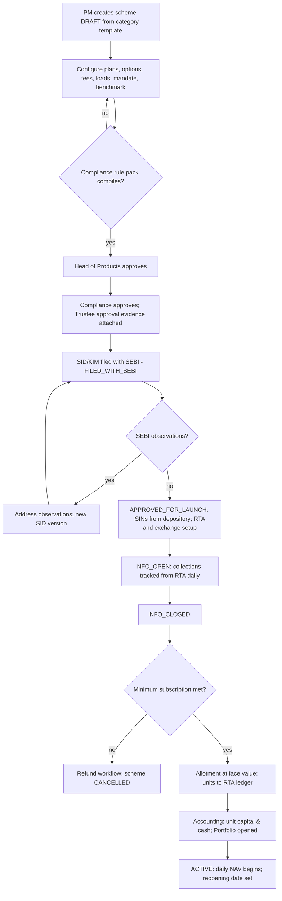

**Validation:** ISIN per plan/option present; fee schedule within TER cap rule; mandate ranges sum logically (minimums ≤ 100%). **Exceptions:** SEBI observation loop; RTA setup rejection; minimum not met → refund within regulatory timeline **\[VAL\]**.

### W2 — Investment research and approval

| Item | Detail |
| --- | --- |
| Trigger | Analyst identifies a new security/issuer or a review date falls due |
| Initiator | Research / Credit Analyst |
| Preconditions | Security and issuer exist in master (else data-steward request) |
| Final state | Security in `APPROVED` universe with limits, or `REJECTED` with reasons |
| Audit | Research note versions, IC agenda, votes, minutes, decision record |

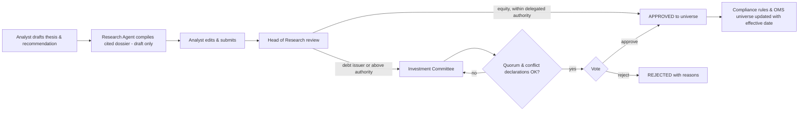

### W3 — Portfolio construction

**Trigger:** new money, model change, index rebalance, drift alert. **Initiator:** Fund Manager. **Preconditions:** SOD snapshot loaded; cash ladder current; universe approved. **Final state:** a set of DRAFT orders linked to a decision record.

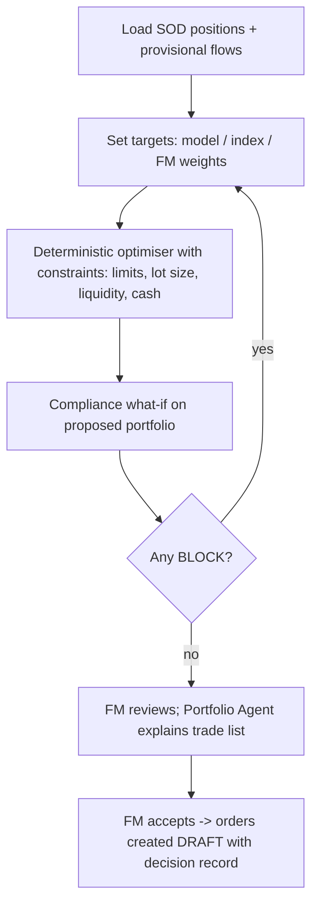

### W4 — Order creation and execution

**Trigger:** FM accepts orders. **Initiator:** FM; executed by Dealer. **Preconditions:** security in universe, not restricted; broker empanelled; market open. **Final state:** order `CLOSED`, trades `CONFIRMED` and passed to settlement.

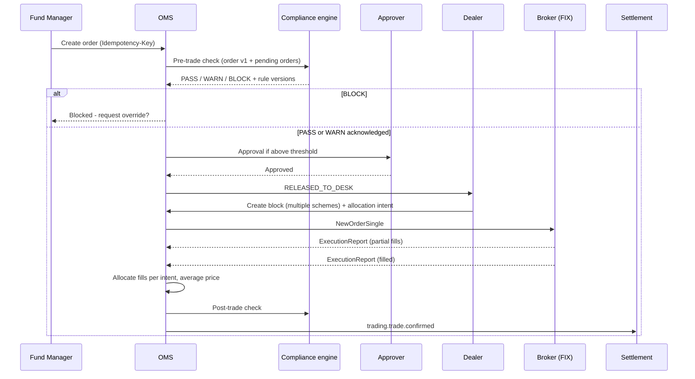

**State transitions:** see Module 04 state machine. **Exceptions:** broker reject → re-route; FIX disconnect → resend with sequence recovery; late fill after cancel → exception queue; allocation deviation → Head of Dealing + Compliance approval.

### W5 — Pre-trade compliance

**Trigger:** order create/amend; what-if from portfolio. **Initiator:** system. **Preconditions:** rule versions effective for trade date; positions and prices available.

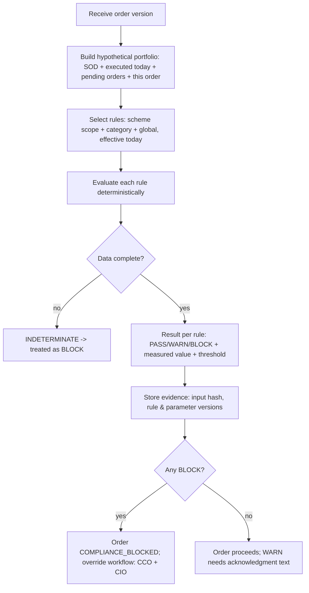

### W6 — Post-trade compliance

**Trigger:** end-of-day after NAV approval, and intraday on market moves. **Final state:** breaches opened or closed.

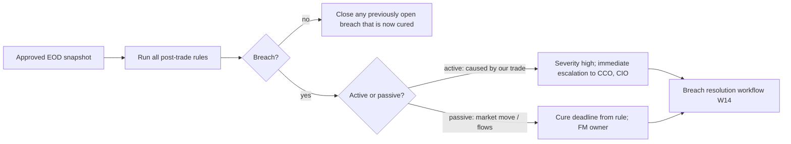

### W6b — Trade settlement

**Trigger:** trade confirmed. **Initiator:** system; Ops for exceptions. **Final state:** `SETTLED`; holdings and cash final; accounting events posted.

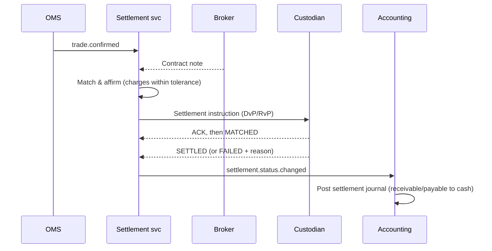

### W7 — Daily NAV

| Item | Detail |
| --- | --- |
| Trigger | Business-day scheduler after market close and receipt of prices |
| Initiator | System; NAV Preparer owns the run |
| Preconditions | All trades of day booked; prices received and validated; accruals run; units outstanding from RTA (provisional allowed with flag); critical recon breaks closed or waived |
| Final state | `PUBLISHED` NAV per plan/option; EOD snapshot frozen |
| Audit | Run record, every component, validation results, approver, publication acknowledgments |

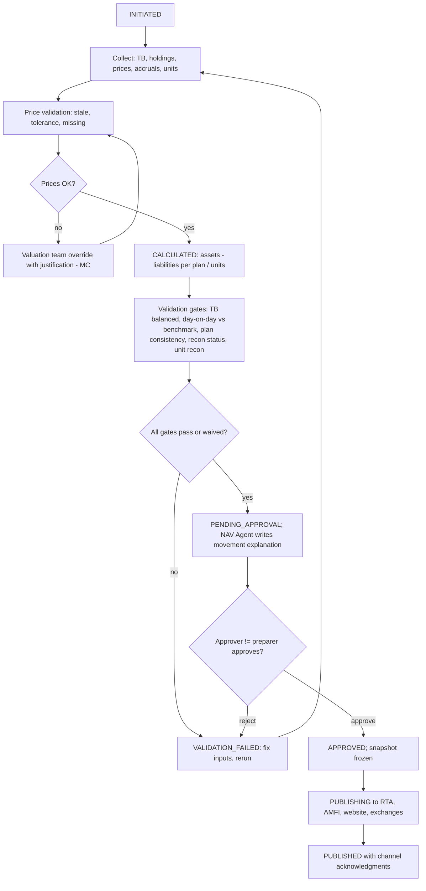

### W8 — Accounting closure (daily and monthly)

**Daily:** after NAV publication, day's period moves `OPEN → SOFT_CLOSED`; next day opens. **Monthly:** checklist — all daily periods soft-closed, accrual true-ups posted (e.g., actual vs accrued expenses), recons complete (bank, custodian, RTA units), TB reviewed, management sign-off → `CLOSED`. Reopen only with CFO + Head FA and a reason; all postings during reopen tagged.

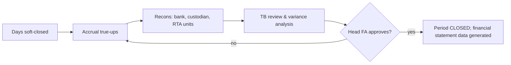

### W9 — Corporate actions

**Trigger:** CA announcement from exchange/vendor/custodian. **Initiator:** Ops Analyst. **Final state:** entitlements booked on ex-date / pay-date and reconciled with custodian.

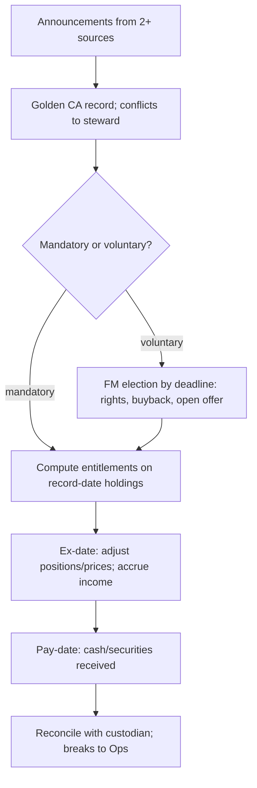

### W10 — Investor purchase

**Trigger:** purchase received on any channel. **Initiator:** investor / distributor. **Preconditions:** KYC valid; folio exists or new folio; scheme open for subscription. **Final state:** units allotted, investor ledger updated, capital stock posted.

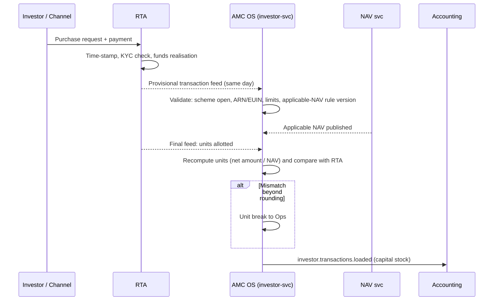

### W11 — Investor redemption

**Trigger:** redemption request. **Preconditions:** units free of lock-in / lien; KYC not on hold. **Final state:** units extinguished, payout `PAID` within regulatory timeline **\[VAL\]**.

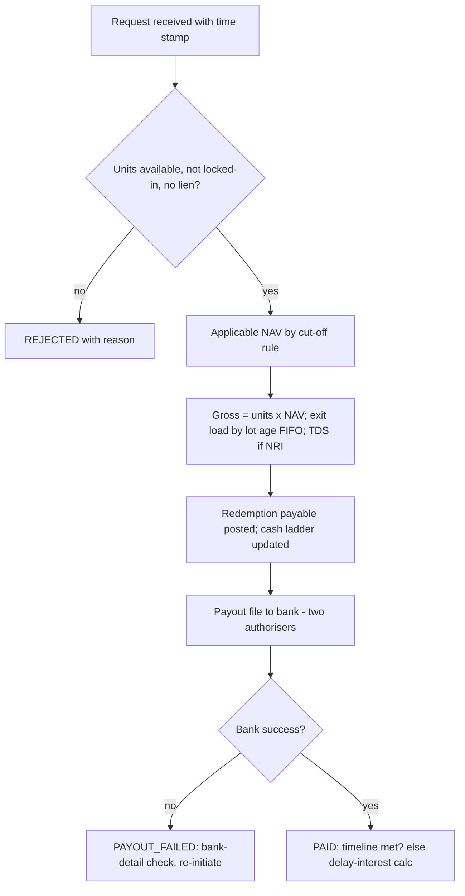

### W12 — SIP processing

**Trigger:** SIP instalment date. **Initiator:** system (via RTA and mandate rails). **Final state:** instalment `PROCESSED` or `FAILED`; SIP auto-cancelled after the configured number of consecutive failures **\[VAL\]**.

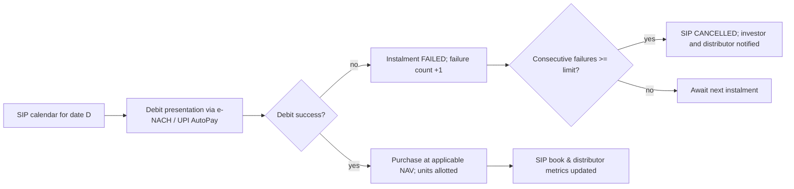

### W13 — Distributor commission

**Trigger:** month-end. **Initiator:** Distribution Ops. **Preconditions:** month's AUM and transactions final from RTA; ARN validity loaded; commission structure versions approved. **Final state:** payout file paid; statements published to distributors; GST/TDS booked.

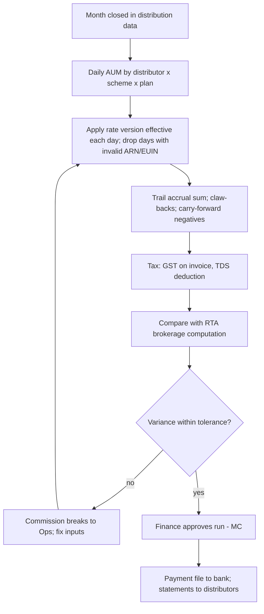

### W14 — Compliance breach resolution

**Trigger:** breach opened by W6. **Initiator:** system; owner FM. **Final state:** `RESOLVED` with evidence, or `REGULARISED` by approved exception; reported to Trustees.

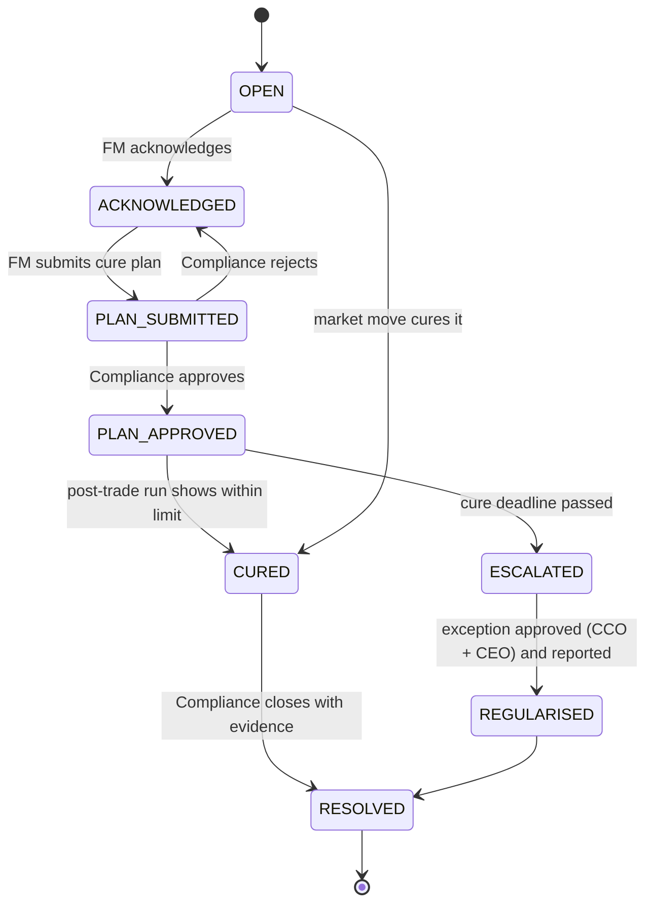

### W15 — Reconciliation

**Trigger:** inbound file arrival or schedule. **Initiator:** system; Ops for breaks. **Final state:** all items matched or breaks resolved/written off.

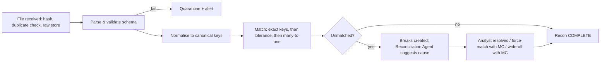

### W16 — Regulatory reporting

**Trigger:** reporting calendar (daily/monthly/quarterly/event). **Initiator:** system; Compliance owns. **Final state:** report filed, acknowledgment stored.

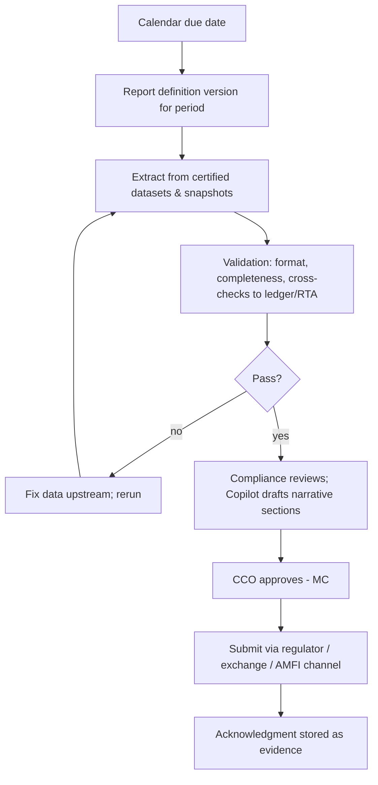

### W17 — NAV correction (exception workflow)

**Trigger:** error found in a published NAV. **Initiator:** Fund Accountant or Compliance. **Final state:** corrected NAV published (if required), affected transactions reprocessed, investors/scheme compensated per policy, regulator/Trustees informed. **\[REG — NAV error thresholds and compensation; VAL\]**

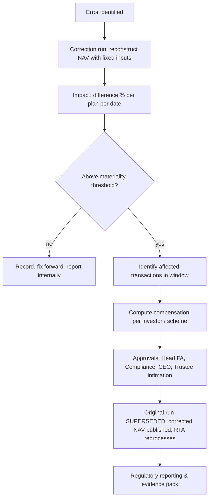

## Chapter 5 — User Stories and Acceptance Criteria

Module chapters list representative stories. This chapter is the release-gating backlog: **C** = critical (release-blocking), **O** = optional. Each story has testable Given/When/Then criteria; QA turns each into automated tests.

| ID | Story | Pri | Acceptance criteria (Given / When / Then) |
| --- | --- | --- | --- |
| US-PLT-01 | As a Tenant Admin, I want to create users with roles, so that each person sees only what their job needs. | C | Given a new user with role Dealer, when they log in, then they cannot open NAV approval screens or APIs (HTTP 403, audited). |
| US-PLT-02 | As a Security Officer, I want MFA for every user, so that stolen passwords are not enough. | C | Given SSO without MFA claim, when login is attempted, then access is denied. |
| US-PLT-03 | As any user, I want my session limited to my AMC, so that I never see another AMC's data. | C | Given user of tenant A, when any API is called with tenant B's object ID, then 404 is returned and a cross-tenant alert is logged. |
| US-PRD-01 | As a PM, I want to create a scheme from a category template, so that rules come pre-loaded. | C | Given category "Large Cap", when scheme is created, then its rule pack includes the category minimum-allocation rule. |
| US-PRD-02 | As a PM, I want effective-dated exit loads. | C | See Module 01 AC. |
| US-INV-01 | As an Analyst, I want to publish a recommendation with target price. | C | Given a published recommendation, when edited, then a new version is created and v1 remains viewable. |
| US-INV-02 | As Compliance, I want instant restricted-list effect. | C | Given an addition at 10:00:00, when an order is placed at 10:00:06, then it is blocked. |
| US-PM-01 | As an FM, I want a live cash ladder. | C | Given an executed buy of ₹5 crore settling T+1, when it fills, then T+1 projected cash falls by ₹5 crore plus charges within 1 s. |
| US-PM-02 | As an FM, I want rebalance proposals that never breach limits. | C | Given any proposal, when compliance what-if runs, then no BLOCK results exist. |
| US-PM-03 | As an FM, I want Brinson attribution. | O | Given a month of data, when attribution runs, then allocation + selection + interaction = active return (±0.01 bp). |
| US-OMS-01 | As an FM, I want pre-trade results before submission. | C | Given an order, when created, then results return in < 500 ms p95. |
| US-OMS-02 | As a Dealer, I want block orders with fair allocation. | C | See Module 04 AC. |
| US-OMS-03 | As Compliance, I want overrides with two approvers. | C | Given a BLOCK, when one approver approves, then the order stays blocked until the second approves. |
| US-OMS-04 | As a Dealer, I want debt RFQ quote capture. | O | Given a debt order, when fewer than the policy minimum quotes are captured, then release needs Head of Dealing approval. |
| US-STL-01 | As Ops, I want contract-note auto-matching. | C | Given 1,000 trades with correct notes, when matching runs, then ≥ 99% auto-affirm. |
| US-STL-02 | As Ops, I want SSI changes under MC with call-back flag. | C | Given an SSI change without call-back flag, when approval is attempted, then it is refused. |
| US-CMP-01 | As Compliance, I want rule versions tested before approval. | C | See Module 06 AC. |
| US-CMP-02 | As Compliance, I want an evidence pack per inspection. | C | Given a date range and scheme, when the pack is generated, then it contains every check result with rule version and input hash. |
| US-RSK-01 | As a CRO, I want daily liquidity stress results. | C | Given open-ended schemes, when EOD run completes, then every scheme has a stress result within 30 min of NAV approval. |
| US-RSK-02 | As a Risk Manager, I want reference-tested formulas. | C | See Module 07 AC. |
| US-ACC-01 | As a Fund Accountant, I want auto-posting from events. | C | Given a settled trade event, when consumed, then a balanced journal posts within 1 min with posting-rule version. |
| US-ACC-02 | As an Auditor, I want drill-down TB → journal → source event. | C | Given any TB line, when drilled, then the source event and document are reachable in ≤ 3 clicks. |
| US-NAV-01 | As Head FA, I want NAV approval only when gates pass. | C | See Module 09 AC. |
| US-NAV-02 | As Compliance, I want exact NAV reconstruction. | C | See Module 09 AC. |
| US-NAV-03 | As an FM, I want an AI explanation of NAV movement. | O | Given an approved NAV, when the explanation is shown, then every number in it equals a stored NAV component. |
| US-OPS-01 | As Ops, I want a single exception queue with SLAs. | C | Given an exception at SLA − 1 h, then it turns amber and notifies the owner. |
| US-IVS-01 | As an ISE, I want an investor 360 view. | C | Given a PAN search by authorised role, when executed, then folios, holdings, transactions and open requests show in < 800 ms. |
| US-IVS-02 | As a Grievance Officer, I want TAT tracking. | C | Given a complaint, when 80% of TAT elapses, then escalation fires. |
| US-DST-01 | As an RM, I want a daily scorecard. | C | Given T-1 data certified, when RM logs in at 09:00, then scorecard shows T-1 values. |
| US-DST-02 | As Finance, I want reproducible commissions. | C | Given a past month, when rerun with stored inputs, then output matches to the paisa. |
| US-FIN-01 | As CFO, I want net yield by scheme × channel. | C | Given a closed month, when report runs, then net yield = (revenue − commission) / average AUM, annualised, matching ledger. |
| US-DAT-01 | As an Analyst, I want certified metrics only on CXO dashboards. | C | Given an uncertified metric, when added to a CXO dashboard, then publish is refused. |
| US-AI-01 | As a CEO, I want to ask "why did AUM fall?" in plain language. | O | Given the question, when answered, then the answer cites metric IDs and dates and contains no uncited number. |
| US-AI-02 | As Compliance, I want AI never to execute or approve. | C | Given any agent identity, when it calls an approve/post/publish endpoint, then 403 is returned and a security alert raised. |

**Definition of done for every story:** unit tests, integration tests, API docs, audit events verified, RLS negative test, performance test for any NFR stated, and UX accessibility check.

## Chapter 6 — User Roles and Permissions

Access is role-based (RBAC) with attribute limits (ABAC): a role grants actions; attributes narrow scope (e.g., a Fund Manager only for schemes they manage; an RM only for mapped distributors). Permissions are named `domain.object.action` (e.g., `nav.run.approve`).

**Legend:** R read · C create · U update · D delete (only where legally allowed — financial records are never deleted, only reversed) · S submit · A approve · J reject · O override · E export · X admin · — none. "own" = limited to own scope.

| Role | Product & Scheme | Research & Universe | Portfolio | Orders (OMS) | Settlement & Ops | Compliance rules & breaches | Risk | Accounting | NAV | Investor data (PII) | Distribution & Commission | Finance & MIS | AI agents | Users & config |
| --- | --- | --- | --- | --- | --- | --- | --- | --- | --- | --- | --- | --- | --- | --- |
| CEO | R A(material) | R | R | R | R | R A(regularise) | R | R | R A(material correction) | R masked | R | R E | R use | — |
| COO | R | R | R | R | R A J E | R | R | R A(reopen with CFO) | R A J | R masked | R | R E | R use | — |
| CIO | R A(mandate) | R C U A J | R A | R A J O(with CCO) | R | R | R | R | R | — | — | R | R use | — |
| CFO | R A(fees) | — | R | R | R | R | R | R A(period) | R | R masked | R A(commission) | R C U A E | R use | — |
| CTO | R | — | — | — | R (tech) | — | — | — | — | — | — | R | R X(config) | R A(tech config) |
| Fund Manager | R | R C(recommend) | R C U own | R C U S own | R own | R own; S cure plan | R own | R own | R own | — | — | R own | R use | — |
| Research Analyst | R | R C U S own | R | — | — | R | R | — | — | — | — | — | R use | — |
| Dealer | R | R | R | R U (route, block, allocate) | R | R results | — | — | — | — | — | — | R use | — |
| Compliance Officer | R A J | R C U (restricted list) A | R | R O(with 2nd approver) | R | R C U S A J | R | R | R A(correction) | R masked E(audit) | R A(due diligence) | R | R use, R logs | — |
| Risk Manager | R | R | R | R | R | R | R C U S A(CRO) | R | R | — | — | R | R use | — |
| Fund Accountant | R | — | R | R | R | R | R | R C S (A senior) | R C S (A Head FA) | R masked | — | R | R use | — |
| Operations Analyst | R | R | R | R | R C U S (A manager) | R | — | R | R | R masked | R | — | R use | — |
| Product Manager | R C U S (A head) | R | R | — | — | R | R | — | R | — | R | R | R use | — |
| Distributor Manager | R | — | — | — | — | — | — | — | R | — | R C U S | R own | R use | — |
| RM | R | — | — | — | — | — | — | — | R | — | R own | R own | R use | — |
| Investor Service Executive | R | — | — | — | — | — | — | — | R | R C U S (A supervisor); unmask with reason | — | — | R use | — |
| Technology Administrator | — | — | — | — | R (connections) C U S | — | — | — | — | — | — | — | X (agent config, not data) | C U S (A Tenant Admin) |
| Auditor | R | R | R | R | R | R | R | R E | R E | R masked E | R E | R E | R logs | R (audit log) |

**Maker-checker and segregation-of-duties (SoD) rules**

1. **SOD-01** Maker ≠ checker on every MC action, enforced in the service and by a database check on approval rows (`approved_by <> created_by`).
2. **SOD-02** NAV preparer ≠ NAV approver; NAV approver cannot have Dealer or FM role in the same tenant.
3. **SOD-03** FM who originates an order cannot be the dealer who executes it (tenant-configurable; default on).
4. **SOD-04** Compliance override requires two distinct approvers from Compliance and Investment (CCO + CIO or delegates).
5. **SOD-05** User admin (Tech Admin) cannot grant roles to themselves; role grants need Tenant Admin approval; Tech Admin cannot hold business roles.
6. **SOD-06** Bank / SSI master changes: maker in Ops, checker in Finance or Ops Manager, plus call-back flag.
7. **SOD-07** Commission run: maker Distribution Ops, checker Finance; payment release needs two bank-mandate signatories.
8. **SOD-08** Rule author ≠ rule approver; rule tester may be author but approval requires passing tests.
9. **SOD-09** Platform operators (our staff) have zero default access to tenant business data; break-glass access needs tenant approval, is time-boxed (≤ 4 h), fully logged and reported to the tenant. **\[DES; CSCRF alignment VAL\]**
10. **SOD-10** AI agent identities hold no A, O, post, publish or execute permissions in any domain.
11. **SOD-11** Toxic-combination scan: nightly job flags users holding conflicting roles and reports to Compliance.

**Export controls:** all exports watermarked with user and time; PII exports need reason + approval; bulk export above threshold triggers DLP alert.

## Chapter 7 — Non-Functional Requirements

Mandatory items come from regulation or from the brief's non-negotiable principles. Proposed targets are our engineering commitments to be confirmed with customers in SLAs.

| Area | Requirement | Type |
| --- | --- | --- |
| Availability | Core trading-day services (OMS, compliance, NAV, investor) 99.95% during 08:00–23:00 IST business days; 99.9% otherwise | Proposed |
| Availability | Critical-system classification, BCP and DR drills per SEBI CSCRF for the AMC's RE category | Mandatory **\[REG — CSCRF; VAL category\]** |
| Scalability | Horizontal scaling of stateless services; tenants from 1 to 50+ AMCs; largest tenant: 500 plans, 50 million investor transactions/year, 10 million folios | Proposed |
| Performance | Pre-trade check p95 < 300 ms; order-to-compliance p95 < 500 ms; API reads p95 < 200 ms; dashboards p95 < 2 s | Proposed |
| Throughput | 2,000 orders/min/tenant; 50,000 fills/min platform; 1 million journal lines/day/tenant; 5 million investor transactions/day platform on peak days | Proposed |
| Latency | Restricted-list propagation < 5 s; intraday position update < 1 s after fill | Proposed |
| Consistency | Strong (ACID) consistency inside a domain; cross-domain via outbox events with exactly-once *effect* (idempotent consumers); no financial record depends on eventual reads | Mandatory **\[DES — brief 3.5\]** |
| Fault tolerance | No single point of failure; multi-AZ database with synchronous standby; zero data loss for committed financial transactions within region | Proposed |
| Disaster recovery | RPO ≤ 5 min, RTO ≤ 2 h for critical services in a separate seismic zone DR region in India; quarterly DR drills; data residency in India | Proposed RPO/RTO; data localisation and DR drills **\[REG — CSCRF / SEBI cloud framework; VAL\]** |
| Data retention | Financial and transaction records, logs and audit trails retained per SEBI MF Regulations, CSCRF log-retention and PMLA (commonly 8+ years for records; logs per CSCRF) | Mandatory **\[REG — VAL exact periods per record type\]** |
| Security | MFA, SSO (SAML/OIDC), RBAC + ABAC, TLS 1.3, AES-256 at rest, tenant-specific keys in HSM/KMS, field-level encryption of PII, secrets in vault, VAPT twice a year, SOC monitoring | CSCRF-driven **\[REG\]**, specifics Proposed |
| Auditability | Append-only audit log, hash-chained per tenant per day; tamper evidence; user activity logs available to tenant | Mandatory **\[DES — brief 3.5; REG record-keeping\]** |
| Maintainability | Modular monolith with enforced module boundaries (architecture tests), 80% unit-test coverage on financial engines, 100% on formula libraries, OpenAPI contracts, semantic versioning | Proposed |
| Observability | OpenTelemetry traces/metrics/logs; per-tenant SLO dashboards; business monitors (NAV not published by T, file not received) | Proposed |
| Accessibility | WCAG 2.1 AA for all web UI; keyboard-only dealing screens | Proposed |
| Privacy | DPDP Act 2023 obligations: notice, consent, purpose limitation, data-principal rights, breach notification | Mandatory **\[REG — VAL DPDP Rules timeline\]** |
| Precision | `NUMERIC` money; documented rounding at defined steps only; no binary floating point in any financial path | Mandatory **\[DES — brief 3.5\]** |
| Reproducibility | Any NAV, compliance result, risk metric, commission or report can be recomputed for any past date from stored versions | Mandatory **\[DES — brief 3.5\]** |
| Localisation | INR, Indian numbering (lakh/crore) display option, IST, Indian holiday calendars per exchange/clearing | Proposed |

## Chapter 8 — External Integrations

No integration below assumes a public API exists. Where a provider's interface specification is not publicly confirmed, the row says **Confirm with provider** and the integration is designed behind an adapter so file, API or message transports can be swapped. All inbound data lands raw in the data lake first (immutable), then is parsed, validated and reconciled.

**Common integration standards \[DES\]:** adapter per provider and version; mutual TLS or SFTP with key auth; PGP for files where provider supports; checksum + duplicate detection; schema validation; idempotent loads keyed on provider reference + business date; retry with back-off; dead-letter queue; reconciliation to a control total; alerting on missing expected files by time.

| Integration | Purpose | Data exchanged | Direction | Frequency | Transport | Auth | Validation & reconciliation | Vendor dependency / certification |
| --- | --- | --- | --- | --- | --- | --- | --- | --- |
| **AMFI** | NAV dissemination; industry data; ARN validation; market-cap list; scheme codes | Daily NAV file; monthly AUM/flows; ARN/EUIN status; half-yearly market-cap categorisation | Out (NAV), In (industry data, lists) | Daily / monthly / half-yearly | Format and upload channel per AMFI **Confirm with AMFI** | Per AMFI | NAV upload acknowledgment matched to published NAV; ARN validity compared to distributor master | AMFI membership; formats change by AMFI notice |
| **NSE** | Prices, corporate actions, ETF/iNAV, MF distribution platform (NMF II / MFSS) | Bhavcopy, CA announcements, index data (via NSE Indices licence), MF platform order/allotment files | In; Out for MF platform confirmations | Daily / intraday | Data products under NSE licence; MF platform interfaces **Confirm with NSE** | Licence keys / member credentials | Price completeness vs security master; CA cross-check with second source | Data licence; platform onboarding as AMC |
| **BSE** | Prices, CAs, BSE StAR MF platform | Bhavcopy, CA, StAR MF order/payment/allotment files | In / Out | Daily / intraday | **Confirm with BSE** | Member / AMC credentials | As NSE | Licence; StAR MF AMC onboarding |
| **CAMS / KFin Technologies (RTA)** | Investor master, transactions, holdings, SIP/mandates, brokerage, units outstanding, NAV upload to RTA | Provisional & final transaction feeds, investor/folio master, AUM, brokerage, unit capital; outbound NAV, scheme master, IDCW rates | In & Out | Intraday provisional, EOD final, monthly | Feeds and APIs per RTA agreement **Confirm with RTA** | SFTP keys / API credentials, IP allow-listing | Units outstanding vs AMC capital stock; transaction counts and amounts control totals; brokerage vs AMC commission engine | Contractual; each RTA's formats differ (adapter per RTA) |
| **NSDL / CDSL (depositories)** | ISIN creation, demat unit holdings, CAS, holdings for demat units, corporate actions | ISIN requests, demat holding statements, CAS data | In / Out | Event / daily / monthly | Through RTA and depository interfaces **Confirm** | Per depository | Demat units vs RTA units | Depository onboarding |
| **Custodians** | Safekeeping, settlement, holdings, cash, CA | Settlement instructions, statuses, holdings and cash statements, CA notices | Out (instructions), In (rest) | Intraday / EOD | SWIFT ISO 15022/20022 or custodian API/SFTP **Confirm per custodian** | SWIFT PKI / mTLS / SFTP keys | Daily holdings & cash recon (Module 10) | Custodian onboarding & testing cycle |
| **Banks** | Scheme collections and payouts; AMC payments; statements | Payment files (redemptions, commissions, expenses), MT940/CAMT.053 statements, mandate data | Out / In | Intraday / EOD | Host-to-host SFTP or bank API **Confirm per bank** | Digital signatures, dual authorisation | Bank-ledger cash recon; payout status recon | Bank integration testing; payment-file certification |
| **Brokers** | Order routing, execution, contract notes | FIX 4.2/4.4 orders, execution reports; contract notes (file/PDF), bills | Out / In | Real-time / EOD | FIX over leased line/VPN; files **Confirm FIX dialect per broker** | FIX session credentials, mTLS | Fills vs contract notes; charges tolerance | FIX certification per broker |
| **FactSet** | Reference data, fundamentals, estimates, ownership, benchmarks, analytics | Security/issuer reference, fundamentals, index constituents, holdings data | In | Daily / on demand | FactSet data feeds / APIs per licence **Confirm licensed products** | API key / OAuth per FactSet | Cross-check vs exchange master; steward queue on conflicts | Licence scope limits redistribution and AI use — **Confirm** |
| **KRA ecosystem** (CVL, NDML, CAMS KRA, KFin KRA, DotEx) | KYC status check, KYC upload/modification | PAN-based KYC status; KYC records | In / Out | Per transaction / daily | Via RTA or direct KRA interface **Confirm** | Per KRA | KYC status vs investor master | SEBI-regulated KRAs; access via RTA in mode A |
| **CKYC (CERSAI)** | Central KYC download/upload | CKYC number, KYC records | In / Out | Event | Per CERSAI specification **Confirm** | Digital signature | CKYC number match | Registration as reporting entity (often via RTA) |
| **SEBI regulatory sources** | Regulation register feed; filings | Circulars, regulations, master circulars (read); reports (filed via SEBI portals as prescribed) | In (watch) / Out (filings) | Daily watch; per calendar | Public website monitoring; SEBI intermediary portal for filings **Confirm channels** | Portal credentials (AMC) | Every new circular triaged within 1 business day into register | No API assumed; Compliance Copilot drafts entries |
| **SEBI SCORES / SMART ODR** | Investor complaints | Complaint records, responses | In / Out | Daily | Portal; **Confirm any API** | AMC credentials | Complaint count recon with portal | — |
| **Valuation agencies** | Debt and money-market prices | Security-level prices/yields | In | Daily | Agency files **Confirm** | SFTP | Completeness; tolerance; two-agency comparison where applicable | AMFI-appointed agencies **\[REG — VAL\]** |
| **Rating agencies** | Ratings and actions | Rating history, outlooks, watch | In | Daily | Via data vendor or agency feeds **Confirm** | Licence | Rating change alerts to Risk/Compliance | Licences |

**Certification checklist per integration \[DES\]:** sandbox connectivity → functional test pack (happy path + error codes) → volume test → parallel run with current process (min. 1 month for NAV- or money-affecting feeds) → provider sign-off → go-live with rollback plan.

## Chapter 9 — AI and Machine Learning Requirements

### 9.1 The four-layer boundary

| Layer | What it does | Examples | May change state? |
| --- | --- | --- | --- |
| 1. Deterministic calculation | Produces every official number | NAV, accounting, AUM, exposure, compliance, risk metrics, commission, revenue, performance, reconciliation matching | Yes, through its own module workflow with human approval |
| 2. Machine-learning prediction | Gives a probability or forecast, always labelled as such | Distributor churn score, credit early-warning score, redemption-flow forecast, break-cause classifier, anomaly detection on prices | No. Outputs are advisory signals stored with model version |
| 3. LLM interpretation | Explains, summarises, drafts, retrieves, classifies text | NAV movement explanation, circular summaries, draft replies, research dossiers | No. Can create *proposals* only |
| 4. Human approval | Decides | Every order, journal, NAV, rule, override, payment | Yes — the only layer that authorises |

**Hard rules:** (1) Agents read numbers only via tools that call Layer 1 APIs. (2) A grounding checker rejects any answer containing a number absent from tool outputs. (3) Agent identities have no approve/post/publish/execute scopes. (4) Tenant context is bound to the session by the platform, not the prompt. (5) ML models go through model-risk validation like risk models.

### 9.2 Model requirements

- LLMs accessed via private, India-region endpoints where available; contractual zero data retention and no training on tenant data **\[VAL — data-localisation needs under CSCRF / SEBI cloud framework\]**.
- Model abstraction layer so models can be swapped per agent; each agent pinned to a model version; upgrades go through evaluation gates.
- Embeddings stored per tenant in partitioned vector indexes (pgvector in tenant-scoped tables, or dedicated vector DB namespace per tenant).
- ML models (gradient boosting, time-series) trained per tenant on tenant data or on industry public data only; features from the warehouse; model registry with lineage.

### 9.3 Agent specifications

Common to all agents: **Prompt strategy** = system prompt with role, rules and refusal policy (versioned) + retrieved context with source IDs + tool results; structured output schemas; temperature low for factual tasks. **Failure handling** = tool error → say what failed, no guessing; low retrieval confidence → ask or decline; grounding failure → withhold answer. **Audit** = full session log (Module 15 FR-15-06). **Human approval** = any proposal enters the owning module's normal approval workflow.

| Agent | Purpose | Inputs & data access | Tools (read unless marked) | Expected outputs | Human approval | Evaluation criteria |
| --- | --- | --- | --- | --- | --- | --- |
| Research Agent | Speed up research | Filings, transcripts, news (licensed), internal notes; tenant research docs | search\_docs, get\_fundamentals, get\_security, get\_peer\_set | Cited dossiers, earnings digests, peer tables | Analyst edits and owns any published note | Citation accuracy ≥ 98%; factual error rate; analyst time saved |
| CIO Copilot | Portfolio-wide oversight | Positions, recommendations, risk, compliance results (all schemes, CIO scope) | get\_positions, get\_risk\_metrics, get\_breaches, get\_recommendations | Morning brief, "what changed", blocked-order explanations | None (read-only) | Groundedness 100%; CIO usefulness rating |
| Portfolio Agent | Help FMs construct and rebalance | Own schemes' positions, targets, cash ladder | get\_positions, get\_cash\_ladder, run\_compliance\_whatif, **propose\_orders** | Draft orders with rationale; drift explanations | FM must accept; then OMS approvals | Proposals never BLOCK on submit; FM acceptance rate |
| Compliance Copilot | Keep register current; explain breaches | SEBI public corpus, rule registry, results | search\_regulations, get\_rule, get\_results, **propose\_register\_entry**, **propose\_rule\_change** | Circular summaries, draft register entries, breach explanations | Compliance authors and approves rules; AI drafts only | Recall of applicable circulars; zero auto-activation |
| NAV Operations Agent | Speed NAV checks | NAV components, price validations, recon status | get\_nav\_run, get\_validations, get\_breaks | Pre-approval checklist summary, movement explanation | NAV approver decides | Explanations reconcile to components exactly |
| Reconciliation Agent | Reduce break-handling time | Break records, source rows, history | get\_breaks, get\_source\_rows, **propose\_match**, draft\_counterparty\_email | Suggested matches with confidence, root causes | Analyst accepts; force-match still MC | Precision of accepted suggestions ≥ 95% |
| Distribution Intelligence Agent | Help sales act | Distributor metrics, scorecards (RM scope) | get\_metric, get\_distributor\_profile, get\_churn\_score | Next-best actions, meeting briefs | RM decides | Uplift in activation; RM rating |
| Product Intelligence Agent | Product strategy | Industry AMFI data, own scheme data | get\_industry\_flows, get\_scheme\_performance | Gap analyses, launch ideas, draft SID sections | PM and Compliance | Factual accuracy; adoption |
| Investor Service Agent | Faster servicing | Investor 360 (masked unless ISE has unmask), policies, templates | get\_investor\_summary, get\_transactions, search\_policies, **draft\_reply** | Draft replies, complaint classification, summaries | ISE sends; no data changes | Classification accuracy; TAT reduction; zero PII leakage |
| CFO Copilot | Explain finance | Semantic-layer metrics, ledger summaries | get\_metric, get\_pnl, get\_ter | Variance explanations, board-pack drafts | CFO | Groundedness 100% |
| CEO Copilot | Ask anything, trusted answers | Certified metrics only; summaries from other agents | get\_metric, get\_aum\_bridge, get\_market\_share | Plain-language answers with citations | None (read-only) | Groundedness 100%; refusal on uncertified data |

### 9.4 Evaluation and release gates

Each agent release must pass: golden-set accuracy threshold; 0 cross-tenant leakage across a 500-prompt red-team set; 0 permission escalations; prompt-injection test pack (malicious text inside PDFs, emails, circular pages); latency p95 < 8 s for standard questions; AI Governance Committee sign-off.

## Chapter 10 — Product Roadmap

Ten phases over about 30 months, sequenced so that each release is usable on its own (module adoption) and every later module builds on the canonical data from earlier ones. Durations are planning estimates for a team of roughly 40–60 engineers.

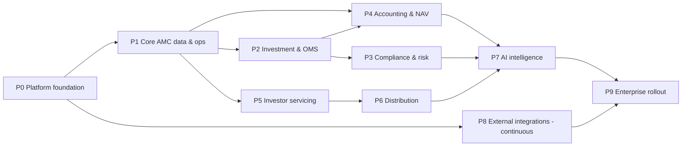

| Phase | Window (indicative) | Scope | Depends on | Release acceptance criteria |
| --- | --- | --- | --- | --- |
| P0 Platform foundation | Months 0–4 | Tenancy, identity (SSO/MFA), RBAC/ABAC, audit log, workflow & maker-checker engine, event bus + outbox, document store, observability, CI/CD, data-lake landing zone | — | Cross-tenant negative test suite 100% pass; audit hash chain verified; DR drill passed; pen-test with no high findings |
| P1 Core AMC data & ops | Months 3–8 | Master data (security, issuer, scheme), Product & Scheme module, ops connectors framework, reconciliation engine, RTA feed ingestion (read mode A) | P0 | Golden records for 100% of a pilot AMC's held securities; daily RTA load reconciled to RTA control totals for 30 days |
| P2 Investment & OMS | Months 6–12 | Research, universe, restricted list, portfolio book, cash ladder, OMS, FIX gateway, allocation | P1 | 1 month parallel run with incumbent OMS; zero lost fills; allocation fairness test pack |
| P3 Compliance & risk | Months 8–14 | Rule registry & DSL, pre/post-trade, breaches, evidence, core risk metrics, stress tests | P2 | All pilot AMC rules encoded with tests; 30-day parallel run with < 0.1% result differences, each explained |
| P4 Accounting & NAV | Months 10–18 | GL, posting engine, accruals, valuation, NAV run/approve/publish, reconstruction, corrections | P1, P2 | 3-month parallel NAV with fund accountant/custodian: 100% match to published NAV (or explained); auditor walkthrough |
| P5 Investor servicing | Months 8–16 | Investor 360, service requests, complaints, communications, DPDP consent | P1 | PII controls audit passed; complaint TAT tracking live |
| P6 Distribution | Months 12–18 | Distributor master, hierarchy, scorecards, commission engine | P5 | Commission parallel run 2 months matching RTA within tolerance |
| P7 AI intelligence | Months 14–24 (agents released one by one) | Agent platform, tool gateway, RAG, the 11 agents, ML models | P3, P4, P6 | Section 9.4 gates per agent |
| P8 External integrations | Continuous from month 3 | Adapters for each provider in Chapter 8 | P0 | Certification checklist per provider |
| P9 Enterprise rollout | Months 20–30 | Dedicated-DB tier, multi-AMC onboarding playbook, data migration tooling, SLAs, 24×7 support | P7, P8 | Three AMCs live; SLOs met for 90 days; SOC 2 / ISO 27001 audits complete |

**Key risks:** RTA and custodian integration timelines (vendor-controlled); regulatory change during build (mitigated by rule-as-data design); parallel-run effort for NAV; AI data-residency constraints.

## Appendix A — Regulatory Register (seed)

This is the starting content of the Regulatory Rule Registry (Module 06). "Verified" means the document's existence, reference and dates were checked against official or reputable secondary sources on 19 Nov 2026; it does **not** mean every clause has been mapped. Each row still needs clause-level review by Compliance before rules are encoded.

| # | Source | Document title | Reference | Published | Effective | Domain | System control | Owner dept | Validation needed | Status |
| --- | --- | --- | --- | --- | --- | --- | --- | --- | --- | --- |
| R1 | SEBI | [SEBI (Mutual Funds) Regulations, 2026](https://www.sebi.gov.in/legal/regulations/jan-2026/securities-and-exchange-board-of-india-mutual-funds-regulations-2026_99173.html) | SEBI/LAD-NRO/GN/2026/294 | Gazette 14–16 Jan 2026 | 1 Apr 2026 | All | Rule packs (investment restrictions, TER, governance, accounting formats) | Compliance | Clause-by-clause mapping; all thresholds | Document verified; clauses pending |
| R2 | SEBI | MF (Amendment) Regulations, 2026 | SEBI/LAD-NRO/GN/2026/307 | 7 Jul 2026 | Per notification | Borrowing / ops | Intraday borrowing rule (with R7) | Compliance | Text | Reference verified |
| R3 | SEBI | [MF (Second Amendment) Regulations, 2026](https://www.sebi.gov.in/sebi_data/attachdocs/oct-2026/1791796434954.pdf) | SEBI/LAD-NRO/GN/2026/324 | Oct 2026 | Per notification | TBD | TBD | Compliance | Read and map | Reference verified; content not reviewed |
| R4 | SEBI | [Master Circular for Mutual Funds](https://www.sebi.gov.in/legal/master-circulars/mar-2026/master-circular-for-mutual-funds_100491.html) | HO/24/13/11(1)2026-IMD-POD-1/I/7602/2026 | 20 Mar 2026 | 1 Apr 2026 (with Regs) | All | Most operational controls; offsite inspection Format 10 reports | Compliance | Chapter-by-chapter mapping | Document verified; replaces 27 Jun 2024 Master Circular |
| R5 | SEBI | Categorization and Rationalization of MF Schemes | HO/24/13/15(2)2026-IMD-RAC4/I/5764/2026 | 26 Feb 2026 | Per circular | Product, Compliance | Category master; category rule packs | Product + Compliance | Category definitions, transition timeline | Reference verified |
| R6 | SEBI | Certification for distribution of SIF products (amends MF Master Circular para 21.10) | HO/24/13/17(1)2026-IMD-POD-1/I/16895/2026 | 21 Jul 2026 | Per circular | Distribution | ARN/certification validity check for SIF sales | Distribution + Compliance | Certification types | Reference verified |
| R7 | SEBI | Intraday borrowings by mutual funds | HO/(92)2026-IMD-POD-2/I/16006/2026 | 10 Jul 2026 | Per circular | Portfolio, Ops | Cash ladder borrowing rules | Compliance + Treasury | Conditions & limits | Reference verified |
| R8 | SEBI | [Net settlement of funds for MF scheme cash-market transactions](https://www.sebi.gov.in/sebi_data/attachdocs/nov-2026/1793874209372.pdf) | HO/24/13/(1)2026-IMD-POD-2/I/25242/2026 | 5 Nov 2026 | Per circular | Settlement | Net settlement option in Module 05 | Ops | Mechanics & go-live date | Reference verified; content not reviewed |
| R9 | SEBI | [Cybersecurity and Cyber Resilience Framework (CSCRF) for SEBI REs](https://www.sebi.gov.in/legal/circulars/aug-2024/cybersecurity-and-cyber-resilience-framework-cscrf-for-sebi-regulated-entities-res-_85964.html) | SEBI/HO/ITD-1/ITD\_CSC\_EXT/P/CIR/2024/113 (+ later clarifications/extensions) | 20 Aug 2024 | Phased from 2025 | Security, Tech | Chapter 7 security NFRs, SOC, log retention, VAPT, BCP/DR | CTO / CISO | AMC's RE category; latest extensions | Document verified |
| R10 | SEBI | Responsibility for use of AI/ML tools (Intermediaries Regs amendment) and pending AI/ML guidelines | Amendment Feb 2025; consultation 20 Jun 2025; final guidelines announced as forthcoming (Nov 2026) | 2025–2026 | Amendment in force; guidelines TBD | AI | Chapter 9 controls (human-in-loop, audit, data privacy) | CTO + Compliance | Track final guidelines | Partially verified |
| R11 | MeitY | Digital Personal Data Protection Act 2023 & DPDP Rules 2025 | DPDP Rules notified 13–14 Nov 2025 | Nov 2025 | Phased: core obligations from May 2027; consent-manager rule Nov 2026 | Investor, Data | Consent, purpose tags, rights requests, breach notice | DPO | Exact rule-wise dates | Verified (secondary sources) |
| R12 | SEBI / PMLA | KYC framework, PMLA record-keeping | Multiple | — | — | Investor | KYC status checks, record retention | Compliance | Current master circulars | Not yet verified |
| R13 | CBDT | FATCA/CRS — Income-tax Rules 114F–114H | — | — | — | Investor | FATCA/CRS data & reporting | Compliance/Tax | Current forms and due dates | Not yet verified |
| R14 | AMFI | Distributor code of conduct, ARN/EUIN, best practices | AMFI circulars | — | — | Distribution | ARN/EUIN validation | Distribution | Latest AMFI circulars | Not yet verified |
| R15 | SEBI / AMFI | Valuation norms (debt valuation agencies; gold/silver valuation change from 1 Apr 2026) | Master Circular valuation chapter | — | 1 Apr 2026 (gold/silver) | NAV | Valuation hierarchy | Valuation Committee | Method text | Partially verified |

## Sources

- [SEBI (MF) Regulations 2026 — SEBI](https://www.sebi.gov.in/legal/regulations/jan-2026/securities-and-exchange-board-of-india-mutual-funds-regulations-2026_99173.html)
- [MF (Second Amendment) Regulations 2026 — SEBI PDF](https://www.sebi.gov.in/sebi_data/attachdocs/oct-2026/1791796434954.pdf)
- [Master Circular for MFs, 20 Mar 2026 — SEBI](https://www.sebi.gov.in/legal/master-circulars/mar-2026/master-circular-for-mutual-funds_100491.html)
- [Offsite inspection formats under the Master Circular — SEBI PDF](https://www.sebi.gov.in/sebi_data/commondocs/mar-2026/Offsite%20Inspection%20formats%20Master%20Circular%20for%20Mutual%20Funds%20as%20on%20March%2020%202026_p.pdf)
- [SIF certification circular, 21 Jul 2026 — SEBI PDF](https://www.sebi.gov.in/sebi_data/attachdocs/jul-2026/1784633350069.pdf)
- [Intraday borrowing circular, 10 Jul 2026 — SEBI PDF](https://www.sebi.gov.in/sebi_data/attachdocs/jul-2026/1783685402131.pdf)
- [Net settlement circular, 5 Nov 2026 — SEBI PDF](https://www.sebi.gov.in/sebi_data/attachdocs/nov-2026/1793874209372.pdf)
- [Categorization circular summary — Taxmann](https://www.taxmann.com/post/blog/sebi-revises-mutual-fund-scheme-categorisation-supersedes-clause-2-6-of-master-circular)
- [CSCRF circular — SEBI](https://www.sebi.gov.in/legal/circulars/aug-2024/cybersecurity-and-cyber-resilience-framework-cscrf-for-sebi-regulated-entities-res-_85964.html)
- [DPDP Rules 2025 explainer — PIB](https://static.pib.gov.in/WriteReadData/specificdocs/documents/2025/nov/doc20251117695301.pdf)
- [DPDP phased rollout — AZB & Partners](https://www.azbpartners.com/?p=87799)
- [SEBI AI/ML consultation — Taxmann](https://www.taxmann.com/post/blog/sebi-proposes-ai-ml-governance-framework-for-securities-markets)
- [SEBI to issue AI guidelines — YourStory, Nov 2026](https://yourstory.com/2026/11/sebi-issue-ai-usage-guidelines-investor-protection)
