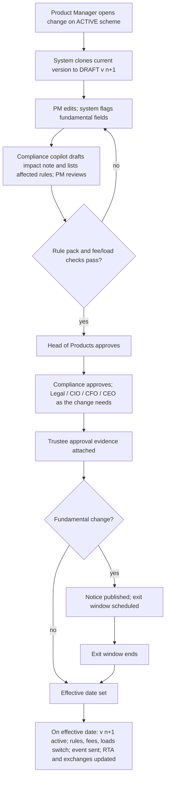

# PRD-002 — Product and Scheme Management (D02)

This document states what AMC OS must do to be the single source of truth for every scheme, plan and option of an AMC: what each scheme is, what it may invest in, what it charges, which documents describe it, and which state of its life it is in. It re-keys PRD-000 v0.9 Module 01 to the GOV-001 identifiers (`FR-01-nn` → `FR-D02-nnn`, business rules `BR-01-n` → `BRL-D02-nnn`, `US-PRD-0n` → `US-D02-nnn`) and adds what Module 01 left out: regulatory document versioning detail (GOV-001 §3 gap), suspension, merger, winding-up and maturity, and the two workflows BA-004 §5.1 left for this step.

**Builds on Draft documents:** [PRD-000 v0.9](PRD-000_master_prd_v0.9.md) Module 01, Chapter 4 (W1), Chapter 5, Appendix A; [BA-001](../02_business_architecture/BA-001_business_capability_map.md) D02; [BA-002](../02_business_architecture/BA-002_amc_operating_model.md); [BA-003](../02_business_architecture/BA-003_domain_dictionary.md); [BA-004](../02_business_architecture/BA-004_end_to_end_workflows.md) WF-001; [BA-005](../02_business_architecture/BA-005_roles_and_permissions.md); [PRD-001](PRD-001_platform_administration.md) — allowed by owner decision D-3 ([GOV-008](../00_governance/GOV-008_build_loop.md) §2 rule 3). No document used here is Approved. Owner decision Q2 (the RTA allots units; AMC OS mirrors) is applied to NFO allotment, merger and maturity.

**What this document is not:** the compliance rule engine that checks mandates, TER and exit-load caps (D08, PRD-008, FE-04), performance and profitability calculations (D04 FE-10, D15 FE-08), document storage (CAP-D12-010), index data (CAP-D16-004), table definitions (Steps 15–16) or API contracts (Step 24). **Rule for engineers (PRD-000):** no regulatory number (limit, cut-off, percentage, timeline) is hard-coded; each is a versioned, approved parameter in the rule registry (D08) or the configuration catalogue (PRD-001 FR-D01-033).

## 1. Scope

| In scope (CAP) | Out of scope |
| --- | --- |
| CAP-D02-001 Scheme master · CAP-D02-002 Scheme categories · CAP-D02-003 Plan and option management · CAP-D02-004 SID, SAI and KIM document management · CAP-D02-005 NFO lifecycle · CAP-D02-006 Scheme configuration · CAP-D02-007 Benchmark mapping · CAP-D02-008 Scheme approvals · CAP-D02-009 Product lifecycle · CAP-D02-010 Scheme changes · CAP-D02-011 Regulatory document versioning | Unit allotment, investor refunds and unit conversion (done by the RTA; AMC OS mirrors — Q2, PS-001 §3); filing on SEBI portals (done by the AMC; AMC OS records references and dates); writing the scheme documents' legal text; checking limits (D08) |

## 2. Re-keying from PRD-000 Module 01

| PRD-000 v0.9 | Here | Note |
| --- | --- | --- |
| FR-01-01 … FR-01-13 | FR-D02-001 … FR-D02-013 | Same order; capability added; wording shortened. Changes of meaning or source are marked **(changed)** in §4.1 with the reason; added cross-references (for example "(D08)", "(WF-029)", a CAP- ID) are not tagged |
| BR-01-1 … BR-01-5 (business **rules**) | BRL-D02-001 … BRL-D02-005 | GOV-001 §4 reserves `BR-` for business *requirements*; rules are `BRL-` |
| US-PRD-01, US-PRD-02 (Ch 5) | US-D02-001, US-D02-002 | |
| Module 01 point 18 acceptance criteria | AC-US-D02-002-1, AC-US-D02-003-1 | |
| Module 01 point 6 (scheme amendment workflow) | WF-029 (§6.2) | New `WF-` ID; BA-004 register updated |
| — | FR-D02-014 … FR-D02-025, BRL-D02-006 … 010, US-D02-004 … 010, WF-030 | **New** **[DES]** |

## 3. Business requirements

| ID | Business requirement | Capabilities |
| --- | --- | --- |
| BR-D02-001 | Every scheme, plan and option has one authoritative record that every domain and outside party uses | CAP-D02-001, -003 |
| BR-D02-002 | Scheme facts change only through approved, versioned changes that apply from a stated date, so any past day can be reproduced | CAP-D02-006, -008, -010 |
| BR-D02-003 | The AMC can show SEBI, trustees and auditors every scheme document version and who approved it | CAP-D02-004, -011 |
| BR-D02-004 | A new scheme starts with the correct category limits, mandate, fees and parties from day one | CAP-D02-002, -005, -006, -007 |
| BR-D02-005 | Changes that affect investors (fundamental changes, suspension, merger, winding-up, maturity) follow the required approvals and investor-protection steps | CAP-D02-009, -010 |

## 4. Functional requirements

Every requirement also obeys PRD-000 common rules C1–C8. Labels from PRD-000 are carried unchanged.

### 4.1 Re-keyed from PRD-000 Module 01

| ID (was) | Pri | Capability | Requirement |
| --- | --- | --- | --- |
| FR-D02-001 (FR-01-01) | M | CAP-D02-001 | **Scheme master:** legal name, short name, AMFI scheme code, ISINs per plan and option, SEBI category and sub-category, open/close/interval type, launch date, face value, base currency, fund managers (effective-dated), custodian, RTA, auditor, trustee approval reference |
| FR-D02-002 (FR-01-02) | M | CAP-D02-002 | **Scheme categorisation:** category from a governed list mirroring the SEBI categorisation circular in force (currently the 26 Feb 2026 circular, which superseded clause 2.6 of the June 2024 Master Circular; PRD-000 Appendix A R5); each category carries its default investment-limit rule pack **[REG]** |
| FR-D02-003 (FR-01-03) | M | CAP-D02-003 | **Plans and options:** Direct and Regular plans; Growth and IDCW (payout, reinvestment, transfer) options; each with its own ISIN, NAV series and TER |
| FR-D02-004 (FR-01-04) | M | CAP-D02-006 | **Scheme configuration:** minimum investment, additional purchase, SIP/STP/SWP frequencies and minimums, exit-load slabs (effective-dated), lock-in (e.g. ELSS), cut-off times, settlement cycle, benchmark(s), TER schedule, side-pocket eligibility |
| FR-D02-005 (FR-01-05) **(changed)** | M | CAP-D02-005 | **NFO management:** NFO calendar, offer period, minimum subscription amount, allotment date, collection tracking from the RTA, refund if the minimum is not met, conversion to open-ended on the reopening date. *Added here:* allotment and refunds are done by the RTA (or the AMC's bank — BA-004 WF-001 **[ASSUMPTION — confirm: Product Manager, pilot discovery]**); AMC OS tracks and mirrors them (Q2). Offer-period length and refund timeline are parameters **[VAL]** |
| FR-D02-006 (FR-01-06) | M | CAP-D02-004 | **SID, KIM, SAI document management:** versioned documents, each linked to the scheme version it describes; addenda; filing and observation dates with SEBI; publication to the website |
| FR-D02-007 (FR-01-07) | M | CAP-D02-006 | **Investment mandate:** asset-allocation ranges (min/max % per asset class), permitted instruments, derivatives use, overseas limits, credit-quality limits — compiled into compliance rules (D08) automatically |
| FR-D02-008 (FR-01-08) | M | CAP-D02-007 | **Benchmark configuration:** primary and additional benchmarks, TRI variant, effective dates, data source (index data from CAP-D16-004) |
| FR-D02-009 (FR-01-09) **(changed)** | M | CAP-D02-009 | **Lifecycle states:** `DRAFT → IN_REVIEW → FILED_WITH_SEBI → SEBI_OBSERVATIONS → APPROVED_FOR_LAUNCH → NFO_OPEN → NFO_CLOSED → ALLOTTED → ACTIVE → (SUSPENDED_SUBSCRIPTIONS) → MERGING → WOUND_UP / MATURED`, plus **`CANCELLED`** when the NFO minimum is not met (added here: BA-004 WF-001 uses it but PRD-000 FR-01-09 did not list it) |
| FR-D02-010 (FR-01-10) | M | CAP-D02-010 | **Amendments:** fundamental-attribute change workflow (with investor exit-option window) and non-fundamental change, each creating a new scheme version (WF-029) **[REG — fundamental attribute change rules; VAL exact exit window]** |
| FR-D02-011 (FR-01-11) **(changed)** | S | CAP-D02-001 (view) | **Product performance:** returns vs benchmark and peers (CAGR, rolling, SIP returns) shown per scheme. *Changed:* PRD-000 named "the Performance engine (Module 07/14)"; the source is now CAP-D04-009 and FE-10 (BA-001 §3 note, GOV-001 §5) — D02 only displays the numbers |
| FR-D02-012 (FR-01-12) **(changed)** | S | CAP-D02-001 (view) | **Product profitability:** revenue, distributor cost and opex allocation per scheme. *Changed:* PRD-000 named "Module 13"; the source is now D15 (CAP-D15-005, FE-08) — D02 only displays the numbers |
| FR-D02-013 (FR-01-13) | M | CAP-D02-004 | **Product disclosures:** factsheet, riskometer, portfolio disclosure and TER disclosure data feeds; disclosure calendar |

### 4.2 New requirements **[DES]**

| ID | Pri | Capability | Requirement |
| --- | --- | --- | --- |
| FR-D02-014 | M | CAP-D02-011 (.1) | **Document difference view:** any two versions of a SID, KIM, SAI or addendum can be compared section by section, together with the scheme-version fields that changed between them |
| FR-D02-015 | M | CAP-D02-011 (.2) | **Approval link:** every document version is linked to its approval record (maker, checkers, trustee evidence, SEBI filing and observation references and dates) and cannot be published without it (BRL-D02-010) |
| FR-D02-016 | M | CAP-D02-011 (.3) | **Retention:** every scheme version and document version is kept for the life of the scheme plus the retention period, and nothing is deleted before then (PRD-000 Module 01 point 17 **[VAL]** period). PRD-000 point 15 says versions are kept "forever"; which rule applies is **[VAL]** (open point C6) |
| FR-D02-017 | M | CAP-D02-002 (.3) | **Category changes:** a scheme's category change is a fundamental change (BRL-D02-004 **[VAL]**). When SEBI changes the categorisation itself, a new category-list version is loaded under maker-checker, and every affected scheme gets a tracked transition task with its due date **[VAL]** |
| FR-D02-018 | M | CAP-D02-009 (.2) | **Suspension of subscriptions:** moving a scheme or plan to `SUSPENDED_SUBSCRIPTIONS` (and back) needs a reason, an effective date and approval (§7); the change is sent to the RTA, exchanges' MF platforms, D13 and D14 so that new subscriptions and SIP registrations are stopped as the decision states |
| FR-D02-019 | M | CAP-D02-009 (.3) | **Merger:** a merger record links source and target schemes, plans and options, record date and effective date, approvals and investor communication (WF-030). The unit conversion is done by the RTA from NAVs produced by D11; AMC OS mirrors and reconciles it (Q2) and never computes it in D02 |
| FR-D02-020 | M | CAP-D02-009 (.3) | **Winding-up and maturity:** for winding-up, and for close-ended or interval schemes reaching maturity, AMC OS records the decision, approvals, final dates and the RTA's final redemption, and moves the scheme to `WOUND_UP` or `MATURED` (WF-030). Timelines are parameters **[VAL]** |
| FR-D02-021 | M | CAP-D02-010 (.2) | **Exit window and notice:** for a fundamental change, AMC OS schedules the investor exit window, triggers investor communication (D13) and records the notice. The SEBI (MF) Regulations, 2026 replace the newspaper advertisement for a change in fundamental attributes with publication on the AMC's website **[REG — secondary source (AZB & Partners, 12 Mar 2026); VAL]**; the window length is a parameter **[VAL]** |
| FR-D02-022 | M | CAP-D02-001 | **Scheme-master distribution:** every approved scheme version is published to other domains as an event and sent to the RTA and exchanges' MF platforms (interfaces: "Confirm with provider", INT-001 Step 14); acknowledgements are tracked; a rejection raises a break (PRD-000 Module 01 point 14) |
| FR-D02-023 | M | CAP-D02-006 (.2), (.4) | **Fee and load checks:** TER schedules and exit-load slabs are checked against cap rules held in the D08 rule registry before approval; D02 stores the scheme's chosen values and never the cap (BRL-D02-005). Press reports of SEBI's Annual Report 2025-26 state the maximum exit load is now 3% (was 5%) under the 2026 Regulations, with no stated effective date per scheme **[REG — secondary source (Business Today, 7 Aug 2026); VAL]** — the value belongs in the rule registry, not in D02 |
| FR-D02-024 | M | CAP-D02-005, CAP-D02-009 | **Launch readiness check:** before `NFO_OPEN`, AMC OS shows a checklist computed from the data: approved SID version, benchmark, RTA, custodian and fund manager configured (BRL-D02-002), ISIN for every plan and option (BRL-D02-008), compiled rule pack, fee schedule passed FR-D02-023, mandate ranges consistent (minimums ≤ 100%, PRD-000 W1), and no conflicting scheme in the same category — the one-scheme-per-category rule, checked as a D08 rule **[REG — VAL exceptions]** (PRD-000 W1, BA-004 WF-001). Any failure blocks the state change |
| FR-D02-025 | S | CAP-D02-001, CAP-D02-002 | **Create from template:** a new scheme can be created from its category template (rule pack, default configuration) or by copying an existing scheme as a draft; copied values are flagged for review |

## 5. Business rules

| ID (was) | Rule | Label |
| --- | --- | --- |
| BRL-D02-001 (BR-01-1) | One active version per scheme per date; versions never overlap | **[DES]** |
| BRL-D02-002 (BR-01-2) | A scheme cannot move to `NFO_OPEN` without an approved SID version and a configured benchmark, RTA, custodian and fund manager | **[DES]** |
| BRL-D02-003 (BR-01-3) | Exit-load and TER changes apply prospectively only | **[DES]** (PRD-000 unlabelled) |
| BRL-D02-004 (BR-01-4) | A category change is a fundamental change | **[VAL]** |
| BRL-D02-005 (BR-01-5) | TER caps are rules in the rule registry (MF Regulations 2026 restructured the expense framework); D02 stores the scheme's chosen TER, the rule engine checks it against the cap | **[REG — VAL slab values]** |
| BRL-D02-006 | Which scheme fields are "fundamental attributes" is a governed list (configuration catalogue, approved by Compliance and Legal); the system flags any change to them | **[DES]**; the list itself **[VAL]** |
| BRL-D02-007 | A plan or option is never deleted once a NAV has been published for it; it is closed by a state change | **[DES]** |
| BRL-D02-008 | Each plan and option has exactly one ISIN; an ISIN is never reassigned to another plan or option | **[IND]** |
| BRL-D02-009 | A new scheme, any amendment (fundamental or not), fee change, benchmark change, merger or winding-up cannot take effect until trustee approval evidence is attached | PRD-000 Module 01 point 13 and point 6 step 4; BA-005 §4 `product.scheme.approve`. Whether trustees must approve every non-fundamental change in law is **[VAL]** — confirm: Compliance / Legal (open point C1) |
| BRL-D02-010 | A scheme document version is published only after its approvals are complete and, for an offer document, after the SEBI filing and observation steps recorded in WF-001 | **[VAL]** |

## 6. Workflows

### 6.1 Existing workflows

| Workflow | D02 role | Requirements |
| --- | --- | --- |
| [WF-001](../02_business_architecture/BA-004_end_to_end_workflows.md) Scheme launch (NFO) | Accountable (DEP-13) | FR-D02-001…009, FR-D02-013, FR-D02-022, FR-D02-024, FR-D02-025 |
| WF-011 Investor redemption | Supplies exit-load slabs and cut-offs | FR-D02-004, BRL-D02-003 |

### 6.2 WF-029 — Scheme change (fundamental and non-fundamental) **[DES]**

| Field | Detail |
| --- | --- |
| Trigger | Decision to change any scheme field (fees, loads, benchmark, mandate, fund manager, parties, category, documents) |
| Initiator | Product Manager (ROLE-13) |
| Departments | **DEP-13**; DEP-09 and DEP-10 (approvals), DEP-02 / DEP-03 (mandate, benchmark), DEP-14 (fees), DEP-07 (accruals), DEP-08 and DEP-12 (investor and distributor communication) |
| Capabilities | CAP-D02-010, CAP-D02-006, CAP-D02-007, CAP-D02-008, CAP-D02-004, CAP-D02-011, CAP-D08-001, CAP-D13-013 |
| Hand-offs (outside) | Trustees (approval evidence); SEBI where a filing is required **[VAL]**; RTA and exchanges (updated scheme master); AMC website (notice — FR-D02-021) |
| Preconditions | Scheme `ACTIVE` (or `SUSPENDED_SUBSCRIPTIONS`) |
| Final state | New scheme version effective from its date; dependent rules, fees and loads switched; old version kept |
| Approvals | Head of Products, then Compliance Officer (CAP-D02-008); Legal Officer for document changes; CIO for mandate and benchmark changes; CFO for fee changes; CEO for material changes ("material" defined by the AMC **[ASSUMPTION — confirm: pilot discovery]**); trustee approval evidence for every change (BRL-D02-009) |
| Exceptions | Rule pack does not compile → back to maker; an approver rejects → back to maker; SEBI observations **[VAL]** → new document version; investor notice not published → effective date cannot be reached |
| Audit | Both versions, difference view, flags of fundamental fields, approvals, trustee evidence, notice publication, effective-date activation |
| Source | PRD-000 Module 01 point 6 (scheme amendment) |

### 6.3 WF-030 — Scheme merger, winding-up and maturity **[DES]**

| Field | Detail |
| --- | --- |
| Trigger | Board / trustee decision to merge or wind up a scheme; maturity date of a close-ended or interval scheme |
| Initiator | Product Manager (ROLE-13) |
| Departments | **DEP-13**; DEP-09, DEP-10, DEP-07 (final NAV and books), DEP-06 (portfolio transfer or liquidation), DEP-08 (investors), DEP-12 (distributors), DEP-02 / DEP-03 |
| Capabilities | CAP-D02-009, CAP-D02-010, CAP-D02-008, CAP-D02-004, CAP-D11-010, CAP-D10-013, CAP-D13-011 |
| Hand-offs (outside) | Trustees; SEBI where required **[VAL]**; RTA (unit conversion or final redemption); exchanges' MF platforms; custodian |
| Preconditions | Scheme `ACTIVE`, `SUSPENDED_SUBSCRIPTIONS` or reaching maturity |
| Final state | Merger: source scheme closed into the target, units converted by the RTA and mirrored. Winding-up / maturity: final redemption paid by the RTA and mirrored; scheme `WOUND_UP` or `MATURED`; books closed |
| Approvals | Merger, winding-up, and abandoning a merger: as WF-029 for a fundamental change, including trustee approval evidence (BRL-D02-009). Maturity: Head of Products and Compliance Officer; whether trustee approval evidence is also needed at maturity is **[VAL]** (open point C1) |
| Exceptions | RTA conversion does not reconcile with the NAVs from D11 → break (CAP-D12-003); assets cannot be liquidated by the planned date → escalation to CIO and Compliance; regulatory timelines **[VAL]** |
| Audit | Decision, approvals, record and effective dates, NAVs used, RTA files and reconciliation, final state |
| Source | **new** (BA-004 §5.1 D02 gap: CAP-D02-009 (.2), (.3), CAP-D02-010) |

```mermaid
stateDiagram-v2
  [*] --> ACTIVE
  ACTIVE --> SUSPENDED_SUBSCRIPTIONS: approved suspension (FR-D02-018)
  SUSPENDED_SUBSCRIPTIONS --> ACTIVE: approved resumption
  ACTIVE --> MERGING: merger approved, trustee evidence, notice and exit window done
  SUSPENDED_SUBSCRIPTIONS --> MERGING
  MERGING --> WOUND_UP: RTA conversion mirrored and reconciled
  ACTIVE --> WOUND_UP: winding-up approved; final redemption mirrored
  ACTIVE --> MATURED: maturity date; final redemption mirrored
  SUSPENDED_SUBSCRIPTIONS --> WOUND_UP: winding-up approved; final redemption mirrored
  SUSPENDED_SUBSCRIPTIONS --> MATURED: maturity date; final redemption mirrored
  MERGING --> ACTIVE: merger abandoned before effective date (same approvers as the merger); back to the state held before the merger
  MERGING --> SUSPENDED_SUBSCRIPTIONS: as above, if the scheme was suspended before the merger
  WOUND_UP --> [*]
  MATURED --> [*]
```

## 7. Permissions by capability

From BA-005 §3 (D02 column) and §4, narrowed to each capability (BA-005 §7 C2). Checker ≠ maker (SOD-01). Every other business role listed in BA-005 §3 with "R" in D02 may read.

| Capability | Maker | Checker(s) |
| --- | --- | --- |
| CAP-D02-001 Scheme master | Product Manager | Head of Products, then Compliance Officer; trustee approval evidence (BRL-D02-009) |
| CAP-D02-002 Scheme categories (category list) | Product Manager | Compliance Officer and Head of Products **[DES]** |
| CAP-D02-003 Plan and option management | Product Manager | Head of Products, then Compliance Officer; trustee approval evidence |
| CAP-D02-004 SID, SAI, KIM documents | Product Manager | Legal Officer and Compliance Officer (BA-005 ROLE-21); trustee approval evidence for a document change that is an amendment (BRL-D02-009) |
| CAP-D02-005 NFO lifecycle | Product Manager | Head of Products, then Compliance Officer |
| CAP-D02-006 Scheme configuration | Product Manager | Head of Products, then Compliance Officer; CIO for mandate ("A(mandate)"); CFO for fees and TER ("A(fees)"); trustee approval evidence |
| CAP-D02-007 Benchmark mapping | Product Manager | Head of Products, Compliance Officer, CIO; trustee approval evidence |
| CAP-D02-008 Scheme approvals | (the approval step itself) | As per row of the item approved; trustee evidence uploaded by the Legal Officer **[ASSUMPTION — confirm: DEP-10 of the pilot AMC]** |
| CAP-D02-009 Product lifecycle (suspension, merger, winding-up, maturity) | Product Manager | Head of Products, Compliance Officer, CEO ("A(material)"); trustee approval evidence for merger and winding-up (BRL-D02-009) |
| CAP-D02-010 Scheme changes | Product Manager | As WF-029 approvals |
| CAP-D02-011 Regulatory document versioning | System (versions created automatically) | — (read: Compliance, Legal, Auditor; Trustee read-only as in PRD-000 Module 01 point 4 "Trustee viewer (read)" — wider than BA-005 ROLE-25, open point C7) |

## 8. User stories and acceptance criteria

Priority: **C** critical (release-blocking), **O** optional — as PRD-000 Chapter 5.

| ID | Story | Pri | Acceptance criteria (Given / When / Then) |
| --- | --- | --- | --- |
| US-D02-001 (was US-PRD-01) | As a Product Manager, I want to create a scheme from a category template, so that rules come pre-loaded | C | **AC-US-D02-001-1** Given category "Large Cap", when a scheme is created from its template, then its rule pack includes the category minimum-allocation rule. |
| US-D02-002 (was US-PRD-02) | As a Product Manager, I want effective-dated exit loads | C | **AC-US-D02-002-1** Given a scheme in `ACTIVE` state, when a PM changes the exit load and both approvers approve with effective date D, then redemptions with transaction date before D use the old slab and on/after D use the new slab. |
| US-D02-003 | As a Compliance Officer, I want maker ≠ checker on scheme changes | C | **AC-US-D02-003-1** Given a user who created an amendment, when that same user tries to approve it, then the system rejects with `SOD_VIOLATION`. |
| US-D02-004 | As Head of Products, I want an NFO blocked until the scheme is ready | C | **AC-US-D02-004-1** Given a scheme in `APPROVED_FOR_LAUNCH` with one plan without an ISIN, when `NFO_OPEN` is requested, then it is refused and the readiness check names the missing ISIN. |
| US-D02-005 | As a Compliance Officer, I want fundamental changes to wait for the exit window | C | **AC-US-D02-005-1** Given an approved fundamental change with an exit window ending on date E, when the effective date requested is before E, then it is refused. |
| US-D02-006 | As an Auditor, I want to compare two SID versions with their approvals | C | **AC-US-D02-006-1** Given two published SID versions, when compared, then every changed section and scheme field is shown with the approval record of each version. |
| US-D02-007 | As a Fund Accountant, I want the TER schedule effective-dated, so that accruals use the right rate each day | C | **AC-US-D02-007-1** Given a TER change effective from date D, when D10 reads the TER for a date before D, then it gets the old rate, and from D the new rate. |
| US-D02-008 | As a Product Manager, I want a fee change refused when it breaks a cap rule | C | **AC-US-D02-008-1** Given an exit-load slab above the cap held in the D08 rule registry, when it is submitted, then it is refused with the rule ID and version. |
| US-D02-009 | As Head of Products, I want suspensions sent to every channel | C | **AC-US-D02-009-1** Given an approved suspension effective date D, when D arrives, then the scheme state changes and an event is sent to D13 and D14 and an update queued for the RTA and exchange platforms, each with acknowledgement tracking. |
| US-D02-010 | As Head of Fund Accounting, I want merger conversions checked | O | **AC-US-D02-010-1** Given an RTA unit-conversion file for a merger, when the units differ from the expected units computed by the reconciliation engine (FE-07, through CAP-D12-003) from the NAVs published by D11 (FE-01) beyond the tolerance set in configuration, then a break is raised and the scheme stays `MERGING`. |

Definition of done: as PRD-000 Chapter 5.

## 9. Exceptions

| Exception | Handling | Source |
| --- | --- | --- |
| ISIN missing from the depository | Scheme stays at `APPROVED_FOR_LAUNCH` (FR-D02-024) | PRD-000 point 14 |
| NFO minimum not met | Refund by RTA / bank tracked; scheme `CANCELLED` | PRD-000 point 14; WF-001 |
| RTA or exchange rejects scheme-master update | Break raised; version stays effective internally, outside party re-sent after fix | PRD-000 point 14; FR-D02-022 |
| Rule pack does not compile | Change returns to maker | WF-001, WF-029 |
| SEBI observations on an offer document | New document version; loop until cleared | WF-001 |
| Merger conversion does not reconcile | Break; scheme stays `MERGING` | WF-030 |
| Categorisation changed by SEBI | Transition tasks per affected scheme with due dates **[VAL]** | FR-D02-017 |

## 10. Data and interfaces

**Owned schema:** `product` (GOV-001 §3). Reads `master.benchmark` and the category list. No database change is made in this step.

| Exists in DDL-000 | Not yet in DDL-000 (for DA-001 / DDL, Steps 15–16) **[DES]** |
| --- | --- |
| `product.scheme`, `product.scheme_version`, `product.plan`, `product.fee_schedule`, `product.exit_load_slab`; `master.benchmark` | Category list and versions; mandate (asset-allocation ranges, permitted instruments); benchmark mapping per scheme; document and document version (content in the document store, CAP-D12-010); NFO record and collections mirror; lifecycle events; scheme-change request with fundamental-field flags; merger, winding-up and maturity records; fundamental-attribute list (configuration catalogue, PRD-001) |

**Interfaces (indicative, not contracts):** PRD-000 Module 01 point 11 names `product-svc` endpoints `/schemes`, `/schemes/{id}/plans`, `/schemes/{id}/versions`, `/nfos`, `/documents` and the events `product.scheme.activated`, `product.scheme.amended`; they are renamed to the GOV-001 formats (`API-D02-nnn`, `<NAME>.v<n>`) in Step 24 and EA-007 (Step 13) (BA-004 §5.2 C4). Outside parties: RTA, exchanges' MF platforms, depository (ISINs), AMC website — interfaces "Confirm with provider" (INT-001, Step 14).

## 11. Non-functional requirements

NFR numbering continues after PRD-001.

| ID | Requirement | Type / source |
| --- | --- | --- |
| NFR-PERF-001 | Scheme read API p95 < 100 ms | Proposed — PRD-000 Module 01 point 17 |
| NFR-RET-002 | Scheme versions and document versions kept for at least the scheme's life plus the retention period; whether they are kept forever is open point C6 | PRD-000 Module 01 point 17 **[VAL]** period |
| NFR-AUD-002 | Difference view between any two scheme or document versions, with the approval chain and timestamps | PRD-000 Module 01 point 15 **[DES]** |

Platform NFRs (NFR-SEC-001…003, NFR-AUD-001, NFR-AVAIL-001, NFR-DR-001) in PRD-001 §11 apply.

## 12. AI in this domain

Within the boundary of PRD-000 C8 and ADR-0008 (read and propose only): the Compliance copilot drafts the impact note of a scheme change (WF-029, PRD-000 point 6). PRD-000 point 16 also names a "Product Intelligence Agent" (category gap analysis, SID drafting from structured data, peer launch tracking); it is not in the brief's D17 list, so it is **not** adopted here — BA-001 §5 C4, decided in AIML-001 (Step 26).

## 13. Open points

| # | Point | Where closed |
| --- | --- | --- |
| C1 | List of fundamental attributes, exit-window length, NFO offer-period length and refund timeline, retention period, and whether trustee approval is legally required for every non-fundamental change (BRL-D02-009) and at maturity (WF-030) — all **[VAL]** | REG-001 (Step 25), Compliance of pilot AMC |
| C2 | Exit-load cap (3% per secondary sources) and TER slabs need the primary SEBI text and effective dates before they enter the rule registry | REG-001 (Step 25) |
| C3 | Who initiates NFO refunds (RTA or AMC via its bank) | Pilot discovery (BA-004 WF-001) |
| C4 | BA-004 register gets WF-029 and WF-030 (rows added in this step); the full cards live here until BA-004's next revision | Next BA-004 revision |
| C5 | Whether AMC OS publishes scheme documents to the AMC website directly or hands them to the website team | Pilot discovery |
| C6 | Retention of scheme and document versions: "forever" (PRD-000 point 15) or scheme life plus retention period (point 17) **[VAL]** | REG-001 (Step 25) |
| C7 | Trustee read access to scheme document versions (PRD-000 Module 01 point 4) is wider than BA-005 ROLE-25 ("nothing else") | Next BA-005 revision |

## Sources

| # | Source | Used for |
| --- | --- | --- |
| R1 | [PRD-000 v0.9](PRD-000_master_prd_v0.9.md) Module 01, Ch 4 W1, Ch 5, Appendix A (R1, R4, R5) | Re-keyed requirements, rules, stories, labels |
| R2 | [BA-001](../02_business_architecture/BA-001_business_capability_map.md) D02, §4, §5 | Capabilities, shared owners, C4 |
| R3 | [BA-004](../02_business_architecture/BA-004_end_to_end_workflows.md) WF-001, §5.1, §5.2 | Workflow, D02 gap, event naming |
| R4 | [BA-005](../02_business_architecture/BA-005_roles_and_permissions.md) §3, §4 | Rights and approvers |
| R5 | [PRD-001](PRD-001_platform_administration.md) | Configuration catalogue, NFR numbering, platform NFRs |
| R6 | AZB & Partners, "Mutual Funds are Subject to New Regulations from April 1, 2026", 12 Mar 2026 — https://www.azbpartners.com/bank/mutual-fund-regulations-are-subject-to-market-new-regulations-from-april-1-2026/ (secondary source; opened 20 Nov 2026) | Website publication replaces newspaper advertisement for fundamental-attribute changes (FR-D02-021) |
| R7 | Business Today, "Exiting mutual funds may get cheaper as SEBI cuts maximum exit load cap to 3%", 7 Aug 2026 — https://www.businesstoday.in/mutual-funds/story/exiting-mutual-funds-may-get-cheaper-as-sebi-cuts-maximum-exit-load-cap-to-3-547787-2026-08-07 ; Kotak Neo, 7 Aug 2026 — https://www.kotakneo.com/news/mutual-funds/sebi-cuts-mutual-fund-exit-load-cap-to-3-percent/ (secondary sources reporting SEBI Annual Report 2025-26; opened 20 Nov 2026) | Exit-load cap (FR-D02-023) |
