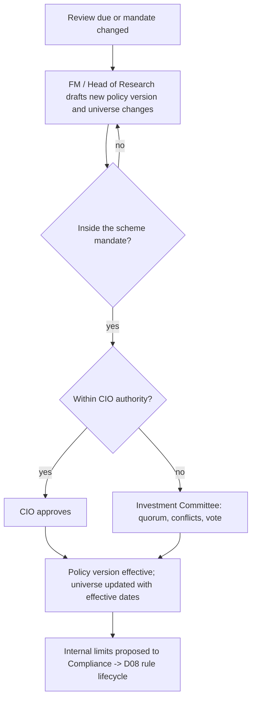

# PRD-003 — Investment Management (D03)

This document states what AMC OS must do to turn research into governed, documented investment decisions and to control which securities each scheme may hold. It re-keys PRD-000 v0.9 Module 02 to the GOV-001 identifiers (`FR-02-nn` → `FR-D03-nnn`, business rules `BR-02-n` → `BRL-D03-nnn`, `US-INV-0n` → `US-D03-nnn`) and adds what Module 02 left out: portfolio strategy and investment policy documents (GOV-001 §3 gap), research intelligence, and a workflow for the periodic review of investment policy and approved universes (BA-004 §5.1 D03 gap).

**Builds on Draft documents:** [PRD-000 v0.9](PRD-000_master_prd_v0.9.md) Module 02, Chapter 4 (W2), Chapter 5; [BA-001](../02_business_architecture/BA-001_business_capability_map.md) D03, §4, §5; [BA-002](../02_business_architecture/BA-002_amc_operating_model.md); [BA-004](../02_business_architecture/BA-004_end_to_end_workflows.md) WF-002, WF-003; [BA-005](../02_business_architecture/BA-005_roles_and_permissions.md); [PRD-001](PRD-001_platform_administration.md) — allowed by owner decision D-3 ([GOV-008](../00_governance/GOV-008_build_loop.md) §2 rule 3). No document used here is Approved. Owner decisions D-17…D-25 (role IDs, SoD waivers, small-team mode) are applied through BA-005.

**What this document is not:** the security and issuer golden records (owned by D16, CAP-D16-004 — BA-001 §5 C2), compliance rule evaluation (D08, FE-04), credit-risk scoring (D09, FE-05), table definitions (Steps 15–16) or API contracts (Step 24). It adds **no new regulatory fact**; labels from PRD-000 are carried unchanged.

## 1. Scope

| In scope (CAP) | Out of scope |
| --- | --- |
| CAP-D03-001 Investment research · CAP-D03-002 Research documents · CAP-D03-003 Security analysis · CAP-D03-004 Investment recommendations · CAP-D03-005 Investment committee workflows · CAP-D03-006 Investment decisions · CAP-D03-007 Research approval · CAP-D03-008 Portfolio strategy · CAP-D03-009 Investment policy management · CAP-D03-010 Research intelligence | Maintaining security, issuer, rating and benchmark master data (D16, CAP-D16-004 — D03 reads it and raises data-steward requests); evaluating limits (D08); computing credit-risk scores (D09); the AI assistants themselves (D17) |

## 2. Identifiers and re-keying

| PRD-000 v0.9 | Here | Note |
| --- | --- | --- |
| FR-02-01 … FR-02-10 | FR-D03-001 … FR-D03-010 | Same order; capability added; wording shortened. Changes of meaning or source are marked **(changed)** with the reason; added cross-references are not tagged |
| BR-02-1 … BR-02-4 (business **rules**) | BRL-D03-001 … BRL-D03-004 | GOV-001 §4 reserves `BR-` for business requirements |
| US-INV-01, US-INV-02 (Ch 5); Module 02 point 7 and point 18 | US-D03-001 … US-D03-005 | |
| Module 02 point 18 acceptance criteria | AC-US-D03-003-1, AC-US-D03-004-1 | |
| Module 02 point 6 (credit approval workflow) | Part of WF-002 (BA-004) | Not a new workflow |
| — | FR-D03-011 … FR-D03-018, BRL-D03-005 … 008, US-D03-006 … 008, WF-031 | **New** **[DES]** |

Priority: **M** must, **S** should (PRD-000 Ch 3); user stories **C** critical, **O** optional (PRD-000 Ch 5).

## 3. Business requirements

| ID | Business requirement | Capabilities |
| --- | --- | --- |
| BR-D03-001 | For any holding, the AMC can show why it was bought or sold: the research, the recommendation and the decision record behind each order | CAP-D03-001, -004, -006 |
| BR-D03-002 | A scheme can only buy securities in its approved universe, and never a restricted security | CAP-D03-007, -009 |
| BR-D03-003 | Investment committee decisions are taken with quorum and declared conflicts, and cannot be changed afterwards | CAP-D03-005 |
| BR-D03-004 | Each scheme's investment policy and strategy are written down, approved and reviewed on schedule | CAP-D03-008, -009 |
| BR-D03-005 | Research is searchable, versioned and used within the AMC's data licences | CAP-D03-002, -010 |

## 4. Functional requirements

Every requirement also obeys PRD-000 common rules C1–C8.

### 4.1 Re-keyed from PRD-000 Module 02

| ID (was) | Pri | Capability | Requirement |
| --- | --- | --- | --- |
| FR-D03-001 (FR-02-01) **(changed)** | M | CAP-D03-003 | **Security view:** ISIN, symbol per exchange, instrument type, face value, coupon schedule, maturity, call/put dates, day-count convention, listing status, sector, market-cap category (from the AMFI half-yearly list), rating history. *Changed:* PRD-000 made this the security master; under BA-001 §5 C2 the golden record is owned by D16 (CAP-D16-004) and D03 reads it and raises steward requests |
| FR-D03-002 (FR-02-02) **(changed)** | M | CAP-D03-003 | **Issuer view:** legal entity, LEI, CIN, issuer group (for group exposure), sector, sponsor-group flag (for related-party limits), ratings by agency. *Changed:* as FR-D03-001 — golden record in D16 |
| FR-D03-003 (FR-02-03) | M | CAP-D03-009 (.2), CAP-D03-007 (.2) | **Investment universe:** per scheme or scheme group; states `PROPOSED → APPROVED → WATCHLIST → SUSPENDED → REMOVED` (as `investment.universe_member` in DDL-000) |
| FR-D03-004 (FR-02-04) | M | CAP-D03-009 (.3) | **Approved and restricted lists:** the restricted list (insider / MNPI — material non-public information, sponsor group, regulatory bans) blocks orders hard in the OMS; the grey / watch list warns. Restricted-list entries are owned by Compliance (BA-001 CAP-D03-009 note). Both the universe and the restricted list are checked in D05 order validation (PRD-005 FR-D05-004) **[DES]** |
| FR-D03-005 (FR-02-05) | M | CAP-D03-001 (.2), (.3) | **Investment thesis:** structured template (thesis, valuation, target price or yield, risks, triggers, review date) plus attachments |
| FR-D03-006 (FR-02-06) | M | CAP-D03-004 (.1)–(.3) | **Analyst recommendations:** Buy / Add / Hold / Reduce / Sell with target, horizon, conviction; version history; hit-rate tracking |
| FR-D03-007 (FR-02-07) | M | CAP-D03-005 | **Investment committee workflow:** agenda, papers, quorum rules, votes, minutes, decision records, action items |
| FR-D03-008 (FR-02-08) | M | CAP-D03-002 | **Research documentation:** notes, models, management-meeting notes, broker research references (licence-aware), searchable |
| FR-D03-009 (FR-02-09) | S | CAP-D03-004 (.4) | **Portfolio recommendations:** analyst-to-fund-manager suggestions linked to scheme portfolios |
| FR-D03-010 (FR-02-10) | M | CAP-D03-006 | **Investment decision records:** every order links to a decision record (fund-manager rationale); evidence for dealing-room and trustee review **[REG — documentation of investment decisions; VAL exact Master Circular clause]** |

### 4.2 New requirements **[DES]**

| ID | Pri | Capability | Requirement |
| --- | --- | --- | --- |
| FR-D03-011 | M | CAP-D03-001 (.1) | **Coverage list:** each covered security or issuer has a named analyst; uncovered holdings are shown to the Head of Research |
| FR-D03-012 | M | CAP-D03-003 (.2) | **Credit analysis of debt issuers:** issuer proposal with financials, rating rationale, covenants and proposed internal limit; credit-risk score taken from D09 (deterministic model, FE-05) — PRD-000 Module 02 point 6 |
| FR-D03-013 | M | CAP-D03-007 (.1), (.3) | **Research approval:** research is published only after a checker other than the author approves; debt-issuer approvals carry a review date and expire as BRL-D03-003 states |
| FR-D03-014 | M | CAP-D03-008 | **Portfolio strategy:** a house view and a strategy per scheme (asset-class and sector stance, duration or credit stance for debt, horizon), versioned and approved by the CIO; the approved strategy's targets are handed to D04 (CAP-D04-003, -004) |
| FR-D03-015 | M | CAP-D03-009 (.1) | **Investment policy documents:** an investment policy per scheme and for the house (approach, permitted instruments within the mandate of CAP-D02-006, internal limits, review frequency), versioned and approved (WF-031) |
| FR-D03-016 | M | CAP-D03-009 (.4) | **Internal limits proposed to D08:** internal limits stricter than the mandate (for example issuer or sector caps) are proposed from the policy to Compliance, who turn them into rules in the D08 rule lifecycle (CAP-D08-002 internal investment restrictions; rule approval CAP-D08-001 (.3), SOD-08); D03 never holds rule logic |
| FR-D03-017 | S | CAP-D03-010 (.2) | **News and filing alerts:** alerts on covered names (filings, rating actions, corporate news) from licensed sources; a rating downgrade below a configured threshold alerts Risk, Compliance and the fund manager (PRD-000 Module 02 point 14; threshold **[ASSUMPTION — confirm: DEP-11 of the pilot AMC]**) |
| FR-D03-018 | S | CAP-D03-010 (.1), (.3) | **Research intelligence:** AI research summaries through the Research copilot (CAP-D17-002), always cited and marked as drafts; usage analytics of research (who read what) |

## 5. Business rules

| ID (was) | Rule | Label |
| --- | --- | --- |
| BRL-D03-001 (BR-02-1) | An order on a security not in the scheme's approved universe is blocked unless an emergency override approved by the CIO and Compliance exists | **[DES]** (PRD-000 unlabelled) |
| BRL-D03-002 (BR-02-2) | Restricted-list entries take effect within 5 seconds across OMS sessions, counted from the checker's approval of the entry (DDL-000 requires an approval on every entry) | **[DES]** |
| BRL-D03-003 (BR-02-3) | Debt-issuer approvals expire after the review period (configurable); an overdue review moves the issuer to `WATCHLIST` | **[IND]** |
| BRL-D03-004 (BR-02-4) | Market-cap classification uses the latest AMFI list effective for the period | **[REG — categorization circular; VAL refresh dates]** |
| BRL-D03-005 | Investment committee votes, minutes and decision records are immutable once the meeting is closed; a correction is a new, linked record | PRD-000 Module 02 point 15 **[DES]** |
| BRL-D03-006 | A committee decision cannot move to `APPROVED` without quorum and every member's conflict declaration; a member with a declared conflict does not vote on that item | PRD-000 Module 02 point 18 **[DES]**; quorum size **[ASSUMPTION — confirm: CIO of the pilot AMC]** |
| BRL-D03-007 | A research note, recommendation, strategy or policy is never edited after publication; a change is a new version and the old one stays viewable | **[DES]** |
| BRL-D03-008 | Licensed vendor content is shown and used (including by AI) only as the licence permits | GOV-003 §5 **[VAL]** per vendor |

## 6. Workflows

### 6.1 Existing workflows

| Workflow | D03 role | Requirements |
| --- | --- | --- |
| [WF-002](../02_business_architecture/BA-004_end_to_end_workflows.md) Investment research and approval | Accountable (DEP-04) | FR-D03-003…008, FR-D03-012, FR-D03-013 |
| WF-003 Portfolio construction | Supplies strategy and decision records | FR-D03-010, FR-D03-014 |
| WF-004 Order creation and execution | Every order carries a decision record; restricted list and universe checked | FR-D03-003, FR-D03-004, FR-D03-010 |

### 6.2 WF-031 — Investment policy and approved-universe review **[DES]**

| Field | Detail |
| --- | --- |
| Trigger | Review date of a scheme or house investment policy (frequency **[ASSUMPTION — confirm: CIO of the pilot AMC]**); a scheme change that touches the mandate (WF-029); a CIO request |
| Initiator | Fund Manager of the scheme (scheme policy) or Head of Research (house policy and universe) |
| Departments | **DEP-02 / DEP-03** (CIO); DEP-04, DEP-09 (internal limits), DEP-11 (risk view), Investment Committee |
| Capabilities | CAP-D03-009, CAP-D03-008, CAP-D03-007 (.2), CAP-D03-005, CAP-D02-006, CAP-D08-002 |
| Hand-offs (outside) | None |
| Preconditions | Current policy version and universe exist; mandate of the scheme version in force (D02) |
| Final state | New policy version approved and effective (or current version re-confirmed); universe members re-confirmed, moved to `WATCHLIST` / `SUSPENDED` / `REMOVED`, or added; proposed internal limits handed to Compliance |
| Approvals | CIO approves a scheme policy; Investment Committee for a house policy or for any change above the CIO's delegated authority **[ASSUMPTION — confirm: CIO of the pilot AMC]**; maker ≠ checker (SOD-01). Internal limits become rules only through the D08 rule lifecycle (SOD-08) |
| Exceptions | Policy would allow something outside the mandate → refused (mandate wins); review overdue → escalation to the CIO and the universe members under review move to `WATCHLIST` |
| Audit | Old and new policy versions, difference view, universe decisions with reasons, approvals, limits proposed |
| Source | **new** (BA-004 §5.1 D03 gap: CAP-D03-009 (.1)) |

## 7. Permissions by capability

From BA-005 §3 (D03 column) and §4, split by capability (BA-005 §7 C2). Checker ≠ maker (SOD-01). Roles with "R" in D03 in BA-005 §3 (CEO, COO, CIO, Fund Manager, Research Analyst, Dealer, Compliance Officer, Risk Manager, Operations Analyst, Product Manager, Auditor) read; the CFO, CTO and the other roles shown "—" there have no D03 access. Rights below that BA-005 §3 does not show are marked **†** with a reason.

| Capability | Maker | Checker(s) |
| --- | --- | --- |
| CAP-D03-001 Investment research | Research Analyst (own coverage) | Head of Research (publication) |
| CAP-D03-002 Research documents | Research Analyst; Fund Manager (management-meeting notes)† | — (documents; publication of notes via CAP-D03-007) |
| CAP-D03-003 Security analysis | Research Analyst | Head of Research; Investment Committee for debt-issuer credit approval |
| CAP-D03-004 Investment recommendations | Research Analyst; Fund Manager ("C(recommend)") | Head of Research |
| CAP-D03-005 Investment committee workflows | Head of Research or CIO (agenda) | Committee members vote; CIO closes the minutes **[ASSUMPTION — confirm: CIO of the pilot AMC]** |
| CAP-D03-006 Investment decisions | Fund Manager (own schemes)† | — (record, not an approval; it is reviewed in WF-004 order approval) |
| CAP-D03-007 Research approval | Research Analyst | Head of Research, or Investment Committee vote (`investment.universe.approve`) |
| CAP-D03-008 Portfolio strategy | Fund Manager (scheme); Head of Research (house view)† | CIO ("R C U A J") |
| CAP-D03-009 Investment policy management | Fund Manager / Head of Research†; Compliance Officer for restricted-list entries ("R C U (restricted list) A") | CIO or Investment Committee (policy, universe); another Compliance Officer for restricted-list entries (SOD-01) |
| CAP-D03-010 Research intelligence | System and Research copilot (drafts only, SOD-10) | — |

**Rights added beyond BA-005 §3 (†), with reasons [DES]:**

| Cell | Reason |
| --- | --- |
| Fund Manager writes management-meeting notes (CAP-D03-002) | Fund managers attend company meetings; BA-005 gives them only C(recommend) in D03 |
| Fund Manager creates decision records (CAP-D03-006) | FR-D03-010 / PRD-000 FR-02-10 require the FM's rationale on every order; BA-005 shows it under D05 "C U S own" only |
| Head of Research drafts the house view and policy; Fund Manager drafts the scheme policy (CAP-D03-008, -009) | WF-031 makers; BA-005 §3 gives D03 create rights only to analysts, FM (recommend) and Compliance (restricted list) |

These are to be carried into the BA-005 D03 column (open point C3).

## 8. User stories and acceptance criteria

| ID | Story | Pri | Acceptance criteria (Given / When / Then) |
| --- | --- | --- | --- |
| US-D03-001 (was US-INV-01) | As a Research Analyst, I want to publish a recommendation with a target price, so that FMs and the CIO see it with its history | C | **AC-US-D03-001-1** Given a published recommendation, when it is edited, then a new version is created and v1 remains viewable. |
| US-D03-002 (was US-INV-02) | As a Compliance Officer, I want a restricted-list entry to take effect at once, so that no order can be placed in it | C | **AC-US-D03-002-1** Given an addition at 10:00:00, when an order is placed at 10:00:06, then it is blocked. |
| US-D03-003 (Module 02 point 18) | As a Compliance Officer, I want restricted securities blocked in every scheme | C | **AC-US-D03-003-1** Given a security on the restricted list, when a dealer submits a buy order in any scheme, then the order is rejected with code `RESTRICTED_SECURITY` and an audit event is written. |
| US-D03-004 (Module 02 point 18) | As a CIO, I want committee decisions only with quorum | C | **AC-US-D03-004-1** Given an IC meeting without quorum, when votes are recorded, then the decision cannot move to `APPROVED`. |
| US-D03-005 (Module 02 point 7) | As a CIO, I want every trade linked to a decision record, so that I can answer "why" for any holding | C | **AC-US-D03-005-1** Given an executed trade, when the CIO opens it, then the order, its decision record (FM rationale) and the research and recommendation linked to that record are shown. (Refusal of an order without a decision record is tested in PRD-005 AC-US-D05-008-1.) |
| US-D03-006 | As a Risk Manager, I want overdue debt-issuer reviews flagged | C | **AC-US-D03-006-1** Given an approved debt issuer whose review date has passed, when the daily job runs, then the issuer moves to `WATCHLIST` and the analyst, CIO and Risk are notified. |
| US-D03-007 | As a CIO, I want scheme policies reviewed on schedule | O | **AC-US-D03-007-1** Given a scheme policy whose review date has passed without a new or re-confirmed version, when the daily job runs, then the CIO is notified and the review appears overdue on the CIO overview. |
| US-D03-008 | As a Head of Research, I want AI summaries never published as research | C | **AC-US-D03-008-1** Given a research summary drafted by the Research copilot, when it is saved, then it is marked as an AI draft and cannot be published until a human analyst edits and submits it and the Head of Research approves it. |

## 9. Exceptions

| Exception | Handling | Source |
| --- | --- | --- |
| Conflicting vendor data on a security or issuer | Data-steward queue in D16 with source-precedence rules (CAP-D16-004 (.3)) | PRD-000 Module 02 point 14 |
| Rating downgrade below threshold | Alert to Risk, Compliance and the fund manager (FR-D03-017) | PRD-000 Module 02 point 14 |
| IC quorum or conflict declarations missing | Decision stays open; back to committee (WF-002) | BA-004 WF-002 |
| Security not in the master | Data-steward request before research can be approved | BA-004 WF-002 preconditions |
| Policy review overdue | Escalation and `WATCHLIST` (WF-031) | new |

## 10. Data and interfaces

**Owned schema:** `investment` (GOV-001 §3). Reads `master.security`, `master.issuer`, `master.issuer_group`, `master.credit_rating` and `product.scheme`. No database change is made in this step.

| Exists in DDL-000 | Not yet in DDL-000 (for DA-001 / DDL, Steps 15–16) **[DES]** |
| --- | --- |
| `investment.restricted_list_entry`, `investment.universe_member`, `investment.decision_record` | Coverage list; research note and version; thesis; recommendation and version; IC meeting, agenda item, vote, conflict declaration, minutes, action item; debt-issuer credit approval with review date; portfolio strategy and house view versions; investment policy versions; internal-limit proposals; research usage log (GOV-006 §2 row 7 already names "research notes, IC meetings") |

**Interfaces (indicative, not contracts):** PRD-000 Module 02 point 11 names `investment-svc` endpoints `/securities`, `/issuers`, `/universe`, `/research-notes`, `/recommendations`, `/ic-meetings`, `/decisions`; `/securities` and `/issuers` move to D16 (BA-001 §5 C2). Final paths and `API-D03-nnn` IDs: Step 24; events (universe changed, restricted list changed, decision recorded) in `<NAME>.v<n>` form: EA-007 (Step 13). Outside parties: data vendors and rating agencies through D16 adapters — "Confirm with provider" (INT-001, Step 14).

## 11. Non-functional requirements

NFR numbering continues after PRD-002. NFR-PERF-003 is not used, because GOV-001 §4 uses it as its format example.

| ID | Requirement | Type / source |
| --- | --- | --- |
| NFR-PERF-002 | Security lookup p95 < 50 ms | Proposed — PRD-000 Module 02 point 17 |
| NFR-PERF-004 | Restricted-list propagation to every OMS session < 5 s | Proposed — PRD-000 Module 02 point 17, Ch 7 Latency (BRL-D03-002) |
| NFR-AUD-003 | Full history of universe and restricted-list changes with reason codes; IC votes immutable | PRD-000 Module 02 point 15 **[DES]** |

Platform NFRs in PRD-001 §11 apply.

## 12. AI in this domain

Within PRD-000 C8 and ADR-0008 (read and propose only):

- **Research copilot** (CAP-D17-002) drafts cited dossiers, earnings-call digests and peer comparisons; the analyst edits and owns the result (WF-002, US-D03-008).
- **CIO copilot** (CAP-D17-003, in the brief's D17 list) gives the CIO a read-only morning brief and "what changed", including the portfolio-wide view of recommendations that PRD-000 Module 02 point 16 asks for.

## 13. Open points

| # | Point | Where closed |
| --- | --- | --- |
| C1 | Exact Master Circular clause for investment-decision documentation (FR-D03-010) and refresh dates of the AMFI market-cap list (BRL-D03-004) **[VAL]** | REG-001 (Step 25) |
| C2 | Quorum size, delegated authority of the Head of Research and CIO, policy review frequency, downgrade alert threshold — tenant configuration with no values yet **[ASSUMPTION]** | Pilot discovery |
| C3 | The † rights of §7 are not yet in the BA-005 §3 D03 column | Next BA-005 revision |
| C4 | WF-031 is added to the BA-004 register in this step; its card lives here until BA-004's next revision | Next BA-004 revision |

## Sources

All sources are inside this repository; no external facts are introduced.

| # | Source | Used for |
| --- | --- | --- |
| R1 | [PRD-000 v0.9](PRD-000_master_prd_v0.9.md) Module 02, Ch 4 W2, Ch 5 (US-INV-01, -02), Ch 7 | Re-keyed requirements, rules, stories, labels, targets |
| R2 | [BA-001](../02_business_architecture/BA-001_business_capability_map.md) D03, §4, §5 C2, C4 | Capabilities, ownership of master data |
| R3 | [BA-004](../02_business_architecture/BA-004_end_to_end_workflows.md) WF-002, WF-003, WF-004, §5.1 | Workflows and the D03 gap |
| R4 | [BA-005](../02_business_architecture/BA-005_roles_and_permissions.md) §3, §4, §5 | Rights, approvers, SoD |
| R5 | [PRD-002](PRD-002_product_and_scheme_management.md) | Mandate (CAP-D02-006), WF-029, NFR numbering |
| R6 | `database/ddl/DDL-000_core_schema_v0.9.sql` | Existing `investment` tables and universe states |
