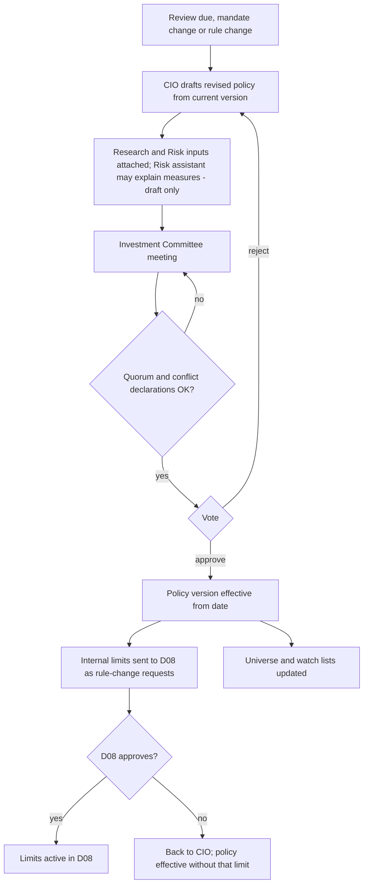

# PRD-003 — Investment Management (D03)

This document states what AMC OS must do so that research becomes governed, documented investment decisions, and so that the AMC controls which securities each scheme may hold. It re-keys PRD-000 v0.9 Module 02 to the GOV-001 identifiers (`FR-02-nn` → `FR-D03-nnn`, business rules `BR-02-n` → `BRL-D03-nnn`, `US-INV-0n` → `US-D03-nnn`) and adds what Module 02 left out: portfolio strategy, investment policy management (GOV-001 §3 gap), research intelligence, and the investment-policy review workflow that BA-004 §5.1 left for this step.

**Builds on Draft documents:** [PRD-000 v0.9](PRD-000_master_prd_v0.9.md) Module 02, Chapter 4 (W2), Chapter 5, Chapter 9; [BA-001](../02_business_architecture/BA-001_business_capability_map.md) D03; [BA-002](../02_business_architecture/BA-002_amc_operating_model.md) §2, §4; [BA-003](../02_business_architecture/BA-003_domain_dictionary.md); [BA-004](../02_business_architecture/BA-004_end_to_end_workflows.md) WF-002, WF-003; [BA-005](../02_business_architecture/BA-005_roles_and_permissions.md); [PRD-001](PRD-001_platform_administration.md); [PRD-002](PRD-002_product_and_scheme_management.md) — allowed by owner decision D-3 ([GOV-008](../00_governance/GOV-008_build_loop.md) §2 rule 3). No document used here is Approved. Owner decisions D-17 (role IDs) and D-18 (no SoD waivers) are applied ([LOOP_STATE.md](../../LOOP_STATE.md)).

**What this document is not:** the golden security and issuer records (owned by D16, CAP-D16-004 — BA-001 §5 C2; PRD-016, Step 9), limit evaluation (D08, PRD-008, FE-04), risk scores (D09, PRD-009, FE-05), portfolio construction (D04, [PRD-004](PRD-004_portfolio_management.md)) or orders ([PRD-005](PRD-005_order_management.md)). **Rule for engineers (PRD-000):** no regulatory number (limit, threshold, review period, refresh date) is hard-coded; each is a versioned, approved parameter in the rule registry (D08) or the configuration catalogue (PRD-001 FR-D01-033).

## 1. Scope

| In scope (CAP) | Out of scope |
| --- | --- |
| CAP-D03-001 Investment research · CAP-D03-002 Research documents · CAP-D03-003 Security analysis · CAP-D03-004 Investment recommendations · CAP-D03-005 Investment committee workflows · CAP-D03-006 Investment decisions · CAP-D03-007 Research approval · CAP-D03-008 Portfolio strategy · CAP-D03-009 Investment policy management · CAP-D03-010 Research intelligence | Maintaining the security, issuer and rating golden records (D16); evaluating limits (D08); computing risk or credit scores (D09); AI that decides or publishes (ADR-0008) |

## 2. Re-keying from PRD-000 Module 02

| PRD-000 v0.9 | Here | Note |
| --- | --- | --- |
| FR-02-01 … FR-02-10 | FR-D03-001 … FR-D03-010 | Same order. FR-02-01 and FR-02-02 (security and issuer master) are **(changed)**: their records belong to D16 (BA-001 §5 C2); here they state what D03 needs from those records |
| BR-02-1 … BR-02-4 (business **rules**) | BRL-D03-001 … BRL-D03-004 | `BR-` is reserved for business *requirements* (GOV-001 §4) |
| US-INV-01, US-INV-02 (Ch 5) and the three Module 02 point 7 stories | US-D03-001 … US-D03-005 | |
| Module 02 point 18 acceptance criteria | AC-US-D03-002-2 (restricted list), AC-US-D03-006-1 (quorum) | |
| Module 02 point 6 (credit approval for a new debt issuer) | Covered by WF-002 (BA-004) and FR-D03-012 | No new `WF-` ID |
| — | FR-D03-011 … FR-D03-020, BRL-D03-005 … 008, US-D03-006 … 010, WF-031; acceptance criteria AC-US-D03-003-1, AC-US-D03-004-1 and AC-US-D03-006-2 on re-keyed or new stories | **New** **[DES]** |

## 3. Business requirements

| ID | Business requirement | Capabilities |
| --- | --- | --- |
| BR-D03-001 | Every holding can be traced to a documented investment decision, so the AMC can answer "why was this bought?" for SEBI, trustees and auditors | CAP-D03-006 |
| BR-D03-002 | Only approved securities can be bought for a scheme, and restricted securities can never be bought | CAP-D03-007, CAP-D03-009 |
| BR-D03-003 | Research is stored, versioned and searchable in one place instead of email and personal files | CAP-D03-001, -002, -004 |
| BR-D03-004 | Investment committee decisions are made with quorum, conflict declarations and an immutable record | CAP-D03-005 |
| BR-D03-005 | Each scheme's investment policy and strategy are written down, approved, reviewed on time and carried into limits and portfolio targets | CAP-D03-008, CAP-D03-009 |

## 4. Functional requirements

Every requirement also obeys PRD-000 common rules C1–C8. Labels from PRD-000 are carried unchanged.

### 4.1 Re-keyed from PRD-000 Module 02

| ID (was) | Pri | Capability | Requirement |
| --- | --- | --- | --- |
| FR-D03-001 (FR-02-01) **(changed)** | M | CAP-D03-003 (uses CAP-D16-004) | **Security data needed by research:** ISIN, symbol per exchange, instrument type (equity, bond, CP, CD, T-bill, G-sec, SDL, REIT/InvIT, ETF, MF unit, derivative, repo/TREPS), face value, coupon schedule, maturity, call/put dates, day-count convention, listing status, sector (AMFI / industry classification), market-cap category (from the AMFI half-yearly list), rating history. *Changed:* PRD-000 made this a D03 master; the golden record is maintained by D16 (CAP-D16-004, BA-001 §5 C2) and D03 reads it |
| FR-D03-002 (FR-02-02) **(changed)** | M | CAP-D03-003 (uses CAP-D16-004) | **Issuer data needed by research:** legal entity, LEI, CIN, issuer group (for group exposure), sector, sponsor-group flag (for related-party limits), ratings by agency. *Changed:* as FR-D03-001 |
| FR-D03-003 (FR-02-03) | M | CAP-D03-009 (.2) | **Investment universe:** per scheme or scheme group; states `PROPOSED → APPROVED → WATCHLIST → SUSPENDED → REMOVED` |
| FR-D03-004 (FR-02-04) | M | CAP-D03-009 (.3) | **Approved and restricted lists:** the restricted list (insider / MNPI, sponsor group, regulatory bans) blocks orders hard in the OMS (D05); the grey / watch list warns |
| FR-D03-005 (FR-02-05) | M | CAP-D03-001 (.2), (.3) | **Investment thesis:** structured template (thesis, valuation, target price / yield, risks, triggers, review date) plus attachments |
| FR-D03-006 (FR-02-06) | M | CAP-D03-004 (.1)–(.3) | **Analyst recommendations:** Buy / Add / Hold / Reduce / Sell with target, horizon and conviction; version history; hit-rate tracking |
| FR-D03-007 (FR-02-07) | M | CAP-D03-005 | **Investment committee workflow:** agenda, papers, quorum rules, votes, minutes, decision records, action items |
| FR-D03-008 (FR-02-08) | M | CAP-D03-002 | **Research documentation:** notes, models, meeting notes with management, broker research references (licence-aware), searchable |
| FR-D03-009 (FR-02-09) | S | CAP-D03-004 (.4) | **Portfolio recommendations:** analyst-to-fund-manager suggestions linked to scheme portfolios |
| FR-D03-010 (FR-02-10) | M | CAP-D03-006 | **Investment decision records:** every order must link to a decision record (fund-manager rationale); evidence for dealing-room and trustee review **[REG — documentation of investment decisions; VAL exact Master Circular clause]** |

### 4.2 New requirements **[DES]**

| ID | Pri | Capability | Requirement |
| --- | --- | --- | --- |
| FR-D03-011 | M | CAP-D03-007 (.1) | **Research approval:** a recommendation or research note is visible to fund managers only after its checker (Head of Research, or CIO) approves it; drafts stay with the author |
| FR-D03-012 | M | CAP-D03-007 (.3) | **Debt-issuer credit approval and review expiry:** a debt issuer enters the universe only through WF-002 (Investment Committee vote); each approval carries a review date; when the review date passes, the issuer moves to `WATCHLIST` automatically and new buys warn (BRL-D03-003). PRD-000 Module 02 point 6 step 3 adds a credit-risk score from D09 (FE-05) as an input; D03 shows it, never computes it. The proposal carries a proposed issuer limit; on approval the limit is sent to D08 as a rule-change request (CAP-D08-002) and is used in compliance checks only once D08 approves it (Module 02 point 6 steps 1 and 5) |
| FR-D03-013 | M | CAP-D03-008 (.1) | **House view and scheme strategy:** the CIO records a house view and a strategy per scheme (asset-class tilts, duration stance, sector preferences, themes) as a versioned, effective-dated document approved by the Investment Committee |
| FR-D03-014 | M | CAP-D03-008 (.2) | **Strategy targets to D04:** an approved strategy can carry target ranges (for example asset-class or sector ranges) that are sent to D04 as targets for construction (PRD-004 FR-D04-004); D04 never changes them |
| FR-D03-015 | M | CAP-D03-009 (.1) | **Investment policy:** an investment policy per scheme and for the AMC as a whole (house policy), versioned and effective-dated, approved by the Investment Committee and reviewed on a schedule through WF-031 |
| FR-D03-016 | M | CAP-D03-009 (.4) | **Internal limits proposed to D08:** internal (house) limits stricter than regulation are proposed from the investment policy and sent to D08 as rule-change requests; they take effect only when D08 approves them under its rule lifecycle (CAP-D08-002, SOD-08) |
| FR-D03-017 | S | CAP-D03-010 (.2) | **News and filing alerts:** analysts get alerts on news and exchange filings for securities on their coverage list. Which data sources may be used depends on each vendor's licence **[VAL]** (GOV-003 §5) |
| FR-D03-018 | S | CAP-D03-010 (.3) | **Research usage analytics:** which notes and recommendations fund managers read and act on |
| FR-D03-019 | M | CAP-D03-003 | **Rating-change alert:** a rating downgrade of a held or universe security below the threshold set in configuration alerts Risk, Compliance and the fund manager (PRD-000 Module 02 point 14). The threshold is AMC policy **[ASSUMPTION — confirm: CIO of the pilot AMC]** |
| FR-D03-020 | M | CAP-D03-001 (.1) | **Coverage list:** each security or issuer has a covering analyst; uncovered holdings are listed for the Head of Research |

Priority: **M** must (release-blocking), **S** should — as PRD-000 Chapter 3.

## 5. Business rules

| ID (was) | Rule | Label |
| --- | --- | --- |
| BRL-D03-001 (BR-02-1) | An order on a security not in the scheme's approved universe is blocked unless an emergency override with CIO + Compliance maker-checker exists (enforced in D05, PRD-005 FR-D05-012) | **[DES]** (PRD-000 unlabelled) |
| BRL-D03-002 (BR-02-2) | Restricted-list entries take effect within 5 seconds across OMS sessions | **[DES]** |
| BRL-D03-003 (BR-02-3) | Debt issuer approvals expire after the review period (configurable) | **[IND]** |
| BRL-D03-004 (BR-02-4) | Market-cap classification uses the latest AMFI list effective for the period | **[REG — categorization circular; VAL refresh dates]** |
| BRL-D03-005 | AI-drafted research (Research copilot) is a draft: it is published only after the analyst submits it and the checker approves it (FR-D03-011; ADR-0008) | **[DES]** |
| BRL-D03-006 | An Investment Committee decision is valid only with quorum and with conflict-of-interest declarations from every voting member; a member with a declared conflict does not vote on that item. Quorum size is AMC policy | **[DES]**; quorum **[ASSUMPTION — confirm: pilot discovery]** |
| BRL-D03-007 | Investment Committee votes and minutes are immutable once the meeting is closed; corrections are new, linked records | **[DES]** (PRD-000 point 15) |
| BRL-D03-008 | An investment policy past its review date is flagged on the CIO overview and to Compliance until WF-031 completes. Review frequency is AMC policy | **[DES]**; frequency **[ASSUMPTION — confirm: pilot discovery]** |

## 6. Workflows

### 6.1 Existing workflows

| Workflow | D03 role | Requirements |
| --- | --- | --- |
| [WF-002](../02_business_architecture/BA-004_end_to_end_workflows.md) Investment research and approval | Accountable (DEP-04) | FR-D03-003…008, FR-D03-011, FR-D03-012 |
| WF-003 Portfolio construction | Supplies strategy targets and decision records | FR-D03-010, FR-D03-014 |
| WF-004 Order creation and execution | Supplies the decision record and universe / restricted list | FR-D03-003, -004, -010; BRL-D03-001, -002 |

### 6.2 WF-031 — Investment policy review **[DES]**

| Field | Detail |
| --- | --- |
| Trigger | Policy review date reached (BRL-D03-008); a scheme change that affects the mandate (WF-029); a regulatory change affecting investment limits (D08) |
| Initiator | CIO (ROLE-03) |
| Departments | **DEP-02 / DEP-03 (CIO)** — accountable for CAP-D03-009 (BA-002 §4); DEP-04 (research input), DEP-11 (risk input), DEP-09 (internal limits), Investment Committee |
| Capabilities | CAP-D03-009, CAP-D03-008, CAP-D03-005, CAP-D08-002, CAP-D09-012 |
| Hand-offs (outside) | None. Whether the AMC board or trustees must see the reviewed policy is **[VAL]** |
| Preconditions | Current policy version exists (or none, for a new scheme) |
| Final state | New policy version effective from its date; proposed internal limits sent to D08; universe and watch lists updated; or the policy confirmed unchanged with a new review date |
| Approvals | Investment Committee vote (BRL-D03-006); internal limits are approved separately by D08 (SOD-08) |
| Exceptions | No quorum → meeting re-scheduled, policy stays flagged; D08 rejects a proposed limit → policy takes effect without it and the item returns to the CIO |
| Audit | Old and new policy versions, inputs, votes, minutes, limit requests and D08 outcome |
| Source | **new** (BA-004 §5.1 D03 gap: CAP-D03-009 (.1)) |

## 7. Permissions by capability

From BA-005 §3 (D03 column) and §4, narrowed to each capability (BA-005 §7 C2). Checker ≠ maker (SOD-01). CEO, COO, Risk Manager, Operations Analyst, Product Manager, Dealer and Auditor read (BA-005 §3: R).

| Capability | Maker | Checker(s) |
| --- | --- | --- |
| CAP-D03-001 Investment research | Research Analyst (own coverage) | Head of Research (approval authority, BA-005 §4) |
| CAP-D03-002 Research documents | Research Analyst | Head of Research |
| CAP-D03-003 Security analysis | Research Analyst | Head of Research |
| CAP-D03-004 Investment recommendations | Research Analyst; Fund Manager ("C(recommend)") | Head of Research |
| CAP-D03-005 Investment committee workflows | CIO (agenda, papers) | Committee members vote; quorum rule (BRL-D03-006) |
| CAP-D03-006 Investment decisions | Fund Manager† (decision record for own scheme) | — (record, not approval) |
| CAP-D03-007 Research approval — universe additions | Research Analyst | Head of Research within delegated authority, else Investment Committee (`investment.universe.approve`) |
| CAP-D03-007 Research approval — debt-issuer credit | Research Analyst (credit analyst) | Investment Committee vote only (PRD-000 Module 02 point 13, WF-002, FR-D03-012) |
| CAP-D03-008 Portfolio strategy | CIO | Investment Committee |
| CAP-D03-009 Investment policy; restricted and watch lists | CIO (policy); Compliance Officer (restricted list, "R C U (restricted list) A") | Investment Committee (policy); a second Compliance Officer (restricted list, SOD-01) |
| CAP-D03-010 Research intelligence | System (alerts); Research Analyst | — |

**Right added beyond BA-005 §3 (†):** BA-005 gives the Fund Manager "C(recommend)" in D03, but PRD-000 FR-02-10 and BA-001 CAP-D03-006 make the fund manager the author of the decision record; this PRD adds that create right **[DES]** (open point C4).

## 8. User stories and acceptance criteria

Priority: **C** critical (release-blocking), **O** optional — as PRD-000 Chapter 5.

| ID | Story | Pri | Acceptance criteria (Given / When / Then) |
| --- | --- | --- | --- |
| US-D03-001 (was US-INV-01) | As an Analyst, I want to publish a recommendation with a target price | C | **AC-US-D03-001-1** Given a published recommendation, when edited, then a new version is created and v1 remains viewable. |
| US-D03-002 (was US-INV-02) | As Compliance, I want instant restricted-list effect | C | **AC-US-D03-002-1** Given an addition at 10:00:00, when an order is placed at 10:00:06, then it is blocked. **AC-US-D03-002-2** (was Module 02 point 18) Given a security on the restricted list, when a dealer submits a buy order in any scheme, then the order is rejected with code `RESTRICTED_SECURITY` and an audit event is written. |
| US-D03-003 (was Module 02 point 7) | As a Research Analyst, I want my recommendation shown to fund managers and the CIO with its history | C | **AC-US-D03-003-1** (new **[DES]**) Given an approved recommendation with three versions, when a fund manager opens it, then all versions are listed with dates and the approver of each. |
| US-D03-004 (was Module 02 point 7) | As a CIO, I want every trade linked to a decision record | C | **AC-US-D03-004-1** (new **[DES]**) Given an order without a decision record ID, when it is submitted, then it is refused (PRD-005 FR-D05-001). |
| US-D03-005 (was Module 02 point 7) | As a Compliance Officer, I want to add a security to the restricted list with immediate effect | C | See AC-US-D03-002-1 and AC-US-D03-002-2. |
| US-D03-006 | As a CIO, I want committee decisions valid only with quorum | C | **AC-US-D03-006-1** (was Module 02 point 18) Given an IC meeting without quorum, when votes are recorded, then the decision cannot move to `APPROVED`. **AC-US-D03-006-2** Given a member who declared a conflict on an item, when votes on that item are counted, then that member's vote is not accepted. |
| US-D03-007 | As a Head of Research, I want lapsed credit approvals flagged | C | **AC-US-D03-007-1** Given a debt issuer whose review date was yesterday, when today starts, then its universe state is `WATCHLIST` and a new buy order receives a WARN. |
| US-D03-008 | As a CIO, I want overdue policy reviews visible | C | **AC-US-D03-008-1** Given a scheme policy past its review date, when the CIO overview loads, then the policy is flagged until WF-031 records a new version or a confirmed review. |
| US-D03-009 | As a Compliance Officer, I want internal limits from the policy to wait for my approval | C | **AC-US-D03-009-1** Given an approved policy proposing an internal limit, when the policy becomes effective, then the limit is a pending rule-change request in D08 and is not used in compliance checks until approved there. |
| US-D03-010 | As a Research Analyst, I want AI drafts never published by themselves | C | **AC-US-D03-010-1** Given a dossier drafted by the Research copilot, when no analyst has submitted it, then no fund manager can see it. |

Definition of done: as PRD-000 Chapter 5.

## 9. Exceptions

| Exception | Handling | Source |
| --- | --- | --- |
| Conflicting vendor data for a security or issuer | Data-steward queue with source-precedence rules (D16) | PRD-000 Module 02 point 14 |
| Rating downgrade below threshold | Alert to Risk, Compliance and the fund manager (FR-D03-019) | PRD-000 Module 02 point 14 |
| IC meeting without quorum | Decision cannot be approved; meeting re-scheduled | Module 02 point 18; WF-002, WF-031 |
| Credit review date passed | Issuer moves to `WATCHLIST` (FR-D03-012) | Module 02 point 6 |
| D08 rejects a proposed internal limit | Returned to the CIO; policy effective without it | WF-031 |

## 10. Data and interfaces

**Owned schema:** `investment` (GOV-001 §3). Reads `master` security, issuer, issuer-group and rating records (owned by D16). No database change is made in this step.

| Exists in DDL-000 | Not yet in DDL-000 (for DA-001 / DDL, Steps 15–16) **[DES]** |
| --- | --- |
| `investment.universe_member`, `investment.restricted_list_entry`, `investment.decision_record`; `master.security`, `master.issuer`, `master.issuer_group`, `master.credit_rating` | Research note and versions; recommendation and versions; thesis; coverage list; IC meeting, agenda item, vote, conflict declaration, minutes; credit approval with review date; house view and scheme strategy versions; investment policy versions; internal-limit request (link to D08) |

**Interfaces (indicative, not contracts):** PRD-000 Module 02 point 11 names `investment-svc` endpoints `/securities`, `/issuers`, `/universe`, `/research-notes`, `/recommendations`, `/ic-meetings`, `/decisions`; `/securities` and `/issuers` move to D16 (FR-D03-001, -002). Names become `API-D03-nnn` in Step 24 and events `<NAME>.v<n>` in EA-007 (Step 13) (BA-004 §5.2 C4). Outside parties: data vendors and rating agencies through D16 — interfaces "Confirm with provider" (INT-001, Step 14).

## 11. Non-functional requirements

NFR numbering continues after PRD-002.

| ID | Requirement | Type / source |
| --- | --- | --- |
| NFR-PERF-002 | Security lookup p95 < 50 ms | Proposed — PRD-000 Module 02 point 17 |
| NFR-PERF-003 | Restricted-list change effective in every OMS session within 5 s (BRL-D03-002) | Proposed — PRD-000 Module 02 point 17 |
| NFR-AUD-003 | Full history of universe, restricted-list and policy changes with reason codes; IC votes immutable | PRD-000 Module 02 point 15 **[DES]** |

Platform NFRs in PRD-001 §11 apply.

## 12. AI in this domain

Within PRD-000 C8 and ADR-0008 (read and propose only): the **Research copilot** (CAP-D17-002) drafts cited dossiers, earnings-call digests and peer comparisons; the analyst edits and owns them (BRL-D03-005). The **CIO copilot** (CAP-D17-003) gives a read-only view of recommendations across schemes. Model governance: AIML-001 / AIML-002 (Step 26).

## 13. Open points

| # | Point | Where closed |
| --- | --- | --- |
| C1 | Exact Master Circular clause for documenting investment decisions (FR-D03-010) and AMFI market-cap list refresh dates (BRL-D03-004) **[VAL]** | REG-001 (Step 25) |
| C2 | Quorum size, delegated authority of the Head of Research, policy review frequency, rating-downgrade threshold **[ASSUMPTION]** | Pilot discovery |
| C3 | Ownership of the security and issuer records moves to D16 (BA-001 §5 C2); PRD-016 must take over FR-D03-001 and FR-D03-002 as owner requirements | PRD-016 (Step 9) |
| C4 | Fund Manager create right on decision records (§7 †) is not in BA-005 §3 | Next BA-005 revision |
| C5 | BA-004 register gets WF-031 (row added in this step); the full card lives here until BA-004's next revision | Next BA-004 revision |
| C6 | Whether the AMC board or trustees must see each reviewed investment policy (WF-031) **[VAL]** | REG-001 (Step 25) |

## Sources

All sources are inside this repository; no external facts are introduced.

| # | Source | Used for |
| --- | --- | --- |
| R1 | [PRD-000 v0.9](PRD-000_master_prd_v0.9.md) Module 02, Ch 4 W2, Ch 5, Ch 9 | Re-keyed requirements, rules, stories, labels |
| R2 | [BA-001](../02_business_architecture/BA-001_business_capability_map.md) D03, §4, §5 C2 | Capabilities, ownership of master data |
| R3 | [BA-002](../02_business_architecture/BA-002_amc_operating_model.md) §2, §4 | Investment Committee; accountable departments |
| R4 | [BA-004](../02_business_architecture/BA-004_end_to_end_workflows.md) WF-002, WF-003, WF-004, §5.1 | Workflows; D03 gap |
| R5 | [BA-005](../02_business_architecture/BA-005_roles_and_permissions.md) §3, §4 | Rights and approvers |
| R6 | [PRD-001](PRD-001_platform_administration.md), [PRD-002](PRD-002_product_and_scheme_management.md) | Configuration catalogue; mandate and scheme changes; NFR numbering |
| R7 | [LOOP_STATE.md](../../LOOP_STATE.md) owner decisions D-3, D-17, D-18 | Building on Drafts; role IDs; no SoD waivers |
