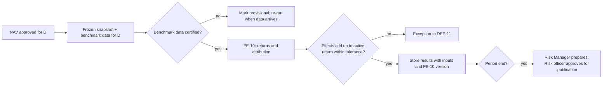

# PRD-004 — Portfolio Management (D04)

This document states what AMC OS must do to give fund managers an accurate, live book of each scheme's holdings and cash, and the tools to construct, rebalance, monitor and measure portfolios within limits. It re-keys PRD-000 v0.9 Module 03 to the GOV-001 identifiers (`FR-03-nn` → `FR-D04-nnn`, `BR-03-n` → `BRL-D04-nnn`, `US-PM-0n` → `US-D04-nnn`) and adds what Module 03 left out: exposure management and benchmark comparison (GOV-001 §3 gap), portfolio monitoring, and a workflow for performance measurement and attribution (BA-004 §5.1 D04 gap).

**Builds on Draft documents:** [PRD-000 v0.9](PRD-000_master_prd_v0.9.md) Module 03, Chapter 4 (W3), Chapter 5, Chapter 7; [BA-001](../02_business_architecture/BA-001_business_capability_map.md) D04, §4; [BA-004](../02_business_architecture/BA-004_end_to_end_workflows.md) WF-003; [BA-005](../02_business_architecture/BA-005_roles_and_permissions.md); [PRD-003](PRD-003_investment_management.md) — allowed by owner decision D-3 ([GOV-008](../00_governance/GOV-008_build_loop.md) §2 rule 3). No document used here is Approved.

**What this document is not:** the performance and attribution calculation method (FE-10, Step 23), prices and valuation (D11, FE-03), limits (D08, FE-04), risk measures (D09, FE-05), table definitions (Steps 15–16) or API contracts (Step 24). Every number this domain shows (positions, cash, market value, drift, exposure, returns, attribution) comes from deterministic code, never from AI (master prompt §3.1). It adds **no new regulatory fact**.

## 1. Scope

| In scope (CAP) | Out of scope |
| --- | --- |
| CAP-D04-001 Portfolio master · CAP-D04-002 Portfolio holdings · CAP-D04-003 Asset allocation · CAP-D04-004 Security allocation · CAP-D04-005 Portfolio construction · CAP-D04-006 Rebalancing · CAP-D04-007 Exposure management · CAP-D04-008 Benchmark comparison · CAP-D04-009 Performance attribution · CAP-D04-010 Portfolio monitoring · CAP-D04-011 Historical holdings | Order approval and routing (D05); prices (D11); limit checks (D08); risk measures such as VaR or stress (D09); the books of account (D10 — D04 positions are an investment view, reconciled to the books and the custodian through CAP-D12-003) |

## 2. Identifiers and re-keying

| PRD-000 v0.9 | Here | Note |
| --- | --- | --- |
| FR-03-01 … FR-03-11 | FR-D04-001 … FR-D04-011 | Same order; capability added; wording shortened. Changes of meaning are marked **(changed)**; added cross-references are not tagged |
| BR-03-1 … BR-03-3 (business **rules**) | BRL-D04-001 … BRL-D04-003 | |
| US-PM-01 … US-PM-03 (Ch 5); Module 03 point 7 stories | US-D04-001 … US-D04-005 | |
| Module 03 point 18 acceptance criteria | AC-US-D04-006-1, AC-US-D04-007-1 | |
| Module 03 point 6 (daily index rebalance) | Variant of WF-003 (BA-004) | Not a new workflow |
| — | FR-D04-012 … FR-D04-019, BRL-D04-004 … 007, US-D04-008 … 011, WF-032 | **New** **[DES]** |

Priority: **M** must, **S** should; user stories **C** critical, **O** optional (PRD-000 Ch 3 and Ch 5).

## 3. Business requirements

| ID | Business requirement | Capabilities |
| --- | --- | --- |
| BR-D04-001 | Fund managers always see each scheme's true holdings and projected cash, so that no scheme is overdrawn or oversold | CAP-D04-002 |
| BR-D04-002 | Portfolios are built and rebalanced toward approved targets without breaching any limit | CAP-D04-003…006 |
| BR-D04-003 | Any past day's holdings can be reproduced exactly as they were when that day's NAV was approved | CAP-D04-011 |
| BR-D04-004 | The CIO sees drift, exposure, benchmark position and performance across all schemes in one place | CAP-D04-007…010 |

## 4. Functional requirements

Every requirement also obeys PRD-000 common rules C1–C8.

### 4.1 Re-keyed from PRD-000 Module 03

| ID (was) | Pri | Capability | Requirement |
| --- | --- | --- | --- |
| FR-D04-001 (FR-03-01) | M | CAP-D04-001 | **Portfolio master:** one portfolio per scheme, plus sub-portfolios (side-pocket, segregated, derivative sleeve) |
| FR-D04-002 (FR-03-02) | M | CAP-D04-002 (.1), (.2) | **Holdings book:** positions by security with quantity, cost (lot level, FIFO or weighted average per accounting policy), accrued interest, market value, % of net assets, settled vs traded quantities. Cost method follows the accounting policy of D10; accrued interest comes from D10 (BA-001 §4) and market value from D11 prices |
| FR-D04-003 (FR-03-03) | M | CAP-D04-002 (.3) | **Real-time position:** start-of-day + executed trades + expected corporate actions = intraday position, updated on every fill |
| FR-D04-004 (FR-03-04) | M | CAP-D04-003, CAP-D04-004 | **Allocations and target weights:** target % per security, sector and asset class; drift = actual − target |
| FR-D04-005 (FR-03-05) | S | CAP-D04-005 (.1) | **Model portfolios:** shared models applied to several schemes (for example index schemes and ETFs) |
| FR-D04-006 (FR-03-06) | M | CAP-D04-005 (.2), CAP-D04-006 | **Construction and rebalancing:** generate proposed orders to move toward targets subject to constraints (limits, lot sizes, liquidity, minimum trade size, tax lots) with a deterministic optimiser, not AI |
| FR-D04-007 (FR-03-07) **(changed)** | M | CAP-D04-005 | **Investment constraints:** the optimiser reads the effective limit parameters it needs as constraints through the D08 API (read only), and every proposal is then checked by the D08 compliance what-if (CAP-D08-006), so that an accepted proposal contains no BLOCK result. *Changed:* PRD-000 said D04 "pulls compliance rules"; under BA-001 §4 rule logic stays in D08, and D04 holds no limit data of its own |
| FR-D04-008 (FR-03-08) | M | CAP-D04-002 (.4) | **Cash management:** cash ladder T to T+n — opening cash, settlements due, investor subscriptions and redemptions (provisional and final, from the RTA through the D13 mirror), IDCW payouts, expenses, margin calls, TREPS (tri-party repo) / repo maturities |
| FR-D04-009 (FR-03-09) | S | CAP-D04-009 | **Performance attribution:** Brinson (the standard split of active return into allocation, selection and interaction effects) for equity; duration / curve / spread / carry for debt; daily and period. Method in FE-10. Priority kept at S as in PRD-000; whether to make it release-blocking (M, and US-D04-005 C) is open point C7 |
| FR-D04-010 (FR-03-10) | M | CAP-D04-011 (.1) | **Portfolio snapshots:** immutable end-of-day snapshot after NAV approval, used for history, disclosure, risk and AI (as `portfolio.snapshot` `DRAFT → FROZEN → SUPERSEDED` in DDL-000) |
| FR-D04-011 (FR-03-11) | S | CAP-D04-005 (.3) | **What-if:** simulate trades and see the effect on limits, risk, duration and cash |

### 4.2 New requirements **[DES]**

| ID | Pri | Capability | Requirement |
| --- | --- | --- | --- |
| FR-D04-012 | M | CAP-D04-003 (.1) | **Targets from mandate and strategy:** asset-class target ranges are taken from the scheme mandate (CAP-D02-006) and the approved strategy (CAP-D03-008); a target outside the mandate is refused |
| FR-D04-013 | M | CAP-D04-007 (.1), (.2) | **Exposure views:** exposure by sector, issuer, issuer group, rating and asset class, gross and net including derivatives, intraday and end of day. Exposure *limits* are D08 (CAP-D08-005); risk measures are D09 (CAP-D09-006) — BA-001 §4 |
| FR-D04-014 | S | CAP-D04-007 (.3) | **Exposure vs internal targets:** exposure compared with the scheme strategy's internal targets (not limits), with drift shown |
| FR-D04-015 | M | CAP-D04-008 (.1) | **Active weights:** weights vs the scheme's primary benchmark (mapping from CAP-D02-007, constituents from CAP-D16-004), by security, sector and asset class |
| FR-D04-016 | M | CAP-D04-008 (.2), CAP-D04-009 (.1) | **Returns vs benchmark:** scheme and plan returns and relative return vs the benchmark (TRI — total return index, which adds back reinvested dividends) for standard periods, from FE-10 |
| FR-D04-017 | M | CAP-D04-010 | **Portfolio monitoring:** alerts on drift beyond a tolerance, on limit headroom below a configured level (headroom computed by D08), on projected negative cash (BRL-D04-003) and on large intraday moves; a CIO overview across schemes. Tolerances are tenant configuration **[ASSUMPTION — confirm: CIO of the pilot AMC]** |
| FR-D04-018 | M | CAP-D04-011 (.2) | **Point-in-time queries:** holdings for any past date as frozen for that date's approved NAV, or as corrected by a later snapshot version, chosen explicitly |
| FR-D04-019 | M | CAP-D04-002 | **Position adjustments:** a correction to a position not caused by a trade, settlement, corporate action or transfer is an `ADJUSTMENT` event with reason, evidence and maker-checker (BRL-D04-001) |

## 5. Business rules

| ID (was) | Rule | Label |
| --- | --- | --- |
| BRL-D04-001 (BR-03-1) | Positions are derived only from events (trades, settlements, corporate actions, transfers); no direct edits. Adjustments need an `ADJUSTMENT` event with maker-checker | **[DES]** |
| BRL-D04-002 (BR-03-2) | The snapshot for date D is frozen when the NAV for D is approved; later corrections create a new snapshot version linked to a NAV correction (WF-017) | **[DES]** |
| BRL-D04-003 (BR-03-3) | The cash ladder never shows negative projected cash without an alert. Borrowing rules come from the rule registry (for example intraday borrowing permitted under the SEBI circular of 10 July 2026) | **[REG — VAL conditions]** |
| BRL-D04-004 | A rebalance proposal accepted by a fund manager becomes `DRAFT` orders with a decision record auto-linked; it never bypasses D05 approvals | PRD-000 Module 03 point 6 **[DES]** |
| BRL-D04-005 | Model-portfolio changes need CIO approval | PRD-000 Module 03 point 13 **[DES]** |
| BRL-D04-006 | Performance and attribution results are stored with the inputs and FE-10 version used, and recompute exactly for any past period | PRD-000 Ch 7 Reproducibility **[DES]** |
| BRL-D04-007 | The optimiser and what-if use only deterministic code; an AI assistant may explain a proposal but never creates or changes its numbers | Master prompt §3.1; PRD-000 C8 |

## 6. Workflows

### 6.1 Existing workflows

| Workflow | D04 role | Requirements |
| --- | --- | --- |
| [WF-003](../02_business_architecture/BA-004_end_to_end_workflows.md) Portfolio construction (incl. the PRD-000 Module 03 index-rebalance variant) | Accountable (DEP-02 / DEP-03) | FR-D04-004…008, FR-D04-011, FR-D04-012, BRL-D04-004 |
| WF-004 Order creation and execution | Positions and cash updated on every fill | FR-D04-003, FR-D04-008 |
| WF-006 Post-trade compliance; WF-007 Daily NAV; WF-017 NAV correction | Snapshot frozen at NAV approval; new version on correction | FR-D04-010, BRL-D04-002 |
| WF-009 Corporate actions; WF-018, WF-026, WF-027 settlement | Expected and actual position and cash changes | FR-D04-003, FR-D04-008 |

### 6.2 WF-032 — Performance measurement and attribution **[DES]**

| Field | Detail |
| --- | --- |
| Trigger | NAV approved for date D (daily run); period end (month, quarter, year) for period results |
| Initiator | System |
| Departments | **DEP-11** (performance measurement, BA-002 §3); DEP-02 / DEP-03 (users), DEP-13 (factsheet returns, FR-D02-011), DEP-09 (performance disclosure checks) |
| Capabilities | CAP-D04-009, CAP-D04-008, CAP-D04-011, CAP-D11-012, CAP-D16-004, CAP-D02-007 |
| Hand-offs (outside) | Index providers for benchmark returns and constituents, through D16 — "Confirm with provider" (INT-001, Step 14) |
| Preconditions | Frozen snapshot and approved NAV for the date; benchmark data for the date certified in D16 |
| Final state | Returns and attribution results stored with their input and FE-10 versions; period results approved for publication |
| Approvals | Daily results: none (system); period results used in factsheets or disclosures: prepared by a Risk Manager and approved by the Risk officer (BA-005 "A(CRO)") **[DES]**, maker ≠ checker |
| Exceptions | Benchmark data missing or late → results marked provisional and re-run; attribution does not add up within tolerance (US-D04-005) → run fails and raises an exception to DEP-11; NAV corrected later (WF-017) → affected periods re-run as new versions |
| Audit | Run record, inputs, FE-10 version, results, approvals |
| Source | **new** (BA-004 §5.1 D04 gap: CAP-D04-009, FE-10) |

BA-002 §3 (DEP-11 duties) and §4 (CAP-D04-009 owned by DEP-11) are the source for this ownership; the method itself (return formula, attribution model, linking over periods) is FE-10 (Step 23) and is not set here.

## 7. Permissions by capability

From BA-005 §3 (D04 column), split by capability. Roles with "R" in D04 in BA-005 §3 (CEO, COO, CIO, CFO, Fund Manager, Research Analyst, Dealer, Compliance Officer, Risk Manager, Fund Accountant, Operations Analyst, Product Manager, Auditor) read; the Fund Manager's change rights are limited to own schemes ("own"). Rights BA-005 §3 does not show are marked **†**.

| Capability | Maker | Checker(s) |
| --- | --- | --- |
| CAP-D04-001 Portfolio master | Fund Manager (own) | CIO ("R A") |
| CAP-D04-002 Portfolio holdings | System (from events); Operations Analyst for `ADJUSTMENT` events† | Operations Manager for adjustments† **[ASSUMPTION — confirm: DEP-06 of the pilot AMC]** |
| CAP-D04-003 Asset allocation | Fund Manager (own) | — (targets within the approved strategy and mandate) |
| CAP-D04-004 Security allocation | Fund Manager (own) | — |
| CAP-D04-005 Portfolio construction | Fund Manager (own); model portfolios by Fund Manager | CIO for model-portfolio changes (BRL-D04-005) |
| CAP-D04-006 Rebalancing | Fund Manager (own) accepts proposals | Orders follow D05 approvals |
| CAP-D04-007 Exposure management | System | — |
| CAP-D04-008 Benchmark comparison | System | — |
| CAP-D04-009 Performance attribution | System; Risk Manager prepares period results† | Risk officer approves period results (BA-005 D09 "A(CRO)")† |
| CAP-D04-010 Portfolio monitoring | Fund Manager sets own alert tolerances within tenant limits | — |
| CAP-D04-011 Historical holdings | System (freeze at NAV approval) | — |

**Rights added beyond BA-005 §3 (†), with reasons [DES]:** Operations Analyst / Operations Manager for position adjustments — PRD-000 BR-03-1 requires maker-checker on adjustments but names no roles, and DEP-06 owns reconciliations that find the differences; Risk Manager / Risk officer for period performance results — DEP-11 owns performance measurement (BA-002 §3), while BA-005 gives Risk only "R" in D04. To be carried into the BA-005 D04 column (open point C3).

## 8. User stories and acceptance criteria

| ID | Story | Pri | Acceptance criteria (Given / When / Then) |
| --- | --- | --- | --- |
| US-D04-001 (was US-PM-01) | As a Fund Manager, I want a live cash ladder | C | **AC-US-D04-001-1** Given an executed buy of ₹5 crore settling T+1, when it fills, then T+1 projected cash falls by ₹5 crore plus charges within 1 s. |
| US-D04-002 (was US-PM-02) | As a Fund Manager, I want rebalance proposals that never breach limits | C | **AC-US-D04-002-1** Given any proposal, when compliance what-if runs, then no BLOCK results exist in a proposal the FM can accept. |
| US-D04-003 (Module 03 point 7) | As a CIO, I want to see drift from model across all schemes, so that I can direct rebalancing | C | **AC-US-D04-003-1** Given schemes mapped to a model, when the CIO opens the overview, then each scheme's drift by security and asset class is shown as at the latest fill. |
| US-D04-004 (Module 03 point 7) | As a Risk Manager, I want end-of-day immutable snapshots, so that every risk number can be reproduced | C | **AC-US-D04-004-1** Given a frozen snapshot, when anyone tries to change it, then the change is refused and audited. |
| US-D04-005 (was US-PM-03) | As a Fund Manager, I want Brinson attribution | O | **AC-US-D04-005-1** Given a month of data, when attribution runs, then allocation + selection + interaction = active return (±0.01 bp). |
| US-D04-006 (Module 03 point 18) | As a Fund Manager, I want partial fills reflected at once | C | **AC-US-D04-006-1** Given a partial fill of 4,000 of 10,000 shares, when the fill arrives, then the intraday position increases by 4,000 within 1 second and the cash ladder updates for the settlement date. |
| US-D04-007 (Module 03 point 18) | As Head of Fund Accounting, I want past positions locked after NAV approval | C | **AC-US-D04-007-1** Given an approved NAV for date D, when someone tries to change a D position, then the system refuses and requires the NAV-correction workflow (WF-017). |
| US-D04-008 | As a Fund Manager, I want to be warned before cash goes negative | C | **AC-US-D04-008-1** Given a projected cash balance below zero on any day T…T+n, when the ladder recalculates, then an alert goes to the scheme's FM and the CIO. |
| US-D04-009 | As a CIO, I want exposure by issuer group including derivatives | C | **AC-US-D04-009-1** Given a scheme holding an issuer's bond and a derivative on the same issuer, when exposure is shown, then gross and net exposure to the issuer group both include the derivative. |
| US-D04-010 | As a Fund Manager, I want active weights against my benchmark | C | **AC-US-D04-010-1** Given benchmark constituents certified for date D, when active weights are shown for D, then for every security active weight = portfolio weight − benchmark weight, and the active weights sum to zero within rounding. |
| US-D04-011 | As a Compliance Officer, I want published returns reproducible | C | **AC-US-D04-011-1** Given an approved period result, when it is re-run with the stored inputs and FE-10 version, then every figure matches exactly. |

AC-US-D04-010-1 sums to zero because portfolio weights and benchmark weights each sum to 100%. This holds only when every non-security line of the portfolio (cash, net current assets) is counted as a position with a benchmark weight of zero, and derivative exposure is shown separately rather than in the weights.

## 9. Exceptions

| Exception | Handling | Source |
| --- | --- | --- |
| Position mismatch vs custodian | Reconciliation break (WF-015, CAP-D12-003) | PRD-000 Module 03 point 14 |
| Missing price | Stale price flagged; valuation uses the fallback hierarchy (D11) | PRD-000 Module 03 point 14 |
| Projected negative cash | Alert (BRL-D04-003, FR-D04-017) | PRD-000 BR-03-3 |
| Compliance what-if BLOCK on a proposal | Targets revised (WF-003) | BA-004 WF-003 |
| Benchmark data missing; attribution does not add up | WF-032 exceptions | new |

## 10. Data and interfaces

**Owned schema:** `portfolio` (GOV-001 §3). Reads trades and fills (D05/D06 events), settlements (D07), corporate actions (D12), prices (D11), investor flow summaries (D13), benchmark data (D16). No database change is made in this step.

| Exists in DDL-000 | Not yet in DDL-000 (for DA-001 / DDL, Steps 15–16) **[DES]** |
| --- | --- |
| `portfolio.snapshot`, `portfolio.snapshot_position` (yearly partitions) | Portfolio and sub-portfolio master; position lots and intraday positions; position events including `ADJUSTMENT`; cash ladder lines; targets and model portfolios; rebalance proposals and what-if runs; exposure results; benchmark comparison and performance / attribution results with FE-10 version (PRD-000 Module 03 point 12 lists "position lots, snapshots, models, targets") |

**Interfaces (indicative, not contracts):** PRD-000 Module 03 point 11 names `portfolio-svc` endpoints `/portfolios/{scheme}/positions?asOf=`, `/cash-ladder`, `/models`, `/rebalance-proposals`, `/what-if`. Final paths and `API-D04-nnn` IDs: Step 24; events: EA-007 (Step 13).

## 11. Non-functional requirements

| ID | Requirement | Type / source |
| --- | --- | --- |
| NFR-PERF-005 | Intraday position update < 1 s after a fill | Proposed — PRD-000 Module 03 point 17, Ch 7 Latency |
| NFR-PERF-006 | Positions API p95 < 150 ms for a 300-security scheme | Proposed — PRD-000 Module 03 point 17 |
| NFR-AUD-004 | Each position change linked to its source event; snapshot hash stored | PRD-000 Module 03 point 15 **[DES]** |

Platform NFRs in PRD-001 §11 apply; reproducibility (PRD-000 Ch 7) applies to snapshots and performance results.

## 12. AI in this domain

Within PRD-000 C8 and ADR-0008: an assistant may explain drift, flag concentration build-up and summarise what changed since yesterday (PRD-000 Module 03 point 16), as read-only text whose every number equals a stored figure. PRD-000 calls it the "Portfolio Agent"; it is not in the brief's D17 list, so it is not adopted here (BA-001 §5 C4, BA-004 §5.2 C5) — decided in AIML-001 (Step 26).

## 13. Open points

| # | Point | Where closed |
| --- | --- | --- |
| C1 | Intraday-borrowing conditions and limits (circular of 10 Jul 2026) **[VAL]** | REG-001 (Step 25) |
| C2 | Return formula, attribution models, period linking and the tolerance in US-D04-005 | FE-10 (Step 23) |
| C3 | The † rights of §7 are not yet in the BA-005 §3 D04 column | Next BA-005 revision |
| C4 | WF-032 is added to the BA-004 register in this step; its card lives here | Next BA-004 revision |
| C5 | Drift and headroom tolerances have no values **[ASSUMPTION]** | Pilot discovery |
| C6 | Where D04 positions and D10 books differ in purpose (investment view vs books of account), which is reconciled to which | FE-07 (Step 22), DA-001 (Step 15) |
| C7 | Should performance attribution be release-blocking (FR-D04-009 M, US-D04-005 C) rather than S / O as in PRD-000? GOV-001 §5 makes FE-10 a D04 engine and BA-004 §5.1 asked for its workflow | Owner (Q22) |

## Sources

All sources are inside this repository; no external facts are introduced.

| # | Source | Used for |
| --- | --- | --- |
| R1 | [PRD-000 v0.9](PRD-000_master_prd_v0.9.md) Module 03, Ch 4 W3, Ch 5 (US-PM-01…03), Ch 7 | Re-keyed requirements, rules, stories, targets |
| R2 | [BA-001](../02_business_architecture/BA-001_business_capability_map.md) D04, §4, §5 C4 | Capabilities, shared owners |
| R3 | [BA-002](../02_business_architecture/BA-002_amc_operating_model.md) §3, §4 | DEP-11 performance measurement; owner of CAP-D04-009 |
| R4 | [BA-004](../02_business_architecture/BA-004_end_to_end_workflows.md) WF-003, §5.1, §5.2 C5 | Workflow and the D04 gap |
| R5 | [BA-005](../02_business_architecture/BA-005_roles_and_permissions.md) §3, §4 | Rights and approvers |
| R6 | [GOV-001](../00_governance/GOV-001_document_control_and_identifiers.md) §5 | FE-10 primary domain D04 |
| R7 | `database/ddl/DDL-000_core_schema_v0.9.sql` | Existing `portfolio` tables |
