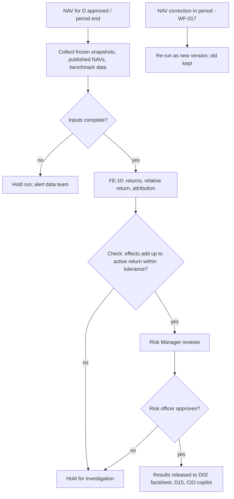

# PRD-004 — Portfolio Management (D04)

This document states what AMC OS must do to give fund managers an accurate, real-time book of holdings and cash, tools to construct and rebalance portfolios within limits, and a reproducible view of exposure and performance. It re-keys PRD-000 v0.9 Module 03 to the GOV-001 identifiers (`FR-03-nn` → `FR-D04-nnn`, `BR-03-n` → `BRL-D04-nnn`, `US-PM-0n` → `US-D04-nnn`) and adds what Module 03 left out: exposure management and benchmark comparison (GOV-001 §3 gaps), portfolio monitoring, and the performance-measurement workflow that BA-004 §5.1 left for this step.

**Builds on Draft documents:** [PRD-000 v0.9](PRD-000_master_prd_v0.9.md) Module 03, Chapter 4 (W3), Chapter 5, Chapter 9; [BA-001](../02_business_architecture/BA-001_business_capability_map.md) D04, §4; [BA-002](../02_business_architecture/BA-002_amc_operating_model.md) §4; [BA-004](../02_business_architecture/BA-004_end_to_end_workflows.md) WF-003, WF-006, WF-007; [BA-005](../02_business_architecture/BA-005_roles_and_permissions.md); [PRD-002](PRD-002_product_and_scheme_management.md); [PRD-003](PRD-003_investment_management.md) — allowed by owner decision D-3 ([GOV-008](../00_governance/GOV-008_build_loop.md) §2 rule 3). No document used here is Approved.

**What this document is not:** the calculation methods for valuation, returns and attribution (FE-03 and FE-10, Steps 20 and 23), limit evaluation (D08, FE-04), risk measures (D09, FE-05), accounting cost and books (D10), orders (D05, [PRD-005](PRD-005_order_management.md)) or index data (D16). D04 holds positions and runs construction; every official number comes from a deterministic engine (master prompt §3.1). **Rule for engineers (PRD-000):** no regulatory number is hard-coded; each is a versioned parameter in the rule registry (D08) or configuration catalogue (PRD-001 FR-D01-033).

## 1. Scope

| In scope (CAP) | Out of scope |
| --- | --- |
| CAP-D04-001 Portfolio master · CAP-D04-002 Portfolio holdings · CAP-D04-003 Asset allocation · CAP-D04-004 Security allocation · CAP-D04-005 Portfolio construction · CAP-D04-006 Rebalancing · CAP-D04-007 Exposure management · CAP-D04-008 Benchmark comparison · CAP-D04-009 Performance attribution · CAP-D04-010 Portfolio monitoring · CAP-D04-011 Historical holdings | Limits and breaches (D08); risk measures such as VaR, duration and stress (D09; exposure *measures* are D09 CAP-D09-006 — BA-001 §4); the ledger and official cost (D10); NAV (D11); index constituents and prices (D16, D11); AI that trades (ADR-0008) |

## 2. Re-keying from PRD-000 Module 03

| PRD-000 v0.9 | Here | Note |
| --- | --- | --- |
| FR-03-01 … FR-03-11 | FR-D04-001 … FR-D04-011 | Same order; FR-03-07 is **(changed)**: compliance is checked by calling D08, not by D04 holding rules |
| BR-03-1 … BR-03-3 | BRL-D04-001 … BRL-D04-003 | |
| US-PM-01 … US-PM-03 (Ch 5) and the three Module 03 point 7 stories | US-D04-001 … US-D04-005 | The Module 03 point 7 cash-ladder story is **merged** into US-D04-001 (same need as US-PM-01); the CIO drift story → US-D04-005; the Risk Manager snapshot story → US-D04-004 |
| Module 03 point 18 acceptance criteria | AC-US-D04-001-2 (partial fill), AC-US-D04-004-1 (frozen snapshot) | |
| Module 03 point 6 (daily index-fund rebalance) | Covered by WF-003 (BA-004) | No new `WF-` ID |
| — | FR-D04-012 … FR-D04-019, BRL-D04-004 … 007, US-D04-006 … 009, WF-032; acceptance criterion AC-US-D04-005-1 on a re-keyed story | **New** **[DES]** |

## 3. Business requirements

| ID | Business requirement | Capabilities |
| --- | --- | --- |
| BR-D04-001 | Fund managers see correct holdings and projected cash at every moment of the day, so a scheme is never overdrawn or over-sold | CAP-D04-002 |
| BR-D04-002 | Portfolios are built and rebalanced towards approved targets by a deterministic tool that respects limits | CAP-D04-003…006 |
| BR-D04-003 | Every past position and performance number can be reproduced from frozen data | CAP-D04-009, CAP-D04-011 |
| BR-D04-004 | Fund managers and the CIO see exposures, drift and benchmark differences across schemes in one place | CAP-D04-007, -008, -010 |

## 4. Functional requirements

Every requirement also obeys PRD-000 common rules C1–C8. Labels from PRD-000 are carried unchanged. Priority: **M** must (release-blocking), **S** should — as PRD-000 Chapter 3.

### 4.1 Re-keyed from PRD-000 Module 03

| ID (was) | Pri | Capability | Requirement |
| --- | --- | --- | --- |
| FR-D04-001 (FR-03-01) | M | CAP-D04-001 | **Portfolio master:** one portfolio per scheme, plus sub-portfolios (side pocket, segregated portfolio, derivative sleeve) |
| FR-D04-002 (FR-03-02) **(changed)** | M | CAP-D04-002 (.1), (.2) | **Holdings book:** positions by security with quantity, cost (lot-level, FIFO / weighted average per accounting policy), accrued interest, market value, % NAV, settled vs traded quantities. *Changed:* the official cost and accruals come from D10 (CAP-D10-005, BA-001 §4 accruals row); D04 shows them |
| FR-D04-003 (FR-03-03) | M | CAP-D04-002 (.3) | **Real-time position:** start-of-day + executed trades + expected corporate actions = intraday position, updated on every fill |
| FR-D04-004 (FR-03-04) | M | CAP-D04-003, CAP-D04-004 | **Security allocations and target weights:** target % per security / sector / asset class; drift = actual − target. Targets may come from the approved scheme strategy (PRD-003 FR-D03-014) |
| FR-D04-005 (FR-03-05) | S | CAP-D04-005 (.1) | **Model portfolios:** shared models applied to several schemes (for example index funds, ETFs) |
| FR-D04-006 (FR-03-06) | M | CAP-D04-005 (.2), CAP-D04-006 | **Portfolio construction / rebalancing:** generate proposed orders to move toward targets subject to constraints (limits, lot sizes, liquidity, minimum trade size, tax lots); deterministic optimiser, not AI |
| FR-D04-007 (FR-03-07) **(changed)** | M | CAP-D04-005 | **Investment constraints:** every proposal is checked through the D08 what-if (CAP-D08-006, WF-005) so that no proposal contains a BLOCK. *Changed:* PRD-000 said D04 "pulls compliance rules"; under BA-001 §4 D04 never holds rule logic, it calls D08 |
| FR-D04-008 (FR-03-08) | M | CAP-D04-002 (.4) | **Cash management:** cash ladder T to T+n: opening cash, settlements due, investor subscriptions / redemptions (provisional and final from the RTA, through D13), IDCW payouts, expenses, margin calls, TREPS / repo maturities |
| FR-D04-009 (FR-03-09) | S | CAP-D04-009 (.2), (.3) | **Performance attribution:** Brinson (allocation, selection, interaction) for equity; duration / curve / spread / carry for debt; daily and period. Calculated only by FE-10 (WF-032) |
| FR-D04-010 (FR-03-10) | M | CAP-D04-011 (.1) | **Portfolio snapshots:** immutable end-of-day snapshot after NAV approval, used for history, disclosure and AI |
| FR-D04-011 (FR-03-11) | S | CAP-D04-005 (.3) | **What-if:** simulate trades and see the effect on limits (D08), risk (D09), duration and cash |

### 4.2 New requirements **[DES]**

| ID | Pri | Capability | Requirement |
| --- | --- | --- | --- |
| FR-D04-012 | M | CAP-D04-007 (.1), (.2) | **Exposure views:** exposure by sector, issuer, issuer group, rating and asset class; gross and net exposure including derivatives; per scheme and across schemes. These are position views on D04 holdings; limits on them are D08 (CAP-D08-005) and risk measures are D09 (CAP-D09-006) (BA-001 §4) |
| FR-D04-013 | M | CAP-D04-007 (.3) | **Exposure vs internal targets:** exposure compared with the scheme strategy's target ranges (PRD-003 FR-D03-014), with drift shown |
| FR-D04-014 | M | CAP-D04-008 (.1) | **Active weights:** portfolio weight − benchmark weight per security, sector and asset class, using the scheme's benchmark mapping (PRD-002 FR-D02-008) and constituents from D16 |
| FR-D04-015 | M | CAP-D04-008 (.2), CAP-D04-009 (.1) | **Returns and relative return:** portfolio return and return relative to the benchmark for any period, calculated only by FE-10 from frozen snapshots and published NAVs (BRL-D04-005). The return method (for example time-weighted) is set in FE-10 (Step 23) |
| FR-D04-016 | M | CAP-D04-010 (.1) | **Drift and headroom alerts:** alerts when drift from target, or the headroom to a limit as reported by D08 (FE-04; D04 never evaluates limits, BA-001 §4), crosses the threshold set per scheme (BRL-D04-004) |
| FR-D04-017 | M | CAP-D04-010 (.2), (.3) | **Monitoring views:** intraday cash and position watch for each fund manager; a CIO overview of drift, exposure and alerts across all schemes |
| FR-D04-018 | M | CAP-D04-011 (.2) | **Point-in-time holdings:** holdings as of any past date and time, from snapshots and position events, including the version used after a NAV correction (BRL-D04-002) |
| FR-D04-019 | M | CAP-D04-005 (.1) | **Model changes approved:** a change to a model portfolio is made by the fund manager and approved by the CIO before it affects any proposal (PRD-000 Module 03 point 13) |

## 5. Business rules

| ID (was) | Rule | Label |
| --- | --- | --- |
| BRL-D04-001 (BR-03-1) | Positions are derived only from events (trades, settlements, corporate actions, transfers); no direct edits. Adjustments need an `ADJUSTMENT` event with maker-checker | **[DES]** (PRD-000 unlabelled) |
| BRL-D04-002 (BR-03-2) | The snapshot for date D is frozen when NAV for D is approved; later corrections create a new snapshot version linked to a NAV correction (WF-017) | **[DES]** (PRD-000 unlabelled) |
| BRL-D04-003 (BR-03-3) | The cash ladder must never show negative projected cash without an alert. Borrowing rules come from the rule registry (e.g., intraday borrowing permitted per SEBI circular of 10 July 2026) | **[REG — VAL conditions]** |
| BRL-D04-004 | Drift and headroom alert thresholds are set per scheme in configuration, approved by the CIO | **[DES]**; values **[ASSUMPTION — confirm: CIO of the pilot AMC]** |
| BRL-D04-005 | Returns and attribution are produced only by FE-10, only from frozen snapshots and published NAVs, and each result records the engine and input versions | **[DES]** (master prompt §3.1, §3.2) |
| BRL-D04-006 | A performance result is shown outside D04 and D09 (for example on a factsheet through PRD-002 FR-D02-011 and FR-D02-013) only after the Risk officer approves the run (WF-032). Rules for publishing scheme performance to investors are regulatory **[VAL]** | **[DES]** |
| BRL-D04-007 | A rebalance proposal never becomes an order by itself: the fund manager accepts it and the orders start as `DRAFT` in D05 (WF-003; ADR-0008) | **[DES]** |

## 6. Workflows

### 6.1 Existing workflows

| Workflow | D04 role | Requirements |
| --- | --- | --- |
| [WF-003](../02_business_architecture/BA-004_end_to_end_workflows.md) Portfolio construction | Accountable (DEP-02 / DEP-03) | FR-D04-003…008, FR-D04-011, FR-D04-019 |
| WF-006 Post-trade compliance | Supplies the approved end-of-day snapshot | FR-D04-010 |
| WF-007 Daily NAV | Snapshot frozen on NAV approval | FR-D04-010, BRL-D04-002 |
| WF-009, WF-018, WF-026, WF-027 | Positions and cash ladder updated from corporate actions, settlement and fails | FR-D04-002, -003, -008 |

### 6.2 WF-032 — Performance measurement and attribution **[DES]**

| Field | Detail |
| --- | --- |
| Trigger | Daily: after the NAV for D is approved (returns). Period end (month, quarter, year) or on request: attribution |
| Initiator | System; Risk Manager owns the run |
| Departments | **DEP-11 Risk management** — accountable for CAP-D04-009 (BA-002 §4); DEP-02 / DEP-03 (users), DEP-13 (factsheet, PRD-002 FR-D02-011, FR-D02-013), DEP-07 (NAV inputs) |
| Capabilities | CAP-D04-009, CAP-D04-008, CAP-D04-011, CAP-D11-014, CAP-D16-004 |
| Hand-offs (outside) | Index data (benchmark returns and constituents) from the index provider through D16 — "Confirm with provider" (INT-001, Step 14) |
| Preconditions | Frozen snapshots and published NAVs for the period; benchmark data for the period |
| Final state | Return and attribution results stored with engine and input versions; approved results available to D02, D15 and the CIO copilot |
| Approvals | Risk Manager prepares; Risk officer (approval authority, BA-005 §4) approves for use outside D04 and D09 (BRL-D04-006) |
| Exceptions | Benchmark data missing → run held, alert to DEP-17; check fails (allocation + selection + interaction ≠ active return within tolerance, US-D04-003) → run held for investigation; a NAV correction in the period (WF-017) → affected runs re-done as new versions, old results kept |
| Audit | Inputs and their versions, engine version, results, approver, later re-runs |
| Source | **new** (BA-004 §5.1 D04 gap: CAP-D04-009, FE-10) |

## 7. Permissions by capability

From BA-005 §3 (D04 column), narrowed to each capability (BA-005 §7 C2). Checker ≠ maker (SOD-01). CEO, COO, CFO, Research Analyst, Dealer, Compliance Officer, Risk Manager, Fund Accountant, Operations Analyst, Product Manager and Auditor read (BA-005 §3: R).

| Capability | Maker | Checker(s) |
| --- | --- | --- |
| CAP-D04-001 Portfolio master | Fund Manager (own scheme) | CIO |
| CAP-D04-002 Portfolio holdings | System (from events); `ADJUSTMENT` event by Fund Manager | CIO for an adjustment (BRL-D04-001) **[DES]** |
| CAP-D04-003, -004 Allocation and targets | Fund Manager (own scheme) | — (targets within an approved strategy); CIO for model changes (FR-D04-019) |
| CAP-D04-005, -006 Construction and rebalancing | Fund Manager (own scheme) | — (orders follow D05 approvals) |
| CAP-D04-007 Exposure management | System | — |
| CAP-D04-008 Benchmark comparison | System | — |
| CAP-D04-009 Performance attribution | Risk Manager† | Risk officer† (BRL-D04-006) |
| CAP-D04-010 Portfolio monitoring | System; thresholds by Fund Manager | CIO approves thresholds (BRL-D04-004) |
| CAP-D04-011 Historical holdings | System | — |

**Rights added beyond BA-005 §3 (†):** BA-005 gives the Risk Manager only R in D04, but BA-002 §4 makes DEP-11 accountable for CAP-D04-009; this PRD adds create / submit for the Risk Manager and approve for the Risk officer on attribution runs **[DES]** (open point C3).

## 8. User stories and acceptance criteria

Priority: **C** critical (release-blocking), **O** optional — as PRD-000 Chapter 5.

| ID | Story | Pri | Acceptance criteria (Given / When / Then) |
| --- | --- | --- | --- |
| US-D04-001 (was US-PM-01) | As an FM, I want a live cash ladder | C | **AC-US-D04-001-1** Given an executed buy of ₹5 crore settling T+1, when it fills, then T+1 projected cash falls by ₹5 crore plus charges within 1 s. **AC-US-D04-001-2** (was Module 03 point 18) Given a partial fill of 4,000 of 10,000 shares, when the fill arrives, then the intraday position increases by 4,000 within 1 second and the cash ladder updates for the settlement date. |
| US-D04-002 (was US-PM-02) | As an FM, I want rebalance proposals that never breach limits | C | **AC-US-D04-002-1** Given any proposal, when compliance what-if runs, then no BLOCK results exist. |
| US-D04-003 (was US-PM-03) | As an FM, I want Brinson attribution | O | **AC-US-D04-003-1** Given a month of data, when attribution runs, then allocation + selection + interaction = active return (±0.01 bp). |
| US-D04-004 (was Module 03 point 7) | As a Risk Manager, I want end-of-day immutable snapshots, so that every risk number can be reproduced | C | **AC-US-D04-004-1** (was Module 03 point 18) Given an approved NAV for date D, when someone tries to change a D position, then the system refuses and requires a NAV-correction workflow. |
| US-D04-005 (was Module 03 point 7) | As a CIO, I want to see drift from model across all schemes | C | **AC-US-D04-005-1** (new **[DES]**) Given three schemes on one model, when the CIO overview loads, then each scheme's drift per security is shown with its alert status. |
| US-D04-006 | As an FM, I want exposure by issuer group across my schemes | C | **AC-US-D04-006-1** Given two holdings in issuers of the same group, when the exposure view loads, then they are summed under the group with each issuer listed. |
| US-D04-007 | As an FM, I want active weights against the scheme's benchmark | C | **AC-US-D04-007-1** Given a benchmark change effective date D (PRD-002), when active weights are shown for D−1 and D, then each date uses the benchmark mapped on that date. |
| US-D04-008 | As a Product Manager, I want only approved performance on the factsheet | C | **AC-US-D04-008-1** Given a WF-032 run not yet approved by the Risk officer, when the factsheet feed is built, then that run's results are not used. |
| US-D04-009 | As an FM, I want position fixes controlled | C | **AC-US-D04-009-1** Given a direct edit of a position quantity, when attempted, then it is refused; given an `ADJUSTMENT` event, when the same user tries to approve it, then it is refused with `SOD_VIOLATION`. |

Definition of done: as PRD-000 Chapter 5.

## 9. Exceptions

| Exception | Handling | Source |
| --- | --- | --- |
| Position differs from custodian | Reconciliation break (WF-015) | PRD-000 Module 03 point 14 |
| Missing price | Stale price flagged; valuation uses the fallback hierarchy (D11, CAP-D11-003) | Module 03 point 14 |
| Projected cash negative | Alert (BRL-D04-003); borrowing only as the rule registry allows | BR-03-3 |
| Benchmark data missing | Active weights and attribution held; alert (WF-032) | **[DES]** |
| Attribution check fails | Run held for investigation (WF-032) | US-PM-03 |
| NAV correction after snapshot | New snapshot version; affected performance runs redone (BRL-D04-002, WF-032) | BR-03-2 |

## 10. Data and interfaces

**Owned schema:** `portfolio` (GOV-001 §3). Reads trades (`trading`, `execution`), settlements, corporate actions, investor flow summaries (D13), prices (D11) through events. No database change is made in this step.

| Exists in DDL-000 | Not yet in DDL-000 (for DA-001 / DDL, Steps 15–16) **[DES]** |
| --- | --- |
| `portfolio.snapshot`, `portfolio.snapshot_position` (partitioned) | Portfolio and sub-portfolio; position lots and position events; cash-ladder entries; targets and model portfolios with versions; rebalance proposals; exposure views (may be derived); performance and attribution results with input and engine versions |

**Interfaces (indicative, not contracts):** PRD-000 Module 03 point 11 names `portfolio-svc` endpoints `/portfolios/{scheme}/positions?asOf=`, `/cash-ladder`, `/models`, `/rebalance-proposals`, `/what-if`. Names become `API-D04-nnn` in Step 24 and events `<NAME>.v<n>` in EA-007 (Step 13) (BA-004 §5.2 C4). Outside parties: index provider through D16 — "Confirm with provider" (INT-001, Step 14).

## 11. Non-functional requirements

NFR numbering continues after PRD-003.

| ID | Requirement | Type / source |
| --- | --- | --- |
| NFR-PERF-004 | Intraday position updated < 1 s after a fill | Proposed — PRD-000 Module 03 point 17 |
| NFR-PERF-005 | Positions API p95 < 150 ms for a 300-security scheme | Proposed — PRD-000 Module 03 point 17 |
| NFR-AUD-004 | Each position change linked to its source event; snapshot hash stored | PRD-000 Module 03 point 15 **[DES]** |

Platform NFRs in PRD-001 §11 apply.

## 12. AI in this domain

Within PRD-000 C8 and ADR-0008 (read and propose only). PRD-000 Module 03 point 16 names a **Portfolio Agent** (explain drift, flag concentration build-up, summarise what changed). It is not in the brief's D17 list, so it is **not** adopted here (BA-001 §5 C4; decided in AIML-001, Step 26). Until then, the **CIO copilot** (CAP-D17-003, "what changed") and the **Risk assistant** (CAP-D17-006) may explain D04 data read-only.

## 13. Open points

| # | Point | Where closed |
| --- | --- | --- |
| C1 | Conditions for intraday borrowing (BRL-D04-003, "SEBI circular of 10 July 2026" as stated in PRD-000; not opened in this step) **[REG — VAL]** | REG-001 (Step 25) |
| C2 | Drift and headroom thresholds; who approves an `ADJUSTMENT` event **[ASSUMPTION]** | Pilot discovery |
| C3 | Risk Manager and Risk officer rights on attribution (§7 †) are not in BA-005 §3 | Next BA-005 revision |
| C4 | Return method and attribution formulas; rules for publishing performance to investors **[VAL]** | FE-10 (Step 23); REG-001 (Step 25) |
| C5 | BA-004 register gets WF-032 (row added in this step); the full card lives here until BA-004's next revision | Next BA-004 revision |

## Sources

All sources are inside this repository; no external facts are introduced.

| # | Source | Used for |
| --- | --- | --- |
| R1 | [PRD-000 v0.9](PRD-000_master_prd_v0.9.md) Module 03, Ch 4 W3, Ch 5, Ch 9 | Re-keyed requirements, rules, stories, labels |
| R2 | [BA-001](../02_business_architecture/BA-001_business_capability_map.md) D04, §4, §5 C4 | Capabilities, shared ownership (exposure, accruals) |
| R3 | [BA-002](../02_business_architecture/BA-002_amc_operating_model.md) §4 | DEP-11 accountable for attribution |
| R4 | [BA-004](../02_business_architecture/BA-004_end_to_end_workflows.md) WF-003, WF-006, WF-007, WF-017, §5.1 | Workflows; D04 gap |
| R5 | [BA-005](../02_business_architecture/BA-005_roles_and_permissions.md) §3, §4 | Rights and approval authorities |
| R6 | [PRD-002](PRD-002_product_and_scheme_management.md), [PRD-003](PRD-003_investment_management.md) | Benchmark mapping, factsheet, strategy targets |
