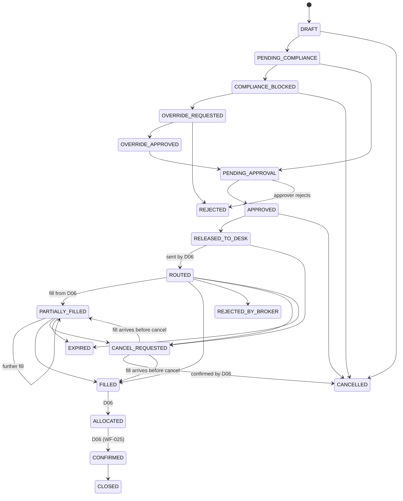

# PRD-005 — Order Management System (D05)

This document states what AMC OS must do to take an investment decision to a compliant, approved order that is released to the dealing desk, with a complete audit trail. It re-keys the order part of PRD-000 v0.9 Module 04 to the GOV-001 identifiers (`FR-04-nn` → `FR-D05-nnn`, `BR-04-n` → `BRL-D05-nnn`, `US-OMS-0n` → `US-D05-nnn`). Execution, fills, post-trade allocation and trade confirmation (FR-04-09…11) belong to D06 Trading and Execution and are re-keyed in PRD-006 (Step 8), following BA-001.

**Builds on Draft documents:** [PRD-000 v0.9](PRD-000_master_prd_v0.9.md) Module 04, Chapter 4 (W4, W5), Chapter 5, Chapter 6, Chapter 9; [BA-001](../02_business_architecture/BA-001_business_capability_map.md) D05, D06, §4; [BA-002](../02_business_architecture/BA-002_amc_operating_model.md) §4; [BA-004](../02_business_architecture/BA-004_end_to_end_workflows.md) WF-003…WF-006, WF-024; [BA-005](../02_business_architecture/BA-005_roles_and_permissions.md); [PRD-003](PRD-003_investment_management.md); [PRD-004](PRD-004_portfolio_management.md) — allowed by owner decision D-3 ([GOV-008](../00_governance/GOV-008_build_loop.md) §2 rule 3). No document used here is Approved. Owner decision D-18 (no SoD waivers except SOD-03 and small-team mode) is applied.

**What this document is not:** rule evaluation for pre- and post-trade compliance (D08, CAP-D08-006 / -007, FE-04 — D05 calls it and acts on the result, BA-001 §4); messages to brokers, fills, allocation and confirmation (D06, PRD-006); settlement (D07). **Rule for engineers (PRD-000):** no regulatory number is hard-coded; approval thresholds and limits are versioned parameters.

## 1. Scope

| In scope (CAP) | Out of scope |
| --- | --- |
| CAP-D05-001 Order creation · CAP-D05-002 Order validation · CAP-D05-003 Order approval · CAP-D05-004 Order amendments · CAP-D05-005 Order cancellation · CAP-D05-006 Order routing · CAP-D05-007 Order status · CAP-D05-008 Order history · CAP-D05-009 Maker-checker · CAP-D05-010 Pre-trade compliance · CAP-D05-011 Post-trade compliance · CAP-D05-012 Order audit | Rule logic (D08); broker messages, executions, allocation of fills, contract-note matching (D06); algorithmic execution (PS-001 §3); AI that submits or executes (ADR-0008) |

## 2. Re-keying from PRD-000 Module 04

| PRD-000 v0.9 | Here | Note |
| --- | --- | --- |
| FR-04-01 … FR-04-08 | FR-D05-001 … FR-D05-008 | Same order; FR-04-08 is **(changed)**: D05 releases the order, D06 sends it (CAP-D06-006) |
| FR-04-09, FR-04-10, FR-04-11 | — | **Not re-keyed here:** execution capture, post-trade allocation and trade confirmation are D06 (CAP-D06-002, -004, -003); PRD-006 (Step 8) re-keys them |
| FR-04-12 … FR-04-14 | FR-D05-009 … FR-D05-011 | |
| BR-04-1 … BR-04-5 | BRL-D05-001 … BRL-D05-005 | BR-04-3 (allocation by intent) and BR-04-5 (raw broker messages) are shared with D06; kept here because the intent is recorded in D05 |
| US-OMS-01 … US-OMS-04 (Ch 5) and the three Module 04 point 7 stories | US-D05-001 … US-D05-006 | US-OMS-02 ("block orders with fair allocation") and the Module 04 point 7 Dealer story ("combine orders from five schemes into one block … fair allocation") are **merged** into US-D05-002 and **reworded** to the D05 part (block with allocation intent fixed before execution); the fair-allocation check after the fill is re-keyed in PRD-006. Module 04 point 7 FM story → US-D05-005; Compliance story → US-D05-006 |
| Module 04 point 18 acceptance criteria | AC-US-D05-007-1 (state machine); the allocation criterion (500/300/200) goes to PRD-006 | |
| Order state machine (Module 04) | §4.3 | Transitions taken from DDL-000 `trading.order_state_transition`; ALLOCATED and CONFIRMED are reported by D06 |
| — | FR-D05-012 … FR-D05-016, BRL-D05-006 … 008, US-D05-007 … 010; acceptance criteria AC-US-D05-002-1 and AC-US-D05-006-1 on re-keyed stories | **New** **[DES]** |

## 3. Business requirements

| ID | Business requirement | Capabilities |
| --- | --- | --- |
| BR-D05-001 | No order reaches the market unless it is valid, passed compliance (or has an approved override) and is approved where required | CAP-D05-002, -003, -010 |
| BR-D05-002 | Every order is linked to an investment decision and its full history can be shown to SEBI, trustees and auditors | CAP-D05-001, -008, -012 |
| BR-D05-003 | Orders from several schemes in the same security can be combined fairly, with the allocation intent fixed before execution | CAP-D05-006 |
| BR-D05-004 | Order duties are separated: the fund manager decides, an approver approves where required, a dealer executes | CAP-D05-009 |

## 4. Functional requirements

Every requirement also obeys PRD-000 common rules C1–C8. Labels from PRD-000 are carried unchanged. Priority: **M** must (release-blocking), **S** should — as PRD-000 Chapter 3.

### 4.1 Re-keyed from PRD-000 Module 04

| ID (was) | Pri | Capability | Requirement |
| --- | --- | --- | --- |
| FR-D05-001 (FR-04-01) | M | CAP-D05-001 (.1), (.3) | **Order creation:** from a rebalance proposal, from a model, manual, or bulk upload. Fields: scheme, security, side (Buy / Sell; for derivatives Buy / Sell open / close), quantity or amount, order type, limit price, time-in-force, broker preference, decision record ID, reason. An order without a decision record ID (PRD-003 FR-D03-010) is refused |
| FR-D05-002 (FR-04-02) | M | CAP-D05-001 (.2) | **Order types:** Market, Limit, Stop-loss limit (where the broker supports it), VWAP / TWAP instruction (broker algo), Negotiated (debt RFQ / OTC), Primary market (IPO / bond issue application) **[IND]** |
| FR-D05-003 (FR-04-03) | M | CAP-D05-004, CAP-D05-005 (.1) | **Modification and cancellation:** amend quantity / price before full execution; cancel the unexecuted remainder; every change re-runs compliance |
| FR-D05-004 (FR-04-04) | M | CAP-D05-002 | **Validation:** lot size, tick size, price band check, security status, settlement-holiday check, sufficient holdings for sells (no short selling in cash equity), available projected cash for buys (PRD-004 FR-D04-008) |
| FR-D05-005 (FR-04-05) | M | CAP-D05-010 | **Pre-trade compliance:** synchronous call to D08 (WF-005); result PASS / WARN / BLOCK per rule; WARN requires acknowledgment text; BLOCK requires the override workflow |
| FR-D05-006 (FR-04-06) | M | CAP-D05-003 | **Approval hierarchy:** configurable matrix (by size as % of scheme AUM or notional, by instrument such as unlisted debt or derivatives, and by soft-limit warnings — PRD-000 Module 04 point 13); auto-approve within the fund manager's authority |
| FR-D05-007 (FR-04-07) | M | CAP-D05-006 (.1), (.2) | **Block orders and broker allocation:** combine same-security orders from several schemes into one block; record the pre-trade allocation intent; choose the broker from the approved broker list (WF-023), broker limits (% of turnover per broker) and the best-execution policy |
| FR-D05-008 (FR-04-08) **(changed)** | M | CAP-D05-006 (.3) | **Routing:** release the order or block to D06 for execution; for debt, RFQ platforms or phone with dealer-entered quotes (at least N quotes per policy) **[IND; VAL any regulatory minimum]**. *Changed:* PRD-000 said "FIX to broker OMS"; the message to the broker is sent by D06 (CAP-D06-006) and its format is confirmed with each broker (BA-004 WF-004 **[ASSUMPTION]**) |
| FR-D05-009 (FR-04-12) | M | CAP-D05-011 | **Post-trade checks:** after allocation (D06) run full compliance on actual post-trade positions through D08 (WF-006), including inter-scheme transfer checks; the result is shown on the order |
| FR-D05-010 (FR-04-13) | M | CAP-D05-007 (.1), CAP-D05-008, CAP-D05-012 (.1) | **Order lifecycle and audit trail:** every state transition is stored as an order event with actor, time and payload; every amendment is a new order version (BRL-D05-004) |
| FR-D05-011 (FR-04-14) | M | CAP-D05-012 (.2) | **Dealing-room controls:** recorded-line reference capture for phone orders; dealer personal-trading pre-clearance link **[REG — VAL]** |

### 4.2 New requirements **[DES]**

| ID | Pri | Capability | Requirement |
| --- | --- | --- | --- |
| FR-D05-012 | M | CAP-D05-009 (.2) | **Emergency universe override:** an order on a security outside the scheme's approved universe (PRD-003 BRL-D03-001) can proceed only with an override approved by the CIO **and** a Compliance Officer, with a reason; the override covers that order version only |
| FR-D05-013 | M | CAP-D05-009 (.1) | **SoD on orders:** maker ≠ checker on approvals (SOD-01); the fund manager who originates an order cannot be the dealer who executes it unless the tenant has switched SOD-03 off (D-18) — checked when the dealer takes the order |
| FR-D05-014 | M | CAP-D05-005 (.2), CAP-D05-007 (.2) | **Status from execution:** fills, cancel confirmations, broker rejects, allocation and confirmation status come back from D06 as events and move the order state (§4.3); a cancel is `CANCELLED` only after D06 confirms it |
| FR-D05-015 | M | CAP-D05-001 | **Orders proposed by AI:** an order proposed by an AI assistant (ROLE-26, ADR-0008 decision 3; which assistant may propose orders is decided in AIML-001, Step 26 — open point C8) enters only as `DRAFT` owned by a fund manager, who must submit it; the proposal is linked to the order |
| FR-D05-016 | M | CAP-D05-007 (.1) | **Transitions enforced:** a transition not in the state machine (§4.3) is refused by the service and by the database and logged |

### 4.3 Order state machine

PRD-000 Module 04 lists the states; the allowed transitions are those already enforced by DDL-000 v0.9 (`trading.order_state_transition`), which this PRD adopts unchanged. The annotations say which domain reports each state.

Transitions not in the diagram are refused by the service and by the database (FR-D05-016). How an amended order version (BRL-D05-004) re-enters `PENDING_COMPLIANCE` is not shown in PRD-000 or DDL-000 (open point C4).

## 5. Business rules

| ID (was) | Rule | Label |
| --- | --- | --- |
| BRL-D05-001 (BR-04-1) | No order reaches a broker without a PASS or an approved override from compliance for its current version | **[DES]** (PRD-000 unlabelled) |
| BRL-D05-002 (BR-04-2) | The fund manager cannot be the dealer on the same order (configurable SoD — SOD-03) | **[IND]** |
| BRL-D05-003 (BR-04-3) | Allocation of a block must be decided before execution (intent) and allocated by that intent after execution unless an approved deviation exists (D06 applies it, PRD-006) | **[DES]** (PRD-000 unlabelled); fair allocation **[REG — VAL exact clause]** (FR-04-10) |
| BRL-D05-004 (BR-04-4) | An amended order is a new order version; the compliance result for v1 does not cover v2 | **[DES]** |
| BRL-D05-005 (BR-04-5) | Every message to or from a broker is stored raw for at least the retention period (stored by D06) | **[VAL period]** |
| BRL-D05-006 | A WARN can be acknowledged only by the order's fund manager, with text; the acknowledgment is stored with the order version | **[DES]** |
| BRL-D05-007 | A compliance override needs two distinct approvers, CCO and CIO or their delegates (SOD-04); one approval alone leaves the order blocked | **[DES]** (PRD-000 SOD-04) |
| BRL-D05-008 | Order approval thresholds are tenant configuration approved by the CIO and changed only through WF-021 | **[DES]**; values **[ASSUMPTION — confirm: CIO of the pilot AMC]** |

## 6. Workflows

| Workflow | D05 role | Requirements |
| --- | --- | --- |
| [WF-003](../02_business_architecture/BA-004_end_to_end_workflows.md) Portfolio construction | Receives accepted proposals as `DRAFT` orders | FR-D05-001, BRL-D04-007 (PRD-004) |
| WF-004 Order creation and execution | Order part, up to release to the desk; D06 does the rest | FR-D05-001…008, -010, -012…016 |
| WF-005 Pre-trade compliance | Caller; acts on the result (D08 accountable) | FR-D05-005, BRL-D05-001, -004, -006, -007 |
| WF-006 Post-trade compliance | Shows the result on the order | FR-D05-009 |
| WF-024 Externally booked trade capture | Pre-trade check for types that need one | FR-D05-005 |

No new workflow is needed for D05: BA-004 §5.1 lists no D05 gap.

## 7. Permissions by capability

From BA-005 §3 (D05 column) and §4, narrowed to each capability (BA-005 §7 C2). Checker ≠ maker (SOD-01). CEO, COO, CFO, Risk Manager, Fund Accountant, Operations Analyst and Auditor read (BA-005 §3: R).

| Capability | Maker | Checker(s) |
| --- | --- | --- |
| CAP-D05-001 Order creation | Fund Manager (own scheme, "R C U S own") | — |
| CAP-D05-002 Order validation | System | — |
| CAP-D05-003 Order approval | Fund Manager | CIO above the threshold (`trading.order.approve`, BRL-D05-008) |
| CAP-D05-004, -005 Amendment and cancellation | Fund Manager (own scheme); Dealer for cancel of the unexecuted remainder at the desk† | Re-approval where the amended version needs it |
| CAP-D05-006 Order routing (block, broker, intent) | Dealer ("R U (route, block, allocate)") | — |
| CAP-D05-007, -008 Status and history | System | — |
| CAP-D05-009 Maker-checker; emergency override | Fund Manager requests | CIO **and** Compliance Officer (FR-D05-012) |
| CAP-D05-010 Pre-trade compliance; override | System calls D08; Fund Manager requests override | CCO **and** CIO (`compliance.pretrade.override`, SOD-04). BA-005 §4 maps this permission to CAP-D08-011, while BA-001 lists "override with approval" under CAP-D05-010 (.3); open point C6 |
| CAP-D05-011 Post-trade compliance | System | — |
| CAP-D05-012 Order audit | System; Dealer records phone-line reference† | — (read: Compliance Officer, Auditor) |

**Rights added beyond BA-005 §3 (†):** the BA-005 D05 Dealer cell is "R U (route, block, allocate)"; this PRD adds cancelling the unexecuted remainder at the desk (PRD-000 W4, FR-04-03) and recording the phone-line reference (FR-04-14) **[DES]** (open point C7).

## 8. User stories and acceptance criteria

Priority: **C** critical (release-blocking), **O** optional — as PRD-000 Chapter 5.

| ID | Story | Pri | Acceptance criteria (Given / When / Then) |
| --- | --- | --- | --- |
| US-D05-001 (was US-OMS-01) | As an FM, I want pre-trade results before submission | C | **AC-US-D05-001-1** Given an order, when created, then results return in < 500 ms p95. |
| US-D05-002 (was US-OMS-02) | As a Dealer, I want block orders with the allocation intent fixed before execution | C | **AC-US-D05-002-1** (new **[DES]**) Given three scheme orders in one security, when the dealer creates a block, then the block cannot be released until an allocation intent totalling 100% of the block is recorded. (The post-fill allocation criterion is re-keyed in PRD-006.) |
| US-D05-003 (was US-OMS-03) | As Compliance, I want overrides with two approvers | C | **AC-US-D05-003-1** Given a BLOCK, when one approver approves, then the order stays blocked until the second approves. |
| US-D05-004 (was US-OMS-04) | As a Dealer, I want debt RFQ quote capture | O | **AC-US-D05-004-1** Given a debt order, when fewer than the policy minimum quotes are captured, then release needs Head of Dealing approval. |
| US-D05-005 (was Module 04 point 7) | As a Fund Manager, I want to see compliance results before I submit | C | See AC-US-D05-001-1. |
| US-D05-006 (was Module 04 point 7) | As a Compliance Officer, I want every override to carry a reason and two approvers | C | **AC-US-D05-006-1** (new **[DES]**) Given an override request without a reason, when submitted, then it is refused. |
| US-D05-007 | As Compliance, I want illegal state changes impossible | C | **AC-US-D05-007-1** (was Module 04 point 18) Given an order in `FILLED`, when a user tries to set it to `DRAFT`, then the transition is rejected and logged. |
| US-D05-008 | As a CIO, I want amended orders re-checked | C | **AC-US-D05-008-1** Given an order v1 that passed compliance, when its quantity is amended, then v2 is `PENDING_COMPLIANCE` and cannot be released on v1's result. |
| US-D05-009 | As a CIO, I want orders outside the universe stopped | C | **AC-US-D05-009-1** Given a security not in the scheme's approved universe, when an order is submitted without an approved override, then it is refused; with an override approved by the CIO and a Compliance Officer, it proceeds for that version only. |
| US-D05-010 | As an FM, I want AI-proposed orders to need my submission | C | **AC-US-D05-010-1** Given an order proposed by an AI assistant, when it is created, then its state is `DRAFT`, its owner is a fund manager and no compliance call or release happens until that fund manager submits it. |

Definition of done: as PRD-000 Chapter 5.

## 9. Exceptions

| Exception | Handling | Source |
| --- | --- | --- |
| Compliance data incomplete | Result `INDETERMINATE`, treated as BLOCK | WF-005 |
| Broker reject | Order `REJECTED_BY_BROKER` (closed: no outgoing transition in §4.3). A re-route is a new order or order version that goes through compliance and approval again; which of the two is open point C4 | PRD-000 Module 04 point 14; WF-004 |
| Fill after the order is `CANCELLED` (a fill while `CANCEL_REQUESTED` follows §4.3) | Exception queue (CAP-D12-008); handled in D06 | PRD-000 Module 04 point 14 |
| Duplicate fill | Ignored by execution ID (idempotent, D06) | PRD-000 Module 04 point 14 |
| Price outside band | Refused at validation (FR-D05-004) | PRD-000 Module 04 point 14 |
| Connection loss to a broker | Handled by D06 (reconnect and recovery); order state unchanged until D06 reports | PRD-000 Module 04 point 14 |

## 10. Data and interfaces

**Owned schema:** `trading` (GOV-001 §3; orders, order events, blocks, allocations — PRD-000 Module 04 point 12). Fills and broker messages are in `execution` (D06). No database change is made in this step.

| Exists in DDL-000 | Not yet in DDL-000 (for DA-001 / DDL, Steps 15–16) **[DES]** |
| --- | --- |
| `trading.order` (with `order_version`), `trading.order_event`, `trading.order_state_transition`, `trading.block_allocation` (with `intent_pct`) | Block as its own record; approval-threshold matrix (configuration); compliance-result reference per order version; WARN acknowledgment; override record; AI proposal link; RFQ quotes |

**Interfaces (indicative, not contracts):** PRD-000 Module 04 point 11 names `oms-svc` endpoints `/orders`, `/orders/{id}/amend`, `/orders/{id}/cancel`, `/blocks`, `/allocations`, `/executions`, a synchronous call to `compliance-svc /pretrade/check`, and events `oms.order.*`, `trading.execution.received`; `/allocations` and `/executions` move to D06. Names become `API-D05-nnn` in Step 24 and events `<NAME>.v<n>` in EA-007 (Step 13) (BA-004 §5.2 C4). No outside party connects to D05 directly; brokers connect to D06.

## 11. Non-functional requirements

NFR numbering continues after PRD-004.

| ID | Requirement | Type / source |
| --- | --- | --- |
| NFR-PERF-006 | Order create to compliance result p95 < 500 ms | Proposed — PRD-000 Module 04 point 17 |
| NFR-SCAL-002 | 2,000 orders per minute at peak per tenant | Proposed — PRD-000 Module 04 point 17 |
| NFR-AUD-005 | Order event store with compliance-result snapshot per order version and override evidence (PRD-000 Module 04 point 15); zero lost order events (new **[DES]**) | PRD-000 Module 04 point 15; **[DES]** |

Platform NFRs in PRD-001 §11 apply.

## 12. AI in this domain

Within PRD-000 C8 and ADR-0008 (read and propose only): the **CIO copilot** (CAP-D17-003 (.2)) explains why an order was blocked; the **Dealing assistant** (CAP-D17-004) gives order and execution context to dealers; any order an assistant proposes enters as `DRAFT` and needs a fund manager to submit it (FR-D05-015). PRD-000 Module 04 point 16 names the Portfolio Agent as drafting orders; it is not adopted (BA-001 §5 C4).

## 13. Open points

| # | Point | Where closed |
| --- | --- | --- |
| C1 | Regulatory basis for dealing-room controls (FR-D05-011), fair allocation (BRL-D05-003) and any minimum number of debt quotes (FR-D05-008) **[VAL]** | REG-001 (Step 25) |
| C2 | Raw broker-message retention period (BRL-D05-005) **[VAL]** | REG-001 (Step 25) |
| C3 | Approval thresholds and the policy minimum number of debt quotes **[ASSUMPTION]** | Pilot discovery |
| C4 | How an amended order version re-enters `PENDING_COMPLIANCE` (BRL-D05-004, AC-US-D05-008-1): not in PRD-000 or the DDL-000 transition table; the same question applies to re-routing after `REJECTED_BY_BROKER`, which has no outgoing transition (§9) | DA-001 (Step 15) or a PRD-005 revision. D06 side settled in [PRD-006](PRD-006_trading_and_execution.md) FR-D06-021 (no automatic re-send) |
| C5 | FR-04-09…11 (execution, allocation, confirmation), the allocation acceptance criterion, "zero lost fills" (Module 04 point 17) and the raw FIX archive (point 15) are not re-keyed here | Closed by PRD-006 (Step 8): FR-D06-001…003, AC-US-D06-001-1, NFR-AUD-006 |
| C6 | Override permission: BA-005 §4 maps `compliance.pretrade.override` to CAP-D08-011; BA-001 puts "override with approval" in CAP-D05-010 (.3) | EA-003 (Step 11); next BA-005 revision. Proposal in [PRD-008](PRD-008_compliance_management.md) §13 C4 |
| C7 | Dealer rights added in §7 (†) are not in BA-005 §3 | Next BA-005 revision |
| C8 | Which AI assistant may propose orders: BA-001 has CAP-D17-003 CIO copilot read-only and CAP-D17-004 Dealing assistant as context only | AIML-001 (Step 26) |
| C9 | `trading.block_allocation` holds `allocated_quantity` and `average_price`, which D06 produces: either D06 writes into the D05 schema (a cross-domain write, AGENTS.md §2.3) or D05 records them from D06 events. Where post-trade allocation results live and who writes them is open | EA-003 (Step 11), DA-001 (Step 15). Proposal in PRD-006 §10 (D06 owns them in `execution`; D05 updated by events) |
| C10 | DDL-000 enforces transitions only on `UPDATE` of `state` (trigger `trading.tg_order_state`): there is no CHECK on allowed state values, no rule that a new order starts in `DRAFT`, and the `PARTIALLY_FILLED → PARTIALLY_FILLED` self-transition writes no order event. Needed for FR-D05-016: a state-domain CHECK, `DRAFT` enforced on insert, and a decision on whether further partial fills are order events or only D06 `execution` records | DA-001 / DDL (Steps 15–16) |

## Sources

All sources are inside this repository; no external facts are introduced.

| # | Source | Used for |
| --- | --- | --- |
| R1 | [PRD-000 v0.9](PRD-000_master_prd_v0.9.md) Module 04, Ch 4 W4–W5, Ch 5, Ch 6 (SOD-03, SOD-04), Ch 9 | Re-keyed requirements, rules, stories, state machine, labels |
| R2 | [BA-001](../02_business_architecture/BA-001_business_capability_map.md) D05, D06, §4 | Capabilities; D05 / D06 / D08 boundaries |
| R3 | [BA-004](../02_business_architecture/BA-004_end_to_end_workflows.md) WF-003…WF-006, WF-023, WF-024, WF-025 | Workflows |
| R4 | [BA-005](../02_business_architecture/BA-005_roles_and_permissions.md) §3, §4, §5 | Rights, approvers, SoD |
| R5 | [PRD-003](PRD-003_investment_management.md), [PRD-004](PRD-004_portfolio_management.md) | Decision records, universe, cash ladder, proposals |
| R6 | [LOOP_STATE.md](../../LOOP_STATE.md) owner decisions D-3, D-18 | Building on Drafts; SoD waivers |
