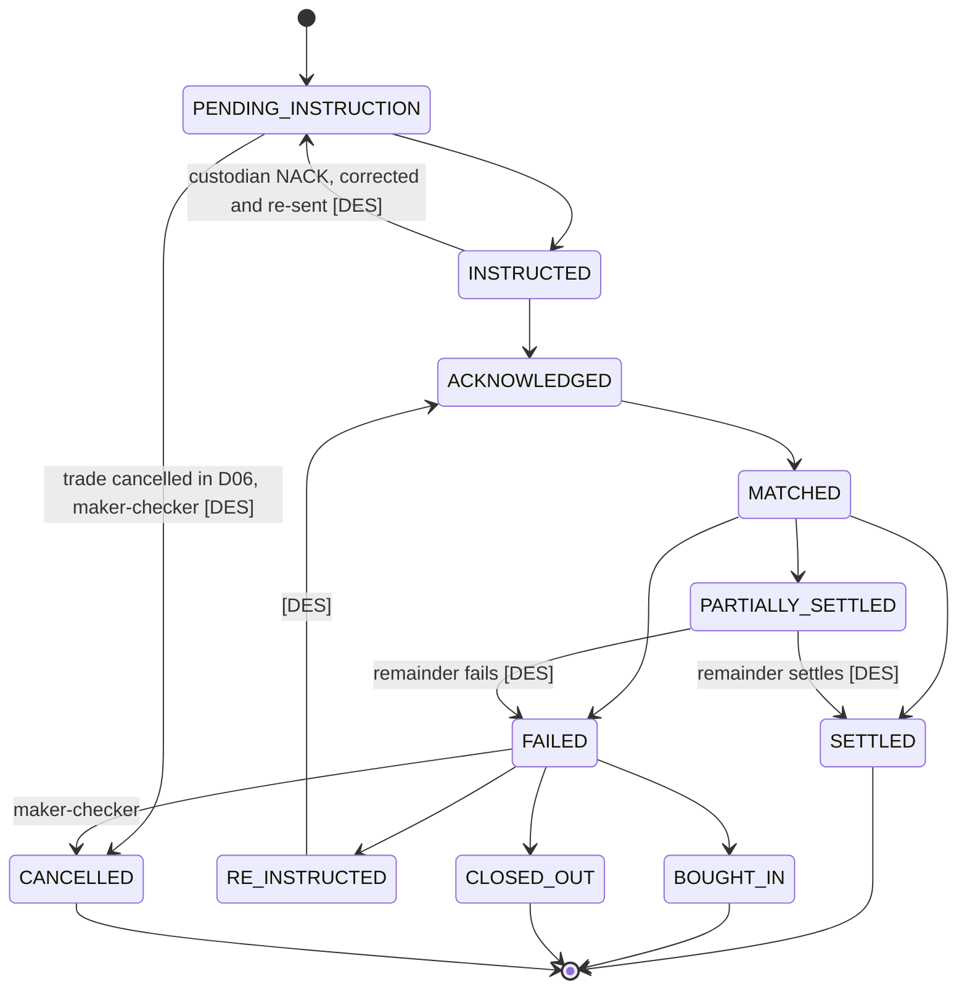

# PRD-007 — Settlement Management (D07)

This document states what AMC OS must do to turn confirmed trades into settled securities and cash, on the right date, and to catch every failure early. It re-keys the settlement part of PRD-000 v0.9 Module 05 "Trading and Settlement" to the GOV-001 identifiers (`FR-05-nn` → `FR-D07-nnn`, `BR-05-n` → `BRL-D07-nnn`) and adds what Module 05 leaves out for the two capabilities BA-001 marks **new**: the settlement calendar and settlement obligations. Module 05 is split three ways, following BA-001: trade capture, contract-note matching and broker reconciliation go to D06 Trading and Execution ([PRD-006](PRD-006_trading_and_execution.md), same step); settlement goes here; corporate actions go to D12 Fund Operations (PRD-012, Step 9).

**Builds on Draft documents:** [PRD-000 v0.9](PRD-000_master_prd_v0.9.md) Module 05, Module 10 (FR-10-03, -06, -08, BR-10-3), Chapter 4 (W6b), Chapter 6; [BA-001](../02_business_architecture/BA-001_business_capability_map.md) D07, §4, §5 C3; [BA-002](../02_business_architecture/BA-002_amc_operating_model.md) §4; [BA-004](../02_business_architecture/BA-004_end_to_end_workflows.md) WF-018, WF-026, WF-027, WF-028, §5.2 C2, C9; [BA-005](../02_business_architecture/BA-005_roles_and_permissions.md) §3, §4, §5; [PRD-004](PRD-004_portfolio_management.md) (cash ladder); [PRD-005](PRD-005_order_management.md) — allowed by owner decision D-3 ([GOV-008](../00_governance/GOV-008_build_loop.md) §2 rule 3). No document used here is Approved. Owner decision D-18 (no SoD waivers except SOD-03 and small-team mode) is applied.

**What this document is not:** trade capture, the link of trade to order and execution, contract-note matching, charge checks and broker (execution) reconciliation (D06, PRD-006); corporate actions (D12, PRD-012); the reconciliation engine and its break workflow (D12, FE-07 — D07 defines its reconciliation sets and works its breaks); the holiday calendar master (D01, CAP-D01-009); accounting journals (D10 posts them from D07 events); the settlement calculation method (FE-06, Step 22). AMC OS is not a custodian, depository, clearing corporation or bank (PS-001 §3): it instructs, tracks and reconciles. **Rule for engineers (PRD-000):** no settlement cycle, cut-off time, penalty rate or threshold is hard-coded; they are versioned, effective-dated parameters.

## 1. Scope

| In scope (CAP) | Out of scope |
| --- | --- |
| CAP-D07-001 Settlement calendar · CAP-D07-002 Settlement obligations · CAP-D07-003 Cash settlement · CAP-D07-004 Securities settlement · CAP-D07-005 Payment tracking · CAP-D07-006 Settlement confirmation · CAP-D07-007 Settlement reconciliation · CAP-D07-008 Failed settlement management | Trade capture and confirmation, broker reconciliation (D06); corporate actions (D12); holiday master (D01); reconciliation engine (D12, FE-07); journals (D10); custody, clearing, depository and banking services themselves (PS-001 §3); AI that releases payments or instructions (ADR-0008) |

## 2. Re-keying from PRD-000 Module 05

| PRD-000 v0.9 | Here | Note |
| --- | --- | --- |
| FR-05-01 Trade capture, FR-05-02 Execution records, FR-05-03 Trade confirmation, FR-05-07 Broker reconciliation | — | **Not re-keyed here:** D06 (CAP-D06-007, -003, -005); re-keyed in PRD-006 |
| FR-05-04 Settlement instructions | FR-D07-001 **(changed)** | Settlement cycle facts updated (§4.1) |
| FR-05-05 Settlement status | FR-D07-002 | State machine in §4.3 |
| FR-05-06 Failed settlement management | FR-D07-003 | |
| FR-05-08 Custodian reconciliation | FR-D07-004 **(changed)** | Runs on the D12 engine (FE-07); D07 owns the reconciliation sets |
| FR-05-09 Cash settlement | FR-D07-005 **(changed)** | Net-settlement facts updated (§4.1) |
| FR-05-10 Corporate actions | — | **Not re-keyed here:** D12 (CAP-D12-007, BA-001 §4); re-keyed in PRD-012 (Step 9) |
| FR-05-11 Counterparty management | FR-D07-006 (SSI part only) | **Split:** the SSI part is D07 (CAP-D07-004 (.2)); brokers' empanelment status and limits are D06 (CAP-D06-001, PRD-006); the counterparty master itself sits in `master` (BA-001 §5 C2) |
| BR-05-1, BR-05-2 | BRL-D07-001, BRL-D07-002 | |
| BR-05-3 (corporate-action entitlements) | — | D12, PRD-012 (Step 9) |
| BR-05-4 (charges by versioned tax-rate table) | — | D06, PRD-006 (charges are checked when the contract note is matched) |
| Module 05 point 7 stories: Operations Analyst (contract-note matching) / Fund Manager (fails) / Auditor (SSI); Ch 5 US-STL-02 (SSI change under maker-checker with call-back flag) | — / US-D07-001 / US-D07-002 (US-STL-02 **merged** into US-D07-002 as AC-US-D07-002-2) | The contract-note story and US-STL-01 go to PRD-006 |
| Module 05 point 18 acceptance criteria: `CHARGE_MISMATCH` / `FAILED` | — / AC-US-D07-001-1 | The charge criterion goes to PRD-006 |
| Module 05 point 17 NFRs | NFR-PERF-008, NFR-PERF-009 | |
| Module 05 point 15 audit | NFR-AUD-007 | |
| FR-10-03 (bank connectivity), FR-10-06 (settlement tracking), FR-10-08 (failed transaction handling) | Referenced only | BA-001 cites them as sources of CAP-D07-005, -006 (.3), -008; they are re-keyed with Module 10 in PRD-012 (Step 9) |
| — | FR-D07-007 … FR-D07-017, BRL-D07-003 … 007, US-D07-003 … 007 | **New** **[DES]** |

## 3. Business requirements

| ID | Business requirement | Capabilities |
| --- | --- | --- |
| BR-D07-001 | Every confirmed trade is instructed to the custodian before the cut-off for its settlement date, and its status is known at every moment until it is settled or closed | CAP-D07-001, -004, -006 |
| BR-D07-002 | Each scheme knows, for every settlement date, what it must pay and deliver, and is funded before payments are released | CAP-D07-002, -003, -005 |
| BR-D07-003 | A failed or partly settled trade is found the same day, owned, tracked to an end state, and its effect on cash and NAV is visible | CAP-D07-008 |
| BR-D07-004 | Settled positions and cash agree with the custodian and the bank, and differences are worked as breaks | CAP-D07-007 |
| BR-D07-005 | Settlement and bank details cannot be changed by one person, so payment fraud is controlled | CAP-D07-004 (.2) |

## 4. Functional requirements

Every requirement also obeys PRD-000 common rules C1–C8. Labels from PRD-000 are carried unchanged unless the change is stated. Priority: **M** must (release-blocking), **S** should — as PRD-000 Chapter 3.

### 4.1 Re-keyed from PRD-000 Module 05

| ID (was) | Pri | Capability | Requirement |
| --- | --- | --- | --- |
| FR-D07-001 (FR-05-04) **(changed)** | M | CAP-D07-004 (.1), CAP-D07-001 (.1) | **Settlement instructions:** generate delivery-versus-payment / receive-versus-payment instructions to the custodian for each trade, with the settlement date from the settlement calendar (FR-D07-007). Equity cash market: rolling T+1 is the standard cycle, and an optional T+0 cycle exists for a limited set of shares **[REG — S1, S2]**; whether and when mutual-fund schemes use T+0 is **[VAL]**; debt settles per platform and segment **[VAL]**. *Changed:* PRD-000 said "equity T+1 currently; T+0 optional segment" with the whole statement **[VAL]**; the cycles are now sourced, MF use of T+0 stays **[VAL]**. Message format per custodian: Confirm with <custodian> (DDL-000 names ISO 15022 / 20022 types as examples only) |
| FR-D07-002 (FR-05-05) | M | CAP-D07-006 (.1), (.2) | **Settlement status:** `PENDING_INSTRUCTION → INSTRUCTED → ACKNOWLEDGED → MATCHED → SETTLED / PARTIALLY_SETTLED / FAILED → (RE_INSTRUCTED / BOUGHT_IN / CLOSED_OUT / CANCELLED)`; full state machine in §4.3. Every status message from the custodian is stored with its time and reference |
| FR-D07-003 (FR-05-06) | M | CAP-D07-008 (.1), (.2), (.3) | **Failed settlement management:** reason code, ageing, owner, penalty and close-out tracking; effect on the cash ladder (PRD-004 FR-D04-008) and on the next NAV run (accrual of a penalty if the scheme bears it). Who bears the cost — scheme or AMC — is **[VAL]** (unchanged from PRD-000) |
| FR-D07-004 (FR-05-08) **(changed)** | M | CAP-D07-007 (.1) | **Custodian reconciliation:** settled holdings and cash per scheme vs custodian statements, daily. *Changed:* PRD-000 said "see Module 10 engine"; it runs on the one reconciliation engine and break workflow owned by D12 (CAP-D12-003, FE-07, WF-015); D07 defines the reconciliation set (keys, tolerances) and owns its breaks (BA-001 §4) |
| FR-D07-005 (FR-05-09) **(changed)** | M | CAP-D07-003 (.1), (.2) | **Cash settlement:** pay-in and pay-out schedules per scheme bank account; net settlement of funds where enabled. SEBI has issued a framework allowing net settlement of funds for mutual-fund schemes' cash-market transactions, reported as applying from April 2027 **[REG — S3, S4; date, scope and netting unit VAL]**. Net settlement is switched on per scheme and effective date only through configuration (WF-021) once validated. *Changed:* PRD-000 dated the framework 5 Nov 2026; the circular text has not yet been read for this PRD (open point C1) |
| FR-D07-006 (FR-05-11, SSI part) | M | CAP-D07-004 (.2) | **Standard settlement instructions (SSIs) and scheme bank details:** versioned, effective-dated, with maker-checker and a call-back flag (WF-028, SOD-06). The other parts of FR-05-11 (broker empanelment status and limits) are D06 (PRD-006) |

### 4.2 New requirements **[DES]**

| ID | Pri | Capability | Requirement |
| --- | --- | --- | --- |
| FR-D07-007 | M | CAP-D07-001 (.1), (.2) | **Settlement calendar:** settlement cycle per instrument type, market and segment as versioned, effective-dated configuration; settlement holidays read from the one calendar master in D01 (CAP-D01-009 (.1), BA-001 §4) — D07 keeps no holiday list of its own. A change of cycle or holiday after instructions exist raises an exception for every affected trade |
| FR-D07-008 | M | CAP-D07-002 (.1), (.2) | **Settlement obligations:** for each settlement date, the securities and cash each scheme must deliver or receive, per counterparty (gross); where net settlement is enabled (FR-D07-005), also the net cash obligation per scheme and netting unit. Gross obligations are always kept, so net figures can be traced to trades. Computed by FE-06 (Step 22) |
| FR-D07-009 | M | CAP-D07-002, CAP-D07-003 | **Funding check:** before payment release, compare each scheme's obligations with its bank balance and projected cash (PRD-004 FR-D04-008). A shortfall alerts Operations and the Fund Manager and keeps payment release blocked until the Fund Manager's funding decision is recorded and the check passes (WF-026). Which funding options a scheme may use is regulatory and scheme policy **[VAL]** (PRD-004 BRL-D04-003) |
| FR-D07-010 | M | CAP-D07-005 (.1), (.2) | **Payment tracking:** each payment instruction has a status (created, released, sent, confirmed, rejected) linked to the bank's confirmation; release needs the bank-mandate signatories (BA-005 §4 `settlement.payment.release`). Bank interface: Confirm with <bank> (FR-10-03 is re-keyed in PRD-012) |
| FR-D07-011 | M | CAP-D07-006 (.3) | **Operations view:** status of every trade, instruction, obligation, payment and fail across all schemes for a settlement date, with ageing and owner (PRD-000 FR-10-06, re-keyed in PRD-012) |
| FR-D07-012 | M | CAP-D07-006 | **Events to other domains:** status changes are published as events; D10 posts settlement journals and D04 moves positions from traded to settled from these events. D07 never writes another domain's tables (AGENTS.md §2.3) |
| FR-D07-013 | M | CAP-D07-006 (.2) | **Idempotent status intake:** a custodian or bank message already received (same sender reference) is ignored; a message that is not an allowed transition (§4.3) does not change the state and goes to the exception queue (CAP-D12-008) |
| FR-D07-014 | M | CAP-D07-007 (.2) | **Cash reconciliation:** cash settled per scheme bank account vs bank statement, daily, on the D12 engine |
| FR-D07-015 | M | CAP-D07-006 (.1) | **Transitions enforced:** a status change not in §4.3 is refused by the service and by the database, and logged |
| FR-D07-016 | M | CAP-D07-004 (.1) | **Trades come only from D06:** D07 instructs only trades that D06 has confirmed against the contract note (WF-025) or externally booked trades approved by maker-checker (WF-024); D07 does not create trades |
| FR-D07-017 | M | CAP-D07-004 (.1), CAP-D07-008 (.2) | **Controlled instruction changes:** manual instructions, instructions above a threshold, cancellation or amendment of an instruction, and write-off of fail costs need maker-checker (PRD-000 Module 05 point 13). An instruction is never edited: an amendment cancels it and creates a new one |

### 4.3 Settlement state machine

PRD-000 FR-05-05 gives the sequence; DDL-000 v0.9 has the same eleven status values as a CHECK on `settlement.trade.status` but, unlike `trading.order_state_transition`, **no table of allowed transitions** (open point C4). The solid sequence is PRD-000; transitions marked **[DES]** are proposed here to make the machine complete.

Whether `INSTRUCTED` or `ACKNOWLEDGED` can go straight to `FAILED` (for example a fail reported before matching) depends on each custodian's messages: Confirm with <custodian> (open point C4).

## 5. Business rules

| ID (was) | Rule | Label |
| --- | --- | --- |
| BRL-D07-001 (BR-05-1) | SSI and bank-detail changes are maker-checker and take effect only after a call-back verification flag is set | **[DES; IND]** (unchanged) |
| BRL-D07-002 (BR-05-2) | A trade settles in accounting only on custodian confirmation, not on instruction | **[DES]** (PRD-000 unlabelled) |
| BRL-D07-003 | Settlement cycles, cut-off times and holidays are effective-dated configuration from their source (regulator, exchange, custodian, D01 calendar), never code | **[DES]**; cut-off values **[ASSUMPTION — confirm: each custodian]** |
| BRL-D07-004 | The call-back uses contact details already on record, never those in the change request (BA-004 WF-028) | **[DES]** |
| BRL-D07-005 | No payment is released for a scheme with an unresolved funding shortfall for that settlement date | **[DES]** |
| BRL-D07-006 | Net settlement never replaces the gross record: every net figure is traceable to the trades it nets | **[DES]** |
| BRL-D07-007 | The threshold above which an instruction needs a checker is tenant configuration approved through WF-021 | **[DES]**; value **[ASSUMPTION — confirm: Head of Operations of the pilot AMC]** |

## 6. Workflows

No new workflow is needed: BA-004 already covers D07 (§5.1).

| Workflow | D07 role | Requirements |
| --- | --- | --- |
| [WF-018](../02_business_architecture/BA-004_end_to_end_workflows.md) Trade settlement | Accountable (DEP-06) | FR-D07-001, -002, -012, -013, -015, -016, BRL-D07-002 |
| WF-026 Settlement obligations and funding | Accountable | FR-D07-005, -007, -008, -009, -010, BRL-D07-005, -006 |
| WF-027 Failed settlement management | Accountable | FR-D07-003, -017 |
| WF-028 SSI and bank-detail change | Accountable | FR-D07-006, BRL-D07-001, -004 |
| WF-015 Reconciliation (D12) | Defines and works its reconciliation sets | FR-D07-004, -014 |
| WF-024, WF-025 (D06) | Receives the trades to settle | FR-D07-016 |
| WF-023 Broker empanelment (D06) | Supporting (counterparty SSIs) | FR-D07-006 |

## 7. Permissions by capability

From BA-005 §3 (D07 column) and §4, narrowed to each capability. Checker ≠ maker (SOD-01). In BA-005 §3 the Operations Analyst holds "R C U S (A manager)", the COO "R A J E", the Finance Officer (ROLE-24) "R A J" for SSI and bank-detail changes, the Technology Administrator "R (connections) C U S"; the other business roles and the Auditor read.

| Capability | Maker | Checker(s) |
| --- | --- | --- |
| CAP-D07-001 Settlement calendar | Operations Analyst proposes cycle configuration | Through WF-021 (`platform.config.approve`, SOD-12): Operations Manager, plus a Compliance Officer for a regulatory parameter |
| CAP-D07-002 Settlement obligations | System (FE-06) | — |
| CAP-D07-003 Cash settlement | Operations Analyst | At least two bank-mandate signatories (`settlement.payment.release`) |
| CAP-D07-004 (.1) Securities settlement — straight-through instruction | System | — |
| CAP-D07-004 (.1) Manual or above-threshold instruction; cancel or amend an instruction | Operations Analyst | Operations Manager (`settlement.instruction.approve`, `settlement.instruction.cancel`)† |
| CAP-D07-004 (.2) SSI and bank details | Operations Analyst | Finance Officer or Operations Manager, after call-back (`settlement.ssi.approve`, SOD-06) |
| CAP-D07-005, -006 Payment tracking, confirmation | System; Operations Analyst works exceptions | — |
| CAP-D07-007 Settlement reconciliation | Operations Analyst (force-match through D12) | Operations Manager (CAP-D12-009) |
| CAP-D07-008 Fail cancellation | Operations Analyst | Operations Manager (`settlement.fail.cancel`) |
| CAP-D07-008 Write-off of fail costs | Operations Analyst | Operations Manager **and** Finance Officer (`settlement.fail.write_off`)† |

**Rights added beyond BA-005 §4 (†):** PRD-000 Module 05 point 13 requires maker-checker on manual and above-threshold instructions, on cancellation and amendment of instructions, and "Ops Head + Finance" on write-off of fail costs; BA-005 §4 lists no permission for these. The three permission names are proposed here **[DES]** (open point C6).

## 8. User stories and acceptance criteria

Priority: **C** critical (release-blocking), **O** optional — as PRD-000 Chapter 5.

| ID | Story | Pri | Acceptance criteria (Given / When / Then) |
| --- | --- | --- | --- |
| US-D07-001 (was Module 05 point 7) | As a Fund Manager, I want to see failed settlements that affect my cash tomorrow, so that I can plan | C | **AC-US-D07-001-1** (was Module 05 point 18) Given a failed settlement, when the status changes to `FAILED`, then the cash ladder and the next NAV run both reflect the unsettled position. |
| US-D07-002 (was Module 05 point 7; US-STL-02) | As an Auditor, I want any SSI change to show who changed it and who approved it, so that payment-fraud risk is controlled | C | **AC-US-D07-002-1** (new **[DES]**) Given an SSI change, when it is viewed, then the maker, checker, call-back record, supporting document and effective date are shown and the earlier version is kept. **AC-US-D07-002-2** (was US-STL-02) Given an SSI change without the call-back flag, when the checker approves, then the approval is refused. |
| US-D07-003 | As an Operations Analyst, I want instructions generated automatically, so that I work only on exceptions | C | **AC-US-D07-003-1** Given a trade confirmed by D06, when confirmation is received, then a settlement instruction with the calendar's settlement date exists within 5 minutes (NFR-PERF-008). |
| US-D07-004 | As an Operations Manager, I want payments held when a scheme is short of cash | C | **AC-US-D07-004-1** Given a scheme whose pay-in obligation for a date exceeds its available cash, when an analyst tries to release its payments, then release is refused and Operations and the Fund Manager are alerted, until the Fund Manager's funding decision is recorded and the funding check passes. |
| US-D07-005 | As an Operations Analyst, I want duplicate custodian messages ignored | C | **AC-US-D07-005-1** Given a `SETTLED` message already applied, when the same message (same custodian reference) arrives again, then no state change, journal event or position event is produced. |
| US-D07-006 | As an Operations Manager, I want net and gross obligations both kept | C | **AC-US-D07-006-1** Given net settlement enabled for a scheme, and that scheme's buys of ₹10 crore and sells of ₹7 crore in one netting unit for one settlement date, when obligations are computed, then the net pay-in is ₹3 crore and the ₹10 crore and ₹7 crore gross obligations remain visible and linked to their trades. |
| US-D07-007 | As Compliance, I want illegal status changes impossible | C | **AC-US-D07-007-1** Given a trade in `SETTLED`, when a user or message tries to set it to `FAILED`, then the change is refused and logged. |

Definition of done: as PRD-000 Chapter 5.

## 9. Exceptions

| Exception | Handling | Source |
| --- | --- | --- |
| Custodian rejects an instruction (NACK) | Instruction `NACK` with reason; trade back to `PENDING_INSTRUCTION` (§4.3 **[DES]**); exception queue (CAP-D12-008) | PRD-000 Module 05 point 14 |
| Short delivery; auction or close-out by the clearing corporation | `FAILED` → `BOUGHT_IN` or `CLOSED_OUT` per exchange and clearing rules **[VAL]** (WF-027) | PRD-000 Module 05 point 14 |
| Bank payment failure | Payment `REJECTED`; if it causes a fail, WF-027 | PRD-000 Module 05 point 14 |
| No confirmation by the expected time | Treated as a suspected fail (WF-027 trigger); expected time from the custodian's schedule **[ASSUMPTION]** | BA-004 WF-027 |
| Missing or unapproved SSI | Instruction not sent; exception to Operations | BA-004 WF-018 precondition |
| Cycle or holiday changed after instructions were sent | Exception for each affected trade (FR-D07-007) | **[DES]** |
| Duplicate or out-of-order status message | FR-D07-013 | **[DES]** |
| Corporate-action data conflicts | D12 (PRD-012) | PRD-000 Module 05 point 14 |

## 10. Data and interfaces

**Owned schema:** `settlement` (GOV-001 §3). No database change is made in this step.

| Exists in DDL-000 | Not yet in DDL-000 (for DA-001 / DDL, Steps 15–16) **[DES]** |
| --- | --- |
| `settlement.trade` (status with the 11 values of §4.3, charges, net amount), `settlement.instruction` (status `CREATED`…`CANCELLED`, unique custodian reference) | Allowed-transition table for trade status (C4); settlement-cycle configuration; obligations (gross and net); payment instructions and bank confirmations; fail record (reason, owner, ageing, penalty, close-out); SSI and scheme bank-detail versions with call-back record; raw custodian and bank message store |

DA-000 places trades, contract notes, corporate actions and SSIs in `settlement`, while BA-001 gives trade confirmation to D06 and corporate actions to D12; `settlement.trade` also holds the charge fields that D06's contract-note matching produces (BA-001 §5 C3, BA-004 §5.2 C2; open point C3).

**Interfaces (indicative, not contracts):** PRD-000 Module 05 point 11 names `settlement-svc` endpoints `/trades`, `/settlement-instructions`, `/settlement-status`, `/fails`, `/counterparties`, `/corporate-actions`; `/corporate-actions` moves to D12 and broker counterparty data to D06. Events in: `trading.trade.confirmed` (D06). Events out: `settlement.status.changed` (to D10, D04). Names become `API-D07-nnn` in Step 24 and `<NAME>.v<n>` in EA-007 (Step 13). Outside parties: custodian (instructions out; status and statements in) and banks (payments out; confirmations and statements in) — every interface Confirm with <custodian> / <bank> until INT-001 (Step 14).

## 11. Non-functional requirements

NFR numbering continues the series used by PRD-001…PRD-005.

| ID | Requirement | Type / source |
| --- | --- | --- |
| NFR-PERF-008 | Settlement instruction generated within 5 minutes of trade confirmation | Proposed — PRD-000 Module 05 point 17 |
| NFR-PERF-009 | 100% of trades instructed before the custodian cut-off for their settlement date | Proposed — PRD-000 Module 05 point 17; cut-offs **[VAL]** |
| NFR-AUD-007 | Full message history per instruction, SSI change log and fail actions (PRD-000 Module 05 point 15); zero lost custodian or bank status messages (new **[DES]**) | PRD-000 Module 05 point 15; **[DES]** |

Platform NFRs in PRD-001 §11 apply.

## 12. AI in this domain

Within PRD-000 C8 and ADR-0008 (read and propose only): the **Reconciliation assistant** (CAP-D17-008) suggests matches and likely causes for settlement and cash breaks; an analyst accepts, and a force-match stays maker-checker. The **NAV operations assistant** (CAP-D17-007) summarises fails that affect the next NAV. No assistant may send an instruction, release a payment, change an SSI or cancel a fail (SOD-10).

## 13. Open points

| # | Point | Where closed |
| --- | --- | --- |
| C1 | Net settlement of funds for MF schemes: circular date, effective date (reported as April 2027), scope (which segments) and netting unit were taken from search results, not from the circular text **[VAL]** | REG-001 (Step 25); before FR-D07-005 net mode is built |
| C2 | Whether MF schemes use the optional T+0 cycle; debt settlement cycles per platform; custodian cut-off times **[VAL / ASSUMPTION]** | REG-001 (Step 25); pilot discovery with the custodian |
| C3 | Schema placement: DA-000 puts trades, contract notes, corporate actions and SSIs in `settlement`, and `settlement.trade` holds charge fields produced by D06 — a possible cross-domain write | EA-003 (Step 11), DA-001 (Step 15) — same as BA-001 §5 C3, BA-004 §5.2 C2 |
| C4 | DDL-000 has no allowed-transition table for settlement status; the **[DES]** transitions of §4.3 and fails before matching need custodian confirmation; `settlement.instruction.status` and `settlement.trade.status` are two separate lists whose link is not defined | DA-001 / DDL (Steps 15–16); INT-001 (Step 14) |
| C5 | Who bears a fail penalty (scheme or AMC) and how it is accrued **[VAL]** | REG-001 (Step 25); owner (new question) |
| C6 | Permissions proposed in §7 (†) — `settlement.instruction.approve`, `settlement.instruction.cancel`, `settlement.fail.write_off` — are not in BA-005 §4 | Next BA-005 revision |
| C7 | Instruction threshold for maker-checker (BRL-D07-007) and the expected confirmation time per custodian **[ASSUMPTION]** | Pilot discovery |
| C8 | BA-003 TERM-078 "Standing Settlement Instructions" vs "standard settlement instruction" here and in BA-001 (BA-004 §5.2 C9) | Next BA-003 revision |

## Sources

Inside the repository: [PRD-000 v0.9](PRD-000_master_prd_v0.9.md) Module 05, Module 10, W6b, Ch 6; [BA-001](../02_business_architecture/BA-001_business_capability_map.md) D07, §4, §5; [BA-004](../02_business_architecture/BA-004_end_to_end_workflows.md) WF-015, WF-018, WF-023…WF-028; [BA-005](../02_business_architecture/BA-005_roles_and_permissions.md) §3–§5; [PRD-004](PRD-004_portfolio_management.md); [PRD-005](PRD-005_order_management.md); DDL-000 v0.9 section 07e (`database/ddl/DDL-000_core_schema_v0.9.sql`); [LOOP_STATE.md](../../LOOP_STATE.md) decisions D-3, D-18.

External (accessed 20 Nov 2026):

| # | Source | Used for |
| --- | --- | --- |
| S1 | NSE, "T+0 settlement cycle" product page — https://www.nseindia.com/products-services/t0-settlement-cycle | Optional T+0 cycle alongside T+1 in the equity cash market |
| S2 | Business Standard, "SEBI introduces beta version of T+0 rolling settlement cycle on optional basis" (21 Mar 2024) — https://www.business-standard.com/markets/capital-market-news/sebi-introduces-beta-version-of-t-0-rolling-settlement-cycle-on-optional-basis-124032100799_1.html; Business Standard, "SEBI widens scope of T+0 settlement to top 500 stocks" (Dec 2024) — https://www.business-standard.com/markets/news/market-regulator-sebi-widens-scope-of-t-0-settlement-to-top-500-stocks-124121000906_1.html | T+0 is optional and limited to a list of shares; T+1 remains the standard cycle |
| S3 | SEBI, circular PDF listed under November 2026 attachments — https://www.sebi.gov.in/sebi_data/attachdocs/nov-2026/1793874209372.pdf (title seen in search results; text not read) | Net settlement of funds for MF schemes (C1) |
| S4 | LiveLaw Biz, "SEBI allows mutual fund schemes to net funds for cash market transactions from April 2027" — https://www.livelawbiz.com/securities-law/sebi/securities-and-exchange-board-of-india-allows-mutual-fund-schemes-net-funds-cash-market-transactions-april-2027-557664; Moneylife — https://www.moneylife.in/article/sebi-allows-net-settlement-of-funds-for-mutual-fund-schemes-from-april-2027-to-reduce-funding-requirements/82137.html | Reported effective date April 2027 (headline only; C1) |
