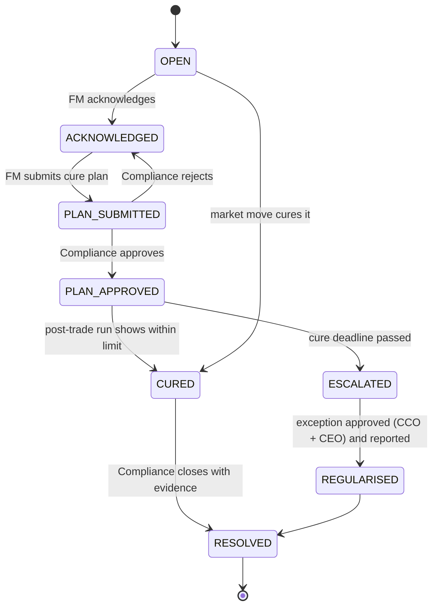
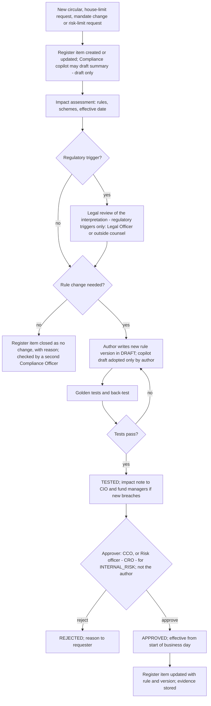

# PRD-008 — Compliance Management (D08)

This document states what AMC OS must do to stop investment-limit breaches before a trade, find breaches after prices or flows move, see each breach through to closure, and prove all of it with evidence — using rules that are effective-dated, versioned, tested and approved (master build prompt §4, Domain 8). It re-keys PRD-000 v0.9 Module 06 to the GOV-001 identifiers (`FR-06-nn` → `FR-D08-nnn`, `BR-06-n` → `BRL-D08-nnn`, `US-CMP-0n` → `US-D08-nnn`) and adds the rule change lifecycle that BA-004 §5.1 left to this PRD (new workflow WF-034).

**Builds on Draft documents:** [PRD-000 v0.9](PRD-000_master_prd_v0.9.md) Module 06, Module 07 points 13 and BR-07-3, Chapter 4 (W5, W6, W14, W16), Chapter 5, Chapter 6, Chapter 9, Appendix A; [BA-001](../02_business_architecture/BA-001_business_capability_map.md) D08, §4; [BA-002](../02_business_architecture/BA-002_amc_operating_model.md) §4, §7; [BA-004](../02_business_architecture/BA-004_end_to_end_workflows.md) WF-005, WF-006, WF-014, WF-016, §5.1; [BA-005](../02_business_architecture/BA-005_roles_and_permissions.md); [PRD-002](PRD-002_product_and_scheme_management.md); [PRD-003](PRD-003_investment_management.md); [PRD-004](PRD-004_portfolio_management.md); [PRD-005](PRD-005_order_management.md) — allowed by owner decision D-3 ([GOV-008](../00_governance/GOV-008_build_loop.md) §2 rule 3). No document used here is Approved. Owner decision D-18 (no SoD waivers except SOD-03 and small-team mode) is applied.

**What this document is not:** the calculation method of the rule engine (FE-04, Step 21); the full field list and clause-by-clause content of the regulatory control registry (REG-001, Step 25); risk measures used as rule inputs (D09, PRD-009); the order and its states (D05, PRD-005); document storage (CAP-D12-010) and the generic approval mechanism (CAP-D12-011). **Rule for engineers (PRD-000):** no regulatory number (limit, threshold, cure period, reporting deadline) is hard-coded or written in this PRD; each is a versioned, approved rule parameter in the registry. This PRD deliberately states no limit value.

## 1. Scope

| In scope (CAP) | Out of scope |
| --- | --- |
| CAP-D08-001 Regulatory rule registry · CAP-D08-002 Internal investment restrictions · CAP-D08-003 Scheme-specific restrictions · CAP-D08-004 Issuer limits · CAP-D08-005 Exposure limits · CAP-D08-006 Pre-trade compliance · CAP-D08-007 Post-trade compliance · CAP-D08-008 Regulatory monitoring · CAP-D08-009 Breach detection · CAP-D08-010 Breach investigation · CAP-D08-011 Corrective actions · CAP-D08-012 Evidence management · CAP-D08-013 Compliance reporting | Placing, blocking or releasing orders (D05 acts on D08 results); computing risk measures (D09); position and exposure views (D04, CAP-D04-007); writing scheme documents (D02); filing on regulator portals (the AMC files; AMC OS prepares, records the submission and stores the acknowledgment); market-abuse surveillance of recorded communications (BA-005 §7 C6, Step 25); AI that approves or activates a rule (ADR-0008) |

## 2. Re-keying from PRD-000 Module 06

| PRD-000 v0.9 | Here | Note |
| --- | --- | --- |
| FR-06-01 … FR-06-14 | FR-D08-001 … FR-D08-014 | Same order; capability added; wording shortened. FR-06-01 is **(changed)**: the register keeps the 10 fields of PRD-000, and the remaining fields of the master prompt §9 are added in REG-001 (Step 25, GOV-006 §2 row 9). FR-06-04 is **(changed)** in its label only (see FR-D08-004). FR-06-12 is **(changed)**: the example report formats are not repeated as requirements here; the report list is REG-001's |
| BR-06-1 … BR-06-5 (business **rules**) | BRL-D08-001 … BRL-D08-005 | `BR-` is reserved for business *requirements* (GOV-001 §4) |
| US-CMP-01, US-CMP-02 (Ch 5) | US-D08-001, US-D08-002 | |
| Module 06 point 7 stories (Compliance Officer, Fund Manager, Trustee) | US-D08-003 … US-D08-005 | |
| Module 06 point 18 acceptance criteria | AC-US-D08-003-1 (effective dating), AC-US-D08-001-1 (approval refused without tests) | |
| Module 06 point 14 exceptions | §9 | |
| Module 07 BR-07-3 (internal risk limits in the compliance engine, tagged `INTERNAL_RISK`) | FR-D08-021 | Hosted here; the limit itself is D09's (PRD-009) |
| — | FR-D08-015 … FR-D08-024, BRL-D08-006 … 010, US-D08-006 … 011, WF-034; acceptance criteria AC-US-D08-004-1 and AC-US-D08-005-1 on re-keyed stories | **New** **[DES]** |

## 3. Business requirements

| ID | Business requirement | Capabilities |
| --- | --- | --- |
| BR-D08-001 | No order can breach a regulatory, mandate or house limit without being stopped first, or without a recorded, two-person override | CAP-D08-006, CAP-D08-011 |
| BR-D08-002 | Every breach of a limit after the trade, however caused, is found the same day, owned, cured on time or regularised, and reported to the Trustees | CAP-D08-007, CAP-D08-009, CAP-D08-010, CAP-D08-011, CAP-D08-013 |
| BR-D08-003 | A change in regulation reaches the rules on its effective date, tested and approved, and the AMC can show which rule version applied on any past day | CAP-D08-001, CAP-D08-008 |
| BR-D08-004 | The AMC can hand SEBI, Trustees and auditors complete evidence for any check, breach, override or report without assembling it by hand | CAP-D08-012, CAP-D08-013 |
| BR-D08-005 | House (internal) limits set by the investment policy are applied with the same control as regulatory limits | CAP-D08-002 |

## 4. Functional requirements

Every requirement also obeys PRD-000 common rules C1–C8. Labels from PRD-000 are carried unchanged unless the change is stated. Priority: **M** must (release-blocking), **S** should — as PRD-000 Chapter 3.

### 4.1 Re-keyed from PRD-000 Module 06

| ID (was) | Pri | Capability | Requirement |
| --- | --- | --- | --- |
| FR-D08-001 (FR-06-01) **(changed)** | M | CAP-D08-001 (.1) | **Regulatory rule registry:** each regulation item recorded with source, document title, reference, publication date, effective date, domain, system control, responsible department, validation requirement and verification status (the 10 fields of PRD-000). *Changed:* the further fields the master prompt §9 asks for (applicable entity, scheme or activity, business interpretation, required control, implemented rule and version, test case, approval status, responsible owner) are added by REG-001 (Step 25); the seed content is PRD-000 Appendix A |
| FR-D08-002 (FR-06-02) | M | CAP-D08-001 (.2) | **Rule definition language:** rules are written in a typed, declarative language, not free code: *scope* (schemes or categories), *measure* (for example an issuer's exposure divided by net assets), *grouping* (issuer, group, sector, rating, instrument), *operator and threshold* (parameters by effective date), *severity* (BLOCK / WARN / INFO), *timing* (pre / post / both), *cure period* for passive breaches |
| FR-D08-003 (FR-06-03) | M | CAP-D08-003 (.1) | **Scheme-level restrictions:** from the scheme mandate (PRD-002 FR-D02-007) and the SID |
| FR-D08-004 (FR-06-04) **(changed)** | M | CAP-D08-004 (.1)…(.3), CAP-D08-005 (.1) | **Concentration rules:** single issuer, issuer group, sector, single security, top-N, related party (sponsor group), unlisted and unrated securities, derivatives exposure, overseas, REIT / InvIT, units of other mutual funds **[REG — investment restrictions under the SEBI (Mutual Funds) Regulations 2026 (§13 C1; sources R7, R8); VAL all thresholds]**. *Changed:* PRD-000 label read "[REG — Seventh Schedule-type investment restrictions under MF Regulations 2026; VAL all thresholds]"; the schedule number is dropped until REG-001 maps the clauses |
| FR-D08-005 (FR-06-05) | M | CAP-D08-005 (.2) | **Credit-rating restrictions:** rating-based limits; downgrade triggers; segregated-portfolio (side-pocket) eligibility on a credit event **[REG — VAL]** |
| FR-D08-006 (FR-06-06) | M | CAP-D08-005 (.3) | **Liquidity restrictions:** minimum liquid assets per category; liquidity-stress-test outputs from D09 (CAP-D09-003 (.3)) used as rule inputs **[REG — VAL]** |
| FR-D08-007 (FR-06-07) | M | CAP-D08-003 (.2) | **Investment mandate checks:** asset-allocation bands; category-defining minimums (for example the large-cap minimum of a large-cap fund) |
| FR-D08-008 (FR-06-08) | M | CAP-D08-006 (.1), (.2) | **Pre-trade validation:** against the hypothetical post-trade portfolio: start-of-day positions + executed today + pending orders + this order (WF-005); result per rule PASS / WARN / BLOCK / INDETERMINATE with measured value and threshold |
| FR-D08-009 (FR-06-09) | M | CAP-D08-007 (.1), (.2) | **Post-trade validation:** end of day after NAV approval and intraday on market moves, on actual holdings and market values (WF-006) |
| FR-D08-010 (FR-06-10) | M | CAP-D08-009, CAP-D08-010 (.2), CAP-D08-011 (.1), (.2) | **Breach management:** active vs passive classification, owner, cure deadline (from the rule's cure-period parameter), escalation, reporting to Trustees; breach states as in §4.4 (WF-014) |
| FR-D08-011 (FR-06-11) | M | CAP-D08-011 (.3) | **Exception workflows:** temporary exemptions with an expiry date; overrides with reasons (FR-D08-024) |
| FR-D08-012 (FR-06-12) **(changed)** | M | CAP-D08-013 (.1), (.2) | **Regulatory reporting:** report definitions mapped to certified data (CAP-D16-007); scheduled generation; monthly and quarterly compliance reports; Trustee reports; regulator formats **[REG]** (WF-016). *Changed:* PRD-000 names SEBI offsite-inspection formats (Format 10 under the Master Circular as on 20 Mar 2026) as an example; the list of reports, formats and due dates is set in REG-001 (Step 25) and is **[VAL]** until then |
| FR-D08-013 (FR-06-13) | M | CAP-D08-001 (.3) | **Rule versioning and testing:** each rule version has golden test cases (portfolio + expected result); a version cannot be approved unless its tests pass; back-test on the last N business days shows the impact (N is configuration, PRD-001 FR-D01-033) |
| FR-D08-014 (FR-06-14) | M | CAP-D08-012 (.1), (.2) | **Evidence management:** every check result stored with input hash, rule version, parameter values and time; evidence packs exportable per inspection request |

### 4.2 New requirements **[DES]**

| ID | Pri | Capability | Requirement |
| --- | --- | --- | --- |
| FR-D08-015 | M | CAP-D08-002 (.1), (.2) | **Internal (house) restrictions:** house limits proposed from the investment policy (PRD-003 FR-D03-012, FR-D03-016; WF-031) arrive as rule-change requests and are handled by WF-034 like any rule; each links to an internal-policy register item (source `INTERNAL_POLICY` in DDL-000 `compliance.regulation`); a rejection is returned to the CIO with the reason |
| FR-D08-016 | M | CAP-D08-005 (.4) | **Derivative limits:** rules on derivative positions (gross and net exposure, hedging and portfolio-rebalancing positions) with measures defined in the rule language; which positions count as hedges, and every value, are **[REG — VAL]** |
| FR-D08-017 | M | CAP-D08-008 (.1)…(.3) | **Regulatory monitoring:** new circulars and regulation changes are tracked from the sources listed in REG-001; each gets an impact assessment (affected register items, rules, schemes, effective date) and, where needed, rule-change requests; the Compliance copilot may draft the summary, the register entry and the rule change, never approve or activate them (WF-034, BRL-D08-007). The interpretation of a new or changed regulation or circular is reviewed by the Legal Officer (ROLE-21) or outside counsel before any rule is authored from it: the master prompt §9 says "Regulatory interpretation must be reviewed by qualified compliance and legal professionals" **[DES]**; who does it is open point C9 |
| FR-D08-018 | M | CAP-D08-001 (.4) | **Effective dating and scheduled activation:** an approved rule version takes effect from the start of the business day of its effective date (BRL-D08-004); two approved versions of the same rule never overlap in time (DDL-000 exclusion constraint); a mid-day switch is only by the emergency path of BRL-D08-004 |
| FR-D08-019 | M | CAP-D08-009 (.2) | **Breach severity and notification:** an active breach (caused by the AMC's own trade) is raised to high severity and notified at once to the CCO and the CIO; a passive breach goes to the scheme's fund manager as owner with the cure deadline (WF-006) |
| FR-D08-020 | M | CAP-D08-010 (.1), (.2) | **Breach investigation record:** root cause, contributing orders and price or flow events, and the active / passive classification; a change of classification needs a Compliance Officer other than the one who made the first classification (SOD-01) |
| FR-D08-021 | M | CAP-D08-001 (.3) | **Internal risk limits hosted for D09:** risk limits are rules of class `INTERNAL_RISK` in the same engine (PRD-000 BR-07-3); they follow the WF-034 lifecycle, but the approver is the Risk officer (CRO) approval authority held with ROLE-10 Risk Manager (BA-005 §4; PRD-000 Module 07 point 13) instead of the CCO. BA-005 §3 gives the Risk Manager only R on D08, so the author and approver rights for this class are open point C3 |
| FR-D08-022 | M | CAP-D08-003 (.2), CAP-D08-001 (.3) | **Mandate rules compiled from the scheme:** when a scheme's mandate is approved or changed (PRD-002 FR-D02-007; WF-001, WF-029), D08 compiles it into rule versions of class `MANDATE` in `DRAFT`; they are tested and approved through WF-034 before use; a scheme cannot open its NFO without an approved rule pack (PRD-002 FR-D02-024) |
| FR-D08-023 | M | CAP-D08-006 (.2), CAP-D08-007 (.1) | **What-if and headroom service:** D04 proposals and what-ifs are checked with the same rules as orders (check kind `WHAT_IF`, PRD-004 FR-D04-007, FR-D04-011); D08 reports the headroom to each limit per scheme for D04 alerts (PRD-004 FR-D04-016). What-if results are evidence but never count as a pre-trade pass for an order |
| FR-D08-024 | M | CAP-D08-011 (.3) | **Override record:** a pre-trade override covers one order version and the named BLOCK results only; it carries a mandatory reason and two approvals by distinct people, the CCO and the CIO or their delegates (SOD-04); it is stored as evidence and listed in the monthly Trustee report. D05 requests the override and acts on the outcome (PRD-005 FR-D05-005, BRL-D05-007); D08 holds the record and the approval permission — proposed answer to PRD-005 open point C6 (§13 C4) |

### 4.3 Rule version lifecycle

DDL-000 v0.9 `compliance.rule_version` has the statuses `DRAFT`, `TESTED`, `APPROVED`, `RETIRED`, `REJECTED` and refuses `APPROVED` unless tests passed and an approval request exists. This PRD adopts them; "scheduled" means `APPROVED` with an effective date in the future. The steps between the statuses are WF-034.

```mermaid
stateDiagram-v2
  [*] --> DRAFT: author creates (or copilot draft accepted by author)
  DRAFT --> TESTED: golden tests and back-test pass
  TESTED --> DRAFT: author edits
  TESTED --> APPROVED: approver (not the author) approves; effective date set
  TESTED --> REJECTED: approver rejects
  APPROVED --> RETIRED: superseded by a later version, or rule withdrawn
  REJECTED --> [*]
  RETIRED --> [*]
```

A version is never edited after `TESTED`; a change is a new version (BRL-D08-002). Whether a `REJECTED` version may be copied into a new `DRAFT` is a design detail for FE-04 (Step 21).

### 4.4 Breach states

Taken unchanged from PRD-000 W14 and BA-004 WF-014; the same values are in DDL-000 `compliance.breach.status`.

## 5. Business rules

| ID (was) | Rule | Label |
| --- | --- | --- |
| BRL-D08-001 (BR-06-1) | The rule engine is deterministic: the same inputs and the same rule version always give the same result | **[DES]** (PRD-000 unlabelled; master prompt §3.1) |
| BRL-D08-002 (BR-06-2) | Parameters are never edited in place; a new parameter version with an effective date is created | **[DES]** |
| BRL-D08-003 (BR-06-3) | Every rule links to at least one regulation-register item or internal-policy item | **[DES]** |
| BRL-D08-004 (BR-06-4) | Rule changes take effect from the start of a business day; no mid-day switch except by an emergency maker-checker approval | **[DES]** |
| BRL-D08-005 (BR-06-5) | Pre-trade and post-trade checks use the same rule code | **[DES]** |
| BRL-D08-006 | A house limit can only be equal to or stricter than the regulatory limit on the same measure; a looser house limit is refused at test time | **[DES]** |
| BRL-D08-007 | Nothing drafted by an AI assistant becomes a register entry, rule version or report until a Compliance Officer adopts it as author and it passes WF-034 or WF-016; zero automatic activation | **[DES]** (PRD-000 Ch 9; SOD-10) |
| BRL-D08-008 | A result of `INDETERMINATE` (data missing, for example no rating) is treated as BLOCK pre-trade; post-trade it opens a data exception for Compliance, not a breach | **[DES]** (pre-trade from PRD-000 Module 06 point 14; post-trade new) |
| BRL-D08-009 | A temporary exemption has an end date; it stops applying on that date without anyone acting, and every check result it affects shows it | **[DES]** |
| BRL-D08-010 | Cure deadlines, reporting deadlines and Trustee-reporting frequency come only from approved rule or report-definition parameters | **[DES]**; values **[REG — VAL]** until REG-001 |

## 6. Workflows

### 6.1 Workflows this domain takes part in

| Workflow | D08 role | Requirements |
| --- | --- | --- |
| [WF-001](../02_business_architecture/BA-004_end_to_end_workflows.md) Scheme launch | Compiles and approves the scheme's rule pack | FR-D08-022 |
| WF-002 Investment research and approval | Restricted-list and issuer-limit requests reach D08 through WF-034 | FR-D08-015 |
| WF-003 Portfolio construction | What-if checks on proposals | FR-D08-023 |
| WF-004 Order creation and execution; WF-024 External trade capture | Pre-trade check on each order version | FR-D08-008 |
| WF-005 Pre-trade compliance | **Accountable** (DEP-09) | FR-D08-008, -014, -024; BRL-D08-001, -005, -008 |
| WF-006 Post-trade compliance | **Accountable** | FR-D08-009, -019; BRL-D08-005, -008 |
| WF-014 Compliance breach resolution | **Accountable** | FR-D08-010, -011, -020; BRL-D08-009, -010 |
| WF-016 Regulatory reporting | **Accountable** | FR-D08-012, -014 |
| WF-017 NAV correction | Compliance Officer is a checker (BA-005 §4 `nav.correction.approve`) | — |
| WF-025 Trade confirmation | Post-trade check on allocated trades (D05 FR-D05-009) | FR-D08-009 |
| WF-029 Scheme change; WF-031 Investment policy review | Mandate and house-limit changes arrive as rule-change requests | FR-D08-015, -022 |
| **WF-034** Compliance rule change lifecycle | **Accountable** — card in §6.2 | FR-D08-001, -002, -013, -015…018, -021, -022; BRL-D08-002…004, -006, -007 |

### 6.2 WF-034 — Compliance rule change lifecycle **[DES]**

| Field | Detail |
| --- | --- |
| Trigger | A new or changed regulation or circular (CAP-D08-008); a house-limit request from D03 (WF-031, FR-D03-016); a mandate change from D02 (WF-001, WF-029); an internal risk-limit request from D09; a defect found in a rule |
| Initiator | Compliance Officer (ROLE-09); system for compiled mandate rules (FR-D08-022) |
| Departments | **DEP-09 Compliance** — accountable for CAP-D08-001 and CAP-D08-008 (BA-002 §4); DEP-10 Legal (interpretation review); DEP-02 / DEP-03 (CIO, house limits and mandates), DEP-11 (internal risk limits), DEP-13 (mandate source) |
| Capabilities | CAP-D08-008, CAP-D08-001, CAP-D08-002, CAP-D08-003, CAP-D08-004, CAP-D08-005, CAP-D08-012, CAP-D17-005 |
| Hand-offs (outside) | SEBI, AMFI and other publishers as sources of circulars (read only; source list and channel in REG-001, Step 25 — confirm with each source) |
| Preconditions | Register item exists for the source (or is created in this workflow) |
| Final state | Rule version `APPROVED` and scheduled for its effective date, or `REJECTED` with reason returned to the requester; register item updated with the implemented rule and version |
| Approvals | Interpretation of a new or changed regulation or circular reviewed by the Legal Officer (ROLE-21) or outside counsel before the decision whether a rule change is needed, so a "no change" conclusion is also reviewed (master prompt §9: "Regulatory interpretation must be reviewed by qualified compliance and legal professionals"; open point C9). A "no change" closure is checked by a second Compliance Officer **[DES]**. Author ≠ approver; approval needs passing tests (SOD-08). Approver: the CCO (PRD-000 Module 06 point 13; BA-005 §4 `compliance.rule.approve` says "another Compliance Officer" — open point C2); Risk officer (CRO) for `INTERNAL_RISK` rules (FR-D08-021, open point C3); emergency mid-day activation needs an additional maker-checker approval (BRL-D08-004) |
| Exceptions | Tests fail → back to author; back-test shows new breaches on current portfolios → impact note sent to the CIO and fund managers before approval, effective date may be moved; regulation effective before the rule can be approved → interim manual control recorded in the register and reported to the CCO **[DES]** |
| Audit | Register item versions, impact assessment, copilot drafts and who adopted them, rule diff, test cases and results, back-test result, approval, effective date |
| Source | **new** (BA-004 §5.1 D08 gap: CAP-D08-001, CAP-D08-008) |

## 7. Permissions by capability

From BA-005 §3 (D08 column) and §4, narrowed to each capability (BA-005 §7 C2). Checker ≠ maker (SOD-01). CEO, COO, CIO, CFO, Research Analyst, Risk Manager, Fund Accountant, Operations Analyst, Product Manager and Auditor read (BA-005 §3: R); the Legal Officer reads; the Trustee reads evidence packs (ROLE-25); the Fund Manager reads own schemes and submits cure plans; the Dealer reads results.

| Capability | Maker | Checker(s) |
| --- | --- | --- |
| CAP-D08-001 Rule registry, rule versions | Compliance Officer (author) | CCO (`compliance.rule.approve`; tests must pass, SOD-08) — open point C2; Risk officer (CRO) for `INTERNAL_RISK` rules — open point C3 |
| CAP-D08-002 Internal restrictions | CIO proposes (WF-031); Compliance Officer authors | As CAP-D08-001 |
| CAP-D08-003 … CAP-D08-005 Scheme, issuer and exposure rules | Compliance Officer; system compiles mandate rules | As CAP-D08-001 |
| CAP-D08-006, -007 Pre- and post-trade checks | System | — |
| CAP-D08-008 Regulatory monitoring | Compliance Officer; AI agent identity drafts only (ROLE-26, SOD-10) | Legal Officer (ROLE-21) or outside counsel reviews the interpretation of a new or changed regulation before the rule-change decision† (master prompt §9); an impact assessment closed as "no change" is checked by a second Compliance Officer **[DES]** |
| CAP-D08-009, -010 Breach detection and investigation | System detects; Compliance Officer investigates | Second Compliance Officer for a change of classification (FR-D08-020) |
| CAP-D08-011 Corrective actions | Fund Manager (cure plan, "S cure plan") | Compliance Officer (`compliance.breach.approve_plan`); regularisation: CCO **and** CEO (`compliance.breach.regularise`); pre-trade override: CCO **and** CIO (`compliance.pretrade.override`, SOD-04); temporary exemption: CCO **[DES]** |
| CAP-D08-012 Evidence management | System; Compliance Officer builds packs | — (read: Auditor, Trustee) |
| CAP-D08-013 Compliance reporting | Compliance Officer | CCO (`compliance.report.approve`) |

**Right added beyond BA-005 §3 (†):** BA-005 gives the Legal Officer (ROLE-21) only R on D08; this PRD adds the interpretation review in WF-034 **[DES]** (open point C9).

## 8. User stories and acceptance criteria

Priority: **C** critical (release-blocking), **O** optional — as PRD-000 Chapter 5.

| ID | Story | Pri | Acceptance criteria (Given / When / Then) |
| --- | --- | --- | --- |
| US-D08-001 (was US-CMP-01) | As Compliance, I want rule versions tested before approval | C | **AC-US-D08-001-1** (was Module 06 point 18) Given a rule version without passing tests, when the CCO tries to approve, then approval is refused. |
| US-D08-002 (was US-CMP-02) | As Compliance, I want an evidence pack per inspection | C | **AC-US-D08-002-1** Given a date range and scheme, when the pack is generated, then it contains every check result with rule version and input hash. |
| US-D08-003 (was Module 06 point 7) | As a Compliance Officer, I want to encode a new SEBI limit with an effective date and test it before go-live, so that it applies on the right day and does not break trading | C | **AC-US-D08-003-1** (was Module 06 point 18) Given rule version v2 effective from D, when a pre-trade check runs on D−1, then v1 is used; on D, v2 is used; both results record the version. |
| US-D08-004 (was Module 06 point 7) | As a Fund Manager, I want to know the cure deadline for a passive breach, so that I can plan orderly rebalancing | C | **AC-US-D08-004-1** (new **[DES]**) Given a passive breach opened on day D under a rule version with a cure-period parameter, when the fund manager opens the breach, then the deadline shown equals D plus that parameter's value and names the rule version it came from. |
| US-D08-005 (was Module 06 point 7) | As a Trustee, I want a monthly list of breaches and overrides with resolutions, so that I can discharge my oversight duty | C | **AC-US-D08-005-1** (new **[DES]**) Given breaches and overrides in a month, when the Trustee report for that month is approved, then it lists every one of them with its state, owner and resolution, and the Trustee can open each item's evidence. |
| US-D08-006 | As a CIO, I want a house limit to apply only after Compliance approves it | C | **AC-US-D08-006-1** Given a house limit sent from WF-031, when Compliance has not approved it, then no check uses it; when it is approved with effective date D, then checks from D use it. |
| US-D08-007 | As a CCO, I want AI drafts never to go live by themselves | C | **AC-US-D08-007-1** Given a rule change drafted by the Compliance copilot, when no Compliance Officer has adopted it, then it has no rule version and no check uses it; any call by the AI agent identity to approve returns 403 and raises a security alert (PRD-000 US-AI-02). |
| US-D08-008 | As a CCO, I want a check with missing data to stop the order | C | **AC-US-D08-008-1** Given a security with no rating and a rating-based rule, when the pre-trade check runs, then the result is `INDETERMINATE` and the order is `COMPLIANCE_BLOCKED`. |
| US-D08-009 | As an Auditor, I want to re-run any past check and get the same answer | C | **AC-US-D08-009-1** Given a stored check result, when it is re-run from its stored inputs and rule version, then the outcome and measured value are identical. |
| US-D08-010 | As a CCO, I want temporary exemptions to end on their own | C | **AC-US-D08-010-1** Given an exemption ending on day D, when a check runs on D+1, then the exemption is not applied. |
| US-D08-011 | As a Compliance Officer, I want an override to cover only the order version it was given for | C | **AC-US-D08-011-1** Given an approved override for order v1, when the order is amended to v2 and still BLOCKs, then v2 is `COMPLIANCE_BLOCKED` and needs its own override. |

Definition of done: as PRD-000 Chapter 5.

## 9. Exceptions

| Exception | Handling | Source |
| --- | --- | --- |
| Data missing for a rule | `INDETERMINATE`: BLOCK pre-trade; data exception post-trade (BRL-D08-008) | PRD-000 Module 06 point 14 |
| Rule engine timeout or unavailable | Order held in `PENDING_COMPLIANCE`, never passed | PRD-000 Module 06 point 14 |
| Post-trade run cannot start (snapshot not approved) | Run waits; Compliance alerted if it has not started by a configured time **[ASSUMPTION — time: confirm with pilot AMC Compliance]** | WF-006 |
| Cure deadline passed | Breach `ESCALATED`; regularisation needs CCO + CEO | WF-014 |
| Report validation fails | Fix data upstream and re-run | WF-016 |
| Regulation effective before its rule is approved | Interim manual control recorded and reported to the CCO (WF-034) | **[DES]** |

## 10. Data and interfaces

**Owned schema:** `compliance` (GOV-001 §3). No database change is made in this step.

| Exists in DDL-000 | Not yet in DDL-000 (for DA-001 / DDL, Steps 15–16) **[DES]** |
| --- | --- |
| `compliance.regulation` (10 PRD-000 fields plus `classification`, `source_url`), `compliance.rule` (`rule_class` REGULATORY / MANDATE / INTERNAL_RISK), `compliance.rule_version` (statuses, tests flag, effective range, no overlap), `compliance.rule_parameter`, `compliance.check_result` (immutable, partitioned; PASS / WARN / BLOCK / INDETERMINATE; PRE_TRADE / POST_TRADE / WHAT_IF), `compliance.breach` (§4.4 states) | Registry fields added by REG-001; rule test cases and test runs; back-test results; impact assessments; override record (FR-D08-024); temporary exemptions; breach investigation and cure-plan versions; report definitions, runs and acknowledgments; evidence packs; a rule class for house limits (open point C5) |

**Interfaces (indicative, not contracts):** PRD-000 Module 06 point 11 names `compliance-svc` endpoints `/rules`, `/rules/{id}/versions`, `/rule-tests`, `/pretrade/check`, `/posttrade/run`, `/breaches`, `/exceptions`, `/evidence`, `/regulatory-reports`. D05 calls `/pretrade/check` synchronously; D04 uses the what-if; D09 sends risk-limit requests and liquidity-stress outputs; D02 sends mandates. Names become `API-D08-nnn` in Step 24 and events `<NAME>.v<n>` in EA-007 (Step 13).

## 11. Non-functional requirements

NFR numbering continues; PRD-006, PRD-007 and PRD-009 (same step) use other numbers.

| ID | Requirement | Type / source |
| --- | --- | --- |
| NFR-PERF-010 | Pre-trade check p95 < 300 ms for 150 active rules | Proposed — PRD-000 Module 06 point 17, Chapter 7 |
| NFR-PERF-011 | Post-trade full run for 100 schemes < 5 min | Proposed — PRD-000 Module 06 point 17 |
| NFR-AUD-008 | Check results immutable; rule diff history; record of who approved which rule version; any past result reproducible from stored inputs (PRD-000 Module 06 point 15, Chapter 7 "Reproducibility") | PRD-000; **[DES]** |

Platform NFRs in PRD-001 §11 apply. How long check results and evidence are kept is **[REG — VAL exact periods per record type]** (PRD-000 Chapter 7), set in REG-001.

## 12. AI in this domain

Within PRD-000 C8 and ADR-0008 (read and propose only): the **Compliance copilot** (CAP-D17-005) summarises circulars, drafts register entries and rule changes, and explains breaches; the **CIO copilot** (CAP-D17-003 (.2)) explains blocked orders. Drafts enter WF-034 or WF-016 only when a Compliance Officer adopts them (BRL-D08-007). Evaluation (PRD-000 §9.3): recall of applicable circulars and zero automatic activation; release gates in AIML-001 (Step 26).

## 13. Open points

| # | Point | Where closed |
| --- | --- | --- |
| C1 | Every limit value, cure period, liquidity and derivative rule, report format and due date is **[VAL]**. Checked on 20 Nov 2026: the SEBI (Mutual Funds) Regulations 2026 were notified in January 2026 and apply from 1 Apr 2026 [R7][R8] (secondary sources); the Master Circular for Mutual Funds is dated 20 Mar 2026 and SEBI publishes its offsite-inspection formats [R9][R10]. Their clauses are not mapped here | REG-001 (Step 25) |
| C2 | Rule approver: PRD-000 Module 06 point 13 says the CCO; BA-005 §4 `compliance.rule.approve` says "another Compliance Officer". This PRD uses the CCO | Owner question Q26 in [LOOP_STATE.md](../../LOOP_STATE.md); next BA-005 revision |
| C3 | Internal risk limits (`INTERNAL_RISK`): PRD-000 BR-07-3 and Module 07 point 13 put them in the D08 engine with approval by the Risk officer (CRO); BA-005 §3 gives the Risk Manager only R on D08. Who authors and who approves this rule class needs confirming | Owner question Q27 in LOOP_STATE.md; PRD-009; next BA-005 revision |
| C4 | PRD-005 C6 (override permission): proposed here that D08 owns the override record and the approval (`compliance.pretrade.override` under CAP-D08-011, as BA-005 §4), and CAP-D05-010 (.3) is the D05 side (request and act on the result) | EA-003 (Step 11) |
| C5 | DDL-000 `rule_class` has no value for house (internal investment) limits; they could be `MANDATE`, `INTERNAL_RISK` or a new class | DA-001 / DDL (Steps 15–16) |
| C6 | Who approves a temporary exemption and how long it may last (FR-D08-011, §7 uses the CCO **[DES]**) **[ASSUMPTION]** | Owner question Q28 in LOOP_STATE.md; pilot discovery |
| C7 | Which breaches SEBI must be told about, and how (BA-004 WF-014 hand-off **[VAL]**) | REG-001 (Step 25) |
| C8 | Back-test window N (FR-D08-013) and the time by which the post-trade run must start (§9) **[ASSUMPTION]** | Pilot discovery |
| C9 | Legal review of regulatory interpretation (WF-034, §7 †): whether the in-house Legal Officer or outside counsel does it; the right is not in BA-005 §3 (Legal Officer: R on D08) | Owner question Q29 in LOOP_STATE.md; next BA-005 revision; REG-001 (Step 25) |

## Sources

| # | Source | Used for |
| --- | --- | --- |
| R1 | [PRD-000 v0.9](PRD-000_master_prd_v0.9.md) Module 06, Module 07 (point 13, BR-07-3), Ch 4 W5, W6, W14, W16, Ch 5, Ch 6, Ch 9, Appendix A | Re-keyed requirements, rules, stories, states, labels, register seed |
| R2 | [BA-001](../02_business_architecture/BA-001_business_capability_map.md) D08, §4 | Capabilities and ownership |
| R3 | [BA-004](../02_business_architecture/BA-004_end_to_end_workflows.md) WF-005, WF-006, WF-014, WF-016, §5.1 | Workflows and the D08 gap |
| R4 | [BA-005](../02_business_architecture/BA-005_roles_and_permissions.md) §3, §4, §5 | Rights, approvers, SoD |
| R5 | [PRD-002](PRD-002_product_and_scheme_management.md), [PRD-003](PRD-003_investment_management.md), [PRD-004](PRD-004_portfolio_management.md), [PRD-005](PRD-005_order_management.md) | Mandate, house limits, what-if and headroom, overrides |
| R6 | DDL-000 v0.9 `compliance` schema (`database/ddl/DDL-000_core_schema_v0.9.sql`) | Rule statuses, breach states, check kinds |
| R7 | [SEBI notifies Mutual Funds Regulations, 2026 — Taxmann](https://www.taxmann.com/post/blog/sebi-notifies-mutual-funds-regulations-2026) (accessed 20 Nov 2026) — secondary source | Regulations notified January 2026 |
| R8 | [New MF rules from April 1 — Business Standard, 16 Jan 2026](https://www.business-standard.com/markets/mutual-fund/new-mf-rules-from-april-1-sebi-allows-performance-linked-expense-charging-126011601076_1.html) (accessed 20 Nov 2026) — secondary source | Effective 1 Apr 2026 |
| R9 | [Offsite inspection formats, Master Circular for Mutual Funds as on 20 Mar 2026 — SEBI PDF](https://www.sebi.gov.in/sebi_data/commondocs/mar-2026/Offsite%20Inspection%20formats%20Master%20Circular%20for%20Mutual%20Funds%20as%20on%20March%2020%202026_p.pdf) (accessed 20 Nov 2026) | Master Circular date; formats exist |
| R10 | [SEBI issues updated Master Circular for Mutual Funds — Taxmann](https://www.taxmann.com/post/blog/sebi-issues-updated-master-circular-for-mutual-funds/) (accessed 20 Nov 2026) | Master Circular (secondary) |
| R11 | [LOOP_STATE.md](../../LOOP_STATE.md) owner decisions D-3, D-18 | Building on Drafts; SoD waivers |
