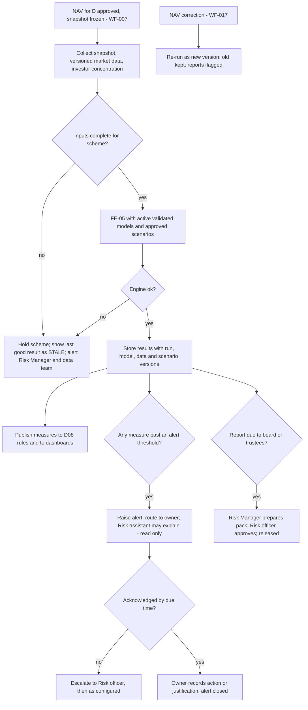

# PRD-009 — Risk Management (D09)

This document states what AMC OS must do to measure every material risk in every scheme each business day with reproducible, versioned models, explain where the risk comes from, and raise alerts before limits are reached. It re-keys PRD-000 v0.9 Module 07 to the GOV-001 identifiers (`FR-07-nn` → `FR-D09-nnn`, `BR-07-n` → `BRL-D09-nnn`, Module 07 stories → `US-D09-nnn`) and adds the two capabilities that had no v0.9 source: risk attribution (CAP-D09-011) and risk alerts (CAP-D09-013). It also adds the end-to-end workflow D09 was missing (BA-004 §5.1, §5.2 C6): **WF-033 Daily risk run and risk alerts** (§6.2).

**Builds on Draft documents:** [PRD-000 v0.9](PRD-000_master_prd_v0.9.md) Module 07, Chapter 6, Chapter 9; [BA-001](../02_business_architecture/BA-001_business_capability_map.md) D09, D17, §4; [BA-002](../02_business_architecture/BA-002_amc_operating_model.md) §2, §3, §4; [BA-004](../02_business_architecture/BA-004_end_to_end_workflows.md) WF-006, WF-007, WF-014, WF-017, §5; [BA-005](../02_business_architecture/BA-005_roles_and_permissions.md); [PRD-004](PRD-004_portfolio_management.md) — allowed by owner decision D-3 ([GOV-008](../00_governance/GOV-008_build_loop.md) §2 rule 3). No document used here is Approved. [PRD-008](PRD-008_compliance_management.md) Compliance Management (written in the same step, Step 8) holds the rule engine in which internal risk limits live.

**What this document is not:** the formulas, precision and test values of the risk engine (FE-05, Step 22); limit evaluation and breaches, including internal risk limits (D08, FE-04, PRD-008 — BRL-D09-003); position-level exposure views (D04 CAP-D04-007, PRD-004 FR-D04-012) and performance attribution (D04 CAP-D04-009, FE-10, WF-032); market and index data (D16 CAP-D16-004); investor-level records (D13, mirrored from the RTA). **Rule for engineers (PRD-000):** no regulatory number or risk threshold is hard-coded; each is a versioned parameter or tenant configuration (PRD-001 FR-D01-033). Every official risk number comes from FE-05, never from AI (master prompt §3.1).

## 1. Scope

| In scope (CAP) | Out of scope |
| --- | --- |
| CAP-D09-001 Market risk · CAP-D09-002 Credit risk · CAP-D09-003 Liquidity risk · CAP-D09-004 Concentration risk · CAP-D09-005 Counterparty risk · CAP-D09-006 Portfolio exposure · CAP-D09-007 Duration · CAP-D09-008 Interest-rate sensitivity · CAP-D09-009 Stress testing · CAP-D09-010 Scenario analysis · CAP-D09-011 Risk attribution · CAP-D09-012 Risk reporting · CAP-D09-013 Risk alerts | Limits and breaches (D08; D09 supplies measures as inputs); position views (D04 CAP-D04-007) and performance attribution (D04 CAP-D04-009); valuation and NAV (D11); market data acquisition (D16); operational and enterprise risk registers (DEP-11 duties in BA-002 §3 that no brief capability covers — open point C9); AI that trades or changes a limit (ADR-0008) |

## 2. Re-keying from PRD-000 Module 07

| PRD-000 v0.9 | Here | Note |
| --- | --- | --- |
| FR-07-01 … FR-07-11 | FR-D09-001 … FR-D09-011 | Same order; capability references added. Wording kept for FR-D09-001, -002, -004…-007, -011. **Wording extended** **[DES]** for: FR-D09-003 (investor concentration taken from the D13 RTA mirror; pointer to the §5 note and sources); FR-D09-008 (counterparty records from CAP-D16-004, broker panel from D06); FR-D09-009 (the **[IND]** label on the historical scenario names, added here, and the rule that scenarios come only from the approved library, FR-D09-017); FR-D09-010 (what-if on a D04 proposed trade or a D05 draft order; results labelled "what-if" and never stored as official daily risk) |
| BR-07-1 … BR-07-4 | BRL-D09-001 … BRL-D09-004 | Labels added where PRD-000 had none |
| Module 07 point 7 stories (CRO liquidity stress; FM PV01 of a proposed trade) | US-D09-001, US-D09-002 | Acceptance criteria are new **[DES]** |
| Module 07 point 18 acceptance criteria | AC-US-D09-003-1 (reference bond), AC-US-D09-004-1 (model without validation) | Placed on US-D09-003 (was US-RSK-02) and on the new story US-D09-004 |
| Ch 5 US-RSK-01 (CRO daily liquidity stress results) and US-RSK-02 (Risk Manager reference-tested formulas) | US-D09-001 (**merged** with the Module 07 point 7 CRO story) and US-D09-003 | US-RSK-01's criterion ("every scheme has a stress result within 30 min of NAV approval") is carried by AC-US-D09-001-1 together with NFR-PERF-012; US-RSK-02 has no own criterion ("See Module 07 AC") |
| Module 07 point 13 approvals | BRL-D09-002 (models), BRL-D09-008 (scenario library), BRL-D09-005 (limits and thresholds) | Risk-limit changes: PRD-000 says "CRO + Risk Committee evidence" (open point C3) |
| Module 07 points 14, 15, 17 | §9 exceptions, NFR-AUD-009, NFR-PERF-012, NFR-PERF-013 | |
| — | FR-D09-012 … FR-D09-020, BRL-D09-005 … 009, US-D09-004 … 009, WF-033 | **New** **[DES]** |

## 3. Business requirements

| ID | Business requirement | Capabilities |
| --- | --- | --- |
| BR-D09-001 | Every material risk of every scheme is measured each business day on the approved end-of-day positions, and every number can be reproduced later | CAP-D09-001 … -008 |
| BR-D09-002 | Risk is seen before a limit is reached: alerts reach a named owner and are escalated if not acted on | CAP-D09-013 |
| BR-D09-003 | The Risk officer, the board and the trustees receive risk reports built only from approved runs, models and scenarios | CAP-D09-012 |
| BR-D09-004 | Fund managers and the CIO can see how a proposed trade or a shock changes a scheme's risk before acting | CAP-D09-009, -010 |
| BR-D09-005 | Risk models and stress scenarios are governed: independently validated, approved and versioned | CAP-D09-001 (.4), CAP-D09-009 |

## 4. Functional requirements

Every requirement also obeys PRD-000 common rules C1–C8. Labels from PRD-000 are carried unchanged. Priority: **M** must (release-blocking), **S** should — as PRD-000 Chapter 3.

### 4.1 Re-keyed from PRD-000 Module 07

| ID (was) | Pri | Capability | Requirement |
| --- | --- | --- | --- |
| FR-D09-001 (FR-07-01) | M | CAP-D09-001 (.1), CAP-D09-006 (.1), (.2) | **Market risk:** historical and parametric value-at-risk and expected shortfall per scheme; beta; factor exposures |
| FR-D09-002 (FR-07-02) | M | CAP-D09-002 | **Credit risk:** rating distribution, issuer PD / LGD proxies, credit-spread sensitivity, watchlist migration, early-warning signals (deterministic indicators; an ML score only as an *additional* signal — FR-D09-019) |
| FR-D09-003 (FR-07-03) | M | CAP-D09-003 | **Liquidity risk:** days to liquidate by security (using % of average daily volume assumptions), portfolio liquidation profile, redemption-at-risk vs liquid assets, investor concentration (top-10 investors %, from the D13 RTA mirror), liquidity stress tests per the SEBI / AMFI methodology **[REG — stress-test disclosure requirements; VAL methodology version]** (see §5 note and [S1]–[S4]) |
| FR-D09-004 (FR-07-04) | M | CAP-D09-004 | **Concentration risk:** HHI, top-N weights, sector / issuer / group concentration, effective number of holdings |
| FR-D09-005 (FR-07-05) | M | CAP-D09-007, CAP-D09-008 | **Interest-rate risk:** duration, modified duration, Macaulay duration, convexity, PV01 / DV01, key-rate durations, YTM, portfolio YTM |
| FR-D09-006 (FR-07-06) | M | CAP-D09-001 (.2) | **Volatility:** realised volatility (several windows), downside deviation, maximum drawdown |
| FR-D09-007 (FR-07-07) | M | CAP-D09-001 (.3) | **Tracking error:** ex-post and ex-ante vs the scheme benchmark (benchmark mapping D02, index data D16); tracking difference for index funds and ETFs (disclosure item) **[REG — VAL]** |
| FR-D09-008 (FR-07-08) | M | CAP-D09-005 | **Counterparty risk:** exposure to brokers, repo counterparties, banks (deposits) and clearing corporations (counterparty records from CAP-D16-004; broker panel from D06) |
| FR-D09-009 (FR-07-09) | M | CAP-D09-009 | **Stress testing:** historical scenarios (for example 2008, 2013 taper, 2020 COVID, 2018 IL&FS credit event **[IND]**), hypothetical shocks (rates +x bp, spreads +y bp, equity −z%), redemption shocks; scenarios only from the approved scenario library (FR-D09-017) |
| FR-D09-010 (FR-07-10) | M | CAP-D09-010 | **Scenario analysis:** user-defined what-if on current or proposed portfolios, including a proposed trade from D04 what-if (PRD-004 FR-D04-011) or a draft order (D05); results are labelled "what-if" and never stored as the scheme's official daily risk |
| FR-D09-011 (FR-07-11) | M | CAP-D09-012 | **Risk reporting:** daily risk dashboard; riskometer computation input **[REG — riskometer methodology; VAL]** ([S5], [S6]); Risk Committee pack; Trustee pack (released per BRL-D09-009) |

### 4.2 New requirements **[DES]**

| ID | Pri | Capability | Requirement |
| --- | --- | --- | --- |
| FR-D09-012 | S | CAP-D09-011 | **Risk attribution:** contribution of each security, sector and factor to the scheme's value-at-risk, tracking error and duration, from the same run and model version as the total; contributions add up to the total within a tolerance set in FE-05. This is *risk* attribution; *performance* attribution is D04 (FR-D04-009, WF-032) |
| FR-D09-013 | M | CAP-D09-013 (.1) | **Alert thresholds:** threshold alerts on any risk measure, per scheme or scheme category, with an early-warning level below a limit. Thresholds are tenant configuration (PRD-001 FR-D01-033), effective-dated and approved by the Risk officer through WF-021 (BRL-D09-005); AMC OS ships no threshold values **[ASSUMPTION — confirm: Risk officer of the pilot AMC]** |
| FR-D09-014 | M | CAP-D09-013 (.2) | **Alert routing and acknowledgement:** each alert has a severity, an owner (fund manager of the scheme by default, Risk Manager as watcher), a due time and a status (`OPEN → ACKNOWLEDGED → ACTION_TAKEN \| NO_ACTION_JUSTIFIED → CLOSED`); acknowledgement and closure need a comment; an alert not acknowledged by its due time escalates to the Risk officer and then as configured (WF-033) |
| FR-D09-015 | M | CAP-D09-001 (.4) | **Daily risk run:** after the NAV for D is approved and the D snapshot is frozen (PRD-004 BRL-D04-002), run FE-05 for every scheme on that snapshot and versioned market data (WF-033); each result stores run ID, model versions, data versions and parameters; a scheme whose inputs are incomplete is held and its last good result shown as stale (BRL-D09-006) |
| FR-D09-016 | M | CAP-D09-001 (.4) | **Model inventory and governance:** every risk model and formula library has a version, owner, documentation, validation record and status (`DRAFT → IN_VALIDATION → VALIDATED → ACTIVE → RETIRED`); activation needs the independent validation record and Risk officer approval (BRL-D09-002, US-D09-004) |
| FR-D09-017 | M | CAP-D09-009 (.1), (.2), (.3) | **Scenario library:** stress scenarios (historical, hypothetical, redemption) are versioned records with description, shocks and source; adding, changing or retiring a scenario needs Risk officer approval (BRL-D09-008); stress results record the scenario version |
| FR-D09-018 | M | CAP-D09-013, CAP-D09-003 | **Measures for limits:** D09 publishes approved daily measures (for example liquidity-stress outputs, duration, VaR) as inputs for D08 rules: internal risk limits tagged `INTERNAL_RISK` (BRL-D09-003) and regulatory liquidity rules (PRD-000 FR-06-06). D09 never decides a breach; D08 does (WF-006, WF-014) |
| FR-D09-019 | M | CAP-D09-002 (.3), CAP-D09-013 | **AI and ML signals:** an ML credit early-warning score (CAP-D17-014 (.2)) is shown next to the deterministic indicators with model version and explanation, labelled as a prediction; it may raise an advisory alert but never changes a risk number, a limit, a compliance result or starts an order (BRL-D09-007) |
| FR-D09-020 | M | CAP-D09-001 (.4), CAP-D09-012 | **Reproduction and re-runs:** any past run can be reproduced from its stored inputs and versions; a NAV correction for a past date (WF-017) or a corrected input creates a new run version — the old one is kept and reports that used it are flagged |

## 5. Business rules

| ID (was) | Rule | Label |
| --- | --- | --- |
| BRL-D09-001 (BR-07-1) | All risk calculations run on approved end-of-day snapshots and versioned market data; each result stores model version, data versions and parameters | **[DES]** (PRD-000 unlabelled) |
| BRL-D09-002 (BR-07-2) | No model goes live without an independent validation record. The validator is not the model developer; the Risk officer approves activation | **[DES]**; **[IND]** model-risk practice |
| BRL-D09-003 (BR-07-3) | Internal risk limits live in the same rule engine as compliance rules (D08, FE-04), tagged `INTERNAL_RISK`; the Risk officer approves their values; rule mechanics as in PRD-008 | **[DES]** (PRD-000 unlabelled) |
| BRL-D09-004 (BR-07-4) | The formula library is code-reviewed and unit-tested against reference values (for example the duration of a known bond) | **[DES]** |
| BRL-D09-005 | Alert thresholds, escalation times and risk-limit values are tenant configuration approved by the Risk officer (WF-021) and never hard-coded; values **[ASSUMPTION — confirm: Risk officer of the pilot AMC]**; whether a risk-limit change also needs a Risk Committee record is open (C3) | **[DES]** |
| BRL-D09-006 | A stale result is always shown as stale, with its as-of date and the reason; it is never silently replaced or treated as current | **[DES]** (PRD-000 Module 07 point 14) |
| BRL-D09-007 | An ML signal or an AI explanation never changes an official risk number, a limit or a compliance result, and never starts an order (PRD-000 §9.1 layer 2) | **[DES]** |
| BRL-D09-008 | Stress scenarios are used only from the approved scenario library; library changes need Risk officer approval (PRD-000 Module 07 point 13) | **[DES]** |
| BRL-D09-009 | A risk report leaves D09 for the board, trustees or a committee only after the Risk officer approves it (BA-005 §4 "Risk officer") | **[DES]** |

**Regulatory note (liquidity stress and riskometer).** SEBI has required open-ended debt schemes to hold a share of liquid assets and to run liquidity stress tests ([S1], [S2], June 2021 prudential norms; [S3], earlier norms for money-market and liquid schemes), and AMFI issued best-practice guidelines on stress testing of debt schemes with addenda in November and December 2022 [S4] **[REG via SEBI circulars; AMFI guidelines IND]**. The risk-o-meter has six levels and is evaluated monthly [S5], [S6] **[REG]**. These circulars predate the SEBI (Mutual Funds) Regulations, 2026 (BA-002 [S1]); which of them still apply, in which consolidated master-circular form, and the exact methodology, frequency, ratios and disclosure formats are **[VAL]** and are not stated here (REG-001, Step 25). No numeric threshold from these sources is used in this document.

## 6. Workflows

### 6.1 Existing workflows

| Workflow | D09 role | Requirements |
| --- | --- | --- |
| [WF-007](../02_business_architecture/BA-004_end_to_end_workflows.md) Daily NAV | NAV approval and the frozen snapshot start WF-033 | FR-D09-015 |
| WF-006 Post-trade compliance | D09 measures are inputs to `INTERNAL_RISK` and liquidity rules | FR-D09-018, BRL-D09-003 |
| WF-014 Compliance breach resolution | A breach of an internal risk limit is a D08 breach; Risk Manager advises | FR-D09-018 |
| WF-017 NAV correction | Affected risk runs re-done as new versions | FR-D09-020 |
| WF-021 Configuration change and promotion | Thresholds, escalation times and limit values | FR-D09-013, BRL-D09-005 |
| WF-023 Broker empanelment and review | DEP-11 gives counterparty-risk input (BA-002 §4) | FR-D09-008 |
| WF-032 Performance measurement and attribution | Same department (DEP-11), different engine (FE-10); no overlap with risk attribution | FR-D09-012 |

### 6.2 WF-033 — Daily risk run and risk alerts **[DES]**

| Field | Detail |
| --- | --- |
| Trigger | NAV for business day D approved and the D snapshot frozen (WF-007, PRD-004 BRL-D04-002); also a re-run after a NAV correction (WF-017) or a corrected input |
| Initiator | System; Risk Manager owns the run |
| Departments | **DEP-11 Risk management** — accountable for D09 (BA-002 §4); DEP-02 / DEP-03 (alert owners, users), DEP-09 (`INTERNAL_RISK` and liquidity rules), DEP-07 (NAV and snapshot inputs), DEP-17 (market data); Risk officer; board and trustees (reports) |
| Capabilities | CAP-D09-001 … CAP-D09-013, CAP-D04-011, CAP-D11-012, CAP-D16-004, CAP-D12-011, CAP-D17-006 |
| Hand-offs (outside) | Market data (prices, yield curves, spreads, index data, volumes) from vendors through D16 — "Confirm with provider" (INT-001, Step 14) |
| Preconditions | Approved NAV and frozen snapshot for D; market data for D loaded and versioned; active, validated model versions; approved scenario library; investor-concentration data from the D13 mirror |
| Final state | Results for every scheme stored with run, model, data and scenario versions; stale schemes listed; alerts raised, routed and visible on the dashboard; measures published to D08 and to D04 / CIO copilot; reports for the board or trustees approved by the Risk officer where due |
| Approvals | No approval for internal daily results; Risk officer approves reports leaving D09 (BRL-D09-009); alert closure by the alert owner with comment; threshold changes through WF-021 (BRL-D09-005) |
| Exceptions | Missing curve point → interpolation with a flag on the result (PRD-000 Module 07 point 14); missing input for a scheme → that scheme held, last good result shown stale (BRL-D09-006), data issue to DEP-17; model failure → last good result shown stale and an alert to the Risk Manager; run not finished in the target time (NFR-PERF-012) → alert to the Risk Manager; alert not acknowledged by its due time → escalated to the Risk officer, then as configured (Risk Committee or board, open point C2) |
| Audit | Run inputs and their versions, model and scenario versions, results, stale flags, every alert with owner, acknowledgement, comment, escalation and closure; report approvals; Risk assistant sessions (CAP-D17-001 (.4)) |
| Source | **new** (BA-004 §5.1 D09 gap; §5.2 C6) |

A breach of an `INTERNAL_RISK` limit is decided by D08 and handled in WF-014; a WF-033 alert is an early warning and does not by itself restrict trading.

## 7. Permissions by capability

From BA-005 §3 (D09 column) and §4, narrowed to each capability (BA-005 §7 C2). Checker ≠ maker (SOD-01). The Risk Manager holds "R C U S A(CRO)" in D09; the Risk officer approval authority is held with ROLE-10 (BA-005 §4). CEO, COO, CIO, CFO, Fund Manager (own schemes), Research Analyst, Compliance Officer, Fund Accountant, Product Manager and Auditor read (BA-005 §3: R). Dealer, Operations Analyst and investor-facing roles have no D09 right (BA-005 §3: —).

| Capability | Maker | Checker(s) |
| --- | --- | --- |
| CAP-D09-001 … -008 measures; CAP-D09-011 attribution | System (FE-05); Risk Manager runs and re-runs | — |
| CAP-D09-001 (.4) model activation | Model developer (Risk Manager or data-science team) | Independent validator, then Risk officer (BRL-D09-002; validator role open point C4) |
| CAP-D09-009 scenario library | Risk Manager | Risk officer (BRL-D09-008) |
| CAP-D09-010 what-if | Risk Manager; Fund Manager on own schemes and CIO† | — (not stored as official) |
| CAP-D09-012 reports | Risk Manager prepares | Risk officer (BRL-D09-009); Trustee reads CAP-D09-012 (.3) (BA-005 ROLE-25) |
| CAP-D09-013 thresholds | Risk Manager proposes | Risk officer, through WF-021 (BRL-D09-005) |
| CAP-D09-013 alert acknowledgement and closure | Alert owner (Fund Manager of the scheme)† | — (Risk officer sees escalations) |

**Rights added beyond BA-005 §3 (†):** the BA-005 D09 cells for the Fund Manager and CIO are "R own" and "R"; this PRD adds running a what-if for their own schemes (US-D09-002) and acknowledging and closing alerts on their own schemes (FR-D09-014) **[DES]** (open point C5).

## 8. User stories and acceptance criteria

Priority: **C** critical (release-blocking), **O** optional — as PRD-000 Chapter 5.

| ID | Story | Pri | Acceptance criteria (Given / When / Then) |
| --- | --- | --- | --- |
| US-D09-001 (was Module 07 point 7; US-RSK-01) | As the Risk officer, I want liquidity-stress results for every open-ended scheme from each daily run, so that I can act before a redemption wave | C | **AC-US-D09-001-1** (from US-RSK-01, with **[DES]** detail) Given the NAV for D is approved, when 30 minutes have passed (NFR-PERF-012), then every open-ended scheme has a liquidity stress result for D stored with its scenario and methodology versions. A scheme without a result for D fails this criterion: it raises an alert to the Risk Manager and the Risk officer, and its last good result is shown as stale with the reason (BRL-D09-006) — showing stale is required behaviour, not a pass. |
| US-D09-002 (was Module 07 point 7) | As an FM, I want the PV01 of my proposed trade before I place it, so that I stay within duration bands | C | **AC-US-D09-002-1** (new **[DES]**) Given a proposed trade on my scheme, when I run a what-if, then PV01 and modified duration before and after are returned within NFR-PERF-013 and marked "what-if". |
| US-D09-003 (was US-RSK-02) | As the Risk officer, I want the formula library proven on known values | C | **AC-US-D09-003-1** (was Module 07 point 18) Given a reference bond with known modified duration, when the engine computes it, then the result matches to 6 decimal places. |
| US-D09-004 | As the Risk officer, I want no unvalidated model in use | C | **AC-US-D09-004-1** (was Module 07 point 18) Given a model version without validator sign-off, when activation is attempted, then it is refused. |
| US-D09-005 | As the Risk officer, I want unanswered alerts escalated | C | **AC-US-D09-005-1** Given an alert with a due time, when it is not acknowledged by then, then it is escalated to the Risk officer and the escalation is logged. |
| US-D09-006 | As an FM, I want to know when a risk number is old | C | **AC-US-D09-006-1** Given the run for D failed for my scheme, when I open the dashboard, then I see the last good result marked stale with its as-of date and reason. |
| US-D09-007 | As the CIO, I want to see what drives a scheme's risk | O | **AC-US-D09-007-1** Given a daily run, when I open risk attribution, then the security contributions add up to the scheme VaR within the FE-05 tolerance and come from the same run version. |
| US-D09-008 | As Compliance, I want ML signals kept advisory | C | **AC-US-D09-008-1** Given an ML early-warning score above its display level, when it is shown, then it is labelled as a prediction with model version, and no risk number, limit, compliance result or order changes. |
| US-D09-009 | As an Auditor, I want any past risk result reproduced | C | **AC-US-D09-009-1** Given a stored run for D, when it is re-run from its stored inputs and versions, then every result is identical; after a NAV correction for D, the new run is a new version and the old one is kept. |

Definition of done: as PRD-000 Chapter 5.

## 9. Exceptions

| Exception | Handling | Source |
| --- | --- | --- |
| Missing curve point | Interpolation with a flag on the result | PRD-000 Module 07 point 14 |
| Model failure | Last good result shown as stale; alert raised | PRD-000 Module 07 point 14 |
| Incomplete inputs for a scheme | Scheme held; stale shown; data issue to DEP-17 (WF-033) | **[DES]** |
| NAV not yet approved | Run does not start; previous day's results stay current and dated | **[DES]** |
| NAV correction for a past date | New run version; old kept; reports that used it flagged (FR-D09-020) | **[DES]** |
| Attribution does not add up | Attribution held for investigation; totals still published | **[DES]** |
| Alert not acknowledged | Escalation (FR-D09-014) | **[DES]** |

## 10. Data and interfaces

**Owned schema:** `risk` (GOV-001 §3). DDL-000 v0.9 creates **no tables** in `risk` (GOV-006 §2 row 7). Heavy time series sit in the analytical store with results summarised back (PRD-000 Module 07 point 12; ClickHouse per ADR-0007, GOV-006 §2 point 3). Reads snapshots (D04), prices (D11), market and index data and counterparties (D16), investor concentration (D13), benchmark mapping (D02) through APIs or events. No database change is made in this step.

| Exists in DDL-000 | Not yet in DDL-000 (for DA-001 / DDL, Steps 15–16) **[DES]** |
| --- | --- |
| — | Risk run and run versions; results per scheme, measure and date with model, data and scenario versions; attribution results; model inventory with versions and validation records; scenario library with versions; alert thresholds (configuration); alerts with owner, status and escalation history; report packs and approvals |

**Interfaces (indicative, not contracts):** PRD-000 Module 07 point 11 names `risk-svc` endpoints `/risk-runs`, `/metrics?scheme&asOf`, `/limits`, `/stress-scenarios`, `/stress-results`, `/models`; this PRD adds alerts and attribution. `/limits` is read-through to D08 (BRL-D09-003). Names become `API-D09-nnn` in Step 24 and events `<NAME>.v<n>` in EA-007 (Step 13) (BA-004 §5.2 C4). Outside parties: market-data vendors through D16 — "Confirm with provider" (INT-001, Step 14).

## 11. Non-functional requirements

NFR numbering continues from the block allocated to this PRD in Step 8.

| ID | Requirement | Type / source |
| --- | --- | --- |
| NFR-PERF-012 | Daily run for 100 schemes × 50 measures finishes within 30 minutes after NAV approval | Proposed — PRD-000 Module 07 point 17 |
| NFR-PERF-013 | Ad-hoc what-if returns in < 10 s | Proposed — PRD-000 Module 07 point 17 |
| NFR-AUD-009 | Every run reproducible from stored inputs; model inventory with validation history; every alert's life recorded | PRD-000 Module 07 point 15; **[DES]** |

Platform NFRs in PRD-001 §11 apply.

## 12. AI in this domain

Within PRD-000 C8 and ADR-0008 (read and propose only). The **Risk assistant** (CAP-D17-006) explains risk measures and their changes ("VaR up because …") and drafts Risk Committee commentary for the Risk Manager to edit; every number it states must come from FE-05 results through tools (PRD-000 §9.1 hard rule 2). The **CIO copilot** (CAP-D17-003) may read risk results. The **ML credit early-warning score** (CAP-D17-014 (.2)) is an additional signal only (FR-D09-019, BRL-D09-007). PRD-000 Module 07 point 16 names a "CIO/Risk Copilot"; the brief splits it into the CIO copilot and the Risk assistant, which this PRD follows. Model governance for ML is AIML-002 (Step 26); no AI identity holds any D09 approval (SOD-10).

## 13. Open points

| # | Point | Where closed |
| --- | --- | --- |
| C1 | Liquidity stress-test methodology, frequency and disclosure; riskometer methodology; tracking-difference disclosure; which pre-2026 circulars still apply under the 2026 Regulations **[VAL]** | REG-001 (Step 25); FE-05 (Step 22) |
| C2 | Escalation path after the Risk officer: whether a separate Risk Management Committee exists (BA-002 §2 marks it **[VAL]**) or escalation goes to the board — owner question Q31 in [LOOP_STATE.md](../../LOOP_STATE.md) | Owner (Q31); REG-001 (Step 25) |
| C3 | Whether a risk-limit change needs a Risk Committee record in addition to Risk officer approval (PRD-000 Module 07 point 13) — owner question Q32 | Owner (Q32); pilot discovery |
| C4 | PRD-000 names a "Model Validator (independent)" role that BA-005 does not have; who validates models in a small AMC (another Risk Manager, the data-science team or an outside firm) **[ASSUMPTION]** — owner question Q30 | Owner (Q30); next BA-005 revision; AIML-002 (Step 26) |
| C5 | Fund Manager and CIO rights added in §7 (†) are not in BA-005 §3 | Next BA-005 revision |
| C6 | Alert thresholds, escalation times, attribution tolerance and the liquidity assumptions (% of average daily volume) **[ASSUMPTION]** | Pilot discovery; FE-05 (Step 22) |
| C7 | `risk` schema has no tables in DDL-000 | DA-001 / DDL (Steps 15–16) |
| C8 | BA-004 register gets WF-033 (row added in this step); the full card lives here until BA-004's next revision | Next BA-004 revision |
| C9 | BA-002 §3 gives DEP-11 operational and enterprise risk, but the brief's D09 list and BA-001 have no capability for them (risk register, incidents, risk and control self-assessment) — owner question Q33 | Owner (Q33); next BA-001 revision |

## Sources

Repository sources: [PRD-000 v0.9](PRD-000_master_prd_v0.9.md) Module 07, Ch 6, Ch 9 (re-keyed requirements, rules, stories, labels); [BA-001](../02_business_architecture/BA-001_business_capability_map.md) D09, D17, §4 (capabilities, shared ownership); [BA-002](../02_business_architecture/BA-002_amc_operating_model.md) §2–§4 (risk officer, committees, DEP-11); [BA-004](../02_business_architecture/BA-004_end_to_end_workflows.md) §5 (D09 gap); [BA-005](../02_business_architecture/BA-005_roles_and_permissions.md) §3–§5 (rights, approval authorities, SoD); [PRD-004](PRD-004_portfolio_management.md) (snapshots, exposure views, WF-032); [LOOP_STATE.md](../../LOOP_STATE.md) owner decision D-3.

External sources (opened through web search on 20 Nov 2026; regulatory detail still **[VAL]**):

| # | Source | Used for |
| --- | --- | --- |
| S1 | [SCC Online — SEBI circular on prudential norms for liquidity risk management for open-ended debt schemes (29 Jun 2021)](https://www.scconline.com/blog/post/2021/06/29/sebi-circular-on-prudential-norms-for-liquidity-risk-management-for-open-ended-debt-schemes) — secondary | Liquid-asset holding and stress testing for open-ended debt schemes |
| S2 | [Business Standard — Sebi boosts liquidity risk management for open-ended debt schemes (25 Jun 2021)](https://business-standard.com/article/economy-policy/sebi-boosts-liquidity-risk-management-for-open-ended-debt-schemes-121062501476_1.html) — press, secondary | Same |
| S3 | [SEBI circular on money-market and liquid schemes (Apr 2015)](https://www.sebi.gov.in/sebi_data/attachdocs/1430384191858.pdf) — primary, not read clause by clause | Earlier stress-testing norms |
| S4 | [AMFI Best Practices Guidelines Circular No. 103 — Stress testing by debt schemes](https://www.amfiindia.com/%5CThemes%5CTheme1%5Cdownloads%5Ccirculars%5CSEBI%5CCU135-AMFI%20Best%20Practices%20Guidelines%20Circular%20No.103-%20Stress%20Testing%20by%20Debt%20schemes%20of%20MFs.pdf); addenda 103a (15 Nov 2022) and 103b (13 Dec 2022) — industry body | Stress-testing methodology source |
| S5 | [SEBI circular on product labelling — risk-o-meter (Oct 2020)](https://www.sebi.gov.in/sebi_data/attachdocs/oct-2020/1602580413614.pdf) — primary, not read clause by clause | Risk-o-meter levels and monthly evaluation |
| S6 | [TaxGuru — Evaluation methodology of risk level of a mutual fund scheme](https://taxguru.in/sebi/evaluation-methodology-risk-level-mutual-fund-scheme.html) — secondary | Same |
