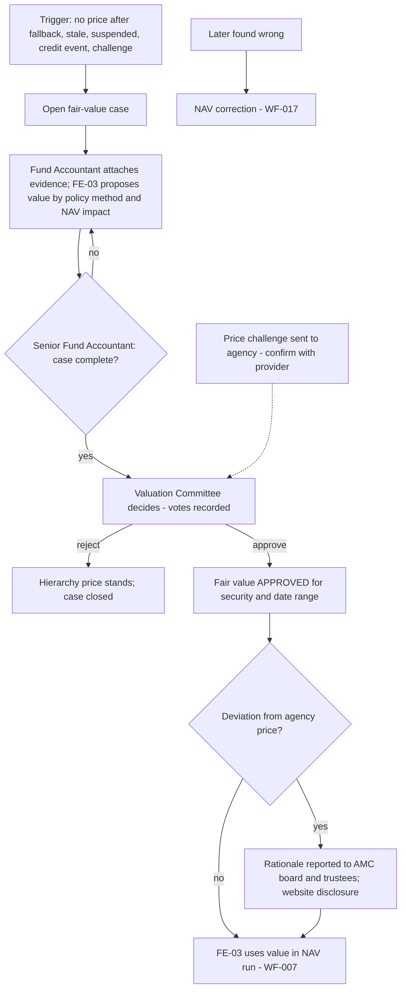

# PRD-011 — Valuation and NAV (D11)

This document states what AMC OS must do to price every holding from an approved source, value securities that have no reliable market price under an approved policy, and compute, validate, approve and publish the NAV of every plan and option each business day — or, where the custodian computes the NAV, receive it, recompute it independently and reconcile it before the AMC accepts it (owner decision D-16). It re-keys PRD-000 v0.9 Module 09 to the GOV-001 identifiers (`FR-09-nn` → `FR-D11-nnn`, `BR-09-n` → `BRL-D11-nnn`, Module 09 and Chapter 5 stories → `US-D11-nnn`) and adds requirements for the BA-001 D11 capabilities that had no v0.9 source or only a partial one: price-source management (CAP-D11-003), fair valuation workflows (CAP-D11-005, only a phrase in FR-09-03) and NAV reconciliation (CAP-D11-015). It also adds the end-to-end workflow D11 was missing (BA-004 §5.1): **WF-035 Fair valuation and price challenge** (§6.2).

**Builds on Draft documents:** [PRD-000 v0.9](PRD-000_master_prd_v0.9.md) Module 09, Chapter 4 (W7, W17), Chapter 5, Chapter 6, Chapter 7, Chapter 9, Appendix A (R15); [BA-001](../02_business_architecture/BA-001_business_capability_map.md) D11, §4; [BA-002](../02_business_architecture/BA-002_amc_operating_model.md) §2, §4, §5, §7; [BA-003](../02_business_architecture/BA-003_domain_dictionary.md) TERM-034, TERM-055, TERM-087, TERM-089; [BA-004](../02_business_architecture/BA-004_end_to_end_workflows.md) WF-007, WF-017, §5; [BA-005](../02_business_architecture/BA-005_roles_and_permissions.md) §3–§5; [PRD-004](PRD-004_portfolio_management.md) BRL-D04-002 — allowed by owner decision D-3 ([GOV-008](../00_governance/GOV-008_build_loop.md) §2 rule 3). No document used here is Approved. PRD-010 Fund Accounting, PRD-012 Fund Operations and PRD-013 Investor Management are written in the same step (Step 9a) and supply the trial balance and accruals, the reconciliation engine and the RTA unit mirror that D11 uses. Owner decisions D-44…D-47 (answers Q38–Q41, 21 Nov 2026) are applied ([LOOP_STATE.md](../../LOOP_STATE.md)).

**What this document is not:** the NAV formula, rounding steps and test values (FE-01) and the valuation methods per asset class (FE-03), both specified in Step 20 — no formula is written here; accrual calculation and posting (D10, CAP-D10-005); the reconciliation engine and break workflow (D12, CAP-D12-003, FE-07); investor transactions and unit allotment, which the RTA does and AMC OS mirrors (D13, owner decision Q2); market and index data acquisition (D16). **Rule for engineers (PRD-000):** no regulatory number, tolerance, deadline or decimal convention is hard-coded; each is a versioned parameter or tenant configuration (PRD-001 FR-D01-033). Every official price, value and NAV comes from FE-01 or FE-03, never from AI (master prompt §3.1).

## 1. Scope

| In scope (CAP) | Out of scope |
| --- | --- |
| CAP-D11-001 Security prices · CAP-D11-002 Price validation · CAP-D11-003 Price-source management · CAP-D11-004 Valuation policies · CAP-D11-005 Fair valuation workflows · CAP-D11-006 Accrued income · CAP-D11-007 Accrued expenses · CAP-D11-008 Assets and liabilities · CAP-D11-009 Unit balances · CAP-D11-010 NAV calculations · CAP-D11-011 NAV validation · CAP-D11-012 NAV approvals · CAP-D11-013 NAV publication · CAP-D11-014 Historical NAV · CAP-D11-015 NAV reconciliation | Accrual calculation (D10; D11 only includes the results — BA-001 §4); the reconciliation engine (D12; D11 defines its NAV reconciliation set); investor-level units and reprocessing after a NAV correction (RTA, mirrored in D13); security and issuer golden records (D16 CAP-D16-004); risk measures (D09); iNAV for ETFs during market hours (no BA-001 capability — open point C9); AI that values, approves or publishes (ADR-0008) |

**Two operating modes (owner decision D-16).** Each scheme has an effective-dated **NAV mode** (FR-D11-021): **in-house** — AMC OS is the NAV engine of record (FE-01, FE-03), the Fund Accountant prepares and the Head of Fund Accounting approves; **outsourced** — the custodian (as fund accountant) computes the NAV, AMC OS mirrors it with its components, recomputes a **shadow NAV** from its own inputs, reconciles the two (CAP-D11-015) and records the AMC's acceptance. In the outsourced mode the AMC accepts the custodian's NAV in AMC OS after the checks; who submits it to AMFI is a tenant setting (owner decision D-44; BA-004 WF-007 variant). Requirements below apply to both modes unless they say otherwise.

## 2. Re-keying from PRD-000 Module 09

| PRD-000 v0.9 | Here | Note |
| --- | --- | --- |
| FR-09-01 … FR-09-13 | FR-D11-001 … FR-D11-013 | Same order; capability references added. Wording kept for FR-D11-004, -006, -010, -012. **Wording extended** **[DES]** for: FR-D11-001 (sources come from the approved source hierarchy, FR-D11-014; providers "Confirm with provider"); FR-D11-002 (tolerances are tenant configuration with no shipped values); FR-D11-003 (fair-value overrides go through WF-035; gold and silver method sourced [S6]); FR-D11-005 (accruals are never recomputed in D11, BA-001 §4); FR-D11-007 (units from the D13 RTA mirror); FR-D11-008 (formula left to FE-01; decimals **[VAL]** [S7]); FR-D11-009 (in the outsourced mode the same gates run on the shadow NAV); FR-D11-011 (deadline sourced [S4]); FR-D11-013 (investor reprocessing by the RTA; thresholds **[VAL]**) |
| NAV run states (Module 09) | §4.1 note under FR-D11-008 | Kept unchanged; they match DDL-000 `nav.nav_run` |
| BR-09-1 … BR-09-4 | BRL-D11-001 … BRL-D11-004 | Labels added where PRD-000 had none |
| Module 09 point 7 stories (Head FA all checks green; Compliance reproduces last March's NAV) | US-D11-001, US-D11-002 | **Merged** with Ch 5 US-NAV-01 and US-NAV-02, which had no own criterion ("See Module 09 AC") |
| Ch 5 US-NAV-03 (FM AI explanation of NAV movement) | US-D11-003 | Criterion kept as AC-US-D11-003-1 |
| Module 09 point 18 acceptance criteria | AC-US-D11-002-1 (reconstruction), AC-US-D11-001-1 (failed validation) | |
| Module 09 points 4, 13 roles and approvals; Ch 6 NAV column, SOD-02 | §7 (from BA-005, which re-keyed them) | "Valuation Committee (policy)" kept as a committee, not a role (BA-005 §2) |
| Module 09 points 14–17; Ch 9 NAV Operations Agent | §9, NFR-PERF-016, NFR-PERF-017, NFR-AUD-011, §12 | Agent renamed NAV operations assistant (CAP-D17-007), as in BA-004 |
| Ch 4 W7, W17 | WF-007, WF-017 (already re-keyed in BA-004) | §6.1 |
| Appendix A R15 (valuation norms; gold and silver from 1 Apr 2026) | FR-D11-003, §5 note, [S3], [S6] | Gold and silver circular now cited |
| — | FR-D11-014 … FR-D11-025, BRL-D11-005 … 010, US-D11-004 … 010, WF-035 | **New** **[DES]** |

## 3. Business requirements

| ID | Business requirement | Capabilities |
| --- | --- | --- |
| BR-D11-001 | Every plan and option has a correct NAV each business day, approved by a person other than the preparer, published on time, and reproducible later | CAP-D11-008 … -013 |
| BR-D11-002 | Every price used comes from an approved source in a known order of preference, is validated, and its source and fallback are recorded | CAP-D11-001, -002, -003 |
| BR-D11-003 | A security without a reliable market price is valued under the approved valuation policy, and the fair value is approved by the Valuation Committee with evidence | CAP-D11-004, -005 |
| BR-D11-004 | Where the custodian computes the NAV, the AMC checks it independently before accepting it | CAP-D11-015 |
| BR-D11-005 | An error in a published NAV is measured, corrected, approved and reported, and the original is never lost | CAP-D11-014 |

## 4. Functional requirements

Every requirement also obeys PRD-000 common rules C1–C8. Labels from PRD-000 are carried unchanged unless the change is stated. Priority: **M** must (release-blocking), **S** should — as PRD-000 Chapter 3.

### 4.1 Re-keyed from PRD-000 Module 09

| ID (was) | Pri | Capability | Requirement |
| --- | --- | --- | --- |
| FR-D11-001 (FR-09-01) | M | CAP-D11-001 (.1) | **Price ingestion:** exchange closing prices (NSE, BSE), valuation-agency prices for debt and money-market securities (agencies appointed by AMFI [S3]), FX rates, index levels, overseas prices — each from a source in the approved hierarchy (FR-D11-014), through D16 adapters. **[REG — debt valuation by agencies [S3]; VAL agency list and current clause]**. Formats: "Confirm with provider" (INT-001, Step 14) |
| FR-D11-002 (FR-09-02) | M | CAP-D11-002 (.1), (.2) | **Price validation:** stale check (unchanged for N days), tolerance vs previous day and vs alternate source, missing price, corporate-action adjustment check. N and the tolerances are tenant configuration per asset class, set by each AMC; AMC OS ships no values **[DES]** (owner decision D-46). A price override is maker-checker (`valuation.price.override`, BA-005 §4) |
| FR-D11-003 (FR-09-03) | M | CAP-D11-004 (.1), CAP-D11-005, CAP-D11-010 (.1) | **Security valuation:** valuation hierarchy per instrument type under the versioned valuation policy (FR-D11-016); fair-value overrides with justification only through WF-035. Physical gold and silver are valued at polled domestic exchange spot prices from 1 Apr 2026 [S6] **[REG; method detail VAL — FE-03]** |
| FR-D11-004 (FR-09-04) | M | CAP-D11-010 (.1) | **Holdings valuation:** quantity × price (+ accrued interest), FX conversion |
| FR-D11-005 (FR-09-05) | M | CAP-D11-006, CAP-D11-007 | **Income and expense accrual:** consumed from the D10 accrual runs for the day (CAP-D10-005); D11 never recomputes an accrual (BA-001 §4) |
| FR-D11-006 (FR-09-06) | M | CAP-D11-008 | **Assets and liabilities:** all balance-sheet lines from the trial balance as of the NAV date |
| FR-D11-007 (FR-09-07) | M | CAP-D11-009 | **Units outstanding:** from the RTA capital-stock feed mirrored in D13 (CAP-D13-011) for the NAV date, per plan and option; provisional units allowed with a flag (WF-007) |
| FR-D11-008 (FR-09-08) | M | CAP-D11-010 (.2) | **NAV calculation:** NAV per unit (TERM-055) per plan and option, with plan-level expense allocation, by the deterministic engine FE-01 with `NUMERIC` precision and rounding only at the final step. Formula, allocation method and rounding mode are FE-01 (Step 20); decimals per scheme are configuration **[VAL]** ([S7]; PRD-000 C5) |
| FR-D11-009 (FR-09-09) | M | CAP-D11-011 (.1) | **NAV validation:** day-on-day change vs benchmark move (tolerance band), change vs other plans of the same scheme, trial balance balanced, all prices validated, all trades booked, reconciliation breaks above materiality closed or acknowledged, units reconciled with the RTA. In the outsourced mode the gates run on the shadow NAV and the custodian reconciliation is one more gate (FR-D11-020) |
| FR-D11-010 (FR-09-10) | M | CAP-D11-012 (.1) | **NAV approval:** maker-checker; the approver sees validation results and the AI-written explanation of movement |
| FR-D11-011 (FR-09-11) | M | CAP-D11-013 (.1) | **NAV publication:** to the RTA, AMFI and the website (and exchanges for ETFs) by the regulatory deadline — 11 p.m. on the business day for most schemes and 10 a.m. the next business day for schemes investing at least 80% overseas, per SEBI circular of 29 Mar 2023 [S4] **[REG; VAL whether unchanged under the 2026 Master Circular [S2]]**; status per channel with acknowledgment. AMFI upload method: "Confirm with AMFI" |
| FR-D11-012 (FR-09-12) | M | CAP-D11-014 (.1) | **Historical NAV reconstruction:** recompute NAV for any past date using stored versions of prices, holdings snapshot, trial balance and rules; must equal the published NAV unless a correction exists |
| FR-D11-013 (FR-09-13) | M | CAP-D11-014 (.2) | **NAV correction and audit:** error identification, impact per affected transaction, materiality test vs threshold, investor compensation calculation, reprocessing by the RTA (mirrored, Q2), regulatory and Trustee reporting (WF-017). **[REG — NAV error treatment; VAL thresholds]** — no source found in this step |

**NAV run states (PRD-000 Module 09, unchanged):** `INITIATED → DATA_COLLECTED → CALCULATED → VALIDATION_FAILED | VALIDATED → PENDING_APPROVAL → APPROVED → PUBLISHING → PUBLISHED`; `SUPERSEDED` when a correction run replaces it; `CANCELLED` before approval.

### 4.2 New requirements **[DES]**

| ID | Pri | Capability | Requirement |
| --- | --- | --- | --- |
| FR-D11-014 | M | CAP-D11-003 (.1) | **Source hierarchy:** per asset class (and, where needed, per security), an ordered list of approved price sources (exchange, valuation agency, vendor, fair value). The hierarchy is versioned, effective-dated and approved by the Head of Fund Accounting through WF-021; a change to the order for a regulated asset class also needs Valuation Committee approval (BRL-D11-007) |
| FR-D11-015 | M | CAP-D11-003 (.2) | **Precedence and fallback:** for each security and date the engine takes the first source that has a validated price; if none, it falls back down the hierarchy and, at the end, raises a fair-value case (WF-035). Every price used records its source, fallback level and validation outcome (BRL-D11-005) |
| FR-D11-016 | M | CAP-D11-004 (.1), (.2) | **Valuation policy record:** the AMC's valuation policy is a versioned record (methods per asset class, source hierarchy reference, fair-value triggers, approver, effective date, document link in CAP-D12-010). A new version needs Valuation Committee approval; whether board and trustee approval is also needed is **[VAL]** (open point C2). FE-03 reads the active version; past NAVs use the version then in force |
| FR-D11-017 | M | CAP-D11-005 (.1) | **Fair-value case:** opened automatically when no validated price exists after fallback, a price is stale beyond the configured days, a security is suspended or not traded, or a credit event is flagged; or manually by a price challenge (FR-D11-019). The case holds the trigger, the proposed method from the policy, evidence, the proposed value and its NAV impact computed by FE-03, and the proposer (WF-035) |
| FR-D11-018 | M | CAP-D11-005 (.2) | **Valuation Committee decision:** a fair value or a deviation from the agency price is used in an approved NAV only after a recorded Valuation Committee decision (members, quorum and votes as tenant configuration, BA-002 §2). A deviation from the agency price records the rationale, is reported to the AMC board and trustees, and is disclosed on the website [S3] **[REG via SEBI circular of 24 Sep 2019; VAL current form]**. There is no delegate: an urgent fair value between meetings also needs a recorded Valuation Committee decision (owner decision D-45) |
| FR-D11-019 | S | CAP-D11-005 (.1), CAP-D11-002 | **Price challenge:** a Fund Accountant, Fund Manager or Risk Manager may challenge a received price with reason and evidence; the challenge opens a fair-value case. Sending a challenge to a valuation agency and receiving its answer is outside AMC OS until the agency's process is known — "Confirm with provider" (INT-001, Step 14) |
| FR-D11-020 | M | CAP-D11-015 (.1) | **NAV reconciliation (outsourced mode):** receive the custodian's NAV per plan and option with its components (net assets, units, prices, accruals) — "Confirm with custodian" for format; compute the shadow NAV (FE-01); reconcile NAV, net assets, units and each component through the D12 engine (FE-07, CAP-D12-003) with the D11 reconciliation set; differences above tolerance become breaks; the custodian NAV is accepted only when BRL-D11-008 holds |
| FR-D11-021 | M | CAP-D11-010, CAP-D11-012, CAP-D11-013, CAP-D11-015 | **NAV mode per scheme:** each scheme has an effective-dated mode `IN_HOUSE`, `OUTSOURCED` or `PARALLEL_RUN` (configuration, WF-021). In `PARALLEL_RUN` both NAVs are computed and reconciled but only the incumbent's is official — used for the parallel NAV run of at least 3 months before go-live (PS-001 O5, D-12) (PRD-000 Ch 10, P4). There is exactly one official NAV source per scheme and date (BRL-D11-010) |
| FR-D11-022 | M | CAP-D11-011 (.2) | **Movement explanation data:** FE-01 stores the day-on-day change of each NAV split by component (price moves by asset class, income, expenses, flows effect) so that any explanation, human or AI, can only quote stored figures (US-D11-003) |
| FR-D11-023 | M | CAP-D11-013 (.1) | **Publication deadline monitor:** each channel has a configured deadline (FR-D11-011); an alert goes to the Head of Fund Accounting and the COO at a configured time before it if the NAV is not `PUBLISHED`; a manual upload is recorded with who, when, channel and acknowledgment reference |
| FR-D11-024 | S | CAP-D11-002, CAP-D17-015 | **Price anomaly flags:** an ML anomaly flag on prices may be shown next to the deterministic checks, labelled as a prediction; it never changes a price, a check result or a NAV (BRL-D11-004) |
| FR-D11-025 | S | CAP-D11-010 (.2), CAP-D11-013 | **Swing pricing (not in release 1):** SEBI's swing pricing framework for open-ended debt schemes (optional in normal times; mandatory full swing for some schemes when SEBI declares market dislocation [S5]) **[REG; VAL current form and factors]** — not supported in release 1 (owner decision D-47): AMC OS records a market-dislocation declaration and blocks a swung NAV |

## 5. Business rules

| ID (was) | Rule | Label |
| --- | --- | --- |
| BRL-D11-001 (BR-09-1) | Only one `APPROVED` NAV per plan per date that is not `SUPERSEDED` | **[DES]** (PRD-000 unlabelled); enforced in DDL-000 `nav_run_one_live_ux` |
| BRL-D11-002 (BR-09-2) | Published NAVs are never deleted or updated; corrections create a new run linked to the original | **[DES]**; DDL-000 `nav_run_guard` |
| BRL-D11-003 (BR-09-3) | Approver ≠ preparer; the approver cannot hold the Dealer or Fund Manager role in the same tenant (SOD-02) | **[DES]** (PRD-000 SOD-02) |
| BRL-D11-004 (BR-09-4) | An AI agent may never call approve or publish endpoints; its service identity lacks those scopes (SOD-10) | **[DES]** |
| BRL-D11-005 | No price enters an approved NAV without a recorded source, fallback level and a `PASS` validation, an approved override, or an approved fair value | **[DES]** |
| BRL-D11-006 | A fair value or a deviation from the agency price is used only after a recorded Valuation Committee decision; the deviation rationale is reported to the AMC board and trustees and disclosed on the website | **[REG]** [S3] (secondary) for deviation reporting; committee step **[IND]** (BA-002 §2) |
| BRL-D11-007 | Valuation policy versions and changes to the source order for a regulated asset class need Valuation Committee approval; further board or trustee approval **[VAL]** | **[IND]**; **[VAL]** |
| BRL-D11-008 | In the outsourced mode the AMC accepts the custodian's NAV only when no break above tolerance is open, or each open break has an approved waiver | **[DES]** |
| BRL-D11-009 | Stale days, price tolerances, NAV tolerance bands, materiality thresholds, reconciliation tolerances and deadline-alert times are tenant configuration approved through WF-021; AMC OS ships no values (regulatory parameters checked by Compliance, SOD-12) | **[DES]**; values set by each AMC (owner decision D-46) |
| BRL-D11-010 | One official NAV source per scheme and date (the configured mode); a shadow NAV is labelled "shadow" and is never published | **[DES]** |

**Regulatory note (valuation and NAV).** SEBI's circular of 24 Sep 2019 [S3] (secondary summary) requires money-market and debt securities to be valued at the average of prices from agencies appointed by AMFI, ended amortisation-based valuation from 1 Apr 2020, requires the rationale for each deviation to be recorded, reported to the AMC board and trustees and disclosed on the website, and moved the NAV upload time to 11 p.m.; SEBI's circular of 29 Mar 2023 [S4] keeps 11 p.m. on the business day for most schemes and sets 10 a.m. the next business day for schemes with at least 80% overseas. Physical gold and silver are valued at polled domestic exchange spot prices from 1 Apr 2026 [S6]. A 2002 SEBI circular set NAV decimals by scheme type [S7]; current practice may differ. These sources predate or sit beside the SEBI (Mutual Funds) Regulations, 2026 [S1] and the Master Circular of 20 Mar 2026 [S2]; which clauses still apply, in which form, is **[VAL]** (REG-001, Step 25). No numeric tolerance from these sources (for example the amortisation band in [S3]) is used here, and none is hard-coded.

## 6. Workflows

### 6.1 Existing workflows

| Workflow | D11 role | Requirements |
| --- | --- | --- |
| [WF-007](../02_business_architecture/BA-004_end_to_end_workflows.md) Daily NAV | Owner (DEP-07); outsourced-mode variant per D-16 | FR-D11-001 … -011, -014, -015, -020 … -023 |
| WF-017 NAV correction | Owner; reconstruction and correction run | FR-D11-012, FR-D11-013 |
| WF-001 Scheme launch (NFO) | NAV series starts when the scheme becomes `ACTIVE` | FR-D11-008, FR-D11-021 |
| WF-010 / WF-011 Investor purchase and redemption | Supplies the applicable NAV the RTA uses; the RTA allots units | FR-D11-011 |
| WF-015 Reconciliation | Runs the D11 NAV reconciliation set and unit reconciliation | FR-D11-009, FR-D11-020 |
| WF-021 Configuration change | Source hierarchy, tolerances, NAV mode, deadlines | FR-D11-014, FR-D11-021, BRL-D11-009 |
| WF-033 Daily risk run | Starts after NAV approval | FR-D11-010 |
| WF-035 Fair valuation and price challenge | Owner (new, §6.2) | FR-D11-015 … -019 |

### 6.2 WF-035 — Fair valuation and price challenge **[DES]**

| Field | Detail |
| --- | --- |
| Trigger | No validated price after fallback (FR-D11-015); price stale beyond the configured days; security suspended, not traded or hit by a credit event; a price challenge (FR-D11-019); or a proposed deviation from the agency price |
| Initiator | System (automatic triggers) or a Fund Accountant, Fund Manager or Risk Manager (challenge); a Fund Accountant (valuation team) owns the case |
| Departments | **DEP-07 Fund accounting and NAV** — accountable for D11 (BA-002 §4); Valuation Committee (decides); DEP-11 and DEP-04 (credit and market evidence); DEP-02 / DEP-03 (fund manager view); DEP-09 (compliance with policy); DEP-10 (board and trustee reporting); DEP-13 (website disclosure) |
| Capabilities | CAP-D11-005, CAP-D11-004, CAP-D11-003, CAP-D11-002, CAP-D11-010 (.1), CAP-D12-011, CAP-D12-010, CAP-D16-004, CAP-D09-002, CAP-D08-013, CAP-D17-007 |
| Hand-offs (outside) | Valuation agencies (agency price in; challenge out and answer in — "Confirm with provider"); AMC board and trustees (deviation report); AMC website (deviation disclosure) |
| Preconditions | Active valuation policy version (FR-D11-016); source hierarchy for the asset class (FR-D11-014); Valuation Committee membership configured |
| Final state | Fair value `APPROVED` for the security and date range, or `REJECTED` (the hierarchy price stands); the value used by FE-03 for that NAV; deviation reported and disclosed where it applies; case closed with evidence |
| Approvals | Proposer (Fund Accountant) ≠ checker (Senior Fund Accountant) for completeness; Valuation Committee decision (BRL-D11-006); no delegate, also for urgent decisions between meetings (D-45) |
| Exceptions | No decision before the NAV cut-off → NAV held in `PENDING_APPROVAL` for the scheme, Head of Fund Accounting and COO alerted, prior approved fair value or last validated price used only if the policy allows **[VAL]**; challenge rejected by the agency → committee decides with both views; fair value reversed later → NAV correction (WF-017) |
| Audit | Trigger, evidence, method and policy version, proposed and approved values, NAV impact, votes, report to board and trustees, website disclosure, valuation-agency correspondence, NAV operations assistant drafts |
| Source | **new** (BA-004 §5.1 D11 gap; BA-001 CAP-D11-005; PRD-000 Module 09 points 4, 13, 14) |

The NAV operations assistant may summarise the evidence for the committee (read-only); it never proposes the value used (FE-03 does) and never votes.

## 7. Permissions by capability

From BA-005 §3 (D11 column) and §4, narrowed to each capability (BA-005 §7 C2). Checker ≠ maker (SOD-01). The Fund Accountant holds "R C S (A Head FA)" in D11; the COO "R A J"; the Compliance Officer "R A(correction)"; the CEO "R A(material correction)". CIO, CFO, Risk Manager, Product Manager, Distributor Manager, RM, Investor Service Executive and Operations Analyst read; the Fund Manager reads own schemes; the Auditor reads and exports (BA-005 §3). Dealer, Research Analyst and Technology Administrator have no D11 right (—). Valuation Committee membership is an attribute, not a role (BA-005 §2).

| Capability | Maker | Checker(s) |
| --- | --- | --- |
| CAP-D11-001, -006 … -009, -010 | System (FE-01, FE-03); Fund Accountant runs and re-runs | — |
| CAP-D11-002 price override | Fund Accountant | Senior Fund Accountant (`valuation.price.override`) |
| CAP-D11-003 source hierarchy | Fund Accountant proposes | Head of Fund Accounting (WF-021); Valuation Committee for regulated asset classes (BRL-D11-007)† |
| CAP-D11-004 valuation policy | Fund Accountant (Head of Fund Accounting) drafts | Valuation Committee† (board / trustees **[VAL]**) |
| CAP-D11-005 fair-value case | Fund Accountant; challenge by Fund Manager on own schemes or Risk Manager† | Senior Fund Accountant (completeness)†, then Valuation Committee |
| CAP-D11-011, -012 NAV approval | Fund Accountant (preparer) | Head of Fund Accounting (`nav.run.approve`, SOD-02) |
| CAP-D11-013 publication | System after approval; Fund Accountant records a manual upload† | — |
| CAP-D11-014 NAV correction | Fund Accountant or Compliance Officer | Head of Fund Accounting and Compliance Officer; CEO as well above materiality (BRL-D11-009; BA-005 §3 "A(material correction)" — BA-005 §4 lists the CEO without the condition, open point for the next BA-005 revision) (`nav.correction.approve`) |
| CAP-D11-015 custodian NAV acceptance (outsourced) | Fund Accountant | Head of Fund Accounting† (acceptance after checks, D-44); AMFI submission by the party set per tenant (D-44) |

**Rights added beyond BA-005 (†)** **[DES]**: the Valuation Committee as checker of source order and policy (BA-005 §4 lists it only for fair values in WF-007); a Senior Fund Accountant completeness check on fair-value cases; price challenge by the Fund Manager and Risk Manager, whose D11 cells are "R own" and "R"; recording a manual publication; acceptance of the custodian NAV in the outsourced mode (open point C5).

## 8. User stories and acceptance criteria

Priority: **C** critical (release-blocking), **O** optional — as PRD-000 Chapter 5.

| ID | Story | Pri | Acceptance criteria (Given / When / Then) |
| --- | --- | --- | --- |
| US-D11-001 (was Module 09 point 7; US-NAV-01) | As Head of Fund Accounting, I want all validation checks green before I approve, so that I approve with confidence | C | **AC-US-D11-001-1** (was Module 09 point 18) Given a NAV run with a failed validation, when approval is attempted, then it is refused unless each failure has an approved waiver. |
| US-D11-002 (was Module 09 point 7; US-NAV-02) | As a Compliance Officer, I want to reproduce last March's NAV exactly, so that I can answer a SEBI query | C | **AC-US-D11-002-1** (was Module 09 point 18) Given stored inputs for date D, when NAV is reconstructed, then it equals the published NAV to all stored decimals. |
| US-D11-003 (was US-NAV-03) | As an FM, I want an AI explanation of NAV movement | O | **AC-US-D11-003-1** (was US-NAV-03) Given an approved NAV, when the explanation is shown, then every number in it equals a stored NAV component (FR-D11-022). |
| US-D11-004 | As a Valuation Committee member, I want every fair value to come to us with evidence and impact | C | **AC-US-D11-004-1** Given a fair-value case without a committee decision, when a NAV run tries to use the proposed value, then the run uses the hierarchy price or stays `PENDING_APPROVAL`, and the proposed value is not used. |
| US-D11-005 | As Head of Fund Accounting in an outsourced AMC, I want the custodian's NAV checked before I accept it | C | **AC-US-D11-005-1** Given a custodian NAV whose net assets differ from the shadow NAV by more than the configured tolerance, when acceptance is attempted, then it is refused until the break is resolved or waived with approval. |
| US-D11-006 | As a Fund Accountant, I want to know which source each price came from | C | **AC-US-D11-006-1** Given the first source has no price for a security, when the run collects prices, then the next source in the hierarchy is used and the price records source and fallback level. |
| US-D11-007 | As the COO, I want warning before a NAV deadline is missed | C | **AC-US-D11-007-1** Given a scheme not `PUBLISHED` at the configured alert time, when the time passes, then the Head of Fund Accounting and the COO are alerted and the alert is logged. |
| US-D11-008 | As Compliance, I want AI kept away from NAV approval | C | **AC-US-D11-008-1** Given an AI agent identity, when it calls the approve or publish endpoint, then the call is refused (HTTP 403) and audited. |
| US-D11-009 | As a Compliance Officer, I want deviations from agency prices reported | C | **AC-US-D11-009-1** Given an approved deviation from the agency price, when it is approved, then a board and trustee report item and a website disclosure task are created with ISIN, prices and NAV impact. |
| US-D11-010 | As an Auditor, I want shadow NAVs never published | C | **AC-US-D11-010-1** Given a scheme in `OUTSOURCED` or `PARALLEL_RUN` mode, when publication runs, then only the official NAV is sent and the shadow NAV stays labelled "shadow". |

Definition of done: as PRD-000 Chapter 5.

## 9. Exceptions

| Exception | Handling | Source |
| --- | --- | --- |
| Price missing at cut-off | Fallback hierarchy, then fair-value case and Valuation Committee approval (WF-035) | PRD-000 Module 09 point 14 |
| RTA units late | Provisional units flagged; re-run when final units arrive | PRD-000 Module 09 point 14 |
| Publication channel failure | Retry and alert; manual upload as fallback, recorded (FR-D11-023) | PRD-000 Module 09 point 14 |
| Custodian NAV late or missing (outsourced) | Alert; no acceptance; escalate to Head of Fund Accounting and COO | **[DES]** |
| Custodian NAV break above tolerance | Break in WF-015; acceptance blocked (BRL-D11-008) | **[DES]** |
| Fair value not decided in time | NAV held; alert; policy fallback only if allowed **[VAL]** | **[DES]** |
| Error found after publication | WF-017 | PRD-000 W17 |

## 10. Data and interfaces

**Owned schemas:** `valuation` and `nav` (GOV-001 §3). Reads trial balance and accruals (D10), units (D13 mirror), snapshots (D04), security master (D16), reconciliation results (D12) through APIs or events. No database change is made in this step.

| Exists in DDL-000 | Not yet in DDL-000 (for DA-001 / DDL, Steps 15–16) **[DES]** |
| --- | --- |
| `valuation.price` (by source, with `FAIR_VALUE` and `OVERRIDE` types and validation flags); `nav.nav_run` (states, `CORRECTION` / `RECONSTRUCTION` kinds, SOD-02 check, input manifest); `nav.nav_result` (per plan; `nav_unrounded` is held at 12 decimals, then the published NAV is rounded to 6, 4 or 2 decimals — FE-01, Step 20, confirms); `nav.nav_validation` (with waiver); `nav.nav_publication` (per channel and attempt) | Source hierarchy versions; price overrides with maker-checker; valuation policy versions; fair-value cases, evidence and committee decisions; deviation reports; NAV mode per scheme; custodian NAV and components and shadow NAV; NAV movement components; publication deadlines. DDL-000 `nav_run` is per scheme while results are per plan — fine for FE-01 to confirm |

**Interfaces (indicative, not contracts):** PRD-000 Module 09 point 11 names `nav-svc` `/nav-runs`, `/nav-runs/{id}/validate`, `/approve`, `/publish`, `/navs?plan&date`, `/nav-corrections` and `valuation-svc` `/prices`, `/price-overrides`, `/valuations`; this PRD adds fair-value cases, valuation policy, source hierarchy and custodian NAV. Names become `API-D11-nnn` in Step 24 and events `<NAME>.v<n>` in EA-007 (Step 13). Outside parties: exchanges, valuation agencies, custodians, RTA and AMFI — "Confirm with provider" (INT-001, Step 14).

## 11. Non-functional requirements

| ID | Requirement | Type / source |
| --- | --- | --- |
| NFR-PERF-016 | NAV for 500 plans computed in < 10 min after data complete (also the shadow NAV in outsourced mode) | Proposed — PRD-000 Module 09 point 17 |
| NFR-PERF-017 | Reconstruction of any past date < 2 min per scheme | Proposed — PRD-000 Module 09 point 17 |
| NFR-AUD-011 | Every NAV component stored with input hashes and versions; every price with source and fallback level; every override, fair value, committee decision, custodian reconciliation and publication acknowledgment recorded | PRD-000 Module 09 point 15; **[DES]** |

Platform NFRs in PRD-001 §11 apply; PRD-000 Ch 7 "Reproducibility" and "Precision" rows are mandatory for D11.

## 12. AI in this domain

Within PRD-000 C8 and [ADR-0008](../../architecture/adrs/ADR-0008_ai_boundary.md) (read and propose only). The **NAV operations assistant** (CAP-D17-007) summarises pre-approval checks and drafts the movement explanation from stored FE-01 components (FR-D11-022); it may summarise fair-value evidence for the committee. It never computes a price, value or NAV, never approves, never publishes and never votes (BRL-D11-004, SOD-10). **Anomaly detection** (CAP-D17-015) flags prices as an additional signal only (FR-D11-024).

## 13. Open points

| # | Point | Where closed |
| --- | --- | --- |
| C1 | Valuation methods, deviation reporting, NAV deadlines, decimals, NAV error thresholds and compensation, swing pricing: which pre-2026 circulars still apply under the 2026 Regulations and Master Circular **[VAL]** | REG-001 (Step 25); FE-01, FE-03 (Step 20) |
| C2 | Whether the valuation policy also needs board or trustee approval **[VAL]** | REG-001 (Step 25) |
| C3 | Outsourced mode: who approves and publishes the NAV — closed by owner decision D-44 (AMC accepts in AMC OS after checks; AMFI submitter set per tenant) | Tenant setting at onboarding |
| C4 | Valuation Committee delegate — closed by owner decision D-45 (always a recorded committee decision; no delegate); members and quorum stay tenant configuration | Tenant setting |
| C5 | Rights added in §7 (†) are not in BA-005 | Next BA-005 revision |
| C6 | Stale days, tolerances, materiality and reconciliation tolerances, alert times — closed by owner decision D-46 (set by each AMC; AMC OS ships no values) | Tenant settings at onboarding |
| C7 | Swing pricing in the first release — closed by owner decision D-47 (not in release 1; a swung NAV is blocked) | Later release |
| C8 | Price-challenge exchange with valuation agencies; custodian NAV file format — "Confirm with provider" | INT-001 (Step 14) |
| C9 | iNAV for ETFs during market hours has no BA-001 capability | Next BA-001 revision |
| C10 | Tables in §10 not yet in DDL-000 | DA-001 / DDL (Steps 15–16) |
| C11 | BA-004 register gets WF-035 (row added in this step); full card lives here until BA-004's next revision | Next BA-004 revision |

## Sources

Repository sources: [PRD-000 v0.9](PRD-000_master_prd_v0.9.md) Module 09, Ch 4–7, 9, Appendix A; [BA-001](../02_business_architecture/BA-001_business_capability_map.md) D11, §4; [BA-002](../02_business_architecture/BA-002_amc_operating_model.md) §2 (Valuation Committee), §4, §5, §7; [BA-003](../02_business_architecture/BA-003_domain_dictionary.md); [BA-004](../02_business_architecture/BA-004_end_to_end_workflows.md) WF-007 (D-16 variant), WF-017, §5.1; [BA-005](../02_business_architecture/BA-005_roles_and_permissions.md) §3–§5; [DA-000](../05_data_architecture/DA-000_data_and_database_architecture_v0.9.md) and [DDL-000](../../database/ddl/DDL-000_core_schema_v0.9.sql) (`valuation`, `nav` tables); [LOOP_STATE.md](../../LOOP_STATE.md) owner decisions D-3, D-16, D-44…D-47.

External sources (opened through web search on 21 Nov 2026 unless stated; regulatory detail still **[VAL]**):

| # | Source | Used for |
| --- | --- | --- |
| S1 | [SEBI — SEBI (Mutual Funds) Regulations, 2026](https://www.sebi.gov.in/legal/regulations/apr-2026/securities-and-exchange-board-of-india-mutual-funds-regulations-2026_100744.html) — primary, not opened (as BA-002 S1) | Current rulebook |
| S2 | [SEBI — Master Circular for Mutual Funds, 20 Mar 2026](https://www.sebi.gov.in/legal/master-circulars/mar-2026/master-circular-for-mutual-funds_100491.html) — primary, not read clause by clause (as PRD-000 Appendix A R4) | Consolidated circulars |
| S3 | [TaxGuru — SEBI circular SEBI/HO/IMD/DF4/CIR/P/2019/102 on valuation of money-market and debt securities (24 Sep 2019)](https://taxguru.in/sebi/valuation-money-market-debt-securities.html) — secondary | AMFI-appointed agencies, end of amortisation, deviation recording, board and trustee reporting, website disclosure, 11 p.m. upload |
| S4 | [SEBI circular SEBI/HO/IMD/IMD-I POD2/P/CIR/2023/48 — review of time limit for disclosure of NAV (29 Mar 2023), AMFI copy](https://www.amfiindia.com/uploads/Reviewoftimelimitfordisclosureof_NAV_f5ebc65062.pdf) — primary | NAV disclosure deadlines |
| S5 | [SCC Online — SEBI circular on swing pricing framework (29 Sep 2021)](https://www.scconline.com/blog/post/2021/09/30/sebi-issues-circular-on-swing-pricing-framework-for-mutual-fund-schemes/) — secondary | Swing pricing scope, from 1 Mar 2022 |
| S6 | [SEBI circular HO/(68)2026-IMD-POD-2/I/5780/2026 — valuation of physical gold and silver (26 Feb 2026)](https://www.sebi.gov.in/sebi_data/attachdocs/feb-2026/1772102397057.pdf) — primary | Gold and silver at polled domestic spot prices from 1 Apr 2026 |
| S7 | [SEBI circular — rounding off NAVs (Aug 2002)](https://www.sebi.gov.in/legal/circulars/aug-2002/rounding-off-navs_16470.html) — primary, old | NAV decimals by scheme type (current status **[VAL]**) |
