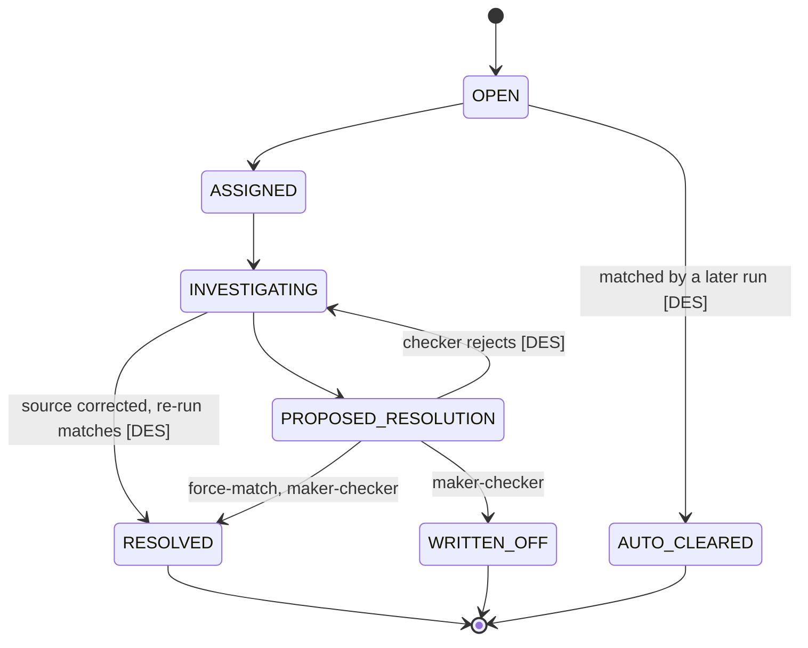
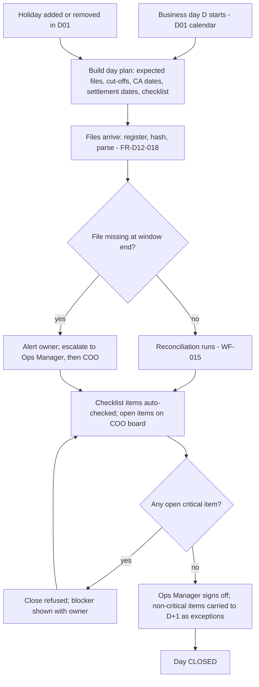

# PRD-012 — Fund Operations (D12)

This document states what AMC OS must do to run the operations day of an AMC: know in advance what must happen each business day, take in every file from custodians, banks, brokers and the RTA, reconcile everything on one engine, process corporate actions, keep one queue of exceptions, and close the day only when its checks pass. It re-keys PRD-000 v0.9 Module 10 "Fund Operations" to the GOV-001 identifiers (`FR-10-nn` → `FR-D12-nnn`, `BR-10-n` → `BRL-D12-nnn`, Module 10 stories → `US-D12-nnn`), and also re-keys the two corporate-action items of Module 05 that PRD-006 and PRD-007 left for D12 (`FR-05-10`, `BR-05-3`). It adds requirements for the capabilities with no v0.9 source — operational calendars (CAP-D12-001, the GOV-001 §3 gap), document management (CAP-D12-010) and workflow management (CAP-D12-011) — and one new workflow: **WF-036 Operations calendar and daily operations close** (§6.2).

**Builds on Draft documents:** [PRD-000 v0.9](PRD-000_master_prd_v0.9.md) Module 10, Module 05 (FR-05-10, BR-05-3), Chapter 4 (W9, W15), Chapter 5 (US-OPS-01), Chapter 6, Chapter 8, Chapter 9; [BA-001](../02_business_architecture/BA-001_business_capability_map.md) D12, §4, §5 C3; [BA-002](../02_business_architecture/BA-002_amc_operating_model.md) §3, §4, §7; [BA-003](../02_business_architecture/BA-003_domain_dictionary.md); [BA-004](../02_business_architecture/BA-004_end_to_end_workflows.md) WF-009, WF-011, WF-015, WF-018, WF-024…WF-028, §5; [BA-005](../02_business_architecture/BA-005_roles_and_permissions.md) §3–§5; [PRD-001](PRD-001_platform_administration.md) (calendar master, configuration); [PRD-004](PRD-004_portfolio_management.md); [PRD-006](PRD-006_trading_and_execution.md); [PRD-007](PRD-007_settlement_management.md); [DA-000](../05_data_architecture/DA-000_data_and_database_architecture_v0.9.md); DDL-000 v0.9 — allowed by owner decision D-3 ([GOV-008](../00_governance/GOV-008_build_loop.md) §2 rule 3). No document used here is Approved. PRD-010 Fund Accounting, PRD-011 Valuation and NAV and PRD-013 Investor Management are written in the same step (Step 9a). Owner decisions D-18 (no SoD waivers except SOD-03 and small-team mode) and D-48…D-51 (answers Q42–Q45, 21 Nov 2026) are applied ([LOOP_STATE.md](../../LOOP_STATE.md)).

**What this document is not:** the matching method, tolerance mathematics and test values of the reconciliation engine (FE-07, owned by D12, specified in Step 22 — no formula is given here); corporate-action **accounting** entries (D10, CAP-D10-008, PRD-010); position changes from corporate actions (D04, PRD-004 BRL-D04-001); settlement instructions, settlement payments, settlement fails and the settlement operations view (D07, PRD-007); order and fill messages and contract notes (D06, PRD-006); the holiday calendar master (D01, CAP-D01-009, PRD-001 FR-D01-038); provider adapters and data validation (D16, CAP-D16-001…003); investor transactions, which the RTA processes as record keeper (D13, PS-001 §3). AMC OS is not a custodian, depository, bank or RTA: it receives, reconciles, tracks and instructs. **Rule for engineers (PRD-000):** no cut-off time, tolerance, SLA, threshold or expected file time is hard-coded; each is versioned, effective-dated tenant configuration (PRD-001 FR-D01-033).

## 1. Scope

| In scope (CAP) | Out of scope |
| --- | --- |
| CAP-D12-001 Operational calendars · CAP-D12-002 Daily fund operations · CAP-D12-003 Reconciliation · CAP-D12-004 Custodian reconciliation · CAP-D12-005 Broker reconciliation · CAP-D12-006 Bank reconciliation · CAP-D12-007 Corporate-action processing · CAP-D12-008 Exception management · CAP-D12-009 Operational approvals · CAP-D12-010 Document management · CAP-D12-011 Workflow management | Holiday master (D01); trade-by-trade execution reconciliation (D06 CAP-D06-005); settlement status, payments for settlement and fails (D07); corporate-action accounting (D10); NAV calculation (D11); investor transaction processing (RTA; D13 mirrors); custody, depository, banking and RTA services themselves (PS-001 §3); AI that matches, writes off, elects, releases or closes on its own (ADR-0008) |

## 2. Re-keying from PRD-000 Module 10 and Module 05

| PRD-000 v0.9 | Here | Note |
| --- | --- | --- |
| FR-10-01 Custodian connectivity | FR-D12-001 | CAP-D12-004; the same feed also serves D07 status and CAP-D12-007 notices |
| FR-10-02 Broker connectivity | FR-D12-002 **(changed — D12 part only)** | D12 keeps **brokerage bills and broker statements and balances** (CAP-D12-005). Order and fill messages (FIX assumed) and contract-note intake are already stated by D06 in PRD-006 FR-D06-013 and FR-D06-014 (CAP-D06-006) and are not repeated |
| FR-10-03 Bank connectivity | FR-D12-003 **(changed — D12 part only)** | D12 keeps **bank-statement intake and bank reconciliation** (CAP-D12-006) but no longer releases investor payouts: the RTA sends redemption, SWP and IDCW payout files, and AMC OS tracks and checks them (owner decision D-52; PRD-013 FR-D13-020). Settlement payment tracking is already stated by D07 in PRD-007 FR-D07-010 (CAP-D07-005) and uses the same bank connection |
| FR-10-04 Cash management | FR-D12-004 | Scheme bank-account details stay with D07 (FR-D07-006, WF-028) |
| FR-10-05 Corporate actions operations | FR-D12-005 | CAP-D12-007 (.1), (.3), (.4) |
| FR-10-06 Settlement tracking | FR-D12-006 **(changed — D12 part only)** | The operations view of settlement is already stated by D07 in PRD-007 FR-D07-011 (CAP-D07-006 (.3)). D12 keeps only the feed of settlement items into the day-close checklist and the exception queue — no second view |
| FR-10-07 Operational reconciliation engine | FR-D12-007 | FE-07; each domain owns its reconciliation sets (BA-001 §4) |
| FR-10-08 Failed transaction handling | FR-D12-008 **(changed — D12 part only)** | D12 keeps **exception management** of redemption-payout failures and SIP mandate failures (CAP-D12-008 (.2)). Settlement fails are already stated by D07 in PRD-007 FR-D07-003 (CAP-D07-008, WF-027) and only appear in the D12 queue |
| FR-10-09, FR-10-10 | FR-D12-009, FR-D12-010 | |
| Module 05 **FR-05-10** Corporate actions (left by PRD-006 §2 and PRD-007 §2) | FR-D12-011 **(changed)** | "Booking on ex-date and pay-date" becomes events: D10 posts the entries (CAP-D10-008, PRD-010), D04 moves positions; D12 never writes their tables |
| BR-10-1 … BR-10-4 | BRL-D12-001 … BRL-D12-004 | Labels added where PRD-000 had none |
| Module 05 **BR-05-3** Corporate-action entitlements (left by PRD-006 §2 and PRD-007 §2) | BRL-D12-005 | Label **[IND]** added; ex-date practice sourced ([S1]) |
| Module 10 break states | §4.3 | Re-open as a new linked break (DA-000 Ch 6) |
| Module 10 point 7 stories (Ops Analyst auto-match; COO day-close board); Ch 5 US-OPS-01 | US-D12-001, US-D12-002, US-D12-003 | |
| Module 10 point 18 acceptance criteria | AC-US-D12-001-1 (`QTY_MISMATCH`), AC-US-D12-002-1 (day-close refused) | |
| Module 10 points 4, 13, 14, 15, 17 | §7, §9, NFR-AUD-012, NFR-PERF-018 | "Connector uptime 99.9%" is covered by PRD-001 NFR-AVAIL-001; no new ID |
| Chapter 4 W9, W15 | BA-004 WF-009, WF-015 (already re-keyed) | D12 requirements in §6.1 |
| — | FR-D12-012 … FR-D12-025, BRL-D12-006 … 012, US-D12-004 … 011, WF-036 | **New** **[DES]** |

## 3. Business requirements

| ID | Business requirement | Capabilities |
| --- | --- | --- |
| BR-D12-001 | Operations knows before each business day starts which files, cut-offs, events and checks are due that day, built on the one holiday source | CAP-D12-001 |
| BR-D12-002 | Every holding, cash balance, unit balance and NAV that AMC OS holds agrees with the outside record, or the difference is a tracked break with an owner | CAP-D12-003 … -006 |
| BR-D12-003 | Every corporate action is captured once, its entitlements are right, and voluntary elections are made by the Fund Manager in time | CAP-D12-007 |
| BR-D12-004 | Every operational problem sits in one queue with an owner, an SLA and its age until it is closed | CAP-D12-008 |
| BR-D12-005 | The operations day closes only when its checks pass, with a named sign-off, and the COO sees what blocks NAV | CAP-D12-002 |
| BR-D12-006 | Actions that move money or change a record of account need two people; every domain uses the same approval and document services | CAP-D12-009, -010, -011 |

## 4. Functional requirements

Every requirement also obeys PRD-000 common rules C1–C8. Labels from PRD-000 are carried unchanged unless the change is stated. Priority: **M** must (release-blocking), **S** should — as PRD-000 Chapter 3.

### 4.1 Re-keyed from PRD-000 Module 10 and Module 05

| ID (was) | Pri | Capability | Requirement |
| --- | --- | --- | --- |
| FR-D12-001 (FR-10-01) | M | CAP-D12-004 (.1), (.2) | **Custodian connectivity:** holdings, transactions, cash statements, corporate-action notices and settlement status from each custodian. Message types (PRD-000 names SWIFT MT5xx and ISO 20022 semt/sese as examples) and transport: Confirm with <custodian> **[VAL with each custodian]** (unchanged). Holdings and transactions are reconciled here (CAP-D12-004); status goes to D07 (FR-D07-013); notices go to FR-D12-005 |
| FR-D12-002 (FR-10-02) **(changed)** | M | CAP-D12-005 (.1) | **Broker statements and bills:** receive brokerage bills and broker statements and balances; reconcile them against D06 trades and charges on FE-07 (CAP-D12-003). Formats: Confirm with <broker>. *Changed:* order and fill messages and contract notes are D06 (FR-D06-013, FR-D06-014) |
| FR-D12-003 (FR-10-03) **(changed)** | M | CAP-D12-006 (.1) | **Bank connectivity:** bank statements (PRD-000 names MT940 / CAMT.053 or a bank API) for every scheme bank account, daily, reconciled per account (CAP-D12-006, open point C3); AMC OS releases no investor payouts: the RTA sends redemption, SWP and IDCW payout files, and AMC OS tracks and checks them (owner decision D-52; PRD-013 FR-D13-020); `operations.payout.release` is no longer used for investor payouts; PRD-014 still uses it for distributor commission payments (CAP-D14-010, C14). Interface: Confirm with <bank>. *Changed:* settlement payments are tracked by D07 (FR-D07-010); scheme expense payments are made outside AMC OS for now; AMC OS records and checks them (owner decision D-51, C7) |
| FR-D12-004 (FR-10-04) | M | CAP-D12-002 (.2) | **Cash management:** balances per scheme bank account from bank statements; sweep and TREPS placement instructions recorded as the Fund Manager's decision and executed by Operations. Account details are read from D07 (FR-D07-006), projected cash from the D04 cash ladder (FR-D04-008); allowed cash-deployment options are scheme policy **[VAL]** (PRD-004 BRL-D04-003) |
| FR-D12-005 (FR-10-05) | M | CAP-D12-007 (.1), (.3), (.4) | **Corporate actions operations:** one golden corporate-action record built from several sources (BRL-D12-012); elections workflow for voluntary actions (FR-D12-020); entitlement reconciliation with the custodian on pay-date — a difference is a break (WF-015) |
| FR-D12-006 (FR-10-06) **(changed)** | M | CAP-D12-002 (.1), CAP-D12-008 (.1) | **Settlement items in the operations day:** unsettled trades, unconfirmed payments and open fails for the day, read from D07 events, appear as day-close checklist items and in the exception queue. *Changed:* the settlement view itself is FR-D07-011 |
| FR-D12-007 (FR-10-07) | M | CAP-D12-003 (.1)–(.4) | **Reconciliation engine (FE-07):** configurable two-way and three-way matching (keys, tolerances, many-to-one). Types and owning domain of each set: holdings vs custodian (D12, CAP-D12-004; settled part D07 FR-D07-004); cash vs bank (D12, CAP-D12-006; settlement cash D07 FR-D07-014; ledger vs bank D10 CAP-D10-012); trades OMS vs broker vs custodian (D06 FR-D06-007); broker bills (D12, CAP-D12-005); units AMC mirror vs RTA (D13 CAP-D13-011 via CAP-D12-003 (.4)); NAV vs outsourced fund accountant (D11 CAP-D11-015); fees vs distributor and RTA bills (D14, D15); entitlements vs custodian (D12). Matching method and tolerance arithmetic: FE-07 (Step 22) |
| FR-D12-008 (FR-10-08) **(changed)** | M | CAP-D12-008 (.2) | **Failed transaction handling:** redemption-payout failures (bank rejects) and SIP mandate failures reported by the RTA (D13 mirror) become exceptions with owner and ageing; AMC OS tracks and follows up but does not re-process them (the RTA is record keeper). *Changed:* settlement fails are D07 (FR-D07-003) and only appear in the queue |
| FR-D12-009 (FR-10-09) | M | CAP-D12-008 (.1) | **Operational exceptions:** one queue for every domain's operational exceptions (D06 FR-D06-017, D07 FR-D07-013 and others) with category, severity, SLA, owner and ageing; an item nearing its SLA turns amber and notifies the owner (US-D12-003); a breached SLA escalates to the Operations Manager, then the COO (PRD-000 point 4) |
| FR-D12-010 (FR-10-10) | M | CAP-D12-002 (.1) | **Daily closing workflow:** configurable checklist (all expected files received, reconciliations run, breaks under threshold, NAV published, payments released); each item checked automatically where possible; a live board for the COO shows each item, its owner and what blocks NAV; the day cannot close with open critical items (BRL-D12-007); sign-off by the Operations Manager (WF-036) |
| FR-D12-011 (FR-05-10) **(changed)** | M | CAP-D12-007 (.1), (.2) | **Corporate-action capture and entitlements:** capture announcements from exchange, data vendor and custodian; validate; compute entitlements (BRL-D12-005, FR-D12-019); publish ex-date and pay-date events (FR-D12-021). *Changed:* PRD-000 said "booking on ex-date and pay-date"; the booking is done by D10 (accounting, PRD-010) and D04 (positions) from D12 events |

### 4.2 New requirements **[DES]**

| ID | Pri | Capability | Requirement |
| --- | --- | --- | --- |
| FR-D12-012 | M | CAP-D12-001 (.1) | **Daily operations calendar:** for each business day, the list of expected activities — files, reconciliations, cut-offs, corporate-action key dates, settlement dates (read from D07), NAV publication — each tied to the calendar that governs it (exchange, clearing, bank, RTA) from the D01 master. D12 keeps no holiday list (BRL-D12-008). Bank holidays differ by RBI regional office ([S5]), so a bank activity names its location |
| FR-D12-013 | M | CAP-D12-001 (.2) | **Operational cut-off register:** cut-offs no other domain owns (bank payment cut-offs, file-send deadlines to custodian or RTA, internal deadlines) as versioned, effective-dated configuration (WF-021); an open item is flagged before its cut-off. NAV-applicability cut-offs are D02 (BA-003 TERM-021) and settlement cut-offs D07 (BRL-D07-003): shown in the calendar, never copied. Values **[ASSUMPTION — confirm: Operations Manager of the pilot AMC]** |
| FR-D12-014 | M | CAP-D12-001 (.3) | **Expected file schedule:** per sender, file type and scheme set, the expected arrival window and governing calendar; a file not received by the window end raises an alert and escalates (PRD-000 point 14); no file is expected on the sender's holiday; late arrival time is recorded |
| FR-D12-015 | M | CAP-D12-001 | **Calendar change:** when a holiday is added or removed in D01 — exchanges can declare a trading holiday at short notice ([S6]) — the operations calendar, cut-offs and expected files are recomputed from that date, and affected items (file windows, corporate-action dates, open elections) are listed to the Operations Manager; nothing already done changes silently |
| FR-D12-016 | M | CAP-D12-003 (.1) | **Reconciliation definitions:** each set is a versioned definition (sources, keys, match stages, tolerances, break types, owning domain); a new version needs maker-checker — a checker from the owning department, plus the Operations Manager (§7); each run stores the definition version (DDL-000 `definition_version`) |
| FR-D12-017 | M | CAP-D12-003 (.3), CAP-D12-009 (.1) | **Break workflow:** breaks follow §4.3; each has type, both values, owner and ageing bucket (tenant configuration, BRL-D12-009; PRD-000's 0–1, 2–3, 4–7, > 7 days is the proposed default **[ASSUMPTION]**); force-match needs a reason and maker-checker (BRL-D12-004); write-off needs maker-checker (BRL-D12-006); a re-opened break is a new break linked to the old one |
| FR-D12-018 | M | CAP-D12-002 (.3) | **File register:** every inbound file stored raw with hash, sender and business date (BRL-D12-001, -002); parsing failure → quarantine and alert; a change in a counterparty's format flags the connector version (PRD-000 point 14); every outbound file (payment, instruction) registered with hash and the receiver's acknowledgement |
| FR-D12-019 | M | CAP-D12-007 (.2) | **Entitlement calculation:** on record-date holdings per BRL-D12-005, per scheme and corporate action, deterministic and versioned, with inputs stored; treatment of fractional entitlements follows the issuer's terms **[VAL]** and is never rounded by AMC OS on its own; which engine specification holds the method is open (C1) |
| FR-D12-020 | M | CAP-D12-007 (.3) | **Elections:** each voluntary action (rights, buyback, open offer, tender) has options, the custodian's deadline and an earlier AMC deadline; the Fund Manager of the scheme records the election with a reason (BRL-D12-011); reminders before the deadline; no election by the deadline escalates to the CIO, and nothing is elected automatically (owner decision D-49). An election that changes holdings is checked by D08 before it is sent, like an order (WF-005) |
| FR-D12-021 | M | CAP-D12-007 | **Corporate-action events:** D12 publishes announced, golden-record-confirmed, ex-date-effective and pay-date-received events for D04, D10, D11 and D09; a corrected announcement after ex-date produces a new event version, and consumers reverse and re-apply in their own domains (AGENTS.md §2.3) |
| FR-D12-022 | M | CAP-D12-010 (.1)–(.3) | **Document management:** every domain's documents stored once with type, version, hash, classification, retention class and link to the record they support (DDL-000 `documents.document`); object store with tenant prefix; a document is never deleted before its retention class ends; retention periods **[VAL]** (REG-001, Step 25); the owning domain decides content and approval (BA-001 §4) |
| FR-D12-023 | M | CAP-D12-011 (.1)–(.3) | **Workflow management:** workflow definitions, task queues and the one generic maker-checker used by every domain (DDL-000 `workflow.approval_request` / `approval_decision`); maker ≠ checker and no AI identity may decide, enforced by the database (SOD-01, SOD-10); the owning domain sets who may approve |
| FR-D12-024 | M | CAP-D12-009 (.1) | **Operational approvals:** force-match, break write-off, reconciliation-definition change, connection change (Technology Administrator + Operations Manager, PRD-000 point 13) and day-close sign-off each go through FR-D12-023 with the permission in §7 |
| FR-D12-025 | M | CAP-D12-002 (.3), CAP-D16-002 | **Connection register:** each custodian, bank, broker, RTA and data connection with transport, sender identity, expected files and adapter version; adapters are built by D16 (INT-001, Step 14); every outside interface: Confirm with <provider> |

### 4.3 Break state machine

From PRD-000 Module 10 and DDL-000 `operations.recon_break` (same seven values; `WRITTEN_OFF` requires an approval ID). Transitions marked **[DES]** are proposed.

## 5. Business rules

| ID (was) | Rule | Label |
| --- | --- | --- |
| BRL-D12-001 (BR-10-1) | Inbound files are stored raw, checksummed and never altered; parsing results are stored separately | **[DES]** (PRD-000 unlabelled) |
| BRL-D12-002 (BR-10-2) | A duplicate file is detected by hash + sender + business date and rejected (DDL-000 unique key) | **[DES]** |
| BRL-D12-003 (BR-10-3) | Payments need two authorisers from the bank-mandate list | **[IND]** (unchanged) |
| BRL-D12-004 (BR-10-4) | A force-match needs a reason and maker-checker | **[DES]** |
| BRL-D12-005 (BR-05-3) | Corporate-action entitlements are computed on record-date holdings using positions that settle on or before the record date, per exchange rules. Under T+1, ex-date and record date fall on the same day ([S1]), so a purchase made on the ex-date carries no entitlement | **[IND]**; exchange and depository rules **[VAL]** |
| BRL-D12-006 | Write-off of a break needs maker-checker (PRD-000 point 13); the Operations Manager approves; above an amount set by each tenant (no value shipped) Fund Accounting also approves (owner decision D-50) | **[DES]**; D-50 |
| BRL-D12-007 | The day cannot close with an open critical item; which categories are critical is tenant configuration approved through WF-021; no override exists (owner decision D-48) | **[DES]**; D-48 |
| BRL-D12-008 | One holiday source: D12 reads the D01 calendar master and keeps no holiday list (BA-001 §4) | **[DES]** |
| BRL-D12-009 | Cut-offs, expected file windows, SLAs, break ageing buckets, amber lead times, tolerances and critical categories are effective-dated tenant configuration approved through WF-021, never code; AMC OS ships no values (regulatory parameters checked by Compliance, SOD-12) | **[DES]**; values **[ASSUMPTION — confirm: Operations Manager of the pilot AMC]** |
| BRL-D12-010 | Each reconciliation set has one owning domain that works its breaks; D12 owns the engine and the break workflow, not another domain's business decision (BA-001 §4) | **[DES]** |
| BRL-D12-011 | A voluntary corporate-action election is the Fund Manager's decision; Operations and AI never elect | **[DES]** (PRD-000 FR-05-10 "FM decision") |
| BRL-D12-012 | A corporate action is processed only from a validated golden record; when sources disagree the record goes to the Data Steward queue (CAP-D16-004 (.3)) and no entitlement is computed until resolved | **[DES]** (PRD-000 W9) |

**Regulatory and industry note.** SEBI's Custodian Regulations define custodial services to include collecting benefits accruing to the client, keeping the client informed of issuer actions, and maintaining and reconciling records, and require custodians to keep records of each client's entitlements ([S4], regs 2(e), 19) **[REG]**; the custodian is therefore the AMC's main counterparty for entitlements and holdings. Non-cash benefits are credited to demat accounts by the depository on data from the issuer or its RTA ([S3]) **[IND]**; listed issuers fix a record date, and exchanges recognise only the record date ([S2]) **[REG via exchange FAQ]**. The Custodian Regulations were amended on 8 Jul 2026; the amended text was not read (C12) — the current wording is **[VAL]**.

## 6. Workflows

### 6.1 Existing workflows

| Workflow | D12 role | Requirements |
| --- | --- | --- |
| [WF-009](../02_business_architecture/BA-004_end_to_end_workflows.md) Corporate actions | Accountable (DEP-06) | FR-D12-005, -011, -019, -020, -021, BRL-D12-005, -011, -012 |
| WF-015 Reconciliation | Accountable; engine and break workflow for every domain | FR-D12-001, -002, -003, -007, -016, -017, -018, BRL-D12-001, -002, -004, -006, -010 |
| WF-007 Daily NAV; WF-017 NAV correction | Reconciliation status is a NAV input; NAV reconciliation set (D11) | FR-D12-007, -010 |
| WF-008 Accounting closure | Ledger vs custodian and bank sets (D10) on FE-07 | FR-D12-007 |
| WF-010, WF-011, WF-012 Investor flows | Unit reconciliation; payout tracking (the RTA sends payout files, D-52); payout and SIP mandate failures | FR-D12-003, -008 |
| WF-018, WF-025, WF-026, WF-027 | Engine for D06/D07 sets; settlement items in the queue and checklist | FR-D12-006, -009 |
| WF-021 Configuration change | Cut-offs, file windows, SLAs, critical categories, tolerances | FR-D12-013, -014, BRL-D12-007, -009 |
| WF-028 SSI and bank-detail change (D07) | D12 reads account details; keeps no copy | FR-D12-004 |

### 6.2 WF-036 — Operations calendar and daily operations close **[DES]**

| Field | Detail |
| --- | --- |
| Trigger | Start of each business day in the D01 calendar (prepare); last checklist item done or the close time in configuration (close); a holiday change in D01 (recompute) |
| Initiator | System prepares; Operations Analyst works items; Operations Manager signs off |
| Departments | **DEP-06 Fund operations and settlement** — accountable (BA-002 §3 "operational calendars"); DEP-07 (NAV and accounting items), DEP-08 (RTA files), DEP-05 (trade items), DEP-15 (connections); COO (escalation) |
| Capabilities | CAP-D12-001, CAP-D12-002, CAP-D12-003, CAP-D12-008, CAP-D12-009, CAP-D12-011, CAP-D01-009 (.1), CAP-D07-006 (.3), CAP-D11-013, CAP-D17-007, CAP-D17-008 |
| Hand-offs (outside) | Custodians, banks, brokers, RTA (files in; payment and instruction files out) — Confirm with each provider |
| Preconditions | Approved calendar master in D01; approved cut-off register, expected file schedule and checklist definition |
| Final state | Day `CLOSED` with sign-off, every checklist item done or carried to the next day as an exception with owner; or day `OPEN` with blockers on the COO board |
| Approvals | Day-close sign-off by the Operations Manager (`operations.day.close`†); checklist and critical-category changes through WF-021 |
| Exceptions | File not received → alert and escalation; reconciliation run failed → item blocked; critical break open → close refused (BRL-D12-007); NAV not published → item blocked, owner DEP-07; holiday added or removed → recompute (FR-D12-015) |
| Audit | Calendar version used, each item's status changes with time and user, automatic check results, refusals, sign-off |
| Source | **new** (BA-001 CAP-D12-001 has no v0.9 source; PRD-000 FR-10-10 has no workflow card) |

## 7. Permissions by capability

From BA-005 §3 (D12 column) and §4, narrowed to each capability. Checker ≠ maker (SOD-01). BA-005 §3: Operations Analyst "R C U S (A manager)"; COO "R A J E"; Technology Administrator "R (connections) C U S"; CTO "R (tech)"; Fund Manager "R own"; CEO, CIO, CFO, Dealer, Compliance Officer, Risk Manager, Fund Accountant and Auditor read; Product Manager, Research Analyst, Distributor Manager, RM and Investor Service Executive have no D12 right.

| Capability | Maker | Checker(s) |
| --- | --- | --- |
| CAP-D12-001 calendar, cut-offs, file schedule | Operations Analyst proposes | Operations Manager through WF-021 (SOD-12); Compliance Officer too for a regulatory parameter |
| CAP-D12-002 (.1) day close | Operations Analyst works items | Operations Manager signs off (`operations.day.close`†) |
| CAP-D12-002 (.2) sweep / TREPS instruction | Operations Analyst, on the Fund Manager's recorded decision | Operations Manager |
| CAP-D12-003 definitions | Operations Analyst; Fund Accountant for D10/D11 sets† | Owning department's checker and Operations Manager (`operations.recon_definition.approve`†) |
| CAP-D12-003 (.3), CAP-D12-009 force-match | Operations Analyst; Fund Accountant and Investor Service Executive in their own sets† | Operations Manager (`operations.break.force_match`) |
| CAP-D12-009 write-off | Operations Analyst | Operations Manager (`operations.break.write_off`†); above a tenant-set amount also Fund Accounting (D-50; the Head of Fund Accounting as the approver is **[DES]**†) |
| CAP-D12-009 D12 payout release | — (no investor payout is released by AMC OS, D-52) | — (`operations.payout.release` no longer used for investor payouts; still used for commission payments in PRD-014; C14) |
| CAP-D12-002 (.3), FR-D12-025 connections | Technology Administrator | Operations Manager (`operations.connection.approve`†) |
| CAP-D12-004 … -006 reconciliation | System (FE-07); Operations Analyst works breaks | as force-match / write-off |
| CAP-D12-007 golden record | System; Operations Analyst; Data Steward for conflicts | — |
| CAP-D12-007 (.3) election | Fund Manager of the scheme (`operations.election.submit`†) | — (D08 check, FR-D12-020); CIO on escalation |
| CAP-D12-008 exceptions | Item owner | — (escalation to Operations Manager, COO) |
| CAP-D12-010, -011 | Users of each domain within their own rights | As the owning domain sets |

**Rights added beyond BA-005 (†):** `operations.day.close`, `operations.recon_definition.approve`, `operations.break.write_off`, `operations.connection.approve` and `operations.election.submit` are not in BA-005 §4; the Fund Manager (BA-005 D12 "R own") gets submit on elections for own schemes, and the Fund Accountant and Investor Service Executive work breaks in their own sets (BA-004 WF-015 names DEP-07 and DEP-08) **[DES]** (open point C8).

## 8. User stories and acceptance criteria

Priority: **C** critical (release-blocking), **O** optional — as PRD-000 Chapter 5.

| ID | Story | Pri | Acceptance criteria (Given / When / Then) |
| --- | --- | --- | --- |
| US-D12-001 (was Module 10 point 7) | As an Operations Analyst, I want most holdings auto-matched, so that I only investigate genuine breaks | C | **AC-US-D12-001-1** (was point 18) Given a holdings file where one ISIN differs by quantity, when the reconciliation runs, then exactly one break of type `QTY_MISMATCH` is created with both values. **AC-US-D12-001-2** (new **[DES]**) Given a run, when it completes, then the auto-match rate is reported per set; PRD-000's 95% is a target **[ASSUMPTION]**, not a pass rule. |
| US-D12-002 (was Module 10 point 7) | As the COO, I want a live day-close board, so that I know what blocks NAV | C | **AC-US-D12-002-1** (was point 18) Given open critical breaks, when day close is attempted, then it is refused. **AC-US-D12-002-2** (new **[DES]**) Given the board, when an item changes status, then the board shows it with owner and blocking reason within NFR-PERF-019. |
| US-D12-003 (was US-OPS-01) | As Operations, I want a single exception queue with SLAs | C | **AC-US-D12-003-1** (was US-OPS-01) Given an exception at SLA − 1 h, then it turns amber and notifies the owner (the 1 h lead time is configuration, BRL-D12-009). |
| US-D12-004 | As a Fund Manager, I want entitlements on the right holding | C | **AC-US-D12-004-1** Given a 1:1 bonus with record date R, a scheme holding 1,000 settled shares and a purchase of 200 on the trading day before R that settles on R, and a purchase of 50 on R, when entitlements are computed, then the base is 1,200 and the entitlement is 1,200 shares (BRL-D12-005). |
| US-D12-005 | As the CIO, I want missed elections escalated | C | **AC-US-D12-005-1** Given a voluntary action with an AMC deadline, when the deadline passes with no election, then the CIO is alerted, the escalation is logged, and no election is sent automatically. |
| US-D12-006 | As an Operations Analyst, I want entitlement differences caught | C | **AC-US-D12-006-1** Given an entitlement of 1,200 shares, when the custodian credits 1,100 on pay-date, then one break with both values is created and owned by Operations. |
| US-D12-007 | As an Operations Manager, I want missing files flagged, but not on holidays | C | **AC-US-D12-007-1** Given an expected custodian holdings file, when its window ends without it, then an alert is raised within NFR-PERF-019. **AC-US-D12-007-2** Given the same sender's holiday in the D01 calendar, then no file is expected and no alert is raised. |
| US-D12-008 | As an Operations Manager, I want holiday changes to show me what moves | C | **AC-US-D12-008-1** Given an approved new exchange holiday for a future date, when D01 publishes it, then the operations calendar for that date is recomputed and the affected expected files, cut-offs and corporate-action dates are listed to me. |
| US-D12-009 | As an Operations Analyst, I want duplicate files rejected | C | **AC-US-D12-009-1** Given a file already registered (same hash, sender, business date), when it arrives again, then it is marked `DUPLICATE` and no reconciliation run starts from it. |
| US-D12-010 | As an Auditor, I want force-matches controlled | C | **AC-US-D12-010-1** Given a force-match proposed by an analyst, when the same analyst approves it, then the approval is refused (SOD-01); a proposal without a reason is refused. |
| US-D12-011 | As an Auditor, I want any reconciliation reproduced | C | **AC-US-D12-011-1** Given a stored run, when it is re-run from its stored files and definition version, then the matches and breaks are identical. |

Definition of done: as PRD-000 Chapter 5.

## 9. Exceptions

| Exception | Handling | Source |
| --- | --- | --- |
| File not received by expected time | Alert and escalation (FR-D12-014) | PRD-000 Module 10 point 14 |
| Parsing failure | Quarantine and alert (FR-D12-018) | PRD-000 Module 10 point 14 |
| Counterparty format change | Connector version flagged; files quarantined until the adapter is updated | PRD-000 Module 10 point 14 |
| Duplicate file | Rejected by hash (BRL-D12-002) | BA-004 WF-015 |
| Corporate-action sources disagree | Data Steward queue; no entitlement until resolved (BRL-D12-012) | BA-004 WF-009 |
| Entitlement mismatch with custodian | Break (WF-015) | BA-004 WF-009 |
| Election deadline missed | Escalation to the CIO (FR-D12-020) | **[DES]** |
| Announcement corrected after ex-date | New event version; consumers reverse and re-apply (FR-D12-021) | **[DES]** |
| Holiday added or removed | Recompute and list affected items (FR-D12-015) | **[DES]** |
| Payout rejected by the bank | Exception with owner (FR-D12-008); the RTA is informed per its process — Confirm with <RTA> | **[DES]** |
| Reconciliation run fails | Checklist item blocked; previous result shown with its date | **[DES]** |
| Exception SLA breached | Escalation to Operations Manager, then COO (FR-D12-009) | PRD-000 Module 10 point 4 |

## 10. Data and interfaces

**Owned schemas:** `operations`, `workflow`, `documents` (GOV-001 §3). D12 reads `platform.business_calendar` (D01) and never writes it. No database change is made in this step.

| Exists in DDL-000 | Not yet in DDL-000 (for DA-001 / DDL, Steps 15–16) **[DES]** |
| --- | --- |
| `operations.inbound_file` (hash, duplicate key, `QUARANTINED`, `DUPLICATE`), `operations.recon_run` (type, definition version), `operations.recon_break` (seven states, write-off needs approval), `workflow.approval_request`, `workflow.approval_decision` (SoD trigger, no AI decision), `documents.document` (version, hash, classification, retention class) | Connection register; outbound file register; reconciliation definitions and match results; break action history and links; exception queue; day plan, cut-off register, expected file schedule; checklist definitions and day-close records; golden corporate-action record and sources, entitlements, elections; workflow definitions and tasks. `recon_run.recon_type` lacks entitlement and broker-statement types (C10) |

DA-000 places corporate actions in `settlement`, while BA-001 gives corporate-action processing to D12 (BA-001 §5 C3; open point C2).

**Interfaces (indicative, not contracts):** PRD-000 Module 10 point 11 names `operations-svc` endpoints `/connections`, `/files`, `/recon-runs`, `/breaks`, `/exceptions`, `/day-close`; this PRD adds the operations calendar, cut-offs, expected files, corporate actions (moved from `settlement-svc`, PRD-007 §10), elections, documents and workflow tasks. Events out: corporate-action events (FR-D12-021), break and day-close status. Names become `API-D12-nnn` in Step 24 and `<NAME>.v<n>` in EA-007 (Step 13). Outside parties — custodians, banks, brokers, RTA, exchanges and data vendors (announcements): every interface Confirm with <provider> until INT-001 (Step 14).

## 11. Non-functional requirements

| ID | Requirement | Type / source |
| --- | --- | --- |
| NFR-PERF-018 | Reconciliation of 1 million rows in < 2 minutes | Proposed — PRD-000 Module 10 point 17 |
| NFR-PERF-019 | Missing-file alerts, exception status and day-close board changes visible within 1 minute | Proposed **[DES]**; value **[ASSUMPTION — confirm: Operations Manager of the pilot AMC]** |
| NFR-AUD-012 | File register, reconciliation run inputs and outputs, break history (PRD-000 point 15); corporate-action sources, golden record, entitlement inputs, elections, calendar versions and day-close sign-offs (new **[DES]**) | PRD-000 Module 10 point 15; **[DES]** |
| NFR-SCAL-003 | Reconciliation runs of one tenant scale out and run in parallel without delaying another tenant's runs | Proposed **[DES]** |

Platform NFRs in PRD-001 §11 apply; connector uptime (PRD-000: 99.9%) is under NFR-AVAIL-001.

## 12. AI in this domain

Within PRD-000 C8 and [ADR-0008](../../architecture/adrs/ADR-0008_ai_boundary.md) (read and propose only). The **Reconciliation assistant** (CAP-D17-008) suggests matches with confidence and likely causes (for example "custodian still shows pre-split quantity") and drafts e-mails to counterparties; an analyst accepts or sends, and a force-match stays maker-checker. PRD-000 Ch 9 sets "precision of accepted suggestions ≥ 95%" as its quality target. The **NAV operations assistant** (CAP-D17-007) may summarise open day-close items that block NAV; **anomaly detection** (CAP-D17-015) may flag unusual operations data as advisory. No AI identity may force-match, write off, elect, release a payout, change a calendar or sign off the day (SOD-10; enforced by the `workflow` SoD trigger).

## 13. Open points

| # | Point | Where closed |
| --- | --- | --- |
| C1 | Entitlement calculation (FR-D12-019) produces numbers but no engine in GOV-001 §5 (FE-01…FE-10) covers it: an FE-07 annex or a new engine | FE spec template (Step 20); owner |
| C2 | DA-000 puts corporate actions in `settlement`; BA-001 gives processing to D12 | EA-003 (Step 11), DA-001 (Step 15) — BA-001 §5 C3 |
| C3 | Bank reconciliation overlap: CAP-D12-006, CAP-D07-007 (.2) (FR-D07-014) and CAP-D10-012 (.2). **[DES]** proposal: D12 runs one reconciliation per scheme bank account per day; D07 and D10 define their match rules inside it; each statement line is matched once | EA-003 (Step 11) |
| C4 | Can anyone close the day with an open critical item — closed by owner decision D-48 (no override) | — |
| C5 | Election authority and the default when no election is made — closed by owner decision D-49 (Fund Manager decides; missed deadline escalates to the CIO; nothing elected automatically) | — |
| C6 | Who approves a break write-off above a money amount — closed by owner decision D-50 (Fund Accounting also approves above a tenant-set amount) | Amount per tenant at onboarding |
| C7 | Scheme expense payments (PRD-000 FR-10-03) — closed by owner decision D-51 (paid outside AMC OS for now; AMC OS records and checks) | PRD-015 |
| C8 | Permissions and rights marked † in §7 are not in BA-005 | Next BA-005 revision |
| C9 | BA-003 TERM-021 "Cut-off time" means NAV applicability; CAP-D12-001 (.2) operational cut-offs need their own term | Next BA-003 revision |
| C10 | DDL-000 lacks the tables in §10 and the entitlement and broker-statement reconciliation types | DA-001 / DDL (Steps 15–16) |
| C11 | Values of tolerances, SLAs, amber lead time, file windows, critical categories and the 95% auto-match target **[ASSUMPTION]** | Pilot discovery |
| C12 | Current text of the Custodian Regulations as amended 8 Jul 2026, exchange and depository corporate-action rules, retention periods for documents **[VAL]** | REG-001 (Step 25) |
| C13 | BA-004 register and §5.1 D12 row get WF-036; the full card lives here until BA-004's next revision | Next BA-004 revision |
| C14 | After owner decision D-52 AMC OS releases no investor payouts, so BA-005 §4 `operations.payout.release` should no longer point to WF-011; PRD-014 still uses it for distributor commission payments (CAP-D14-010) | Next BA-005 revision: re-point the permission to commission and other AMC-run payments |

## Sources

Repository sources: [PRD-000 v0.9](PRD-000_master_prd_v0.9.md) Module 10, Module 05, W9, W15, Ch 5, Ch 6, Ch 8, Ch 9; [BA-001](../02_business_architecture/BA-001_business_capability_map.md) D12, §4, §5; [BA-002](../02_business_architecture/BA-002_amc_operating_model.md) §3, §4; [BA-004](../02_business_architecture/BA-004_end_to_end_workflows.md); [BA-005](../02_business_architecture/BA-005_roles_and_permissions.md) §3–§5; [PRD-006](PRD-006_trading_and_execution.md) §2; [PRD-007](PRD-007_settlement_management.md) §2; [DA-000](../05_data_architecture/DA-000_data_and_database_architecture_v0.9.md); DDL-000 v0.9 sections 06, 12, 15 (`database/ddl/DDL-000_core_schema_v0.9.sql`); [LOOP_STATE.md](../../LOOP_STATE.md) decisions D-3, D-18, D-48…D-51.

External sources (opened through web search on 21 Nov 2026; regulatory detail still **[VAL]**):

| # | Source | Used for |
| --- | --- | --- |
| S1 | [Zerodha support — What does ex-date and record date mean](https://support.zerodha.com/category/console/corporate-actions/ca-others/articles/what-does-ex-date-and-record-date-mean) — broker, secondary | Under T+1 the ex-date and record date are the same day (BRL-D12-005) |
| S2 | [NSE — FAQs on corporate action (updated 7 Jul 2026)](https://nsearchives.nseindia.com//web/circular/2026-07/FAQs_on_Corporate_Action_20260708204832.pdf) — exchange, primary for listed issuers | Only the record date is recognised; notice periods for issuers |
| S3 | [NSDL — Issuer services: corporate actions](https://nsdl.com/issuer-services-corporate-actions) — depository, primary | Non-cash corporate actions credited by the depository on data from issuer or RTA |
| S4 | [SEBI (Custodian) Regulations, 1996 — SEBI acts page](https://www.sebi.gov.in/acts/act05a.html) — primary, version on that page; [amended version of 8 Jul 2026](https://www.sebi.gov.in/legal/regulations/jul-2026/securities-and-exchange-board-of-india-custodian-regulations-1996-last-amended-on-july-08-2026-_102764.html) not read | Custodial services include collecting benefits, informing clients, maintaining and reconciling records; entitlement records (regs 2(e), 19) |
| S5 | [RBI — Holiday matrix](https://rbi.org.in/Scripts/HolidayMatrixDisplay.aspx) — primary | Holidays under the Negotiable Instruments Act differ by RBI regional office (FR-D12-012) |
| S6 | [Business Standard — NSE announces trading holiday on November 20 for Maharashtra elections (8 Nov 2024)](https://business-standard.com/markets/capital-market-news/nse-announces-trading-holiday-on-november-20-for-maharashtra-elections-124110801205_1.html) — press, secondary | Exchanges can add a trading holiday at short notice (FR-D12-015) |
