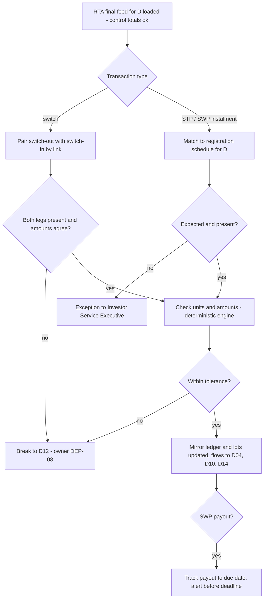
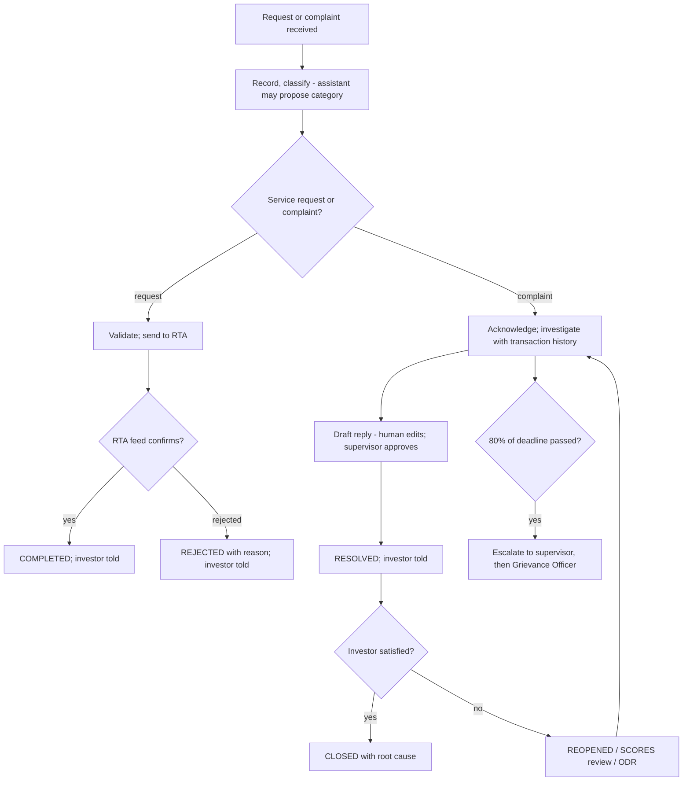

# PRD-013 — Investor Management and Servicing (D13)

This document states what AMC OS must do to give the AMC a complete, current and checked copy of every investor, folio and transaction, to service investors and handle complaints within their deadlines, and to protect investor personal data. It re-keys PRD-000 v0.9 Module 11 to the GOV-001 identifiers (`FR-11-nn` → `FR-D13-nnn`, `BR-11-n` → `BRL-D13-nnn`, Module 11 and Chapter 5 stories → `US-D13-nnn`) and adds new **[DES]** requirements for the D13 gaps in BA-004 §5.1: switch, STP, SWP, IDCW, service requests and complaints (CAP-D13-006, -008, -009, -010, -014, -015). It adds two workflows: **WF-037 Switch, STP and SWP (mirror and checks)** (§6.2) and **WF-038 Investor service request and complaint handling** (§6.3).

**The boundary (owner decision Q2 — [GOV-006](../00_governance/GOV-006_gap_analysis_and_delivery_plan.md) §4; [BA-001](../02_business_architecture/BA-001_business_capability_map.md) D13 boundary note; [PS-001](../01_product_strategy/PS-001_project_charter.md) §3):** CAMS and KFintech remain the registrar and transfer agent (RTA) of record. AMC OS holds a synchronised **mirror** of the investor book for servicing, analytics and reconciliation. It does **not** allot units, extinguish units, keep the official unit register or decide a transaction. Every unit, amount, load or tax figure AMC OS computes in this domain is a **check** of the RTA's figure; a difference is a break, never a correction of the RTA's record. PRD-000 "mode B" (AMC OS as transaction engine) is out of scope (GOV-006 Q2).

**Builds on Draft documents:** [PRD-000 v0.9](PRD-000_master_prd_v0.9.md) Module 11, Chapter 4 (W10–W12), Chapter 5, Chapter 6, Chapter 7, Chapter 8, Chapter 9, Appendix A (R11–R13); [BA-001](../02_business_architecture/BA-001_business_capability_map.md) D13, §4, §5; [BA-002](../02_business_architecture/BA-002_amc_operating_model.md) DEP-08, P9, §5; [BA-003](../02_business_architecture/BA-003_domain_dictionary.md); [BA-004](../02_business_architecture/BA-004_end_to_end_workflows.md) WF-001, WF-007, WF-010, WF-011, WF-012, WF-017, §5; [BA-005](../02_business_architecture/BA-005_roles_and_permissions.md) §3–§5; [PRD-001](PRD-001_platform_administration.md) §11 — allowed by owner decision D-3 ([GOV-008](../00_governance/GOV-008_build_loop.md) §2 rule 3). No document used here is Approved. PRD-010, PRD-011 and PRD-012 are written in the same step (Step 9a) and are referred to by ID only.

**What this document is not:** the RTA's processing rules or file formats (RTA agreements; INT-001, Step 14 — "Confirm with CAMS / KFintech"); the reconciliation engine and break workflow (D12 CAP-D12-003, FE-07); scheme-level units outstanding and NAV (D11, PRD-011); capital-stock and payables accounting (D10, PRD-010); distributor data and commission (D14, PRD-014); AI model governance (AIML-002, Step 26). **Rule for engineers:** no cut-off time, deadline, rounding rule, nominee count or service level is hard-coded; each is a versioned parameter or tenant configuration (PRD-001 FR-D01-033). Every authoritative unit or money figure comes from the RTA; AMC OS check values come from a deterministic engine (FE spec to be named in EA-003, Step 11), never from AI (BRL-D13-003).

## 1. Scope

| In scope (CAP) | Out of scope |
| --- | --- |
| CAP-D13-001 Investor master · CAP-D13-002 Folio management · CAP-D13-003 KYC integration · CAP-D13-004 Purchase transactions · CAP-D13-005 Redemption transactions · CAP-D13-006 Switch transactions · CAP-D13-007 SIP · CAP-D13-008 STP · CAP-D13-009 SWP · CAP-D13-010 IDCW-related workflows · CAP-D13-011 Unit balances · CAP-D13-012 Transaction history · CAP-D13-013 Investor communication · CAP-D13-014 Service requests · CAP-D13-015 Complaints · CAP-D13-016 Transaction status | Acting as RTA of record (PS-001 §3); running a KRA or CKYC registry; accepting payments or presenting debits; deciding the IDCW rate (Trustees; D02 / D10); reconciliation engine (D12); units outstanding per plan (D11 CAP-D11-009); distributor records (D14); AI that changes investor data or starts a transaction (ADR-0008) |

## 2. Re-keying from PRD-000 Module 11

| PRD-000 v0.9 | Here | Note |
| --- | --- | --- |
| FR-11-01 … FR-11-17 | FR-D13-001 … FR-D13-017 | Same order; capability added. **Rewritten** for the mirror (Q2): FR-D13-007, -008, -013 (see below), -015, -016 (RTA does the work, AMC OS tracks and checks). **FR-11-13 "Unit allotment"** becomes FR-D13-013 **"Unit allotment check"** — closes BA-001 §5 C5 |
| BR-11-1 … BR-11-4 | BRL-D13-001 … BRL-D13-004 | BRL-D13-002 and -003 reworded from "decide" / "compute" to "check" |
| Module 11 "Operating model choice" (mode A / mode B) | Intro and BRL-D13-005 | Mode B removed (GOV-006 Q2) |
| W10, W11 (BA-004 WF-010, WF-011) unit and redemption computations | FR-D13-013, FR-D13-019 (checks) | Closes BA-004 §5.2 C3, except who sends the payout file → open point C1 (Q46) |
| Module 11 point 7 stories; Ch 5 US-IVS-01, US-IVS-02 | US-D13-001 (merged with US-IVS-01), US-D13-002 (merged with US-IVS-02) | Acceptance criteria from Ch 5 kept |
| Module 11 point 18 acceptance criteria | AC-US-D13-003-1 (masking), AC-US-D13-004-1 (cut-off — rewritten as a check) | |
| Module 11 points 13–17 | §5, §7, §9, §11, §12 | |
| — | FR-D13-018 … FR-D13-034, BRL-D13-005 … 012, US-D13-005 … 012, WF-037, WF-038 | **New** **[DES]** |

## 3. Business requirements

| ID | Business requirement | Capabilities |
| --- | --- | --- |
| BR-D13-001 | The AMC sees every investor, folio, holding and transaction from a mirror that is synchronised with the RTA every business day, with its freshness always shown | CAP-D13-001, -002, -004 … -012, -016 |
| BR-D13-002 | Every unit and amount the RTA reports is independently checked; differences become breaks with an owner | CAP-D13-004, -005, -006, -010, -011 |
| BR-D13-003 | Payouts (redemption, SWP, IDCW) are tracked against their regulatory deadlines so that a delay is seen before it happens | CAP-D13-005, -009, -010, -016 |
| BR-D13-004 | Service requests and complaints from every channel are recorded, routed, tracked to their deadlines and reported, including SCORES and ODR escalations | CAP-D13-014, -015 |
| BR-D13-005 | Investor personal data is protected: masked by role, used only for a recorded purpose, and every access is logged (DPDP Act 2023) | CAP-D13-001, -013; CAP-D01-005 |
| BR-D13-006 | Other domains get investor flows and unit balances from one governed source (cash ladder, capital stock, units outstanding, investor concentration, sales) | CAP-D13-004, -005, -011 |

## 4. Functional requirements

Every requirement also obeys PRD-000 common rules C1–C8. Priority: **M** must (release-blocking), **S** should — as PRD-000 Chapter 3. "Mirror" means: loaded from the RTA feed, read-only in AMC OS except through FR-D13-031.

### 4.1 Re-keyed from PRD-000 Module 11

| ID (was) | Pri | Capability | Requirement |
| --- | --- | --- | --- |
| FR-D13-001 (FR-11-01) | M | CAP-D13-001 (.1), (.2) | **Investor master (mirror):** individual and non-individual investors; PAN (encrypted, searchable by keyed hash, shown masked); name; date of birth or incorporation; tax status; residency; contact (masked by role); KYC status and source; CKYC number; beneficial-owner details for non-individuals |
| FR-D13-002 (FR-11-02) | M | CAP-D13-002 (.1) | **Folio (mirror):** folio per AMC; holders (first, second, third); mode of holding; holdings per plan and option; bank accounts; nominees; demat link for units held in demat |
| FR-D13-003 (FR-11-03) | M | CAP-D13-003 | **KYC:** status from the KRA as reported (validated, registered, on hold and others), re-KYC triggers shown to servicing, CKYC reference; AMC OS reads status through the RTA or a KRA interface and never acts as a KRA **[REG — SEBI KYC framework and PMLA; VAL current KRA statuses]** ([S7]) |
| FR-D13-004 (FR-11-04) | M | CAP-D13-001 (.3) | **FATCA / CRS:** self-certification data, indicia checks, reportable-account flags, annual reporting dataset **[REG — Income-tax Rules 114F–114H; VAL]** |
| FR-D13-005 (FR-11-05) | M | CAP-D13-002 (.2) | **Nomination (mirror):** nominees with shares, or the opt-out declaration; the maximum number of nominees is a versioned parameter **[REG — SEBI nomination circulars; VAL current maximum]** ([S8]) |
| FR-D13-006 (FR-11-06) | M | CAP-D13-002 (.3) | **Bank accounts and mandates (mirror):** several accounts, default payout account, verification status, SIP debit mandates (e-NACH, UPI AutoPay) as reported by the RTA |
| FR-D13-007 (FR-11-07) | M | CAP-D13-004 | **Purchase (mirror and check):** lump-sum and additional purchases on every channel (direct, distributor, exchange platforms, MF Central, RIA) as reported by the RTA; AMC OS checks the applicable-NAV date against the active cut-off and fund-realisation rule version **[REG — applicable NAV and cut-off rules; VAL]** ([S3]) |
| FR-D13-008 (FR-11-08) | M | CAP-D13-005 | **Redemption (mirror and check):** amount, units or all units as reported by the RTA; exit load from the scheme configuration (D02) and TDS for non-residents re-computed as checks (FR-D13-019); payout tracked against the regulatory deadline (FR-D13-020) **[REG — redemption payout timeline; VAL]** ([S1]) |
| FR-D13-009 (FR-11-09) | M | CAP-D13-006 | **Switch (mirror):** inter-scheme and inter-plan switches held as a linked switch-out and switch-in (`linked_txn_id`) — detail in FR-D13-021 and WF-037 |
| FR-D13-010 (FR-11-10) | M | CAP-D13-007 | **SIP (mirror):** registration, instalment schedule, mandate link, pause, top-up, cancellation and instalment status as reported by the RTA; the RTA's auto-cancellation after a number of consecutive failures is shown, its limit is **[VAL]** |
| FR-D13-011 (FR-11-11) | M | CAP-D13-008, CAP-D13-009 | **STP and SWP (mirror):** schedules, triggers and linked transactions — detail in FR-D13-022 and WF-037 |
| FR-D13-012 (FR-11-12) | M | CAP-D13-010 | **IDCW:** record date and rate per unit (declared by the Trustees; an approved input), payout versus reinvestment, TDS, unclaimed amounts — detail in FR-D13-023 |
| FR-D13-013 (FR-11-13) **rewritten** | M | CAP-D13-004 (.1), CAP-D13-011 (.2) | **Unit allotment check:** the RTA allots units; AMC OS re-computes expected units = net amount ÷ applicable NAV, with stamp duty and rounding from versioned parameters **[REG — stamp duty; VAL rate and rounding]**, and compares with the RTA's units. A difference beyond the configured tolerance raises a unit break in D12 (CAP-D12-003 (.4)); the RTA figure stays the mirror value (BRL-D13-002) |
| FR-D13-014 (FR-11-14) | M | CAP-D13-011 (.1), CAP-D13-012 (.1) | **Investor ledger (mirror):** unit holding per folio, plan and option with lot history (used for exit-load ageing checks and capital-gains statements; first in, first out) rebuilt from mirrored transactions and reconciled to the RTA's holding |
| FR-D13-015 (FR-11-15) | M | CAP-D13-014, CAP-D13-012 (.2) | **Service requests:** change requests, statements (consolidated account statements come from depositories or the RTA), duplicate documents; deadline by request type — lifecycle in FR-D13-024 and WF-038 |
| FR-D13-016 (FR-11-16) | M | CAP-D13-015 | **Complaints:** intake from email, web, branches, SEBI SCORES and the ODR portal; categorisation, deadline tracking, escalation, root cause, reporting **[REG — grievance redressal timelines; VAL]** ([S4], [S5]) — lifecycle in FR-D13-025 and WF-038 |
| FR-D13-017 (FR-11-17) | M | CAP-D13-013 | **Investor communication:** templates, consents, channels (email, SMS, WhatsApp where permitted), delivery tracking; regulatory communications such as the fundamental-attribute change notice (D02 WF-001 / PRD-002) |

### 4.2 New requirements **[DES]**

| ID | Pri | Capability | Requirement |
| --- | --- | --- | --- |
| FR-D13-018 | M | CAP-D13-004 … -012, CAP-D13-016 | **RTA feed load:** load provisional (same-day) and final feeds from each RTA through one adapter per RTA; control totals (count, amount, units) checked per file; every row keeps its RTA reference; a mirror record changes only by a newer RTA record. Feed formats and timing: "Confirm with CAMS / KFintech" (INT-001, Step 14) |
| FR-D13-019 | M | CAP-D13-005 (.1) | **Redemption check:** re-compute gross amount (units × applicable NAV), exit load by lot age, TDS and net amount, and compare with the RTA; difference beyond tolerance → break (D12). Closes BA-004 §5.2 C3 for the computation |
| FR-D13-020 | M | CAP-D13-005 (.2), CAP-D13-009, CAP-D13-010, CAP-D13-016 | **Payout tracking:** each redemption, SWP and IDCW payout carries a due date from the deadline parameter and the business calendar (CAP-D01-009); status from the bank or RTA (`PAYOUT_INITIATED → PAID \| PAYOUT_FAILED → REPROCESSED`); an alert before the due date if not paid; a missed deadline is recorded with the delay for the delay-interest check **[VAL]**. Who sends the payout file is open (C1, Q46) |
| FR-D13-021 | M | CAP-D13-006 | **Switch checks:** a switch-out without its switch-in (or the reverse) after the final feed is a break; the switch-out amount net of load must equal the switch-in amount; each leg is checked like a redemption and a purchase (FR-D13-019, FR-D13-013) |
| FR-D13-022 | M | CAP-D13-008, CAP-D13-009 | **STP and SWP schedules:** mirror registrations (source and target scheme, amount or units, frequency, start, end, status); expected instalments per date; an instalment expected but not in the final feed, or present without an active registration, is an exception to DEP-08 |
| FR-D13-023 | M | CAP-D13-010 | **IDCW check:** take record date and rate per unit from the approved Trustee decision (D02 / D10 input; never typed in D13); compute expected amounts per folio from units held on the record date, TDS where due, reinvestment units at the ex-IDCW NAV; compare with the RTA's IDCW transactions; track payouts (FR-D13-020) and unclaimed amounts by age **[REG — unclaimed amount rules; VAL]** |
| FR-D13-024 | M | CAP-D13-014 | **Service-request lifecycle:** `RECEIVED → VALIDATED → SENT_TO_RTA → COMPLETED \| REJECTED`, with `CANCELLED` by the investor; request type, channel, due time from the type's service level (tenant configuration **[ASSUMPTION — confirm: Investor Services Head of the pilot AMC]**); hand-off to the RTA through its interface — "Confirm with CAMS / KFintech"; completion confirmed only by the RTA feed (WF-038) |
| FR-D13-025 | M | CAP-D13-015 (.1), (.2) | **Complaint lifecycle:** `RECEIVED → ACKNOWLEDGED → UNDER_INVESTIGATION → RESOLVED → CLOSED`, with `REOPENED`, `IN_REVIEW` (SCORES review) and `IN_ODR`; category and root cause from a tenant list; due time from the source's deadline parameter; at 80% of the time an escalation (from PRD-000 US-IVS-02); a complaint linked to the transactions and service requests it concerns |
| FR-D13-026 | M | CAP-D13-015 (.1), (.3) | **SCORES and ODR records:** for a SCORES complaint keep the SEBI reference, action-taken report (ATR) text, upload date and review requests; for an ODR case keep the portal reference and outcome. Loaded by hand or by file until an interface is confirmed — "Confirm with SEBI" ([S4], [S5]) |
| FR-D13-027 | M | CAP-D13-015 (.3) | **Complaint reporting:** monthly and ad-hoc complaint statistics (received, resolved, pending by age and category) as a dataset for D08 regulatory reporting (WF-016) and the AMC's disclosures **[VAL — format and frequency]** |
| FR-D13-028 | M | CAP-D13-001, CAP-D13-012, CAP-D13-016 | **Investor 360:** one screen with investor, folios, holdings, transactions with status across channel, RTA and payment, open service requests and complaints, communications, and mirror freshness ("as of" final or provisional) |
| FR-D13-029 | M | CAP-D13-001; CAP-D01-005 (.3) | **Masking and unmasking:** personal data masked by default for every role; unmasking only for roles with `investor.pii.unmask`, with a recorded reason and purpose, for one record at a time; every unmask logged (BRL-D13-001) |
| FR-D13-030 | M | CAP-D13-013 (.1), CAP-D13-001 | **Consent, purpose and rights:** each processing purpose recorded with its legal basis or consent and consent withdrawal; data-principal requests (access, correction, erasure, grievance, nominee) logged with due date **[REG — DPDP Act 2023 and Rules 2025; VAL]** ([S6]); correction of RTA-held data goes to the RTA (FR-D13-031); erasure is refused where law requires keeping the record (NFR-RET-005) |
| FR-D13-031 | M | CAP-D13-001, CAP-D13-002 | **Mirror corrections:** AMC staff never edit a mirrored field; a wrong field becomes a correction request to the RTA (FR-D13-024) and a discrepancy flag until the RTA feed changes it (BRL-D13-006; owner question C2, Q47). Manual transaction reprocessing requests need maker, checker and Compliance (PRD-000 Module 11 point 13) |
| FR-D13-032 | M | CAP-D13-004, -005, -011 | **Flows to other domains:** provisional and final net flows per scheme and plan to D04 cash ladder; capital-stock events to D10; investor-level unit totals to D12 for reconciliation with D11 units outstanding (BA-001 §4); top-investor concentration to D09; transactions to D14 and D16 — through events only (no cross-domain writes) |
| FR-D13-033 | S | CAP-D13-013 (.3) | **Personal-data breach support:** find the investors affected by a breach, draft the notices for DPO approval, and record when each was sent **[REG — DPDP Rules 2025; VAL timelines]** |
| FR-D13-034 | M | CAP-D17-009 | **Investor service assistant:** drafts replies, summarises history, proposes complaint category; sees masked data only; output is a draft a human edits and sends (§12; BRL-D13-008) |

## 5. Business rules

| ID (was) | Rule | Label |
| --- | --- | --- |
| BRL-D13-001 (BR-11-1) | PAN stored encrypted; shown masked except to authorised roles; every unmasked view audited with reason | **[DES]**; **[REG]** DPDP security safeguards ([S6]) |
| BRL-D13-002 (BR-11-2) **reworded** | The applicable-NAV *check* uses a versioned rule (time stamp, amount, fund realisation, scheme type). The RTA decides the applicable NAV; AMC OS only checks | **[REG — cut-off rules; VAL]** ([S3]) |
| BRL-D13-003 (BR-11-3) | Units and amounts are never computed by AI. Check values come from a deterministic engine | **[DES]** |
| BRL-D13-004 (BR-11-4) | Consent and purpose limitation recorded for each processing purpose | **[REG — DPDP Act 2023 and Rules 2025; VAL dates]** ([S6]) |
| BRL-D13-005 | The RTA's record is authoritative. A check difference creates a break in D12; it never changes the mirror | **[DES]** (owner decision Q2) |
| BRL-D13-006 | A mirrored field is changed only by an RTA feed. AMC-side changes go to the RTA as requests | **[DES]**; open C2 (Q47) |
| BRL-D13-007 | Cut-offs, payout deadlines, service levels, complaint deadlines, tolerances and nominee limits are versioned tenant configuration approved through WF-021; AMC OS ships no values (regulatory parameters checked by Compliance, SOD-12) | **[DES]** |
| BRL-D13-008 | AI never changes investor data, starts a transaction, sends a reply or closes a complaint (ADR-0008; SOD-10) | **[DES]** |
| BRL-D13-009 | Investor personal data leaves AMC OS only as a masked export, or as an unmasked export with reason and approval (BA-005 §3 export rules) | **[DES]** |
| BRL-D13-010 | A complaint is closed only by a human with a resolution note; a SCORES complaint is treated as closed only when SEBI closes it on SCORES ([S4]) | **[DES]**; **[VAL]** |
| BRL-D13-011 | Only the processing purposes recorded for an investor may be used (for example a marketing message needs its own consent) | **[REG — DPDP; VAL]** |
| BRL-D13-012 | Production investor data is never used in non-production systems, prompts or test fixtures (GOV-003 §5) | **[DES]** |

**Regulatory note.** These facts were opened through web search on 21 Nov 2026. They predate the SEBI (Mutual Funds) Regulations, 2026 (BA-002), so which still apply, and in what consolidated form, is **[VAL]** (REG-001, Step 25). Nothing below is hard-coded; each becomes a parameter that Compliance confirms (BRL-D13-007).

- Redemption proceeds within three working days of redemption (the five-day figure for schemes with at least 80% overseas was not found in [S1]; it may come from AMFI's list of exceptional situations — **[VAL]**); IDCW within seven working days of the record date; AMFI lists exceptional situations; interest at 15% a year on delays, borne by the AMC — SEBI circular SEBI/HO/IMD/IMD-I DOF2/P/CIR/2022/161 of 25 Nov 2022 [S1], [S2] **[REG; VAL current form]**.
- Cut-offs (AMFI summary): 3:00 p.m. for most schemes; 1:30 p.m. for purchases in liquid and overnight schemes; from 1 Feb 2021 the purchase NAV depends on the funds being available before the cut-off [S3] **[VAL]**.
- SCORES (circular of 20 Sep 2023, in force 4 Dec 2023): the entity files an ATR within 21 calendar days; the complainant may ask for a first review by the designated body and then a second review by SEBI; after that, ODR [S4] **[VAL — secondary source]**. Smart ODR portal from 2023; investors normally go to the entity first, then SCORES, then ODR [S5] **[VAL — secondary source]**.
- DPDP Rules 2025 notified 14 Nov 2025 with an 18-month phased start; rights requests answered within at most 90 days; breach notice to affected persons without delay [S6] **[REG; VAL exact dates per rule]**.
- Up to 10 nominees per folio from 2025 [S8] **[VAL]**. KRA independent validation and statuses [S7] **[VAL]**. MF Central is a joint CAMS–KFintech platform for investor service requests across AMCs [S9] **[IND]**.

## 6. Workflows

### 6.1 Existing workflows

| Workflow | D13 role | Requirements |
| --- | --- | --- |
| [WF-010](../02_business_architecture/BA-004_end_to_end_workflows.md) Investor purchase | **Accountable** (DEP-08); unit recalculation is a check (FR-D13-013) | FR-D13-007, -013, -018 |
| WF-011 Investor redemption | **Accountable**; amount checks and payout tracking; payout file sender open (C1) | FR-D13-008, -019, -020 |
| WF-012 SIP processing | **Accountable**; mirror only | FR-D13-010 |
| WF-001 Scheme launch (NFO) | NFO allotment mirrored; fundamental-change notices (CAP-D13-013 (.3)) | FR-D13-017 |
| WF-007 Daily NAV | Investor-level units feed the D12 reconciliation with D11 units outstanding | FR-D13-032 |
| WF-015 Reconciliation | Unit, amount and switch breaks are worked here | FR-D13-013, -019, -021 |
| WF-016 Regulatory reporting | Complaint dataset | FR-D13-027 |
| WF-017 NAV correction | Affected investor transactions listed; reprocessing by the RTA; mirror reloaded | FR-D13-031 |
| WF-021 Configuration change | Deadlines, cut-offs, tolerances, service levels | BRL-D13-007 |

### 6.2 WF-037 — Switch, STP and SWP (mirror and checks) **[DES]**

| Field | Detail |
| --- | --- |
| Trigger | RTA final feed for business day D contains switch, STP or SWP transactions, or an STP / SWP instalment is due on D |
| Initiator | System (feed load); Investor Service Executive owns exceptions |
| Departments | **DEP-08 Investor services** — accountable; DEP-06 (breaks, payout status), DEP-07 (capital stock), DEP-02 / DEP-03 (flows), DEP-12 (distributor tagging) |
| Capabilities | CAP-D13-006, CAP-D13-008, CAP-D13-009, CAP-D13-011, CAP-D13-016, CAP-D13-005 (.2), CAP-D12-003, CAP-D02-006 (.2), CAP-D14-006 |
| Hand-offs (outside) | RTA processes the request, allots and extinguishes units and arranges SWP payouts; bank reports payout result — "Confirm with CAMS / KFintech" |
| Preconditions | Active registration in the mirror (STP / SWP); approved NAV for D; scheme load configuration for D |
| Final state | Each leg mirrored and checked; switch pairs linked; instalments matched to schedules; SWP payouts tracked to `PAID`; breaks raised for every difference |
| Approvals | None (mirror). Manual reprocessing requests to the RTA: maker, checker and Compliance (FR-D13-031) |
| Exceptions | Unpaired switch leg → break; amount or unit difference → break (D12); expected instalment missing, or instalment without registration → exception to DEP-08; SWP payout not paid by due date → alert, then delay recorded **[VAL]**; registration ended by the RTA (insufficient units, failures) → status shown, investor communication if configured |
| Audit | Feed file and control totals, check inputs and results with rule versions, breaks, exceptions, payout status history |
| Source | **new** (BA-004 §5.1 D13 gap) |

### 6.3 WF-038 — Investor service request and complaint handling **[DES]**

| Field | Detail |
| --- | --- |
| Trigger | Request or complaint from email, web, call centre, branch, distributor, SEBI SCORES, the ODR portal, or the RTA |
| Initiator | Investor (or someone acting for the investor); Investor Service Executive records it |
| Departments | **DEP-08 Investor services** — accountable; DEP-09 (complaint escalation, reporting, KYC and AML questions), DEP-06 (payout and bank issues), DEP-12 (distributor-related complaints), DPO (personal-data requests) |
| Capabilities | CAP-D13-014, CAP-D13-015, CAP-D13-013, CAP-D13-016, CAP-D13-012, CAP-D17-009, CAP-D12-011, CAP-D08-012 |
| Hand-offs (outside) | RTA (does the change; channels include MF Central [S9]) — "Confirm with CAMS / KFintech"; SEBI SCORES and ODR portal — "Confirm with SEBI" for any interface |
| Preconditions | Requester identified; for a change request, verification done in the RTA's process (one-time password or KYC) |
| Final state | Request `COMPLETED` (confirmed by the RTA feed) or `REJECTED` with reason; complaint `CLOSED` with resolution and root cause; SCORES ATR uploaded and SEBI closure recorded where relevant |
| Approvals | Reply to a complaint: Investor Service Supervisor; SCORES ATR: Grievance Officer (C3, Q48); complaint closure needs a resolution note (BRL-D13-010) |
| Exceptions | Deadline at 80% → escalate to supervisor; deadline missed → Grievance Officer and Compliance; RTA rejects the request → investor told the reason; investor not satisfied → `REOPENED`, or SCORES review, or ODR (`IN_ODR`); complaint shows a possible systemic issue (for example a NAV error) → to Compliance and the owning domain |
| Audit | Every state change, reply draft and its editor, AI drafts with session ID (CAP-D17-001 (.4)), unmask events, SCORES and ODR references |
| Source | **new** (BA-004 §5.1 D13 gap) |

## 7. Permissions by capability

From BA-005 §3 (D13 column) and §4, narrowed to capabilities (BA-005 §7 C2). Checker ≠ maker (SOD-01). Investor Service Executive (ROLE-16): R C U S, approval by the Investor Service Supervisor; unmask with reason. CEO, COO, CFO, Fund Accountant, Operations Analyst: R masked. Compliance Officer: R masked, E (audit). Auditor: R masked, E. CIO, CTO, Fund Manager, Research Analyst, Dealer, Risk Manager, Product Manager, Distributor Manager, RM, Technology Administrator: none. Trustee: masked reports only (ROLE-25). AI agent identity: drafts only (SOD-10).

| Capability | Maker | Checker(s) |
| --- | --- | --- |
| CAP-D13-001 … -012, -016 mirror | System (RTA feed load); nobody edits (BRL-D13-006) | — |
| CAP-D13-001 unmask | Investor Service Executive with reason; Compliance Officer for an investigation† | — (logged; NFR-AUD-013) |
| CAP-D13-001, -002 correction request to RTA | Investor Service Executive | Investor Service Supervisor |
| Manual reprocessing request (FR-D13-031) | Investor Service Executive | Investor Service Supervisor **and** Compliance Officer† |
| CAP-D13-014 service requests | Investor Service Executive | Investor Service Supervisor (where the type needs it) |
| CAP-D13-015 complaint reply and closure | Investor Service Executive | Investor Service Supervisor; SCORES ATR by Grievance Officer† (C3) |
| CAP-D13-013 templates and regulatory communications | Investor Service Executive | Investor Service Supervisor; Compliance Officer for regulatory notices† |
| CAP-D13-013 (.1) consent and rights requests; breach notices | Investor Service Executive | Data Protection Officer† (C3) |
| PII export (BRL-D13-009) | Any role with E | Investor Service Supervisor or Compliance Officer † |

**Rights added beyond BA-005 §3 (†):** Compliance Officer approval on reprocessing (PRD-000 Module 11 point 13 "MC + Compliance") and regulatory notices, and unmask for investigations; the **Grievance Officer** and **Data Protection Officer** authorities named in PRD-000 Module 11 point 4, which BA-005 §4 does not have (C3, Q48). PRD-000 Module 11 point 3 also lists "Sales / RMs (read, masked)", but BA-005 §3 gives RMs no D13 right; this PRD follows BA-005 — RMs see investor data only as D14 aggregates (C4).

## 8. User stories and acceptance criteria

Priority: **C** critical (release-blocking), **O** optional — as PRD-000 Chapter 5. All example data is synthetic (GOV-003 §5).

| ID | Story | Pri | Acceptance criteria (Given / When / Then) |
| --- | --- | --- | --- |
| US-D13-001 (was Module 11 point 7; US-IVS-01) | As an Investor Service Executive, I want one screen with the investor's folios, transactions and open requests, so that I can resolve a call in one go | C | **AC-US-D13-001-1** (from US-IVS-01) Given a PAN search by an authorised role, when executed, then folios, holdings, transactions and open requests show in < 800 ms (NFR-PERF-020), with the mirror's "as of" time. |
| US-D13-002 (was Module 11 point 7; US-IVS-02) | As a Grievance Officer, I want complaints close to their deadline highlighted, so that none is missed | C | **AC-US-D13-002-1** (from US-IVS-02) Given a complaint, when 80% of its deadline has passed, then escalation fires and is logged. |
| US-D13-003 | As Compliance, I want personal data masked by default | C | **AC-US-D13-003-1** (was Module 11 point 18) Given a role without `investor.pii.unmask`, when viewing an investor, then the PAN shows in the `XXXXX1234X`-style mask. |
| US-D13-004 | As Operations, I want the RTA's applicable NAV checked | C | **AC-US-D13-004-1** (was Module 11 point 18, **rewritten** as a check) Given a purchase time-stamped after the cut-off, when the check applies the active rule version, then the expected NAV date is the next business day with funds available; if the RTA used another date, an applicable-NAV break is raised and the mirror keeps the RTA's value. |
| US-D13-005 | As Operations, I want unit differences found | C | **AC-US-D13-005-1** Given an RTA purchase whose units differ from net amount ÷ applicable NAV beyond the tolerance, when the final feed is checked, then exactly one unit break is created in D12 with both values, and the mirror is unchanged. |
| US-D13-006 | As the COO, I want late payouts seen before the deadline | C | **AC-US-D13-006-1** Given a redemption with a due date, when it is not `PAID` by the configured warning time, then an alert reaches DEP-08 and DEP-06; if the deadline passes, the delay in days is recorded. |
| US-D13-007 | As an Investor Service Executive, I want switches checked as pairs | C | **AC-US-D13-007-1** Given a switch-out in the final feed without its switch-in, when the check runs, then an unpaired-switch break is raised. |
| US-D13-008 | As an Investor Service Executive, I want missing STP / SWP instalments flagged | C | **AC-US-D13-008-1** Given an active SWP due on D, when the final feed for D has no matching instalment, then an exception is raised to DEP-08. |
| US-D13-009 | As Fund Accounting, I want IDCW amounts checked | C | **AC-US-D13-009-1** Given an approved rate and record date, when the RTA's IDCW transactions are loaded, then each folio's amount is compared with units on the record date × rate (less TDS where due) and differences become breaks. |
| US-D13-010 | As a Grievance Officer, I want SCORES complaints tracked to SEBI closure | C | **AC-US-D13-010-1** Given a SCORES complaint with an uploaded ATR, when the complainant asks for a review, then the status is `IN_REVIEW` and the complaint cannot be closed until SEBI closure is recorded. |
| US-D13-011 | As the DPO, I want every unmask logged with reason | C | **AC-US-D13-011-1** Given an unmask, when it happens, then user, time, record, reason and purpose are logged, and an unmask without reason is refused. |
| US-D13-012 | As Compliance, I want AI kept to drafts | C | **AC-US-D13-012-1** Given the investor service assistant, when it calls any update, send or close operation, then 403 is returned and a security alert raised; its draft shows masked data only. |

Definition of done: as PRD-000 Chapter 5.

## 9. Exceptions

| Exception | Handling | Source |
| --- | --- | --- |
| RTA file late or incomplete | Mirror shown with last "as of"; alert to DEP-08 and DEP-06; dependent flows marked provisional | PRD-000 Module 11 point 14 |
| Control totals do not match | File held; not loaded; RTA contacted | **[DES]** |
| Transaction rejected by the RTA | Mirrored as `REJECTED` with reason; investor communication if configured | PRD-000 Module 11 point 14 |
| Mandate failure | Shown on SIP; RTA cancellation mirrored | PRD-000 Module 11 point 14 |
| KYC on hold | Shown on investor 360; payout held per the RTA's rules | PRD-000 Module 11 point 14; **[VAL]** |
| Check difference (units, amount, NAV date, switch pair, IDCW) | Break in D12 (WF-015); RTA value kept | **[DES]** |
| Payout deadline at risk or missed | Alert; delay recorded **[VAL]** | **[DES]** |
| Complaint or request deadline at risk | Escalation (WF-038) | **[DES]** |
| Rights request conflicts with record-keeping law | Refused with reason; DPO informed | **[DES]**; **[VAL]** |

## 10. Data and interfaces

**Owned schema:** `investor` (GOV-001 §3). No database change is made in this step.

| Exists in [DDL-000](../../database/ddl/DDL-000_core_schema_v0.9.sql) | Not yet in DDL-000 (for DA-001 / DDL, Steps 15–16) **[DES]** |
| --- | --- |
| `investor.investor` (encrypted PAN, keyed hash, last four, KYC status); `investor.folio`; `investor.investor_txn` (partitioned; types include `SWITCH_IN`, `SWITCH_OUT`, `STP_IN`, `STP_OUT`, `SWP`, `IDCW_PAYOUT`, `IDCW_REINVEST`; `linked_txn_id` for switch pairs; state machine as PRD-000); `investor.sip_registration` | Holders, nominees, bank accounts and mandates (DA-000 lists them); unit lots; STP and SWP registrations; IDCW declarations (reference) and expected amounts; check results; payout due dates and status history; service requests; complaints with SCORES / ODR references; communications and consents; purpose register; rights requests; unmask log (or in the audit log); feed-file register with control totals |

DDL-000 `investor_txn.state` mixes RTA processing states with payout states; in the mirror these are the RTA's reported states, not states AMC OS drives — to confirm in DA-001 (C6).

**Interfaces (indicative, not contracts):** PRD-000 Module 11 point 11 names `investor-svc` resources `/investors`, `/folios`, `/transactions`, `/sips`, `/mandates`, `/service-requests`, `/complaints`, `/communications`; this PRD adds `/registrations` (STP / SWP), `/idcw-checks`, `/payouts`, `/rights-requests`. In mirror mode none of them creates a transaction. Names become `API-D13-nnn` in Step 24 and events `<NAME>.v<n>` in EA-007 (Step 13). Outside parties: CAMS and KFintech feeds and request interfaces, MF Central, exchange platforms, KRA and CKYC, SEBI SCORES and the ODR portal — each "Confirm with <provider>" (INT-001, Step 14); none is fabricated here.

## 11. Non-functional requirements

| ID | Requirement | Type / source |
| --- | --- | --- |
| NFR-PERF-020 | Investor 360 view p95 < 800 ms | Proposed — PRD-000 Module 11 point 17, US-IVS-01 |
| NFR-PERF-021 | Load and check a peak day's final feeds (platform peak 5 million investor transactions a day; largest tenant 50 million a year, 10 million folios — PRD-000 Ch 7) before the next business day's first cut-off; exact window **[ASSUMPTION — confirm: DEP-08 of the pilot AMC]** | Proposed |
| NFR-AUD-013 | Every unmask, export, correction request, complaint and request state change, check result and AI draft recorded with user, time and reason (PRD-000 Module 11 point 15: personal-data access log and change history on every investor attribute) | **[DES]**; **[REG]** DPDP safeguards ([S6]) |
| NFR-SEC-004 | Field-level encryption of investor personal data with tenant keys; PAN search by keyed hash only; personal data never in logs, events to non-D13 consumers, analytics extracts or AI prompts unless masked (extends NFR-SEC-003) | **[DES]** |
| NFR-PRIV-002 | Purpose register, consent records, rights requests answered within the DPDP Rules time limit (90 days at most [S6]), breach notice support; applies from the dates the Rules set **[REG; VAL dates]** (extends NFR-PRIV-001) | **[REG]**; **[VAL]** |
| NFR-RET-005 | Investor records, transactions, complaints and KYC data kept for the periods required by SEBI MF Regulations and PMLA; erasure under DPDP only after those periods **[REG — VAL exact periods per record type]** | **[VAL]** |

Platform NFRs in PRD-001 §11 apply.

## 12. AI in this domain

Within PRD-000 C8 and [ADR-0008](../../architecture/adrs/ADR-0008_ai_boundary.md) (read and propose only). The **investor service assistant** (CAP-D17-009; PRD-000 Ch 9 "Investor Service Agent") summarises an investor's history, drafts replies and proposes a complaint category. It uses tools that return **masked** data in the calling user's scope; it never sees unmasked PAN, bank or contact details, even when the user has unmask rights (NFR-SEC-004) — sending any personal data to a model provider is allowed only as AI policy (AIML-002, Step 26) and the DPDP purpose register allow **[VAL]**. It never moves money, changes a record, starts a transaction, sends a reply or closes a complaint (BRL-D13-008, SOD-10); every number it states comes from the mirror through tools. Measures: classification accuracy, deadline reduction, zero personal-data leakage (PRD-000 Ch 9).

## 13. Open points

| # | Point | Where closed |
| --- | --- | --- |
| C1 | Who sends the redemption, SWP and IDCW payout file — the RTA, or AMC OS to the AMC's bank (with two signatories, CAP-D12-009)? BA-004 WF-011 marks it **[ASSUMPTION]** — owner question Q46 in [LOOP_STATE.md](../../LOOP_STATE.md) | Owner (Q46); pilot discovery |
| C2 | May AMC staff correct a mirrored field (for example a typing error in an address) in AMC OS, or only by request to the RTA? Default: only through the RTA — owner question Q47 | Owner (Q47) |
| C3 | Grievance Officer and Data Protection Officer are in PRD-000 but not in BA-005; who holds them — owner question Q48 | Owner (Q48); next BA-005 revision |
| C4 | PRD-000 gives Sales / RMs masked read of investor data; BA-005 gives none; Compliance approval, unmask rights and the PII-export checker added (†) | Next BA-005 revision |
| C5 | Does AMC OS send investor communications itself (email, SMS, WhatsApp) or prepare them for the RTA or the AMC's provider? — owner question Q49 | Owner (Q49); INT-001 (Step 14) |
| C6 | Tables listed in §10 are missing from DDL-000; `investor_txn.state` meaning in mirror mode | DA-001 / DDL (Steps 15–16) |
| C7 | All timelines, cut-offs, tolerances, nominee limits, service levels and complaint deadlines **[VAL]** / **[ASSUMPTION]**; which pre-2026 circulars still apply | REG-001 (Step 25); pilot discovery |
| C8 | Which deterministic engine (FE-nn) holds the unit, amount and IDCW checks | EA-003 (Step 11); FE specs (Step 22) |
| C9 | BA-004 register gets WF-037 and WF-038 (rows added in this step); the full cards live here until BA-004's next revision; BA-004 §5.1 D13 row is closed | Next BA-004 revision |
| C10 | BA-001 §5 C5 (FR-11-13 unit allotment) closed by FR-D13-013; BA-004 §5.2 C3 closed by FR-D13-013 and FR-D13-019, except the payout-file sender (C1) | Closed here |

## Sources

Repository sources: [PRD-000 v0.9](PRD-000_master_prd_v0.9.md) Module 11, Ch 4–9, Appendix A; [BA-001](../02_business_architecture/BA-001_business_capability_map.md) D13, §4, §5; [BA-002](../02_business_architecture/BA-002_amc_operating_model.md) DEP-08, P9; [BA-004](../02_business_architecture/BA-004_end_to_end_workflows.md) WF-010…012, §5; [BA-005](../02_business_architecture/BA-005_roles_and_permissions.md) §3–§5; [PRD-001](PRD-001_platform_administration.md) §11; [DA-000](../05_data_architecture/DA-000_data_and_database_architecture_v0.9.md) Ch 2, Ch 4; [GOV-003](../00_governance/GOV-003_ai_assisted_development_policy.md) §2, §5; [LOOP_STATE.md](../../LOOP_STATE.md) owner decisions D-3, Q2.

External sources (opened through web search on 21 Nov 2026; regulatory detail still **[VAL]**):

| # | Source | Used for |
| --- | --- | --- |
| S1 | [SEBI circular — Timelines for transfer of dividend and redemption proceeds to unitholders (25 Nov 2022)](https://www.sebi.gov.in/legal/circulars/nov-2022/timelines-for-transfer-of-dividend-and-redemption-proceeds-to-unitholders_65455.html) — primary (text read from a copy of the circular PDF) | Redemption and IDCW payment timelines, delay interest |
| S2 | [Business Standard — Sebi reduces timelines for redemption amount, dividend payout (25 Nov 2022)](https://www.business-standard.com/article/markets/sebi-reduces-timelines-for-redemption-amount-dividend-payout-to-7-days-122112500887_1.html) — press, secondary | Same |
| S3 | [AMFI — Cut-off timings](https://amfiindia.com/investor-corner/knowledge-center/cut-off-timings.html) — industry body, secondary | Cut-off times; realisation-of-funds rule from 1 Feb 2021 |
| S4 | [Bar & Bench — SEBI's redressal of investor grievances through SCORES and ODR](https://www.barandbench.com/law-firms/view-point/the-viewpoint-sebis-redressal-of-investor-grievance-through-scores-platform-and-online-dispute-resolution) — secondary (SEBI circular of 20 Sep 2023 not opened) | SCORES ATR deadline, reviews, closure |
| S5 | [Angel One — SEBI Smart ODR portal for mutual fund investors](https://www.angelone.in/news/mutual-funds/sebi-smart-odr-portal-enhancing-dispute-resolution-for-mutual-fund-investors); [NSE — Online dispute resolution](https://www.nseindia.com/static/complaints/online-dispute-resolution) — secondary | ODR escalation path |
| S6 | [PIB — DPDP Rules 2025 explainer (Nov 2025)](https://static.pib.gov.in/WriteReadData/specificdocs/documents/2025/nov/doc20251117695301.pdf) — government, primary summary | Notification date, 18-month phasing, 90-day rights response, breach notice |
| S7 | [SEBI circular on KRA validation (Oct 2023)](https://www.sebi.gov.in/sebi_data/attachdocs/oct-2023/1696327038844.pdf) — primary, not read clause by clause | KYC statuses through KRAs |
| S8 | [Business Today — Mutual fund investors can add up to 10 nominees (14 Jan 2025)](https://www.businesstoday.in/mutual-funds/story/now-mutual-fund-investors-can-add-up-to-10-nominees-check-details-460716-2025-01-14) — press, secondary | Nomination maximum |
| S9 | [Business Standard — RTAs launch interoperable investment management platform (23 Sep 2021)](https://www.business-standard.com/article/markets/rtas-launch-interoperable-investment-management-platform-121092301156_1.html) — press, secondary | MF Central (CAMS and KFintech) |
