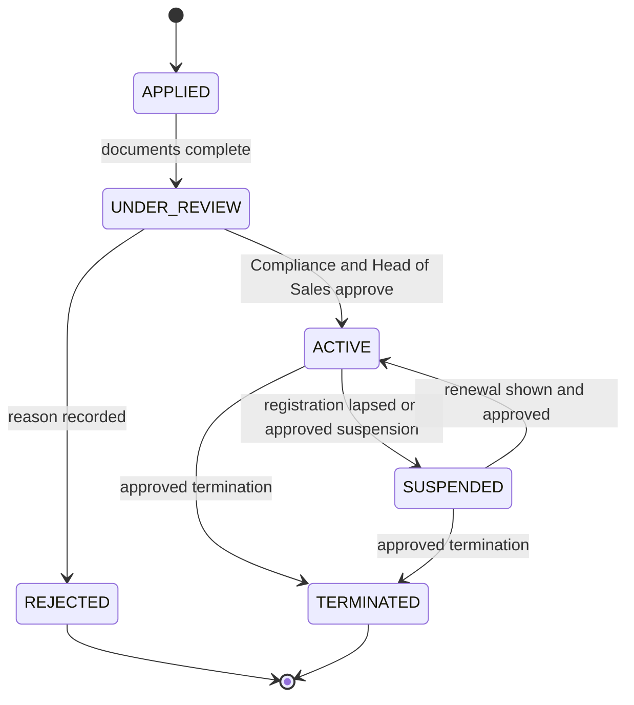

# PRD-014 — Distribution Management (D14)

This document states what AMC OS must do to keep a correct record of every distributor and its registrations, to measure sales, flows and assets by distributor, relationship manager (RM) and channel without breaking history when mappings change, and to calculate distributor commission in a way that can be reproduced to the paisa and audited. It re-keys PRD-000 v0.9 Module 12 to the GOV-001 identifiers (`FR-12-nn` → `FR-D14-nnn`, `BR-12-n` → `BRL-D14-nnn`, Module 12 and Chapter 5 stories → `US-D14-nnn`) and adds new **[DES]** requirements for the four D14 capabilities that had no v0.9 source (BA-001 §5 C1; GOV-001 §3 gap): **channel management (CAP-D14-004), sales incentives (CAP-D14-013), distributor segmentation (CAP-D14-014) and sales forecasting (CAP-D14-015)**. It adds one workflow, **WF-039 Distributor empanelment and registration monitoring** (§6.2), and expands the WF-013 card with the commission run states.

**Boundaries.** Sales, redemption, SIP and holding data come from the D13 mirror of the RTA's records (owner decision Q2; [PRD-013](PRD-013_investor_management.md) FR-D13-032); D14 never changes an investor transaction. Who computes the commission that is actually paid today — the AMC or the RTA — is not known (BA-002 §5; BA-004 WF-013); this PRD specifies an AMC OS calculation on the deterministic commission engine **FE-09** that is compared with the RTA's brokerage computation, and leaves the choice of which figure is paid to the owner (C1, owner question Q50). Bank payment release uses the generic payment control of D12 (CAP-D12-009). Commission as a cost in management accounts belongs to D15 ([PRD-015](PRD-015_finance_and_management_reporting.md)).

**Builds on Draft documents:** [PRD-000 v0.9](PRD-000_master_prd_v0.9.md) Module 12, Chapter 4 (W13), Chapter 5 (US-DST-01, US-DST-02), Chapter 6, Chapter 7, Chapter 9, Appendix A (R6, R14); [BA-001](../02_business_architecture/BA-001_business_capability_map.md) D14, §4, §5; [BA-002](../02_business_architecture/BA-002_amc_operating_model.md) DEP-12, P10, §5; [BA-003](../02_business_architecture/BA-003_domain_dictionary.md); [BA-004](../02_business_architecture/BA-004_end_to_end_workflows.md) WF-010, WF-012, WF-013, WF-037; [BA-005](../02_business_architecture/BA-005_roles_and_permissions.md) §3–§5; [PRD-001](PRD-001_platform_administration.md) §11; [PRD-013](PRD-013_investor_management.md); [DA-000](../05_data_architecture/DA-000_data_and_database_architecture_v0.9.md) §4.5 — allowed by owner decision D-3 ([GOV-008](../00_governance/GOV-008_build_loop.md) §2 rule 3). No document used here is Approved. PRD-015 is written in the same step (Step 9b).

**What this document is not:** the commission engine's formulas, day-count, rounding and test values (FE-09, Step 23 — the figures below are illustrations from PRD-000 only); RTA and AMFI file formats (INT-001, Step 14 — "Confirm with CAMS / KFintech", "Confirm with AMFI"); metric definitions (D16 metric registry, CAP-D16-012); ML model governance (AIML-002, Step 26); the AMC's payroll and HR systems. **Rule for engineers:** no commission rate, incentive amount, tax rate, tolerance, eligibility rule or certification period is hard-coded; each is a versioned, effective-dated parameter or tenant configuration approved through WF-021 (PRD-001 FR-D01-033). Every commission figure comes from FE-09, never from AI (BRL-D14-004).

## 1. Scope

| In scope (CAP) | Out of scope |
| --- | --- |
| CAP-D14-001 Distributor master · CAP-D14-002 ARN and EUIN records · CAP-D14-003 Distributor hierarchy · CAP-D14-004 Channel management · CAP-D14-005 Relationship manager management · CAP-D14-006 Sales tracking · CAP-D14-007 Business development · CAP-D14-008 AUM tracking · CAP-D14-009 Net flow analysis · CAP-D14-010 Distributor commissions · CAP-D14-011 Commission calculation · CAP-D14-012 Distributor productivity · CAP-D14-013 Sales incentives · CAP-D14-014 Distributor segmentation · CAP-D14-015 Sales forecasting · CAP-D14-016 Channel analytics | Issuing or cancelling ARNs (AMFI's job); running NISM certification; holding investor personal data beyond the masked aggregates D14 needs (BA-005 §3: RMs have no D13 right); salary and payroll processing (the AMC's HR systems); paying commission outside the approved run; AI that sets rates, approves runs or contacts distributors on its own (ADR-0008) |

## 2. Re-keying from PRD-000 Module 12

| PRD-000 v0.9 | Here | Note |
| --- | --- | --- |
| FR-12-01 … FR-12-15 | FR-D14-001 … FR-D14-015 | Same order; capability added. **(changed)** FR-D14-009 (daily AUM added; NAV source named as D11 approved NAV **[DES]**), FR-D14-002 (SIF certification reference now names PRD-000 R6 and is **[VAL]**), FR-D14-010 (upfront and B-30 wording replaced by the sourced facts in §5 note; who computes the paid figure open, C1) |
| BR-12-1 … BR-12-4 | BRL-D14-001 … BRL-D14-004 | Wording kept, except **(changed)** BRL-D14-001 (adds holding days and active empanelment, from FR-D14-017 **[DES]**) and BRL-D14-004 (adds the incentive-line trace, from FR-D14-019 **[DES]**) |
| W13 | WF-013 (BA-004) — run states added in §6.1 | |
| Module 12 point 7; Ch 5 US-DST-01, US-DST-02 | US-D14-001 (merged with US-DST-01), US-D14-002 (merged with US-DST-02) | Acceptance criteria from Ch 5 kept |
| Module 12 point 18 acceptance criteria | AC-US-D14-003-1, AC-US-D14-004-1 | Illustrative figures kept, labelled illustrative |
| Module 12 points 3, 4, 11–17 | §7, §9, §10, §11, §12 | |
| — | FR-D14-016 … FR-D14-033, BRL-D14-005 … 012, US-D14-005 … 012, WF-039 | **New** **[DES]** |

## 3. Business requirements

| ID | Business requirement | Capabilities |
| --- | --- | --- |
| BR-D14-001 | The AMC deals only with distributors who are registered, certified and empanelled on the transaction date, and can prove it for any past date | CAP-D14-001, -002, -003 |
| BR-D14-002 | Sales, flows, SIP book and AUM are measured the same way everywhere, by distributor, RM, branch, channel and city tier, and past reports do not change when mappings change | CAP-D14-005, -006, -008, -009, -016 |
| BR-D14-003 | Distributor commission is calculated by a deterministic engine from approved rate versions, checked against the RTA, approved by Finance and reproducible for any past month to the paisa | CAP-D14-010, -011 |
| BR-D14-004 | Sales leadership sees productivity, segments, incentives and forecasts on certified data, with forecasts always shown as forecasts | CAP-D14-004, -007, -012 … -015 |
| BR-D14-005 | Regulatory distribution incentives and certification rules are applied as versioned parameters that Compliance confirms | CAP-D14-002, -010 |

## 4. Functional requirements

Every requirement also obeys PRD-000 common rules C1–C8. Labels from PRD-000 are carried unchanged unless the change is stated. Priority: **M** must (release-blocking), **S** should — as PRD-000 Chapter 3.

### 4.1 Re-keyed from PRD-000 Module 12

| ID (was) | Pri | Capability | Requirement |
| --- | --- | --- | --- |
| FR-D14-001 (FR-12-01) | M | CAP-D14-001 (.1)…(.3) | **Distributor master:** entity type (individual distributor, corporate, bank, national distributor, online platform, registered investment adviser), PAN, GST registration, empanelment status, agreements, due-diligence category **[REG — distributor due diligence; VAL]** |
| FR-D14-002 (FR-12-02) **(changed)** | M | CAP-D14-002 (.1), (.3) | **ARN:** ARN number, validity, certification status and expiry, AMFI Know Your Distributor (KYD) status; daily validity check; certification for distributing Specialised Investment Fund (SIF) products where the AMC offers them (PRD-000 Appendix A R6, SEBI circular of 21 Jul 2026) **[REG; VAL certification types]**. *Changed:* label made explicit; certification types and the validity period are parameters, not values here |
| FR-D14-003 (FR-12-03) | M | CAP-D14-002 (.2) | **EUIN:** employee-level codes under corporate ARNs; the EUIN quoted on a transaction is checked against the ARN and its validity on the transaction date ([S4]) |
| FR-D14-004 (FR-12-04) | M | CAP-D14-003 (.1) | **Distributor hierarchy:** parent and sub-distributor relations, effective-dated |
| FR-D14-005 (FR-12-05) | M | CAP-D14-005 (.1), (.2) | **RM and branch mapping:** distributor → RM → branch → region → zone, effective-dated (branches from CAP-D01-007); history kept so that past reports do not change when mappings change |
| FR-D14-006 (FR-12-06) | M | CAP-D14-006 (.1) | **Sales transactions:** gross sales by channel, scheme, plan (Regular), distributor, RM and city tier (top 30 / beyond top 30 cities), from the D13 mirror |
| FR-D14-007 (FR-12-07) | M | CAP-D14-009 (.1) | **Redemptions and net flows:** net sales = gross sales − redemptions (including switch-out); one definition in the metric registry (CAP-D16-012) |
| FR-D14-008 (FR-12-08) | M | CAP-D14-006 (.2) | **SIP and lump sum:** SIP registrations, SIP book (monthly SIP inflow), cancellations, continuity rate |
| FR-D14-009 (FR-12-09) **(changed)** | M | CAP-D14-008 (.1) | **Distributor AUM:** daily, daily-average and month-end AUM per distributor and scheme from the mirrored holdings (D13) and the approved NAV (D11) |
| FR-D14-010 (FR-12-10) **(changed)** | M | CAP-D14-010 (.1)…(.3), CAP-D14-011 (.1), (.2) | **Commission calculation:** trail commission (% a year on daily AUM, accrued daily, paid monthly) from effective-dated rate versions by plan and distributor category; slab and scheme-specific rates; regulatory incentives (FR-D14-019); GST and TDS (FR-D14-020); claw-backs and carry-forward of negative balances; payment file. *Changed:* PRD-000's "upfront not permitted except as allowed" and "B30 incentive where permitted" are replaced by the sourced facts in the §5 regulatory note, still **[VAL]**; whether the AMC OS figure or the RTA's figure is paid is open (C1) |
| FR-D14-011 (FR-12-11) | M | CAP-D14-012 (.1) | **Distributor productivity:** sales per active distributor, activation, SIP share, yield earned |
| FR-D14-012 (FR-12-12) | M | CAP-D14-012 (.2) | **RM productivity:** scorecard (gross sales, net sales, SIP contribution, net revenue, incremental yield) with targets and rank; revenue and yield figures come from D15 (CAP-D15-001, CAP-D15-007) |
| FR-D14-013 (FR-12-13) | S | CAP-D14-007 (.1) | **Distributor opportunity management:** lead and opportunity pipeline for distributor activation and scheme pushes |
| FR-D14-014 (FR-12-14) | S | CAP-D14-016 (.1) | **Distributor churn:** early warning on falling AUM or flows; an ML score (CAP-D17-014 (.1)) is shown with its explanation and never changes a figure |
| FR-D14-015 (FR-12-15) | S | CAP-D14-016 (.2) | **Competitor analysis:** industry AUM and flows by AMC and category from AMFI monthly data; market share ("Confirm with AMFI" for the data feed) |

### 4.2 New requirements **[DES]**

| ID | Pri | Capability | Requirement |
| --- | --- | --- | --- |
| FR-D14-016 | M | CAP-D14-004 (.1), (.2) | **Channel management:** a tenant list of channels (for example banks, national distributors, independent distributors, online platforms, direct, exchange platforms), each distributor assigned to one channel with effective dates; channel owner (a person) and channel targets by period; reports by channel use the assignment in force on the transaction date (BRL-D14-003) |
| FR-D14-017 | M | CAP-D14-001 (.2), CAP-D14-002 | **Empanelment lifecycle:** `APPLIED → UNDER_REVIEW → ACTIVE → SUSPENDED → TERMINATED` (with `REJECTED`), driven by WF-039; agreement versions kept; due-diligence category and review date recorded; a suspended or terminated distributor earns no commission from the effective date (BRL-D14-001) |
| FR-D14-018 | M | CAP-D14-002 (.3) | **Registration monitoring:** daily load of ARN, EUIN and KYD status (source "Confirm with AMFI"); alerts at a configured number of days before expiry; on expiry or cancellation the commission eligibility ends from that date (PRD-000 Module 12 point 14) and transactions quoting the code are flagged; the source file and its date are kept so validity on any past date can be shown |
| FR-D14-019 | M | CAP-D14-010 (.1), CAP-D14-011 (.2) | **Regulatory incentive lines:** additional distributor incentives that regulation permits (currently the incentive for new individual investors from beyond-top-30 cities and new women investors — §5 note) are computed by FE-09 from a versioned incentive rule (eligibility, rate, cap, excluded categories, retention period, claw-back); eligibility facts (new investor, city, investor category) come from the D13 mirror or the RTA; each incentive line shows its rule version and funding source **[REG; VAL]** |
| FR-D14-020 | M | CAP-D14-010 (.2) | **Taxes on commission:** GST and TDS computed by FE-09 from versioned tax parameters and the distributor's registration status (GST registered or not; PAN available or not); certificates and returns are produced by Finance outside AMC OS **[REG — Income-tax and GST law; VAL current rates and sections]** |
| FR-D14-021 | M | CAP-D14-011 (.2) | **Commission run lifecycle:** `DRAFT → CALCULATED → APPROVED → PAID`, with `SUPERSEDED` (DA-000 Ch 7); a run uses only final month data from the D13 mirror, rate versions approved before the run, and registration status by day; each line traces to AUM-days × rate version (BRL-D14-004); an approved or paid run is never edited. Correction before payment: a superseding run replaces the approved, unpaid run. Correction after payment: `PAID` is final (DA-000 Ch 7), so the difference is booked as adjustment or claw-back lines in a later month's run, linked to the original lines |
| FR-D14-022 | M | CAP-D14-011 (.2) | **RTA comparison:** the run is compared line by line with the RTA's brokerage computation where the RTA supplies one ("Confirm with CAMS / KFintech"); a difference beyond the configured tolerance is a commission break, worked in WF-015 on the D12 engine (FE-07); the run cannot be approved while a break above the tolerance is open (WF-013) |
| FR-D14-023 | M | CAP-D14-010 (.2) | **Statements and payment:** distributor-wise statements (gross, incentive, claw-back, GST, TDS, net) published to distributors after approval; the payment file is released through the D12 payment control by at least two bank-mandate signatories (SOD-07); paid status returned from the bank ("Confirm with <bank>") |
| FR-D14-024 | M | CAP-D14-010 (.3) | **Claw-backs and carry-forward:** a claw-back (for example under an incentive rule's retention condition, or a recovered SIP upfront) is a negative line linked to the original line; a net negative balance for a distributor is carried forward to the next run, never paid as a negative (PRD-000 Module 12 point 14); write-off of an old negative balance needs CFO approval (§7) |
| FR-D14-025 | M | CAP-D14-010 | **Disputes:** a distributor query on a statement is recorded against the run and line, worked to a resolution, and any change made only through FR-D14-021 / FR-D14-024 |
| FR-D14-026 | M | CAP-D14-013 (.1), (.2) | **Sales incentives (staff):** incentive schemes for the AMC's sales staff (eligibility, measures from certified metrics, slabs, period, cap) are versioned and approved; incentive results are calculated deterministically (FE-09 or FE-08, to be fixed in EA-003, C5) and approved by the CFO; AMC OS hands the approved amounts to the AMC's payroll system and does not pay them; incentive data is personal data, visible only to the employee, the employee's managers in line and Finance |
| FR-D14-027 | S | CAP-D14-014 (.1), (.2) | **Distributor segmentation:** segment rules (for example by AUM band, growth, SIP share, channel, geography) defined in terms of certified metrics; membership computed on a schedule and kept by date, so that any past segment can be shown; a segment change never changes a commission rate unless a rate version names that segment |
| FR-D14-028 | S | CAP-D14-015 (.1) | **Sales forecasting:** a driver-based forecast of gross sales, redemptions, net flows and SIP book by channel and scheme (drivers and assumptions versioned and named); an optional ML forecast (CAP-D17-016) shown beside it with error bands; forecasts labelled as forecasts and never mixed with actuals (as PRD-000 BR-13-3); feeds the D15 revenue forecast (CAP-D15-008) |
| FR-D14-029 | M | CAP-D14-005, CAP-D14-012 | **Data scope by hierarchy:** an RM sees own distributors; a branch, zonal or national head sees the hierarchy below (PRD-000 Module 12 point 4), enforced through attribute-based scope from the mapping in force today (CAP-D01-004); historical reports use the mapping on the transaction date (BRL-D14-003) |
| FR-D14-030 | M | CAP-D14-006, -008, -009 | **Investor data in D14:** D14 holds investor-level data only as needed for commission and incentive eligibility (folio reference, plan, units, city, investor category), with personal data masked or tokenised (NFR-SEC-004 of PRD-013); dashboards and RM views show aggregates only |
| FR-D14-031 | M | CAP-D14-006, -009, -011 | **Events to other domains:** commission accrual and paid amounts to D15 (cost, CAP-D15-006) and to D10 where commission is a scheme expense (C2); sales, flows and AUM to D16 for the certified metrics; through events only (no cross-domain writes) |
| FR-D14-032 | M | CAP-D14-016 | **Channel analytics:** sales, net flows, AUM, SIP book, yield and market share by channel, city tier, segment and period, from certified metrics, each number linked to its definition and source (as PRD-000 FR-13-11) |
| FR-D14-033 | S | CAP-D17-010 | **Distribution intelligence assistant:** next-best actions, meeting briefs and churn explanations for an RM, within the RM's scope; it proposes, the RM decides (§12; BRL-D14-008) |

## 5. Business rules

| ID (was) | Rule | Label |
| --- | --- | --- |
| BRL-D14-001 (BR-12-1) **(changed)** | No commission accrues on a transaction or holding day without a valid ARN (and EUIN where required) and an active empanelment on that day | **[DES]**; ARN/EUIN requirement **[IND; VAL]** ([S4]) |
| BRL-D14-002 (BR-12-2) | Direct-plan transactions never accrue commission | **[DES]**; Direct plan has no distribution commission **[REG — VAL]** |
| BRL-D14-003 (BR-12-3) | Mappings are effective-dated; reports use the mapping as of the transaction date unless the report says "current mapping" | **[DES]** |
| BRL-D14-004 (BR-12-4) **(changed)** | The commission engine is deterministic; every payout line traces to AUM-days × rate version (and, for an incentive line, to the incentive rule version and eligible transaction) | **[DES]** |
| BRL-D14-005 | Commission rate versions are approved by the Head of Sales†, a Finance Officer or the CFO, and a Compliance Officer before their effective date; a rate is never changed for a past period except by a superseding version with reason, which forces a superseding run | **[DES]** (PRD-000 Module 12 point 13) |
| BRL-D14-006 | Commission run: maker in distribution operations, checker in Finance; payment release by at least two bank-mandate signatories (SOD-07) | **[DES]** (PRD-000) |
| BRL-D14-007 | Regulatory parameters (incentive rules, tax rates, certification types) are confirmed by a Compliance Officer before use (SOD-12) | **[DES]** |
| BRL-D14-008 | AI never sets a rate, changes a mapping, approves or edits a run, or contacts a distributor on its own (ADR-0008; SOD-10) | **[DES]** |
| BRL-D14-009 | Forecasts and segments are labelled and stored apart from actuals; a forecast is never used as an input to commission | **[DES]** |
| BRL-D14-010 | A distributor's own statement shows only that distributor's data; one distributor never sees another's figures | **[DES]** |
| BRL-D14-011 | An investor may earn a distributor at most one regulatory incentive for the same investor or investment (§5 note) | **[REG — VAL]** ([S2], [S3]) |
| BRL-D14-012 | Money is `NUMERIC`; FE-09 keeps 4 decimal places on lines (DA-000 §4.5) and rounds to the paisa only at the payable step defined in FE-09 | **[DES]** |

**Regulatory note.** These facts were opened through web search on 21 Nov 2026. Most predate the SEBI (Mutual Funds) Regulations, 2026 (PRD-000 Appendix A R1, in force 1 Apr 2026) and the Master Circular of 20 Mar 2026 (R4), so whether each still applies, and in what form, is **[VAL]** (REG-001, Step 25). Nothing below is hard-coded; each becomes a parameter that Compliance confirms (BRL-D14-007).

- **Full-trail model.** SEBI's circular of 22 Oct 2018 (SEBI/HO/IMD/DF2/CIR/P/2018/137) moved distributors to trail commission and stopped upfront commission [S1] (press) [S5] (reference). The circular of 25 Mar 2019 (SEBI/HO/IMD/DF2/CIR/P/2019/42) allowed one carve-out: trail commission may be paid upfront, up to 1% a year in advance for at most three years, for SIPs of up to ₹3,000 a month per scheme by an investor investing in mutual funds for the first time (identified by PAN), paid from the AMC's books, amortised daily to the scheme, and recovered pro rata from the distributor if the SIP stops early; applicable from 15 Apr 2019 [S5] **[REG; VAL current form]**.
- **Incentive for new investors (B-30 and women).** A SEBI circular of 27 Nov 2025 allowed an additional commission for new individual investors (new PAN) from beyond the top 30 cities and for new women investors: 1% of the first lump sum (retained for at least a year) or of the first year's SIP instalments, capped at ₹2,000; ETFs, certain domestic fund-of-funds and short-duration schemes (overnight, liquid, ultra-short, low duration) excluded; paid from the 2 basis points AMCs set aside for investor education; with claw-back; a distributor may claim only one incentive per investor or investment. The start was 1 Feb 2026 [S3]; a circular of 7 Jan 2026 moved it to 1 Mar 2026 [S2] (only this press source; the primary circulars were not opened) [S2], [S3] **[REG; VAL — secondary sources; legal basis under the 2026 Regulations; definition of "new" (industry-wide PAN or AMC-level) and claw-back mechanics]**.
- **Registration.** A distributor needs an AMFI Registration Number (ARN), obtained after NISM certification (or the continuing professional education route, where eligible) and KYD, with "new cadre" distributors exempt from KYD; an institutional distributor's advising employee is identified by an EUIN quoted on the application [S4] **[IND; VAL — ARN validity period and renewal not stated in the source]**.
- **TDS on commission.** The Finance (No. 2) Bill 2024 cut TDS on commission under section 194H of the Income-tax Act, 1961 from 5% to 2% from 1 Oct 2024 [S6] **[REG; VAL enactment, threshold, and the section number under the Income-tax Act, 2025 if it applies from 1 Apr 2026]**. GST on distributor commission **[VAL — rate and reverse-charge position for unregistered distributors; confirm: AMC tax adviser]**.

## 6. Workflows

### 6.1 Existing workflows

| Workflow | D14 role | Requirements |
| --- | --- | --- |
| [WF-013](../02_business_architecture/BA-004_end_to_end_workflows.md) Distributor commission | **Accountable** (DEP-12); maker Distributor Manager, checker Finance Officer or CFO, payment by two signatories (SOD-07) | FR-D14-010, -019 … -025 |
| WF-010 Investor purchase; WF-012 SIP processing; WF-037 Switch, STP, SWP | ARN / EUIN on the transaction checked against validity (FR-D14-003, -018); sales and SIP book updated from the mirror | FR-D14-006 … -008 |
| WF-015 Reconciliation | Commission breaks against the RTA computation | FR-D14-022 |
| WF-021 Configuration change | Rate versions, incentive rules, tax parameters, tolerances | BRL-D14-005, -007 |
| WF-039 Distributor empanelment and registration monitoring (new, §6.2) | **Accountable** | FR-D14-001, -002, -017, -018 |

**WF-013 additions [DES].** The run follows FR-D14-021 states. Preconditions add: no open commission break above tolerance at approval; incentive rule versions approved. A rerun after approval creates a superseding run (the approved run becomes `SUPERSEDED` only when the new run is approved). These additions belong in the WF-013 card at BA-004's next revision (C7).

### 6.2 WF-039 — Distributor empanelment and registration monitoring **[DES]**

| Field | Detail |
| --- | --- |
| Trigger | Application from a distributor to be empanelled; or the daily registration file shows an expiry, cancellation or change; or a due-diligence review date is reached |
| Initiator | Distributor Manager (distribution operations) |
| Departments | **DEP-12 Sales and distribution** — accountable; DEP-09 (due diligence, approval), DEP-14 (bank details and tax registration, for payment), DEP-10 (agreement, where the AMC's legal team reviews it) |
| Capabilities | CAP-D14-001, CAP-D14-002, CAP-D14-003, CAP-D14-004, CAP-D14-005, CAP-D14-010 (.2), CAP-D12-010 |
| Hand-offs (outside) | AMFI (ARN, EUIN and KYD status — "Confirm with AMFI"); RTA (distributor code set-up so that transactions carry the ARN — "Confirm with CAMS / KFintech"); distributor (documents, agreement) |
| Preconditions | Valid ARN and certification on the application date; PAN and bank details verified (bank detail changes follow the SOD-06 pattern: maker in distribution operations, checker in Finance, with call-back) |
| Final state | Distributor `ACTIVE` with channel, hierarchy and RM mapping, agreement version and due-diligence category recorded; or `REJECTED` with reason. For monitoring: status set to `SUSPENDED` (registration lapsed) or `TERMINATED`, commission eligibility ended from the effective date |
| Approvals | Empanelment: Distributor Manager (maker), Compliance Officer (due diligence) **and** Head of Sales† (checker). Suspension and termination: same. Reinstatement after renewal: Distributor Manager with Compliance Officer |
| Exceptions | ARN expired or cancelled → automatic `SUSPENDED` at expiry, alert to DEP-12 and the RM; EUIN not linked to the ARN → transaction flagged, no commission; due-diligence review overdue → alert to Compliance; distributor appears on a regulatory action list **[VAL — source]** → Compliance review |
| Audit | Application documents (in the document store, CAP-D12-010), registration source file and date, approvals, every status change with effective date and reason |
| Source | **new** (BA-001 CAP-D14-001 (.2), (.3); PRD-000 Module 12 point 4 "Compliance (distributor due diligence)") |

## 7. Permissions by capability

From BA-005 §3 (D14 column) and §4, narrowed to capabilities (BA-005 §7 C2). Checker ≠ maker (SOD-01). Distributor Manager (ROLE-14): R C U S. RM (ROLE-15): R own. CFO: R A(commission). Finance Officer (ROLE-24): R A J (commission checker). Compliance Officer: R A(due diligence). CEO, COO, Operations Analyst, Product Manager: R. Auditor: R E. CIO, CTO, Fund Manager, Research Analyst, Dealer, Risk Manager, Fund Accountant, Investor Service Executive, Technology Administrator: none. AI agent identity: proposals only (SOD-10).

| Capability | Maker | Checker(s) |
| --- | --- | --- |
| CAP-D14-001, -002 empanelment, suspension, termination (WF-039) | Distributor Manager | Compliance Officer **and** Head of Sales† |
| CAP-D14-001 distributor bank details | Distributor Manager | Finance Officer, with call-back (SOD-06 pattern)† |
| CAP-D14-003, -004, -005 hierarchy, channel and RM mapping | Distributor Manager | Head of Sales† |
| CAP-D14-010 (.1) rate versions; FR-D14-019 incentive rules | Distributor Manager | Head of Sales†, Finance Officer or CFO, **and** Compliance Officer (BRL-D14-005) |
| CAP-D14-011 (.2) commission run | Distributor Manager | Finance Officer or CFO (SOD-07) |
| CAP-D14-010 (.2) payment release | Operations Analyst (as BA-005 `operations.payout.release`) | At least two bank-mandate signatories (SOD-07) |
| CAP-D14-010 (.3) write-off of negative balance | Distributor Manager | CFO† |
| CAP-D14-013 staff incentive scheme and results | Distributor Manager | CFO† (and CEO for the scheme itself†) |
| CAP-D14-014, -015 segment rules, forecast versions | Distributor Manager | Head of Sales† |
| CAP-D14-006 … -009, -012, -016 views | System (from certified data) | — |

**Rights added beyond BA-005 (†):** BA-005 §4 has no **Head of Sales** authority; PRD-000 Module 12 point 13 names "Distribution head" as an approver of commission structures. This PRD uses a proposed approval authority **Head of Sales**, held with ROLE-14 by the head of DEP-12 (BA-002: CBO / Head of Sales) (C3). Also added: Finance Officer as checker of distributor bank details (mirrors SOD-06), and CFO approval of write-offs and staff incentives; CEO approval of a staff incentive scheme.

## 8. User stories and acceptance criteria

Priority: **C** critical (release-blocking), **O** optional — as PRD-000 Chapter 5. All example data is synthetic and illustrative (GOV-003 §5); rates are not real.

| ID | Story | Pri | Acceptance criteria (Given / When / Then) |
| --- | --- | --- | --- |
| US-D14-001 (was Module 12 point 7; US-DST-01) | As an RM, I want my scorecard updated daily, so that I know where I stand against target | C | **AC-US-D14-001-1** (from US-DST-01) Given T−1 data certified, when the RM logs in at 09:00, then the scorecard shows T−1 values (NFR-PERF-022). |
| US-D14-002 (was Module 12 point 7; US-DST-02) | As Finance, I want to reproduce last month's commission for any distributor, so that disputes are resolved quickly | C | **AC-US-D14-002-1** (from US-DST-02) Given a past month, when rerun with stored inputs and versions, then output matches to the paisa. |
| US-D14-003 | As Finance, I want trail commission computed from AUM-days | C | **AC-US-D14-003-1** (was Module 12 point 18; illustrative rate) Given a distributor with AUM ₹10,00,000 for 30 days at 0.80% a year on an actual/365 basis, when the monthly run executes, then gross commission = 10,00,000 × 0.80% × 30/365 = ₹657.5342 held on the line (DA-000 §4.5), ₹657.53 at paisa rounding, before taxes. Day basis and rounding step are confirmed in FE-09 **[VAL]**. |
| US-D14-004 | As Compliance, I want no commission on Direct plans | C | **AC-US-D14-004-1** (was Module 12 point 18) Given a transaction under a Direct plan, when the run executes, then its commission = 0. |
| US-D14-005 | As a Distributor Manager, I want commission to stop when an ARN expires | C | **AC-US-D14-005-1** Given an ARN valid to the 15th of the month, when the run executes, then commission accrues for days up to and including the 15th only, and the distributor's status is `SUSPENDED` from the 16th. |
| US-D14-006 | As Finance, I want differences with the RTA found before approval | C | **AC-US-D14-006-1** Given a line whose amount differs from the RTA's brokerage beyond the tolerance, when the Finance Officer tries to approve the run, then approval is refused until the break is resolved or accepted in WF-015. |
| US-D14-007 | As the CFO, I want past months never to change silently | C | **AC-US-D14-007-1** Given an approved run, when anyone tries to edit a line, then the edit is refused; a correction is possible only as a superseding run or a claw-back line, each with reason and approval. |
| US-D14-008 | As a Distributor Manager, I want negative balances carried forward | C | **AC-US-D14-008-1** Given a distributor whose claw-backs exceed this month's commission, when the run executes, then net payable is zero and the negative amount is carried into next month's run. |
| US-D14-009 | As a zonal head, I want last year's report unchanged after a remapping | C | **AC-US-D14-009-1** Given a distributor moved to another branch from date D, when a report for a period before D runs, then sales are shown under the old branch unless "current mapping" is chosen. |
| US-D14-010 | As Compliance, I want only one regulatory incentive per investor | C | **AC-US-D14-010-1** Given a new woman investor from a beyond-top-30 city, when the run computes incentives, then at most one incentive line is created for that investment, under the rule version in force, within the cap. |
| US-D14-011 | As an RM, I want only my own distributors | C | **AC-US-D14-011-1** Given an RM, when the RM queries another RM's distributor through UI or API, then 403 is returned and the attempt logged. |
| US-D14-012 | As the Head of Sales, I want forecasts kept apart from actuals | C | **AC-US-D14-012-1** Given a sales forecast and an ML forecast, when shown on a dashboard, then both are labelled as forecasts with version and error band, and neither appears in actual sales totals. |

Definition of done: as PRD-000 Chapter 5.

## 9. Exceptions

| Exception | Handling | Source |
| --- | --- | --- |
| ARN expired mid-month | Accrual stops from the expiry date; status `SUSPENDED` | PRD-000 Module 12 point 14 |
| RTA brokerage differs from AMC OS calculation | Commission break (WF-015); run held | PRD-000 Module 12 point 14 |
| Negative net commission (claw-back) | Carried forward | PRD-000 Module 12 point 14 |
| RTA month data not final | Run cannot start; provisional view only | **[DES]** |
| Rate version missing for a plan and category with AUM | Run blocked with the list of missing rates | **[DES]** |
| Transaction with unknown ARN or EUIN | Flagged; no commission until resolved; DEP-12 work queue | **[DES]** |
| Bank rejects a payment | Line stays `APPROVED` unpaid; bank details checked (SOD-06 pattern); re-released by signatories | **[DES]** |
| Distributor disputes a statement | FR-D14-025 | **[DES]** |

## 10. Data and interfaces

**Owned schema:** `distribution` (GOV-001 §3). No database change is made in this step.

| Exists in [DDL-000](../../database/ddl/DDL-000_core_schema_v0.9.sql) | Not yet in DDL-000 (for DA-001 / DDL, Steps 15–16) **[DES]** |
| --- | --- |
| `distribution.distributor` (ARN, entity type, `arn_valid_to`, empanelment status `PENDING / ACTIVE / SUSPENDED / TERMINATED`); `distribution.rm_mapping` (effective-dated, no overlaps); `distribution.commission_rate` (effective-dated per plan and category); `distribution.commission_run` (`DRAFT → CALCULATED → APPROVED → PAID / SUPERSEDED`, maker ≠ checker); `distribution.commission_line` (AUM-days, day basis, gross, GST, TDS, claw-back, net, with arithmetic CHECKs — DA-000 §4.5) | EUIN register; KYD and certification records with source file; hierarchy links; channels and channel assignments; agreements; due-diligence reviews; incentive rules and incentive lines; carry-forward balances; RTA brokerage lines and comparison results; statements; disputes; staff incentive schemes and results; segment rules and membership; forecasts; opportunities |

DDL-000 status values differ from FR-D14-017 (`PENDING` vs `APPLIED / UNDER_REVIEW`, no `REJECTED`); the `commission_line` key `(run, distributor, plan)` has no place for incentive, adjustment or claw-back lines linked to an original line; `commission_run` has no link to the run it supersedes, and the unique index on `APPROVED / PAID` runs per month means a superseding run can be approved only after the old run leaves `APPROVED` in the same transaction — to settle in DA-001 (C6).

**Interfaces (indicative, not contracts):** PRD-000 Module 12 point 11 names `distribution-svc` resources `/distributors`, `/arns`, `/euins`, `/hierarchy`, `/mappings`, `/sales`, `/aum`, `/flows`, `/commission-structures`, `/commission-runs`, `/opportunities`; this PRD adds `/channels`, `/empanelments`, `/incentive-rules`, `/statements`, `/disputes`, `/segments`, `/forecasts`, `/staff-incentives`. Names become `API-D14-nnn` in Step 24 and events `<NAME>.v<n>` in EA-007 (Step 13). Outside parties: AMFI (ARN, EUIN, KYD status; industry data), CAMS and KFintech (transaction and brokerage feeds), banks (payment files), distributors (statements portal or file) — each "Confirm with <provider>" (INT-001, Step 14); none is fabricated here.

## 11. Non-functional requirements

| ID | Requirement | Type / source |
| --- | --- | --- |
| NFR-PERF-022 | RM and distributor scorecards for T−1 available by 09:00 IST on business days | Proposed — PRD-000 Module 12 point 17, US-DST-01 |
| NFR-PERF-023 | Monthly commission run for 100,000 distributors completes in < 30 minutes | Proposed — PRD-000 Module 12 point 17 |
| NFR-AUD-014 | Every rate, incentive-rule and tax-parameter version, run input set, calculation result, comparison, approval, payment file and statement kept and reproducible for any past month (PRD-000 Module 12 point 15; Ch 7 reproducibility) | **[DES]** |
| NFR-RET-006 | Distributor, commission and payment records kept for the periods required by SEBI MF Regulations and tax law **[REG — VAL periods]** | **[VAL]** |

Platform NFRs in PRD-001 §11 apply (dashboards p95 < 2 s, PRD-000 Ch 7).

## 12. AI in this domain

Within PRD-000 C8 and [ADR-0008](../../architecture/adrs/ADR-0008_ai_boundary.md) (read and propose only). The **distribution intelligence assistant** (CAP-D17-010; PRD-000 Ch 9 "Distribution Intelligence Agent") gives an RM next-best actions, meeting briefs, territory insights and churn explanations, using tools that return certified metrics and churn scores in the RM's scope (`get_metric`, `get_distributor_profile`, `get_churn_score`). The churn score is a model output (CAP-D17-014 (.1)) governed under AIML-002 (Step 26). The assistant never sets rates, changes mappings, approves or edits commission runs, or contacts distributors (BRL-D14-008, SOD-10); investor personal data is never in its context (FR-D14-030). Measures: activation uplift, RM rating (PRD-000 Ch 9).

## 13. Open points

| # | Point | Where closed |
| --- | --- | --- |
| C1 | Which commission figure is paid: AMC OS's FE-09 calculation (checked against the RTA) or the RTA's brokerage computation (checked by AMC OS, as for the investor mirror)? Default here: FE-09 figure, compared with the RTA, paid after Finance approval — owner question Q50 | Owner (Q50); pilot discovery |
| C2 | Since the 2018 framework, commission is understood to be charged to the scheme within the TER (SIP upfront paid from the AMC's books and amortised to the scheme) [S5]; so commission is both a scheme expense (D10) and, in PRD-000 FR-13-03, an AMC cost (D15). Which books carry it, and how D15 shows it, needs Compliance and Finance confirmation — owner question Q51 | Owner (Q51); FE-02, FE-08 (Steps 21, 23) |
| C3 | Head of Sales approval authority is not in BA-005 §4; Finance Officer checker for distributor bank details and CFO approval of write-offs and staff incentives added (†) | Next BA-005 revision |
| C4 | Regulatory incentive (B-30 and women): legal basis under the 2026 Regulations, "new investor" definition, claw-back mechanics, and how the RTA supplies eligibility | REG-001 (Step 25); INT-001 (Step 14) |
| C5 | Which engine computes staff sales incentives (FE-09 or FE-08) | EA-003 (Step 11) |
| C6 | Tables in §10 missing from DDL-000; DDL-000 empanelment states, commission-line key and superseding-run link (§10) | DA-001 / DDL (Steps 15–16) |
| C7 | BA-004 register gets WF-039 (row added in this step); the full card lives here and the WF-013 additions (§6.1) go into BA-004's next revision | Next BA-004 revision |
| C8 | ARN validity period, renewal, KYD and certification rules; TDS section under the Income-tax Act, 2025; GST position — all **[VAL]** | REG-001 (Step 25); AMC tax adviser |

## Sources

Repository sources: [PRD-000 v0.9](PRD-000_master_prd_v0.9.md) Module 12, Ch 4 (W13), Ch 5, Ch 6, Ch 7, Ch 9, Appendix A; [BA-001](../02_business_architecture/BA-001_business_capability_map.md) D14, §4, §5; [BA-002](../02_business_architecture/BA-002_amc_operating_model.md) DEP-12, P10, §5; [BA-004](../02_business_architecture/BA-004_end_to_end_workflows.md) WF-013; [BA-005](../02_business_architecture/BA-005_roles_and_permissions.md) §3–§5; [PRD-013](PRD-013_investor_management.md); [DA-000](../05_data_architecture/DA-000_data_and_database_architecture_v0.9.md) §4.5, Ch 7; [GOV-006](../00_governance/GOV-006_gap_analysis_and_delivery_plan.md) §4 owner decision Q2; [LOOP_STATE.md](../../LOOP_STATE.md) owner decision D-3.

External sources (opened through web search on 21 Nov 2026; regulatory detail still **[VAL]**):

| # | Source | Used for |
| --- | --- | --- |
| S1 | [Business Standard — MFs may no longer be top draw for banks after Sebi trail commission order (21 Nov 2018)](https://www.business-standard.com/amp/article/markets/mfs-may-no-longer-be-top-draw-for-banks-after-sebi-trail-commission-order-118112101435_1.html) — press, secondary | Circular of 22 Oct 2018; end of upfront commission |
| S2 | [Moneylife — Mutual fund distributor incentives: SEBI extends timeline to 1st March (7 Jan 2026)](https://www.moneylife.in/article/mutual-fund-distributor-incentives-sebi-extends-timeline-to-1st-march-after-industry-feedback/79318.html) — press, secondary | B-30 and women investor incentive: amount, cap, exclusions, funding, one incentive only, start date |
| S3 | [SCC Online — SEBI rolls out additional incentives for mutual fund distributors (28 Nov 2025)](https://www.scconline.com/blog/post/2025/11/28/sebi-announces-additional-incentives-mutual-fund-distributors/) — legal news, secondary | Circular of 27 Nov 2025; Regulation 52(4A) of the 1996 Regulations |
| S4 | [Taxmann — ARN, EUIN and KYD explained](https://www.taxmann.com/post/blog/arn-euin-kyd-explained) — secondary | ARN, EUIN, KYD, NISM certification |
| S5 | [SEBI circular SEBI/HO/IMD/DF2/CIR/P/2019/42 — Review of commission, expenses, disclosure norms (25 Mar 2019)](https://www.sebi.gov.in/sebi_data/attachdocs/mar-2019/1553515852324.pdf) — primary | SIP upfront carve-out, conditions and claw-back; reference to the 22 Oct 2018 circular |
| S6 | [TaxGuru — Budget 2024: section 194H TDS rate cut to 2% from 1 Oct 2024](https://taxguru.in/income-tax/budget-2024-section-194h-tds-rate-cut-2-percent-october-1.html) — secondary (Finance Bill text) | TDS rate on commission |
