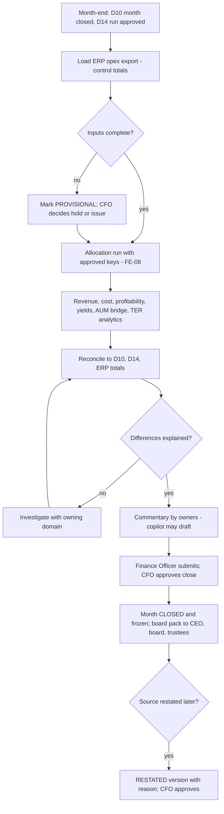

# PRD-015 — Finance and Management Reporting (D15)

This document states what AMC OS must do to show the AMC company's true economics — revenue, cost and profit by scheme, plan, channel, branch and team — from governed data, with budgets, plans and forecasts beside the actuals, and to produce the monthly management pack and executive dashboards on certified numbers. It re-keys PRD-000 v0.9 Module 13 to the GOV-001 identifiers (`FR-13-nn` → `FR-D15-nnn`, `BR-13-n` → `BRL-D15-nnn`, Module 13 and Chapter 5 stories → `US-D15-nnn`) and adds new **[DES]** requirements for the two D15 capabilities that had no v0.9 source (BA-001 §5 C1; GOV-001 §3 gap): **expense management (CAP-D15-002) and financial planning (CAP-D15-004)**. It adds the missing D15 workflow, **WF-040 Monthly management reporting close** (§6.2), which carries BA-002 process **P13 Management reporting (MIS)** and closes BA-004 §5.2 C6.

**Boundary (PS-001 §3; BA-001 D15 boundary note; BA-002 §5):** the AMC company's own statutory books stay in its corporate ERP. D15 produces **management** figures; it does not post the AMC company's statutory ledger, file its tax returns or prepare its statutory financial statements. Scheme-level revenue figures are **not recomputed**: the AMC's management fee per scheme, plan and day comes from the D10 accruals (PRD-000 FR-13-01; PRD-010 FR-D10-006). Commission comes from D14 (FE-09). Operating expenses come from the corporate ERP by export ("Confirm with the AMC's ERP provider"). D15's own engine, **FE-08 (revenue)**, attributes, allocates and aggregates these inputs deterministically; its formulas are specified in Step 23.

**Builds on Draft documents:** [PRD-000 v0.9](PRD-000_master_prd_v0.9.md) Module 13, Chapter 5 (US-FIN-01), Chapter 6, Chapter 7, Chapter 9; [BA-001](../02_business_architecture/BA-001_business_capability_map.md) D15, §4, §6; [BA-002](../02_business_architecture/BA-002_amc_operating_model.md) DEP-14, DEP-01, P13, §5; [BA-003](../02_business_architecture/BA-003_domain_dictionary.md); [BA-004](../02_business_architecture/BA-004_end_to_end_workflows.md) WF-013, §5; [BA-005](../02_business_architecture/BA-005_roles_and_permissions.md) §3–§5; [PRD-001](PRD-001_platform_administration.md) §11; [PRD-002](PRD-002_product_and_scheme_management.md) FR-D02-012, FR-D02-023; [PRD-010](PRD-010_fund_accounting.md) FR-D10-006, §5 note; [PRD-012](PRD-012_fund_operations.md) — allowed by owner decision D-3 ([GOV-008](../00_governance/GOV-008_build_loop.md) §2 rule 3). No document used here is Approved. PRD-014 is written in the same step (Step 9b). Owner decisions D-51 (scheme expense payments made outside AMC OS; AMC OS records and checks them), D-57 (commission in the books by type) and D-58 (budgets and multi-year plans made in AMC OS) of 21 Nov 2026 are applied ([LOOP_STATE.md](../../LOOP_STATE.md)).

**What this document is not:** the revenue engine's formulas and test values (FE-08, Step 23); metric definitions and the semantic layer (D16, CAP-D16-011, CAP-D16-012 — PRD-016); TER cap rules (D08 rule registry, PRD-008); scheme accounting (D10); the AMC company's statutory accounts, tax and payroll (corporate ERP and HR systems); ML model governance (AIML-002, Step 26). **Rule for engineers:** no allocation driver, budget figure, cost centre, fee rate or TER cap is hard-coded; each is versioned configuration or an approved input. Every financial figure comes from a deterministic engine or an approved source, never from AI (BRL-D15-006).

## 1. Scope

| In scope (CAP) | Out of scope |
| --- | --- |
| CAP-D15-001 Revenue management · CAP-D15-002 Expense management · CAP-D15-003 Budgeting · CAP-D15-004 Financial planning · CAP-D15-005 Profitability · CAP-D15-006 Cost allocation · CAP-D15-007 Incremental yield · CAP-D15-008 Revenue forecasting · CAP-D15-009 Management reporting · CAP-D15-010 Business performance · CAP-D15-011 Executive dashboards | AMC company statutory books, tax returns, statutory financial statements (corporate ERP, PS-001 §3); payment of the AMC's own expenses (corporate ERP; scheme expense payments are made outside AMC OS; AMC OS records and checks them — owner decision D-51, PRD-012); recomputing scheme fees (D10); TER cap rules (D08); payroll; AI that produces official figures (ADR-0008) |

## 2. Re-keying from PRD-000 Module 13

| PRD-000 v0.9 | Here | Note |
| --- | --- | --- |
| FR-13-01 … FR-13-11 | FR-D15-001 … FR-D15-011 | Same order; capability added. **(changed)** FR-D15-003 (commission cost treatment by type, D-57), FR-D15-004 (TER cap source named: D08 rule registry) |
| BR-13-1 … BR-13-3 | BRL-D15-001 … BRL-D15-003 | Wording kept, except **(changed)** BRL-D15-003 (extended to budgets, plans and what-if scenarios, which FR-D15-015 and FR-D15-026 add **[DES]**) |
| Module 13 point 7; Ch 5 US-FIN-01 | US-D15-001 (merged with US-FIN-01), US-D15-002 | Acceptance criteria kept |
| Module 13 point 18 acceptance criteria | AC-US-D15-003-1, AC-US-D15-004-1 | |
| Module 13 points 3, 4, 11–17 | §7, §9, §10, §11, §12 | |
| — | FR-D15-012 … FR-D15-027, BRL-D15-004 … 010, US-D15-005 … 011, WF-040 | **New** **[DES]** |

## 3. Business requirements

| ID | Business requirement | Capabilities |
| --- | --- | --- |
| BR-D15-001 | The AMC sees revenue, cost and contribution by scheme, plan, channel, branch and RM each month, from the same governed inputs that the scheme books and commission runs use | CAP-D15-001, -002, -005, -006 |
| BR-D15-002 | Yield and incremental yield are measured consistently, so pricing and distribution decisions rest on one definition | CAP-D15-007 |
| BR-D15-003 | Budgets, multi-year plans and forecasts sit beside actuals, are versioned and approved, and are never mixed with actuals | CAP-D15-003, -004, -008 |
| BR-D15-004 | A monthly management pack (management P&L, AUM bridge, TER analytics, board pack) is closed, frozen and published on a fixed timetable, and any restatement is visible | CAP-D15-009 |
| BR-D15-005 | Leadership dashboards show only certified metrics, each traceable to its definition and source | CAP-D15-010, -011 |

## 4. Functional requirements

Every requirement also obeys PRD-000 common rules C1–C8. Labels from PRD-000 are carried unchanged unless the change is stated. Priority: **M** must (release-blocking), **S** should — as PRD-000 Chapter 3.

### 4.1 Re-keyed from PRD-000 Module 13

| ID (was) | Pri | Capability | Requirement |
| --- | --- | --- | --- |
| FR-D15-001 (FR-13-01) | M | CAP-D15-001 (.1) | **AMC revenue:** management fee earned per scheme, plan and day = daily net assets × fee rate ÷ days in year, **taken from the D10 accruals, not recomputed** (PRD-010 FR-D10-006); the fee rate version used is carried with each figure |
| FR-D15-002 (FR-13-02) | M | CAP-D15-001 (.2) | **Scheme revenue views:** revenue by plan (Direct / Regular), channel and distributor tier, attributed from D14 AUM by channel and distributor (FE-08) |
| FR-D15-003 (FR-13-03) **(changed)** | M | CAP-D15-006 (.1) | **Expense allocation:** distributor commission (actual, from D14 runs), scheme expenses borne by the AMC (FR-D15-013), and operating expenses by cost centre (FR-D15-012), allocated to scheme, plan, channel, branch and RM by drivers (AUM, transactions, headcount, others) with versioned keys. *Changed:* commission enters by type (owner decision D-57 **[VAL — Compliance to confirm current SEBI rules]**): trail commission is a scheme expense inside the TER (from D10, shown in scheme profitability and TER analytics, not as an AMC cost); amounts paid outside the TER (for example SIP upfront) are an AMC company cost and are allocated here |
| FR-D15-004 (FR-13-04) **(changed)** | M | CAP-D15-009 (.3) | **TER analytics:** TER charged versus the cap, components, TER headroom per scheme and plan, effect of AUM slab changes. *Changed:* the cap comes from the D08 rule registry (PRD-002 BRL-D02-005) and the charged TER from D10 accruals; D15 holds neither rate nor cap **[REG — caps from the rule registry; VAL]** |
| FR-D15-005 (FR-13-05) | M | CAP-D15-007 (.1), (.2) | **Yield and incremental yield:** book yield (revenue ÷ average AUM), net yield ((revenue − commission) ÷ average AUM), income yield; incremental yield on new flows against the existing book; split by scheme × channel × cluster. Each yield is a metric in the D16 registry (BRL-D15-001); how each commission type (D-57) enters net yield is fixed in the D16 metric definition **[DES]** |
| FR-D15-006 (FR-13-06) | M | CAP-D15-003 (.1), (.2) | **Budgeting:** annual budget made in AMC OS (owner decision D-58) by scheme, channel and cost centre; versioned (first, revised, final); budget versions approved by the CFO and the CEO† (PRD-000 Module 13 point 13) |
| FR-D15-007 (FR-13-07) | S | CAP-D15-008 (.1), (.2) | **Forecasting:** AUM and revenue forecasts from deterministic drivers (flows from the D14 sales forecast, market-return assumptions, fee rates) plus an optional ML forecast (CAP-D17-016) shown beside it with error bands; scenario sliders; labelled as forecasts (BRL-D15-003) |
| FR-D15-008 (FR-13-08) | M | CAP-D15-005 (.1) | **Profitability:** contribution margin per scheme, plan, channel, branch and RM (revenue − attributable commission − allocated costs); D02 shows the scheme view (PRD-002 FR-D02-012) |
| FR-D15-009 (FR-13-09) | S | CAP-D15-010 (.1) | **Employee productivity:** revenue and net sales per employee and RM (linked to D14 scorecards), with HR data masked (NFR-PRIV-003) |
| FR-D15-010 (FR-13-10) | M | CAP-D15-009 (.1), (.2), (.4) | **Financial reporting:** management P&L, AUM bridges (opening + net flows + market movement = closing), board packs |
| FR-D15-011 (FR-13-11) | M | CAP-D15-011 (.1) | **Management dashboards:** CEO, CFO, CIO and sales-head dashboards on the semantic layer (CAP-D16-011); every number links to its definition and source |

### 4.2 New requirements **[DES]**

| ID | Pri | Capability | Requirement |
| --- | --- | --- | --- |
| FR-D15-012 | M | CAP-D15-002 (.1) | **Operating expense capture:** monthly (and, if the ERP allows, more frequent) load of the AMC company's actual operating expenses by account and cost centre from the corporate ERP export; control totals checked against the ERP trial balance for the period; cost centres and departments from CAP-D01-007; a late export marks the month's costs `PROVISIONAL` (PRD-000 Module 13 point 14). D15 never edits an ERP figure; a correction comes as a new export version |
| FR-D15-013 | M | CAP-D15-002 (.2) | **Scheme expenses borne by the AMC:** expenses of a scheme that the AMC bears itself (for example amounts above the TER cap, or new-scheme expenses the AMC chooses to absorb) recorded per scheme and month, sourced from D10 / D12 records or the ERP, with reason and approval; shown in profitability and TER analytics **[REG — which expenses must be borne by the AMC; VAL]** |
| FR-D15-014 | M | CAP-D15-002 (.1) | **Expense budget versus actual:** actual operating expenses against budget by cost centre and account, with variances and commentary owned by the cost-centre owner |
| FR-D15-015 | M | CAP-D15-004 (.1), (.2) | **Multi-year financial plan:** a plan over a configurable horizon (for example three to five years) built from AUM, flow, market-return, fee and cost drivers; named scenarios (base, upside, downside and others); every driver and assumption versioned and visible; plans are made in AMC OS, not only loaded from another tool (owner decision D-58); plan versions approved by the CFO and the CEO†; plans are labelled as plans and never mixed with actuals |
| FR-D15-016 | M | CAP-D15-006 (.1) | **Allocation runs:** each allocation is a run with its key version, driver data and inputs recorded; deterministic and reproducible (PRD-000 Module 13 point 15); a missing key or driver blocks the run (PRD-000 Module 13 point 14); allocation methodology and keys approved by the CFO |
| FR-D15-017 | M | CAP-D15-009 | **Management period close:** each month moves `OPEN → IN_REVIEW → CLOSED`; a closed month is frozen; a later change creates a `RESTATED` version with reason and CFO approval, and both versions stay visible (BRL-D15-002); WF-040 runs the close |
| FR-D15-018 | M | CAP-D15-009 (.2) | **AUM bridge:** opening AUM + net flows (from D13 / D14, metric-registry definition) + other named movements (for example IDCW payouts, where the metric definition shows them separately) + market movement = closing AUM, per scheme, plan and channel; market movement is the residual = closing − opening − net flows − other named movements, so the bridge sums exactly (AC-US-D15-003-1) **[DES]** |
| FR-D15-019 | M | CAP-D15-009 (.4) | **Board pack:** a configurable pack (management P&L, AUM bridge, yields, profitability, TER analytics, budget variance, key commentary) produced from the closed month only; trustees see the supervisory parts read-only (ROLE-25; BA-005 §3) |
| FR-D15-020 | M | CAP-D15-001, CAP-D15-005 | **Reconciliation to sources:** each month, D15 revenue totals agree with the D10 fee accrual totals, commission totals with the approved D14 runs, and operating expenses with the ERP export control totals; any difference blocks the close until explained (WF-040) |
| FR-D15-021 | M | CAP-D15-001 (.1) | **GST on fees and AMC-side tax lines:** shown only as reported by D10 (for scheme-borne GST) or the ERP (AMC company); D15 computes no tax **[VAL]** |
| FR-D15-022 | M | CAP-D15-011, CAP-D15-010 | **Data scope:** CEO, CFO and COO see the whole AMC; a Fund Manager sees own schemes; a Distributor Manager or RM sees own channel or distributors (BA-005 §3 "R own"); trustees see the board-pack parts only |
| FR-D15-023 | S | CAP-D15-008 | **Forecast accuracy:** each closed month compares last forecasts and plans with actuals and stores the error by driver, so that forecast methods can be judged; for an ML forecast the same measure feeds model monitoring (AIML-002) |
| FR-D15-024 | M | CAP-D15-001 … -011 | **Inputs through events and APIs only:** D15 reads D10 accruals, D14 commission and AUM, D13 flows (aggregated, masked), D11 approved AUM, D02 scheme and plan master, D01 cost centres, and D16 certified metrics; it never writes to another domain's schema |
| FR-D15-025 | S | CAP-D15-009 (.1) | **Commentary:** variance and performance commentary per section of the pack, written by the owner (the CFO copilot may draft, FR-D15-027); commentary versions are kept with the closed month |
| FR-D15-026 | S | CAP-D15-005, CAP-D15-007 | **Pricing what-if:** a what-if view of yield and profitability under a changed fee rate, commission rate or AUM mix, clearly marked as a scenario and never stored as actual |
| FR-D15-027 | S | CAP-D17-011, CAP-D17-012 | **CFO and CEO copilots:** answer questions using certified metrics only, with citations; draft variance explanations and board commentary that a person edits (§12; BRL-D15-006) |

## 5. Business rules

| ID (was) | Rule | Label |
| --- | --- | --- |
| BRL-D15-001 (BR-13-1) | Every metric shown comes from the metric registry (D16) with one definition | **[DES]** |
| BRL-D15-002 (BR-13-2) | Closed management periods are frozen; restatements create a new version with reason | **[DES]** |
| BRL-D15-003 (BR-13-3) **(changed)** | Forecasts are labelled as forecasts and never mixed into actuals; the same holds for budgets, plans and what-if scenarios | **[DES]** |
| BRL-D15-004 | D15 never recomputes a scheme fee, NAV, commission or tax; it takes the figure from the owning domain's engine and records the source version | **[DES]** |
| BRL-D15-005 | Allocation methodology and keys, budget versions and plan versions are approved before use: keys by the CFO; budgets and plans by the CFO and the CEO; maker ≠ checker (SOD-01) | **[DES]** (PRD-000 Module 13 point 13) |
| BRL-D15-006 | AI never produces an official figure, approves a budget or closes a period; copilots answer from certified metrics only and refuse uncertified data (ADR-0008; SOD-10) | **[DES]** |
| BRL-D15-007 | A month is closed only when FR-D15-020 reconciliations are clear or each difference has a recorded explanation accepted by the CFO | **[DES]** |
| BRL-D15-008 | HR data (salary, incentives, personal details) appears only aggregated or masked, except to the people entitled to it (FR-D14-026) | **[DES]** |
| BRL-D15-009 | Money is `NUMERIC`; percentages and yields are computed by FE-08 at the precision it defines and rounded for display only | **[DES]** |
| BRL-D15-010 | A figure based on a `PROVISIONAL` input (for example a late ERP export) is labelled provisional until the input is final | **[DES]** |

**Regulatory note.** D15 mostly reports the AMC's own management figures, which are not regulated in form. Where it touches regulation it reads, never decides: TER caps and the base expense ratio under the SEBI (Mutual Funds) Regulations, 2026 (PRD-010 §5 note and its source S3; PRD-002 BRL-D02-005) come from the D08 rule registry; commission rules come from D14 (PRD-014 §5 note); which scheme expenses the AMC must bear is **[VAL]** (REG-001, Step 25). No new external fact is introduced in this document.

## 6. Workflows

### 6.1 Existing workflows

| Workflow | D15 role | Requirements |
| --- | --- | --- |
| [WF-013](../02_business_architecture/BA-004_end_to_end_workflows.md) Distributor commission | Commission as a cost (CAP-D15-006); DEP-14 is the checker in D14 | FR-D15-003 |
| WF-008 Accounting closure | Monthly fee accruals final in D10 before the D15 close | FR-D15-001, -020 |
| WF-021 Configuration change | Cost centres (D01), allocation keys | FR-D15-016 |
| WF-040 Monthly management reporting close (new, §6.2) | **Accountable** | FR-D15-010, -012, -016 … -020 |

### 6.2 WF-040 — Monthly management reporting close **[DES]**

| Field | Detail |
| --- | --- |
| Trigger | Month-end, after the D10 monthly accounting close (WF-008) and the D14 commission run approval (WF-013) for the month; timetable in the operations calendar (CAP-D12-001) |
| Initiator | Finance Officer (DEP-14) |
| Departments | **DEP-14 Finance** — accountable; DEP-01 CEO office and strategy (business performance, executive dashboards — CAP-D15-010, -011), DEP-07 (fee accruals), DEP-12 (commission, sales), DEP-17 (certified metrics), cost-centre owners (commentary) |
| Capabilities | CAP-D15-001, CAP-D15-002, CAP-D15-005, CAP-D15-006, CAP-D15-007, CAP-D15-009, CAP-D15-010, CAP-D15-011, CAP-D10-013, CAP-D14-011, CAP-D16-007, CAP-D16-012 |
| Hand-offs (outside) | Corporate ERP (operating-expense export — "Confirm with the AMC's ERP provider"); board and trustees (pack) |
| Preconditions | D10 month closed for all schemes; D14 run for the month approved (or the month marked provisional for commission); ERP export loaded with control totals; allocation keys for the month approved; metrics used are certified |
| Final state | Month `CLOSED`; management P&L, AUM bridge, yields, profitability, TER analytics and budget variance frozen; board pack published; or month `RESTATED` with reason |
| Approvals | Close: Finance Officer (maker), CFO (checker). Board pack: CFO, then CEO†. Restatement: CFO with reason (FR-D15-017) |
| Exceptions | ERP export late → costs `PROVISIONAL`, pack issued with a provisional mark or held (CFO decides); allocation key missing → allocation run blocked; reconciliation difference (FR-D15-020) → close blocked until explained; uncertified metric → excluded from the pack and listed; a source domain restates a closed month (for example a D10 reopen or a superseding commission run) → D15 month flagged for restatement |
| Audit | Input versions (D10 accrual run, D14 run, ERP export, key version, metric versions), allocation run record, reconciliation results, approvals, published pack and commentary versions |
| Source | **new** (BA-002 P13; BA-004 §5.1 D15 gap and §5.2 C6) |

## 7. Permissions by capability

From BA-005 §3 (D15 column) and §4, narrowed to capabilities (BA-005 §7 C2). Checker ≠ maker (SOD-01). CFO: R C U A E. Finance Officer (ROLE-24): R C U S (PRD-000 "FP&A Analyst (maker)"). CEO, COO: R E. CIO, CTO, Compliance Officer, Risk Manager, Fund Accountant, Product Manager: R. Fund Manager, Distributor Manager, RM: R own. Auditor: R E. Trustee: board-pack parts (CAP-D15-009 (.4)). Research Analyst, Dealer, Operations Analyst, Investor Service Executive, Technology Administrator: none. AI agent identity: drafts only (SOD-10).

| Capability | Maker | Checker(s) |
| --- | --- | --- |
| CAP-D15-002 ERP export load; scheme expenses borne by the AMC | Finance Officer | CFO (for borne expenses) |
| CAP-D15-003 budget versions; CAP-D15-004 plan versions | Finance Officer | CFO **and** CEO† |
| CAP-D15-006 allocation methodology and keys | Finance Officer | CFO |
| CAP-D15-009 month close and restatement (WF-040) | Finance Officer | CFO |
| CAP-D15-009 (.4) board pack | Finance Officer | CFO, then CEO† |
| CAP-D15-008 forecast versions | Finance Officer | CFO |
| CAP-D15-010, -011 dashboards (owned by DEP-01) | Finance Officer or CEO office staff† | CFO (for definitions shown); metric certification in D16 |
| CAP-D15-001, -005, -007 figures | System (FE-08 from source domains) | — |

**Rights added beyond BA-005 (†):** BA-005 §3 gives the CEO only R E in D15; this PRD adds CEO approval (A) of budget versions (from PRD-000 Module 13 point 13), plan versions and the board pack (new **[DES]**). BA-002 §4 makes DEP-01 (CEO office and strategy) the owner of CAP-D15-010 and -011, but BA-005 has no role for CEO-office staff other than the CEO; dashboard configuration by CEO-office staff needs a role or a grant of the Finance Officer role (C3).

## 8. User stories and acceptance criteria

Priority: **C** critical (release-blocking), **O** optional — as PRD-000 Chapter 5. All example data is synthetic (GOV-003 §5).

| ID | Story | Pri | Acceptance criteria (Given / When / Then) |
| --- | --- | --- | --- |
| US-D15-001 (was Module 13 point 7; US-FIN-01) | As the CFO, I want net yield by scheme and channel each month within one business day of close, so that I can steer pricing and distribution | C | **AC-US-D15-001-1** (from US-FIN-01) Given a closed month, when the report runs, then net yield = (revenue − commission) ÷ average AUM, annualised, matching the D10 accruals and D14 runs; the commission term follows the registry definition settled under C2. |
| US-D15-002 (was Module 13 point 7) | As the CEO, I want an AUM bridge for the month, so that I see how much growth came from flows versus markets | C | **AC-US-D15-002-1** Given opening AUM, net flows and closing AUM per scheme, when the bridge is shown, then each line names its metric version and the scheme lines add up to the AMC total. |
| US-D15-003 | As the CFO, I want the bridge to sum exactly | C | **AC-US-D15-003-1** (was Module 13 point 18; extended for FR-D15-018) Given opening AUM, net flows, any other named movements and closing AUM, when the bridge is computed, then market movement = closing − opening − net flows − other named movements (with no other named movements, closing − opening − net flows) and the bridge sums exactly. |
| US-D15-004 | As the CFO, I want closed months protected | C | **AC-US-D15-004-1** (was Module 13 point 18) Given a closed period, when an analyst edits an allocation, then a restatement version with reason and CFO approval is required. |
| US-D15-005 | As the CFO, I want an allocation never to run on a missing key | C | **AC-US-D15-005-1** Given a cost centre with expenses and no approved key for the month, when the allocation run starts, then it is blocked with the list of missing keys. |
| US-D15-006 | As the CFO, I want revenue to agree with the scheme books | C | **AC-US-D15-006-1** Given the D10 fee accrual total for a month, when WF-040 reconciles, then D15 revenue equals it to the paisa, or the close is blocked until the difference is explained. |
| US-D15-007 | As the CEO, I want budgets and plans approved before use | C | **AC-US-D15-007-1** Given a budget version approved by the CFO only, when a dashboard compares actuals with budget, then that version is not offered until the CEO also approves. |
| US-D15-008 | As the CFO, I want late ERP data flagged | C | **AC-US-D15-008-1** Given no ERP export by the close timetable, when the pack is produced, then operating-expense figures and everything derived from them carry a provisional mark. |
| US-D15-009 | As the CFO, I want forecasts kept apart | C | **AC-US-D15-009-1** Given a driver-based forecast and an ML forecast for next quarter, when shown, then both are labelled with version and error band and neither is included in actual totals. |
| US-D15-010 | As a trustee, I want the board pack read-only | O | **AC-US-D15-010-1** Given the trustee role, when the published pack is opened, then the supervisory sections show and every edit or export of other data is refused. |
| US-D15-011 | As the CFO, I want the copilot to refuse uncertified numbers | C | **AC-US-D15-011-1** Given a question that needs an uncertified metric, when asked, then the copilot says it cannot answer from certified data and names the metric; it never estimates. |

Definition of done: as PRD-000 Chapter 5.

## 9. Exceptions

| Exception | Handling | Source |
| --- | --- | --- |
| Corporate ERP export late | Provisional opex flagged (BRL-D15-010) | PRD-000 Module 13 point 14 |
| Allocation key missing | Run blocked | PRD-000 Module 13 point 14 |
| D15 total differs from D10, D14 or ERP totals | Close blocked until explained (BRL-D15-007) | **[DES]** |
| Source domain restates a closed month | D15 month flagged; restatement through WF-040 | **[DES]** |
| Metric not certified | Excluded from pack and dashboards, listed | **[DES]** |
| Cost centre in the ERP not in the D01 hierarchy | Mapping exception to Finance; costs held in "unmapped" until fixed | **[DES]** |

## 10. Data and interfaces

**Owned schema:** `finance` (GOV-001 §3). DDL-000 has **no** `finance` tables (GOV-006 §2, brief §7 row). No database change is made in this step.

| Exists in DDL-000 | Not yet in DDL-000 (for DA-001 / DDL, Steps 15–16) **[DES]** |
| --- | --- |
| None in `finance`. D15 reads `analytics.metric_definition` (D16) | ERP export register with control totals; operating-expense actuals by account and cost centre; scheme expenses borne by the AMC; allocation key versions and allocation runs with results; budget versions and lines; plan versions, scenarios and drivers; forecast versions; management period and restatement versions; AUM bridge results; board packs and commentary versions; forecast accuracy records |

**Interfaces (indicative, not contracts):** PRD-000 Module 13 point 11 names `finance-svc` resources `/revenue`, `/expense-allocations`, `/ter-analytics`, `/yield`, `/budgets`, `/forecasts`, `/profitability`, `/dashboards`; this PRD adds `/expenses`, `/plans`, `/periods`, `/aum-bridges`, `/board-packs`. Names become `API-D15-nnn` in Step 24 and events `<NAME>.v<n>` in EA-007 (Step 13). Outside party: the AMC's corporate ERP (export format "Confirm with the AMC's ERP provider", INT-001, Step 14); none is fabricated here.

## 11. Non-functional requirements

| ID | Requirement | Type / source |
| --- | --- | --- |
| NFR-PERF-024 | Month-end management pack available by close + 1 business day (the close being the later of the D10 monthly close and the D14 run approval) | Proposed — PRD-000 Module 13 point 17 |
| NFR-AUD-015 | Allocation runs, budget, plan and forecast versions, close and restatement records, and published packs kept and reproducible for any past month (PRD-000 Module 13 point 15) | **[DES]** |
| NFR-PRIV-003 | Employee and HR data used in productivity and incentive views is masked or aggregated by default; personal-level views limited to entitled people and logged (extends NFR-PRIV-001) **[REG — DPDP Act 2023 applies to employee data; VAL]** | **[VAL]** |

Platform NFRs in PRD-001 §11 apply (dashboards p95 < 2 s, PRD-000 Module 13 point 17 and Ch 7).

## 12. AI in this domain

Within PRD-000 C8 and [ADR-0008](../../architecture/adrs/ADR-0008_ai_boundary.md) (read and propose only). The **CFO copilot** (CAP-D17-011) explains variances and drafts board-pack commentary using `get_metric`, `get_pnl` and `get_ter`; the **CEO copilot** (CAP-D17-012) answers plain-language questions on certified metrics with citations using `get_metric`, `get_aum_bridge` and `get_market_share`, and refuses uncertified data (PRD-000 Ch 9). Every number either copilot states comes from a tool call on certified data; neither computes, closes, approves or publishes (BRL-D15-006, SOD-10). ML forecasts (CAP-D17-016) are shown only beside deterministic forecasts (FR-D15-007). Measure: groundedness 100% (PRD-000 Ch 9).

## 13. Open points

| # | Point | Where closed |
| --- | --- | --- |
| C1 | BA-004 §5.2 C6 (D15 and BA-002 P13 had no workflow) closed by WF-040; BA-004 register row and §5.1 D15 row updated in this step; the full card lives here until BA-004's next revision | Closed here (register); next BA-004 revision (card) |
| C2 | Commission: scheme expense inside the TER, AMC cost, or both for different parts | Decided by owner decision D-57 (Q51): trail commission is a scheme expense inside the TER; amounts paid outside the TER (for example SIP upfront) are an AMC company cost (FR-D15-003, FR-D15-005; PRD-014 C2). Still **[VAL — Compliance to confirm current SEBI rules]**; formulas in FE-08 (Step 23) |
| C3 | DEP-01 owns CAP-D15-010 and -011 but BA-005 has no CEO-office role below the CEO; CEO approval rights in D15 added (†, §7) | Next BA-005 revision |
| C4 | Budgets and multi-year plans made in AMC OS, or only loaded from an existing planning tool? | Closed by owner decision D-58 (Q52): made in AMC OS (FR-D15-006, FR-D15-015) |
| C5 | ERP export content, frequency and format; cost-centre mapping | INT-001 (Step 14); pilot discovery |
| C6 | Which scheme expenses the AMC must bear, and GST treatment of fees | REG-001 (Step 25) |
| C7 | `finance` schema has no tables | DA-001 / DDL (Steps 15–16) |
| C8 | FE-08 scope: revenue attribution, allocation and yields (it does not compute fees) — to be confirmed in the engine spec | FE-08 (Step 23) |

## Sources

Repository sources only: [PRD-000 v0.9](PRD-000_master_prd_v0.9.md) Module 13, Ch 5, Ch 6, Ch 7, Ch 9; [BA-001](../02_business_architecture/BA-001_business_capability_map.md) D15, §4, §6; [BA-002](../02_business_architecture/BA-002_amc_operating_model.md) DEP-14, DEP-01, P13, §5; [BA-004](../02_business_architecture/BA-004_end_to_end_workflows.md) WF-008, WF-013, §5; [BA-005](../02_business_architecture/BA-005_roles_and_permissions.md) §3–§5; [PRD-002](PRD-002_product_and_scheme_management.md); [PRD-010](PRD-010_fund_accounting.md) FR-D10-006, §5 note and source S3; [PRD-012](PRD-012_fund_operations.md); [PRD-014](PRD-014_distribution_management.md); [PS-001](../01_product_strategy/PS-001_project_charter.md) §3; [LOOP_STATE.md](../../LOOP_STATE.md) owner decisions D-3, D-51, D-57, D-58. No external source is used in this document.
