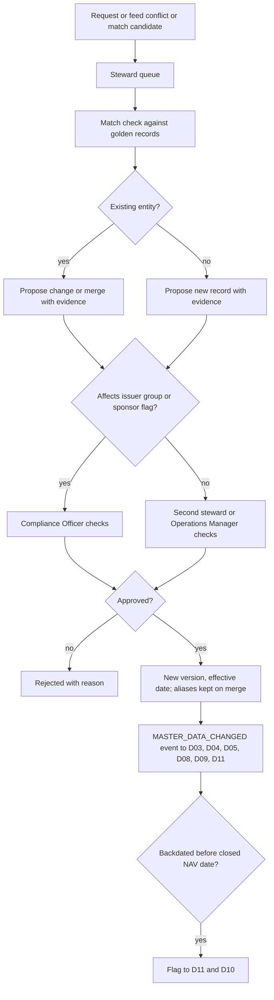
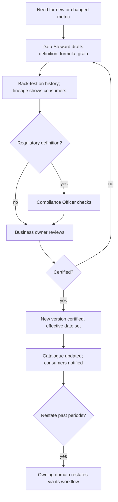

# PRD-016 — Enterprise Data Platform (D16)

This document states what AMC OS must do to give every domain, report and AI assistant one governed, traceable source of data: ingestion, master data (golden records), a canonical model, data quality, lineage, a catalogue, governance, the warehouse and lake, the metric registry and the semantic layer. It re-keys PRD-000 v0.9 Module 14 to the GOV-001 identifiers (`FR-14-nn` → `FR-D16-nnn`, `BR-14-n` → `BRL-D16-nnn`, Module 14 stories → `US-D16-nnn`), **takes over the security and issuer records from D03** (PRD-003 FR-D03-001 and FR-D03-002, PRD-003 C3), proposes that D16 owns the `master` schema (BA-001 §5 C2), and adds new **[DES]** requirements for the capability with no v0.9 source, the **data catalogue (CAP-D16-008)** (GOV-001 §3 gap), and for the external identifier crosswalk (CAP-D16-004 (.4), GOV-006 §2). It adds two D16 workflows: **WF-041 Master data change** (§6.2) and **WF-042 Metric definition change and certification** (§6.3).

**Boundary:** D16 moves, checks, describes and serves data; it does **not** compute official financial numbers. NAV, accounting, AUM, unit balances, commission, revenue, risk and compliance results come from the owning domain's deterministic engine (master prompt §3.1); D16 stores, aggregates (by certified metric definitions) and traces them. D16 **writes only its own schemas** (`analytics`, and `master` if C1 is agreed); other domains read master data and certified datasets through APIs and events (AGENTS.md §2 rule 3). Raw files from outside parties are registered by D12 (`operations.inbound_file`, DA-000 Ch 8) and stored write-once in the lake.

**Builds on Draft documents:** [PRD-000 v0.9](PRD-000_master_prd_v0.9.md) Module 14, Chapter 6, Chapter 7, Chapter 9; [DA-000 v0.9](../05_data_architecture/DA-000_data_and_database_architecture_v0.9.md) Ch 1, Ch 2, Ch 8; [ADR-0007](../../architecture/adrs/ADR-0007_data_stores.md); [BA-001](../02_business_architecture/BA-001_business_capability_map.md) D16, §5 C2; [BA-002](../02_business_architecture/BA-002_amc_operating_model.md) DEP-17, §4, §5; [BA-004](../02_business_architecture/BA-004_end_to_end_workflows.md) §5; [BA-005](../02_business_architecture/BA-005_roles_and_permissions.md) §3 (D16 column), ROLE-23; [PRD-001](PRD-001_platform_administration.md) §11; [PRD-003](PRD-003_investment_management.md) FR-D03-001, FR-D03-002, C3; [PRD-015](PRD-015_finance_and_management_reporting.md) BRL-D15-001 — allowed by owner decision D-3 ([GOV-008](../00_governance/GOV-008_build_loop.md) §2 rule 3). No document used here is Approved. PRD-017 is written in the same step (Step 9c).

**What this document is not:** the canonical model and table design (DA-001, DBE, DDL — Steps 15–16); integration adapters and provider file layouts (INT-001, Step 14); technology choices beyond ADR-0007 (Step 10 onward); the metric list itself (each owning PRD names its metrics; FE specs define their formulas); ML model governance (AIML-002, Step 26). **Rule for engineers:** no data-quality threshold, retention period, source precedence or metric formula is hard-coded; each is versioned configuration approved by a person.

## 1. Scope

| In scope (CAP) | Out of scope |
| --- | --- |
| CAP-D16-001 Data ingestion · CAP-D16-002 Data integration · CAP-D16-003 Data validation · CAP-D16-004 Master data management · CAP-D16-005 Canonical data model · CAP-D16-006 Data lineage · CAP-D16-007 Data quality · CAP-D16-008 Data catalog · CAP-D16-009 Data governance · CAP-D16-010 Data warehouse · CAP-D16-011 Analytical data models · CAP-D16-012 Metric registry · CAP-D16-013 Historical data management | Computing official financial figures (owning domains' engines); registering inbound files (D12); the investor record (mirrored from the RTA by D13, owner decision Q2); the distributor master (D14); users, employees and the organisation hierarchy (D01); the AI gateway (D17, PRD-017); BI tool licensing |

## 2. Re-keying from PRD-000 Module 14

| PRD-000 v0.9 | Here | Note |
| --- | --- | --- |
| FR-14-01 … FR-14-11 | FR-D16-001 … FR-D16-011 | Same order; capability added. **(changed)** FR-D16-004 (golden records split by owning domain, see C2) |
| BR-14-1 … BR-14-4 | BRL-D16-001 … BRL-D16-004 | Wording kept, except **(changed)** BRL-D16-001 (personal data in the raw zone, see C5) |
| Module 14 point 7 (two stories) | US-D16-001, US-D16-002 | Kept |
| Module 14 point 18 (two acceptance criteria) | AC-US-D16-003-1, AC-US-D16-004-1 | Kept |
| Module 14 points 4, 11–15, 17 | §7, §9, §10, §11 | |
| PRD-003 FR-D03-001, FR-D03-002 (security and issuer data) | FR-D16-012, FR-D16-013 | **Taken over** as owner requirements (PRD-003 C3); PRD-003 keeps them as "what D03 needs" |
| — | FR-D16-014 … FR-D16-030, BRL-D16-005 … 011, US-D16-005 … 012, WF-041, WF-042 | **New** **[DES]** |

## 3. Business requirements

| ID | Business requirement | Capabilities |
| --- | --- | --- |
| BR-D16-001 | Every number the AMC reports, internally or to a regulator, can be traced to the file, event or record it came from | CAP-D16-001, -003, -006 |
| BR-D16-002 | One golden record exists per security, issuer, counterparty and benchmark, and every domain uses it | CAP-D16-004 |
| BR-D16-003 | A metric such as "net sales" means the same thing everywhere and its definition is versioned and certified | CAP-D16-011, -012 |
| BR-D16-004 | Bad or late data is caught before it reaches a certified report, and people see when a figure is uncertified | CAP-D16-003, -007 |
| BR-D16-005 | Data is classified, owned, retained and accessed under written policy, including personal data under the DPDP Act | CAP-D16-008, -009 |
| BR-D16-006 | Any past report can be reproduced as it was on its date | CAP-D16-010, -013 |

## 4. Functional requirements

Every requirement also obeys PRD-000 common rules C1–C8. Labels from PRD-000 are carried unchanged unless the change is stated. Priority: **M** must (release-blocking), **S** should — as PRD-000 Chapter 3.

### 4.1 Re-keyed from PRD-000 Module 14

| ID (was) | Pri | Capability | Requirement |
| --- | --- | --- | --- |
| FR-D16-001 (FR-14-01) | M | CAP-D16-001 (.1), (.2), (.3) | **Data ingestion:** batch (SFTP files, APIs) and streaming (CDC from PostgreSQL via logical replication / Debezium; domain events); schema registry; idempotent loads |
| FR-D16-002 (FR-14-02) | M | CAP-D16-010 (.1) | **Data lake:** raw zone (immutable, as received), standardised zone (parsed, typed), curated zone (canonical model); Apache Iceberg tables for time travel **[DES]** |
| FR-D16-003 (FR-14-03) | M | CAP-D16-010 (.2) | **Data warehouse:** star schemas — facts (sales, AUM daily, holdings daily, NAV, journals, commissions, complaints) and conformed dimensions (scheme, plan, security, issuer, distributor, RM, branch, date, investor-segment) |
| FR-D16-004 (FR-14-04) **(changed)** | M | CAP-D16-004 (.1), (.2), (.3) | **Master data management:** golden records with match-merge rules, steward queues and survivorship by source precedence. *Changed:* D16 owns the golden records for **security, issuer, issuer group, credit rating, counterparty, benchmark and index** (BA-001 CAP-D16-004 (.1); DA-000 `master`). For **distributor** (D14), **investor** (D13, RTA mirror) and **employee / RM** (D01) the owning domain keeps the record; D16 provides matching, de-duplication suggestions and quality checks on them and returns findings to the owning domain's steward queue (C2) |
| FR-D16-005 (FR-14-05) | M | CAP-D16-012 (.1) | **Metric registry:** each metric has ID, name, plain-language definition, formula (SQL / metric DSL), grain, owner, version, effective date, certified flag. Examples: `aum_month_end`, `aaum`, `gross_sales`, `net_sales`, `sip_book`, `book_yield`, `net_yield`, `incremental_yield`, `market_share_aaum` |
| FR-D16-006 (FR-14-06) | M | CAP-D16-007 (.1), (.2) | **Data quality:** rules (completeness, validity, uniqueness, timeliness, reconciliation-to-source) with thresholds; failures block downstream certified reports or mark them "uncertified" |
| FR-D16-007 (FR-14-07) | M | CAP-D16-006 (.1) | **Data lineage:** column-level lineage from source file / event to report cell (OpenLineage standard); viewable in the UI |
| FR-D16-008 (FR-14-08) | M | CAP-D16-009 (.1), (.2), (.3) | **Data governance:** classification (Public / Internal / Confidential / Restricted-PII), ownership, retention, access policies, DPDP purpose tags |
| FR-D16-009 (FR-14-09) | M | CAP-D16-013 (.1) | **Historical snapshots:** daily snapshots of key dimensions (SCD Type 2) and facts; point-in-time queries |
| FR-D16-010 (FR-14-10) | M | CAP-D16-013 (.2) | **Analytical reporting:** governed report catalogue; self-service on certified datasets |
| FR-D16-011 (FR-14-11) | M | CAP-D16-011 (.1) | **Semantic layer:** business names, joins and metrics exposed consistently to BI tools, APIs and AI agents |

### 4.2 Taken over from PRD-003 and new requirements **[DES]**

| ID | Pri | Capability | Requirement |
| --- | --- | --- | --- |
| FR-D16-012 (was FR-D03-001) | M | CAP-D16-004 (.1) | **Security golden record:** ISIN, symbol per exchange, instrument type (equity, bond, CP, CD, T-bill, G-sec, SDL, REIT/InvIT, ETF, MF unit, derivative, repo/TREPS), face value, coupon schedule, maturity, call/put dates, day-count convention, lot and tick size, listing status, sector (AMFI / industry classification), market-cap category (from the AMFI half-yearly list), issuer link and rating history; effective-dated and versioned (PRD-000 C4). Label carried from PRD-003: market-cap category source **[REG — AMFI list as adopted by SEBI; VAL]** |
| FR-D16-013 (was FR-D03-002) | M | CAP-D16-004 (.1) | **Issuer and issuer-group golden record:** legal entity, LEI, CIN, issuer group (for group exposure), sector, sponsor-group flag (for related-party limits), ratings by agency. A change to the issuer group or the sponsor-group flag affects compliance limits and needs a Compliance Officer as checker (§7 †) |
| FR-D16-014 | M | CAP-D16-004 (.1) | **Credit ratings:** rating, outlook, scale (long / short term) and agency per security or issuer with validity dates, loaded from the rating agencies or a licensed vendor ("Confirm with provider", INT-001); history never overwritten; a rating change raises a `RATING_CHANGED` event for D03, D08, D09 and D11 (name finalised in EA-007) |
| FR-D16-015 | M | CAP-D16-004 (.1) | **Counterparty golden record:** brokers, custodians, banks, clearing corporations and other counterparties with legal entity, LEI, registrations and identifiers; D06 empanelment (WF-023) and D07 settlement instructions (WF-028) reference it; D16 holds identity data only, not empanelment status or bank details (those stay in D06 / D07) |
| FR-D16-016 | M | CAP-D16-004 (.1) | **Benchmark and index data:** index definitions (price and total-return variants), daily levels and, where licensed, constituents and weights, by provider; D02 maps schemes to benchmarks (CAP-D02-007), D04 compares (CAP-D04-008), D09 uses them for tracking error. Index data is licensed per AMC **[ASSUMPTION — confirm licence terms with each index provider]** |
| FR-D16-017 | M | CAP-D16-004 (.4) | **External identifier crosswalk:** one mapping per entity from internal ID to every outside identifier (ISIN, exchange symbols, vendor codes, LEI, CIN, AMFI scheme code, RTA scheme and plan codes, depository and custodian codes), each with source and validity dates; an unmapped outside code in a load sends the row to quarantine (FR-D16-022) (master prompt §7 item 9) |
| FR-D16-018 | M | CAP-D16-004 (.2), (.3) | **Steward queues and master data change:** new records, match-merge candidates, conflicting sources and change requests go to a Data Steward queue; every create, merge or change of a golden record is maker-checker (WF-041); a merge keeps both old IDs as aliases so history still resolves |
| FR-D16-019 | M | CAP-D16-004 (.2) | **Source precedence and survivorship:** per entity type and attribute, a versioned precedence list (for example exchange over vendor for listing status) decides which source wins; manual overrides are allowed only through WF-041 with reason and expiry review |
| FR-D16-020 | M | CAP-D16-008 (.1) | **Data catalogue:** searchable list of every dataset, table, metric and report with owner, plain-language description, classification, freshness, quality status, lineage link and how to request access; generated from the registry, lineage and governance metadata, not typed by hand |
| FR-D16-021 | M | CAP-D16-005 (.1), (.2) | **Canonical data model:** one versioned canonical model (conformed keys, SCD2 dimensions) that every curated table follows; a model change is versioned and impact-assessed through lineage before release (DA-001, Step 15) |
| FR-D16-022 | M | CAP-D16-002 (.1), (.2); CAP-D16-003 (.1), (.2) | **Integration and validation:** each provider feed goes through an adapter to the canonical interface (INT-001); schema validated against the schema registry; control totals (row count, amount totals, trailer records) checked; schema drift, a failed control total or an unmapped code quarantines the load and alerts the feed owner (PRD-000 Module 14 point 14) |
| FR-D16-023 | M | CAP-D16-012 (.1) | **Metric certification:** a new or changed metric definition is drafted by a Data Steward, tested on history, and certified by the metric's business owner (checker ≠ maker); certification is per version with an effective date; a report for a past period uses the version effective then unless the user chooses "restated" (AC-US-D16-003-1); WF-042 runs this |
| FR-D16-024 | M | CAP-D16-007 (.2) | **Certified versus uncertified outputs:** each dataset and metric value carries a certification state for its business date; a blocking DQ failure or late source marks dependent outputs "uncertified" with the reason, shown as a badge wherever the figure appears (AC-US-D16-004-1); the state changes back only when the rule passes or a steward records an accepted exception |
| FR-D16-025 | M | CAP-D16-009 (.3) | **Access to restricted datasets:** access to Restricted-PII datasets is requested with a purpose tag and approved by the data owner and the Data Protection Officer (PRD-000 Module 14 point 13; who holds the DPO authority is owner question Q48); grants expire and are reviewed in recertification (WF-020); every read is logged |
| FR-D16-026 | M | CAP-D16-009 (.1), CAP-D16-010 | **Tenant isolation in analytics:** lake paths, warehouse tables, marts, semantic-layer queries, caches and extracts are separated per tenant and filtered by the tenant in the caller's identity, never by a query parameter (master prompt §3.4; NFR-SEC-001); cross-tenant benchmarks such as industry market share use only public data (for example AMFI disclosures) |
| FR-D16-027 | M | CAP-D16-011 (.1) | **Serving AI:** D17 tools read only the semantic layer and certified datasets through the D16 query API with the calling user's scope (BRL-D16-010); the raw and standardised zones are never exposed to AI |
| FR-D16-028 | M | CAP-D16-009 (.2) | **Retention and erasure:** retention per dataset class from the regulatory register (REG-001, Step 25) **[VAL]**; personal data is held in the lake in a form that can be made unreadable on erasure (for example tokenised keys with a deletable key) while the write-once file stays intact (C5) **[DES]** |
| FR-D16-029 | S | CAP-D16-007 (.1) | **Data-quality monitoring:** DQ results by dataset, rule and day, trend of failures, owner and open exceptions; a repeated failure opens a data incident assigned to the dataset owner |
| FR-D16-030 | M | CAP-D16-001 … -013 | **Domain boundaries:** D16 reads other domains through CDC, events and APIs and never writes their schemas; master data changes reach other domains as versioned events, and each consuming engine records the master-data version it used (BRL-D16-011) |

## 5. Business rules

| ID (was) | Rule | Label |
| --- | --- | --- |
| BRL-D16-001 (BR-14-1) **(changed)** | The raw zone is write-once. *Changed:* personal data in raw files is protected so that it can be made unreadable on a lawful erasure without editing the file (FR-D16-028, C5) | **[DES]** |
| BRL-D16-002 (BR-14-2) | Only certified metrics may appear on CXO dashboards and in AI answers | **[DES]** |
| BRL-D16-003 (BR-14-3) | Personal data never leaves the tenant boundary; analytics on personal data uses tokenised keys | **[DES]** |
| BRL-D16-004 (BR-14-4) | Every dataset has an owner | **[DES]** |
| BRL-D16-005 | One golden record per security, issuer, counterparty and benchmark per tenant; it is created, merged or changed only through WF-041 with maker ≠ checker (SOD-01) | **[DES]** |
| BRL-D16-006 | A metric version is never edited after certification; a change is a new version with its own effective date; past outputs keep the version they used | **[DES]** |
| BRL-D16-007 | A metric is certified by its business owner, who may not be the person who drafted it | **[DES]** |
| BRL-D16-008 | A blocking DQ failure is never hidden: dependent outputs are marked uncertified until the rule passes or a steward records an accepted exception with reason | **[DES]** |
| BRL-D16-009 | D16 never produces an official financial figure; aggregates use certified metric definitions over engine outputs (master prompt §3.1) | **[DES]** |
| BRL-D16-010 | AI reads only the semantic layer and certified datasets, inside the calling user's scope (extends BRL-D16-002) | **[DES]** (PRD-000 Module 14 point 16) |
| BRL-D16-011 | Master data used by a financial engine is effective-dated, and the engine run records the version it used, so any past run can be replayed | **[DES]** |

**Regulatory note.** D16 holds data that other domains use for regulated outputs; it decides no regulatory question itself. Two facts touch it directly. (1) The **Digital Personal Data Protection Rules, 2025** were notified on 14 November 2025 with an eighteen-month period for phased compliance (source S1) **[REG]**; which obligations apply on which date is to be confirmed from the Rules text in REG-001 **[VAL]**. This drives FR-D16-008, -025, -028 and NFR-PRIV-004. (2) Retention periods for raw financial files and evidence come from the regulatory register **[VAL]** (DA-000 Ch 8 already marks them VAL). The AMFI market-cap list label is carried from PRD-003.

## 6. Workflows

### 6.1 Existing workflows

| Workflow | D16 role | Requirements |
| --- | --- | --- |
| [WF-001](../02_business_architecture/BA-004_end_to_end_workflows.md) Scheme launch | Benchmark and security master data | FR-D16-016 |
| WF-002 Investment research and approval | New security or issuer requested from D16 (data-steward request) | FR-D16-012, -013, -018 |
| WF-009 Corporate actions | Security master changes after the action | FR-D16-012 |
| WF-015 Reconciliation | Inbound data validation, control totals | FR-D16-022 |
| WF-016 Regulatory reporting | Certified datasets and lineage behind each figure | FR-D16-006, -007, -024 |
| WF-023 Broker empanelment | Counterparty golden record | FR-D16-015 |
| WF-028 SSI change | Counterparty identity only | FR-D16-015 |
| WF-033, WF-035, WF-040 | Certified metrics, ratings, prices context | FR-D16-005, -014 |
| WF-041 Master data change (new, §6.2) | **Accountable** | FR-D16-004, -012 … -019 |
| WF-042 Metric definition change and certification (new, §6.3) | **Accountable** | FR-D16-005, -023 |

### 6.2 WF-041 — Master data change **[DES]**

| Field | Detail |
| --- | --- |
| Trigger | A request for a new security, issuer, counterparty or benchmark (for example from WF-002 research or WF-023 empanelment); a vendor feed change that conflicts with the golden record; a match-merge candidate; a corporate action that changes reference data (WF-009) |
| Initiator | Data Steward (ROLE-23), or a requesting user in another domain through a steward request |
| Departments | **DEP-17 Data and analytics** — accountable; DEP-06 (security master operations, BA-002 §4), DEP-09 (issuer group and sponsor-group flag), DEP-04 / DEP-05 / DEP-07 (requesters and users) |
| Capabilities | CAP-D16-004, CAP-D16-002, CAP-D16-003, CAP-D16-006, CAP-D03-003, CAP-D06-001, CAP-D08-004 |
| Hand-offs (outside) | Data vendors, rating agencies, exchanges, index providers ("Confirm with provider", INT-001) |
| Preconditions | Source evidence attached (vendor record, exchange notice, offer document); entity not already present (match check run) |
| Final state | Golden record created, changed or merged with a new version and effective date; `MASTER_DATA_CHANGED` event sent (name finalised in EA-007); or request rejected with reason |
| Approvals | Maker: Data Steward. Checker: a second Data Steward, or an Operations Manager for security operational fields; a **Compliance Officer** for issuer group and sponsor-group flag changes (affect limits, §7 †) |
| Exceptions | Sources disagree → held in queue with both values, precedence rule applied only after checker approval; record needed urgently for an order → the order waits until the record is approved (no order on a security without an approved golden record) **[DES]**; merge would join two records used in open positions → impact list shown to the checker; a change backdated before a closed NAV date → flagged to D11 and D10 (no silent restatement) |
| Audit | Request, evidence, match results, before/after values, approvals, event sent, consuming domains notified |
| Source | **new** (BA-001 CAP-D16-004 (.3); PRD-000 FR-14-04) |

### 6.3 WF-042 — Metric definition change and certification **[DES]**

| Field | Detail |
| --- | --- |
| Trigger | A new metric is needed, or an owner asks to change a definition (for example a regulatory change to an AUM category, or Q51 settling the net-yield definition) |
| Initiator | Metric business owner or Data Steward |
| Departments | **DEP-17 Data and analytics** — accountable; the metric's business owner department (for example DEP-14 for yields, DEP-12 for sales metrics, DEP-09 where the metric is a regulatory definition) |
| Capabilities | CAP-D16-012, CAP-D16-011, CAP-D16-006, CAP-D16-007, CAP-D16-008, CAP-D15-009, CAP-D14-009 |
| Hand-offs (outside) | None |
| Preconditions | Business owner named; data sources available in the curated zone |
| Final state | New metric version certified with effective date and shown in the catalogue; or rejected |
| Approvals | Maker: Data Steward (definition, formula, tests). Checker: the metric's business owner (certifies). Where the metric is defined by regulation, a Compliance Officer also checks (§7 †) |
| Exceptions | Back-test on history differs from the current version beyond an owner-set tolerance → owner must accept the difference and choose whether earlier closed periods are restated (restatement then runs in the owning domain, for example WF-040); formula reads an uncertified dataset → certification blocked |
| Audit | Draft, test results, approvals, effective date, consumers listed through lineage, notification to consumers |
| Source | **new** (PRD-000 Module 14 point 13 approvals; FR-14-05) |

## 7. Permissions by capability

From BA-005 §3 (D16 column, new in BA-005) and §5. Checker ≠ maker (SOD-01). Data Steward (ROLE-23): R C U S (master data, DQ rules, metric drafts). CTO: R A (technical configuration). Technology Administrator: C U S (pipelines, connections). Auditor: R E. All other business roles: R (certified, own scope); CEO, COO, CIO, CFO: R (certified, whole AMC). AI agent identity (ROLE-26): R certified datasets through the semantic layer only (BRL-D16-010; SOD-10).

| Capability | Maker | Checker(s) |
| --- | --- | --- |
| CAP-D16-004 golden record create, change, merge (WF-041) | Data Steward | Second Data Steward or Operations Manager†; Compliance Officer† for issuer group and sponsor-group flag |
| CAP-D16-004 source precedence rules | Data Steward | CTO (technical) and the data owner of the entity type† |
| CAP-D16-012 metric definition and certification (WF-042) | Data Steward | Metric business owner† (any role named as owner); Compliance Officer† for regulatory definitions |
| CAP-D16-007 DQ rules and thresholds | Data Steward | Dataset owner† (PRD-000 Module 14 point 13: "Steward") |
| CAP-D16-009 access to Restricted-PII datasets | Requesting user | Data owner and Data Protection Officer† (Q48) |
| CAP-D16-001, -002, -010 pipelines and connections | Technology Administrator | CTO |
| CAP-D16-005 canonical model version | Data Steward | CTO |

**Rights added beyond BA-005 (†):** BA-005 gives no D16 approval right to business roles. This PRD adds: the metric business owner as certifier (PRD-000 Module 14 point 13 "Metric Owner"); the dataset owner as checker of DQ thresholds; Compliance Officer checks on issuer group, sponsor-group flag and regulatory metric definitions; Operations Manager as checker for security operational fields (BA-002 §4 DEP-06 supports CAP-D16-004); the Data Protection Officer for restricted-data access (role not in BA-005, Q48). PRD-000 also names a "Data Governance Council"; BA-005 has no such body — owner question Q53.

## 8. User stories and acceptance criteria

Priority: **C** critical (release-blocking), **O** optional — as PRD-000 Chapter 5. All example data is synthetic (GOV-003 §5).

| ID | Story | Pri | Acceptance criteria (Given / When / Then) |
| --- | --- | --- | --- |
| US-D16-001 (was Module 14 point 7) | As an Analyst, I want "net sales" to mean the same thing everywhere, so that leadership trusts the numbers | C | **AC-US-D16-001-1** Given `net_sales` certified in the registry, when it appears in the CEO dashboard, the D14 sales report and a CEO copilot answer, then all three show the same value for the same scope and date and name the same metric version. |
| US-D16-002 (was Module 14 point 7) | As a Compliance Officer, I want to trace a reported number to its source file, so that I can answer a regulator | C | **AC-US-D16-002-1** Given a figure in a regulatory report, when I open its lineage, then I see each transformation down to the raw file (with checksum) or source event it came from. |
| US-D16-003 | As a report user, I want past periods to use the definition in force then | C | **AC-US-D16-003-1** (was Module 14 point 18) Given metric `net_sales` v2 approved effective 1 April, when a report for March is run, then v1 is used unless the user selects restated. |
| US-D16-004 | As the CEO, I want to see when a number is not certified | C | **AC-US-D16-004-1** (was Module 14 point 18) Given a DQ rule failure on today's AUM load, when the CEO dashboard loads, then AUM tiles show an "uncertified" badge. |
| US-D16-005 | As a Data Steward, I want two records for the same security merged safely | C | **AC-US-D16-005-1** Given two security records with the same ISIN from different vendors, when a merge is approved by a second steward, then one golden record remains, the other ID resolves to it as an alias, and positions keep their history. |
| US-D16-006 | As a Compliance Officer, I want issuer-group changes checked by Compliance | C | **AC-US-D16-006-1** Given a steward changes an issuer's group, when the change is submitted, then it cannot take effect until a Compliance Officer approves it, and the D08 limit check uses the new group only from the effective date. |
| US-D16-007 | As a Data Steward, I want bad files stopped | C | **AC-US-D16-007-1** Given a vendor file whose trailer total does not match its rows, when it is loaded, then the whole file is quarantined, nothing reaches the curated zone and the feed owner is alerted. |
| US-D16-008 | As a metric owner, I want to certify only what I did not draft | C | **AC-US-D16-008-1** Given I drafted a metric version, when I try to certify it, then the system refuses (SOD-01). |
| US-D16-009 | As an Information Security Officer, I want analytics isolated per tenant | C | **AC-US-D16-009-1** Given a user of tenant A, when they query the semantic layer with any filter, then no row of tenant B is returned and the attempt is logged if a tenant-B identifier was supplied. |
| US-D16-010 | As a Data Protection Officer, I want personal-data access controlled | C | **AC-US-D16-010-1** Given a request to read a Restricted-PII dataset, when only the data owner has approved, then access is not granted; after both approvals it is granted until the expiry date and every read is logged. |
| US-D16-011 | As an Auditor, I want any past report reproduced | C | **AC-US-D16-011-1** Given a report produced on a past date, when it is re-run as-of that date, then it returns the same figures using the data, master-data and metric versions of that date. |
| US-D16-012 | As an Analyst, I want to find data without asking around | O | **AC-US-D16-012-1** Given a search for "AUM", when I open the catalogue, then I see each AUM dataset and metric with owner, description, freshness, quality state and lineage link. |

Definition of done: as PRD-000 Chapter 5.

## 9. Exceptions

| Exception | Handling | Source |
| --- | --- | --- |
| Schema drift in a source file | Quarantine and alert | PRD-000 Module 14 point 14 |
| DQ failure | Report flagged uncertified (BRL-D16-008) | PRD-000 Module 14 point 14 |
| Control total mismatch or unmapped code | Whole load quarantined | **[DES]** (DA-000 Ch 8) |
| Late source by the T+0 / T+1 deadline | Outputs uncertified; feed owner and dataset owner alerted | **[DES]** |
| Sources disagree on a golden record attribute | Held in steward queue; precedence applied after approval | **[DES]** |
| Backdated master data change before a closed NAV date | Flag to D11 and D10; no silent restatement | **[DES]** |
| Erasure request for personal data in the raw zone | Key deleted so data is unreadable; file kept (C5) | **[DES]** |

## 10. Data and interfaces

**Owned schema:** `analytics` (GOV-001 §3). **Proposed:** `master` (BA-001 §5 C2; DA-000 places it under a "Master Data service" with no domain) — changing GOV-001 §3 is the owner's (C1). No database change is made in this step.

| Exists in DDL-000 | Not yet in DDL-000 (for DA-001 / DDL, Steps 15–16) **[DES]** |
| --- | --- |
| `master.currency` (global reference, not tenant-scoped), `master.issuer_group`, `master.issuer`, `master.security`, `master.credit_rating`, `master.benchmark`; `analytics.metric_definition` | Counterparty; identifier crosswalk; benchmark levels and constituents; security coupon and call schedules; steward requests and match candidates; source precedence rules; DQ rules, results and exceptions; dataset register (owner, classification, retention, purpose tags); catalogue entries; access requests and grants; certification state per dataset and date; pipeline run log; lineage pointers. `master.security` and `master.issuer` have `valid_from` only, not full bi-temporal history (DA-000 Ch 2 rule 4) — C6 |

The lake, warehouse and lineage graph are outside PostgreSQL (ADR-0007: object storage with Iceberg, ClickHouse, OpenLineage); their designs are in DA-001.

**Interfaces (indicative, not contracts):** PRD-000 Module 14 point 11 names `data-platform` resources `/datasets`, `/metrics`, `/lineage`, `/dq-results` and a semantic-layer query API; this PRD adds `/securities`, `/issuers`, `/counterparties`, `/benchmarks`, `/identifiers`, `/steward-requests`, `/catalog`, `/access-requests`. Names become `API-D16-nnn` in Step 24 and events `<NAME>.v<n>` in EA-007 (Step 13). Outside parties: data vendors, rating agencies, exchanges, index providers — "Confirm with provider" (INT-001, Step 14); none is fabricated here.

## 11. Non-functional requirements

| ID | Requirement | Type / source |
| --- | --- | --- |
| NFR-PERF-025 | Provisional T+0 data available by 21:00 IST and final T+1 data by 08:00 IST for the standard daily datasets (AUM, holdings, sales, NAV) | Proposed — PRD-000 Module 14 point 17 **[DES]** |
| NFR-PERF-026 | Warehouse query p95 < 5 s for standard reports | Proposed — PRD-000 Module 14 point 17 |
| NFR-AUD-016 | Pipeline run logs, DQ results history, metric version history, master-data versions and data-access logs kept and queryable for the retention period (PRD-000 Module 14 point 15) | **[DES]**; period **[VAL]** |
| NFR-RET-007 | Raw zone retention per dataset class from REG-001; staging 90 days; marts rebuildable from the canonical zone (DA-000 Ch 8) | **[VAL]** |
| NFR-PRIV-004 | Personal data in analytics is tokenised by default; detokenised views only for approved purposes (FR-D16-025); erasure possible without editing write-once files (extends NFR-PRIV-001) **[REG — DPDP Act 2023 and DPDP Rules 2025 (S1); VAL commencement dates]** | **[VAL]** |
| NFR-SCAL-004 | Ingestion and warehouse sized for the largest-tenant assumption in DA-000 Ch 9 (10 million folios, 50 million investor transactions a year) without missing NFR-PERF-025 | **[ASSUMPTION]** (DA-000 Ch 9 "proposed") |

Platform NFRs in PRD-001 §11 apply (tenant isolation NFR-SEC-001 covers analytics and caches).

## 12. AI in this domain

Within PRD-000 C8 and [ADR-0008](../../architecture/adrs/ADR-0008_ai_boundary.md) (read and propose only). AI agents query only the semantic layer and certified datasets (BRL-D16-010). A **Data Steward assistant** (PRD-000 Module 14 point 16) suggests DQ rules and match-merge resolutions as proposals in the steward queue; a steward and a checker decide (WF-041, WF-042). This assistant is not in the brief's D17 list (BA-001 D17); it is placed under CAP-D17-017 Workflow recommendations in PRD-017 and its own registry entry waits for AIML-001 (C7). ML anomaly flags on loaded data (CAP-D17-015) may raise a DQ exception for a steward; they never block or certify data by themselves.

## 13. Open points

| # | Point | Where closed |
| --- | --- | --- |
| C1 | The `master` schema has no owning domain in GOV-001 §3; this PRD proposes D16 (BA-001 §5 C2). Changing GOV-001 §3 is the owner's — owner question Q59 | Owner (Q59); EA-003 (Step 11) |
| C2 | PRD-000 FR-14-04 lists distributor, investor and employee / RM golden records; here those records stay with D14, D13 and D01 and D16 only matches and checks them (FR-D16-004). Confirm in EA-003 | EA-003 (Step 11) |
| C3 | PRD-003 C3 is closed by FR-D16-012 and FR-D16-013; PRD-003 keeps FR-D03-001 and -002 as "what D03 needs" | Closed here |
| C4 | Can reference data be shared across tenants (for example public identifiers), or must every tenant hold its own copy because vendor licences are per AMC (DDL-000 §04 comment)? Default: per tenant, except `master.currency` — owner question Q56 | Owner (Q56); EA-003; vendor contracts |
| C5 | Write-once raw zone (BRL-D16-001) versus erasure of personal data under the DPDP Act: proposed tokenisation / deletable keys **[DES]**; legal view needed | REG-001 (Step 25); SEC (Step 25) |
| C6 | DA-000 Ch 2 rule 4 asks for bi-temporal master data; DDL-000 master tables have `valid_from` only | DA-001 / DDL (Steps 15–16) |
| C7 | Data Steward assistant (PRD-000 Module 14 point 16) is not a named D17 capability | AIML-001 (Step 26); PRD-017 C3 |
| C8 | Who approves metric definitions beyond the business owner: a Data Governance Council (PRD-000) has no role in BA-005 — owner question Q53 | Owner (Q53); next BA-005 revision |
| C9 | DQ thresholds, T+0 / T+1 deadlines and retention periods are tenant configuration or VAL; no values shipped | Pilot discovery; REG-001 |

## Sources

Repository sources: [PRD-000 v0.9](PRD-000_master_prd_v0.9.md) Module 14, Ch 6, Ch 7; [DA-000 v0.9](../05_data_architecture/DA-000_data_and_database_architecture_v0.9.md) Ch 1, Ch 2, Ch 8, Ch 9; [ADR-0007](../../architecture/adrs/ADR-0007_data_stores.md); [ADR-0008](../../architecture/adrs/ADR-0008_ai_boundary.md); [BA-001](../02_business_architecture/BA-001_business_capability_map.md) D16, §5 C2; [BA-002](../02_business_architecture/BA-002_amc_operating_model.md) DEP-17, §4; [BA-004](../02_business_architecture/BA-004_end_to_end_workflows.md); [BA-005](../02_business_architecture/BA-005_roles_and_permissions.md) §3, §5; [PRD-001](PRD-001_platform_administration.md) §11; [PRD-003](PRD-003_investment_management.md) FR-D03-001, FR-D03-002, C3; [PRD-015](PRD-015_finance_and_management_reporting.md); [LOOP_STATE.md](../../LOOP_STATE.md) owner decisions D-3, Q2.

External source:

| # | Source | Used for | Opened |
| --- | --- | --- | --- |
| S1 | Press Information Bureau, "Digital Personal Data Protection Rules, 2025" explainer, 17 Nov 2025 — https://static.pib.gov.in/WriteReadData/specificdocs/documents/2025/nov/doc20251117695301.pdf | Rules notified 14 Nov 2025; eighteen-month phased compliance. The Rules text (MeitY) was not opened; the commencement schedule is **[VAL]** | 21 Nov 2026 |
