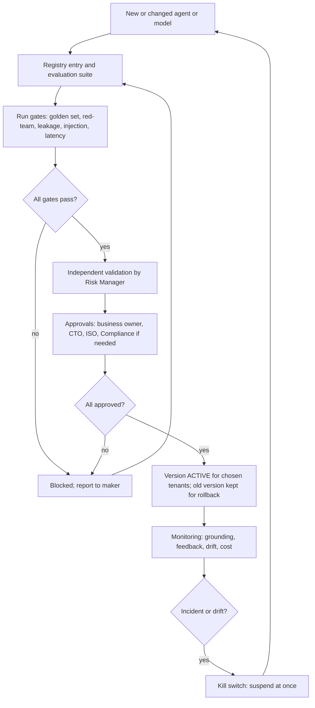

# PRD-017 — AI and Decision Intelligence (D17)

This document states what AMC OS must do to let people in every department ask questions, get explanations and receive drafts from governed AI assistants and ML models — while every number stays deterministic and every decision stays human. It re-keys PRD-000 v0.9 Module 15 and Chapter 9 to the GOV-001 identifiers (`FR-15-nn` → `FR-D17-nnn`, `BR-15-n` → `BRL-D17-nnn`, Module 15 acceptance criteria → `AC-US-D17-nnn-n`), places nine of the eleven PRD-000 agents under their BA-001 capabilities, and adds the two assistants the brief lists but PRD-000 does not: the **Dealing assistant (CAP-D17-004)** and the **Risk assistant (CAP-D17-006)** (BA-001 §5 C4; GOV-006 §2 point 5). It adds new **[DES]** requirements for **anomaly detection (CAP-D17-015)** and **forecasting (CAP-D17-016)** (GOV-001 §3 gaps), and one D17 workflow, **WF-043 AI assistant and model release and change** (§6.2).

**Boundary (master prompt §3.1, §11; [ADR-0008](../../architecture/adrs/ADR-0008_ai_boundary.md)):** AI may read, explain, summarise, classify, forecast and draft **proposals**. AI never executes trades, approves transactions, publishes NAV, modifies accounting records, changes approved regulatory rules, overrides compliance controls or edits history. Every number an assistant states comes from a tool call to a deterministic engine or a certified metric (D16). An ML score or forecast is an advisory signal, labelled as such, never an official figure. No financial workflow waits on an AI call. The AMC's own business owner of each assistant decides what it may be used for (BA-002 §4).

**Builds on Draft documents:** [PRD-000 v0.9](PRD-000_master_prd_v0.9.md) Module 15, Chapter 6, Chapter 7, Chapter 9; [ADR-0008](../../architecture/adrs/ADR-0008_ai_boundary.md); [ADR-0007](../../architecture/adrs/ADR-0007_data_stores.md); [BA-001](../02_business_architecture/BA-001_business_capability_map.md) D17, §5 C4; [BA-002](../02_business_architecture/BA-002_amc_operating_model.md) §4 (D17 rows), §5; [BA-004](../02_business_architecture/BA-004_end_to_end_workflows.md) §1 rule 3, §5.2 C5; [BA-005](../02_business_architecture/BA-005_roles_and_permissions.md) §3 (D17 column), ROLE-26, SOD-10; [PRD-001](PRD-001_platform_administration.md) §11; per-domain "AI in this domain" sections of PRD-002 … PRD-016 — allowed by owner decision D-3 ([GOV-008](../00_governance/GOV-008_build_loop.md) §2 rule 3). No document used here is Approved. PRD-016 is written in the same step (Step 9c). The owner-requested proposal branch `proposal/ai-orchestration-architecture` (EA-100 set, AIML-100…103, SEC-100/101) was read as background only; nothing from it is adopted here as text (C5). Owner decisions of 21 Nov 2026 applied ([LOOP_STATE.md](../../LOOP_STATE.md)): D-26 (metering), D-54 (named DPO), D-60 (AI release approvals), D-61 (AI data processing), D-63 (Portfolio and Product Intelligence agents later), D-64 (AI/ML reporting), D-73 (shared assistant definitions, per-AMC switch-on) and D-75 (emergency switch-off).

**What this document is not:** the AI platform architecture (AIML-001, Step 26; EA documents from Step 10); model governance and validation method (AIML-002, Step 26); tool and API contracts (Step 24); the security controls in detail (SEC, Step 25); the choice of LLM or vector-store provider ("Confirm with provider"; chosen later under the rules of owner decision D-61). **Rule for engineers:** no agent, prompt, tool, model or threshold is hard-coded; each is a versioned registry entry approved through WF-043.

## 1. Scope

| In scope (CAP) | Out of scope |
| --- | --- |
| CAP-D17-001 AI gateway · CAP-D17-002 Research copilot · CAP-D17-003 CIO copilot · CAP-D17-004 Dealing assistant · CAP-D17-005 Compliance copilot · CAP-D17-006 Risk assistant · CAP-D17-007 NAV operations assistant · CAP-D17-008 Reconciliation assistant · CAP-D17-009 Investor service assistant · CAP-D17-010 Distribution intelligence · CAP-D17-011 CFO copilot · CAP-D17-012 CEO copilot · CAP-D17-013 RAG knowledge system · CAP-D17-014 Predictive models · CAP-D17-015 Anomaly detection · CAP-D17-016 Forecasting · CAP-D17-017 Workflow recommendations | Any AI action that approves, posts, publishes, executes or overrides (SOD-10); AI-computed official figures; autonomous trading or order routing; training shared models on tenant data (BRL-D17-002); investor-facing messages sent without a human (§4.3, CAP-D17-009); the PRD-000 Portfolio Agent and Product Intelligence Agent — later release, not release 1 (owner decision D-63, C4) |

## 2. Re-keying from PRD-000 Module 15 and Chapter 9

| PRD-000 v0.9 | Here | Note |
| --- | --- | --- |
| FR-15-01 … FR-15-08 | FR-D17-001 … FR-D17-008 | Same order; capability added |
| BR-15-1 … BR-15-4 | BRL-D17-001 … BRL-D17-004 | Wording kept |
| Module 15 point 18 (two acceptance criteria) | AC-US-D17-001-1, AC-US-D17-002-1 | Kept |
| Ch 5 US-AI-01, US-AI-02 | US-D17-013, US-D17-014 | Acceptance criteria kept. US-AI-02 is also reflected in PRD-008 US-D08-007 and PRD-010 US-D10-011 for their domains |
| Ch 9 §9.1 four-layer boundary and hard rules | §4.4, FR-D17-005, BRL-D17-001, -003, -004, -007, -010 | Kept |
| Ch 9 §9.2 model requirements | FR-D17-018, FR-D17-013 | Kept; **[VAL]** carried |
| Ch 9 §9.3 agents (11) | §4.3 table: 9 agents placed under CAP-D17-002, -003, -005, -007 … -012 | Names follow BA-001 (BA-004 §3 rule 2). **Not placed:** Portfolio Agent, Product Intelligence Agent — later release (owner decision D-63, C4) |
| Ch 9 §9.4 release gates | FR-D17-020, NFR-SEC-005, NFR-PERF-027, WF-043 | **(changed)**: "AI Governance Committee sign-off" replaced by named WF-043 checkers; no new committee (owner decision D-60) |
| — | FR-D17-009 … FR-D17-027 (except as above), BRL-D17-005, -006, -008, -009, -011, -012, US-D17-003 … 012, WF-043 | **New** **[DES]**; Dealing assistant and Risk assistant new (brief) |

## 3. Business requirements

| ID | Business requirement | Capabilities |
| --- | --- | --- |
| BR-D17-001 | People in each department get faster, cited explanations of the numbers and events they work with, without the AI ever being the source of a number | CAP-D17-002 … -012 |
| BR-D17-002 | Every AI use is controlled: registered, permission-checked, tenant-isolated, evaluated before release and fully logged | CAP-D17-001, -013 |
| BR-D17-003 | AI drafts enter the owning domain's normal human approval, so automation saves time without moving any decision away from people | CAP-D17-017 |
| BR-D17-004 | Predictions and anomaly flags help people look in the right place earlier, labelled as signals and validated like risk models | CAP-D17-014, -015, -016 |
| BR-D17-005 | The AMC can show a regulator, auditor or trustee what AI it uses, for what, with what controls and results | CAP-D17-001 |

## 4. Functional requirements

Every requirement also obeys PRD-000 common rules C1–C8. Labels from PRD-000 are carried unchanged unless the change is stated. Priority: **M** must (release-blocking), **S** should — as PRD-000 Chapter 3.

### 4.1 Re-keyed from PRD-000 Module 15

| ID (was) | Pri | Capability | Requirement |
| --- | --- | --- | --- |
| FR-D17-001 (FR-15-01) | M | CAP-D17-001 (.1) | **Agent registry:** name, purpose, owner, allowed tools, allowed data domains, model, prompt version, risk tier, status |
| FR-D17-002 (FR-15-02) | M | CAP-D17-001 (.2) | **Tool gateway:** agents call typed tools (for example `get_positions`, `run_compliance_whatif`, `get_metric`) that wrap domain APIs and enforce the *user's* permissions plus the agent's own allow-list (the narrower wins) |
| FR-D17-003 (FR-15-03) | M | CAP-D17-013 (.1) | **Retrieval (RAG):** documents (SIDs, circulars, research, policies) chunked and embedded per tenant; regulatory corpus shared (public) but read-only |
| FR-D17-004 (FR-15-04) | M | CAP-D17-017 (.1) | **Proposals, not actions:** an agent can create a *proposal* (draft order, draft rule change, draft reply, draft journal explanation) that a human must accept through the normal module workflow |
| FR-D17-005 (FR-15-05) | M | CAP-D17-013 (.2) | **Grounding and citations:** every numeric claim must come from a tool result, and the answer cites it; a post-processor checks that every number in the answer appears in tool outputs, otherwise the answer is blocked or flagged |
| FR-D17-006 (FR-15-06) | M | CAP-D17-001 (.4) | **Audit:** every prompt, retrieved chunk IDs, tool call (inputs / outputs), model version, response and user feedback logged per tenant |
| FR-D17-007 (FR-15-07) | M | CAP-D17-001 (.5) | **Evaluation:** offline test sets per agent (golden Q&A, red-team prompts, cross-tenant leakage tests), online feedback; release gates |
| FR-D17-008 (FR-15-08) | M | CAP-D17-001 (.3) | **Safety:** prompt-injection defences on retrieved content, personal-data redaction in prompts where not needed, output filters, rate limits, kill switch per agent per tenant |

### 4.2 New requirements **[DES]**

| ID | Pri | Capability | Requirement |
| --- | --- | --- | --- |
| FR-D17-009 | M | CAP-D17-002 … -012 | **Assistant catalogue:** each assistant in §4.3 has one registry entry per version with the fields of master prompt §11 (identity, business purpose, approved tools, input and output schema, permission scope, tenant context, data access policy, prompt version, model version, evaluation suite, audit record, failure strategy, human approval policy) and its business owner department (BA-002 §4) |
| FR-D17-010 | M | CAP-D17-004 (.1) | **Dealing assistant (new — brief):** for a dealer's own orders, explains order status, pre-trade compliance result, broker options and limits, fills, average price and execution quality against the chosen benchmark, using read tools on D05, D06 and D08 (indicatively `get_order`, `get_executions`, `get_broker_profile`, `get_compliance_result`); may draft a note to a broker; never creates, amends, routes, allocates or cancels an order; the dealer decides |
| FR-D17-011 | M | CAP-D17-006 (.1) | **Risk assistant (new — brief):** explains risk measures and their day-on-day change (for example duration, VaR, liquidity, concentration) by drilling into D09 results and D04 positions (indicatively `get_risk_metrics`, `get_risk_drivers`, `get_positions`); drafts risk-report commentary; never changes a limit, model or result; the Risk Manager decides |
| FR-D17-012 | M | CAP-D17-013 (.1), (.2) | **Corpus management:** every retrievable document keeps source, version, effective date, page reference, URL, extraction time and approval status (master prompt §11; ADR-0008 decision 5); only documents marked approved (or public regulatory texts) are used for answers; a superseded circular is labelled as superseded when retrieved; tenant documents are filtered by the platform, never by the prompt |
| FR-D17-013 | M | CAP-D17-014 (.1), (.2), (.3) | **Predictive models:** distributor churn score (D14) and credit early-warning score (D03 / D09, an additional signal only) as first models; each production model has training-data documentation, feature definitions, validation method, version, performance measures, drift monitoring, suitable explainability and an approval and retirement record (master prompt §11); trained per tenant on that tenant's data or on public industry data only (PRD-000 §9.2); validated by someone who did not build it (DEP-11 model risk, BA-002 §4) |
| FR-D17-014 | M | CAP-D17-015 (.1) | **Anomaly detection (new):** flags unusual prices (D11), flows (D13, D14) and operations data (D12, D16 loads) with a score, the reason and the model version; a flag goes to the owning domain's exception or steward queue; it never blocks, approves or changes a record by itself |
| FR-D17-015 | S | CAP-D17-016 (.1) | **Forecasting (new):** ML forecasts (candidates from master prompt §11: AUM, net flows, redemption and liquidity needs, SIP cancellations) shown only beside the owning domain's deterministic forecast, with version and error band, and never stored as actual or as the official forecast (PRD-015 FR-D15-007, BRL-D15-003) |
| FR-D17-016 | M | CAP-D17-017 (.1) | **Workflow recommendations:** every proposal (DDL-000 `ai.proposal`) names its target domain and workflow, carries the evidence and tool results it rests on, has an expiry, and is accepted, edited or rejected by a person in that workflow; the acceptance record shows that the item was AI-drafted and what the person changed |
| FR-D17-017 | M | CAP-D17-001 (.3) | **Kill switch:** the CTO, the Information Security Officer or a Tenant Administrator can suspend an agent, a tool, or all AI for a tenant at once, with reason; one authorised person is enough to switch off, but switching back on needs two people and goes through WF-043 with maker ≠ checker (owner decision D-75) |
| FR-D17-018 | M | CAP-D17-001 (.1) | **Model access and pinning:** models reached through an abstraction layer so a model can be swapped per agent; each agent version pinned to one model version; providers used only on private endpoints in India where available, with contractual zero data retention and no training on tenant data (PRD-000 §9.2) — the AMC OS rule is India-region private endpoints only, zero data retention and no training on AMC data; the provider is chosen later (owner decision D-61). **[VAL — data-localisation needs under CSCRF / SEBI cloud framework; provider "Confirm with provider"]** |
| FR-D17-019 | M | CAP-D17-001 | **No dependency of financial processing on AI:** if the AI gateway, a model provider or the vector store is down, every financial workflow (orders, settlement, NAV, accounting, compliance) runs unchanged; screens show that the assistant is unavailable (ADR-0008 decision 4) |
| FR-D17-020 | M | CAP-D17-001 (.5) | **Release gates:** an agent version becomes `ACTIVE` only after passing the PRD-000 §9.4 gates — golden-set accuracy threshold, 0 cross-tenant leakage on the red-team set, 0 permission escalations, the prompt-injection pack, latency p95 — and approval through WF-043; agent status follows DDL-000 `ai.agent` (`DRAFT → APPROVED → ACTIVE → SUSPENDED → RETIRED`) |
| FR-D17-021 | M | CAP-D17-001 (.1) | **AI inventory for oversight:** a report of every AI/ML system in use per tenant (purpose, business owner, model and version, data used, controls, evaluation results, incidents) that Compliance can use for regulatory reporting on AI/ML use by mutual funds (§5 note, S1) and for trustees and auditors; AMC OS prepares the data from its AI inventory, Compliance files (owner decision D-64). The 2019 circular exists **[REG]**; whether it still applies, and its content and frequency, are **[VAL]** |
| FR-D17-022 | M | CAP-D17-001 (.4) | **Feedback:** users can rate an answer, flag an error and state the correct source; flags reach the agent's business owner and the next evaluation set |
| FR-D17-023 | S | CAP-D17-001 (.3) | **Usage and cost limits:** per tenant, agent and user — limits on requests, tokens and spend; a reached limit stops new AI calls, never financial work; usage counts feed subscription metering (PRD-001; API calls are a metered measure, owner decision D-26) |
| FR-D17-024 | M | CAP-D17-001 (.1) | **Tenant enablement:** assistant definitions are one shared, versioned list; each tenant switches on the ones it uses (owner decision D-73; the matching database change is WP4 work, C5); every enabled agent has a per-tenant service identity (ROLE-26, DDL-000 `ai.agent.service_user_id`) with no A, O, post, publish or execute permission (SOD-10) |
| FR-D17-025 | M | CAP-D17-002 … -012 | **Transparency to users:** every AI answer or draft is marked as AI-generated, lists its sources and tool results, and shows the agent and prompt version; a figure shown by an assistant links to its certified metric or engine result |
| FR-D17-026 | M | CAP-D17-001 (.3), CAP-D17-009 | **Personal data in AI:** personal data enters a prompt only when the task needs it and the user may see it unmasked (for example an Investor Service Executive with unmask right); otherwise it is masked or tokenised before the model call; no personal data in evaluation sets (synthetic only, GOV-003 §5) **[REG — DPDP Act 2023 and DPDP Rules 2025; VAL]** |
| FR-D17-027 | M | CAP-D17-001 (.4) | **Human oversight evidence:** for each accepted proposal and each decision taken after an AI explanation inside a workflow, the record keeps who decided, what the AI showed (session ID) and what the person changed, so the AMC can show human oversight of AI-assisted decisions **[VAL — SEBI guidance pending, S2]** |

### 4.3 Assistants

Common to all: prompt strategy, failure handling, audit and human approval as PRD-000 §9.3 "Common to all agents"; tools are read-only unless marked **propose**; groundedness 100% for every numeric claim (FR-D17-005). Business owner = accountable department in BA-002 §4. Tool names are indicative until the API catalogue (Step 24).

| Capability | Assistant (PRD-000 name) | Business owner | Tools | Outputs | Human decides | Evaluation |
| --- | --- | --- | --- | --- | --- | --- |
| CAP-D17-002 | Research copilot (Research Agent) | DEP-04 | search_docs, get_fundamentals, get_security, get_peer_set | Cited dossiers, earnings digests, peer tables | Analyst edits and owns any published note | Citation accuracy ≥ 98%; factual error rate; analyst time saved (PRD-000) |
| CAP-D17-003 | CIO copilot (CIO Copilot) | DEP-02 / DEP-03 (CIO) | get_positions, get_risk_metrics, get_breaches, get_recommendations | Morning brief, "what changed", blocked-order explanations | None (read-only) | Groundedness 100%; CIO usefulness rating (PRD-000) |
| CAP-D17-004 | Dealing assistant (**new**) | DEP-05 | get_order, get_executions, get_broker_profile, get_compliance_result; draft_broker_note | Order and execution context, execution-quality explanation, draft broker note | Dealer; no order state change | Groundedness 100%; zero order-state changes in tests **[DES]** |
| CAP-D17-005 | Compliance copilot (Compliance Copilot) | DEP-09 | search_regulations, get_rule, get_results, **propose_register_entry**, **propose_rule_change** | Circular summaries, draft register entries, breach explanations | Compliance authors and approves rules (WF-034); AI drafts only | Recall of applicable circulars; zero auto-activation (PRD-000) |
| CAP-D17-006 | Risk assistant (**new**) | DEP-11 | get_risk_metrics, get_risk_drivers, get_positions | Risk-change explanations, draft risk commentary | Risk Manager | Explanations reconcile to D09 results exactly **[DES]** |
| CAP-D17-007 | NAV operations assistant (NAV Operations Agent) | DEP-07 | get_nav_run, get_validations, get_breaks | Pre-approval checklist summary, movement explanation | NAV approver | Explanations reconcile to components exactly (PRD-000) |
| CAP-D17-008 | Reconciliation assistant (Reconciliation Agent) | DEP-06 | get_breaks, get_source_rows, **propose_match**, draft_counterparty_email | Suggested matches with confidence, root causes | Analyst accepts; force-match still maker-checker | Precision of accepted suggestions ≥ 95% (PRD-000) |
| CAP-D17-009 | Investor service assistant (Investor Service Agent) | DEP-08 | get_investor_summary, get_transactions, search_policies, **draft_reply** | Draft replies, complaint classification, summaries | Investor Service Executive sends; no data changes | Classification accuracy; TAT reduction; zero personal-data leakage (PRD-000) |
| CAP-D17-010 | Distribution intelligence (Distribution Intelligence Agent) | DEP-12 | get_metric, get_distributor_profile, get_churn_score | Next-best actions, meeting briefs | RM | Uplift in activation; RM rating (PRD-000) |
| CAP-D17-011 | CFO copilot (CFO Copilot) | DEP-14 | get_metric, get_pnl, get_ter | Variance explanations, board-pack drafts | CFO | Groundedness 100% (PRD-000) |
| CAP-D17-012 | CEO copilot (CEO Copilot) | DEP-01 | get_metric, get_aum_bridge, get_market_share | Plain-language answers with citations | None (read-only) | Groundedness 100%; refusal on uncertified data (PRD-000) |

The PRD-000 **Portfolio Agent** (draft orders for Fund Managers via **propose_orders**) and **Product Intelligence Agent** (gap analyses, draft SID sections) are not in the brief's D17 list (BA-001 §5 C4); they are not specified here and come in a later release, not release 1; Product Intelligence will then be the D02 (Product and Scheme) agent (owner decision D-63, C4). The **Data Steward assistant** (PRD-016 §12) would sit under CAP-D17-017 (C3).

### 4.4 The four layers (carried from PRD-000 §9.1)

| Layer | Does | May change state? |
| --- | --- | --- |
| 1 Deterministic calculation | Every official number (NAV, accounting, AUM, exposure, compliance, risk, commission, revenue, performance, reconciliation matching) | Yes, through its own module workflow with human approval |
| 2 ML prediction | Probabilities and forecasts, labelled as such | No — advisory signals stored with model version |
| 3 LLM interpretation | Explains, summarises, drafts, retrieves, classifies | No — proposals only |
| 4 Human approval | Decides | Yes — the only layer that authorises |

## 5. Business rules

| ID (was) | Rule | Label |
| --- | --- | --- |
| BRL-D17-001 (BR-15-1) | Agent service identities never hold approve, post, publish or execute scopes | **[DES]** |
| BRL-D17-002 (BR-15-2) | No tenant data is used to train shared models; provider contracts must guarantee no retention for training | **[DES; VAL contract]** |
| BRL-D17-003 (BR-15-3) | Answers about money show the deterministic engine's figure, never an LLM-computed one | **[DES]** |
| BRL-D17-004 (BR-15-4) | Tenant context is set per session and cannot be changed by prompt | **[DES]** |
| BRL-D17-005 | An agent runs only if its current version is `ACTIVE` for the tenant; any change to model, prompt, tools, data scope or output schema is a new version through WF-043 | **[DES]** |
| BRL-D17-006 | Effective permission of an agent call = the narrowest of the calling user's scope, the agent's allow-list and the tenant's enablement | **[DES]** (FR-15-02 extended) |
| BRL-D17-007 | An ML score or forecast is never the official figure and never blocks, approves or changes a record; it is shown with model version and labelled as a signal | **[DES]** (PRD-000 §9.1) |
| BRL-D17-008 | AI unavailability never stops or delays a financial workflow | **[DES]** (ADR-0008 decision 4) |
| BRL-D17-009 | Retrieved content and tool output are data, not instructions; an instruction found in a document is never followed | **[DES]** |
| BRL-D17-010 | ML models go through independent validation before use and are re-validated on drift or change (PRD-000 §9.1 hard rule 5) | **[DES]** |
| BRL-D17-011 | Only certified metrics and engine results may appear as numbers in AI answers (PRD-016 BRL-D16-002, -010) | **[DES]** |
| BRL-D17-012 | The AMC stays accountable for AI outputs it uses, whether the model is built or bought; AMC OS keeps the evidence (FR-D17-006, -021, -027) | **[VAL]** (S2) |

**Regulatory note.** (1) SEBI circular **SEBI/HO/IMD/DF5/CIR/P/2019/63 of 9 May 2019**, "Reporting for Artificial Intelligence (AI) and Machine Learning (ML) applications and systems offered and used by Mutual Funds", exists (S1) **[REG]**; its body was not opened in this run, so what must be reported, to whom, how often, and whether it continues under the Master Circular for Mutual Funds of 20 March 2026 are **[VAL]** (REG-001, Step 25). FR-D17-021 prepares the data. (2) On 14–16 November 2026 the SEBI Chairman said SEBI will soon issue detailed guidelines for the responsible use of AI in the securities market, covering disclosures, accountability of regulated entities and a human-in-the-loop approach; they had not been issued at that date (S2) **[VAL]**. The same report describes a June 2025 SEBI consultation paper (governance, testing, fallback, data retention, kill switches) and a December 2024 amendment making regulated entities responsible for the outputs of AI tools they use; neither was opened at source here, and whether they apply to AMCs is **[VAL]**. FR-D17-017, -021, -025, -027 and BRL-D17-012 are written so that AMC OS can meet such rules, but no threshold or duty is taken from the press report. (3) DPDP Rules 2025 as in PRD-016 §5 note (S3).

## 6. Workflows

### 6.1 Existing workflows

| Workflow | D17 role | Requirements |
| --- | --- | --- |
| [WF-002](../02_business_architecture/BA-004_end_to_end_workflows.md) Research and approval | Research copilot dossiers | FR-D17-009 (CAP-D17-002) |
| WF-004 Order creation and execution | Dealing assistant context | FR-D17-010 |
| WF-007 Daily NAV | NAV operations assistant checklist and explanation | §4.3 CAP-D17-007 |
| WF-014 Breach resolution; WF-034 Rule change | Compliance copilot explanations and drafts | §4.3 CAP-D17-005 |
| WF-015 Reconciliation | Proposed matches | FR-D17-016 |
| WF-033 Daily risk run | Risk assistant explanations | FR-D17-011 |
| WF-038 Investor service requests | Draft replies, classification | FR-D17-026 |
| WF-040 Management reporting close | CFO copilot commentary drafts | §4.3 CAP-D17-011 |
| WF-041, WF-042 (PRD-016) | Data Steward assistant proposals (C3) | FR-D17-016 |
| WF-043 AI assistant and model release and change (new, §6.2) | **Accountable** | FR-D17-001, -007, -013, -017, -020 |

### 6.2 WF-043 — AI assistant and model release and change **[DES]**

| Field | Detail |
| --- | --- |
| Trigger | A new assistant or ML model; a change to an agent's model, prompt, tools, data scope or output schema; a model provider's version end-of-life; drift or an incident; re-enabling after a kill-switch suspension |
| Initiator | Technology Administrator (agent configuration, BA-005 D17 "X") or the data science team in DEP-17 (models) |
| Departments | **DEP-15 Technology** — accountable (CAP-D17-001, -017); DEP-17 (models, CAP-D17-013 … -016); the assistant's business owner department (§4.3); DEP-09 (AI controls, regulatory use); DEP-16 (security tests); DEP-11 (model validation) |
| Capabilities | CAP-D17-001, CAP-D17-013, CAP-D17-014, CAP-D17-015, CAP-D17-016, CAP-D17-017, CAP-D01-005, CAP-D16-009 |
| Hand-offs (outside) | Model and vector-store providers ("Confirm with provider"; rules of owner decision D-61) |
| Preconditions | Registry entry complete (FR-D17-009); evaluation suite defined; for ML models, training-data and feature documentation |
| Final state | Agent or model version `ACTIVE` for the selected tenants, previous version `RETIRED` or kept for rollback; or rejected with reasons |
| Approvals | Maker: Technology Administrator or model developer. Checkers (all required, none the maker): the assistant's **business owner** (accepts purpose and evaluation results, BA-002 §4); the **CTO** (technical); an **Information Security Officer** (red-team, leakage and permission tests passed); a **Risk Manager** as independent validator (for every new assistant and every ML model, owner decision D-60); for compliance-facing or investor-facing assistants also a **Compliance Officer**. No "AI Governance Committee" (PRD-000) is created (owner decision D-60) |
| Exceptions | A gate fails → release blocked, report to maker; provider forces a model change → old version suspended if the new one is not yet approved (assistant unavailable, financial work unaffected, BRL-D17-008); incident or drift → kill switch (FR-D17-017) then this workflow to re-enable |
| Audit | Registry versions, evaluation results, red-team results, validation report, approvals, enablement per tenant, suspension and re-enable records |
| Source | **new** (PRD-000 Module 15 point 13; §9.4) |

## 7. Permissions by capability

From BA-005 §3 (D17 column) and §5. Checker ≠ maker (SOD-01). Business roles: R use (each assistant inside the role's own scope). Compliance Officer, Auditor, Information Security Officer: R logs. CTO: R X (configuration). Technology Administrator: X (agent configuration, not data). AI agent identity (ROLE-26): read tools and proposal tools only, inside the calling user's scope; never A, O, post, publish or execute (SOD-10).

| Capability | Maker | Checker(s) |
| --- | --- | --- |
| CAP-D17-001 agent version release and change (WF-043) | Technology Administrator | Risk Manager† (validation, D-60), business owner†, CTO†, Information Security Officer†, Compliance Officer† (where needed) |
| CAP-D17-014 … -016 model release (WF-043) | Model developer in DEP-17 (Data Steward role or a new role, C6) | Risk Manager† (validation), business owner†, CTO†, Information Security Officer† |
| CAP-D17-001 (.3) kill switch | CTO, Information Security Officer† or Tenant Administrator† | None to suspend; WF-043 to re-enable |
| CAP-D17-013 corpus document approval | Document owner in the business department | Business owner of the assistant using it† |
| CAP-D17-017 proposals | AI agent identity (draft only) | The owning domain's normal maker / checker |

**Rights added beyond BA-005 (†):** BA-005 §3 gives business roles only "R use" in D17. This PRD adds approval (A) in WF-043 for the business owner of each assistant (BA-002 §4 makes them accountable), the CTO (BA-005 gives the CTO only R X(config) in D17), the Information Security Officer (security gates), the Risk Manager (model validation, BA-002 §4 DEP-11 support) and the Compliance Officer; and the kill-switch right for the ISO and Tenant Administrator. BA-005 has no role for model developers or for the "AI Product Owner" and "AI Governance Committee" named in PRD-000 Module 15 point 4; no AI Governance Committee is created (owner decision D-60, C6).

## 8. User stories and acceptance criteria

Priority: **C** critical (release-blocking), **O** optional — as PRD-000 Chapter 5. All example data is synthetic (GOV-003 §5).

| ID | Story | Pri | Acceptance criteria (Given / When / Then) |
| --- | --- | --- | --- |
| US-D17-001 | As an Information Security Officer, I want AI retrieval and tools isolated per tenant | C | **AC-US-D17-001-1** (was Module 15 point 18) Given a user of tenant A, when they ask an agent about tenant B's scheme, then retrieval and tools return nothing from tenant B and the event is logged as a cross-tenant attempt. |
| US-D17-002 | As the CFO, I want no invented numbers | C | **AC-US-D17-002-1** (was Module 15 point 18) Given an agent answer containing a number not present in any tool output, when the grounding check runs, then the answer is withheld and flagged. |
| US-D17-003 | As a Dealer, I want to understand why my order is held | C | **AC-US-D17-003-1** Given an order blocked by pre-trade compliance, when I ask the Dealing assistant, then it shows the failing rule and figures from the D08 result and offers no action that changes the order. |
| US-D17-004 | As a Risk Manager, I want to know why VaR moved | C | **AC-US-D17-004-1** Given today's and yesterday's D09 results, when I ask the Risk assistant, then the drivers it lists add up to the change shown by D09 and each cites its result. |
| US-D17-005 | As the CCO, I want AI never to activate a rule | C | **AC-US-D17-005-1** Given the Compliance copilot drafts a rule change, when it is saved, then it exists only as a proposal in WF-034 and the rule registry is unchanged until a person approves it. |
| US-D17-006 | As the CTO, I want an agent stopped at once if something goes wrong | C | **AC-US-D17-006-1** Given an active agent, when the ISO presses the kill switch with a reason, then new calls to that agent for that tenant are refused within one minute **[DES]** and re-enabling needs WF-043 approval by someone else. |
| US-D17-007 | As the COO, I want NAV to run when AI is down | C | **AC-US-D17-007-1** Given the AI gateway is unavailable, when the daily NAV run (WF-007) executes, then it completes as normal and only the assistant panel shows "unavailable". |
| US-D17-008 | As the CTO, I want no untested agent version live | C | **AC-US-D17-008-1** Given a new prompt version that failed the injection test pack, when someone tries to activate it, then activation is refused and the failing cases are listed. |
| US-D17-009 | As a Risk Manager, I want ML models validated | C | **AC-US-D17-009-1** Given a churn model with no recorded independent validation, when activation is requested, then it is refused. |
| US-D17-010 | As an Investor Service Executive, I want personal data protected in AI drafts | C | **AC-US-D17-010-1** Given I do not hold the unmask right, when the assistant drafts a reply, then the model call contains masked identifiers only and the draft shows masked values. |
| US-D17-011 | As the CCO, I want an inventory of AI use | O | **AC-US-D17-011-1** Given the quarter end, when I open the AI inventory, then every active agent and model appears with purpose, owner, model version, evaluation results and incidents for the period. |
| US-D17-012 | As an Auditor, I want to see that a person decided | C | **AC-US-D17-012-1** Given a reconciliation match accepted from an AI proposal, when I open its record, then I see the proposal, the accepting user, the time and any change the user made. |
| US-D17-013 (was Ch 5 US-AI-01) | As the CEO, I want to ask "why did AUM fall?" in plain language | O | **AC-US-D17-013-1** (from US-AI-01) Given the question, when answered, then the answer cites metric IDs and dates and contains no uncited number. |
| US-D17-014 (was Ch 5 US-AI-02) | As Compliance, I want AI never to execute or approve | C | **AC-US-D17-014-1** (from US-AI-02) Given any agent identity, when it calls an approve / post / publish endpoint, then 403 is returned and a security alert raised. |

Definition of done: as PRD-000 Chapter 5.

## 9. Exceptions

| Exception | Handling | Source |
| --- | --- | --- |
| Tool error | Say what failed, no guessing | PRD-000 §9.3 |
| Low retrieval confidence | Ask or decline | PRD-000 §9.3 |
| Grounding failure | Withhold answer, flag | PRD-000 §9.3, FR-D17-005 |
| Cross-tenant attempt | Nothing returned; logged and alerted (NFR-OBS-001) | PRD-000 Module 15 point 18 |
| Prompt injection detected in retrieved text | Content ignored as instruction; answer flagged; security event | **[DES]** (BRL-D17-009) |
| AI gateway or provider down | Assistant unavailable; financial work continues | **[DES]** (BRL-D17-008) |
| Model drift beyond threshold | Owner alerted; kill switch if needed; re-validation | **[DES]** |
| Proposal expires unanswered | Status `EXPIRED`; nothing changes | **[DES]** (DDL-000 `ai.proposal`) |
| Usage limit reached | New AI calls refused with message | **[DES]** |

## 10. Data and interfaces

**Owned schema:** `ai` (GOV-001 §3). No database change is made in this step.

| Exists in DDL-000 | Not yet in DDL-000 (for DA-001 / DDL, Steps 15–16) **[DES]** |
| --- | --- |
| `ai.agent` (per tenant: model, prompt version, allowed tools, risk tier LOW / MEDIUM / HIGH, status), `ai.tool_call_log` (insert-only, partitioned), `ai.proposal` | Agent versions history; proposal target workflow, evidence links and expiry time (DDL-000 `ai.proposal` has `target_module` and status `EXPIRED` only); prompt versions; tool registry; sessions and messages; retrieved-chunk log; feedback; evaluation suites and results; model registry, validation and monitoring records; corpus documents with source metadata; embeddings (separate pgvector cluster, ADR-0007); kill-switch log; usage and cost counters; AI inventory snapshots. The meaning of risk tiers is not defined anywhere yet (C7) |

**Interfaces (indicative, not contracts):** PRD-000 Module 15 point 11 names `ai-svc` resources `/agents`, `/sessions`, `/messages`, `/tool-calls`, `/proposals`, `/evaluations`; this PRD adds `/models`, `/corpus-documents`, `/feedback`, `/kill-switch`, `/inventory`. Names become `API-D17-nnn` in Step 24 and events `<NAME>.v<n>` in EA-007 (Step 13). Outside parties: LLM, embedding and vector-store providers — "Confirm with provider" (owner decision D-61: chosen later); none is named or fabricated here.

## 11. Non-functional requirements

| ID | Requirement | Type / source |
| --- | --- | --- |
| NFR-PERF-027 | Assistant answer latency p95 < 8 s for standard questions | Proposed — PRD-000 §9.4 |
| NFR-SEC-005 | Every agent release: 0 cross-tenant leakage across a 500-prompt red-team set, 0 permission escalations, prompt-injection pack passed (malicious text in PDFs, emails, circular pages) | **[DES]** — PRD-000 §9.4 |
| NFR-AUD-017 | AI session records (prompt, retrieved chunk IDs, tool calls with inputs and output hashes, model and prompt version, response, feedback, proposal decisions) insert-only and kept for the retention period | **[DES]**; period **[VAL]** (S2 mentions a proposed retention; not adopted) |
| NFR-AVAIL-002 | Financial processing availability is independent of AI: a chaos test with the AI gateway down during a NAV run shows no effect (ADR-0008 validation) | **[DES]** |
| NFR-OBS-002 | Per tenant and agent: grounding failures, refusals, tool denials, injection detections, feedback, latency, cost and model drift monitored with alerts | **[DES]** (extends NFR-OBS-001) |

Platform NFRs in PRD-001 §11 apply (NFR-SEC-001 covers AI retrieval and caches).

## 12. AI in this domain

This whole domain is AI. Its own controls are §4–§7: every assistant is itself bound by ADR-0008, SOD-10 and BRL-D17-001 … -012, and is released only through WF-043.

## 13. Open points

| # | Point | Where closed |
| --- | --- | --- |
| C1 | BA-001 §5 C4: Dealing assistant and Risk assistant now specified (FR-D17-010, -011) | Closed here (brief assistants); C4 below for the PRD-000 agents |
| C2 | GOV-001 §3 D17 gaps (Dealing assistant, Risk assistant, anomaly detection, forecasting) covered by FR-D17-010, -011, -014, -015 | Closed here |
| C3 | Data Steward assistant (PRD-016 §12) has no BA-001 capability of its own; placed under CAP-D17-017 | AIML-001 (Step 26) |
| C4 | PRD-000 Portfolio Agent and Product Intelligence Agent are not in the brief's D17 list (BA-001 §5 C4, BA-004 §5.2 C5). | Closed by owner decision D-63 (later release, not release 1; Product Intelligence becomes the D02 agent); AIML-001 (Step 26) |
| C5 | The proposal branch `proposal/ai-orchestration-architecture` suggests global agent definitions with per-tenant enablement, risk classes R0–R3 and a four-way permission check; DDL-000 has per-tenant `ai.agent` and LOW / MEDIUM / HIGH. Shared versioned definitions with per-AMC switch-on decided by owner decision D-73 (FR-D17-024); risk classes and the permission check not adopted here | Database change: WP4; rest: WP3 (Steps 10–14) and AIML-001 |
| C6 | No BA-005 role for model developers, the AI Product Owner or the AI Governance Committee (PRD-000 Module 15 point 4) | Approvers closed by owner decision D-60 (business owner, CTO and ISO approve; Risk Manager validates; no new committee); model-developer role: next BA-005 revision |
| C7 | Risk tiers in `ai.agent` have no defined meaning or effect on controls | AIML-001 (Step 26) |
| C8 | LLM, embedding and vector-store providers and data location (India region, zero retention) | Rules closed by owner decision D-61 (India-region private endpoints, zero retention, no training on AMC data); provider chosen later — ADR in WP3; SEC (Step 25) |
| C9 | SEBI AI/ML reporting for mutual funds (2019 circular) — content and frequency, and who files; SEBI's forthcoming AI guidelines | Who files closed by owner decision D-64 (AMC OS prepares from its AI inventory, Compliance files); content and frequency **[VAL]** — REG-001 (Step 25) |
| C10 | Golden-set accuracy thresholds per agent and drift thresholds are not set | AIML-002 (Step 26); pilot discovery |

## Sources

Repository sources: [PRD-000 v0.9](PRD-000_master_prd_v0.9.md) Module 15, Ch 6, Ch 7, Ch 9; [ADR-0007](../../architecture/adrs/ADR-0007_data_stores.md); [ADR-0008](../../architecture/adrs/ADR-0008_ai_boundary.md); [BA-001](../02_business_architecture/BA-001_business_capability_map.md) D17, §5 C4; [BA-002](../02_business_architecture/BA-002_amc_operating_model.md) §4, §5; [BA-004](../02_business_architecture/BA-004_end_to_end_workflows.md); [BA-005](../02_business_architecture/BA-005_roles_and_permissions.md) §3, §5, SOD-10; [PRD-001](PRD-001_platform_administration.md) §11; [PRD-015](PRD-015_finance_and_management_reporting.md); [PRD-016](PRD-016_enterprise_data_platform.md); [LOOP_STATE.md](../../LOOP_STATE.md) owner decisions D-3, D-26, D-54, D-60, D-61, D-63, D-64, D-73, D-75. Branch `proposal/ai-orchestration-architecture` read as background only.

External sources:

| # | Source | Used for | Opened |
| --- | --- | --- | --- |
| S1 | SEBI, circular SEBI/HO/IMD/DF5/CIR/P/2019/63, 9 May 2019, "Reporting for Artificial Intelligence (AI) and Machine Learning (ML) applications and systems offered and used by Mutual Funds" — https://www.sebi.gov.in/legal/circulars/may-2019/reporting-for-artificial-intelligence-ai-and-machine-learning-ml-applications-and-systems-offered-and-used-by-mutual-funds_42932.html | Existence, number, date, title. The circular PDF was not opened; content **[VAL]** | 21 Nov 2026 (listing page) |
| S2 | MediaNama, "SEBI will make market firms disclose AI use and keep humans in the loop, chairman says", 16 Nov 2026 (reporting PTI) — https://www.medianama.com/2026/11/223-sebi-ai-disclosure-human-oversight-rules/ | Guidelines announced, not yet issued; stated coverage; description of June 2025 consultation paper and December 2024 amendment. Press source only — **[VAL]** | 21 Nov 2026 |
| S3 | Press Information Bureau, DPDP Rules 2025 explainer, 17 Nov 2025 — https://static.pib.gov.in/WriteReadData/specificdocs/documents/2025/nov/doc20251117695301.pdf | Rules notified 14 Nov 2025; eighteen-month phased compliance | 21 Nov 2026 |
