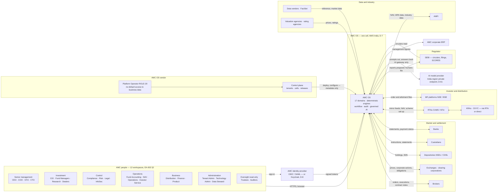
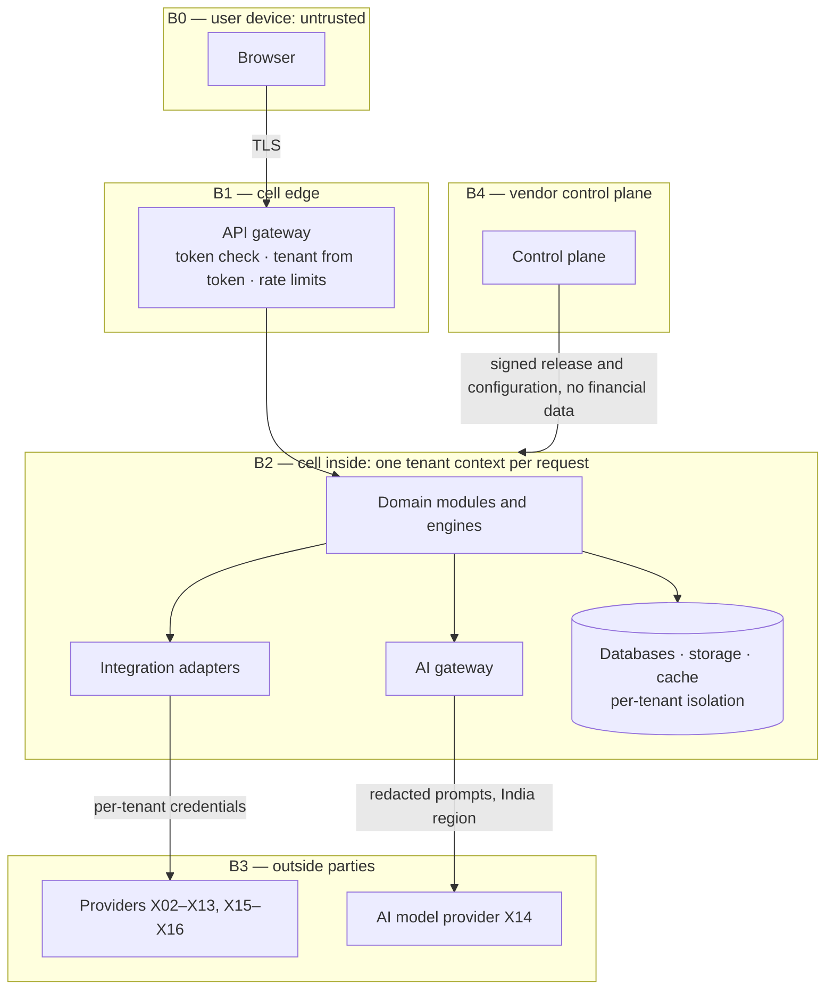

# EA-001 — System Context

This document draws the outer line around AMC OS: who uses it, which outside systems it talks to, what stays outside, and where the trust boundaries are. It is master prompt §14 Stage B item 1 ("System context diagram"). The inside of the box — layers, workspaces and technology — is [EA-002](EA-002_layered_architecture.md).

**Builds on Draft documents:** BA-002 §5–§6, BA-005, PRD-000 Ch 8, PRD-001…PRD-017, ADR-0002…ADR-0008 — allowed by owner decision D-3 ([GOV-008](../00_governance/GOV-008_build_loop.md) §2 rule 3). Nothing used here is Approved. Owner decisions used: D-7, D-8, D-16, D-52, D-55, D-61, D-67, D-68, D-69, D-70, D-72 ([LOOP_STATE.md](../../LOOP_STATE.md)). The proposal branch `proposal/ai-orchestration-architecture` (EA-100…EA-106) was read as input only; nothing in it is treated as approved.

**Plain-language terms**

| Term | Meaning here |
| --- | --- |
| System context | One picture of the whole system as a single box, with the people and outside systems around it |
| System of record | The one system whose copy of a piece of data is the official truth |
| Connect / Mirror / Replace | BA-002 §5 stances: an outside system stays the record (Connect); AMC OS keeps a checked copy (Mirror); AMC OS becomes the AMC's system (Replace) |
| Cell | One running copy of AMC OS (application, databases, storage, keys) serving one or a few AMCs (ADR-0003) |
| Control plane | The vendor's management layer (tenant list, placement, releases); it never holds AMC financial data (ADR-0003) |
| Trust boundary | A line that data or a request crosses only after a check (identity, permission, validation) |

## 1. Scope of the system

AMC OS is one multi-tenant product for Indian mutual fund AMCs, covering the 17 business domains D01–D17 (GOV-001 §3). It is run by the AMC OS vendor in two forms (master prompt §6; ADR-0003): **shared cells** (several AMCs) and **dedicated cells** (one AMC). Both are hosted in India: AWS Mumbai primary and AWS Hyderabad for disaster recovery (owner decision D-7; [ADR-0018](../../architecture/adrs/ADR-0018_cloud_provider_and_regions.md)).

Positioning (owner decision D-67, from proposal option C): AMC OS **connects to the AMC's existing systems first** and runs its own engines area by area where the AMC chooses. For fund accounting and NAV the default is: AMC OS is the record where the AMC does the work in-house; where the custodian does it, the custodian's books stay the record and AMC OS loads and checks them (D-16, D-68, D-40, D-44).

What stays **outside** AMC OS (from PS-001 §3, BA-002 §5 and owner decisions): the investor register (the RTA is record keeper, Q2, D-53); sending payout files (the RTA sends them, D-52); sending investor messages (the RTA or the AMC's provider sends them, D-55); paying scheme expenses (paid outside, D-51); the AMC's statutory company books (corporate ERP); trade execution at exchanges and settlement at custodians and clearing corporations; KYC registries (AMC OS never acts as a registry).

## 2. Context diagram

Every arrow to an outside party is drawn at the level of "what is exchanged", not "how". The transport, format and authentication of each interface are **Confirm with <provider>** until INT-001 (GOV-006 Step 14). PRD-000 Ch 8 lists the expected content; no provider interface is assumed here.

## 3. People and non-human actors

Roles are BA-005 §2 (ROLE-01…ROLE-27). Each person works in one or more of the 12 workspaces in EA-002 §3.

| Actor group | Roles | What they do with AMC OS | Workspace (EA-002 §3) |
| --- | --- | --- | --- |
| Senior management | ROLE-01 CEO, ROLE-02 COO | Oversight, material approvals, escalations | WS-11 |
| Investment | ROLE-03 CIO, ROLE-06 Fund Manager, ROLE-07 Research Analyst, ROLE-08 Dealer | Research, portfolio decisions, orders, execution | WS-01, WS-02, WS-03 |
| Control | ROLE-09 Compliance Officer, ROLE-10 Risk Manager, ROLE-21 Legal Officer, ROLE-22 Information Security Officer | Rules, breaches, risk limits, document review, access policy | WS-04, WS-05, WS-12 (ISO) |
| Operations | ROLE-11 Fund Accountant, ROLE-12 Operations Analyst, ROLE-16 Investor Service Executive | Books, valuation, NAV, settlement, reconciliation, servicing | WS-06, WS-07, WS-08 |
| Business | ROLE-04 CFO, ROLE-13 Product Manager, ROLE-14 Distributor Manager, ROLE-15 RM, ROLE-24 Finance Officer | Finance, MIS, schemes, distribution, commission | WS-09, WS-10, WS-12 (product set-up, see EA-002 §3.2) |
| Administration | ROLE-05 CTO, ROLE-17 Technology Administrator, ROLE-19 Tenant Administrator, ROLE-23 Data Steward | Users, role grants, connections, configuration, master data | WS-12 |
| Oversight | ROLE-18 Auditor, ROLE-25 Trustee | Read-only evidence and reports | WS-11 (trustee views), WS-12 (audit search) |
| Vendor | ROLE-20 Platform Operator | Runs cells and releases through the control plane; no business-data access except break-glass (WF-022, SOD-09) | — (control-plane console, not a tenant workspace) |
| Non-human | ROLE-26 AI agent identity, ROLE-27 Service account | AI assistants acting within the calling user's scope; integrations and scheduled jobs | — |

## 4. Outside systems

Stance and owner come from BA-002 §5–§6 and the PRDs; "Record" says which side holds the official copy by default. Interface details are not given on purpose (see §2).

| # | Outside system | Exchanged with AMC OS (summary, PRD-000 Ch 8) | Direction | Stance | Record (default) | Main domains |
| --- | --- | --- | --- | --- | --- | --- |
| X01 | AMC identity provider (or Keycloak where the AMC has none) | Sign-in, MFA proof, user and group changes | In | Connect | Identity provider for who the person is; AMC OS for roles and grants (FR-D01-006) | D01 |
| X02 | Brokers | Orders, executions, contract notes | In / Out | Connect | Broker for executions; AMC OS for orders and allocations | D05, D06 |
| X03 | Stock exchanges, clearing corporations | Prices, corporate actions, settlement obligations | In | Connect | Exchange / clearing corporation | D06, D07, D11, D12 |
| X04 | Depositories (NSDL, CDSL) | Holdings, ISIN, statements (often through the RTA) | In / Out | Connect | Depository | D07, D13 |
| X05 | Custodians | Settlement instructions and status, holdings, cash, corporate actions; custodian books and NAV where outsourced | In / Out | Connect (Mirror and validate for outsourced accounting, D-40) | Custodian for holdings; for accounting/NAV per D-16/D-68 | D07, D10, D11, D12 |
| X06 | Banks | Statements, payment status | In (Out only for AMC payments the AMC chooses to send) | Connect | Bank | D07, D12, D15 |
| X07 | RTAs (CAMS, KFin) | Investor, folio and transaction feeds; NAV and scheme set-up to the RTA; payout and message status | In / Out | Mirror | RTA (Q2, D-52, D-53, D-55) | D02, D13, D14 |
| X08 | KRAs and CKYC | KYC status | In (through the RTA or direct) | Connect | KRA / CKYC | D13 |
| X09 | MF transaction platforms (NSE, BSE) | Order and allotment files | In / Out | Connect | Platform and RTA | D13, D14 |
| X10 | Data vendors (e.g. FactSet) | Reference and market data, index data | In | Connect | Vendor; AMC OS keeps licensed copies per AMC (D-62) | D03, D04, D09, D16 |
| X11 | Valuation and rating agencies | Security prices and yields; ratings | In | Connect | Agency | D09, D11, D16 |
| X12 | AMFI | NAV publication; ARN data; industry data | In / Out | Connect | AMFI for published NAV and ARN; who submits NAV is set per AMC (D-44) | D11, D14, D16 |
| X13 | SEBI sources and portals | Circulars read; reports prepared for filing; complaints (SCORES) | In / Out (filing by people) | Connect | SEBI | D08, D13 |
| X14 | AI model provider | Prompts and answers through the AI gateway only | In / Out | Connect | — (never a source of truth, ADR-0008) | D17 |
| X15 | AMC corporate ERP | Management figures and cost data | In / Out | Connect | ERP for statutory books | D15 |
| X16 | Investor-message provider (AMC's own or the RTA) | Messages prepared and consent-checked by AMC OS; delivery status | Out / In | Connect | Provider sends (D-55) | D13 |

Rules for every outside system **[DES]**:

1. One adapter per provider and interface version; nothing else in AMC OS talks to the provider directly (PRD-000 Ch 8 common standards; detailed in INT-001).
2. Inbound data is validated against a canonical schema, stored first as an unchanged raw copy in object storage (ADR-0007), and loaded idempotently.
3. Credentials for a provider belong to one tenant and live in the secrets manager of that tenant's cell.
4. A provider being slow or down never corrupts state: the affected workflow waits, retries or raises an exception (master prompt §5 L4).

## 5. Trust boundaries

| Boundary | Check when crossing | Source |
| --- | --- | --- |
| B0 → B1 | Valid signed token from the tenant's identity set-up; MFA proof for people; tenant taken from the token only, never from a request parameter | ADR-0003 §1, FR-D01-011/-012, [ADR-0016](../../architecture/adrs/ADR-0016_identity_provider_and_sign_in.md) |
| B1 → B2 | Request validation against the OpenAPI contract; permission check (role + attributes); tenant context set per database transaction | ADR-0003 §2, EA-002 §4 |
| B2 → B3 (providers) | Only through the provider's adapter; responses schema-checked before use | §4 rules |
| B2 → B3 (AI provider) | Only through the AI gateway; India-region private endpoint, zero data retention, no training on AMC data (D-61) **[VAL — contract terms with the chosen provider]**; data classification and masking before sending (PRD-017) | ADR-0008, D-61 |
| B4 → B2 | Signed releases and configuration only; the control plane cannot read tenant business data; operator access to a tenant only by break-glass | ADR-0003 §4, SOD-09, WF-022 |
| Between tenants | Never crossed: row-level security, per-tenant keys and prefixes, tenant-filtered AI retrieval | ADR-0003 §3, NFR-SEC-001 |

No external AI tool reads AMC OS through MCP in release 1 (D-72), so there is no inbound AI-client boundary yet.

## 6. Main flows across the boundary

These are context-level only; the step-by-step versions are the BA-004 workflows.

| Flow | Path | Workflow |
| --- | --- | --- |
| Sign-in | Person → identity provider (MFA) → token → gateway → workspace | FR-D01-011, -012 |
| Order to settlement | Fund Manager → OMS (pre-trade compliance) → Dealer → broker → execution → custodian instruction → settlement status | WF-004, WF-005, WF-025, WF-018 (BA-004) |
| Daily NAV | Prices from exchanges, agencies and vendors → valuation → accounting → NAV engine → human approval → AMFI and RTA; or custodian NAV loaded and checked (D-44) | WF-007 (fair value exceptions: WF-035) |
| Investor mirror | RTA feeds → mirror and checks → servicing, analytics, reconciliation; corrections go back through the RTA (D-53) | WF-010, WF-011, WF-012, WF-037, WF-038 |
| Regulatory | SEBI circular → human reads and records the rule change → rule versions (CCO approves, D-32) → reports prepared → people file | WF-034, WF-016 |
| AI question | Person → workspace assistant → AI gateway → read tools on deterministic APIs → model provider (India) → answer with sources; never changes records | PRD-017 FR-D17-019, -025 |

## 7. Systems of record at a glance

| Data | Default system of record | AMC OS role |
| --- | --- | --- |
| Users' identity and MFA | AMC identity provider (or Keycloak) | Roles, grants, sessions, audit (D01) |
| Scheme master | AMC OS (Replace) | Feeds RTA and custodian set-up |
| Orders, allocations, compliance results, approvals, audit | AMC OS in every deployment | — |
| Executions | Broker / exchange | Captures, matches, reconciles |
| Settlement status, holdings, cash | Custodian, depository, bank | Instructs, tracks, reconciles |
| Scheme books and NAV | AMC OS where done in-house; custodian where outsourced (D-16, D-68) | Calculates and approves, or loads and checks |
| Investor register and transactions | RTA (Q2) | Mirror, servicing, analytics |
| Reference and market data | Vendors and agencies | Golden copy per AMC (D16, D-62) |
| Published NAV | AMFI publication | Prepares and tracks submission |

A per-tenant, per-object system-of-record register (as sketched in the proposal's EA-101) is **not** adopted here; whether to specify it is left to EA-003 (Step 11) — gap G4 below.

## 8. Deployment context (summary)

| Item | Decision or default | Where decided |
| --- | --- | --- |
| Cloud and regions | AWS Mumbai (ap-south-1) primary, AWS Hyderabad (ap-south-2) disaster recovery | D-7, [ADR-0018](../../architecture/adrs/ADR-0018_cloud_provider_and_regions.md) |
| Deployment models | Shared cells and dedicated cells, one code base | ADR-0003, master prompt §6 |
| Design capacity | 20–50 AMCs; commercial target 3–5 paying AMCs by month 36 | D-69, D-12 |
| Control plane | Separate from every cell; metadata only | ADR-0003 §4; detailed in EA-006 (Step 12) |

Cell sizing, tenant placement, migration and upgrades are Step 12 (EA-004…EA-006).

## 9. Gaps and open points

| # | Gap | Effect | Closed by |
| --- | --- | --- | --- |
| G1 | No provider interface is confirmed (all X02–X16) | Context only; no transport or format decided | INT-001, Step 14 |
| G2 | Whether the AMC's own payment and message providers connect to AMC OS at all varies per AMC | X06 outbound and X16 marked "AMC chooses" | Pilot discovery **[ASSUMPTION — confirm: COO of the pilot AMC]** |
| G3 | AI model provider not chosen (D-61); availability of India-region private endpoints for the chosen model to be confirmed | X14 boundary designed, provider open | AIML-001, Step 26 **[VAL]** |
| G4 | Per-object system-of-record register (proposal EA-101) not yet decided | §7 is per data area only | EA-003, Step 11 |
| G5 | SEBI rules on cloud use and data localisation for AMCs (cloud framework of 6 Mar 2023, CSCRF of 20 Aug 2024) not opened in this run | Region choice relies on D-7; compliance reading needed | SEC-001 / REG-001, Step 25 **[VAL]** |

## Sources

| # | Source | Used for |
| --- | --- | --- |
| S1 | [BA-002](../02_business_architecture/BA-002_amc_operating_model.md) §5–§6 | Stances and outside parties |
| S2 | [BA-005](../02_business_architecture/BA-005_roles_and_permissions.md) §2 | Roles |
| S3 | [PRD-000](../03_product_requirements/PRD-000_master_prd_v0.9.md) Ch 8 | Content exchanged with providers |
| S4 | [PRD-001](../03_product_requirements/PRD-001_platform_administration.md) FR-D01-006…-012, §11 | Identity and platform NFRs |
| S5 | [PRD-017](../03_product_requirements/PRD-017_ai_and_decision_intelligence.md) | AI boundary rules |
| S6 | [ADR-0003](../../architecture/adrs/ADR-0003_multi_tenancy_and_cells.md), [ADR-0008](../../architecture/adrs/ADR-0008_ai_boundary.md) | Tenancy, cells, AI boundary |
| S7 | [LOOP_STATE.md](../../LOOP_STATE.md) owner decisions D-7…D-75 | Decisions listed in the header |
| S8 | SEBI, "Framework for Adoption of Cloud Services by SEBI Regulated Entities", circular SEBI/HO/ITD/ITD_VAPT/P/CIR/2023/033, 6 Mar 2023 — [circular page](https://www.sebi.gov.in/legal/circulars/mar-2023/framework-for-adoption-of-cloud-services-by-sebi-regulated-entities-res-_68740.html) (header read; body PDF not opened) | G5 |
| S9 | Bar and Bench (Saga Legal), "Cybersecurity and Cyber Resilience Framework by SEBI", 24 Sep 2024 — [article](https://www.barandbench.com/law-firms/view-point/cybersecurity-cyber-resilience-framework-sebi-digital-safety) (secondary source; gives the CSCRF date 20 Aug 2024) | G5 |
