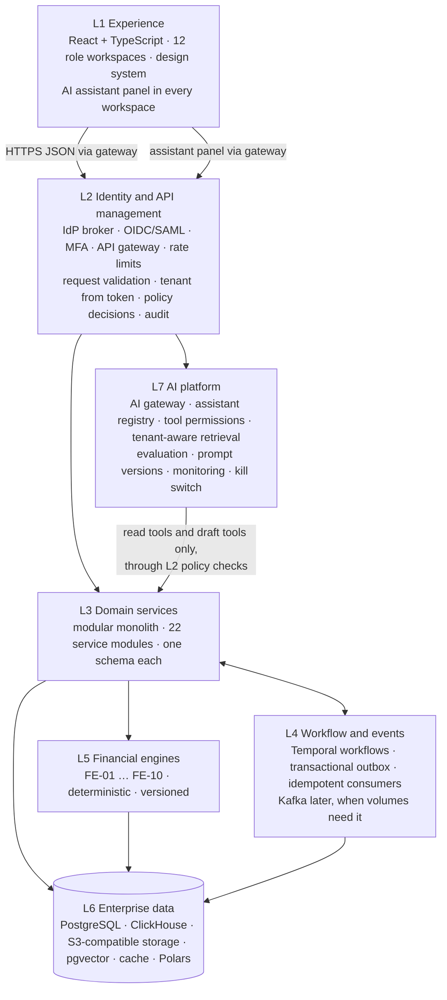

# EA-002 — Layered Enterprise Architecture and the 12 Role Workspaces

This document opens the AMC OS box drawn in [EA-001](EA-001_system_context.md). It sets out the seven layers of master prompt §5, what each layer does and may not do, which technology it uses (and which ADR decides it), how tenant isolation runs through every layer, and the 12 role workspaces of the user interface. It is master prompt §14 Stage B item 2 ("Enterprise architecture").

**Builds on Draft documents:** ADR-0002…ADR-0008, BA-005, PRD-001…PRD-017, DA-000 — allowed by owner decision D-3. Nothing used here is Approved. Owner decisions used: D-7, D-8, D-61, D-67, D-70, D-71, D-72, D-73, D-74, D-75 ([LOOP_STATE.md](../../LOOP_STATE.md)). The proposal branch `proposal/ai-orchestration-architecture` (EA-100, EA-104, EA-106, ADR-0009…ADR-0015) was read as input only.

**New ADRs proposed with this document (all Draft, owner-only folder):**

| ADR | Decision proposed |
| --- | --- |
| [ADR-0016](../../architecture/adrs/ADR-0016_identity_provider_and_sign_in.md) | Sign-in: the AMC's own identity provider, brokered by a Keycloak instance per cell; Keycloak as the identity provider for AMCs without one (D-8) |
| [ADR-0017](../../architecture/adrs/ADR-0017_cache.md) | Cache: Redis-protocol cache running Valkey (managed); never a source of truth |
| [ADR-0018](../../architecture/adrs/ADR-0018_cloud_provider_and_regions.md) | Cloud: AWS Mumbai primary, AWS Hyderabad disaster recovery (D-7); portable building blocks |
| [ADR-0019](../../architecture/adrs/ADR-0019_api_gateway_and_policy_engine.md) | API gateway and policy-engine products: evaluation and shortlist (D-71); final choice after a proof of concept |

**Plain-language terms**

| Term | Meaning here |
| --- | --- |
| Layer | A group of parts with one job; a layer only talks to the layers next to it as shown in §1 |
| Modular monolith | One deployable application made of separate modules with hard boundaries (ADR-0002) |
| Identity provider (IdP) | The system that checks who a person is (password, MFA) and issues a signed token |
| Identity broker | A service that sits between many identity providers and AMC OS, so AMC OS sees one token format |
| Policy engine | One service that answers "is this allowed?" from written, versioned rules |
| Outbox | A table where a module writes "this happened" in the same transaction as the change itself; a relay then passes it on |
| Workspace | The set of screens built for one kind of user, e.g. the Dealer workspace |

## 1. The seven layers



| Layer | Job | Must never | Main technology (ADR) |
| --- | --- | --- | --- |
| L1 Experience | Show data and collect decisions for each role | Calculate money, hold business rules, choose the tenant (master prompt §3.5) | React, TypeScript (STD-001 §6; frontend ADR still to write — §7 G2) |
| L2 Identity and API management | Prove who is calling, set the tenant from the token, check the request and the permission, limit rates, log | Trust a tenant or role sent by the browser | IdP broker ([ADR-0016](../../architecture/adrs/ADR-0016_identity_provider_and_sign_in.md)); gateway and policy engine ([ADR-0019](../../architecture/adrs/ADR-0019_api_gateway_and_policy_engine.md)) |
| L3 Domain services | Own each domain's rules and data; offer documented APIs and events | Write another domain's schema (ADR-0002) | Python, FastAPI, Pydantic, SQLAlchemy (ADR-0004) |
| L4 Workflow and events | Run long, multi-step business processes durably; pass events between modules | Write module tables directly (ADR-0006 §3) | Temporal; outbox in PostgreSQL; Kafka later (ADR-0006, D-70) |
| L5 Financial engines | Produce every official number deterministically | Use binary floating point; depend on AI (ADR-0005, ADR-0008) | Python `Decimal`, PostgreSQL `NUMERIC` (ADR-0005) |
| L6 Enterprise data | Store transactions, history, documents, vectors, cache | Let a cache or analytics copy become the record | PostgreSQL, ClickHouse, S3-compatible, pgvector, Polars (ADR-0007); cache ([ADR-0017](../../architecture/adrs/ADR-0017_cache.md)) |
| L7 AI platform | Answer, explain, summarise, draft — governed | Approve, post, publish, execute or change history; sit on the path of a financial transaction (ADR-0008, FR-D17-019) | AI gateway; agent runtime chosen in AIML-001 (Step 26) |

**Relation to the proposal's eight layers (EA-100 §3, input only).** The proposal split "AI orchestration" and "policy and execution control" into layers of their own. Here they stay inside master prompt §5's seven layers: policy decisions are part of L2 (every call, human or AI, passes the same check) and AI orchestration is part of L7. Nothing in the proposal's list of responsibilities is dropped; the integration adapters the proposal placed in their own layer sit in L3 as one module per provider family behind canonical contracts (INT-001, Step 14).

## 2. Request path (how one call crosses the layers)

```mermaid
sequenceDiagram
  participant U as Dealer (browser, L1)
  participant I as IdP broker (L2)
  participant G as API gateway (L2)
  participant P as Policy engine (L2)
  participant O as OMS module (L3)
  participant C as Compliance engine FE-04 (L5)
  participant D as PostgreSQL (L6)
  U->>I: sign in (AMC IdP + MFA)
  I-->>U: AMC OS token (tenant, user, MFA proof)
  U->>G: POST order (token)
  G->>G: check token signature, expiry, MFA claim; set tenant from token
  G->>G: validate body against OpenAPI; per-tenant rate limit
  G->>O: forward with tenant and user context
  O->>P: allowed? (user grants, scheme, desk, action)
  P-->>O: allow (decision logged)
  O->>D: BEGIN; SET LOCAL tenant; insert order + outbox row; COMMIT
  O->>C: pre-trade check (rule versions)
  C-->>O: PASS / WARN / BLOCK
  O-->>U: order with compliance result
```

The same path applies when an AI assistant calls a read or draft tool: the assistant's ROLE-26 identity carries the calling user's scope, and the policy engine refuses any approve, post, publish or execute action for ROLE-26 (BA-005 §4, SOD-10, ADR-0008).

## 3. L1 Experience — the 12 role workspaces

Owner decision D-74 settles the list: the 12 experiences of master prompt §5 L1, with **Fund Accounting and NAV Operations as two separate workspaces**, and the **AI assistant built into every workspace** (no separate AI workspace). The proposal's EA-104 list (with a merged "NAV and Accounting Desk" and a stand-alone assistant) is therefore not used.

The labels WS-01…WS-12 are working labels in this document; whether they become official IDs is owner question Q63 (GOV-001 §4 lists the official formats).

### 3.1 Workspace list

| # | Workspace (master prompt §5 L1) | Primary roles (BA-005) | Main domains | Key views (from the PRDs) | Assistant in the panel (PRD-017 §4.3) |
| --- | --- | --- | --- | --- | --- |
| WS-01 | CIO | ROLE-03 CIO; ROLE-07 Research Analyst (research pipeline) | D03, D04, D09 | Fund performance and attribution, exposures, research pipeline, investment policy reviews, approvals waiting | CIO copilot; Research copilot |
| WS-02 | Fund managers | ROLE-06 Fund Manager | D03, D04, D05 | Positions, cash, model vs actual, what-if, order drafts, pre-trade results | Research copilot (Portfolio agent later release, D-63) |
| WS-03 | Dealers | ROLE-08 Dealer | D05, D06 | Order blotter, broker choice, fills, allocations, trade exceptions | Dealing assistant |
| WS-04 | Compliance | ROLE-09 Compliance Officer (incl. CCO); ROLE-21 Legal Officer (document review) | D08, D02 (scheme documents) | Pre/post-trade results, breaches, rule versions, regulatory calendar and reports | Compliance copilot |
| WS-05 | Risk | ROLE-10 Risk Manager (incl. CRO) | D09 | Daily risk run, limits, liquidity, alerts, model validation | Risk assistant |
| WS-06 | Fund accounting | ROLE-11 Fund Accountant; Head of Fund Accounting; ROLE-04 CFO for period reopen (D-42) | D10 | Journals, accruals, sub-ledgers, trial balance, period close, custodian-book checks (D-40) | Reconciliation assistant (breaks); NAV operations assistant (read) |
| WS-07 | NAV operations | ROLE-11 Fund Accountant (NAV); ROLE-12 Operations Analyst | D11, D07, D12 | NAV runs and checklist, price exceptions, fair-value requests, settlement status, corporate actions, reconciliation breaks, operations day close | NAV operations assistant; Reconciliation assistant |
| WS-08 | Investor servicing | ROLE-16 Investor Service Executive; Grievance Officer (D-54) | D13 | Investor view (RTA mirror), service requests, complaints, payout and message status | Investor service assistant |
| WS-09 | Distribution | ROLE-14 Distributor Manager; ROLE-15 RM | D14 | Flows by distributor and region, SIP book, empanelment, commission runs | Distribution intelligence |
| WS-10 | Finance | ROLE-04 CFO; ROLE-24 Finance Officer | D15, D14 (commission approval) | AMC P&L, TER use, expenses, budgets and plans, management close | CFO copilot |
| WS-11 | Senior management | ROLE-01 CEO; ROLE-02 COO; ROLE-05 CTO; ROLE-25 Trustee (read-only supervisory views) | All (read) | AUM and flows, profitability, risk and compliance headlines, escalations, board and trustee packs | CEO copilot |
| WS-12 | System administrators | ROLE-19 Tenant Administrator; ROLE-17 Technology Administrator; ROLE-22 Information Security Officer; ROLE-23 Data Steward; ROLE-18 Auditor (audit search) | D01, D16, D17 (assistant enablement), D02 (scheme set-up, §3.2) | Users and role grants, access reviews, configuration, connections health, master data, assistant switch-on and kill switch, audit search | Data Steward assistant (PRD-016 §12, proposal only); otherwise none — §7 G3 |

### 3.2 Roles and domains without a named experience

Master prompt §5 L1 names no experience for product and scheme management (D02), fund operations (settlement, corporate actions, reconciliation — D07, D12) or master data (D16). Working placement **[DES]**: fund operations views sit in WS-07 NAV operations (same operations team, same day cycle, BA-002 §7); D16 master data and D02 scheme set-up sit in WS-12 as governed business configuration, with ROLE-13 Product Manager seeing only the scheme module. Whether D02 should instead have its own 13th workspace is owner question Q64.

### 3.3 Rules for every workspace

1. A workspace shows only the modules the tenant has switched on and the user's grants allow (configuration, not code — master prompt §3.6; PRD-001 entitlements).
2. Every number comes from a domain API or an engine result; the browser formats but never calculates money (master prompt §3.5).
3. Actions that need maker-checker open the owning domain's approval step; the screen cannot skip it.
4. The assistant panel is a view onto L7 through the gateway. If the AI gateway is down, the panel says so and the rest of the workspace works normally (FR-D17-019).
5. Dashboards are configurable per user and per tenant within the widgets the domain offers (master prompt §5 L1).
6. Accessibility target WCAG 2.1 AA **[DES]** (design-system work in a later step).
7. One design system and one code base for all 12; a workspace is a route set and a navigation configuration, not a separate application **[DES]**.

## 4. L2 Identity and API management

### 4.1 Sign-in (summary of ADR-0016)

| Topic | Design **[DES]** unless marked |
| --- | --- |
| Who proves identity | The AMC's own IdP over OIDC or SAML; Keycloak as IdP for AMCs without one (D-8) |
| Broker | One Keycloak instance per cell brokers every tenant's IdP and issues AMC OS tokens in one format, so the API layer handles one token type |
| Tenant in the token | Set by the broker from the IdP connection the user came through, never from a user-editable attribute; the gateway rejects any request whose parameters name another tenant (ADR-0003 §1) |
| MFA | The broker requires MFA proof from the upstream IdP (OIDC `acr`/`amr` or the SAML authentication context, per provider); no proof → no token (FR-D01-012) |
| Roles | Not taken from the IdP. Roles come only from approved grants in AMC OS `identity` (FR-D01-006, FR-D01-016); the IdP says who, AMC OS says what |
| Leavers (FR-D01-008) | Three layers: (1) provisioning push from the AMC IdP where it supports SCIM; (2) back-channel logout where supported; (3) short access-token life with a check at refresh. Worst case without push = token lifetime; proposed default 5 minutes **[ASSUMPTION — confirm: Information Security Officer of the pilot AMC]**. Which of (1)–(2) each IdP supports: confirm with each provider |
| AI agents (ROLE-26) | A token for the assistant is derived from the user's token by token exchange and narrowed to the assistant's tools; it can never carry approve, post, publish or execute rights (ADR-0008) |
| Service accounts (ROLE-27) | Client-credentials tokens per tenant and per integration; owner named; reviewed in recertification (WF-020) |

### 4.2 Gateway and policy decisions (summary of ADR-0019)

| Need (master prompt §5 L2) | Where it is met |
| --- | --- |
| OAuth2, OIDC, SSO, MFA | IdP + broker (ADR-0016) |
| RBAC and ABAC | Policy engine: role grants plus attributes (tenant, scheme, desk, department, data sensitivity) from AMC OS; one decision log |
| API gateway, rate limiting, request validation | Gateway product (ADR-0019 shortlist); per-tenant limits; OpenAPI validation |
| Tenant context | From the token only (§4.1) |
| Audit logging | Every allow/deny decision and every state change logged; append-only, hash-chained per tenant per day (NFR-AUD-001) |

## 5. L3–L6 summary

### 5.1 L3 Domain services

The 22 services of master prompt §5 L3 are modules of one application (ADR-0002). The detailed catalogue (responsibilities, APIs, events, dependencies) is EA-003, GOV-006 Step 11. The mapping to domains and schemas (GOV-001 §3, DA-000 Ch 2) is:

| Service (master prompt) | Domain | Schema | Service (master prompt) | Domain | Schema |
| --- | --- | --- | --- | --- | --- |
| Tenant | D01 | `platform` (and `audit`) | Accounting | D10 | `accounting` |
| Identity | D01 | `identity` | Valuation | D11 | `valuation` |
| Product | D02 | `product` | NAV | D11 | `nav` |
| Security master | D16 | `master` (D-65) | Operations | D12 | `operations` |
| Investment | D03 | `investment` | Investor | D13 | `investor` |
| Portfolio | D04 | `portfolio` | Distribution | D14 | `distribution` |
| OMS | D05 | `trading` | Finance | D15 | `finance` |
| Execution | D06 | `execution` | Workflow | D12 | `workflow` |
| Settlement | D07 | `settlement` | Documents | D12 | `documents` |
| Compliance | D08 | `compliance` | Reporting | D16 | `analytics` |
| Risk | D09 | `risk` | AI | D17 | `ai` |

Audit has no separate service in the master prompt list; it is part of platform core (D01 `audit`). Integration adapters are modules too (one per provider family), owned by the domain that uses the data (INT-001, Step 14).

### 5.2 L4 Workflow and events

ADR-0006 applies. Owner decision D-70 fixes the timing: release 1 uses the **transactional outbox in PostgreSQL** with in-process delivery and idempotent consumers; Kafka is added when volumes need it, with the outbox designed so the relay can publish to Kafka without changing modules. This matches ADR-0006 decision 4 ("Kafka is introduced only where asynchronous fan-out is needed"), but ADR-0006 decision 1 still says the relay publishes to Kafka; its wording should be brought in line with D-70 when the owner next edits ADR-0006 (owner-only file; listed in LOOP_STATE "Waiting for owner"). Temporal runs the long, cross-module workflows (daily NAV, NFO, settlement fails, breach resolution, commission run — ADR-0006 §3). Event catalogue and workflow designs: EA-007, Step 13.

### 5.3 L5 Financial engines

FE-01…FE-10 (GOV-001 §5) are pure, versioned libraries called by their owning module; each needs an approved specification with the 15 points of master prompt §8 before code (Steps 20–23). No engine reads another domain's tables.

### 5.4 L6 Enterprise data

ADR-0007 applies (PostgreSQL record, ClickHouse analytics, S3-compatible storage, pgvector on a separate PostgreSQL cluster, Polars). The cache is [ADR-0017](../../architecture/adrs/ADR-0017_cache.md): a Redis-protocol cache (Valkey) for short-lived, rebuildable data only. One change from DA-000 Ch 1: **idempotency keys and job locks for financial work are kept in PostgreSQL**, not only in the cache, because a cache entry can be lost; the cache may hold a fast copy (ADR-0017 §Decision 3).

## 6. L7 AI platform

| Master prompt §5 L7 item | Design | Source |
| --- | --- | --- |
| Central AI gateway | All model calls go through one gateway per cell: masking, data classification, tenant tagging, budget, logging | PRD-017 CAP-D17-001 |
| Model registry, prompt versioning | Every assistant version pins model, prompt and tools; changes go through WF-043 | PRD-017 FR-D17-009, WF-043 |
| Agent registry | One shared, versioned list of assistant definitions; each tenant switches on the ones it uses (D-73; WP4 database change) | PRD-017 FR-D17-024 |
| Tool permissions | Assistants call registered read tools and draft/proposal tools only; every call passes the L2 policy check | ADR-0008, BA-005 ROLE-26 |
| Tenant-aware retrieval, RAG | Retrieval filtered by the session tenant in the platform, not the prompt; sources keep version, date and page | ADR-0008 §5 |
| Evaluation, monitoring | Evaluation suite per assistant before release; drift and refusal monitoring | PRD-017, AIML-001 (Step 26) |
| Human approval workflows | Anything an assistant drafts enters the owning domain's normal approval | ADR-0008 §3 |
| AI audit logs | Prompt, tools called, sources, answer, user, assistant version | PRD-017 FR-D17-025 |
| Kill switch | One authorised person can switch off an assistant, a tool or all AI for a tenant; switching back on needs two people (D-75) | PRD-017 |
| Model provider | India-region private endpoints only, zero data retention, no training on AMC data; provider chosen later (D-61) | ADR-0018 §Consequences |
| External AI clients | None in release 1 (no MCP access to AMC OS, D-72) | — |
| Failure | AI down never stops financial processing | FR-D17-019 |

The agent runtime (the proposal's LangGraph ADR-0010) is not decided here; it is AIML-001 (Step 26).

## 7. Tenant isolation through the layers (master prompt §3.4)

| Area | How isolation is enforced | Where specified |
| --- | --- | --- |
| Authentication | Tenant fixed by the IdP connection; broker issues the tenant claim | ADR-0016 |
| Authorisation | Policy engine input always includes the token's tenant; grants are per tenant | ADR-0019, BA-005 |
| Application services | Tenant context passed from the gateway; never a function parameter from the client | ADR-0003 §1 |
| Databases | Forced RLS, composite `(tenant_id, id)` keys, `SET LOCAL` per transaction | ADR-0003 §2, DDL-000 |
| APIs | Requests naming another tenant rejected; "not found" for other tenants' objects | FR-D01-005 |
| Events | Every event carries tenant_id; consumers set context from it | ADR-0003 §3 |
| Object storage | Per-tenant prefix or bucket and per-tenant KMS key | ADR-0003 §3 |
| Caches | Tenant prefix on every key; client refuses unprefixed keys | ADR-0017 |
| AI retrieval | Tenant filter applied by the platform | ADR-0008 §5 |
| Logs | Every log line tagged with tenant; tenant-scoped log views | NFR-OBS-001 |
| Analytics | Tenant-partitioned tables and tenant-filtered semantic layer | PRD-016 FR-D16-026 |
| Backups | Per-cell backups encrypted with cell keys; per-tenant restore designed in Step 12 | EA-004/EA-005 (Step 12) |
| Support tools | No default operator access; break-glass only (WF-022) | SOD-09 |

## 8. Smallest technology set for release 1

Master prompt §13 asks for the smallest reliable set. Proposed **[DES]**:

| Technology | Release 1 | Reason / later |
| --- | --- | --- |
| React + TypeScript | Yes | Required by master prompt §5 L1 |
| Python, FastAPI, Pydantic, SQLAlchemy, Alembic, PostgreSQL | Yes | ADR-0004 |
| Keycloak (broker, and IdP for AMCs without one) | Yes | ADR-0016 |
| API gateway, policy engine | Yes (product per ADR-0019 proof of concept) | ADR-0019 |
| Valkey cache (managed) | Yes | ADR-0017 |
| Temporal | Yes | Daily NAV and other durable workflows (ADR-0006) |
| Outbox in PostgreSQL | Yes | D-70 |
| Kafka | No | When volumes need it (D-70) |
| S3-compatible storage | Yes | Raw files, documents, evidence (ADR-0007) |
| pgvector (separate cluster) | Yes, only if an assistant using retrieval is in release 1 | ADR-0007; scope of release 1 is Step 28 |
| ClickHouse | Open | ADR-0007 includes it; whether the pilot needs it from day one is question Q65 |
| OpenTelemetry, Prometheus, Grafana | Yes | Master prompt §13; ADR in INF-001 (Step 26) |
| Docker | Yes | Master prompt §13 |
| Kubernetes, Terraform | Open | INF-001 (Step 26); Kubernetes "when justified" (master prompt §13) |
| Airflow or Dagster | Open | ADR-0007 leaves it to an ADR; DA-002 (Step 19) |

## 9. Gaps and open points

| # | Gap | Closed by |
| --- | --- | --- |
| G1 | Detailed service catalogue (responsibilities, APIs, events per module) | EA-003, Step 11 |
| G2 | No ADR yet for the frontend stack (React + TypeScript), design system, Kubernetes, Terraform, observability, data orchestrator | Frontend ADR with the design system; INF-001 (Step 26); DA-002 (Step 19) |
| G3 | WS-12 has no assistant defined in PRD-017, but D-74 puts an assistant in every workspace | PRD-017 next revision; AIML-001 (Step 26) |
| G4 | Product and scheme management has no named workspace | Owner question Q64 |
| G5 | ClickHouse timing for the pilot | Owner question Q65 |
| G6 | Which leaver-signal methods each AMC's IdP supports; token lifetime target | Pilot discovery; FR-D01-008 |
| G7 | WS-nn as official IDs | Owner question Q63 |

## Sources

| # | Source | Used for |
| --- | --- | --- |
| S1 | [MASTER_BUILD_PROMPT.md](../../MASTER_BUILD_PROMPT.md) §3, §5, §13 | Layers, experiences, stack |
| S2 | [ADR-0002](../../architecture/adrs/ADR-0002_modular_monolith.md) … [ADR-0008](../../architecture/adrs/ADR-0008_ai_boundary.md) | Existing Draft decisions |
| S3 | [BA-005](../02_business_architecture/BA-005_roles_and_permissions.md) | Roles per workspace |
| S4 | [PRD-001](../03_product_requirements/PRD-001_platform_administration.md), [PRD-016](../03_product_requirements/PRD-016_enterprise_data_platform.md), [PRD-017](../03_product_requirements/PRD-017_ai_and_decision_intelligence.md) | Identity, data, AI requirements |
| S5 | [DA-000](../05_data_architecture/DA-000_data_and_database_architecture_v0.9.md) Ch 1, Ch 2, §6.6 | Data stores, schemas, cache isolation |
| S6 | [LOOP_STATE.md](../../LOOP_STATE.md) owner decisions | D-7…D-75 |
