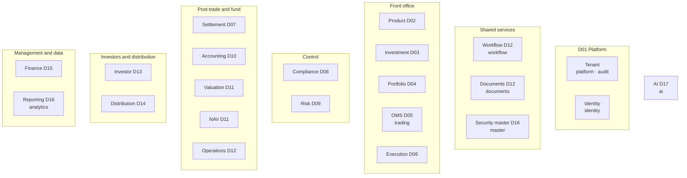
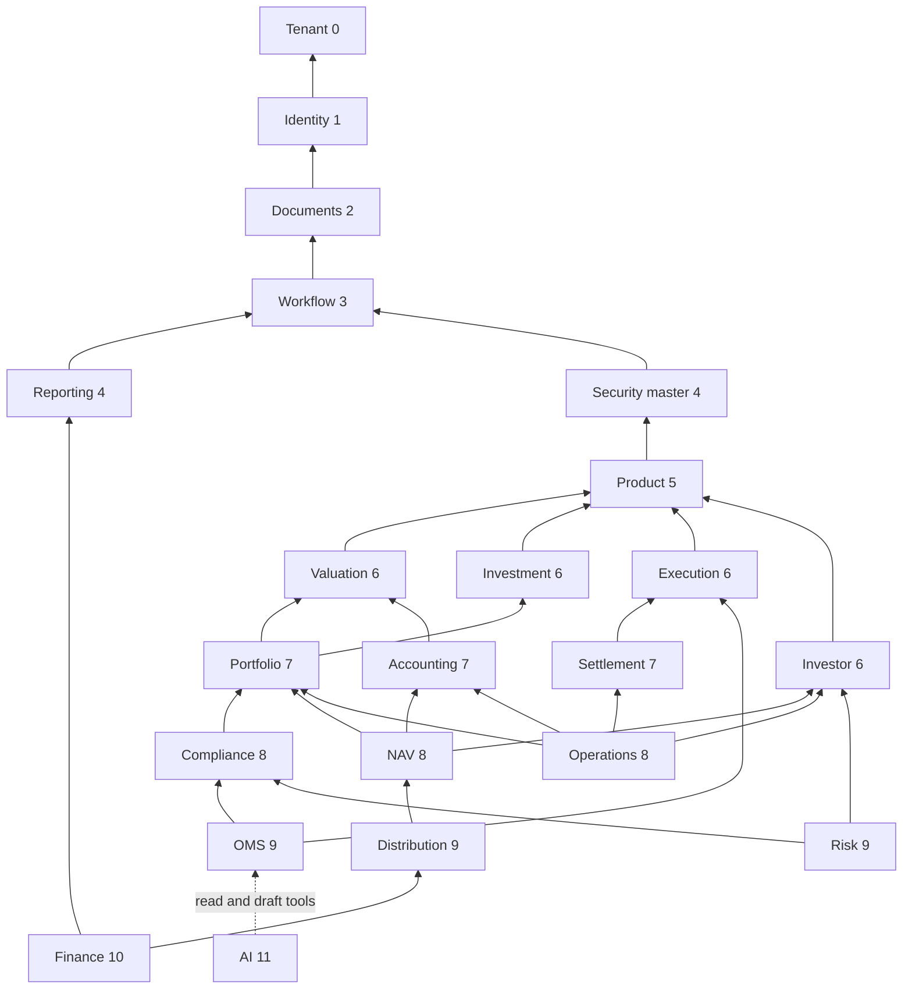
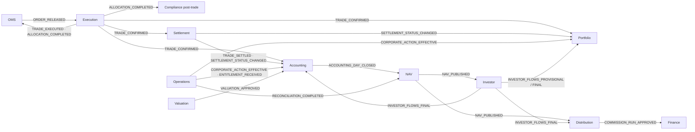

# EA-003 — Domain Boundaries and Service Catalogue

This document lists the 22 service modules of AMC OS (master prompt §5 L3), says what each one owns and does, which APIs and events it offers, which other modules it may call, and how the boundaries between them are kept. It also settles the ownership questions the business documents left open for this step. It is master prompt §14 Stage B items 3 ("Domain boundary diagrams") and 4 ("Service catalogue"). The configuration-over-customisation design (master prompt §3.6), the other half of GOV-006 Step 11, is [EA-008](EA-008_configuration_over_customisation.md).

**Builds on Draft documents:** EA-001, EA-002, ADR-0002…ADR-0008, ADR-0016…ADR-0019, BA-001, BA-004, BA-005, PRD-001…PRD-017, DA-000, DDL-000 — allowed by owner decision D-3 ([GOV-008](../00_governance/GOV-008_build_loop.md) §2 rule 3). Nothing used here is Approved; EA-001, EA-002 and ADR-0016…ADR-0019 are still waiting for the owner to merge. Owner decision Q2 ([GOV-006](../00_governance/GOV-006_gap_analysis_and_delivery_plan.md) §4) and owner decisions D-16, D-29, D-40, D-44, D-52, D-53, D-55, D-58, D-61, D-62, D-65, D-70, D-73, D-74, D-75 ([LOOP_STATE.md](../../LOOP_STATE.md)). The proposal branch `proposal/ai-orchestration-architecture` (EA-101 system-of-record registry) was read as input only.

**Status of every decision in this document:** **[DES]** — a design proposal for the owner (interim ARB) to accept or change. No new regulatory fact is stated. API names are indicative resource groups taken from the PRDs (final paths and `API-Dxx-nnn` IDs: Step 24). Event names are **candidate** names in the master prompt §5 L4 style; final names, payloads and versions (`<NAME>.v<n>`, GOV-001 §4) are set in EA-007 (Step 13).

**Plain-language terms**

| Term | Meaning here |
| --- | --- |
| Module | One part of the single AMC OS application (ADR-0002), with its own code package, its own database schema(s) and its own database role |
| Public interface | The functions a module offers to other modules; the only way another module may ask it for data or ask it to act |
| Synchronous call | Module A calls module B and waits for the answer (inside the same application process in release 1) |
| Event | A record that "something happened" (for example, a trade was confirmed), written by the owning module and delivered to every module that subscribed |
| Read model | A module's own copy of facts it learned from another module's events, kept only to answer its own questions quickly |
| Tier | A position in the call order of §4: a module may call only modules in lower tiers |
| Process workflow | A long, multi-step business process run on Temporal (L4, ADR-0006), such as the daily NAV day |

## 1. Boundary rules

These rules apply to every module. They restate ADR-0002, ADR-0006 and DA-000 Ch 2, and add the points marked *new*.

| # | Rule | Source |
| --- | --- | --- |
| B1 | A module writes only its own schema(s) and connects with its own database role that cannot write any other schema | ADR-0002; AGENTS.md §2.3 |
| B2 | Another module's data is read only through that module's public interface. Direct SQL reads across schemas are allowed only for the stable reference tables DA-000 already allows foreign keys to (`platform.tenant`, `master.*`, `product.*`) and for D16 data pipelines that extract to the analytical store. *New:* DA-000 Ch 2 allowed wider cross-schema read grants; this narrows them so a module can later move out without breaking callers | DA-000 Ch 2 (tightened) |
| B3 | Synchronous calls follow the tier order of §4 and never form a cycle. Information that must flow the other way travels as an event. *New* | Master prompt §21 ("no circular domain dependencies") |
| B4 | Events are written by the owning module in the same transaction as the change (outbox) and delivered to idempotent consumers. *New:* one outbox table **per owning schema**, not one shared `platform.outbox_event`; each module runs its own relay under its own database role (see §5 T15) | ADR-0006, D-70 |
| B5 | Process workflows (L4) may call any module's public interface; modules never write workflow state and only start a workflow or send it a signal | ADR-0006 §3 |
| B6 | Each financial engine FE-01…FE-10 has exactly one owning module, which calls it as a library and passes in all its inputs; an engine never reads another domain's tables (§3) | EA-002 §5.3; GOV-001 §5 |
| B7 | Approvals use the one approval mechanism of the Workflow module (CAP-D12-011); the owning module decides who may approve and what happens after | BA-001 §4 |
| B8 | Audit records are written through the audit write function of the Tenant module (insert-only), never by a direct insert into `audit` tables (§5 T15) | NFR-AUD-001; *new* |
| B9 | An integration adapter belongs to the module that owns the data it brings in or sends out; the Operations module owns only the shared plumbing (connection register, file register, expected-file schedule, raw landing) (§5 T16). *New:* EA-002 §5.1 described adapters as separate modules owned by the domain that **uses** the data; here adapter code sits inside the module that **owns** the data | EA-001 §4 rules; changes EA-002 §5.1 |
| B10 | AI assistants (D17) use only read tools and draft tools that the owning module registers; no module calls AI on the path of a financial transaction | ADR-0008; FR-D17-019 |
| B11 | The browser (L1) may call any module through the gateway to show data or start an action, but never combines modules' data to calculate a financial number | Master prompt §3.5; EA-002 §3.3 |

## 2. The 22 modules at a glance

The list is master prompt §5 L3. The domain and schema columns repeat EA-002 §5.1; the code package column proposes how the modules sit inside the master prompt §14 `src/` folders (a domain with several modules gets sub-packages). Whether ADR-0002's "one package per domain under `src/`" should be read as "one package or sub-package per module" is gap G1 (§8).

| # | Module | Domain | Owns schema(s) | Code package (proposed) | Engines owned | Workspace(s) (EA-002 §3) |
| --- | --- | --- | --- | --- | --- | --- |
| 1 | Tenant | D01 | `platform`, `audit` | `src/platform/tenant` | — | WS-12 |
| 2 | Identity | D01 | `identity` | `src/platform/identity` | — | WS-12 |
| 3 | Product | D02 | `product` | `src/product` | — | WS-12 (Q64) |
| 4 | Security master | D16 | `master` (D-65) | `src/data/master` | — | WS-12 |
| 5 | Investment | D03 | `investment` | `src/investment` | — | WS-01, WS-02 |
| 6 | Portfolio | D04 | `portfolio` | `src/portfolio` | FE-10 Performance and attribution | WS-01, WS-02 |
| 7 | OMS | D05 | `trading` | `src/trading/oms` | — | WS-02, WS-03 |
| 8 | Execution | D06 | `execution` | `src/trading/execution` | — | WS-03 |
| 9 | Settlement | D07 | `settlement` | `src/trading/settlement` | FE-06 Settlement | WS-07 |
| 10 | Compliance | D08 | `compliance` | `src/compliance` | FE-04 Compliance rules | WS-04 |
| 11 | Risk | D09 | `risk` | `src/risk` | FE-05 Risk | WS-05 |
| 12 | Accounting | D10 | `accounting` | `src/accounting` | FE-02 Accounting (posting) | WS-06 |
| 13 | Valuation | D11 | `valuation` | `src/nav/valuation` | FE-03 Portfolio valuation | WS-07 |
| 14 | NAV | D11 | `nav` | `src/nav/nav` | FE-01 NAV | WS-07 |
| 15 | Operations | D12 | `operations` | `src/operations/operations` | FE-07 Reconciliation | WS-07 |
| 16 | Workflow | D12 | `workflow` | `src/operations/workflow` | — | All (approval inbox) |
| 17 | Documents | D12 | `documents` | `src/operations/documents` | — | All (document views) |
| 18 | Investor | D13 | `investor` | `src/investor` | — | WS-08 |
| 19 | Distribution | D14 | `distribution` | `src/distribution` | FE-09 Commission | WS-09 |
| 20 | Finance | D15 | `finance` | `src/finance` | FE-08 Revenue | WS-10, WS-11 |
| 21 | Reporting | D16 | `analytics` | `src/data/reporting` | — | All (dashboards); WS-12 (catalogue, metrics) |
| 22 | AI | D17 | `ai` | `src/ai` | — (no engine; ADR-0008) | Assistant panel in every workspace (D-74) |

Every one of the 17 domains has at least one module; D01, D11, D12 and D16 have more than one. GOV-001 §5 gives FE-03 the primary domain "D11 / D04" and FE-10 "D04"; this document gives FE-03 to the Valuation module (D11), which values the positions the Portfolio module (D04) hands it (§4.2).

## 3. Service catalogue

Each card says what the module is responsible for (BA-001 capabilities), the main API resource groups (from the PRD §10 tables, indicative), the candidate events it publishes and the main events it consumes, the modules it may call synchronously (every module above tier 1 may also call Tenant and Identity, and Identity may call Tenant; the cards list them only where that is all the module calls), and the outside parties whose adapters it owns. "Calls" lists must match the §4 tier table.

### 3.1 Tenant (D01)

| Item | Content |
| --- | --- |
| Responsible for | CAP-D01-001 tenant management, CAP-D01-006 subscription and entitlements, CAP-D01-007 organisation hierarchy, CAP-D01-008 configuration management (EA-008), CAP-D01-009 system administration incl. the business-calendar master, CAP-D01-010 audit management, CAP-D01-011 environment administration (PRD-001) |
| APIs (indicative) | Tenants; entitlements and usage; organisation units; configuration catalogue, versions and difference view; business calendars; audit search; environments and releases |
| Publishes (candidate) | `TENANT_ACTIVATED`, `TENANT_SUSPENDED`, `ENTITLEMENT_CHANGED`, `CONFIG_VERSION_APPROVED`, `CONFIG_VERSION_EFFECTIVE`, `CALENDAR_CHANGED` |
| Consumes | `APPROVAL_DECIDED` (Workflow) for configuration versions |
| Calls | None (tier 0). Approvals for configuration (WF-021) and onboarding (WF-019) are opened by the process workflow (L4), because the Tenant module sits below Workflow (§4) |
| Adapters | None |
| Notes | Holds the audit write function (B8) and provides the shared outbox relay code; each module runs its own relay under its own role (B4, T15). The calendar master here is the one holiday source; D07 and D12 calendars build on it (BA-001 §4) |

### 3.2 Identity (D01)

| Item | Content |
| --- | --- |
| Responsible for | CAP-D01-002 users, CAP-D01-003 identity, CAP-D01-004 role-based access, CAP-D01-005 permissions; role grants, approval authorities, recertification, break-glass grants (PRD-001; BA-005) |
| APIs (indicative) | Users; roles and rights; role-grant requests; approval authorities; recertification campaigns; service accounts; sessions |
| Publishes (candidate) | `USER_PROVISIONED`, `USER_DEPROVISIONED`, `ROLE_GRANTED`, `ROLE_REVOKED`, `BREAK_GLASS_GRANTED` |
| Consumes | `APPROVAL_DECIDED` for grants (WF-020, WF-022) |
| Calls | Tenant |
| Adapters | X01 AMC identity provider (sign-in through the Keycloak broker, ADR-0016; provisioning push where supported) |
| Notes | Supplies grants and attributes to the policy engine (L2, ADR-0019); the policy engine itself is not a module. Approvals for grants and break-glass access (WF-020, WF-022) are opened by the process workflow, as for Tenant |

### 3.3 Workflow (D12)

| Item | Content |
| --- | --- |
| Responsible for | CAP-D12-011 workflow management: the one approval mechanism (maker ≠ checker enforced, SoD triggers, no AI decision), tasks and inboxes; CAP-D12-009 operational approvals use it |
| APIs (indicative) | Approval requests; decisions; tasks; inboxes; delegation |
| Publishes (candidate) | `APPROVAL_REQUESTED`, `APPROVAL_DECIDED`, `TASK_ASSIGNED`, `TASK_OVERDUE` |
| Consumes | `ROLE_REVOKED` (withdraw pending tasks of a leaver) |
| Calls | Documents |
| Adapters | None |
| Notes | Owns the `workflow` schema (approval requests and decisions; DDL-000 `workflow.approval_request`, `workflow.approval_decision`). It is **not** the Temporal runtime: process workflows (L4) are platform infrastructure, and each process workflow's definition belongs to the module that owns the process (for example the daily NAV workflow belongs to NAV). *New:* BA-001 CAP-D12-011 (.1) and DA-000 Ch 2 gave "workflow definitions" to D12; here D12 keeps approval-chain definitions and process workflow definitions move to their owning modules (§7) |

### 3.4 Documents (D12)

| Item | Content |
| --- | --- |
| Responsible for | CAP-D12-010 document management: storage in object storage, versions, hashes, classification, retention class, legal hold |
| APIs (indicative) | Documents; versions; retention classes; download links |
| Publishes (candidate) | `DOCUMENT_STORED`, `DOCUMENT_VERSION_APPROVED` |
| Consumes | — |
| Calls | Tenant, Identity only |
| Adapters | None (object storage is L6 infrastructure, ADR-0007) |
| Notes | Content and its approval belong to the domain that owns it (SID/SAI/KIM to Product, evidence packs to Compliance) (BA-001 §4) |

### 3.5 Security master (D16)

| Item | Content |
| --- | --- |
| Responsible for | CAP-D16-004 master data management for security, issuer, issuer group, credit rating, counterparty, benchmark and index; identifier crosswalk; source precedence; steward queues (FR-D16-004, FR-D16-012, FR-D16-013; WF-041) |
| APIs (indicative) | Securities; issuers; counterparties; benchmarks and levels; identifiers; steward requests |
| Publishes (candidate) | `SECURITY_APPROVED`, `SECURITY_CHANGED`, `ISSUER_CHANGED`, `RATING_CHANGED`, `COUNTERPARTY_CHANGED`, `BENCHMARK_LEVELS_LOADED` |
| Consumes | — |
| Calls | Workflow, Documents |
| Adapters | X10 data vendors (reference data), X11 rating agencies (ratings), index data — each "Confirm with provider" (INT-001, Step 14) |
| Notes | One copy per AMC; only `master.currency` is shared (D-62). Distributor, investor and employee records stay with D14, D13 and D01; Security master only matches and checks them (§5 T9) |

### 3.6 Product (D02)

| Item | Content |
| --- | --- |
| Responsible for | CAP-D02-001…011: scheme master, categories, plans and options, scheme documents, NFO, scheme configuration, benchmark mapping, scheme approvals and changes (PRD-002; WF-001, WF-029, WF-030) |
| APIs (indicative) | Schemes; plans; scheme versions; NFOs; mandates; scheme documents |
| Publishes (candidate) | `SCHEME_ACTIVATED`, `SCHEME_AMENDED`, `SCHEME_MANDATE_CHANGED`, `NFO_CLOSED`, `SCHEME_WOUND_UP` |
| Consumes | `BENCHMARK_LEVELS_LOADED` (display only) |
| Calls | Security master, Workflow, Documents |
| Adapters | Scheme set-up to the RTA (X07), MF platforms (X09) and depository ISIN requests (X04) — "Confirm with provider" |

### 3.7 Investment (D03)

| Item | Content |
| --- | --- |
| Responsible for | CAP-D03-001…010: research, recommendations, investment committee, decisions, approved universe and restricted list, house view and scheme strategy, investment policy (PRD-003; WF-002, WF-031) |
| APIs (indicative) | Research notes; recommendations; IC meetings; decisions; universe; restricted list; investment policies |
| Publishes (candidate) | `RESEARCH_APPROVED`, `INVESTMENT_DECISION_RECORDED`, `UNIVERSE_CHANGED`, `RESTRICTED_LIST_CHANGED`, `INVESTMENT_POLICY_APPROVED` |
| Consumes | `SECURITY_CHANGED`, `RATING_CHANGED` (review triggers) |
| Calls | Security master, Product, Workflow, Documents |
| Adapters | None (vendor research data arrives through Security master or Reporting) |

### 3.8 Portfolio (D04)

| Item | Content |
| --- | --- |
| Responsible for | CAP-D04-001…011: portfolio master, holdings (investment book of record), allocation, construction, rebalancing proposals, exposure views, benchmark comparison, performance and attribution (FE-10), historical holdings (PRD-004; WF-003, WF-032) |
| APIs (indicative) | Positions as of a date; cash ladder; models and targets; rebalance proposals; exposures; performance |
| Publishes (candidate) | `HOLDINGS_UPDATED`, `POSITIONS_SNAPSHOT_TAKEN`, `REBALANCE_PROPOSED`, `PERFORMANCE_CALCULATED` |
| Consumes | `TRADE_CONFIRMED`, `ALLOCATION_COMPLETED` (Execution); `SETTLEMENT_STATUS_CHANGED`; `CORPORATE_ACTION_EFFECTIVE` (Operations); `INVESTOR_FLOWS_PROVISIONAL`, `INVESTOR_FLOWS_FINAL` (Investor) for cash; `PRICES_VALIDATED` (Valuation) |
| Calls | Security master, Product, Investment, Valuation, Workflow |
| Adapters | None |
| Notes | Never calls OMS or Compliance: a rebalance proposal is pulled by OMS when the fund manager turns it into orders, and the what-if check is a Compliance API that reads positions from Portfolio (§4.2) |

### 3.9 OMS (D05)

| Item | Content |
| --- | --- |
| Responsible for | CAP-D05-001…012: order creation, validation, approval, amendment, cancellation, routing to Execution, status, history, maker-checker, and requesting pre- and post-trade checks (PRD-005; WF-004, WF-005) |
| APIs (indicative) | Orders; amend; cancel; blocks |
| Publishes (candidate) | `ORDER_CREATED`, `ORDER_VALIDATED`, `ORDER_APPROVED`, `ORDER_RELEASED`, `ORDER_CANCELLED` |
| Consumes | `TRADE_EXECUTED`, `ALLOCATION_COMPLETED` (order status); `RESTRICTED_LIST_CHANGED`; `COMPLIANCE_CHECK_COMPLETED` for post-trade results |
| Calls | Compliance (pre-trade check, synchronous), Portfolio, Investment, Product, Security master, Execution (release order), Workflow |
| Adapters | None — brokers connect only to Execution |
| Notes | Order validation checks that the security has an approved golden record in Security master (PRD-016 C10; §5 T10) |

### 3.10 Execution (D06)

| Item | Content |
| --- | --- |
| Responsible for | CAP-D06-001…008: broker management and limits, execution, trade confirmation and contract-note matching, post-trade allocation, trade-by-trade execution reconciliation, trade lifecycle and exceptions (PRD-006; WF-023, WF-024, WF-025) |
| APIs (indicative) | Brokers; executions; allocations; trades; contract notes; trade breaks; trade-charges rate table |
| Publishes (candidate) | `TRADE_EXECUTED`, `ALLOCATION_COMPLETED`, `TRADE_CONFIRMED`, `TRADE_CORRECTED`, `TRADE_EXCEPTION_RAISED`, `BROKER_STATUS_CHANGED` |
| Consumes | `ORDER_RELEASED`, `ORDER_CANCELLED` (OMS); `COUNTERPARTY_CHANGED` |
| Calls | Security master, Product, Workflow, Documents |
| Adapters | X02 brokers (orders out, executions and contract notes in) — protocol per broker "Confirm with <broker>" (INT-001) |
| Notes | Owns the trade record and allocation results (§5 T1) and the trade-charges rate table (§5 T6) |

### 3.11 Settlement (D07)

| Item | Content |
| --- | --- |
| Responsible for | CAP-D07-001…008: settlement calendar, obligations (gross and net), cash and securities settlement, instructions, payment tracking, confirmation, settlement-level reconciliation rules, fails; SSIs and scheme bank details (FE-06; PRD-007; WF-018, WF-026, WF-027, WF-028) |
| APIs (indicative) | Settlement records; obligations; instructions; payment instructions; fails; SSIs |
| Publishes (candidate) | `SETTLEMENT_INSTRUCTED`, `SETTLEMENT_STATUS_CHANGED`, `TRADE_SETTLED`, `SETTLEMENT_FAILED` |
| Consumes | `TRADE_CONFIRMED`, `TRADE_CORRECTED` (Execution); `CALENDAR_CHANGED` |
| Calls | Execution (trade details), Security master, Product, Workflow, Documents |
| Adapters | X05 custodians (instructions out, status and statements in), X06 banks (payment status in; payments out only where the AMC chooses), X03 clearing obligations — "Confirm with <provider>" |

### 3.12 Compliance (D08)

| Item | Content |
| --- | --- |
| Responsible for | CAP-D08-001…013: rule registry and rule versions (rules are data), restrictions and limits, pre- and post-trade checks (FE-04), what-if, breaches, investigation, corrective actions, overrides and exemptions, evidence, compliance reports (PRD-008; WF-005, WF-006, WF-014, WF-016, WF-034) |
| APIs (indicative) | Rules and versions; rule tests; pre-trade check; post-trade run; what-if; breaches; overrides; exemptions; evidence; regulatory reports |
| Publishes (candidate) | `COMPLIANCE_CHECK_COMPLETED`, `COMPLIANCE_BREACH_DETECTED`, `COMPLIANCE_BREACH_CLOSED`, `RULE_VERSION_APPROVED`, `PRETRADE_OVERRIDE_APPROVED` |
| Consumes | `ALLOCATION_COMPLETED` (start post-trade checks); `NAV_APPROVED` (end-of-day post-trade run after NAV approval and net assets for limits, FR-D08-009, FR-D08-002); `HOLDINGS_UPDATED`; `SCHEME_MANDATE_CHANGED`; `RESTRICTED_LIST_CHANGED`; `RISK_RUN_COMPLETED` (liquidity-stress inputs) |
| Calls | Portfolio, Product, Investment, Security master, Workflow, Documents |
| Adapters | X13 SEBI sources (circulars read by people; reports prepared for people to file) |
| Notes | Never calls Risk: Risk sends limit requests to Compliance (§4.2). Owns the override record and approval (§5 T7) |

### 3.13 Risk (D09)

| Item | Content |
| --- | --- |
| Responsible for | CAP-D09-001…013: market, credit, liquidity, concentration and counterparty risk, duration and rate sensitivity, stress and scenarios, risk attribution, reporting and alerts (FE-05; PRD-009; WF-033) |
| APIs (indicative) | Risk runs; metrics as of a date; stress scenarios and results; models; alerts; attribution |
| Publishes (candidate) | `RISK_RUN_COMPLETED`, `RISK_ALERT_RAISED`, `RISK_ALERT_ESCALATED`, `RISK_MODEL_VALIDATED` |
| Consumes | `POSITIONS_SNAPSHOT_TAKEN`; `PRICES_VALIDATED`; `RATING_CHANGED`; `CORPORATE_ACTION_EFFECTIVE` (FR-D12-021); `COMPLIANCE_BREACH_DETECTED` (for the risk view) |
| Calls | Portfolio, Valuation, Security master, Product, Compliance (limit requests; read-through of limits, BRL-D09-003), Investor (investor concentration), Workflow, Documents |
| Adapters | Market data comes through Security master and Valuation; none of its own |

### 3.14 Accounting (D10)

| Item | Content |
| --- | --- |
| Responsible for | CAP-D10-001…013: chart of accounts, journals, double-entry ledger, accruals, income and expense recognition, corporate-action accounting, receivables and payables, trial balance, accounting reconciliation rules, period close; book-of-record or mirror mode per scheme (FE-02; PRD-010; D-16, D-40; WF-008) |
| APIs (indicative) | Chart of accounts; journal batches; periods; trial balance as of a date; accrual runs; receivables and payables; custodian ledger loads (mirror mode) |
| Publishes (candidate) | `JOURNAL_POSTED`, `ACCRUALS_POSTED`, `ACCOUNTING_DAY_CLOSED`, `PERIOD_CLOSED`, `PERIOD_REOPENED` |
| Consumes | `TRADE_CONFIRMED`, `TRADE_SETTLED`, `SETTLEMENT_STATUS_CHANGED`; `VALUATION_APPROVED`; `CORPORATE_ACTION_EFFECTIVE`, `ENTITLEMENT_RECEIVED`; `INVESTOR_FLOWS_FINAL`; `SCHEME_AMENDED` (TER and fee changes) |
| Calls | Valuation (approved valuation detail), Product, Security master, Workflow, Documents |
| Adapters | X05 custodian ledger and trial balance in mirror mode — "Confirm with <custodian>" |

### 3.15 Valuation (D11)

| Item | Content |
| --- | --- |
| Responsible for | CAP-D11-001…005: prices, price validation, price-source hierarchy, valuation policy, fair-value cases (WF-035); portfolio valuation (FE-03) of a set of positions handed to it |
| APIs (indicative) | Prices; price overrides; source hierarchy; valuation policy; fair-value cases; valuations |
| Publishes (candidate) | `PRICES_LOADED`, `PRICES_VALIDATED`, `FAIR_VALUE_DECIDED`, `VALUATION_APPROVED` |
| Consumes | `SECURITY_APPROVED`, `SECURITY_CHANGED`; `CORPORATE_ACTION_EFFECTIVE` (price adjustments) |
| Calls | Security master, Product, Workflow, Documents |
| Adapters | X03 exchange prices, X11 valuation agencies, X10 vendor prices — "Confirm with provider" |
| Notes | Never calls Portfolio, Accounting or NAV: the caller (Portfolio, or the daily NAV process workflow) passes the positions to value (§4.2) |

### 3.16 NAV (D11)

| Item | Content |
| --- | --- |
| Responsible for | CAP-D11-006…015 as used for NAV: assembling assets and liabilities, units outstanding, NAV calculation (FE-01), validation, approval, publication, history, corrections, NAV reconciliation with custodian NAV; NAV mode per scheme (D-16, D-44; WF-007, WF-017) |
| APIs (indicative) | NAV runs; validate; approve; publish; NAVs by plan and date; NAV corrections; custodian NAV loads |
| Publishes (candidate) | `NAV_CALCULATED`, `NAV_APPROVED`, `NAV_PUBLISHED`, `NAV_CORRECTION_APPROVED` |
| Consumes | `ACCOUNTING_DAY_CLOSED`; `RECONCILIATION_COMPLETED` (checklist); `FAIR_VALUE_DECIDED` |
| Calls | Accounting (trial balance and accruals — NAV never recomputes accruals, BA-001 §4), Valuation, Portfolio, Investor (units outstanding from the RTA mirror), Product, Workflow, Documents |
| Adapters | X12 AMFI and X07 RTA NAV delivery (who submits to AMFI is set per AMC, D-44); X05 custodian NAV in outsourced mode — "Confirm with provider" |
| Notes | Owns the daily NAV process workflow definition (L4) |

### 3.17 Operations (D12)

| Item | Content |
| --- | --- |
| Responsible for | CAP-D12-001…009: operational calendars and cut-offs, daily operations and day close, reconciliation (FE-07) with break workflow for custodian, broker-statement, bank and entitlement reconciliations, corporate-action golden record, entitlements and elections, exception queue; connection and file registers (PRD-012; WF-009, WF-015, WF-036) |
| APIs (indicative) | Connections; inbound and outbound files; expected-file schedule; reconciliation definitions, runs and breaks; exceptions; day plan and day close; corporate actions; elections |
| Publishes (candidate) | `FILE_RECEIVED`, `FILE_QUARANTINED`, `RECONCILIATION_COMPLETED`, `RECONCILIATION_EXCEPTION_CREATED`, `CORPORATE_ACTION_ANNOUNCED`, `CORPORATE_ACTION_CONFIRMED`, `CORPORATE_ACTION_EFFECTIVE`, `ENTITLEMENT_RECEIVED`, `OPERATIONS_DAY_CLOSED` |
| Consumes | Completion events of every module on the day checklist (`ACCOUNTING_DAY_CLOSED`, `NAV_APPROVED`, `SETTLEMENT_STATUS_CHANGED` …); `CALENDAR_CHANGED` |
| Calls | Security master, Portfolio (positions for entitlements), Execution, Settlement, Accounting, Valuation, Investor (reported figures for checks), Product, Workflow, Documents |
| Adapters | Shared plumbing only (B9): connection register, file landing and schedule; corporate-action announcements from X03, X05, X10 — "Confirm with provider" |
| Notes | Runs one engine and one break workflow for every reconciliation; the owning department of each set (for example Fund Accountants for D10/D11 sets) defines it through the Operations API, and it is stored in `operations` — the owning module does not call Operations (BA-001 §4; EA-008 §6.2; §5 T11, T12) |

### 3.18 Investor (D13)

| Item | Content |
| --- | --- |
| Responsible for | CAP-D13-001…016 in mirror-and-check mode (Q2): investor and folio mirror, KYC status, transactions, SIP/STP/SWP, IDCW checks, unit balances, communications preparation and consent (D-55), service requests and complaints, payout tracking (D-52), corrections only through the RTA (D-53) (PRD-013; WF-010, WF-011, WF-012, WF-037, WF-038) |
| APIs (indicative) | Investors; folios; transactions; SIPs and registrations; service requests; complaints; communications; payouts; rights requests |
| Publishes (candidate) | `INVESTOR_TRANSACTION_RECEIVED`, `INVESTOR_FLOWS_PROVISIONAL`, `INVESTOR_FLOWS_FINAL`, `SERVICE_REQUEST_CLOSED`, `COMPLAINT_RECEIVED`, `INVESTOR_DATA_FLAGGED` |
| Consumes | `NAV_PUBLISHED` (applicable NAV for checks); `RECONCILIATION_COMPLETED` (check results to flag); `SCHEME_AMENDED` |
| Calls | Product, Workflow, Documents |
| Adapters | X07 RTA feeds and requests, X08 KYC status, X09 MF platforms, X16 message providers, X13 SCORES — "Confirm with provider" |
| Notes | Never calls NAV: NAV values arrive by event so that NAV may call Investor for units outstanding (§4.2). PII stays in `investor`; other modules see masked or aggregated data |

### 3.19 Distribution (D14)

| Item | Content |
| --- | --- |
| Responsible for | CAP-D14-001…016: distributor master, ARN/EUIN, hierarchy, channels, RMs, sales and AUM tracking, net flows, commission calculation and runs (FE-09), incentives incl. staff sales incentives (§5 T13), segmentation, forecasting, channel analytics (PRD-014; WF-013, WF-039) |
| APIs (indicative) | Distributors; ARNs and EUINs; hierarchy; mappings; channels; commission structures and runs; incentive rules; statements; disputes; segments; forecasts |
| Publishes (candidate) | `DISTRIBUTOR_STATUS_CHANGED`, `DISTRIBUTOR_FLOW_UPDATED`, `COMMISSION_RUN_CALCULATED`, `COMMISSION_RUN_APPROVED` |
| Consumes | `INVESTOR_FLOWS_FINAL`, `INVESTOR_TRANSACTION_RECEIVED`; `NAV_PUBLISHED`; `SCHEME_AMENDED` |
| Calls | Investor, NAV, Product, Workflow, Documents |
| Adapters | X12 AMFI (ARN, EUIN, KYD), X07 RTA brokerage feeds, X06 bank payment files where used — "Confirm with provider" |

### 3.20 Finance (D15)

| Item | Content |
| --- | --- |
| Responsible for | CAP-D15-001…011: revenue (FE-08), expenses, budgets and plans (D-58), profitability, cost allocation, incremental yield, revenue forecasting, management reporting close (WF-040), executive dashboards |
| APIs (indicative) | Revenue; expenses; allocation keys and runs; budgets; plans; forecasts; management periods; AUM bridges; board packs |
| Publishes (candidate) | `MANAGEMENT_PERIOD_CLOSED`, `BUDGET_APPROVED`, `ALLOCATION_RUN_APPROVED` |
| Consumes | `COMMISSION_RUN_APPROVED`; `PERIOD_CLOSED`; `NAV_PUBLISHED`; `METRIC_DEFINITION_CERTIFIED` |
| Calls | Distribution, Accounting, NAV, Product, Reporting (certified metrics), Workflow, Documents |
| Adapters | X15 AMC corporate ERP — "Confirm with the AMC's ERP provider" |

### 3.21 Reporting (D16)

| Item | Content |
| --- | --- |
| Responsible for | CAP-D16-001…003 and CAP-D16-005…013: ingestion pipelines into the analytical store, canonical analytical model, lineage, data quality, catalogue, governance and access requests, warehouse, metric registry (WF-042), historical data; dashboards (PRD-016) |
| APIs (indicative) | Datasets; metrics; lineage; data-quality results; catalogue; access requests; semantic-layer query |
| Publishes (candidate) | `DATASET_CERTIFIED`, `DQ_EXCEPTION_RAISED`, `METRIC_DEFINITION_CERTIFIED` |
| Consumes | Every module's events (for the analytical store); extracts under rule B2 |
| Calls | Workflow, Documents (approvals for WF-042 metric certification and data access requests, B7); it reads module data through pipelines, not through synchronous calls |
| Adapters | None of its own (vendor data comes through Security master and Valuation) |
| Notes | Domain reports with a business owner and approval (compliance reports, risk packs, board packs) stay with their domain; Reporting supplies certified data and the semantic layer |

### 3.22 AI (D17)

| Item | Content |
| --- | --- |
| Responsible for | CAP-D17-001…017: AI gateway, assistant registry with per-tenant switch-on (D-73), tool registry, tenant-aware retrieval, evaluation, prompt and model versions, monitoring, kill switch (D-75), AI audit, anomaly detection and forecasting shown beside deterministic figures (PRD-017; WF-043) |
| APIs (indicative) | Assistants; sessions and messages; tool calls; proposals; evaluations; models; corpus documents; feedback; kill switch; inventory |
| Publishes (candidate) | `AI_PROPOSAL_CREATED`, `AI_ANOMALY_FLAGGED`, `AI_KILL_SWITCH_CHANGED`, `ASSISTANT_VERSION_RELEASED` |
| Consumes | `ROLE_REVOKED`; `ENTITLEMENT_CHANGED` |
| Calls | Any module, but only through read tools and draft tools that module registers, and always through the L2 policy check (B10) |
| Adapters | X14 AI model provider through the AI gateway only (EA-001 X14, CAP-D17-001); India-region private endpoint, zero data retention, no training on AMC data (D-61) |
| Notes | Top tier: nothing calls AI on a financial path (FR-D17-019). A proposal enters the owning module's normal approval (ADR-0008 §3) |

## 4. Dependencies and tiers

### 4.1 Tier table

Every module above tier 1 may also call Tenant and Identity; Identity may call Tenant; Tenant calls nobody. The table was checked for cycles by a topological sort while this document was written (no cycle found); any later change to a "Calls" row must keep it acyclic and be reflected in the architecture tests of ADR-0002.

| Tier | Modules | May call (besides Tenant, Identity) |
| --- | --- | --- |
| 0 | Tenant | — |
| 1 | Identity | Tenant |
| 2 | Documents | — |
| 3 | Workflow | Documents |
| 4 | Security master | Workflow, Documents |
| 4 | Reporting | Workflow, Documents (pipelines read data; rule B2) |
| 5 | Product | Security master, Workflow, Documents |
| 6 | Valuation | Security master, Product, Workflow, Documents |
| 6 | Investment | Security master, Product, Workflow, Documents |
| 6 | Execution | Security master, Product, Workflow, Documents |
| 6 | Investor | Product, Workflow, Documents |
| 7 | Portfolio | Security master, Product, Investment, Valuation, Workflow |
| 7 | Settlement | Execution, Security master, Product, Workflow, Documents |
| 7 | Accounting | Valuation, Product, Security master, Workflow, Documents |
| 8 | Compliance | Portfolio, Product, Investment, Security master, Workflow, Documents |
| 8 | NAV | Accounting, Valuation, Portfolio, Investor, Product, Workflow, Documents |
| 8 | Operations | Security master, Portfolio, Execution, Settlement, Accounting, Valuation, Investor, Product, Workflow, Documents |
| 9 | OMS | Compliance, Portfolio, Investment, Product, Security master, Execution, Workflow |
| 9 | Risk | Portfolio, Valuation, Security master, Product, Compliance, Investor, Workflow, Documents |
| 9 | Distribution | Investor, NAV, Product, Workflow, Documents |
| 10 | Finance | Distribution, Accounting, NAV, Product, Reporting, Workflow, Documents |
| 11 | AI | Any module, through registered read and draft tools only |

Process workflows (L4) and the browser (L1, through the gateway) are outside this table: they may call any module's public interface (B5, B11).

The diagram shows the main edges only; the table is complete. Arrows point from caller to callee.

### 4.2 Pairs that would have formed a cycle, and how they are broken

| Pair | Natural pull both ways | Resolution |
| --- | --- | --- |
| Portfolio ↔ Valuation | Portfolio wants market values; valuation needs positions | Portfolio calls Valuation and passes the positions to value; Valuation never calls Portfolio. Valuation learns about new prices on its own; Portfolio learns validated prices from `PRICES_VALIDATED` |
| Portfolio ↔ Compliance | What-if needs positions; Portfolio wants what-if results | Compliance offers the what-if API and reads positions from Portfolio; the Fund Manager's screen calls Compliance directly (B11). Portfolio never calls Compliance |
| Portfolio ↔ OMS | Orders need positions; rebalancing produces orders | OMS pulls the rebalance proposal from Portfolio; Portfolio never creates orders |
| Compliance ↔ Risk | Risk limits are enforced as rules; compliance needs liquidity-stress outputs | Risk calls Compliance (limit requests, read-through of limits); stress outputs reach Compliance as `RISK_RUN_COMPLETED` |
| Accounting ↔ NAV | NAV needs the trial balance; accounting books the approved NAV-related figures | NAV calls Accounting; Accounting learns from events (`VALUATION_APPROVED`, flows) and never calls NAV |
| NAV ↔ Investor | NAV needs units outstanding; investor checks need the applicable NAV | NAV calls Investor; Investor learns NAV from `NAV_PUBLISHED` |
| Operations ↔ everyone | Day close and reconciliation read many modules; those modules need reconciliation status | Operations calls them for data; they learn status from `RECONCILIATION_COMPLETED` and `OPERATIONS_DAY_CLOSED`, or the screen shows Operations results directly |
| Tenant, Identity ↔ Workflow | Configuration and grants need approval; Workflow needs grants | Approvals for configuration and grants are opened by the process workflow (WF-019…WF-022, including break-glass grants), not by Tenant or Identity |

### 4.3 Main event flows

Payloads, ordering guarantees, retries, dead-letter handling and versions are EA-007 (Step 13). The daily NAV, NFO, settlement-fail, breach-resolution and commission-run process workflows (ADR-0006 §3) are designed there too.

## 5. Ownership decisions on contested items

Each row closes, or proposes how to close, an open point that earlier documents sent to this step. Schema changes listed here are **not** made now; they are inputs to DA-001 (Step 15) and the DDL step (Step 16).

| # | Topic | Decision proposed **[DES]** | Closes / answers |
| --- | --- | --- | --- |
| T1 | Trade record and allocation results | Execution owns the trade record (with its confirmation states and charges) and the post-trade allocation results in `execution`. OMS keeps only the order state it learns from Execution events. Settlement receives `TRADE_CONFIRMED` and keeps its own settlement record keyed by the trade ID. DDL change for Step 16: allocation quantity and average price leave `trading.block_allocation`; the trade and charge fields leave `settlement.trade` for an `execution` trade table, and `settlement.trade` becomes the settlement record | PRD-006 C3, C4; PRD-005 C9; PRD-007 C3 (trade part); BA-001 §5 C3 (trade part); BA-004 §5.2 C2 |
| T2 | Contract notes and matching | Execution (CAP-D06-003), in `execution` | PRD-007 C3 (contract-note part); BA-004 §5.2 C2 |
| T3 | Corporate actions | Operations owns the golden corporate-action record, entitlements and elections in `operations`; Accounting does the accounting (CAP-D10-008); Portfolio applies position changes; Valuation adjusts prices — all from Operations events (FR-D12-021). DDL change for Step 16: corporate-action tables move from `settlement` (DA-000) to `operations` | PRD-012 C2; PRD-007 C3 (corporate-action part); BA-001 §5 C3 (corporate-action part) |
| T4 | SSIs and scheme bank details | Settlement, in `settlement` (CAP-D07-004 (.2), WF-028) — as DA-000 | PRD-007 C3 (SSI part) |
| T5 | Counterparties | Security master holds the counterparty golden record and the empanelment status of non-broker counterparties (custodians, banks, clearing corporations, debt and repo counterparties). Execution holds broker-specific data (empanelment, limits, brokerage rates) keyed to the counterparty record. Risk measures counterparty exposure; Compliance enforces counterparty limits as rules. A level-3 item for counterparty limits under CAP-D08-005 is needed in the next BA-001 revision | PRD-006 C11, C15; PRD-007 C9 |
| T6 | Trade-charges rate table (STT, stamp duty, GST, exchange fees) | Held by Execution in `execution`, which uses it to compute expected charges for contract-note matching; maintained through the Execution API by Operations (maker) and checked by Compliance (checker), as owner decision D-29 says. Other modules get charges from the trade record, never from the table | PRD-006 C7 (schema part) |
| T7 | Pre-trade override | Compliance owns the override record and its approval (`compliance.pretrade.override`, CAP-D08-011); OMS requests the override and acts on the result (CAP-D05-010 (.3)) | PRD-005 C6; PRD-008 C4 |
| T8 | Security and issuer data | Security master (D16, `master`, D-65); the former D03 `/securities` and `/issuers` resources belong to Security master (FR-D16-012, FR-D16-013) | BA-001 §5 C2 (architecture part); PRD-016 C1 |
| T9 | Distributor, investor and employee golden records | Stay with Distribution, Investor and Identity / Tenant (organisation); Security master only matches, suggests de-duplication and checks quality, returning findings to the owning module's steward queue (FR-D16-004) | PRD-016 C2 |
| T10 | Order on a security without an approved golden record | The check sits in OMS order validation (CAP-D05-002), which asks Security master for the record status. Whether the emergency universe override (FR-D05-012) may use a fast-track security approval is a business rule not yet given — owner question Q67; until answered, no fast track exists and the order waits for WF-041 | PRD-016 C10 (placement part) |
| T11 | Bank reconciliation | One reconciliation per scheme bank account per day, run by Operations with FE-07; the settlement and accounting teams each define their own match rule sets inside it through the Operations API (stored in `operations`); each statement line is matched once (as proposed in PRD-012 C3) | PRD-012 C3 |
| T12 | Engine for the investor unit, amount and IDCW checks | The checks are reconciliation sets that the investor services team defines through the Operations API (stored in `operations`) and Operations runs with FE-07: expected values (for example expected units from amount, applicable NAV and charges) are computed by versioned expected-value rules inside FE-07 and compared with the RTA's figures; results flag the investor record (D-53). To be confirmed in the FE-07 specification (Step 22) | PRD-013 C8 |
| T13 | Engine for staff sales incentives | FE-09 (Commission), owned by Distribution, which also owns CAP-D14-013; FE-08 (Revenue) stays with Finance | PRD-014 C5 |
| T14 | Where configuration is stored | In `platform`, owned by the Tenant module; no new `config` schema. Domain rule sets (compliance rules, posting rules, commission structures, valuation policy, reconciliation definitions, risk models and limits, metric definitions, the trade-charges table) stay in their owning schemas. Design: EA-008 | PRD-001 C6; BA-001 CAP-D01-008 note; BA-004 WF-021 "full design" note |
| T15 | Outbox, idempotency keys and audit writes | One outbox table and one idempotency-key table per owning schema. Each module runs its own relay worker (shared code from the Tenant package, but connected with **that module's** database role), which reads only its own outbox and marks only its own rows sent — so no module, and no central relay, writes another schema. Outbox tables keep forced row-level security: the relay works tenant by tenant, reading the tenant list from `platform.tenant` (a reference table allowed by B2) and setting the tenant context (`SET LOCAL`) for each batch; no relay role bypasses row-level security. This is a named system-worker exception to STD-001 §4 (tenant context from the authenticated principal), like the rule for event consumers in EA-002 §7 ("consumers set context from" the event's tenant_id); it is part of the ADR-0020 scope. Audit records are written through an insert-only database function owned by the audit role (modules get permission to run the function, not to insert into the table), which keeps the per-tenant daily hash chain in one place. DDL-000 today has one shared `platform.outbox_event`, one `platform.idempotency_key` and a single `amc_app` role with write rights on every schema — all three change in Step 16 (per-module roles are what ADR-0002's validation already expects). These changes need an ADR first (§7, G8) | ADR-0002 validation; DA-000 Ch 2; new |
| T16 | Integration adapters | Adapter code belongs to the module that owns the data (brokers → Execution; custodian instructions → Settlement; prices → Valuation; reference data → Security master; RTA feeds → Investor; ARN data → Distribution; ERP → Finance). Operations owns the shared connection register, file register, expected-file schedule and raw landing; after landing, an adapter loads data only through its owning module's interface | EA-002 §5.1; PRD-012 §10 |
| T17 | Calendars | Tenant holds the one holiday calendar (CAP-D01-009); Settlement builds the settlement calendar and Operations the operational calendar and cut-offs on top of it, without copying holidays (BA-001 §4) | BA-001 §4 (confirmed) |
| T18 | Other shared capabilities in BA-001 §4 | Confirmed as proposed there: compliance checks (D08), reconciliation engine (D12, with the D06 trade-date / D12 broker-statement split), accruals (D10 computes, NAV includes), unit balances (D13 investor grain, NAV scheme grain), approvals (Workflow), documents (Documents), exposure (three questions: D04, D08, D09), benchmarks (Security master data, D02 mapping), commission (D14) and revenue (D15), organisation units (Tenant) | BA-001 §4 |
| T19 | Reports | A report with a business owner and an approval belongs to that domain (compliance reports D08, risk packs D09, board packs D15, investor communications D13); Reporting supplies certified datasets, the metric registry and the semantic layer | PRD-016 scope |

## 6. System-of-record register (EA-001 gap G4)

The proposal's EA-101 suggests one generic per-tenant, per-object register (`platform.system_of_record`) that the policy engine checks whenever a write tool in the AI tool registry is called (EA-101 §3 point 2). This document recommends a smaller design **[DES]**:

1. **Fixed by the product, not configurable:** investor register and investor transactions (RTA, Q2), executions (broker and exchange), settlement status, custodian holdings and bank balances (custodian, depository, bank), KYC status (KRA, CKYC), published NAV on AMFI. AMC OS stores these only as checked copies. Orders, allocations, compliance results, approvals, workflow state and audit are always recorded in AMC OS (EA-001 §7).
2. **Chosen per tenant, as named configuration items** in the EA-008 catalogue, each owned by one module that enforces it in its own code: accounting mode per scheme (book of record or custodian mirror, D-16, D-40 — Accounting), NAV mode per scheme (calculated in AMC OS, or custodian NAV loaded and checked, D-44 — NAV), and who submits NAV to AMFI (D-44 — NAV). A change of mode is a migration with its own plan, not a switch (as EA-101 also says).
3. **Every copy of outside data** carries its source system, the source's record ID, the "as of" time, the time it was loaded and the load run (EA-101 §3 point 3) — a rule for DA-001 (Step 15).
4. A read-only "systems of record" view per tenant is generated from (1) and (2) for auditors and the onboarding checklist, instead of a separately maintained register.

Reason: the only data areas where the record holder really varies by tenant today are accounting and NAV; a generic register checked by the policy engine would add a control surface for a handful of settings. If more areas become per-tenant later (for example distributor commission, which EA-101 lists as "O or E"), they are added as further named items. Owner question Q66 asks the owner to accept this or to ask for the generic register.

## 7. Effects on other documents

| Document | Change needed | When |
| --- | --- | --- |
| ADR-0020 (to be drafted; owner-only folder) | GOV-002 §2 needs an ADR before tables move between schemas and before the database role model changes: covers T1 and T3 (table moves), T15 (per-module roles, per-schema outbox and relays, the relay's system-worker tenant-context exception, audit write function) and B2 (narrower read grants) | Before DA-001 / DDL (Steps 15–16); owner merges |
| DA-001, DDL | T1, T3, T15 table moves and per-module database roles; projection metadata (§6 point 3); configuration tables (EA-008 §8) | Steps 15–16 |
| ADR-0002 | Read "one package per domain" together with §2 (sub-packages per module); architecture tests encode the §4.1 tier table | Owner (owner-only file); G1 |
| DA-000 Ch 2 | Cross-schema read grants narrowed (B2); shared outbox replaced (T15); process workflow definitions leave the `workflow` schema (§3.3) | Superseded by DA-001 (Step 15) |
| BA-001 | CAP-D08-005 level-3 item for counterparty limits (T5); §4 marked "confirmed in EA-003"; CAP-D12-011 (.1) "workflow definitions" narrowed to approval chains (§3.3); CAP-D01-008 note to point to EA-008 | Next BA-001 revision |
| PRD-005, PRD-006, PRD-007, PRD-008, PRD-012, PRD-013, PRD-014, PRD-016 | Open points named in §5 marked closed or answered |
| PRD-011 FR-D11-001 | Says prices come in "through D16 adapters"; under B9 and T16 the price adapters sit in the Valuation module | Next revision of each PRD |
| GOV-001 §5 | FE-03 primary domain D11 (Valuation module) instead of "D11 / D04", as in §2 | Owner (owner-only file) |
| EA-002 §5.1 | Adapters: code inside the owning module, not separate modules (B9) | Next EA-002 revision |
| BA-004 WF-021, PRD-001 §1 and C6 | "Full design: EA-003" to read "EA-008" | Next revision of each |
| GOV-005 WP3 row | Add EA-008 to the WP3 outputs | Owner (owner-only file) |
| ADR-0017 Decision 6 | Cache time-to-live values are not set in EA-003; they are all deferred to DBE-002 | Next ADR-0017 revision (owner) |
| EA-007 | Final event names, payloads, versions for every "candidate" event in §3 | Step 13 |
| API-001 and OpenAPI | `API-Dxx-nnn` IDs for the resource groups in §3 | Step 24 |

## 8. Gaps and open points

| # | Gap | Closed by |
| --- | --- | --- |
| G1 | ADR-0002 says "one package per domain under `src/`"; §2 proposes sub-packages per module for D01, D05–D07 (under `trading`, as master prompt §14), D11, D12 and D16 | Owner (ADR-0002 is owner-only); STD-001 next revision |
| G2 | No API or event contract exists yet; every name in §3 is indicative or a candidate | EA-007 (Step 13), API-001 (Step 24) |
| G3 | The tier table is a design; it is enforced only when architecture tests (import rules) and per-module database roles exist | Build increment 1 (Step 28 plan); DDL Step 16 |
| G4 | Generic system-of-record register not adopted (§6) | Owner question Q66 |
| G5 | Fast-track security approval for emergency orders (T10) | Owner question Q67 |
| G6 | Exact split of process workflows (which module owns each L4 workflow definition) beyond the daily NAV | EA-007 (Step 13) |
| G7 | Capacity and extraction triggers per module (when a module would leave the monolith, ADR-0002) | EA-004 (Step 12) |
| G8 | Table moves and the new database role model (T1, T3, T15) need ADR-0020 before Steps 15–16 (GOV-002 §2) | ADR-0020, owner |
| G9 | Cache time-to-live per use (ADR-0017 Decision 6 pointed to EA-003) | DBE-002 (Step 19) |

## Sources

| # | Source | Used for |
| --- | --- | --- |
| S1 | [MASTER_BUILD_PROMPT.md](../../MASTER_BUILD_PROMPT.md) §3.3, §5 L3–L4, §14 Stage B, §21 | Service list, event examples, `src/` folders, no circular dependencies |
| S2 | [EA-001](EA-001_system_context.md), [EA-002](EA-002_layered_architecture.md) | Outside systems X01–X16, systems of record, layers, workspaces, module-to-schema map |
| S3 | [ADR-0002](../../architecture/adrs/ADR-0002_modular_monolith.md), [ADR-0006](../../architecture/adrs/ADR-0006_events_and_workflows.md), [ADR-0008](../../architecture/adrs/ADR-0008_ai_boundary.md) | Module, event and AI rules |
| S4 | [BA-001](../02_business_architecture/BA-001_business_capability_map.md) §3–§5 | Capabilities per domain; shared capabilities; consistency points C2, C3 |
| S5 | [BA-004](../02_business_architecture/BA-004_end_to_end_workflows.md) register and §5.2 | Workflow IDs; C2 |
| S6 | PRD-001…PRD-017 §10 and §13 ([PRD folder](../03_product_requirements/README.md)) | Owned schemas, indicative interfaces, events named in the PRDs, open points |
| S7 | [DA-000](../05_data_architecture/DA-000_data_and_database_architecture_v0.9.md) Ch 2; [DDL-000](../../database/ddl/DDL-000_core_schema_v0.9.sql) | Schema ownership, cross-schema rules, shared outbox and single application role |
| S8 | Proposal branch `proposal/ai-orchestration-architecture`, EA-101 (read as input only, not in `main`) | System-of-record modes (§6) |
| S9 | [LOOP_STATE.md](../../LOOP_STATE.md) owner decisions; [GOV-006](../00_governance/GOV-006_gap_analysis_and_delivery_plan.md) §4 for Q2 | Q2, D-16, D-29, D-40, D-44, D-52, D-53, D-55, D-58, D-61, D-62, D-65, D-70, D-73…D-75 |
