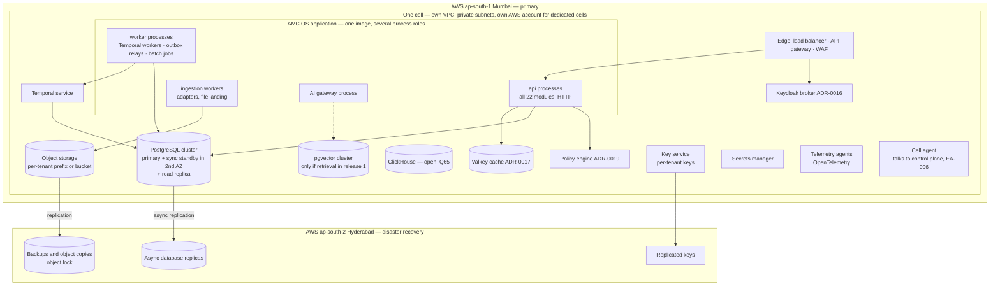
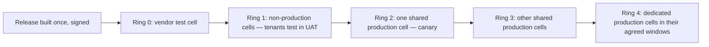

# EA-004 — Deployment and Cell Architecture

This document says how AMC OS is deployed: the deployment models offered to AMCs, what one **cell** contains, how many AMCs a cell may hold, how a new AMC is placed, how an AMC is moved between cells, how a cell is upgraded and how it recovers from a disaster. It is master prompt §14 Stage B item 5 ("Deployment architecture") and covers the cell list in master prompt §6 (tenant placement, cell capacity, tenant migration, cell upgrades, cell disaster recovery, resource isolation, release compatibility). Tenant isolation inside a cell is [EA-005](EA-005_multi_tenant_architecture.md); the control plane that manages cells is [EA-006](EA-006_control_plane_and_data_plane.md).

**Builds on Draft documents:** ADR-0002, ADR-0003, ADR-0006, ADR-0007, ADR-0016…ADR-0019, EA-001, EA-002, EA-003, EA-008, PRD-001, BA-004 (WF-019, WF-021, WF-022), DA-000 Ch 6, Ch 9, Ch 10 — allowed by owner decision D-3 ([GOV-008](../00_governance/GOV-008_build_loop.md) §2 rule 3). Nothing used here is Approved; EA-001, EA-002, EA-003, EA-008 and ADR-0016…ADR-0019 are still waiting for the owner to merge. Owner decisions used: D-7, D-12, D-26, D-27, D-48, D-69, D-70 ([LOOP_STATE.md](../../LOOP_STATE.md)). The proposal branch `proposal/ai-orchestration-architecture` (EA-103) was read as input only; nothing in it is treated as approved.

**Status of every decision in this document:** **[DES]** — a design proposal for the owner (interim ARB) unless another label is shown. Numbers marked **[ASSUMPTION]** are starting values to be replaced by measured ones; they are not requirements until the owner accepts them.

**Plain-language terms**

| Term | Meaning here |
| --- | --- |
| Cell | One complete running copy of AMC OS — application, databases, storage, keys, sign-in broker — serving one AMC (dedicated) or a small group of AMCs (shared). ADR-0003 §4 |
| Data plane | All the cells together: where AMC business and financial data lives and is processed |
| Control plane | The vendor's management system for cells (tenant list, placement, releases). It never holds AMC financial data. EA-006 |
| Availability Zone (AZ) | A separate data centre group inside one AWS region; a failure in one AZ should not stop another |
| Primary / DR region | AWS Mumbai `ap-south-1` runs the cells; AWS Hyderabad `ap-south-2` holds copies to take over after a regional disaster (D-7, ADR-0018) |
| RPO / RTO | Recovery point objective: how much recent data may be lost. Recovery time objective: how long until service is back |
| Release ring | A group of cells upgraded together; rings go one after another so a bad release is caught early |
| Expand → migrate → contract | A way to change a database so the old and the new application version both work during an upgrade: add new things first, move data, remove old things one release later |

## 1. Deployment models

Master prompt §6 asks for two commercial models on one code base. DA-000 §6.1 had three tiers. This document proposes **two cell shapes**, and one hosting option for the dedicated shape:

| Model | Cell shape | Who shares the cell | Hosting account | Isolation | DA-000 §6.1 tier |
| --- | --- | --- | --- | --- | --- |
| A — Shared SaaS | Shared cell | Up to the cell's tenant limit (§4) | AMC OS vendor account | Logical inside the cell (EA-005): RLS, composite keys, per-tenant keys, prefixes and limits | SHARED |
| B — Dedicated | Dedicated cell | One AMC | AMC OS vendor account | Physical: own databases, storage, keys, network, monitoring, backups | DEDICATED_DEPLOYMENT |
| B — Dedicated, AMC's account | Dedicated cell | One AMC | The AMC's own AWS account (ADR-0018 Decision 2) | Physical + account boundary | DEDICATED_DEPLOYMENT |

**Proposed change to DA-000 §6.1:** the middle tier DEDICATED_DB (a shared application pointing at the AMC's own database cluster) is **not offered**. Reason: a cell would then no longer be one unit for upgrades, capacity and recovery; the application would need per-tenant connection routing, and a dedicated database without a dedicated application gives most of the cost of a dedicated cell with only part of the isolation. An AMC that needs its own database gets a dedicated cell. Owner question **Q69** asks the owner to accept this.

Rules for every model:

1. **One code base, one release, one set of images.** Shared and dedicated cells run the same container images, the same database migrations and the same configuration catalogue (EA-008 §9 rule 4). A dedicated cell never gets code or settings a shared cell cannot have (master prompt §6, §3.6).
2. **Same isolation inside a dedicated cell.** Row-level security, composite keys and tenant context stay on even when a cell holds one tenant (DA-000 §6.1: "defence in depth even when alone").
3. **India only.** Every cell, every backup and every DR copy is in `ap-south-1` or `ap-south-2` (D-7, ADR-0018 Decision 1).
4. **Dedicated cell in the AMC's own account:** the vendor still operates it through the control plane (EA-006) and needs an agreed operating role in that account; the AMC controls the account and its keys **[DES]**. Whether this option is offered in the first release is owner question **Q72** (it adds account set-up, contract and support work).

### 1.1 Regulatory context (to be confirmed)

SEBI's "Framework for Adoption of Cloud Services by SEBI Regulated Entities" (circular SEBI/HO/ITD/ITD_VAPT/P/CIR/2023/033, 6 Mar 2023) lists AMCs / mutual funds among the entities it applies to. According to a secondary summary of it ([Taxmann](https://www.taxmann.com/post/blog/sebi-introduces-framework-for-adoption-of-cloud-services-by-regulated-entities/), read 21 Nov 2026), it requires storage and processing in data centres of cloud providers **empanelled by MeitY**, the regulated entity to keep "complete ownership of all its data and logs, encryption keys", an assessment of vendor lock-in and concentration risk (preferring provider-agnostic solutions), and DR drills and a contingency plan for a shutdown of cloud services. **[REG — secondary source; VAL — the circular body was not opened; confirm: Compliance / legal counsel, REG-001 Step 25]**. What follows from it for this document, if confirmed:

| Point in the summary | Effect on the design |
| --- | --- |
| MeitY-empanelled provider data centres | ADR-0018 must record the empanelment status of the AWS regions used **[VAL — confirm with AWS and MeitY list]** |
| AMC keeps ownership of data, logs and keys | Per-tenant keys (EA-005 §5); export on exit (FR-D01-004); customer-managed keys for dedicated cells (ADR-0018 Decision 6); the AMC can always get its logs and audit chain |
| Lock-in and concentration risk | Portable building blocks (ADR-0018 Decision 3); documented tenant export (§6) |
| DR drills, cloud-shutdown contingency | §8 DR design and drills; exit route in ADR-0018 |

The SEBI Cybersecurity and Cyber Resilience Framework (CSCRF, 20 Aug 2024) also lists MFs / AMCs; a secondary summary ([KPMG](https://assets.kpmg.com/content/dam/kpmg/in/pdf/2024/09/sebi-cscrf-our-point-of-view.pdf)) gives no RTO/RPO values and says regulatory data must be localised **[REG — secondary; VAL]**. The proposed RPO/RTO in §8 therefore stay "Proposed" (PRD-001 NFR-DR-001), not regulatory.

## 2. What a cell contains



| Part | In every cell | Note |
| --- | --- | --- |
| Edge (load balancer, gateway, web application firewall) | Yes | Gateway product per ADR-0019 proof of concept |
| Keycloak identity broker | Yes, one per cell | ADR-0016; highly available in the primary region, restorable in DR |
| Policy engine | Yes | ADR-0019 (OPA leading); policy bundles come from the control plane (EA-006 §4) |
| AMC OS application | Yes | One container image of the modular monolith (ADR-0002), run in several **process roles** (§2.1) |
| Temporal service | Yes | ADR-0006; its own database inside the cell's PostgreSQL service, separate from module schemas |
| PostgreSQL (system of record) | Yes | Primary + synchronous standby in a second AZ + read replica (DA-000 §10.1, Ch 9); one cluster per cell |
| pgvector cluster | Only if an assistant that uses retrieval is in release 1 | ADR-0007; EA-002 §8 |
| ClickHouse | Open | Owner question Q65 |
| Valkey cache | Yes | ADR-0017; never a source of truth |
| Object storage | Yes | Raw inbound files, documents, evidence, exports, backups (ADR-0007) |
| Key service and secrets manager | Yes | Per-tenant keys and provider credentials (EA-005 §5; EA-001 §4 rule 3) |
| Telemetry agents | Yes | OpenTelemetry; tenant-tagged inside the cell; filtered before leaving the cell (EA-006 §5) |
| Cell agent | Yes | The only part that talks to the control plane; pulls releases and configuration, pushes health and usage counts (EA-006 §3) |

Kafka is not in a cell for release 1 (D-70). Kubernetes versus another container runtime is decided in INF-001 (Step 26); nothing here depends on it.

### 2.1 Process roles of the one application

ADR-0002 keeps one deployable application. To scale the busy parts separately **without** creating microservices, the same image runs in different roles **[DES]**:

| Process role | Runs | Scales with |
| --- | --- | --- |
| `api` | HTTP endpoints of all modules behind the gateway | Users and API calls |
| `worker` | Temporal workflow and activity workers, outbox relays (one per module, EA-003 T15), scheduled jobs, financial batch runs (NAV, accruals, risk, commission) | Number of schemes and batch volume, mostly in the evening NAV window |
| `ingestion` | Integration adapters and file landing (EA-003 B9, T16) | Number and size of inbound feeds |
| `ai-gateway` | The AI gateway (EA-002 §6) | Assistant use; kept separate so an AI problem cannot use up the financial processes' resources (FR-D17-019) |

A process role is not a service: all roles share the code, the module boundaries and the database roles of EA-003. A module becomes a separate service only under §7.

## 3. Cell kinds and environments

| Cell kind | Holds | Data allowed |
| --- | --- | --- |
| Production cell (shared or dedicated) | Tenants' production environments | Real data |
| Non-production cell (shared or dedicated) | Tenants' UAT and test environments (FR-D01-046) | Synthetic or masked data only; never unmasked investor personal data (FR-D01-048, GOV-003 §5) |
| Vendor test cell | The vendor's own test tenants; first ring of every release (§8) | Synthetic data only |

Production and non-production environments of tenants **never share a cell** **[DES]**: a non-production cell has looser change control, so mixing would weaken production. A tenant's UAT environment is a separate tenant record in a non-production cell, linked to its production tenant in the control plane (EA-006 §2), so configuration can be promoted between them (EA-008 §5, EA-006 §4).

## 4. Cell capacity

### 4.1 What limits a shared cell

| Limit | Why it matters | How it is measured |
| --- | --- | --- |
| Database size and write load | One PostgreSQL cluster per cell; the largest-tenant assumption in DA-000 Ch 9 is about 20 GB a year of investor transactions plus about 60 GB a year of journal lines, i.e. about 80 GB a year, or about 400 GB for five years online | Storage, write rate and replication lag per cluster |
| Evening NAV window | Almost every AMC values and calculates NAV in the same evening hours, so peaks add up rather than spread out | Worker CPU and database load during the NAV window; NAV run time per tenant against its deadline |
| Blast radius | A bad release, an outage or a restore affects every tenant in the cell | Tenant count per cell |
| Failover time | A larger cluster takes longer to restore or promote | Measured in the DR drill against RTO |

### 4.2 Starting rules

| Rule | Starting value | Label |
| --- | --- | --- |
| Tenants per shared production cell | At most **10** | **[ASSUMPTION — from proposal EA-103 §3; confirm by capacity test, QA lead, WP6]** |
| Headroom | Open a new shared cell when any measured limit in §4.1 passes **70 %** of the tested maximum in the busiest hour of the last 30 days | **[ASSUMPTION — confirm: capacity test and SRE lead]** |
| Largest tenants | A tenant expected to need more than **one third** of a shared cell's tested capacity is offered a dedicated cell, or placed in a shared cell with fewer tenants | **[ASSUMPTION — confirm: capacity test]** |
| Fleet size check | Design capacity of 50 AMCs (D-69) at 10 per cell is 5 shared production cells if every AMC were shared; the commercial target of 3–5 paying AMCs by month 36 (D-12) fits in one shared production cell | Arithmetic on the assumptions above |

Capacity is a measured property of a release on a cell size: each release's performance test (DA-000 §10.3, "2× projected peak volumes") records the tested maximum per limit, and the control plane keeps it with the cell record (EA-006 §2).

### 4.3 Per-tenant resource limits in a shared cell (master prompt §6 Model A)

One AMC must not slow down another **[DES]**:

| Resource | Limit | Where enforced |
| --- | --- | --- |
| API calls | Per-tenant rate limit and burst limit | Gateway (EA-002 §4.2) |
| Batch and workflow work | Per-tenant concurrency limit on workers (work is queued per tenant and per scheme, DA-000 Ch 9 "batch processing"); fair scheduling across tenants in the NAV window | `worker` process role; Temporal task queues |
| Database | Statement time-outs per process role (DA-000 Ch 9); per-module connection pools; long-running reports go to the read replica | PostgreSQL, PgBouncer |
| Storage | Per-tenant quota on object storage and export size | Object storage policy; Tenant module usage meter (D-26) |
| AI | Per-tenant token and request budget | AI gateway (EA-002 §6) |
| Ingestion | Per-tenant limit on concurrent file loads | `ingestion` process role |

Limit values come with the AMC's subscription plan (entitlements, CAP-D01-006), set by the vendor, not by the AMC (EA-008 §1 "not tenant settings"). Proposed requirement: **NFR-SCAL-005** (§10).

## 5. Tenant placement

Placement happens in WF-019 between `DRAFT` and `PROVISIONING`. The Platform Operator (ROLE-20) proposes it in the control plane; the rules below are checked by the control plane before the tenant can move on **[DES]**:

| # | Rule |
| --- | --- |
| P1 | The cell's region is `ap-south-1` with DR in `ap-south-2` (D-7). No other region is offered |
| P2 | Isolation tier from the contract: shared or dedicated (FR-D01-001). Dedicated → a new cell is created for the AMC |
| P3 | Shared: choose a production cell whose measured load plus the new tenant's expected size stays under the §4.2 headroom; if none, create a new shared cell |
| P4 | Keep large tenants apart: no two tenants above the "large" size class in one shared cell **[ASSUMPTION — size classes defined after the capacity test]** |
| P5 | The tenant's production and non-production environments are placed in matching production and non-production cells (§3) |
| P6 | A cell running an older release (dedicated cell in its change window, §8) never receives new tenants |
| P7 | The placement, with the rule results, is recorded in the control plane and in the tenant record (FR-D01-001) and audited (WF-019 "Audit: placement") |

**Pilot AMC.** Proposed: the pilot AMC (D-12) goes alone into a new **shared-shape** cell, so later AMCs can join the same cell once the pilot's load is measured, and the pilot is not slowed by other tenants during the parallel run **[DES]**. Owner question **Q71**.

## 6. Moving a tenant between cells

Reasons: rebalancing shared cells, a tenant growing into a dedicated cell, a dedicated tenant moving back to shared, or moving into the AMC's own account. A move is a planned **migration with its own plan**, never a switch (same rule as EA-003 §6 point 2).

```mermaid
sequenceDiagram
  participant OP as Platform Operator (control plane)
  participant TA as Tenant Administrator
  participant SRC as Source cell
  participant TGT as Target cell
  OP->>TA: migration plan, date, freeze window
  TA-->>OP: confirms (two-sided, like FR-D01-002)
  OP->>TGT: prepare: tenant keys, storage, broker realm, same release
  OP->>SRC: freeze tenant (read-only) after day close
  SRC->>TGT: export tenant rows, objects, audit chain (encrypted)
  TGT->>TGT: import; verify row counts, control totals, audit hash chain
  OP->>TA: verification report
  TA-->>OP: confirms cut-over
  OP->>OP: route tenant to target cell
  SRC->>SRC: keep read-only copy for fallback period, then delete and destroy keys
```

Rules **[DES]**:

1. **Same release on both cells.** A move never upgrades or downgrades the tenant at the same time.
2. **Freeze window** after the operations day close (WF-036, D-48) and before the next business day; never while a NAV run, a settlement cycle or a period close is open for that tenant. Planned on a non-business day where possible.
3. **Identifiers do not change.** `tenant_id` and every record ID (UUIDs) stay the same, so composite keys, the audit chain and outside references stay valid.
4. **Keys.** Inside one AWS account the tenant key can move with the tenant; across accounts (to or from a dedicated cell, or into the AMC's account) data is re-encrypted under the target cell's tenant key during import. Key design: SEC-001 (Step 25).
5. **Verification before cut-over:** row counts per table, control totals for financial tables (units, journal amounts per scheme, positions), hash-chain check of the audit log, object counts and checksums. Any difference stops the move; the tenant stays on the source cell.
6. **Two-sided cut-over:** the Platform Operator and the Tenant Administrator both confirm, as for activation (FR-D01-002, SOD-15).
7. **Fallback.** The source copy stays read-only for a fallback period **[ASSUMPTION — 30 days; confirm: project owner]**, then it is deleted and its tenant key destroyed, with evidence kept in the control plane.
8. **No operator reading of data.** The move is done by tooling running inside the cells with the tenant's approval; the operator sees counts and checksums, not business data (SOD-09). The export travels cell-to-cell in encrypted form, never through the control plane's own storage (EA-006 rule CP-1).
9. **Outside parties.** Providers that send to or receive from AMC OS (EA-001 X02–X16) may need new endpoints or IP addresses after a move; the plan lists each connection and its re-test **[DES; confirm with each provider]**.

The same export is the basis of the exit export (FR-D01-004, D-27) and of the per-tenant restore (§8.3).

## 7. When a module leaves the monolith (EA-003 G7)

ADR-0002 extracts a module into its own service only when an ADR shows a need. Proposed measurable triggers **[DES]**:

| Trigger (ADR-0002) | Measured signal | Example where it may happen first |
| --- | --- | --- |
| Independent scaling | A process role (§2.1) cannot meet its NFR without scaling parts that do not need it, for two release cycles, after tuning | Ingestion of very large RTA files |
| Stronger security boundary | A threat model (SEC-002, Step 25) shows the module needs credentials or network reach the rest must not have | AI gateway calling the model provider; adapters holding provider credentials |
| Different reliability or release cadence | A module needs releases more often than the cell's release rhythm, or must stay up while the rest is upgraded | Investor message preparation (D-55) if an RTA demands it |
| Different runtime | A required library exists only for another language or runtime | A vendor SDK with no Python version **[confirm with provider]** |
| Separate team ownership | A separate team owns the module end to end | Not expected before several customers |

First step is always a **separate process role** in the same cell (§2.1), which keeps the database role and module boundaries unchanged. Only if that does not solve the problem is an ADR written for a separate service. A separate service still writes only its own schema(s) (EA-003 B1) and is deployed inside every cell, never shared between cells.

## 8. Releases, compatibility and cell upgrades

### 8.1 Release rings



| Rule | Detail **[DES]** |
| --- | --- |
| One release per cell | All tenants in a cell run the same release; a tenant cannot stay behind inside a shared cell |
| Gates between rings | GOV-004 release gates; each ring watched for a soak period before the next **[ASSUMPTION — period set in REL-001]** |
| Dedicated cells | Upgrade in the AMC's agreed window; may be at most **one release behind** the shared cells **[ASSUMPTION — owner question Q70]** |
| Timing | Never during market hours or the evening NAV window of any tenant in the cell; announced in advance (FR-D01-048; notice period **[ASSUMPTION — confirm: project owner]**) |
| Tenant view | Each tenant sees its current release and scheduled upgrades (FR-D01-047) |

### 8.2 Compatibility rules

1. **Database changes use expand → migrate → contract**: a release only adds tables, columns or indexes in a way the previous application version can live with; removing or renaming comes one release later. So the application can be rolled back to the previous version without a database rollback.
2. **No destructive down-migrations on financial tables.** A faulty migration is fixed by a new forward migration (EA-103 §4, carried over).
3. **APIs and events** keep the previous version working for at least one release after a new version appears; event versions follow `<NAME>.v<n>` (GOV-001 §4); details in EA-007 (Step 13) and API-001 (Step 24).
4. **Configuration catalogue** changes follow EA-008 §9 (new settings with defaults; deprecation for one release; value migration tested).
5. **Workflows in flight.** Temporal workflow code is versioned so that a NAV day or settlement cycle started on the old release finishes on the logic it started with (ADR-0006) **[DES; Temporal versioning approach confirmed in EA-007]**.
6. **Engine versions.** A financial engine change is a new engine version recorded with every result (master prompt §3.2 "versioned calculations"); a re-run of a past date uses the engine version recorded for that date.
7. **Assistant definitions** (D-73) and policy bundles are part of the release manifest (EA-006 §4).

### 8.3 Rollback

Application: roll back to the previous image (possible because of rule 8.2.1). Database: forward fix only. Configuration: a new configuration version, never an edit (EA-008 §5). A rollback is a release event recorded in the control plane.

## 9. Cell disaster recovery

### 9.1 Layers of protection

| Failure | Protection | Target |
| --- | --- | --- |
| One server or process | Several instances per process role; Temporal retries | No visible effect |
| One Availability Zone | Synchronous standby of PostgreSQL in a second AZ; processes spread over at least two AZs (target three, ADR-0018) | RPO ≈ 0 inside the region (DA-000 §10.1); short failover |
| Whole primary region | Asynchronous database replicas, object-storage replication, backups and keys in `ap-south-2` | NFR-DR-001: RPO ≤ 5 min, RTO ≤ 2 h (Proposed, not regulatory — §1.1) |
| Data damage (bad release, deletion, ransomware) | Point-in-time recovery from WAL archives; immutable backup copies (object lock); audit hash chain to detect tampering | Restore to a point before the damage (DA-000 §10.1) |
| Control plane down | Cells keep running (EA-006 rule CP-6) | No effect on business processing |

### 9.2 Regional failover steps

1. **Declare.** The vendor's incident lead declares a regional disaster for the affected cells and informs every tenant in them **[DES; who may declare and how tenants are told — runbook, Step 26]**.
2. **Promote** the DR replicas of the cell's PostgreSQL cluster(s) (system of record, Temporal, Keycloak, pgvector) in `ap-south-2`; start the process roles from the same release images.
3. **Re-point** the cell's DNS names; providers that allow-list IP addresses must already know the DR addresses (§6 rule 9).
4. **Check before opening:** audit hash chain continuous up to the last replicated point; outbox and Temporal state consistent; the last replicated time is shown to every tenant as the "recovered to" point.
5. **Hold outgoing financial messages.** Any instruction or file to an outside party (settlement instructions, orders to brokers, NAV files) that was **sent but not acknowledged** before the failure is put on hold for a person to check with the outside party before resending, because the outside party may have received it although AMC OS lost the record of sending it **[DES]**. Idempotency keys stay in PostgreSQL (ADR-0017 Decision 3) so a resend inside AMC OS is not doubled.
6. **Re-enter lost work.** Work done in the lost minutes (at most the RPO) is listed from the last replicated outbox position and from outside acknowledgements, and re-entered through the normal domain processes, never by editing records.
7. **Fail back** later as a planned move (§6 rules apply).

### 9.3 Per-tenant restore

A single tenant's data may need restoring (for example after a damaging bulk load). Proposed rules **[DES]**:

1. Restore the cell backup to a **scratch cluster** in the same cell, then extract that tenant's rows by `tenant_id` (DA-000 §6.8). Other tenants' data in the scratch copy is never shown or used, and the scratch cluster is destroyed afterwards.
2. In a shared cell the extract is **not written back over live financial records**. It is an investigation copy: corrections go through each domain's correction process (for example WF-017 NAV correction, reversal journals), because financial history is immutable (master prompt §3.2).
3. Non-financial data (for example documents, configuration drafts) may be put back by a tool run with the tenant's approval.
4. A dedicated cell can be restored as a whole to a point in time with the AMC's agreement, followed by re-entry as in §9.2 step 6.

Proposed requirement: **NFR-DR-002** (§10).

### 9.4 Drills

Each production cell has a regional failover drill and a restore drill (full cluster, single tenant, single table) on a fixed schedule **[ASSUMPTION — quarterly as DA-000 §10.1 and EA-103 §5; frequency required by SEBI to be confirmed, VAL]**. Results (measured RPO and RTO) are recorded per cell and given to the tenants in it (GOV-004 §4).

## 10. Non-functional requirements proposed here

NFR IDs continue from the next free numbers (LOOP_STATE). All are **Proposed [DES]** for the owner.

| ID | Requirement | Label |
| --- | --- | --- |
| NFR-SCAL-005 | In a shared cell, one tenant's load (API calls, batch runs, ingestion, AI use) does not push another tenant's NAV run past its deadline or its API response times past the PRD targets; shown by a noisy-neighbour test before each release | **[DES]** |
| NFR-SCAL-006 | A new shared production cell can be created from the release images and infrastructure code, tested and ready for tenants within one business day **[ASSUMPTION — confirm: SRE lead]** | **[DES]** |
| NFR-DR-002 | One tenant's data in a shared cell can be extracted from a backup as of any point in the backup retention window, without exposing or changing other tenants' data; tested in every restore drill | **[DES]** |
| NFR-DR-003 | Every production cell completes a regional failover drill and a restore drill on the drill schedule (§9.4), with measured RPO and RTO recorded | **[DES; frequency VAL]** |

Control-plane NFRs are in EA-006 §7.

## 11. Effects on other documents

| Document | Change needed | When |
| --- | --- | --- |
| DA-000 §6.1 | DEDICATED_DB tier not offered (§1) — if the owner accepts Q69 | DA-001, Step 15 |
| PRD-001 FR-D01-001 | Isolation tier values `SHARED`, `DEDICATED` and hosting account (vendor or AMC) | Next PRD-001 revision |
| ADR-0018 | Record MeitY empanelment status of the regions used (§1.1); confirm every managed service in §2 exists in both regions (ADR-0018 Decision 4) | Owner (owner-only file); SEC-001 / REG-001 Step 25 |
| INF-001 | Container runtime, Terraform modules for one cell, DR runbook, release ring automation | Step 26 |
| REL-001 / runbooks | Soak periods, maintenance windows, failover declaration and tenant notice | Step 26 |
| QA-001 | Capacity test that sets §4.2 values; noisy-neighbour test (NFR-SCAL-005); migration test (§6) | QA-001 next revision |
| EA-007 | Workflow versioning across releases (§8.2 rule 5); event version support window | Step 13 |

## 12. Gaps and open points

| # | Gap | Closed by |
| --- | --- | --- |
| G1 | Tenants per cell, headroom and size classes are assumptions until a capacity test exists | Capacity test (QA lead, WP6); owner accepts values |
| G2 | SEBI cloud framework and CSCRF read only through secondary summaries; effect on regions, drills and contracts not confirmed | SEC-001 / REG-001, Step 25 **[VAL]** |
| G3 | DEDICATED_DB tier dropped | Owner question Q69 |
| G4 | How far a dedicated cell may lag behind shared cells | Owner question Q70 |
| G5 | Pilot AMC alone in its own cell | Owner question Q71 |
| G6 | Dedicated cell in the AMC's own account in release 1 | Owner question Q72 |
| G7 | Exact AWS services per part (managed PostgreSQL flavour, container runtime) and their availability in `ap-south-2` | INF-001, Step 26; ADR-0018 Decision 4 **[VAL — confirm with AWS]** |
| G8 | Failover declaration authority and tenant notice | Runbooks, Step 26 |

## Sources

| # | Source | Used for |
| --- | --- | --- |
| S1 | [MASTER_BUILD_PROMPT.md](../../MASTER_BUILD_PROMPT.md) §3.2, §6, §13, §14 Stage B | Deployment models, cell topics, stack |
| S2 | [ADR-0002](../../architecture/adrs/ADR-0002_modular_monolith.md), [ADR-0003](../../architecture/adrs/ADR-0003_multi_tenancy_and_cells.md), [ADR-0006](../../architecture/adrs/ADR-0006_events_and_workflows.md), [ADR-0007](../../architecture/adrs/ADR-0007_data_stores.md) | Monolith, cells, workflows, stores |
| S3 | [ADR-0016](../../architecture/adrs/ADR-0016_identity_provider_and_sign_in.md), [ADR-0017](../../architecture/adrs/ADR-0017_cache.md), [ADR-0018](../../architecture/adrs/ADR-0018_cloud_provider_and_regions.md), [ADR-0019](../../architecture/adrs/ADR-0019_api_gateway_and_policy_engine.md) | Broker per cell, cache, regions, gateway |
| S4 | [EA-002](EA-002_layered_architecture.md) §6, §8; [EA-003](EA-003_domain_boundaries_and_service_catalogue.md) B1, B9, T15, T16, G7; [EA-008](EA-008_configuration_over_customisation.md) §1, §5, §9 | Layers, modules, configuration |
| S5 | [PRD-001](../03_product_requirements/PRD-001_platform_administration.md) FR-D01-001, -002, -004, -046…-048, NFR-DR-001 | Tenant record, environments, DR target |
| S6 | [BA-004](../02_business_architecture/BA-004_end_to_end_workflows.md) WF-019, WF-021, WF-022 | Onboarding, promotion, break-glass |
| S7 | [DA-000](../05_data_architecture/DA-000_data_and_database_architecture_v0.9.md) §6.1, §6.8, Ch 9, §10.1, §10.3 | Tiers, backup isolation, sizing, backup and tests |
| S8 | Proposal branch `proposal/ai-orchestration-architecture`, EA-103 (input only, not in `main`) | Release order, forward-fix rule, starting cell size |
| S9 | Taxmann, "SEBI introduces Framework for Adoption of Cloud Services by Regulated Entities" — [article](https://www.taxmann.com/post/blog/sebi-introduces-framework-for-adoption-of-cloud-services-by-regulated-entities/) (secondary source, read 21 Nov 2026) | §1.1 |
| S10 | KPMG India, "SEBI CSCRF — our point of view", Sep 2024 — [PDF](https://assets.kpmg.com/content/dam/kpmg/in/pdf/2024/09/sebi-cscrf-our-point-of-view.pdf) (secondary source, read 21 Nov 2026) | §1.1 |
| S11 | [LOOP_STATE.md](../../LOOP_STATE.md) owner decisions | D-7, D-12, D-26, D-27, D-48, D-69, D-70 |
