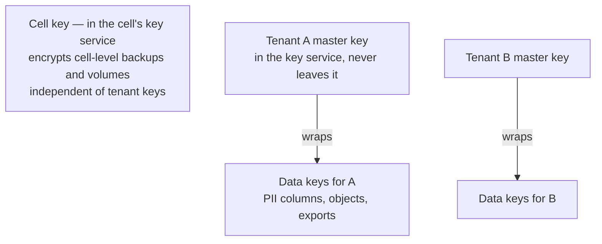

# EA-005 — Multi-Tenant Architecture

This document says how AMC OS keeps every AMC's data, users, AI context and audit trail apart while many AMCs share one product, and often one cell. It is master prompt §14 Stage B item 6 ("Multi-tenant architecture") and the design that PRD-001 FR-D01-005 points to. It turns the summary table in EA-002 §7 into a design per layer, and adds tenant context outside a user request (workers, events, workflows, scheduled jobs), the key hierarchy, the tenant lifecycle and the test list. Cells and deployment are [EA-004](EA-004_deployment_and_cell_architecture.md); the control plane is [EA-006](EA-006_control_plane_and_data_plane.md).

**Builds on Draft documents:** ADR-0003, ADR-0008, ADR-0016, ADR-0017, ADR-0019, EA-001, EA-002, EA-003, EA-008, PRD-001, PRD-016, PRD-017, BA-004 (WF-019, WF-022), BA-005 (SOD-09, SOD-15), DA-000 Ch 6, DDL-000, DBT-000 — allowed by owner decision D-3. Nothing used here is Approved. Owner decisions used: D-5, D-26, D-27, D-61, D-62 ([LOOP_STATE.md](../../LOOP_STATE.md)).

**Status of every decision in this document:** **[DES]** — a design proposal for the owner (interim ARB). No new regulatory fact is stated; privacy points refer to PRD-001 NFR-PRIV-001 **[REG — VAL]**. Tenant isolation is a T1 subject: before this design becomes Approved it needs the paid external review of owner decision D-5.

**Plain-language terms**

| Term | Meaning here |
| --- | --- |
| Tenant | One AMC (one customer) inside AMC OS. Each environment of an AMC (production, UAT) is a separate tenant record (EA-004 §3) |
| Tenant context | The "which AMC is this for" value that every piece of work carries; it decides which rows, files, keys and caches can be touched |
| Row-level security (RLS) | A PostgreSQL feature that filters every row by a rule, here "tenant_id equals the current tenant", whatever the query says |
| Envelope encryption | Data is encrypted with a data key; the data key is itself encrypted ("wrapped") with the tenant's master key in the key service |
| Crypto-shredding | Destroying a tenant's master key so its encrypted data can never be read again |
| Noisy neighbour | One tenant using so much of a shared cell that others slow down |

## 1. Tenant model

| Item | Design | Source |
| --- | --- | --- |
| Tenant | One AMC environment; record in `platform.tenant` with legal names, tier, cell, region, plan, status (FR-D01-001) | PRD-001 |
| Tenant ID | A UUID set once at creation by the control plane, never reused and never changed — not even when the tenant moves cells (EA-004 §6 rule 3) | GOV-001 §4 ("never reused") |
| Tenant hierarchy | None across tenants: an AMC's legal entities, departments and desks are organisation units **inside** one tenant (CAP-D01-007). Two AMCs of one group are two tenants with no shared data **[DES]** | PRD-001 §4.7 |
| Product-level rows | Only in `platform` (configuration catalogue items, EA-008 §8) and the shared currency list (D-62). Nothing else is shared between tenants | DA-000 Ch 2; D-62 |
| Licensed reference data | One copy per tenant, because licences are per AMC (D-62) | PRD-016 |

## 2. Where the tenant context comes from

The rule (master prompt §3.4, ADR-0003 §1): tenant context comes from an authenticated identity, never from a value the browser or a caller sends. Outside a user request there is no user token, so each kind of work has its own named source:

| Kind of work | Source of tenant context | Who sets it | Note |
| --- | --- | --- | --- |
| User request (browser, API client) | `tenant` claim in the token issued by the cell's Keycloak broker for the IdP connection the user came through (ADR-0016) | Gateway, then the module's database session (`SET LOCAL`) | A request naming another tenant is rejected (FR-D01-005) |
| Service account (integration, ROLE-27) | Client-credentials token issued per tenant and per integration (EA-002 §4.1) | Gateway | One token never covers two tenants |
| AI assistant (ROLE-26) | Exchanged from the calling user's token (EA-002 §4.1) | Gateway and AI gateway | Retrieval filter bound by the platform, not the prompt (ADR-0008 §5) |
| Temporal workflow | `tenant_id` fixed when the workflow is started by an authenticated caller, stored in the workflow's start data, and passed to every activity | Workflow starter; the worker sets `SET LOCAL` per activity transaction | A workflow cannot change its tenant. Workflow IDs include the tenant ID so two tenants' workflows never collide **[DES]** |
| Event consumer | `tenant_id` carried in the event, written by the owning module inside its tenant transaction (outbox, EA-003 B4) | Consumer sets context from the event (EA-002 §7) | Named system-worker exception (EA-003 T15; ADR-0020 scope) |
| Outbox relay | Works tenant by tenant from the tenant list in `platform.tenant` and sets context per batch | Relay worker under the module's own role, no RLS bypass (EA-003 T15) | Same named exception |
| Scheduled job (calendar-driven, e.g. accrual run) | A schedule entry stored **inside** the tenant (tenant-scoped row), created by an authenticated, approved action | Scheduler reads due entries per tenant and starts the job with that entry's tenant | Same named exception; the schedule entry, not the scheduler, carries the tenant **[DES]** |
| Inbound file (adapter) | The connection record the file arrived through belongs to one tenant (EA-001 §4 rule 3, EA-003 T16) | Ingestion worker | A file is never matched to a tenant by its content |
| Break-glass support (WF-022) | The approved break-glass grant names one tenant, one scope and an expiry | Break-glass tool sets context for that tenant only | See §6 |

### 2.1 Platform data tools that touch every schema

Some cell tools must read or write a tenant's rows in **every** module schema. They are named here so ADR-0020 can record them as exceptions, with these limits **[DES]**:

| Tool | Reads / writes | Design |
| --- | --- | --- |
| Tenant set-up seed (WF-019 `SETUP`) | Writes seed rows (roles, calendars, chart-of-accounts template, configuration defaults) | Each module's own seed function runs under **that module's** database role; the tool only calls them in order. No role writes another schema (EA-003 B1) |
| Tenant export (migration, exit export FR-D01-004, D-27) | Reads every schema for one tenant | Each module's export function, under that module's role, with the tenant context set from the approved migration or exit record (tenant-scoped, two-sided confirmed). Read only |
| Tenant import (migration target) | Writes every schema for one tenant | Each module's import function, under that module's role, with the tenant context set from the approved migration record. Imported rows pass the same insert checks as new rows (for example balanced journals) and keep their original IDs, timestamps and versions. **Audit rows** are imported through a separate insert-only import function of the audit owner that writes the rows and their original hashes unchanged and then re-verifies the chain end to end; it never recomputes hashes. This is a named exception to EA-003 T15. Two points are **open** for DA-001 with ADR-0020: DDL-000's insert trigger `audit.tg_hash_chain` today always recomputes `prev_hash` and `row_hash`, so a verified import path is needed that does not weaken the trigger for normal writes; and the target cell's audit sequence must be advanced past the imported `event_seq` values before new audit rows are written, so the chain order holds (§10 G6) |
| Per-tenant restore extract (EA-004 §9.3) | Reads a scratch copy | Runs only against the scratch cluster, with the scratch cluster's own migration-owner role; nothing is written to the live cell; the scratch cluster is destroyed afterwards |
| Offboarding removal (§7) and migration-source removal (EA-004 §6 rule 7) | Removes a tenant's rows | Posted journals and audit rows are protected by immutability triggers (DDL-000; DBT-000 T3a, T3b), and must stay so for every other tenant. How one tenant's protected rows are removed without weakening those triggers is **open**: options are (a) a migration-owner procedure that removes rows for one tenant only, under two-sided approval, with the run itself audited; (b) partitioning protected tables also by tenant so a tenant's partitions can be detached and dropped; (c) keeping the rows and crypto-shredding personal data only, with the rows removed when backups expire. Chosen in DA-001 with ADR-0020 (§10 G6) |

Every tool run is started from an approved, tenant-scoped record, is logged in the tenant's audit trail and in the control plane (EA-006 CP-7), and never works on two tenants in one run.

**Rule for every system worker:** it may set a tenant context only from a tenant-scoped record that was itself created inside that tenant by an authenticated action (an event, a workflow start, a schedule entry, a connection, a grant). It never loops over tenants to read business data, except the relay and scheduler reading the tenant list and their own tenant-scoped work rows **[DES]**. These worker cases are the system-worker exceptions to STD-001 §4 that ADR-0020 must record (EA-003 §7).

## 3. Isolation in every layer (master prompt §3.4)

The table extends EA-002 §7. "Shared cell" is the hard case; a dedicated cell has the same controls plus physical separation.

| Area | Shared cell design | Dedicated cell adds | Where specified next |
| --- | --- | --- | --- |
| Authentication | One Keycloak broker per cell; each tenant's IdP configured separately; tenant fixed by the connection (ADR-0016). Realm per tenant or organisation per tenant: proof of concept (ADR-0016 Decision 8) | One realm | ADR-0016 |
| Authorisation | Grants are per tenant; policy-engine input always includes the token's tenant; a grant row for tenant A can never be evaluated for tenant B | — | ADR-0019; BA-005 |
| Application services | Tenant context is a request-scoped value set by the gateway layer; module functions do not take a tenant parameter from callers **[DES]** | — | STD-001 next revision |
| Databases | `tenant_id` leads every primary key; composite foreign keys; RLS enabled **and forced** on every tenant table and partition; `SET LOCAL` per transaction; missing context returns no rows; no application role has `BYPASSRLS` | Own cluster | ADR-0003 §2; DA-000 §6.2–§6.4; DDL-000 |
| Connection pools | PgBouncer in transaction mode, so a pooled connection never carries context into the next transaction; session-level `SET` banned by a linter | Own pools | DA-000 §6.7 |
| APIs | Object IDs of another tenant return "not found" and raise a cross-tenant alert | — | FR-D01-005 |
| Events | Every event carries `tenant_id`; per-schema outbox keeps RLS; a consumer refuses an event without a tenant | — | EA-003 B4, T15; EA-007 (Step 13) |
| Workflows (Temporal) | Tenant in the workflow start data and in the workflow ID; activities set context; workflow history visible to support tools only through break-glass, because it may contain business data **[DES]** | Own Temporal | §2; EA-007 |
| Object storage | One prefix per tenant with bucket policy on the prefix (or a bucket per tenant); encryption with the tenant key; object lock for evidence; the Documents module builds every object key, callers never give paths | Own buckets | DA-000 §6.6 |
| Caches | Every key prefixed `t:{tenant_id}:`; the client library refuses unprefixed keys | Own cache | ADR-0017; DA-000 §6.6 |
| AI retrieval | Vector chunks carry `tenant_id` and sit in per-tenant partitions; the retrieval tool filters by the session tenant; public corpora (SEBI circulars) in a separate read-only index | Own vector store | ADR-0008 §5; DA-000 §6.6 |
| AI model calls | No cross-tenant content in one prompt; prompts and answers logged per tenant; India-region endpoint, zero retention (D-61) | — | ADR-0018 Decision 5; PRD-017 |
| Logs and traces | Every log line and trace span tagged with `tenant_id`; tenant-scoped log views; personal data masked before logging; logs leaving the cell for the control plane carry no business data (EA-006 §5) | Own log store | NFR-OBS-001; EA-006 |
| Analytics | Tenant-partitioned tables, tenant-filtered semantic layer; if ClickHouse is used (Q65), row policies per tenant or a database per tenant, decided in DA-001 **[DES; confirm in DA-001]** | Own store | PRD-016 FR-D16-026 |
| Backups | Cell-level backups encrypted with cell keys and tenant data keys; per-tenant extract only through the scratch-restore procedure (EA-004 §9.3) | Own backups | DA-000 §6.8 |
| Support tools | No standing operator access to business data; break-glass only (§6) | Same | SOD-09; WF-022 |
| Exports | Every export runs inside the tenant context and is encrypted with the tenant key; export files carry the tenant ID in the manifest | — | FR-D01-004 |
| Audit (tenant-level audit, master prompt §6 Model A) | `audit` tables are tenant tables with forced RLS; append-only; hash chain per tenant per day; written only through the insert-only audit function (EA-003 B8, T15); the tenant's Auditor (ROLE-18) searches only its own tenant; the chain can be exported to the AMC at any time | Own audit store | NFR-AUD-001; EA-003 T15; DDL-000 |

## 4. Noisy neighbours

Resource limits per tenant are in EA-004 §4.3 (gateway rate limits, per-tenant worker concurrency, statement time-outs, storage quotas, AI budgets, ingestion limits). Two further rules **[DES]**:

1. **Fair scheduling in the NAV window.** Worker queues take work round-robin across tenants, then by scheme, so one tenant with many schemes cannot hold all workers.
2. **Per-tenant monitoring.** Each tenant's share of API calls, worker time, database time and storage is measured inside the cell and reported to the control plane as numbers only (EA-006 §5), so the Platform Operator can see a noisy tenant without seeing its data.

## 5. Keys and encryption

| Rule | Design | Source |
| --- | --- | --- |
| One master key per tenant | Created at onboarding (WF-019 `PROVISIONING`); recorded as `platform.tenant.kms_key_ref` | DA-000 §6.5 |
| Envelope encryption | Investor personal data columns, objects and exports encrypted with data keys wrapped by the tenant key; lookups by keyed hash, never plaintext | DA-000 §6.5 |
| Volumes and backups | Storage-level encryption with the cell key, in addition to the tenant keys | DA-000 §6.5 |
| Dedicated cells | Customer-managed keys possible: the AMC controls the master key in its own key service, and AMC OS uses it by a grant **[DES]** | ADR-0018 Decision 6 |
| DR | Keys replicated to `ap-south-2` (ADR-0018 Decision 6) so DR copies can be read | ADR-0018 |
| Exit | After the retention period, destroying the tenant key makes the data encrypted with it unreadable (personal-data columns, objects, exports) in live storage and in backups (D-27; FR-D01-004). Other rows (for example journals and positions) are not encrypted with the tenant key: they are removed from live storage by the offboarding removal (§2.1) and stay in cell backups, readable with the cell key, until those backups expire under the backup retention period | DA-000 §6.5, §6.9, §10.1 |
| Data ownership | The AMC keeps ownership of its data, logs and keys (SEBI cloud framework as summarised in EA-004 §1.1 **[REG — secondary; VAL]**) | EA-004 §1.1 |

Detailed key management (rotation periods, key-service choice, separation of duties for key administrators): SEC-001, Step 25.

## 6. Break-glass and support access (WF-022, SOD-09)

1. A Platform Operator has **no** standing right to any tenant's business data (BA-005 ROLE-20).
2. Break-glass access is requested with an incident reference, scope and duration; the tenant approves inside its own cell; access is time-boxed (at most 4 hours, WF-022), logged action by action and reported to the tenant.
3. **Change proposed to DA-000 §6.4:** DA-000 lets break-glass tooling use a database role with `BYPASSRLS`, which would let one support session see every tenant in the cell while the approval covers one tenant. Proposed instead **[DES]**:
   - When the tenant approves, a **per-grant** read-only database login is created and it is dropped (and its sessions ended) at expiry.
   - The RLS policies that apply to break-glass logins do **not** use the session setting `app.tenant_id` (any session can set that value itself). They allow a row only if its `tenant_id` matches an approved, unexpired grant row for that login in a break-glass grant table owned by the Tenant module.
   - The break-glass tool offers predefined read-only views and queries, not free SQL.
   - Write access is not offered; a fix to data goes through the tenant's own users and normal processes.
   - The exact mechanism (policy form, grant table, login handling) is set in DA-001 and recorded in ADR-0020 (§9).
4. The control plane only shows that a break-glass grant exists (incident, tenant, start, expiry); it never receives the data seen (EA-006 §2).

## 7. Tenant lifecycle and what happens to resources

WF-019 states (PRD-001 FR-D01-001) mapped to resource actions **[DES]**:

| State | Resource actions | Who |
| --- | --- | --- |
| `DRAFT` | Tenant ID created in the control plane; tier, plan, modules recorded | Platform Operator |
| `PROVISIONING` | Placement (EA-004 §5); tenant master key; storage prefix or buckets; cache namespace; broker realm or organisation; per-tenant limits from the plan | Control plane through the cell agent (EA-006 §3) |
| `SETUP` | Tenant row and seed data (roles, calendars, chart-of-accounts template, configuration defaults); first Tenant Administrator; IdP connection test; **isolation smoke tests run with this tenant's credentials** (DA-000 §6.9) | Cell tooling; Tenant Administrator |
| `ACTIVE` | Two-sided confirmation (FR-D01-002, SOD-15) | Operator and Tenant Administrator |
| `SUSPENDED` | Read-only for all users after an exit notice (FR-D01-004, WF-019); exports allowed; no new business processing. (A single lapsed module becoming read-only while the tenant stays `ACTIVE` is D-26, not this state) | Tenant module |
| `OFFBOARDED` | Export delivered and confirmed, or contract time limit passed (D-27); rows deleted by tenant and tenant partitions or objects removed, or records kept as law requires **[VAL]**; tenant key destroyed after the retention period; certificate of deletion | Cell tooling, approved by both sides |

## 8. Isolation tests

The negative tests in DA-000 §6.10 (1–11) stay. Added for the parts this document designs **[DES]**:

| # | Test | Expected result |
| --- | --- | --- |
| 12 | Start a Temporal workflow for tenant A, then try to signal or query it with a tenant B token | Refused |
| 13 | Publish an event without `tenant_id`, and one whose `tenant_id` differs from the outbox row's tenant | Consumer refuses; alert raised |
| 14 | Scheduled job entry for tenant A runs | Touches only tenant A rows (checked by row counts per tenant before and after) |
| 15 | Inbound file arrives on tenant A's connection carrying tenant B's identifiers | Loaded only into tenant A or rejected; never into tenant B |
| 16 | Break-glass login for tenant A queries tenant B rows, including after setting `app.tenant_id` to tenant B itself, directly and through every break-glass view; and uses the login after expiry | 0 rows; login refused after expiry |
| 17 | Log search by a tenant A user | Returns only tenant A lines |
| 18 | Telemetry sent to the control plane during a NAV run | Contains no prices, positions, investor data or prompts (EA-006 NFR-OBS-003) |
| 19 | Per-tenant restore drill (EA-004 §9.3) | Extract contains only that tenant's rows; other tenants untouched |
| 20 | Tenant migration (EA-004 §6) | Row counts, control totals and audit chain identical before and after; target uses a new tenant key; destroying the source key leaves the target readable |
| 21 | AI tenant-leakage suite (DA-000 §6.10 test 10) with tenant names in prompts and documents | No cross-tenant content in answers or tool results |

Tests 1–6 (DBT-000 T1a–T1g) and test 11 (catalogue check) run in CI today; tests 7–10 and 12–21 are added when the code exists (build increment 1 onwards, QA-001; ADR-0003 Validation).

## 9. Effects on other documents

| Document | Change needed | When |
| --- | --- | --- |
| ADR-0020 (owner-only, to be drafted) | Record the system-worker tenant-context cases of §2 (event consumer, outbox relay, scheduler, ingestion, break-glass) and the platform data tools of §2.1 (seed, export, import incl. audit-chain import, restore extract, removal) as named exceptions to STD-001 §4 and EA-003 B1/T15; the per-grant break-glass login and its RLS policies (§6) | Before Steps 15–16; owner |
| ADR-0003 (owner-only) | Revision for the tenant-isolation changes here (GOV-002 §2): break-glass without `BYPASSRLS`, tenant context for workers | Owner |
| DA-000 §6.4 → DA-001 | Break-glass role without `BYPASSRLS` (§6.3) | DA-001, Step 15 |
| DDL-000 → DA-001 / DDL | (1) `platform.apply_tenant_rls()` creates `tenant_isolation` for all roles (no `TO` clause); permissive policies combine with OR, so the break-glass login must be excluded from it (policy scoped to application roles, or a restrictive break-glass policy); break-glass views must be `security_invoker`. (2) Audit import path and sequence advance (§2.1). (3) Audit payloads (`before_state`, `after_state`) must not hold tenant-key ciphertext or keyed-hash values, so a tenant move or key destruction never makes audit rows unreadable or changes their hashes; personal data in audit diffs is referenced, not copied **[DES]** | Steps 15–16 |
| DA-001 / DDL | Tenant-scoped schedule entries; tenant ID in Temporal workflow IDs; analytics isolation choice for ClickHouse | Steps 15–16 |
| STD-001 | Tenant context as request-scoped value; no tenant parameter from callers; linter for session `SET` | STD-001 next revision |
| QA-001 | Tests 12–21 | QA-001 next revision |
| SEC-001, SEC-002 | Key management detail; threat model for tenant isolation | Step 25 |
| EA-007 | Event envelope with mandatory `tenant_id`; workflow ID format | Step 13 |

## 10. Gaps and open points

| # | Gap | Closed by |
| --- | --- | --- |
| G1 | Keycloak realm-per-tenant versus organisation-per-tenant | ADR-0016 proof of concept |
| G2 | ClickHouse isolation method (row policy or database per tenant), only if ClickHouse is used | Q65; DA-001 (Step 15) |
| G3 | Key rotation and key-administrator separation of duties | SEC-001 (Step 25) |
| G4 | External review of the isolation design (T1, D-5) | Owner, before Approval |
| G5 | Legal retention after exit | REG-001 (Step 25) **[VAL]** |
| G6 | How one tenant's immutable rows (posted journals, audit) are removed at exit or after a migration, and how audit rows are imported with their original hashes and sequence, without weakening the triggers (§2.1) | DA-001 (Step 15) with ADR-0020 |

## Sources

| # | Source | Used for |
| --- | --- | --- |
| S1 | [MASTER_BUILD_PROMPT.md](../../MASTER_BUILD_PROMPT.md) §3.4, §6 | Isolation areas, Model A requirements |
| S2 | [ADR-0003](../../architecture/adrs/ADR-0003_multi_tenancy_and_cells.md), [ADR-0008](../../architecture/adrs/ADR-0008_ai_boundary.md), [ADR-0016](../../architecture/adrs/ADR-0016_identity_provider_and_sign_in.md), [ADR-0017](../../architecture/adrs/ADR-0017_cache.md), [ADR-0018](../../architecture/adrs/ADR-0018_cloud_provider_and_regions.md) | Tenancy, AI, sign-in, cache, keys |
| S3 | [EA-002](EA-002_layered_architecture.md) §4, §7; [EA-003](EA-003_domain_boundaries_and_service_catalogue.md) B4, T15, T16, §7 | Layer isolation, outbox and relay rules |
| S4 | [PRD-001](../03_product_requirements/PRD-001_platform_administration.md) FR-D01-001…-005; [PRD-016](../03_product_requirements/PRD-016_enterprise_data_platform.md) FR-D16-026 | Tenant record, lifecycle, analytics isolation |
| S5 | [BA-004](../02_business_architecture/BA-004_end_to_end_workflows.md) WF-019, WF-022; [BA-005](../02_business_architecture/BA-005_roles_and_permissions.md) ROLE-20, SOD-09 | Lifecycle, break-glass |
| S6 | [DA-000](../05_data_architecture/DA-000_data_and_database_architecture_v0.9.md) Ch 6 | Context, keys, RLS, storage, pooling, backup, tests |
| S7 | [LOOP_STATE.md](../../LOOP_STATE.md) owner decisions | D-5, D-26, D-27, D-61, D-62 |
