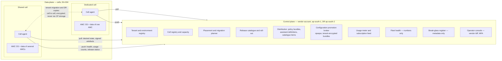
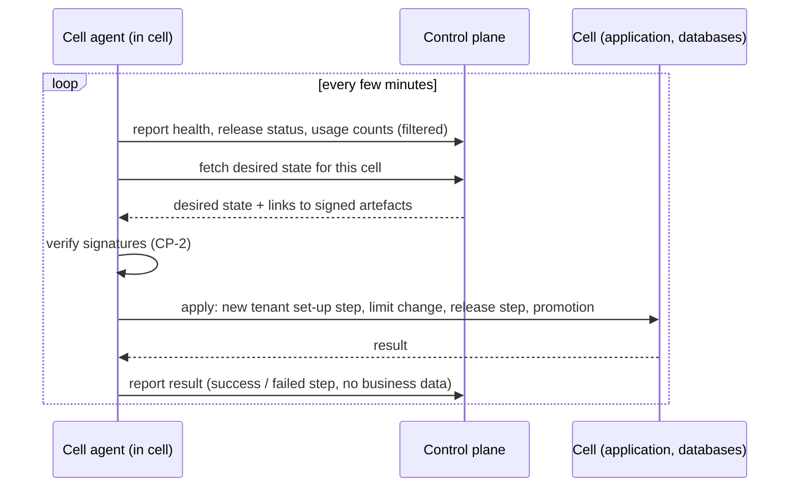

# EA-006 — Control Plane and Data Plane

Master prompt §6 says: "Keep the control plane separate from the customer financial data plane." This document draws that line. The **data plane** is every cell ([EA-004](EA-004_deployment_and_cell_architecture.md)) — where AMC business and financial data lives. The **control plane** is the vendor's management system that creates cells, places tenants, rolls out releases, promotes configuration and watches fleet health — without ever holding AMC financial data (ADR-0003 §4). It is master prompt §14 Stage B items 7 ("Control plane architecture") and 8 ("Data plane architecture"), and it closes EA-008 gap G5 (promotion mechanics).

**Builds on Draft documents:** ADR-0003, ADR-0016, ADR-0018, ADR-0019, EA-001, EA-002, EA-003, EA-004, EA-005, EA-008, PRD-001, PRD-017, BA-004 (WF-019, WF-021, WF-022), BA-005 (ROLE-20, SOD-09, SOD-15) — allowed by owner decision D-3. Nothing used here is Approved. Owner decisions used: D-7, D-14, D-26, D-73 ([LOOP_STATE.md](../../LOOP_STATE.md)). The proposal EA-103 (branch `proposal/ai-orchestration-architecture`) was read as input only; its rules CPR-1…CPR-6 are taken up below in changed form.

**Status of every decision in this document:** **[DES]** — a design proposal for the owner (interim ARB). No regulatory fact is stated beyond the references to EA-004 §1.1.

**Plain-language terms**

| Term | Meaning here |
| --- | --- |
| Control plane | The vendor's own system for running the fleet of cells: tenant list, placement, releases, configuration hand-over, health |
| Data plane | The cells, where AMC data is stored and processed |
| Cell agent | A small part inside each cell that is the only link to the control plane (EA-004 §2) |
| Pull model | The cell agent asks the control plane "anything for me?" and fetches it; the control plane never opens connections into a cell |
| Signed artefact | A file (release, policy bundle, configuration bundle) with a digital signature the cell checks before using it |
| Desired state | What the control plane says a cell should run (release, tenant list, limits); the cell agent makes the cell match it and reports back |

## 1. The line between the planes



### 1.1 What may be in the control plane

| Allowed (metadata) | Never allowed |
| --- | --- |
| Tenant ID, AMC legal name, tier, cell, region, plan, modules, status, environments and their links (FR-D01-001, -046) | Any record of a domain schema: schemes, securities held, orders, trades, positions, prices, journals, NAV, investor or distributor data, commissions |
| Cell records: size, release, measured capacity, health | Investor personal data of any kind |
| Release catalogue, manifests, migration list, release status per cell | Prompts, AI answers, retrieved documents, tool inputs or outputs |
| Policy bundles, assistant definitions (D-73), configuration catalogue items (product-level, EA-008 §8) — all product-level, the same for every tenant | Tenant configuration **values** in readable form (§4) |
| Usage counts for billing: users, schemes, API calls, storage (D-26) | Business reports, exports, backups or database copies |
| Fleet telemetry filtered at source (§5) | Logs or traces that contain business payloads |
| Break-glass grant metadata: incident, tenant, scope label, start, expiry (WF-022) | What the operator saw during break-glass |
| Operator identities and their actions in the console (audited) | Tenant user accounts, roles or grants (they live in the cell's `identity` schema) |
| Contact details of the tenant's named contacts for operations notices | Anything else personal |

The AMC legal name and named contacts are customer business details, not financial data; they are needed to run the service and are kept to the minimum **[DES; personal data of contacts under DPDP — NFR-PRIV-001, VAL]**.

### 1.2 Rules

These take up the proposal's CPR-1…CPR-6, changed where noted.

| # | Rule |
| --- | --- |
| CP-1 | The control plane never stores AMC financial or business data and has no standing access to it (ADR-0003 §4; §1.1). Tenant data moving between cells (migration, DR) goes cell to cell, encrypted, and never lands in control-plane storage |
| CP-2 | Control plane → cell: only **signed, versioned artefacts** and desired-state records. The cell checks every signature before use and refuses anything unsigned or signed by an unknown key (NFR-SEC-006) |
| CP-3 | **Pull model.** The cell agent opens all connections; the control plane has no network route into a cell and no credentials for any cell database, storage or key *(new: the proposal did not fix the direction)* |
| CP-4 | Cell → control plane: health, release status and usage **counts** only, filtered inside the cell (§5) |
| CP-5 | Operator access to a tenant's data happens only through break-glass inside the cell, approved by the tenant (WF-022, SOD-09; EA-005 §6). The control plane only records that a grant exists |
| CP-6 | Cells keep running when the control plane is down; only onboarding, placement, releases, promotions and migrations wait (NFR-AVAIL-003) |
| CP-7 | Every control-plane action that changes a cell (placement, release, limit change, migration, promotion) is recorded in an append-only control-plane audit log and also in the target cell's audit log for the affected tenant *(new)* |
| CP-8 | Release signing keys are **not** held by the control plane. Releases are signed by the build pipeline after the GOV-004 release gates with two-person approval; a compromised control plane can therefore not push code a cell would accept *(new)* |

## 2. Control-plane components

| Component | Does | Does not |
| --- | --- | --- |
| Tenant and environment registry | Tenant IDs, tier, plan, modules, status, cell; links a tenant's production and UAT tenant records (EA-004 §3) | Hold tenant users or grants |
| Cell registry and capacity | Cell list, kind (production / non-production / vendor test), release, account, measured limits (EA-004 §4) | Read cell databases |
| Placement and migration planner | Applies placement rules P1–P7 (EA-004 §5); plans and tracks migrations (EA-004 §6); records two-sided confirmations | Move data itself (cell tooling does) |
| Release catalogue and roll-out | Holds release manifests (images, migrations, assistant definitions, policy bundles, catalogue items); drives release rings (EA-004 §8) | Sign releases (CP-8) |
| Distribution | Publishes product-level policy bundles (ADR-0019), assistant definitions (D-73, PRD-017 FR-D17-024) and configuration catalogue items with each release | Switch an assistant on for a tenant — the tenant does that in its cell (D-73) |
| Configuration promotion broker | Carries a tenant's approved configuration bundle from its UAT tenant to its production tenant as an opaque, tenant-encrypted blob (§4) | Read configuration values |
| Usage meter and subscription feed | Receives counts per tenant (D-26); sends subscription and entitlement changes to the cell as signed instructions (D-14) | Change what a tenant has paid for without a contract record |
| Fleet health | Shows availability, latency, error rates, queue backlogs, NAV-run timing **status** (on time / late, not values), capacity use per cell and per tenant (numbers only) | Show any business value |
| Break-glass register | Incident reference, tenant, scope label, start, expiry, approver role | Hold or show the data accessed |
| Operator console | Platform Operators (ROLE-20) sign in through the vendor's own IdP with MFA; every action audited | Give access to tenant workspaces |

## 3. How a cell talks to the control plane



| Topic | Design **[DES]** |
| --- | --- |
| Direction | Outbound from the cell only (CP-3), over TLS with mutual authentication (cell identity certificate issued at cell creation) |
| Idempotent steps | Every desired-state step has an ID; the agent records applied steps in the cell, so a repeated fetch never applies a step twice |
| Tenant-affecting steps | Steps that need the tenant's agreement (activation, migration cut-over, production upgrade date) wait for the confirmation recorded **inside the cell** by the Tenant Administrator (FR-D01-002, SOD-15) |
| Dedicated cell in the AMC's account | Same agent and pull model; the AMC can see and block outbound control-plane traffic in its own account, which pauses only upgrades and changes (CP-6) |
| Control plane unreachable | Agent keeps the last desired state; the cell runs normally; an alert is raised in the cell and in the fleet view when the link returns |

## 4. Configuration promotion between environments (closes EA-008 G5)

EA-008 §5 requires an approved configuration version to move from a tenant's non-production environment to production **unchanged, with the same version ID, as a signed bundle**, through the control plane, without carrying business data. Design **[DES]**:

```mermaid
sequenceDiagram
  participant U as UAT tenant (non-production cell)
  participant CP as Control plane (promotion broker)
  participant P as Production tenant (production cell)
  U->>U: version approved (WF-021, maker ≠ checker)
  U->>U: build bundle: values + version ID + approval record; hash; sign with the cell's bundle key; encrypt with the production tenant's key
  U->>CP: hand over opaque bundle + metadata (tenant, version ID, hash)
  CP->>CP: store for at most the promotion window; cannot decrypt
  P->>CP: cell agent fetches bundle for its tenant
  P->>P: decrypt; check signature, hash, version ID, catalogue compatibility with production release
  P->>P: record as Approved version (same ID); takes effect on its effective date
  P->>U: (via CP metadata) promotion result
```

| Rule | Detail |
| --- | --- |
| Unchanged | Production checks the hash; any difference rejects the bundle |
| Readable only by the tenant | Encrypted with the production tenant's master key; the control plane holds only the ciphertext, the hash and the metadata. Whether the UAT cell may use the production tenant's key for encryption is a key-design point for SEC-001 (Step 25) **[DES]** |
| Release compatibility | If production runs an older release that does not know a setting in the bundle, the bundle waits until production is upgraded (EA-008 §9) |
| Production approval | A promoted version keeps its maker-checker record from UAT; whether production additionally needs a "go-live" confirmation by the tenant is a tenant setting in the catalogue **[DES]** |
| Record | Each promotion is a `platform.config_promotion` row in both tenants (EA-008 §8) and a control-plane audit entry (CP-7) |
| Expiry | The control plane deletes the ciphertext after delivery or after the promotion window **[ASSUMPTION — 7 days; confirm: SRE lead]** |
| Rule sets (K2) | Domain rule sets (compliance rules, posting rules, commission structures) follow the same bundle mechanism, owned by their module (EA-008 §6) |

## 5. Telemetry leaving the cell

| Sent to the control plane | Filtered out inside the cell |
| --- | --- |
| Metrics: request rates, error rates, latency, queue lengths, CPU, memory, database health, replication lag, backup status | Request and response bodies, SQL parameters, file contents |
| Per-tenant usage counts (D-26) and resource shares (EA-005 §4) | Any money amount, price, position, unit, NAV value, investor or distributor identifier |
| Job status per tenant: started / finished / late / failed, with an error code | Error messages that contain business values (only codes leave the cell) |
| Traces with IDs and timings only | Prompts, AI answers, retrieval results |
| Release and migration step results | Log lines (they stay in the cell's tenant-scoped log store, EA-005 §3) |

The filter is an allow-list in the cell agent and the telemetry collector: only named metrics and fields leave the cell **[DES]**. Requirement: NFR-OBS-003 (§7).

## 6. Where the control plane runs

| Item | Design **[DES]** |
| --- | --- |
| Account | A separate vendor AWS account, not shared with any cell (ADR-0018 Decision 2) |
| Region | `ap-south-1`, with backups and a standby in `ap-south-2` (D-7); its RTO can be longer than the cells' because cells keep running without it (CP-6) **[ASSUMPTION — RTO 8 h; confirm: SRE lead]** |
| Code | Same repository, separate small deployable with its own release (it is not one of the 22 domain modules and holds no domain schema). This is a separate service under the "stronger security boundary" trigger of ADR-0002, and needs its own ADR (proposed ADR-0021, owner-only; §8) |
| Data store | Its own PostgreSQL database in the control-plane account; not part of any cell and not a GOV-001 §3 domain schema |
| Identity | Vendor IdP with MFA for Platform Operators; no AMC user can sign in to the control plane |

## 7. Non-functional requirements proposed here

| ID | Requirement | Label |
| --- | --- | --- |
| NFR-AVAIL-003 | Every business process in a cell (sign-in, orders, NAV, settlement, reconciliation, investor servicing) continues while the control plane is unavailable; shown by a test that cuts the control-plane link during a NAV run | **[DES]** |
| NFR-SEC-006 | A cell applies only artefacts signed by a key it trusts; an unsigned, wrongly signed or altered artefact is refused and raises a security alert | **[DES]** |
| NFR-OBS-003 | Telemetry leaving a cell contains only allow-listed metrics and fields; a test run with sample data shows no money amounts, prices, positions, investor data or prompts in control-plane storage | **[DES]** |

## 8. Effects on other documents

| Document | Change needed | When |
| --- | --- | --- |
| ADR-0021 (proposed, owner-only folder; not drafted in this step) | Control plane as a separate deployable with its own data store; pull model; release signing outside the control plane (CP-3, CP-8) | Owner; before INF-001 (Step 26) |
| EA-008 §5, §11 G5 | Promotion row to point to EA-006 §4; G5 closed | Next EA-008 revision |
| PRD-001 FR-D01-035, FR-D01-046, FR-D01-047 | Point to EA-006 §4 and EA-004 §8 | Next PRD-001 revision |
| SEC-001 | Key used to encrypt promotion bundles; cell identity certificates; release signing keys | Step 25 |
| INF-001 | Control-plane infrastructure, cell agent, telemetry allow-list | Step 26 |
| BA-005 | No change: ROLE-20 already has rights on tenants, cells and releases only | — |

## 9. Gaps and open points

| # | Gap | Closed by |
| --- | --- | --- |
| G1 | ADR for the control plane as a separate deployable (ADR-0021) | Owner |
| G2 | Encryption key for promotion bundles across cells | SEC-001, Step 25 |
| G3 | Control-plane RTO and promotion window are assumptions | SRE lead; INF-001 |
| G4 | Personal data of tenant contacts in the control plane under the DPDP Act | REG-001, Step 25 **[VAL]** |

## Sources

| # | Source | Used for |
| --- | --- | --- |
| S1 | [MASTER_BUILD_PROMPT.md](../../MASTER_BUILD_PROMPT.md) §6, §14 Stage B | Control and data plane requirement |
| S2 | [ADR-0003](../../architecture/adrs/ADR-0003_multi_tenancy_and_cells.md) §4, [ADR-0018](../../architecture/adrs/ADR-0018_cloud_provider_and_regions.md) Decision 2, [ADR-0019](../../architecture/adrs/ADR-0019_api_gateway_and_policy_engine.md) | Control plane, accounts, policy bundles |
| S3 | [EA-004](EA-004_deployment_and_cell_architecture.md), [EA-005](EA-005_multi_tenant_architecture.md), [EA-008](EA-008_configuration_over_customisation.md) §5, §8, §9 | Cells, isolation, promotion |
| S4 | [PRD-001](../03_product_requirements/PRD-001_platform_administration.md) FR-D01-001, -002, -035, -046, -047; [PRD-017](../03_product_requirements/PRD-017_ai_and_decision_intelligence.md) FR-D17-024 | Tenant record, promotion, environments, assistant definitions |
| S5 | [BA-004](../02_business_architecture/BA-004_end_to_end_workflows.md) WF-019, WF-021, WF-022; [BA-005](../02_business_architecture/BA-005_roles_and_permissions.md) ROLE-20, SOD-09 | Workflows and operator rights |
| S6 | Proposal branch `proposal/ai-orchestration-architecture`, EA-103 §2 (input only) | CPR-1…CPR-6 |
| S7 | [LOOP_STATE.md](../../LOOP_STATE.md) owner decisions | D-7, D-14, D-26, D-73 |
