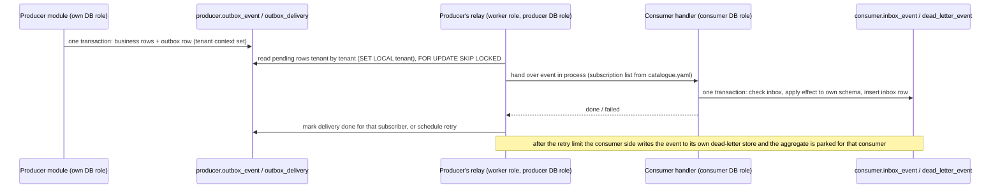
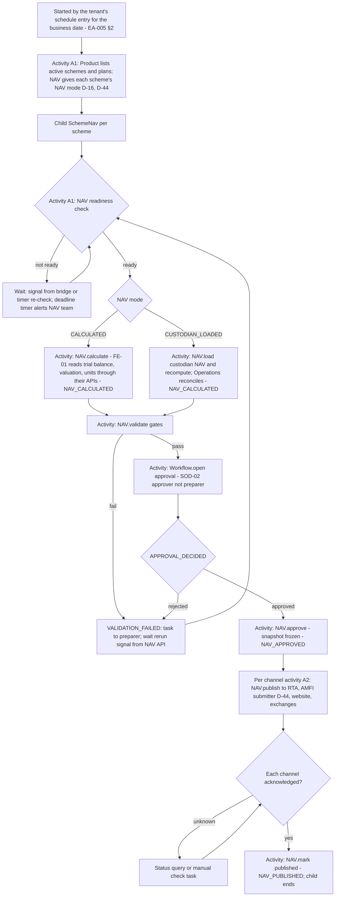

# EA-007 — Event Architecture and Process Workflows

This document designs layer 4 of the master prompt (§5 L4, "Workflow and Event Infrastructure"): how modules tell each other that something happened (**events**), and how long business processes that cross modules and wait for people or outside parties run safely (**process workflows** on Temporal). It is master prompt §14 Stage B item 9 ("Event architecture"). It sets the final names, payloads and versions of every candidate event in [EA-003](EA-003_domain_boundaries_and_service_catalogue.md) §3 (closes EA-003 G2 for events), says which module owns each process workflow (closes EA-003 G6), and confirms the workflow-versioning approach that [EA-004](EA-004_deployment_and_cell_architecture.md) §8.2 rules 3 and 5 left to this step.

The machine-readable contract is in [`contracts/events/`](../../contracts/events/README.md): one JSON Schema per event payload (`<NAME>.v1.schema.json`), the envelope, the common types and `catalogue.yaml`. The contract tests are in [`tests/contracts/`](../../tests/contracts/test_event_catalogue.py).

**Builds on Draft documents:** ADR-0002, ADR-0003, ADR-0005, ADR-0006, ADR-0008, ADR-0017, EA-002, EA-003, EA-004, EA-005, EA-006, EA-008, BA-004 (WF-001…WF-043), BA-005, PRD-000 §2.5, PRD-001…PRD-017, DA-000, DDL-000 — allowed by owner decision D-3 ([GOV-008](../00_governance/GOV-008_build_loop.md) §2 rule 3). Nothing used here is Approved; EA-001…EA-006, EA-008 and ADR-0016…ADR-0019 are still waiting for the owner to merge. Owner decisions used: D-14, D-16, D-26, D-30, D-32, D-36, D-37, D-42, D-44, D-45, D-48, D-53, D-56, D-58, D-59, D-60, D-70, D-75 ([LOOP_STATE.md](../../LOOP_STATE.md)). The proposal branch `proposal/ai-orchestration-architecture` (EA-102 transaction orchestration, ADR-0013 unknown outcome) was read as input only; nothing in it is treated as approved.

**Status of every decision in this document:** **[DES]** — a design proposal for the owner (interim ARB) unless another label is shown. No regulatory fact is stated; where a workflow depends on a regulatory deadline, the deadline is a tenant setting or a value from the owning module and is marked **[VAL]**. Numbers marked **[ASSUMPTION]** are starting values to be replaced by measured ones. Facts about Temporal are taken from its documentation (Sources S8–S10) and labelled **[IND]** (vendor product fact, not law).

**Plain-language terms**

| Term | Meaning here |
| --- | --- |
| Event | A record that "something happened" in one module (for example a trade was confirmed). Past tense, never a command |
| Producer / consumer | The one module that writes an event / a module that reacts to it |
| Envelope | The standard wrapper every event has (ID, tenant, time, who, what); the business details are the payload |
| Outbox | A table in the producer's own schema; the event row is written in the same database transaction as the business change, so neither can exist without the other |
| Relay | The worker that reads a module's outbox and delivers its events to the consumers |
| Inbox | A table in the consumer's own schema that remembers which events it has already handled, so a repeated delivery has no second effect |
| Dead-letter store | Where an event goes for one consumer after repeated failures, for a person to look at |
| Aggregate | The main record an event is about (an order, a NAV run); events of one aggregate are delivered in order |
| Process workflow | A long business process on Temporal that calls several modules and waits for people or outside parties (ADR-0006 §3) |
| Activity | One step of a process workflow that calls a module's public interface |
| Signal | A message that wakes a waiting process workflow (for example "the approval was decided") |
| Unknown outcome | We sent an instruction to an outside party and do not know whether it arrived |
| Tolerant reader | A consumer that uses the fields it knows and ignores any new ones, so an added optional field does not break it |
| Signal-with-start | One call that wakes a process workflow if it is running, or starts it first if it is not |
| Continue-As-New | Temporal's way for a long-running workflow to close its current history and carry on as a fresh run with the same ID, so the history never grows too large |

## 1. What travels as an event, a call or a workflow

| Need | Mechanism | Rule |
| --- | --- | --- |
| Ask another module for data or to act, and wait for the answer | Synchronous call to its public interface, only downwards in the EA-003 §4 tier table | EA-003 B2, B3 |
| Tell any interested module that something happened | Event from the owning module's outbox | EA-003 B4; §2 below |
| Run a multi-step process across modules, with human approvals, timers and outside parties | Process workflow on Temporal, owned by the module that owns the process | ADR-0006 §3; §9 below |
| Keep a process that lives entirely inside one module | That module's own records and state model, with approvals through the Workflow module | §9.1 kind M |

Events are never commands. If a module needs another module to do something, it calls it (if allowed by the tiers) or a process workflow calls it. A consumer may react to an event by changing **its own** data only (EA-003 B1).

## 2. Event rules

| # | Rule | Source |
| --- | --- | --- |
| E1 | Only the owning module publishes an event about its data, from its own outbox, in the same transaction as the change | ADR-0006; EA-003 B4, T15 |
| E2 | Every event has the envelope of §3 and a payload that validates against its schema in `contracts/events/`; the producer validates before writing the outbox row and refuses to commit if invalid | Master prompt §5 L4 "Schema registry" |
| E3 | Delivery is **at least once**. Every consumer is idempotent: it records `event_id` in its inbox in the same transaction as its effect, and a repeat has no second effect | Master prompt §5 L4 "Idempotent event consumers"; ADR-0006 |
| E4 | Order is kept **per aggregate and per consumer** (`aggregate_seq`). There is no order across aggregates; a consumer that needs "everything for date D" waits for the closing event of that date (for example `ACCOUNTING_DAY_CLOSED`) and then reads through the owner's interface, never by counting events | **[DES]** |
| E5 | Every event carries `tenant_id` in the envelope, equal to the outbox row's tenant. A consumer sets its tenant context from it and refuses an event without it or with a mismatch, and raises an alert (EA-005 §8 test 13) | ADR-0003 §3; EA-005 §2 |
| E6 | Money and quantities are decimal strings (`decimal_string`, `money`), never JSON numbers; the scale comes from the producing engine's precision rules | Master prompt §3.2; ADR-0005 |
| E7 | Every event that carries money or quantity figures declares where they come from (`figure_source` in the schema's `x-amc-os` block): **ENGINE** — computed by an AMC OS engine, and the payload names `engine_version` or `rule_versions`; **ENGINE_RUN_REF** — figures of an earlier engine run, and the payload names that run's ID (for example `nav_run_id`), whose event names the engine version; **EXTERNAL_SOURCE** — facts received from an outside party (broker, custodian, RTA), traceable through the source record; **PERSON_DECISION** — entered or decided by a person (an order, a fair-value decision); **MODULE_AGGREGATION** — totals or splits made by the module's own deterministic code (trade allocation, distributor flows), to be covered by an FE or module specification (G10). So every figure can be traced and reproduced; checked by test T-E1 | Master prompt §3.2 "versioned calculations"; EA-004 §8.2 rule 6 |
| E8 | An event is a fact. It is never edited or deleted. A wrong fact is corrected by a new business action that publishes its own event (for example `TRADE_CORRECTED`, `NAV_CORRECTION_APPROVED`) | Master prompt §3.2 "immutable history" |
| E9 | **No investor or employee personal data in any event** (no PAN, names, contact details, bank accounts). Investor events carry internal reference IDs only; a consumer that needs more calls the Investor module, which masks by default (EA-003 §3.18). Payload classification is Internal or Confidential (PRD-016 FR-D16-008), never Restricted-PII | NFR-PRIV-001; **[DES]** |
| E10 | The actor of an approval, release, posting, publication or settlement event is never an AI assistant. `actor_type = AI_ASSISTANT` is allowed only on draft and proposal events (`ORDER_CREATED` in DRAFT, `AI_PROPOSAL_CREATED`, `AI_ANOMALY_FLAGGED`); a consumer refuses any other event with an AI actor and raises a security alert | Master prompt §3.1; ADR-0008 §3; SOD-10 |
| E11 | `correlation_id` is the same across the user request, every event, workflow step, audit row, log line and trace of one business action | Master prompt §5 L4 "Correlation IDs"; NFR-AUD-018 |
| E12 | Events stay inside the cell. No event is sent to a party outside AMC OS in release 1 (owner question Q74); integration messages to outside parties are adapter calls of the owning module (EA-003 B9) | EA-006 §5; **[DES]**, Q74 |
| E13 | Events are not the audit trail. The audit trail is the insert-only, hash-chained `audit` records written through the audit function (EA-003 B8); an event may point to them through `correlation_id` | NFR-AUD-001 |
| E14 | A consumer's copy of another module's data (read model) is for display and triggering only. A financial calculation reads its inputs through the owner's interface at calculation time, never from a read model that may lag | EA-003 §3.16 (NAV calls Accounting); **[DES]** |

## 3. The envelope

Schema: [`contracts/events/envelope.v1.schema.json`](../../contracts/events/envelope.v1.schema.json); shared types: [`common.v1.schema.json`](../../contracts/events/common.v1.schema.json).

| Field | Required | Meaning |
| --- | --- | --- |
| `envelope_version` | Yes | Always 1 for this envelope |
| `event_id` | Yes | UUID, unique per event; the de-duplication key (E3) |
| `event_type`, `event_version` | Yes | For example `NAV_APPROVED` and `1`; together the GOV-001 §4 ID `NAV_APPROVED.v1` |
| `tenant_id` | Yes | E5 |
| `producer` | Yes | One of the 22 modules of EA-003 §2 |
| `aggregate_type`, `aggregate_id`, `aggregate_seq` | Yes | The aggregate root table (`<schema>.<table>`, GOV-001 §4), its ID, and the event's position in that aggregate's history (E4) |
| `occurred_at` | Yes | Commit time of the business change |
| `business_date` | No | Business date the event belongs to, where there is one |
| `correlation_id` | Yes | E11 |
| `causation_id` | No | The event or request that directly caused this one |
| `process_workflow_id` | No | The process workflow the change was made in, if any (§9.2) |
| `actor` | Yes | `actor_type` (user, service account, process workflow, system worker, AI assistant), `actor_id`, and `on_behalf_of_user_id` where an assistant or workflow acted for a person (E10) |
| `data_classification` | Yes | Internal or Confidential (E9) |
| `payload` | Yes | The event's own fields, validated against `<NAME>.v<n>.schema.json` |

Payload schemas are **closed** (no fields beyond the schema), and **only the producer** validates against the closed schema, so a producer mistake is caught at write time. Consumers are **tolerant readers**: they check the fields and types they use and ignore fields they do not know. This is what makes the additive changes of §6 safe during a rolling upgrade, when a consumer on the older release may receive an event with a new optional field (test T-E9).

## 4. Delivery in release 1 (outbox, in process) and later on Kafka

Owner decision D-70: release 1 uses the transactional outbox in PostgreSQL with in-process delivery; Kafka is added when volumes need it, without changing modules (ADR-0006 decision 1 as reworded on 21 Nov 2026).

| # | Design **[DES]** |
| --- | --- |
| D1 | **Outbox per owning schema** (EA-003 T15): `<schema>.outbox_event` holds the envelope columns of §3 plus the payload; `<schema>.outbox_delivery` holds one row per event and subscriber (status, attempts, next attempt time, last error code). Both are written only by the producing module's role |
| D2 | **One relay per producing module**, run in the `worker` process role (EA-004 §2.1) under that module's database role. It works tenant by tenant from `platform.tenant` and sets the tenant context per batch (EA-005 §2, named system-worker exception, ADR-0020 scope) |
| D3 | **Handlers run under the consumer's database role** in their own transaction. The hand-over is in process: the relay passes the event object to the subscribed handler; no module reads another module's outbox (EA-003 B2). The subscription list is generated from `catalogue.yaml` at build time, so a subscription exists only if the contract lists it |
| D4 | **Inbox per consuming schema**: `<schema>.inbox_event (tenant_id, event_id, handler, processed_at)` with a unique key on `(tenant_id, event_id, handler)`. The handler inserts it in the same transaction as its effect (E3) |
| D5 | **Retries**: exponential back-off with jitter, up to **10 attempts over about 2 hours [ASSUMPTION — tune in the capacity test]**. Errors are classified: a *data* error (a field the consumer needs is missing or of the wrong type, or the consumer's business check fails — never merely an unknown field, §3) goes to the dead-letter store at once; a *temporary* error (lock, timeout) is retried |
| D6 | **Dead-letter store per consuming schema**: `<schema>.dead_letter_event` with the envelope, error, attempts and status. For `FINANCIAL`, `CONTROL` and `ACCESS` events the aggregate is **parked** (for access events, so that for example a revocation can never be overtaken by a later grant change) for that consumer: later events of the same aggregate wait until the dead letter is resolved, so order (E4) is never broken. A dead letter raises an alert (NFR-OBS-004) and appears in the Operations exception queue (CAP-D12-008) for the tenant |
| D7 | **Resolution**: a person with the consumer module's support right replays the dead letter through the same handler after the cause is fixed (code release or data fix through the owner's normal process). The payload is never edited (E8). The vendor's support staff see counts and error codes only, not payloads (EA-006 §5); payload inspection needs the tenant's user or break-glass (WF-022) |
| D8 | **Retention**: delivered outbox rows are kept **35 days [ASSUMPTION]** for replay, then archived per tenant to object storage, encrypted with the tenant key (EA-005 §5); how long archives are kept follows the data classification and REG-001 **[VAL]**. Inbox rows are kept at least as long as the producer's outbox rows, so a late duplicate is still recognised |
| D9 | **Replay for a new consumer or a rebuilt read model**: from the producer's outbox (within D8) or archive, through the normal handler, with idempotency by inbox. A replay is an approved operation recorded in the audit trail |
| D10 | **Disaster recovery**: outbox and inbox rows are in the same PostgreSQL cluster as the business rows, so after a regional failover they are consistent up to the last replicated point (EA-004 §9.2 step 4); undelivered rows are delivered by the relay after promotion |

**Moving to Kafka later (D-70).** The relay publishes to Kafka instead of handing over in process; topics per producing module per cell, partition key `tenant_id` + `aggregate_id` (keeps E4), payloads checked against a schema registry loaded from `contracts/events/`, one consumer group per handler, dead-letter topics. Outbox, inbox, envelope and schemas do not change. The trigger (measured relay lag or event volume), the product and the topic layout need their own ADR when the time comes **[DES]**.

## 5. Security and tenant isolation of events

| Point | Design **[DES]** | Source |
| --- | --- | --- |
| Tenant context | E5; relay and handler set context per tenant batch, never loop across tenants inside one transaction | EA-005 §2 |
| Database rights | Producer role writes only its outbox; consumer role writes only its inbox and dead-letter store; no role reads another schema's outbox | EA-003 B1, B2, T15 |
| Personal data | E9; checked by the contract test (no field names that look like personal data) and by review of every new schema | NFR-SEC-007 |
| AI actor | E10 | ADR-0008 |
| Reporting | Reporting (D16) receives every event for the analytical store; because events carry no personal data, personal data reaches analytics only through the governed pipelines of PRD-016 (EA-003 B2) | PRD-016 |
| Tests | EA-005 §8 test 13 (missing or wrong tenant refused), plus §11 tests T-E1…T-E11 | EA-005 |

## 6. Versions and compatibility (EA-004 §8.2 rule 3)

| # | Rule **[DES]** |
| --- | --- |
| V1 | **Adding an optional field** is not a new version. The schema file changes in place and the change is listed in the catalogue's change log; consumers are tolerant readers (§3) |
| V2 | **Anything else** — removing or renaming a field, changing a type or meaning, making a field required — is a **new version** (`<NAME>.v2`), a new schema file next to the old one |
| V3 | **Overlap of at least one release**: the producer publishes both versions for at least one release after the new version appears; consumers move to the new version within that release; the old version is retired in a later release. A dedicated cell may run one release behind (EA-004 §8.1, Q70); this does not affect events because all modules of a cell run the same release and events never leave the cell (E12) — the overlap covers rolling upgrades inside a cell and replay of stored events |
| V4 | **Stored events** (outbox, archive) keep the version they were written in. A consumer that replays them converts old versions with tested upgrade functions ("upcasters") in its own code; the stored row is never rewritten (E8) |
| V5 | **The registry in release 1** is the `contracts/events/` folder plus the contract tests in CI; a runtime schema registry is added with Kafka (§4) |
| V6 | Renaming an event is a new event, not a version |

## 7. Names and changes to the EA-003 candidates

All **103** candidate events of EA-003 §3 are kept; three are renamed and none is added, so the catalogue has **103 events**. Every event that an EA-003 card lists under "Consumes" is published by some module, and every example in master prompt §5 L4 is in the catalogue (both checked when this document was written; the second also by test T-E1).

| Change | Reason |
| --- | --- |
| `ENTITLEMENT_CHANGED` → `TENANT_ENTITLEMENT_CHANGED` | "Entitlement" also means a corporate-action entitlement (D12); the subscription meaning (D-14) gets the prefix |
| `ENTITLEMENT_RECEIVED` → `CORPORATE_ACTION_ENTITLEMENT_RECEIVED` | Same reason |
| `ALLOCATION_RUN_APPROVED` → `COST_ALLOCATION_RUN_APPROVED` | "Allocation" also means trade allocation (D06, `ALLOCATION_COMPLETED`) |
| PRD-016 `MASTER_DATA_CHANGED` not created | EA-003 §3.5 already splits it into `SECURITY_CHANGED`, `ISSUER_CHANGED`, `RATING_CHANGED`, `COUNTERPARTY_CHANGED`, so consumers subscribe only to what they use |

The v0.9 names in PRD-000 §2.5 and the BA-004 diagrams (BA-004 rule 6) map as follows:

| v0.9 name | Catalogue event |
| --- | --- |
| `investor.flows.provisional`, `investor.flows.final` | `INVESTOR_FLOWS_PROVISIONAL.v1`, `INVESTOR_FLOWS_FINAL.v1` |
| `oms.order.released` | `ORDER_RELEASED.v1` |
| `compliance.pretrade.result` | `COMPLIANCE_CHECK_COMPLETED.v1` with `check_kind = PRE_TRADE` (the pre-trade check itself is a synchronous call, EA-003 §3.9; the event records the result) |
| `trading.execution.received` | `TRADE_EXECUTED.v1` |
| `trading.trade.confirmed` | `TRADE_CONFIRMED.v1` (published by Execution, EA-003 T1) |
| `settlement.status.changed` | `SETTLEMENT_STATUS_CHANGED.v1` |
| `accounting.day.closed` | `ACCOUNTING_DAY_CLOSED.v1` |
| `nav.published` | `NAV_PUBLISHED.v1` |
| `investor.transactions.loaded` | `INVESTOR_TRANSACTION_RECEIVED.v1` (one per transaction; see G4) |
| `product.scheme.activated`, `product.scheme.amended` | `SCHEME_ACTIVATED.v1`, `SCHEME_AMENDED.v1` |
| `finance.period.closed` | `MANAGEMENT_PERIOD_CLOSED.v1` (Finance) — the accounting month close is `PERIOD_CLOSED.v1` (Accounting) |

Dotted names such as `nav.run.approve` in BA-005 and the PRDs are **permission** names, not events, and are unchanged.

## 8. Event catalogue v1

Classes: **Financial** (changes or reports a financial figure or position), **Control** (approvals, rules, breaches, alerts, configuration), **Access** (users and rights), **Reference** (master and reference data), **Operational** (files, tasks, documents, service), **AI** (assistant output, always advisory). Data classification: Confidential for Financial, Control, Access and AI; Internal for Reference and Operational. The payload fields of each event are in its schema file; every event also goes to Reporting, which is not repeated in the last column. "L4 signal bridge" means the event wakes a process workflow (§9.4).

| Event | Producer | Aggregate | Class | When it is published | Consumers (besides Reporting) |
| --- | --- | --- | --- | --- | --- |
| `TENANT_ACTIVATED.v1` | Tenant (D01) | `platform.tenant` | Control | Tenant moves to active after onboarding (WF-019) | — |
| `TENANT_SUSPENDED.v1` | Tenant (D01) | `platform.tenant` | Control | Tenant suspended (WF-019, PRD-001) | — |
| `TENANT_ENTITLEMENT_CHANGED.v1` | Tenant (D01) | `platform.tenant_entitlement` | Control | A module subscription is switched on, made read-only or ended (D-14, D-26). Renamed from candidate ENTITLEMENT_CHANGED | AI |
| `CONFIG_VERSION_APPROVED.v1` | Tenant (D01) | `platform.config_version` | Control | A configuration version is approved (WF-021, EA-008) | — |
| `CONFIG_VERSION_EFFECTIVE.v1` | Tenant (D01) | `platform.config_version` | Control | An approved configuration version takes effect (EA-008) | — |
| `CALENDAR_CHANGED.v1` | Tenant (D01) | `platform.business_calendar` | Reference | The holiday calendar master changes (CAP-D01-009, EA-003 T17) | Settlement, Operations |
| `USER_PROVISIONED.v1` | Identity (D01) | `identity.app_user` | Access | A user or service identity is created (WF-020) | — |
| `USER_DEPROVISIONED.v1` | Identity (D01) | `identity.app_user` | Access | A user is disabled (leaver, WF-020) | — |
| `ROLE_GRANTED.v1` | Identity (D01) | `identity.role_grant` | Access | A role grant takes effect after approval (WF-020) | — |
| `ROLE_REVOKED.v1` | Identity (D01) | `identity.role_grant` | Access | A role grant ends (mover, leaver, recertification, expiry) | Workflow, AI |
| `BREAK_GLASS_GRANTED.v1` | Identity (D01) | `identity.break_glass_grant` | Access | An approved break-glass grant starts (WF-022, SOD-09) | — |
| `APPROVAL_REQUESTED.v1` | Workflow (D12) | `workflow.approval_request` | Control | An approval request is opened (CAP-D12-011) | — |
| `APPROVAL_DECIDED.v1` | Workflow (D12) | `workflow.approval_request` | Control | An approval request reaches its final decision; maker-checker already enforced | Tenant, Identity, L4 signal bridge |
| `TASK_ASSIGNED.v1` | Workflow (D12) | `workflow.task` | Operational | A task lands in a user's or role's inbox | — |
| `TASK_OVERDUE.v1` | Workflow (D12) | `workflow.task` | Operational | A task passes its due time | — |
| `DOCUMENT_STORED.v1` | Documents (D12) | `documents.document_version` | Operational | A document version is stored with its hash | — |
| `DOCUMENT_VERSION_APPROVED.v1` | Documents (D12) | `documents.document_version` | Control | The owning module's approval of a document version is recorded | — |
| `SECURITY_APPROVED.v1` | Security Master (D16) | `master.security` | Reference | A new security golden record is approved (WF-041) | Valuation |
| `SECURITY_CHANGED.v1` | Security Master (D16) | `master.security` | Reference | An approved change to a security golden record (WF-041). Replaces PRD-016 MASTER_DATA_CHANGED for securities | Investment, Valuation |
| `ISSUER_CHANGED.v1` | Security Master (D16) | `master.issuer` | Reference | An approved change to an issuer or issuer-group record (WF-041) | — |
| `RATING_CHANGED.v1` | Security Master (D16) | `master.credit_rating` | Reference | A credit rating or outlook changes (FR-D16-014) | Investment, Risk |
| `COUNTERPARTY_CHANGED.v1` | Security Master (D16) | `master.counterparty` | Reference | A counterparty golden record or its empanelment status changes (EA-003 T5) | Execution |
| `BENCHMARK_LEVELS_LOADED.v1` | Security Master (D16) | `master.benchmark` | Reference | Benchmark or index levels for a date are loaded and checked | Product |
| `SCHEME_ACTIVATED.v1` | Product (D02) | `product.scheme` | Reference | A scheme becomes ACTIVE after NFO allotment (WF-001) | — |
| `SCHEME_AMENDED.v1` | Product (D02) | `product.scheme` | Reference | An approved scheme change takes effect (WF-029), including TER and load changes | Accounting, Investor, Distribution |
| `SCHEME_MANDATE_CHANGED.v1` | Product (D02) | `product.scheme_mandate` | Reference | A scheme's investment mandate version changes | Compliance |
| `NFO_CLOSED.v1` | Product (D02) | `product.nfo` | Operational | The NFO subscription window closes (WF-001) | — |
| `SCHEME_WOUND_UP.v1` | Product (D02) | `product.scheme` | Reference | A scheme ends by merger, winding-up or maturity (WF-030) | — |
| `RESEARCH_APPROVED.v1` | Investment (D03) | `investment.research_note` | Operational | A research note or recommendation is approved (WF-002) | — |
| `INVESTMENT_DECISION_RECORDED.v1` | Investment (D03) | `investment.decision_record` | Control | An investment decision is recorded (WF-002) | — |
| `UNIVERSE_CHANGED.v1` | Investment (D03) | `investment.universe_member` | Control | A security enters, leaves or changes in the approved universe | — |
| `RESTRICTED_LIST_CHANGED.v1` | Investment (D03) | `investment.restricted_list_entry` | Control | A restricted-list entry is added or removed; takes effect at once (US-D03-002) | OMS, Compliance |
| `INVESTMENT_POLICY_APPROVED.v1` | Investment (D03) | `investment.investment_policy` | Control | An investment policy version is approved (WF-031) | — |
| `HOLDINGS_UPDATED.v1` | Portfolio (D04) | `portfolio.position` | Financial | Positions of a scheme change (trade, settlement, corporate action, adjustment) | Compliance |
| `POSITIONS_SNAPSHOT_TAKEN.v1` | Portfolio (D04) | `portfolio.position_snapshot` | Financial | A frozen positions snapshot is taken (intraday or end of day) | Risk |
| `REBALANCE_PROPOSED.v1` | Portfolio (D04) | `portfolio.rebalance_proposal` | Operational | A rebalance proposal is ready for the fund manager (WF-003) | — |
| `PERFORMANCE_CALCULATED.v1` | Portfolio (D04) | `portfolio.performance_run` | Financial | A performance and attribution run completes (FE-10, WF-032) | — |
| `ORDER_CREATED.v1` | OMS (D05) | `trading.order` | Financial | An order is created in DRAFT (WF-004) | — |
| `ORDER_VALIDATED.v1` | OMS (D05) | `trading.order` | Financial | Order validation and the pre-trade check give a result (WF-004, WF-005) | — |
| `ORDER_APPROVED.v1` | OMS (D05) | `trading.order` | Financial | An order is approved (or needs no approval under the tenant threshold) | — |
| `ORDER_RELEASED.v1` | OMS (D05) | `trading.order` | Financial | An approved order is released to the dealing desk / Execution | Execution |
| `ORDER_CANCELLED.v1` | OMS (D05) | `trading.order` | Financial | An order is cancelled | Execution |
| `TRADE_EXECUTED.v1` | Execution (D06) | `execution.execution` | Financial | A fill (execution report) is received from a broker | OMS |
| `ALLOCATION_COMPLETED.v1` | Execution (D06) | `execution.allocation` | Financial | Fills of an order or block are allocated to schemes | OMS, Portfolio, Compliance |
| `TRADE_CONFIRMED.v1` | Execution (D06) | `execution.trade` | Financial | A trade is confirmed against the contract note (WF-025, EA-003 T1, T2) | Settlement, Portfolio, Accounting |
| `TRADE_CORRECTED.v1` | Execution (D06) | `execution.trade` | Financial | A confirmed trade is corrected; a new trade version replaces the old one, which is kept | Settlement |
| `TRADE_EXCEPTION_RAISED.v1` | Execution (D06) | `execution.trade_exception` | Operational | A trade break or exception is raised (WF-025) | — |
| `BROKER_STATUS_CHANGED.v1` | Execution (D06) | `execution.broker` | Reference | A broker's empanelment status changes (WF-023) | — |
| `SETTLEMENT_INSTRUCTED.v1` | Settlement (D07) | `settlement.settlement` | Financial | A settlement instruction is sent to the custodian (WF-018) | — |
| `SETTLEMENT_STATUS_CHANGED.v1` | Settlement (D07) | `settlement.settlement` | Financial | Settlement status changes on custodian, bank or clearing information | Portfolio, Accounting, Operations |
| `TRADE_SETTLED.v1` | Settlement (D07) | `settlement.settlement` | Financial | A trade is fully settled (master prompt §5 L4 example) | Accounting |
| `SETTLEMENT_FAILED.v1` | Settlement (D07) | `settlement.settlement` | Financial | A settlement fails or partly settles, or confirmation is overdue (starts WF-027) | L4 signal bridge |
| `COMPLIANCE_CHECK_COMPLETED.v1` | Compliance (D08) | `compliance.check_run` | Control | A pre-trade, post-trade or end-of-day check finishes | OMS |
| `COMPLIANCE_BREACH_DETECTED.v1` | Compliance (D08) | `compliance.breach` | Control | A breach is opened (WF-006; starts WF-014) | Risk, L4 signal bridge |
| `COMPLIANCE_BREACH_CLOSED.v1` | Compliance (D08) | `compliance.breach` | Control | A breach reaches RESOLVED (WF-014) | — |
| `RULE_VERSION_APPROVED.v1` | Compliance (D08) | `compliance.rule_version` | Control | A compliance rule version is approved by the CCO (WF-034, D-32) | — |
| `PRETRADE_OVERRIDE_APPROVED.v1` | Compliance (D08) | `compliance.pretrade_override` | Control | A pre-trade override is approved (EA-003 T7) | — |
| `RISK_RUN_COMPLETED.v1` | Risk (D09) | `risk.risk_run` | Financial | A risk run finishes (WF-033) | Compliance |
| `RISK_ALERT_RAISED.v1` | Risk (D09) | `risk.risk_alert` | Control | A risk limit or threshold alert is raised (WF-033) | — |
| `RISK_ALERT_ESCALATED.v1` | Risk (D09) | `risk.risk_alert` | Control | An unactioned risk alert is escalated (D-37) | — |
| `RISK_MODEL_VALIDATED.v1` | Risk (D09) | `risk.risk_model` | Control | A risk model version is validated by someone who did not build it (D-36) | — |
| `JOURNAL_POSTED.v1` | Accounting (D10) | `accounting.journal` | Financial | A balanced journal is posted (FE-02) | — |
| `ACCRUALS_POSTED.v1` | Accounting (D10) | `accounting.accrual_run` | Financial | An accrual run posts its journals | — |
| `ACCOUNTING_DAY_CLOSED.v1` | Accounting (D10) | `accounting.accounting_day` | Financial | The accounting day of a scheme is closed; trial balance frozen (WF-008) | NAV, Operations, L4 signal bridge |
| `PERIOD_CLOSED.v1` | Accounting (D10) | `accounting.period` | Financial | An accounting period (month) is closed (WF-008) | Finance |
| `PERIOD_REOPENED.v1` | Accounting (D10) | `accounting.period` | Financial | A closed period is reopened by CFO and Head of Fund Accounting (D-42) | — |
| `PRICES_LOADED.v1` | Valuation (D11) | `valuation.price_load` | Reference | A price file or feed for a date is loaded | — |
| `PRICES_VALIDATED.v1` | Valuation (D11) | `valuation.price_set` | Financial | Prices for a date pass validation (stale, tolerance, missing) with overrides recorded | Portfolio, Risk, L4 signal bridge |
| `FAIR_VALUE_DECIDED.v1` | Valuation (D11) | `valuation.fair_value_case` | Financial | A Valuation Committee fair-value decision is recorded (WF-035, D-45) | NAV |
| `VALUATION_APPROVED.v1` | Valuation (D11) | `valuation.valuation` | Financial | A scheme valuation for a date is approved (FE-03) | Accounting |
| `NAV_CALCULATED.v1` | NAV (D11) | `nav.nav_run` | Financial | A NAV run is calculated (FE-01) or a custodian NAV is loaded and recomputed (D-44) (WF-007) | — |
| `NAV_APPROVED.v1` | NAV (D11) | `nav.nav_run` | Financial | A NAV run is approved by a person other than the preparer (SOD-02) | Compliance, Operations |
| `NAV_PUBLISHED.v1` | NAV (D11) | `nav.nav_run` | Financial | An approved NAV is delivered to its channels (RTA, AMFI, website, exchanges) | Investor, Distribution, Finance |
| `NAV_CORRECTION_APPROVED.v1` | NAV (D11) | `nav.nav_correction` | Financial | A NAV correction is approved (WF-017) | — |
| `FILE_RECEIVED.v1` | Operations (D12) | `operations.inbound_file` | Operational | An inbound file lands on a tenant's connection (EA-003 T16) | — |
| `FILE_QUARANTINED.v1` | Operations (D12) | `operations.inbound_file` | Operational | An inbound file fails checks and is quarantined | — |
| `RECONCILIATION_COMPLETED.v1` | Operations (D12) | `operations.recon_run` | Financial | A reconciliation run finishes (FE-07, WF-015) | NAV, Investor, L4 signal bridge |
| `RECONCILIATION_EXCEPTION_CREATED.v1` | Operations (D12) | `operations.recon_break` | Control | A reconciliation break is created (master prompt §5 L4 example) | — |
| `CORPORATE_ACTION_ANNOUNCED.v1` | Operations (D12) | `operations.corporate_action` | Reference | A corporate action announcement is captured (WF-009) | — |
| `CORPORATE_ACTION_CONFIRMED.v1` | Operations (D12) | `operations.corporate_action` | Reference | The golden corporate-action record is confirmed (WF-009, EA-003 T3) | — |
| `CORPORATE_ACTION_EFFECTIVE.v1` | Operations (D12) | `operations.corporate_action` | Financial | A confirmed corporate action takes effect (ex-date or effective date) | Portfolio, Risk, Accounting, Valuation |
| `CORPORATE_ACTION_ENTITLEMENT_RECEIVED.v1` | Operations (D12) | `operations.ca_entitlement` | Financial | A corporate-action entitlement (cash or securities) is received. Renamed from candidate ENTITLEMENT_RECEIVED | Accounting |
| `OPERATIONS_DAY_CLOSED.v1` | Operations (D12) | `operations.day_plan` | Control | The operations day is closed with no critical item open (WF-036, D-48) | — |
| `INVESTOR_TRANSACTION_RECEIVED.v1` | Investor (D13) | `investor.investor_transaction` | Financial | An investor transaction is mirrored from the RTA feed (master prompt §5 L4 example) | Distribution |
| `INVESTOR_FLOWS_PROVISIONAL.v1` | Investor (D13) | `investor.flow_batch` | Financial | Provisional subscription and redemption totals for a date (cash planning) | Portfolio |
| `INVESTOR_FLOWS_FINAL.v1` | Investor (D13) | `investor.flow_batch` | Financial | Final subscription and redemption totals for a date from the RTA | Accounting, Portfolio, Distribution |
| `SERVICE_REQUEST_CLOSED.v1` | Investor (D13) | `investor.service_request` | Operational | An investor service request is closed (WF-038) | — |
| `COMPLAINT_RECEIVED.v1` | Investor (D13) | `investor.complaint` | Control | An investor complaint is received (WF-038) | — |
| `INVESTOR_DATA_FLAGGED.v1` | Investor (D13) | `investor.data_flag` | Control | A check flags investor data for correction through the RTA (D-53) | — |
| `DISTRIBUTOR_STATUS_CHANGED.v1` | Distribution (D14) | `distribution.distributor` | Reference | A distributor's status changes (WF-039) | — |
| `DISTRIBUTOR_FLOW_UPDATED.v1` | Distribution (D14) | `distribution.distributor_flow` | Financial | Flows and AUM by distributor and scheme for a date are updated (master prompt §5 L4 example) | — |
| `COMMISSION_RUN_CALCULATED.v1` | Distribution (D14) | `distribution.commission_run` | Financial | A commission run is calculated (FE-09, WF-013) | — |
| `COMMISSION_RUN_APPROVED.v1` | Distribution (D14) | `distribution.commission_run` | Financial | Finance approves a commission run (D-56, WF-013) | Finance |
| `MANAGEMENT_PERIOD_CLOSED.v1` | Finance (D15) | `finance.management_period` | Financial | The monthly management reporting close completes (WF-040) | — |
| `BUDGET_APPROVED.v1` | Finance (D15) | `finance.budget` | Control | A budget or plan version is approved (D-58) | — |
| `COST_ALLOCATION_RUN_APPROVED.v1` | Finance (D15) | `finance.allocation_run` | Financial | A cost allocation run is approved. Renamed from candidate ALLOCATION_RUN_APPROVED | — |
| `DATASET_CERTIFIED.v1` | Reporting (D16) | `analytics.dataset_certification` | Control | A dataset for a date is certified | — |
| `DQ_EXCEPTION_RAISED.v1` | Reporting (D16) | `analytics.dq_exception` | Control | A data-quality rule fails | — |
| `METRIC_DEFINITION_CERTIFIED.v1` | Reporting (D16) | `analytics.metric_definition` | Control | A metric definition version is certified (WF-042, D-59) | Finance |
| `AI_PROPOSAL_CREATED.v1` | AI (D17) | `ai.proposal` | AI | An assistant drafts a proposal that enters the owning module's normal approval (ADR-0008 §3) | — |
| `AI_ANOMALY_FLAGGED.v1` | AI (D17) | `ai.anomaly` | AI | An anomaly model flags a record; advisory only, never changes a figure (FR-D17-019) | — |
| `AI_KILL_SWITCH_CHANGED.v1` | AI (D17) | `ai.kill_switch` | Control | AI is switched off (one person) or back on (two people) for an assistant, a tool or all AI (D-75) | — |
| `ASSISTANT_VERSION_RELEASED.v1` | AI (D17) | `ai.assistant_version` | Control | An assistant version is released after approval (WF-043, D-60) | — |

Events with no consumer other than Reporting are kept: they feed the analytical store, notifications and audit views, and give later modules a contract to subscribe to without a producer change.

## 9. Process workflows on Temporal

### 9.1 Which business workflows run on Temporal (closes EA-003 G6)

Two kinds **[DES]**:

- **P — process workflow on Temporal.** The process calls several modules, or waits hours to months for people or outside parties, and must survive restarts and releases. Its definition (code) belongs to the module that owns the process (EA-003 §3.3); it runs in the `worker` process role.
- **M — module state machine.** The whole process lives in one module's records and state model; approvals go through the Workflow module (EA-003 B7) and due dates through Workflow tasks (`TASK_OVERDUE`). No Temporal workflow is needed. If such a process later needs a second module or an outside wait, it becomes kind P through an EA-007 revision.

| WF | Name (BA-004) | Kind | Owning module (definition) | Workflow type | Business key in the ID | Version behaviour (§9.6) |
| --- | --- | --- | --- | --- | --- | --- |
| WF-001 | Scheme launch (NFO) | P | Product | `NfoLaunch` | scheme | Auto-upgrade |
| WF-002 | Investment research and approval | M | Investment | — | — | — |
| WF-003 | Portfolio construction | M | Portfolio | — | — | — |
| WF-004 | Order creation and execution | M for the order (OMS); P for the broker leg | Execution | `BrokerOrder` | order | Pinned |
| WF-005 | Pre-trade compliance | M (synchronous call) | Compliance | — | — | — |
| WF-006 | Post-trade compliance | M (event-driven) | Compliance | — | — | — |
| WF-007 | Daily NAV | P | NAV | `NavDay` (parent) and `SchemeNav` (child per scheme) | NAV date; NAV date / scheme | Pinned |
| WF-008 | Accounting closure | P | Accounting | `AccountingDayClose`, `AccountingMonthClose` | date or period / scheme | Pinned (day), auto-upgrade (month) |
| WF-009 | Corporate actions | P | Operations | `CorporateAction` | corporate action | Auto-upgrade |
| WF-010 | Investor purchase | M (mirror and check) | Investor | — | — | — |
| WF-011 | Investor redemption | M (mirror and check) | Investor | — | — | — |
| WF-012 | SIP processing | M (mirror and check) | Investor | — | — | — |
| WF-013 | Distributor commission | P | Distribution | `CommissionRun` | period | Auto-upgrade |
| WF-014 | Compliance breach resolution | P | Compliance | `BreachResolution` | breach | Auto-upgrade |
| WF-015 | Reconciliation | M | Operations | — | — | — |
| WF-016 | Regulatory reporting | P | Compliance | `RegulatoryReport` | report / period | Auto-upgrade |
| WF-017 | NAV correction | P | NAV | `NavCorrection` | correction | Auto-upgrade |
| WF-018 | Trade settlement | P | Settlement | `TradeSettlement` | settlement | Pinned |
| WF-019 | Tenant onboarding and offboarding | P | Tenant | `TenantLifecycle` | tenant / request | Auto-upgrade |
| WF-020 | User access lifecycle | P | Identity | `AccessRequest`, `Recertification` | request; campaign | Auto-upgrade |
| WF-021 | Configuration change and promotion | P | Tenant | `ConfigChange` | configuration version | Auto-upgrade |
| WF-022 | Break-glass support access | P | Identity | `BreakGlass` | grant | Pinned |
| WF-023 | Broker empanelment and review | M | Execution | — | — | — |
| WF-024 | Externally booked trade capture | M | Execution | — | — | — |
| WF-025 | Trade confirmation and exceptions | M | Execution | — | — | — |
| WF-026 | Settlement obligations and funding | P | Settlement | `SettlementDay` | settlement date | Pinned |
| WF-027 | Failed settlement management | P | Settlement | `SettlementFail` | settlement | Auto-upgrade |
| WF-028 | SSI and bank-detail change | M | Settlement | — | — | — |
| WF-029 | Scheme change | P | Product | `SchemeChange` | scheme version | Auto-upgrade |
| WF-030 | Scheme merger, winding-up, maturity | P | Product | `SchemeEnd` | scheme | Auto-upgrade |
| WF-031 | Investment policy review | M | Investment | — | — | — |
| WF-032 | Performance measurement and attribution | M (scheduled run) | Portfolio | — | — | — |
| WF-033 | Daily risk run and risk alerts | P | Risk | `RiskDay` | business date | Pinned |
| WF-034 | Compliance rule change | M | Compliance | — | — | — |
| WF-035 | Fair valuation and price challenge | M | Valuation | — | — | — |
| WF-036 | Operations calendar and day close | P | Operations | `OperationsDay` | business date | Pinned |
| WF-037 | Switch, STP and SWP | M (mirror and check) | Investor | — | — | — |
| WF-038 | Service requests and complaints | M | Investor | — | — | — |
| WF-039 | Distributor empanelment and monitoring | M | Distribution | — | — | — |
| WF-040 | Monthly management reporting close | P | Finance | `ManagementClose` | period | Auto-upgrade |
| WF-041 | Master data change | M | Security master | — | — | — |
| WF-042 | Metric definition change and certification | M | Reporting | — | — | — |
| WF-043 | AI assistant and model release | M | AI | — | — | — |

21 business workflows are kind P (ADR-0006 §3 names five of them: daily NAV, NFO, settlement fails, breach resolution, commission run — their designs are §10.1–§10.5; the broker leg of WF-004 is §10.6). The Tenant and Identity workflows (WF-019…WF-022) are kind P because those modules sit below Workflow in the tiers and cannot open approvals themselves (EA-003 §4.2).

### 9.2 Workflow identity and tenant

| # | Rule **[DES]** | Source |
| --- | --- | --- |
| W1 | Workflow ID = `<tenant_id>/<WF-nnn>/<business key>` (for example `…/WF-007/2026-11-20/<scheme_id>`); pattern `workflow_id` in `common.v1.schema.json`. Two tenants' workflows can never share an ID | EA-005 §2; EA-005 §9 "workflow ID format" |
| W1a | **Duplicate starts.** Temporal never runs two *open* executions with the same ID; for *closed* ones its default reuse policy is Allow Duplicate, Reject Duplicate refuses a new run whatever the closed status (also after a failure or termination), and Allow Duplicate Failed Only refuses a new run only if an earlier one completed — and all three are checked only against closed runs still kept in the namespace **[IND — S13]**. So every start sets the policy explicitly: **Allow Duplicate Failed Only** for every workflow type started by a schedule, a user or a module (`NavDay`, `SchemeNav`, `NavCorrection`, `AccountingDayClose`, `AccountingMonthClose`, `CorporateAction`, `CommissionRun`, `RegulatoryReport`, `TradeSettlement`, `SettlementDay`, `TenantLifecycle`, `AccessRequest`, `Recertification`, `ConfigChange`, `BreakGlass`, `NfoLaunch`, `SchemeChange`, `SchemeEnd`, `BrokerOrder`, `RiskDay`, `OperationsDay`, `ManagementClose`), so a run that failed, timed out or was terminated (for example at the §9.5 history limit) can be restarted under the same ID by the owning module after a person checks it, while a completed one cannot; signal-with-start with conflict policy **Use Existing** for the event-started workflows (`SettlementFail`, `BreachResolution`). **The lasting guard is not Temporal**: the owning module keeps a unique business record per key (for example one NAV run per scheme, plan and date; one breach workflow per breach) with an idempotency key (EA-003 T15), and refuses a second start for a key whose record is already complete, whatever Temporal's retention. Namespace retention for closed workflows is a setting chosen here, because Temporal sets it when a namespace is registered (its command-line tool defaults to 3 days and its registration API requires a value) **[IND — S14]**: **30 days [ASSUMPTION — SEC-001 and REG-001 to confirm]**. Tests T-E10, T-E11 | **[DES]** |
| W2 | The tenant is fixed at start from the authenticated caller (a user request through the owning module, a tenant schedule entry, or an event with its tenant) and stored in the start input; a workflow never changes tenant | EA-005 §2 |
| W3 | Every activity sets the database tenant context (`SET LOCAL`) from the workflow's tenant and connects with the called module's own database role | EA-003 B1; EA-005 §2 |
| W4 | People never talk to Temporal. A user's action on a running process (for example "rerun NAV") is an API call to the owning module, which checks tenant, rights and the workflow ID's tenant prefix and then sends the signal. The Temporal service is not reachable through the gateway. EA-005 §8 test 12 (signal from a tenant B user refused) is enforced here | EA-002 §4; B5 |
| W5 | **One Temporal namespace per cell [DES; owner question Q73]**, with tenant in the ID and in a search attribute; per-tenant namespaces were considered and rejected for release 1 because a shared cell would then run many namespaces for few workflows. A dedicated cell has its own Temporal service anyway (EA-004 §2) | EA-004 §2 |
| W6 | Workflow inputs, results and signals carry **IDs, states and dates, not financial figures or personal data**; figures stay in module tables and are read by activities. Payloads stored in Temporal's history are encrypted by the worker before they leave the process, with a **per-tenant data key wrapped by the tenant's master key** (EA-005 §5 envelope encryption), so destroying a tenant's key at exit also makes its Temporal history unreadable; closed workflow histories are kept only for the namespace retention period set in W1a **[ASSUMPTION — 30 days; SEC-001 and REG-001 to confirm]** | E9; EA-005 §5; ADR-0006 |

### 9.3 Activities, retries and outside parties

| Class | What | Retry **[DES]** |
| --- | --- | --- |
| A1 Safe | Reads, readiness checks, status queries to outside parties, internal writes protected by an idempotency key | Retried with back-off; the idempotency key is `workflow_id + activity name + step number`, stored in the called module's idempotency table (EA-003 T15; PostgreSQL, ADR-0017 Decision 3) |
| A2 Outbound financial instruction | Anything sent to an outside party that can move money, securities or published figures: orders to brokers, settlement instructions, payment files, NAV files to channels | **Never retried automatically.** Each send carries an idempotency key and a client reference. If no acknowledgement arrives within the provider's time limit **[ASSUMPTION — per provider, INT-001 Step 14]**, the instruction becomes **UNKNOWN_OUTCOME**: the workflow runs the provider's status query (class A1); found → take the provider's state; confirmed not received → back to the previous safe state, and a person may resend with the **same** key; still unclear → manual investigation task. If a provider has no status query, its INT-001 specification must say so and name the manual check, and the instruction is released only by a person **[VAL per provider]** (adopted from proposal EA-102 §4) |
| A3 Human step | Approval or decision by a person | Not retried; the workflow opens an approval or task through the Workflow module and waits for the signal (§9.4). Timers raise reminders and escalations only; they never decide on a person's behalf |

**Compensation.** A finished financial step is never "undone" by a workflow. If a later step fails, the workflow either waits for a person or starts the owning module's normal correcting action (reversal journal, NAV correction WF-017, trade correction, settlement cancellation with maker-checker), each with its own approval and events (E8) **[DES]**.

**Deadlines.** Process deadlines (NAV publication time, cure deadlines, settlement cut-offs, commission timing) are read from the tenant's calendars and configuration or from the owning module's record (for example the cure deadline on a breach). This document sets none of them; regulatory deadlines are **[VAL]** in the owning PRDs.

### 9.4 Signals and the L4 signal bridge

| Source | How the workflow learns it **[DES]** |
| --- | --- |
| Approval decided | The approval request carries `process_workflow_id`; the L4 signal bridge consumes `APPROVAL_DECIDED` and signals that workflow |
| Owning module's own change (for example Compliance sees that a breach is cured) | The owning module signals its own workflow (EA-003 B5) |
| Another module's event | The L4 signal bridge consumes the events marked "L4 signal bridge" in §8 and signals (or starts, see below) the workflow whose ID it derives from the event's tenant and payload |
| User action | Through the owning module's API (W4) |

The **L4 signal bridge** is platform infrastructure in the `worker` role, not a module. It has an inbox like any consumer (E3), refuses an event whose tenant differs from the target workflow ID's tenant prefix (E5, EA-005 tests 12–13), and writes no module data. **If the target workflow does not exist yet or has already closed**, the bridge records the event in its inbox as handled with no action and raises no alert: the workflow's own timer re-check (§10.1) and readiness API cover anything it missed, so a late or early event never becomes a dead letter (for signal-with-start events this case cannot occur).

| Event | Bridge action |
| --- | --- |
| `APPROVAL_DECIDED` | Signal `process_workflow_id` |
| `SETTLEMENT_FAILED` | Signal-with-start `…/WF-027/<settlement_id>` |
| `COMPLIANCE_BREACH_DETECTED` | Signal-with-start `…/WF-014/<breach_id>` |
| `ACCOUNTING_DAY_CLOSED` (one scheme) | Signal the child `…/WF-007/<accounting_date>/<scheme_id>` directly (readiness re-check, §10.1) |
| `PRICES_VALIDATED` (date from `price_date`), `RECONCILIATION_COMPLETED` (date from `business_date`) — date-wide or several schemes | Signal the parent `…/WF-007/<date>`; the parent keeps the list of its open children and forwards a readiness re-check signal to each child concerned (all children for prices; the listed `scheme_ids` for a reconciliation, or all if the list is empty) |

### 9.5 Size limits

Temporal limits one workflow execution's event history to 51,200 events or 50 MB and warns at 10,240 events or 10 MB; above the limit the execution is terminated **[IND — Temporal documentation, S9, S10]**. Design rules **[DES]**: a process is split into a parent and one child per scheme or per item where the item count grows with the tenant (daily NAV, commission statements); any process that loops (for example daily NFO collection tracking, recertification campaigns) uses Continue-As-New at a fixed number of iterations; payloads are IDs only (W6), well under Temporal's payload limits.

### 9.6 Versioning across releases (EA-004 §8.2 rule 5 — confirmed)

Temporal's Worker Versioning is generally available across its SDKs since 30 March 2026 **[IND — S8]**. A workflow can be **Pinned** (it completes on the worker deployment version it started on) or **Auto-Upgrade** (it moves to the newest version and must be kept replay-safe by patching) **[IND — S8]**.

| # | Rule **[DES]** |
| --- | --- |
| VW1 | Processes that normally finish within about two business days (WF-004 broker leg, WF-007, WF-008 day close, WF-018, WF-022, WF-026, WF-033, WF-036) are **Pinned**: a NAV day or settlement cycle started on the old release finishes on the logic it started with, as EA-004 §8.2 rule 5 asks |
| VW2 | Processes that can run for weeks or months (NFO, breach resolution, scheme change, corporate actions, commission month, onboarding and the rest marked auto-upgrade in §9.1) are **Auto-Upgrade with patching**, because pinning them would force the cell to run old worker versions for months; every patch is covered by a replay test of recorded histories in CI (QA-001) |
| VW3 | A release removes an old worker version only when no Pinned workflow is still open on it; the release check lists open Pinned workflows per version (REL-001) |
| VW4 | Activities are module calls with stable contracts; changing an activity's input or meaning follows the API versioning of API-001 (Step 24) |
| VW5 | Temporal's upgrade on Continue-As-New is in public preview **[IND — S8]**; it is not relied on in release 1 |

## 10. Workflow designs

Each design names the steps, the module each activity calls, where the process waits and what ends it. Events in the steps are published by the **module** the activity calls, never by the workflow (E1).

### 10.1 Daily NAV — `NavDay` / `SchemeNav` (WF-007, NAV module)

| Item | Design **[DES]** |
| --- | --- |
| Start | Tenant schedule entry (EA-005 §2) for each business day of the tenant's calendar; the start time is tenant configuration (operational calendar, PRD-012), not set here |
| ID | Parent `…/WF-007/<nav_date>`; child `…/WF-007/<nav_date>/<scheme_id>` (§9.5) |
| Readiness | Decided by the NAV module's readiness API, not by the workflow: prices validated, accounting day closed for the scheme, reconciliation status (no open critical break, or waived through the approval mechanism), units outstanding available (provisional allowed with a flag) — the preconditions of BA-004 WF-007 |
| Deadline | Tenant's NAV deadline (regulatory time **[VAL]**, PRD-011): the timer raises an alert and an exception; it never skips a gate or an approval |
| Approval | Workflow module approval; approver ≠ preparer and not Dealer or Fund Manager (SOD-02) — enforced by Workflow and Identity, not by the process code |
| Publication | One A2 activity per channel; who submits to AMFI is a tenant setting (D-44); a channel failure is retried only through the unknown-outcome path (§9.3) |
| Ends | All children ended; the parent ends. Operations' day close (WF-036) learns from `NAV_APPROVED` |
| Correction | After approval, any change goes through WF-017 (`NavCorrection`), never a rerun of this workflow |

### 10.2 Scheme launch (NFO) — `NfoLaunch` (WF-001, Product module)

| Step | Activity / wait **[DES]** | Module | Events (from the module) |
| --- | --- | --- | --- |
| 1 | Started by the Product API when the Product Manager submits the scheme draft | Product | — |
| 2 | Compliance rule pack check (A1); failure → task to Product Manager, wait for resubmit | Compliance | — |
| 3 | Approvals: Head of Products, then Compliance with trustee evidence attached (A3) | Workflow, Documents | `APPROVAL_DECIDED`, `DOCUMENT_VERSION_APPROVED` |
| 4 | Wait for the SEBI filing reference and then for "observations received" or "cleared" — entered by a person through the Product API (signal) | Product | `SCHEME_AMENDED` only after activation; draft versions are not published |
| 5 | Set-up tasks with outside parties (ISINs, RTA, exchange platforms) as human tasks with due dates; interfaces "Confirm with provider" (INT-001) | Product, Workflow | `TASK_ASSIGNED`, `TASK_OVERDUE` |
| 6 | Timer to the NFO open date and close date from the scheme record; daily collection tracking loop (timer, then a call to the Product API, which reads collections from the Investor module) with Continue-As-New (§9.5) — no bridge signal is needed | Product, Investor | `INVESTOR_FLOWS_FINAL` (Investor; not consumed by the workflow) |
| 7 | NFO close | Product | `NFO_CLOSED` |
| 8 | Minimum-subscription result from the Product API (the rule is **[REG — VAL]**, BA-004 WF-001); not met → refund tracking tasks and scheme `CANCELLED` | Product | — |
| 9 | Met → wait for allotment mirrored from the RTA (timer plus readiness call to the Product API, as in §10.5 step 2); Accounting opens the books (unit capital and cash) through its API; Portfolio opens the portfolio | Investor, Accounting, Portfolio | `JOURNAL_POSTED`, `HOLDINGS_UPDATED` |
| 10 | Product activates the scheme; daily NAV starts from the next schedule run | Product | `SCHEME_ACTIVATED` |

### 10.3 Failed settlement — `SettlementFail` (WF-027, Settlement module)

| Step | Activity / wait **[DES]** | Module |
| --- | --- | --- |
| 1 | Settlement records the fail and publishes `SETTLEMENT_FAILED`; the bridge signal-with-starts `…/WF-027/<settlement_id>` | Settlement |
| 2 | Task to the owning Operations Analyst; Portfolio and Accounting already see the status from `SETTLEMENT_STATUS_CHANGED` (cash ladder and NAV flag) | Workflow |
| 3 | Wait for the analyst's chosen action (signal from the Settlement API): re-instruct, buy-in or close-out, or cancel | Settlement |
| 4a | Re-instruct: Settlement sends a new instruction (class A2, unknown-outcome path) and the workflow waits for `SETTLEMENT_STATUS_CHANGED` | Settlement |
| 4b | Buy-in or close-out: recorded as the clearing corporation or exchange reports it (rules **[VAL]**); penalty and its cause recorded by Compliance as D-30 says (who bears it **[VAL]**) | Settlement, Compliance |
| 4c | Cancel or write-off: maker-checker approval (A3) | Workflow, Settlement |
| 5 | Ageing timer: when the fail passes the tenant's escalation limit **[ASSUMPTION — tenant configuration]**, an escalation task is raised; nothing is decided automatically | Workflow |
| 6 | Ends when Settlement reaches an end state (settled after re-instruction, bought-in, closed-out, cancelled); journals follow from events (Accounting) and the break, if any, from reconciliation (WF-015) | Settlement, Accounting, Operations |

### 10.4 Compliance breach resolution — `BreachResolution` (WF-014, Compliance module)

The breach states are those of BA-004 WF-014 and are held in Compliance's breach record; the workflow moves them only by calling the Compliance API.

| Step | Activity / wait **[DES]** |
| --- | --- |
| 1 | `COMPLIANCE_BREACH_DETECTED` → bridge signal-with-starts `…/WF-014/<breach_id>`; task to the Fund Manager to acknowledge |
| 2 | Wait for acknowledgement, then for the cure plan (signals from the Compliance API) |
| 3 | Cure-plan approval by Compliance (A3); rejection returns to step 2 |
| 4 | Wait for "cured" — Compliance signals its own workflow when an end-of-day or post-trade run shows the scheme within limit (it may happen before the plan, BA-004 OPEN → CURED) |
| 5 | Cure-deadline timer from the breach record (regulatory deadline **[VAL]**, CAP-D08-011): on expiry Compliance moves the breach to `ESCALATED` and the workflow opens the regularisation approval (CCO and CEO, A3) |
| 6 | Trustee reporting task with evidence (Documents) |
| 7 | Compliance closes the breach with evidence → `COMPLIANCE_BREACH_CLOSED`; workflow ends |

### 10.5 Distributor commission — `CommissionRun` (WF-013, Distribution module)

| Step | Activity / wait **[DES]** |
| --- | --- |
| 1 | Started by the tenant's schedule entry for the commission period (frequency **[ASSUMPTION]**, BA-004 WF-013) or by the Distribution Manager through the Distribution API |
| 2 | Readiness check (A1) by the Distribution API: final flows for the period, ARN validity loaded, structure versions approved; wait and re-check on timer |
| 3 | Distribution calculates with FE-09 → `COMMISSION_RUN_CALCULATED` (with variance against the RTA figure, D-56) |
| 4 | Variance beyond the tenant tolerance **[ASSUMPTION — tenant configuration]** → commission breaks; wait for "rerun" after inputs are fixed |
| 5 | Finance approval (D-56, A3) → `COMMISSION_RUN_APPROVED` |
| 6 | Payment file to the bank: released by two bank-mandate signatories (SOD-07, A3), sent as class A2 (unknown-outcome path); statements to distributors stored through Documents. GST and TDS treatment **[VAL]** |
| 7 | Ends when the payment file is acknowledged and statements are stored |

### 10.6 Broker leg of an order — `BrokerOrder` (WF-004, Execution module)

| Step | Activity / wait **[DES]** |
| --- | --- |
| 1 | `ORDER_RELEASED` is consumed by Execution, which creates its broker-order record and starts `…/WF-004/<order_id>` |
| 2 | Wait for the Dealer to route (signal from the Execution API); the send to the broker is class A2 |
| 3 | Acknowledged → routed; no acknowledgement in the broker's time limit **[ASSUMPTION — per broker, INT-001]** → `UNKNOWN_SUBMISSION`: status query (A1) → routed, back to released (Dealer may resend with the same key), or manual investigation task. Cancellation requests follow the same path (`UNKNOWN_CANCEL`) |
| 4 | Fills arrive through the Execution adapter → `TRADE_EXECUTED`; Execution signals its workflow |
| 5 | Allocation (with deviation approval by Head of Dealing and Compliance where needed, A3) → `ALLOCATION_COMPLETED` |
| 6 | Ends when the order is filled and allocated, cancelled, rejected or expired; confirmation continues in WF-025 (kind M) |

The unknown-outcome states live on **Execution's broker-order record**, not on the OMS order: this follows EA-003 T1 (Execution owns the broker side) and differs from proposal EA-102 §2, which added them to the OMS order state table. OMS learns the outcome from `TRADE_EXECUTED` and `ALLOCATION_COMPLETED`.

## 11. Tests

Added to the isolation tests of EA-005 §8 and the chaos test of ADR-0006 **[DES]**:

| # | Test | Expected result | When |
| --- | --- | --- | --- |
| T-E1 | Contract tests (`tests/contracts/test_event_catalogue.py`): every schema valid JSON Schema 2020-12; catalogue and files match; no JSON numbers; every event with figures declares its `figure_source` and ENGINE events name an engine or rule version (E7); the kill-switch two-person rule and the approval decider rule are enforced by the schema; no personal-data field names; no `tenant_id` in payloads; an example envelope of every event validates; master prompt §5 L4 examples present; the §8 table lists exactly the catalogue | Pass | Now (run on this branch); in CI once the owner adds the job (§12) |
| T-E2 | Kill the relay, a consumer and a workflow worker during a NAV day and a settlement cycle | No lost event, no duplicate effect, workflows continue | Build increment 1 (ADR-0006 validation) |
| T-E3 | Deliver the same event twice and out of order within one aggregate | One effect; order kept | Build increment 1 |
| T-E4 | Poison event for one consumer | Dead-lettered after the retry limit; aggregate parked for that consumer only; alert raised; replay after fix gives one effect | Build increment 1 |
| T-E5 | Event with an AI actor on an approval or posting event | Refused; security alert (E10) | Build increment 1 |
| T-E6 | Signal a tenant A workflow through the bridge with a tenant B event | Refused (EA-005 tests 12–13) | Build increment 1 |
| T-E7 | Release upgrade with an open Pinned NAV day and an open Auto-Upgrade breach workflow | NAV day finishes on the old version; breach workflow replays on the new version (VW1–VW3) | Release pipeline (REL-001) |
| T-E8 | Outbound instruction with no acknowledgement | `UNKNOWN_OUTCOME`, no automatic resend; status query path taken (§9.3 A2) | Build increment 1 with a provider simulator |
| T-E9 | Producer on the new release adds an optional field (V1); consumer on the older release receives it | One effect, no dead letter (tolerant reader, §3) | Release pipeline |
| T-E10 | Start a `NavDay` for a date whose run already closed, inside and after the Temporal retention period | Refused both times (W1a: reuse policy, then the NAV module's unique run record) | Build increment 1 |
| T-E11 | Terminate a `SchemeNav` run during the NAV day, then restart it for the same scheme and date | Restart allowed (Allow Duplicate Failed Only) and the run continues from the NAV module's records; restarting a completed one is refused | Build increment 1 |

## 12. Non-functional requirements proposed here

NFR IDs continue from the next free numbers in LOOP_STATE. All are **Proposed [DES]** for the owner.

| ID | Requirement | Label |
| --- | --- | --- |
| NFR-PERF-028 | Under normal load, 95 % of events are handled by every subscribed consumer within **5 seconds** of the producer's commit **[ASSUMPTION — confirm in the capacity test]** | **[DES]** |
| NFR-AVAIL-004 | No committed event is lost: each is handled by every subscribed consumer or is in that consumer's dead-letter store; shown by test T-E2 | **[DES]** |
| NFR-OBS-004 | Relay lag, consumer lag, retry counts, dead letters and open UNKNOWN_OUTCOME instructions are measured per module and tenant; a dead letter or an unknown outcome raises an alert at once | **[DES]** |
| NFR-AUD-018 | One `correlation_id` links the request, events, workflow steps, audit rows, logs and traces of a business action; an auditor can list all of them from one ID | **[DES]** |
| NFR-SEC-007 | No event payload or workflow payload contains investor or employee personal data; checked by the contract tests and schema review | **[DES]** |

## 13. Effects on other documents

| Document | Change needed | When |
| --- | --- | --- |
| DA-001, DDL (DDL-000 `platform.outbox_event`, `platform.idempotency_key`) | Per-schema `outbox_event` with the §3 envelope columns (`event_type` becomes `NAV_APPROVED` style, not `oms.order.released`; add `event_version`, `aggregate_seq`, `correlation_id`, `causation_id`, actor, classification), `outbox_delivery`, `inbox_event`, `dead_letter_event` per schema (D1, D4, D6); tenant schedule entries; Execution broker-order record with unknown-outcome states (§10.6) | Steps 15–16 |
| ADR-0020 (owner-only, to be drafted) | Add to its scope: relay and handler tenant loops (D2, D3) and the L4 signal bridge as named system workers | Owner, before Steps 15–16 |
| ADR-0006 (owner-only) | Note that the schema registry in release 1 is `contracts/events/` plus CI (V5); Pinned / Auto-Upgrade rule (§9.6); unknown-outcome rule for outbound instructions (§9.3) | Owner |
| `.github/workflows/ci.yml` (owner-only) | Add a job that runs `python3 -m pytest -q tests/contracts` (needs `pytest`, `jsonschema`, `PyYAML`) | Owner |
| EA-003 | Three renamed events (§7): in the §3.1 (Tenant), §3.14 (Accounting), §3.17 (Operations), §3.20 (Finance) and §3.22 (AI) cards and the `ENTITLEMENT_RECEIVED` label of the §4.3 diagram; G2 (events) and G6 closed | Next EA-003 revision |
| BA-004 rule 6, PRD-000 §2.5 | v0.9 dotted event names replaced as in §7 | Next revisions |
| PRD-016 §6.2 | `MASTER_DATA_CHANGED` replaced by the four Security master events (§7). The consumer list is **narrower** than the PRD-016 WF-041 diagram (D03, D04, D05, D08, D09, D11): Portfolio, OMS and Compliance subscribe to none of them and `ISSUER_CHANGED` has no consumer yet, because these modules read security and issuer data from Security master by call at the time they need it (E14; for example Compliance reads issuer and issuer-group data when it runs a check, EA-003 §3.12). A module that later keeps a read model subscribes then | Next PRD-016 revision |
| EA-005 §9 row "EA-007" | Envelope and workflow ID format now defined (§3, W1) | Next EA-005 revision |
| QA-001 | Tests T-E1…T-E11; replay tests for auto-upgrade workflows (VW2) | QA-001 next revision |
| INT-001 | Per provider: acknowledgement time limit, status query, manual check where none (§9.3 A2) | Step 14 |
| SEC-001 | Key for encrypting workflow payloads (W6); event archive keys (D8) | Step 25 |
| REL-001 | Release check for open Pinned workflows (VW3) | Step 26 |
| FE specs | Engine version string format `FE-nn@<version>` (common type `engine_version`) | Steps 20–23 |

## 14. Gaps and open points

| # | Gap | Closed by |
| --- | --- | --- |
| G1 | One Temporal namespace per cell, or one per tenant | Owner question Q73 |
| G2 | Events to the AMC's own systems (webhooks or streams) — none in release 1 | Owner question Q74 |
| G3 | Outbox retention before archive (35 days) and retry limits are assumptions | Owner question Q75; capacity test |
| G4 | `INVESTOR_TRANSACTION_RECEIVED` is one event per transaction; for a large AMC the daily RTA load may make this the largest event stream. If measured volume is too high for the outbox, either Kafka is introduced (D-70 trigger) or a batch event replaces it in a v2 | Capacity test, WP6 |
| G5 | Provider acknowledgement limits and status queries are unknown until INT-001 | Step 14 |
| G6 | Archive retention by classification | REG-001, Step 25 **[VAL]** |
| G7 | The contract tests do not run in CI until the owner adds the job (§13) | Owner |
| G8 | Payload fields are a first design taken from the PRDs; field lists will be checked against DA-001 tables and the FE specifications and changed under rule V1 or V2 | Steps 15, 20–23 |
| G9 | Only six kind-P workflows have step designs (§10). The other 15 are listed in §9.1 only. Their designs come with the specification that owns the process: WF-017 with FE-01 (Step 20); WF-008 with FE-02 (Step 21); WF-018, WF-026 with FE-06 and WF-009, WF-036 with FE-07, WF-033 with FE-05 (Step 22); WF-040 with FE-08 (Step 23); WF-016 with REG-001 and WF-019…WF-022 with SEC-001 (Step 25); WF-029, WF-030 in an EA-007 revision before the Step 27 consistency review | Steps 20–25, 27 |
| G10 | Trade allocation and distributor flow totals (`figure_source` MODULE_AGGREGATION, E7) are calculations without an FE engine ID; allocation needs a specification (fair allocation, BA-004 WF-004 **[REG — VAL]**) | FE-06 or an Execution specification, Step 22; owner |

## Sources

| # | Source | Used for |
| --- | --- | --- |
| S1 | [MASTER_BUILD_PROMPT.md](../../MASTER_BUILD_PROMPT.md) §3.1, §3.2, §3.4, §5 L4, §14 Stage B | L4 components, example events, determinism, tenancy |
| S2 | [ADR-0006](../../architecture/adrs/ADR-0006_events_and_workflows.md), [ADR-0005](../../architecture/adrs/ADR-0005_decimal_money.md), [ADR-0008](../../architecture/adrs/ADR-0008_ai_boundary.md), [ADR-0017](../../architecture/adrs/ADR-0017_cache.md) | Outbox, Temporal, decimal money, AI boundary, idempotency in PostgreSQL |
| S3 | [EA-003](EA-003_domain_boundaries_and_service_catalogue.md) §1, §3, §4, §5 T1, T15, §8 G2, G6 | Candidate events, consumers, tiers, ownership |
| S4 | [EA-004](EA-004_deployment_and_cell_architecture.md) §2.1, §8, §9; [EA-005](EA-005_multi_tenant_architecture.md) §2, §8, §9; [EA-006](EA-006_control_plane_and_data_plane.md) §5 | Process roles, compatibility, DR, tenant context, tests, telemetry |
| S5 | [BA-004](../02_business_architecture/BA-004_end_to_end_workflows.md) WF-001…WF-043 and rule 6; [BA-005](../02_business_architecture/BA-005_roles_and_permissions.md) | Workflow steps, approvals, SoD |
| S6 | [PRD-000](../03_product_requirements/PRD-000_master_prd_v0.9.md) §2.5; [PRD-016](../03_product_requirements/PRD-016_enterprise_data_platform.md) FR-D16-008, §6.2 | v0.9 event names, data classes |
| S7 | [DDL-000](../../database/ddl/DDL-000_core_schema_v0.9.sql) `platform.outbox_event`, `platform.idempotency_key` | Current outbox shape |
| S8 | Temporal, "Worker Versioning", https://docs.temporal.io/worker-versioning, and "Announcing GA for Worker Versioning and Public Preview for Upgrade on Continue-as-New", 30 Mar 2026, https://temporal.io/blog/ga-worker-versioning-public-preview-upgrade-on-continue-as-new (both read 22 Nov 2026) | Pinned and Auto-Upgrade behaviour; GA date; upgrade on Continue-As-New in preview |
| S9 | Temporal, "Workflow Execution limits", https://docs.temporal.io/workflow-execution/limits (read 22 Nov 2026) | 51,200 events / 50 MB limit, warning at 10,240 / 10 MB |
| S10 | Temporal, "Self-hosted Temporal Service defaults", https://docs.temporal.io/self-hosted-guide/defaults (read 22 Nov 2026) | Same limits as configurable defaults; termination on violation |
| S11 | Proposal branch `proposal/ai-orchestration-architecture`, EA-102 §2, §4, §6 (input only) | Unknown-outcome procedure (adopted in changed form, §9.3, §10.6) |
| S12 | [LOOP_STATE.md](../../LOOP_STATE.md) owner decisions | D-14, D-16, D-26, D-30, D-32, D-36, D-37, D-42, D-44, D-45, D-48, D-53, D-56, D-58, D-59, D-60, D-70, D-75 |
| S13 | Temporal, "Workflow Id and Run Id", https://docs.temporal.io/workflow-execution/workflowid-runid (read 22 Nov 2026) | Workflow ID reuse policy (default Allow Duplicate; checks only closed runs kept within retention) and conflict policy |
| S14 | Temporal, "Temporal Server", https://docs.temporal.io/temporal-service/temporal-server (read 22 Nov 2026) | Retention is set when a namespace is registered; the CLI default is 3 days and the Register Namespace API returns an error without a value (W1a) |
