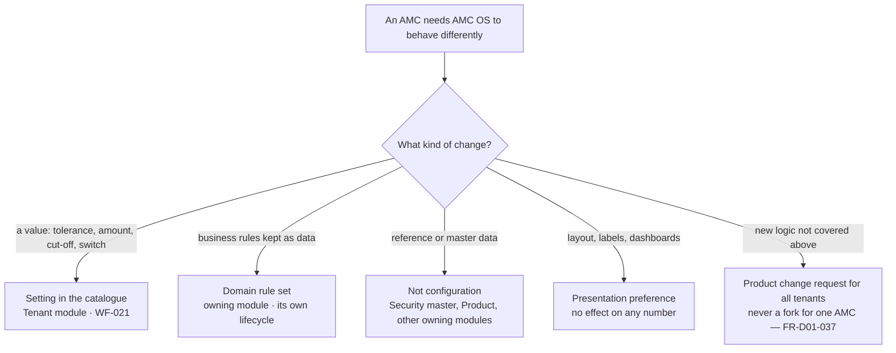
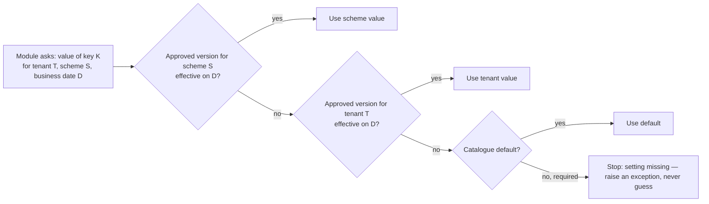
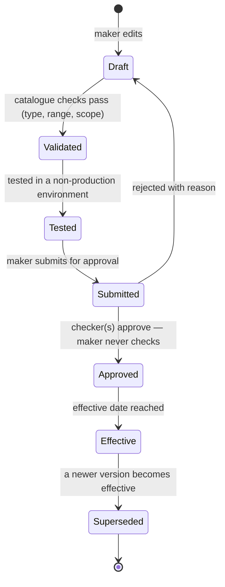

# EA-008 — Configuration over Customisation

Master prompt §3.6 says: "Support AMC-specific configuration through governed metadata and configuration systems. Avoid separate code forks for individual customers." This document designs that system: what an AMC may change, what it may never change, how a change is made, approved, dated, promoted and read, and where it is stored. It completes GOV-006 Step 11 together with [EA-003](EA-003_domain_boundaries_and_service_catalogue.md) and gives the "full design" that BA-004 WF-021 and PRD-001 §4.8 point to.

**Builds on Draft documents:** PRD-001 §4.8 (FR-D01-033…037, BRL-D01-004, BRL-D01-007), BA-004 WF-021, BA-005 (`platform.config.approve`, SOD-12), PRD-005, PRD-008, PRD-010, PRD-011, PRD-014, PRD-016, PRD-017, ADR-0017, EA-002, EA-003 — allowed by owner decision D-3. Nothing used here is Approved. Owner decisions used: D-14, D-16, D-18, D-19, D-21, D-26, D-28, D-29, D-32, D-33, D-34, D-37, D-41, D-43, D-44, D-46, D-50, D-59, D-60, D-73 ([LOOP_STATE.md](../../LOOP_STATE.md)).

**Status of every decision here:** **[DES]** unless marked otherwise. No regulatory fact is stated; where a setting is a regulatory parameter its value is never shipped by AMC OS (D-46).

**Plain-language terms**

| Term | Meaning here |
| --- | --- |
| Setting | One named value an AMC may choose, such as a price tolerance or an approval amount |
| Configuration catalogue | The product's list of every setting an AMC may change, shipped with each release (FR-D01-033) |
| Configuration version | One approved change to one or more settings, with an effective date; never edited afterwards |
| Rule set | A larger, domain-owned body of business rules kept as data (for example compliance rules or posting rules) |
| Scope | The level a value applies to: the whole tenant, or one scheme |
| Effective date | The business date from which a version applies |
| Promotion | Moving an approved configuration version from a test environment to production unchanged (FR-D01-035) |

## 1. Four kinds of variation, and one kind that is never allowed

| Kind | Examples | Owner and store | Change process |
| --- | --- | --- | --- |
| **K1 Settings** | Price and NAV tolerances (D-46); approval amounts above which a second approver is needed (D-41, D-50); age bands (D-43); maximum length of a limit exemption (D-34); escalation path for unactioned risk alerts (D-37); leftover-share rule for block splits (D-28); accounting mode and NAV mode per scheme (D-16, D-44 — a change of mode is not a plain switch: it is approved through WF-021 only together with a migration plan, EA-003 §6 point 2); who submits NAV to AMFI (D-44); assistant switch-on per AMC (D-73); tenant feature flags (FR-D01-003, CAP-D01-001 (.3)); small-team mode (D-19, D-21); cut-off times | Tenant module, `platform` schema (EA-003 T14) | WF-021: maker, checker from the owning department, plus a Compliance Officer for a regulatory parameter (SOD-12), the CTO for technical settings; small-team mode needs both an Information Security Officer and a Compliance Officer (D-21) — BA-005 `platform.config.approve` |
| **K2 Domain rule sets** | Compliance rules and versions (D08); internal risk limits (D09 inside the rule engine, D-33); posting rules (D10); valuation policy and price-source order (D11); reconciliation definitions (D12); commission and incentive structures (D14); trade-charges rate table (D06, D-29); metric definitions (D16, D-59); assistant definitions (D17, D-60) | The owning module, in its own schema (EA-003 T14) | The owning domain's lifecycle (§6), which meets the common contract of §6.1 |
| **Not tenant settings** | Module entitlements — the AMC's subscription to AMC OS (CAP-D01-006, D-14), changed by the vendor under the contract, not by the AMC; a lapsed module becomes read-only (D-26). Release toggles used by the vendor to switch unfinished features on or off for all tenants | Tenant module (entitlements); the release itself (release toggles) | Subscription management (PRD-001) and the control plane (EA-006, Step 12) — never WF-021 |
| **K3 Reference and master data** | Securities, issuers, benchmarks, counterparties (Security master); schemes and plans (Product); distributors (Distribution) | The owning module | That module's own maker-checker workflow (for example WF-041, WF-029); never treated as configuration |
| **K4 Presentation preferences** | Saved views, column choices, personal dashboards; tenant default dashboards and labels; notification channel choices | Tenant module (tenant defaults) or the user's profile | Personal: no approval. Tenant defaults: Tenant Administrator, logged in the audit trail **[DES]**. Never an input to any engine or rule |
| **Never allowed** | Code written for one AMC; scripts or formulas typed in by a tenant; a setting that changes an engine's method or rounding; removing maker-checker from a financial action; weakening segregation of duties (only SOD-03 may be switched off, and SOD-16 relaxed in small-team mode — D-18, D-19); anything touching tenant isolation, audit or the AI boundary (ADR-0008); changing compliance rules through K1 (they are K2, SOD-08) | — | A need here becomes a product change request for all tenants (FR-D01-037) |

## 2. What is fixed by the product

These stay the same for every AMC and every deployment (shared or dedicated cell — one code base, master prompt §6):

1. Engine methods, precision and rounding — set in each FE specification (Steps 20–23), versioned with the release, never a tenant setting. A tenant may choose among methods only where the FE specification lists the choice as a setting.
2. The existence of maker-checker for every financial action and the segregation-of-duties rules SOD-01…SOD-16, apart from the two exceptions above.
3. Tenant isolation, audit, encryption and the AI boundary.
4. The system-of-record facts that are not per tenant (EA-003 §6 point 1).
5. The shape of every API and event (versioned contracts); a tenant cannot add fields to them.

## 3. The configuration catalogue (K1)

Every setting is listed in the catalogue with the fields below. A setting not in the catalogue cannot be changed (FR-D01-033). The catalogue is part of each release: it is written by the product team, reviewed with the code that reads it, and loaded as product-level rows (not tenant rows).

| Field | Meaning | Example |
| --- | --- | --- |
| Key | Stable name `<domain>.<area>.<name>`, lower case, never reused | `d11.price.tolerance_day_move` |
| Owning module | The only module that reads and enforces it | Valuation |
| Owning department | The department whose checker approves a change (BA-002 DEP-nn) | DEP-07 Fund accounting and NAV |
| Data type and allowed values | Type, unit, range or list; validated against a schema before saving | Decimal percentage, 0–100 |
| Default | The value a new tenant starts with, or **none** | None — set by the AMC (D-46) |
| Required before use | If yes, the owning module stays unavailable for the tenant until a value is approved | Yes |
| Scopes allowed | Tenant only, or tenant and scheme | Tenant, scheme |
| Regulatory parameter | Yes if it is a cut-off, timeline or limit that implements a regulation; adds the Compliance Officer checker (SOD-12) | No |
| Technical setting | Yes if the CTO approves it ("A(tech config)", PRD-001 §7) | No |
| Sensitivity | Whether the value itself is confidential (shown masked in the difference view) | Normal |
| Introduced / deprecated in release | For compatibility (§9) | REL-2027.1 / — |

**Rule for regulatory values:** where a value comes from a regulation (for example a cut-off time), the catalogue entry has no default, is marked regulatory, and is set and checked by the AMC (Compliance Officer as checker). AMC OS ships no regulatory values as defaults **[DES]**, following the pattern of D-46 for tolerances; the regulatory control registry (REG-001, Step 25) links each such setting to its source.

## 4. Scopes and how a value is found

1. The most specific approved value wins: scheme, then tenant, then the catalogue default (only scopes the catalogue allows for that key).
2. Values are found **as of the business date** of the work, not the clock time: a process for a date before the effective date uses the previous version (US-D01-007, BRL-D01-007).
3. The answer always includes the configuration version ID. Engines receive the value and its version ID as inputs and record them in their run (for example the NAV run's input manifest), so any past number can be reproduced with the configuration it used (master prompt §3.2 "historical reproducibility").
4. A missing required value stops the step with an exception; it never falls back to an invented value (GOV-003 §2 rule 2).

## 5. Lifecycle of a configuration version (WF-021)

| Rule | Detail |
| --- | --- |
| Maker ≠ checker | Enforced by the Workflow module approval mechanism (EA-003 B7); checkers per §1 K1 |
| Effective date | Must be on or after the approval date. A version never applies to the past; a wrong past result is fixed by that domain's correction process (for example WF-017 NAV correction), not by back-dating configuration **[DES]** |
| History | Versions are never edited or deleted; a mistake is fixed by a new version (FR-D01-034) |
| Difference view | Any two versions can be compared, with maker, checker and effective dates (FR-D01-036) |
| Testing | A version is used in a non-production environment before promotion (FR-D01-035). What "tested" requires per kind of setting (for example a sample NAV run for a NAV tolerance) is set in QA-001's next revision |
| Promotion | The approved version moves to production unchanged, with the same version ID, as a signed bundle; the promotion is logged. Promotion between environments of one tenant runs through the control plane without carrying business data (EA-006, Step 12) |
| Events | `CONFIG_VERSION_APPROVED` and `CONFIG_VERSION_EFFECTIVE` (candidate names, EA-003 §3.1; final in EA-007) |
| Urgent changes | No separate emergency path is designed here; whether one is needed, and its controls, is left to the release and operations runbooks (Step 26) |

## 6. Domain rule sets (K2)

### 6.1 The common contract

Every rule set, whatever module owns it, must have:

1. Versions with effective dates; past versions never edited.
2. Maker-checker, with the approvers the owning PRD or an owner decision names.
3. Test cases that must pass before a version is approved, whenever the rule set changes a financial number or a control result.
4. A difference view between versions.
5. Audit of every change (EA-003 B8).
6. The version ID recorded in every result it produced (as §4 point 3).
7. Promotion between environments unchanged, as for settings.

### 6.2 Rule sets and their lifecycles

| Rule set | Owning module | Lifecycle and approvers | Source |
| --- | --- | --- | --- |
| Compliance rules and versions | Compliance | WF-034: a Compliance Officer drafts, only the CCO approves; tests must pass (SOD-08) | D-32; PRD-008 |
| Internal risk limits | Compliance (rule engine), requested by Risk | Risk team writes, CRO approves, inside the rule engine | D-33; PRD-009 |
| Posting rules | Accounting | WF-021 with maker-checker (Fund Accountant, Senior Fund Accountant); test cases before activation | FR-D10-018, BRL-D10-004 |
| Valuation policy | Valuation | Valuation Committee approval; further board or trustee approval **[VAL]** as PRD-011 says | FR-D11-016, BRL-D11-007 |
| Price-source order (source hierarchy) | Valuation | Head of Fund Accounting through WF-021; a change of order for a regulated asset class also needs the Valuation Committee | FR-D11-014, BRL-D11-007 |
| Reconciliation definitions (including the sets for Settlement, Accounting, NAV and Investor checks) | Operations stores them in `operations`; each set is written through the Operations API by people of the owning department (for example Fund Accountants for D10/D11 sets), not by the owning module calling Operations (EA-003 tiers) | Owning department's checker and the Operations Manager (`operations.recon_definition.approve`†) | PRD-012 §7 |
| Commission rates and incentive rules | Distribution | Head of Sales†, a Finance Officer or the CFO, and a Compliance Officer before the effective date | BRL-D14-005 |
| Trade-charges rate table | Execution | Operations updates, Compliance checks | D-29; EA-003 T6 |
| Metric definitions | Reporting | WF-042: Data Steward drafts, business owner approves; Compliance also for regulatory metrics | D-59 |
| Assistant definitions and versions | AI | WF-043: business owner, CTO and Information Security Officer approve; Risk Manager validates | D-60; FR-D17-024 |

† Not yet in BA-005 (a role or a right waiting for the next BA-005 revision; LOOP_STATE "BA-005 changes waiting").

## 7. How modules read configuration

1. Each module reads only its own settings, through one shared configuration client library offered by the Tenant module (EA-003 §3.1). No module reads `platform` configuration tables directly.
2. The client caches resolved values in the cache of ADR-0017 with the tenant prefix; a cached value is dropped when `CONFIG_VERSION_EFFECTIVE` or `CONFIG_VERSION_APPROVED` arrives for that key. The time-to-live is set in DBE-002 (ADR-0017 Decision 6). The cache is never the source of truth: an engine run reads the value with its version ID from the Tenant module and records both (§4 point 3).
3. A module that needs a value at a fixed point (for example the NAV cut-off for a date) reads it once at the start of the run and keeps it for the whole run, so a change approved mid-run does not split one run across two versions.
4. Rule sets (K2) are read by their owning module from its own schema, in the same way.

## 8. Storage (answers PRD-001 C6)

Settings live in the `platform` schema, owned by the Tenant module; no separate `config` schema is created (EA-003 T14). Proposed tables for DA-001 / Step 16 (names indicative):

| Table (proposed) | Rows | Tenant-scoped? |
| --- | --- | --- |
| `platform.config_item` | The catalogue (§3), loaded per release | No — product-level rows; DA-000 Ch 2 already makes `platform` the only schema allowed to hold non-tenant rows |
| `platform.config_version` | One row per configuration version: maker, checker, approval reference, state, effective date, promotion record | Yes (forced RLS) |
| `platform.config_value` | Value per key, scope (tenant or scheme ID) and version | Yes (forced RLS) |
| `platform.config_promotion` | Each promotion between environments: bundle hash, source and target environment, time | Yes (forced RLS) |

Rule-set tables stay in their owning schemas, as listed in each PRD's §10.

## 9. Releases and compatibility

1. A new setting arrives with a release, with a default or marked "required"; if required, the onboarding checklist shows it as missing for every tenant that has the module.
2. A setting is removed only after one release in which it is marked deprecated and ignored; its versions stay in history.
3. A release that changes the meaning or allowed values of an existing setting includes a migration of existing values, tested in the release gates (GOV-004).
4. Shared and dedicated cells use the same catalogue and the same code; a dedicated cell never gets settings the shared cells cannot have (master prompt §6).

## 10. What an AMC can ask for that is not configuration

| Request | Answer |
| --- | --- |
| "Add a field to the scheme record" | A product change for all tenants (FR-D01-037). Whether tenants may add their own free tags or attributes for reporting only, never used by engines or rules, is owner question Q68; until answered, no tenant-defined fields exist |
| "Add an extra approver above the minimum" | Allowed where the catalogue offers the approval chain as a setting; never fewer approvers than the product minimum |
| "Change how NAV or commission is calculated" | Only where the FE specification offers a choice as a setting; otherwise a product change |
| "Our own report layout" | K4 presentation, or a report built on Reporting's certified datasets |
| "Connect our in-house system" | An integration adapter through INT-001 (Step 14), offered to all tenants who use the same system |

## 11. Gaps and open points

| # | Gap | Closed by |
| --- | --- | --- |
| G1 | No catalogue entries exist yet; each module's settings are listed when its specification is written (FE specs, API contracts) | Steps 20–24 |
| G2 | What "tested" means per kind of setting before promotion | QA-001 next revision |
| G3 | Urgent configuration change path, if any | Release and operations runbooks (Step 26) |
| G4 | Tenant-defined tags or attributes | Owner question Q68 |
| G5 | Promotion mechanics across the control plane | EA-006 (Step 12) |
| G6 | Cache time-to-live for configuration | DBE-002 (Step 19) |

## Sources

| # | Source | Used for |
| --- | --- | --- |
| S1 | [MASTER_BUILD_PROMPT.md](../../MASTER_BUILD_PROMPT.md) §3.2, §3.6, §6 | Principle; reproducibility; one code base |
| S2 | [PRD-001](../03_product_requirements/PRD-001_platform_administration.md) §4.8, BRL-D01-004, BRL-D01-007, US-D01-007, C6 | Catalogue, versions, promotion, difference view, no forks |
| S3 | [BA-004](../02_business_architecture/BA-004_end_to_end_workflows.md) WF-021 | Configuration change workflow |
| S4 | [BA-005](../02_business_architecture/BA-005_roles_and_permissions.md) `platform.config.approve`, SOD-08, SOD-12 | Approvers |
| S5 | [PRD-008](../03_product_requirements/PRD-008_compliance_management.md), [PRD-010](../03_product_requirements/PRD-010_fund_accounting.md), [PRD-011](../03_product_requirements/PRD-011_valuation_and_nav.md), [PRD-014](../03_product_requirements/PRD-014_distribution_management.md), [PRD-016](../03_product_requirements/PRD-016_enterprise_data_platform.md), [PRD-017](../03_product_requirements/PRD-017_ai_and_decision_intelligence.md) | Rule sets and their approvers |
| S6 | [ADR-0017](../../architecture/adrs/ADR-0017_cache.md) | Cache rules |
| S7 | [EA-003](EA-003_domain_boundaries_and_service_catalogue.md) | Module ownership (T14), boundary rules |
| S8 | [LOOP_STATE.md](../../LOOP_STATE.md) owner decisions | Decisions listed in the header |
