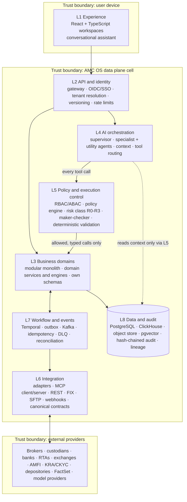
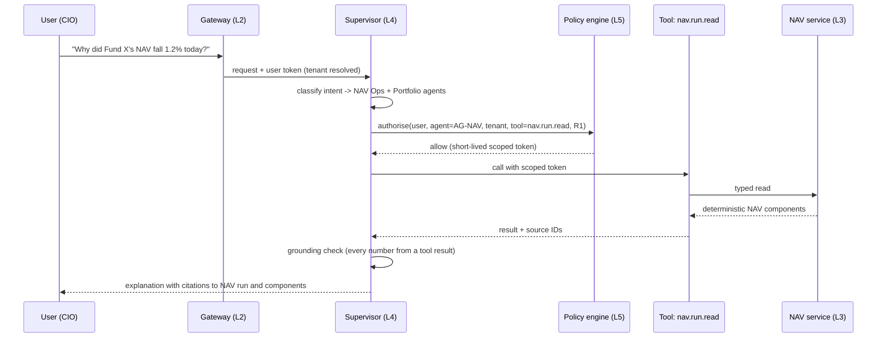
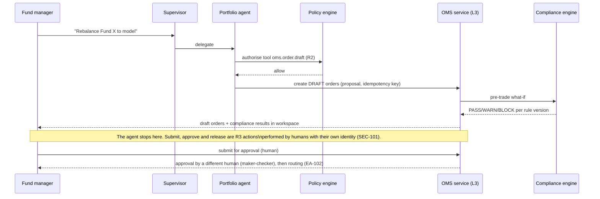

# EA-100 — AI Orchestration Architecture (Proposal)

> **Status: PROPOSAL.** This document and its companions (§10) were requested by the project owner on 20 Nov 2026 ahead of the planned sequence. WP3 (GOV-006 Steps 10–14) depends on WP2 (Steps 2–9: capability map, operating model, workflows, roles, per-domain PRDs), which is not yet written. Nothing here is complete or approved. When Steps 10–14 run, they must reconcile this proposal with the approved WP2 output and either adopt, change or reject each part through the normal review and approval route.

AMC OS is proposed as an **AI-native orchestration layer**: one governed interface that coordinates an AMC's existing systems, vendors and people, with deterministic services and human approval in front of every financial action. Where an AMC has no suitable system, AMC OS's own deterministic engines can be the system of record for that domain.

**Plain-language terms used in this set**

| Term | Meaning |
| --- | --- |
| System of record (SoR) | The one system whose copy of a piece of data is the official truth |
| Projection | A read-only copy of data taken from another system, stamped with where and when it came from |
| MCP (Model Context Protocol) | An open standard that lets AI assistants call tools and data sources in a uniform way |
| Agent | An AI assistant with a defined job, a fixed list of tools and limited permissions |
| Tool | A controlled function an agent may call, e.g. "read positions"; it wraps a normal, tested API |
| RBAC / ABAC | Permissions by role (RBAC) and by attributes such as scheme, desk or data sensitivity (ABAC) |
| Policy engine (e.g. Open Policy Agent, OPA) | One central service that answers "is this allowed?" using written, versioned rules |
| Control plane / data plane | The operator's management layer vs the place where each AMC's data and processing live |
| Maker-checker | One person prepares, a different person approves |

## 1. Repository inspection (20 Nov 2026, 00:10 IST)

| Item | Finding |
| --- | --- |
| Phase | Documentation programme (master prompt §22); no production code |
| Active work | WP2, GOV-006 Step 2 (BA-001 capability map) is the build loop's next action; loop run due 00:23 IST |
| Chain waiting for owner | `wp2-step01b-review-fixes` → `gov-cr0001-merge-protocol` (both unmerged; owner-only files) |
| Open pull requests | None |
| Approved documents | **None.** Every document, including ADR-0001–0008, is Draft (GOV-001 §7) |
| Relevant existing decisions (Draft) | ADR-0002 modular monolith · ADR-0003 multi-tenancy and cells · ADR-0004 Python/FastAPI/SQLAlchemy/Alembic/PostgreSQL · ADR-0005 decimal money · ADR-0006 outbox + Kafka + Temporal · ADR-0007 PostgreSQL/ClickHouse/S3/pgvector/Polars · ADR-0008 AI reads, explains, proposes; never approves, posts, publishes or executes |
| Capability map | Not yet written (Step 2) |
| Database contracts | DDL-000 v0.9 reference schema (67 tables + 19 partitions), DBT-000 tests |
| API / event contracts | None yet (`contracts/` empty) |

## 2. Conflicts and how this proposal treats them

| # | Conflict | Existing position | This proposal | Resolution route |
| --- | --- | --- | --- | --- |
| C1 | **Positioning** | PS-001/PS-002 and master prompt §2 objective 2: a complete platform that *replaces* fragmented systems | Orchestration layer that *integrates* existing systems; own engines where useful | ADR-0009 (Draft) sets out options A (replace), B (orchestrate only) and C (orchestrate first, own engines per tenant and per domain via EA-101) and recommends C. **Owner decision OD-1** |
| C2 | **System of record for accounting and NAV** | PRD-000 Modules 08/09 and DDL-000 make AMC OS the scheme ledger and NAV publisher | External accounting platform and NAV authority are system of record by default; AMC OS keeps projections, shadow calculations and reconciliation | EA-101 modes; ADR-0009. **Owner decision OD-2** |
| C3 | **Customer scale** | GOV-006 Q1: design capacity 50 AMCs; commercial target 1 pilot → 3–5 | "20–50 AMC customers initially" | Treated as design capacity (consistent with Q1); commercial target unchanged unless owner revisits Q1. **Owner decision OD-3** |
| C4 | **Agent list** | PRD-000 §9.3: 11 agents; master prompt §4 D17: 11 copilots/assistants plus a RAG knowledge system | 1 supervisor + 13 specialists + 7 utility agents | Mapping in AIML-100 §5; PRD-000 "Product Intelligence Agent" has no counterpart (OD-9) |
| C5 | **Layers** | Master prompt §5: 7 layers | 8 layers (adds AI orchestration and policy/execution control as separate layers; AI platform folds into them) | Mapping in §3 below; no capability lost |
| C6 | **New technology** | No ADR for API gateway, policy engine, LangGraph or MCP | Kong-or-equivalent, OPA-or-equivalent, LangGraph, official MCP SDKs | Proposed ADR-0010 (LangGraph), ADR-0011 (MCP), ADR-0012 (policy engine), ADR-0015 (product choices) — all Draft; EA-106 evaluation |
| C7 | **Sequencing** | WP3 starts after WP2 | Architecture written now | Marked PROPOSAL; branch `proposal/…` excluded from the build loop |
| C8 | **Commercial claim** "20–50 AMCs initially" vs ~51 AMCs in India (PS-003) | — | Kept as capacity, not a sales forecast | OD-3 |
| C9 | **Agent registry shape** | DDL-000 `ai.agent`: per-tenant table, key `(tenant_id, agent_code)`, codes like `RESEARCH_AGENT`, risk tier LOW/MEDIUM/HIGH | Global agent definitions (control plane) + per-tenant enablement; IDs `AG-*` | Proposed for WP4: a global, versioned `ai.agent_definition` + `ai.agent` kept as per-tenant enablement with its own service identity; one ID format chosen in WP4; risk tier mapped to R0–R2. **Decision OD-10** |
| C10 | **Workspaces** | Master prompt §5 L1: 12 separate experiences incl. **Fund accounting** and **NAV operations** separately | Owner brief: 12 workspaces with one "NAV and Accounting Desk" and an "Enterprise AI Assistant" | EA-104 shows both options. **Owner decision OD-11** |
| C11 | **Order state machine** | DDL-000 `trading.order_state_transition` (30 transitions) | All kept; adds UNKNOWN_SUBMISSION, UNKNOWN_CANCEL, MANUAL_INVESTIGATION | EA-102 §2.1; WP4 migration |
| C12 | **Model fallback** | PRD-000 §9.2: each agent pinned to a model version | Optional fallback model | Allowed only as a separately evaluated, pinned version (AIML-101) |
| C13 | **Data stores** | ADR-0007: pgvector on a separate PostgreSQL cluster; ClickHouse in the store set | Same; EA-106 only *suggests* re-opening ClickHouse timing | Any change only through a new ADR in Step 10 |

No Approved decision is overridden, because none exists. Where this proposal departs from a Draft, the departure is named here and in the ADR concerned.

## 3. Eight logical layers

| Layer | Responsibilities | Key interfaces | Maps to master prompt §5 |
| --- | --- | --- | --- |
| L1 Experience | 12 role workspaces (EA-104), dashboards, conversational assistant; never computes money | REST/JSON via gateway; server-sent events for agent progress | L1 |
| L2 API & identity | Gateway, OIDC/SSO, MFA, tenant resolution **from token only**, API versioning (`/v1`), per-tenant rate limits, request validation, correlation IDs | OpenAPI contracts; token exchange for agents (SEC-100) | L2 |
| L3 Business domains | 22 domain modules (ADR-0002); deterministic engines FE-01…FE-10; single writer per schema | Domain service interfaces; events | L3, L5 |
| L4 AI orchestration | Supervisor, 13 specialists, 7 utilities (AIML-100); context assembly; tool selection from registry | Calls tools only through L5 | L7 (part) |
| L5 Policy & execution control | Four-dimension authorisation, policy engine, R0–R3 risk classes, approvals, deterministic pre-execution validation | Policy decision API; approval workflow | L2 (authZ) + L7 (human approval) |
| L6 Integration | One adapter per provider and interface version; MCP client for vendor MCP servers; MCP server exposing AMC OS tools to approved clients | Canonical contracts in `contracts/schemas` | §10 of master prompt |
| L7 Workflow & events | Durable workflows (Temporal), outbox, Kafka where justified, idempotent consumers, retries, DLQ, reconciliation jobs | Event catalogue (`contracts/events`, WP3 Step 13) | L4 |
| L8 Data & audit | Transactions, analytics, documents, vectors, immutable audit, lineage, observability | Owned by L3 modules and the data platform | L6 |

## 4. Trust boundaries and rules

1. **Device → gateway:** only authenticated users; tenant comes from the token, never from request parameters.
2. **Agent → anything:** an agent holds no database connection and no vendor credential. It can only call registered tools (AIML-102) through the policy layer, with a short-lived token scoped to *user ∩ agent ∩ tenant ∩ tool* (SEC-100).
3. **Data plane → control plane:** the control plane sees metadata, never customer financial data (EA-103).
4. **AMC OS → providers:** each adapter holds its tenant's credentials in the secrets manager; responses are validated against canonical schemas before use (INT-100).
5. **Model provider boundary:** prompts leave the cell only through the AI gateway with data classification checks and redaction (SEC-100 §6); no tenant data is used for model training **[VAL — contract]**.

## 5. Major data flows

### 5.1 Conversational question → governed answer

### 5.2 Agent-prepared order → human-executed order (R3)

## 6. Quality attributes (how each is addressed)

| Attribute | Approach | Document |
| --- | --- | --- |
| Multi-tenancy | Tenant from identity; RLS; composite keys; tenant-scoped tools, prompts, vectors, caches, credentials | ADR-0003, SEC-100 |
| Security and privacy | Four-dimension authorisation; R0–R3; injection defences; masking; short-lived credentials | SEC-100 |
| Financial integrity | Deterministic services; NUMERIC; maker-checker; agents cannot execute R3 | ADR-0005, SEC-101 |
| Auditability | Hash-chained audit; full agent trace; tool-call log | AIML-103 |
| Scalability | Cells; stateless agent runtime; horizontal workers | EA-103 |
| Reliability | Temporal; idempotency; unknown-outcome handling; DLQ | EA-102, EA-105 |
| Extensibility | Agent and tool registries; adapters; MCP | AIML-101, AIML-102, INT-100 |
| Vendor independence | Model abstraction in AI gateway; adapters behind canonical contracts | INT-100, ADR-0014 |
| API-first | Every tool wraps a documented domain API | AIML-102 |
| Configurability | Per-tenant SoR registry, workspaces, policies, agent enablement | EA-101, EA-104 |
| Observability | OpenTelemetry traces across user → agent → tool → service → provider | AIML-103 |
| Disaster recovery | Cell-level RPO/RTO, per-tenant restore | EA-103 |
| Performance | Read paths cached; AI never on the synchronous path of a financial transaction | EA-105 |
| Cost efficiency | Logical agents in one runtime; per-tenant AI budgets; smallest technology set | AIML-100, EA-106 |
| Regulatory controls | Rules as versioned data; AI may propose rule changes only | ADR-0008, SEC-101 |

## 7. Unresolved decisions (not invented here)

| # | Decision needed | Options | Owner |
| --- | --- | --- | --- |
| OD-1 | Positioning: orchestration-first, platform-first, or both per tenant | ADR-0009 | Project owner |
| OD-2 | Default system of record for accounting and NAV per deployment | EA-101 modes O / S / E | Project owner + pilot AMC |
| OD-3 | "20–50 AMCs initially": capacity target or commercial target | GOV-006 Q1 | Project owner |
| OD-4 | Model providers and India data residency for prompts | AI gateway configuration | CTO + compliance **[VAL]** |
| OD-5 | API gateway product | ADR-0015 | ARB |
| OD-6 | Policy engine product | ADR-0015 | ARB |
| OD-7 | Kafka from day one or in-process events first | ADR-0006 (already "where justified") | ARB |
| OD-8 | Whether AMC OS exposes an MCP server to external AI clients in v1 | INT-100 §3 | Project owner |
| OD-9 | Agent for D02 Product and Scheme (missing in the 13) | AIML-100 §4 | Project owner |
| OD-10 | Agent registry: global definitions + per-tenant enablement (C9) | AIML-101 | ARB |
| OD-11 | Workspaces: owner's 12 or the master prompt's 12 experiences (C10) | EA-104 | Project owner |
| OD-12 | Emergency disable of AI by one person (exception to maker-checker) | SEC-100 §7 | Project owner + CISO |

## 8. Dependencies

| This proposal needs | From | Status |
| --- | --- | --- |
| Capability map (L1–L3 capabilities per domain) | BA-001, Step 2 | Not started |
| Roles and permissions re-keyed | BA-005, Step 5 | Not started |
| Workflows WF-xxx re-keyed | BA-004, Step 4 | Not started |
| Per-domain PRDs | PRD-001…017, Steps 6–9 | Not started |
| Event catalogue | Step 13 | Not started |
| Engine specs FE-01…FE-10 | Steps 20–23 | Not started |

## 9. Recommended next step

Merge the waiting chain, let the loop finish WP2 Steps 2–5, then run GOV-006 Steps 10–14 with this proposal as input. The first implementation increment (platform foundation, owner decision Q4) should include the policy engine, tool registry and audit trace skeleton, because every later agent depends on them.

## 10. Document set of this proposal

| ID | Title |
| --- | --- |
| EA-100 | This overview |
| [EA-101](EA-101_system_of_record_registry.md) | System-of-record registry |
| [EA-102](EA-102_transaction_orchestration.md) | Transaction orchestration |
| [EA-103](EA-103_hybrid_deployment_control_and_data_plane.md) | Hybrid deployment, control plane and data plane |
| [EA-104](EA-104_product_suites_and_workspaces.md) | Product suites and workspaces |
| [EA-105](EA-105_failure_handling_and_recovery.md) | Failure handling and recovery |
| [EA-106](EA-106_technology_evaluation.md) | Technology evaluation |
| [AIML-100](../09_ai_and_ml/AIML-100_agent_hierarchy_and_supervisor.md) | Agent hierarchy, supervisor, domain-to-agent matrix |
| [AIML-101](../09_ai_and_ml/AIML-101_agent_registry_specification.md) | Agent registry specification |
| [AIML-102](../09_ai_and_ml/AIML-102_tool_registry_specification.md) | Tool registry specification |
| [AIML-103](../09_ai_and_ml/AIML-103_ai_observability_and_audit.md) | AI observability and audit |
| [INT-100](../07_api_and_integrations/INT-100_mcp_and_integration_architecture.md) | MCP and integration architecture |
| [SEC-100](../10_security_and_regulatory/SEC-100_ai_security_and_permission_model.md) | AI security and permission model |
| [SEC-101](../10_security_and_regulatory/SEC-101_human_in_the_loop_execution.md) | Human-in-the-loop execution |
| [DA-100](../05_data_architecture/DA-100_data_and_decision_intelligence.md) | Data and decision intelligence |
| [TRACE-003](../00_governance/TRACE-003_ai_orchestration_traceability.md) | Traceability for this proposal |
| ADR-0009 … ADR-0015 | Proposed decisions (`architecture/adrs/`) |
