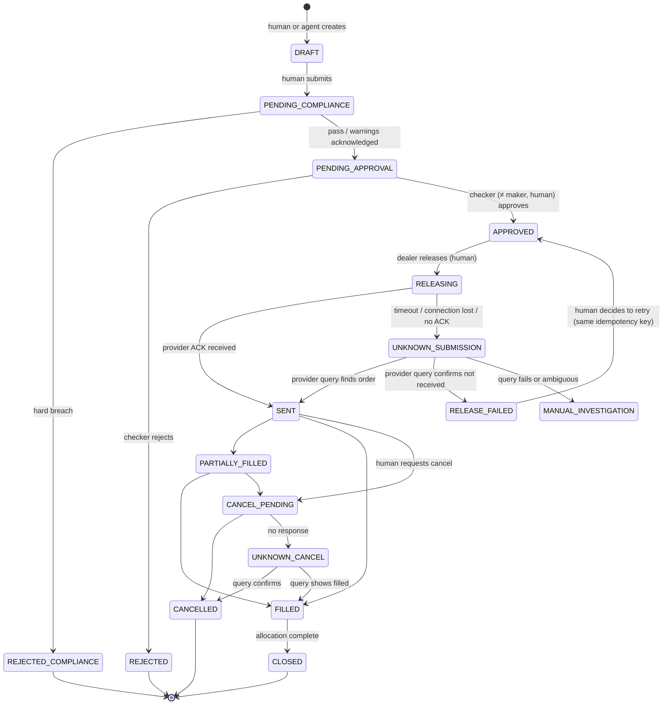

# EA-102 — Transaction Orchestration (Proposal)

> **PROPOSAL** — part of the [EA-100](EA-100_ai_orchestration_architecture_proposal.md) set. Not approved. State names below are proposals; DDL-000 currently has a single order state machine (`trading.order_state_transition`), which WP4 would extend.

## 1. Principles

1. AI may **prepare** a transaction (draft). Only humans **submit, approve and release** it (SEC-101).
2. Deterministic validation runs before every state change that leaves AMC OS.
3. Every outbound instruction has an **idempotency key** and a **client reference** that the provider echoes back.
4. If AMC OS does not know whether a provider received an instruction, the state is **UNKNOWN**. From UNKNOWN the only allowed action is **query the provider**. Blind resubmission is forbidden.
5. Order, execution, confirmation and settlement are separate records with separate lifecycles and separate systems of record (EA-101).

## 2. Order lifecycle (AMC OS is SoR)

## 3. Execution, confirmation and settlement lifecycles (external SoR; AMC OS tracks)

| Lifecycle | States tracked by AMC OS | Source of truth | Driven by |
| --- | --- | --- | --- |
| Execution | RECEIVED_FILL · CORRECTED · BUSTED | Broker / exchange | FIX execution reports or broker files **[VAL per broker]** |
| Confirmation | AWAITING_CONFIRM · CONFIRMED · MISMATCH · AFFIRMED | Broker / custodian | Contract notes, custodian affirmation |
| Settlement | INSTRUCTED · PENDING · SETTLED · FAILED · PARTIALLY_SETTLED | Custodian / bank / clearing | Custodian status files or APIs **[VAL per custodian]** |

A fill never changes the order's approval history. A busted or corrected fill creates a new execution record; the old one is kept (insert-only).

## 4. Unknown-outcome procedure (all providers)

1. Mark the instruction `UNKNOWN_*`; freeze any automatic retry.
2. Run the provider's **status query** (order book, status API or file, as the provider supports) using the client reference.
3. Found → adopt the provider's state. Confirmed not received → `*_FAILED`; a human may retry with the **same** idempotency key. Ambiguous → `MANUAL_INVESTIGATION` with an alert to the dealer desk and operations.
4. Every step is audited with correlation ID.
5. If the provider offers no status query, the integration spec must say so and name the manual procedure; such a provider cannot be used for automated release **[VAL]**.

## 5. Same pattern for non-trade instructions

| Instruction | Provider | Unknown-outcome query |
| --- | --- | --- |
| Payment / fund transfer | Bank | Bank status enquiry by client reference **[VAL per bank]** |
| Settlement instruction | Custodian | Custodian instruction status **[VAL]** |
| Investor transaction push (if ever allowed) | RTA | RTA status report **[VAL]** |
| NAV file submission | AMFI (human-submitted) | Human checks AMFI portal |

## 6. Workflow implementation (proposed)

Each lifecycle runs as a durable Temporal workflow (ADR-0006); activities that call providers are idempotent and record request and response; retries apply only to *safe* calls (reads, status queries). Release activities are **not retried automatically**; failure moves to UNKNOWN.

## 7. Open items

- Which brokers support FIX vs file vs API for Indian AMC dealing desks — to be confirmed per pilot AMC (INT-100 §6).
- Whether partial-fill allocation is done in AMC OS or at the broker (WP2 dealing workflow).
