# EA-103 — Hybrid Deployment, Control Plane and Data Plane (Proposal)

> **PROPOSAL** — part of the [EA-100](EA-100_ai_orchestration_architecture_proposal.md) set. Builds on ADR-0003 (multi-tenancy and cells, Draft). Cloud provider and region are open (owner question Q5); nothing here assumes a provider.

## 1. One codebase, three deployment models

| Model | What the AMC gets | Isolation | When to use |
| --- | --- | --- | --- |
| **Shared cell** | Tenant in a shared data-plane cell with other AMCs | Logical: RLS, composite keys, per-tenant keys and credentials, per-tenant vector namespaces | Smaller AMCs; lowest cost |
| **Dedicated cell** | Own data-plane cell (own database cluster, workers, AI runtime) in AMC OS's cloud account | Physical per tenant | Larger AMCs, stricter risk appetite |
| **Dedicated in customer account** | Data-plane cell deployed in the AMC's own cloud account | Physical + account boundary | AMCs requiring data in their own account **[VAL — customer policy]** |

All three run the **same release artefacts** (same container images, same migrations); differences are configuration only (ADR-0002, master prompt §3.6). A tenant can move from shared to dedicated by a documented migration (export → restore → cut-over) without code change.

## 2. Control plane vs data plane

```mermaid
flowchart LR
  subgraph CP[Control plane — AMC OS operator]
    TR[Tenant registry\nplan, cell, region, feature flags]
    REL[Release and upgrade orchestration]
    REG["Agent and tool registry\n(definitions, not data)"]
    POL["Policy bundles\n(signed, versioned)"]
    OBS["Fleet health\n(metrics, no financial payloads)"]
    BILL[Usage metering]
  end
  subgraph DP1[Data plane — shared cell]
    A1[App + agents + workflows]
    D1[(Tenant data)]
  end
  subgraph DP2[Data plane — dedicated cell]
    A2[App + agents + workflows]
    D2[(Tenant data)]
  end
  CP -- signed config, releases, policy bundles --> DP1
  CP -- signed config, releases, policy bundles --> DP2
  DP1 -- "metrics, health, usage counts (no customer financial data)" --> CP
  DP2 -- metrics, health, usage counts --> CP
```

| Rule | Detail |
| --- | --- |
| CPR-1 | The control plane **never stores customer financial data and has no standing access to it** (ADR-0003). It holds tenant metadata, configuration, release state, definitions and aggregate telemetry only. The only exception is time-boxed break-glass support access under CPR-4, which happens inside the data plane. |
| CPR-2 | Data flows CP → DP as **signed, versioned artefacts** (config, policy bundles, registry definitions). The data plane verifies signatures before applying. |
| CPR-3 | DP → CP telemetry is filtered at source: no prompts, no tool payloads, no investor PII, no positions or prices. Traces sent to the fleet view carry IDs and timings only. |
| CPR-4 | Operator access to a data plane (support) is **break-glass**: time-boxed, ticket-linked, approved by the tenant's admin where contract requires, fully audited, read-only by default. |
| CPR-5 | Each data-plane cell holds its own secrets, encryption keys (per tenant in shared cells) and audit chain. |
| CPR-6 | The data plane keeps running if the control plane is unavailable; only upgrades, onboarding and config changes pause. |

## 3. Cells

- A cell = one complete data-plane stack in one region. Proposed shared-cell size: up to ~10 tenants **[ASSUMPTION — confirm by capacity test (QA lead, WP6)]**.
- For 20–50 AMCs (design capacity, EA-100 C3) at ~10 tenants per cell: 2–5 shared cells, plus one spare cell for headroom and any dedicated cells.
- Blast radius: an incident or bad release affects one cell; releases roll out cell by cell (canary cell first).

## 4. Upgrades

1. Release built once; migrations backward-compatible (expand → migrate → contract).
2. Order: internal test cell → canary shared cell → remaining shared cells → dedicated cells per customer change window.
3. Agent, prompt, model and tool versions are part of the release manifest; a tenant can pin an agent version for one release cycle where validation requires **[DES]**.
4. Rollback: application roll-back by image; database by forward-fix only (no destructive down-migrations on financial tables).

## 5. Backup and disaster recovery

| Item | Proposal | Status |
| --- | --- | --- |
| RPO / RTO targets | Per tier, set with pilot AMC and in line with SEBI cyber-security and resilience requirements **[VAL — Compliance to confirm which SEBI CSCRF provisions apply to AMCs and their targets]** | Open |
| Database | Continuous WAL archiving + daily snapshots, cross-region copy | Proposal |
| Per-tenant restore | Supported in dedicated cells; in shared cells via logical export by tenant_id **[DES]** | Proposal; test in WP6 |
| Audit chain | Backed up with integrity hash verification on restore | Proposal |
| DR drills | Quarterly per cell, results recorded (GOV-004 §4) | Aligned |
| Data residency | India regions for all tenant data **[VAL — Compliance and legal to confirm against SEBI requirements and customer contracts]** | Open (Q5) |

## 6. Open items

- Q5 cloud provider and region; key management service choice.
- Whether AI model inference must stay in India (OD-4).
- Contractual terms for operator break-glass access.
