# AMC OS — Database Architecture

Nov 19, 2026 · @Suchit

PostgreSQL is the system of record for every financial transaction, isolated per tenant with row-level security, with a columnar warehouse, an Iceberg data lake, an event log and a per-tenant vector store around it. This is Deliverable Two; it pairs with the AMC OS PRD.

## Chapter 1 — Database Architecture Overview

Eight storage technologies, each with one job. Money is only ever written in PostgreSQL; every other store is derived from it or holds things PostgreSQL is bad at (large files, scans of billions of rows, vectors).

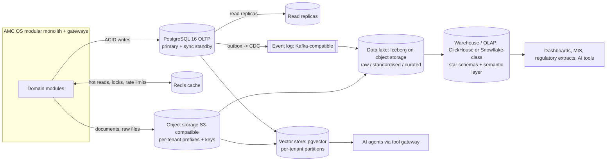

| Store | Technology (recommended) | What lives there | Why it is needed | Why not just PostgreSQL? |
| --- | --- | --- | --- | --- |
| Transactional DB (system of record) | PostgreSQL 16+ (managed, India region), Patroni or cloud HA | Orders, trades, settlements, journals, NAV runs, investor transactions, rules, workflow, audit | ACID transactions, constraints, RLS, mature tooling; financial correctness | — (this is the core) |
| Read replicas | PostgreSQL streaming replicas | Read-heavy screens, exports, reconstruction jobs | Offload primary; isolate heavy reads | Same engine, different role |
| Analytical database | ClickHouse (self-managed) or a cloud warehouse | Daily holdings history, AUM, sales facts, risk time series, billions of rows | Columnar scans 10–100× faster for aggregates; cheap storage | Row store is slow for wide scans over years of history and would compete with OLTP |
| Data lake | Apache Iceberg tables on object storage (Parquet) | Raw inbound files, CDC history, curated canonical tables with time travel | Immutable raw evidence; replay; cheap long retention; open format | Storing raw files and full history in OLTP bloats it and backups |
| Data warehouse | Star schemas inside the analytical DB, built from Iceberg curated zone by dbt | Facts and conformed dimensions; metric registry outputs | One governed model for MIS, regulatory reports, AI | Modelled for queries, not transactions |
| Object storage | S3-compatible, India region, SSE-KMS with per-tenant keys | SIDs, research PDFs, contract notes, statements, evidence packs, exports, backups | Large binary files, lifecycle policies, WORM (object lock) for evidence | Large objects in DB hurt performance and backups |
| Vector database | pgvector in a dedicated PostgreSQL cluster (or Qdrant/Weaviate namespaces) | Embeddings of documents, circulars, research, notes | Semantic search for RAG | pgvector *is* PostgreSQL — kept on a separate cluster so AI load cannot hurt OLTP |
| Event storage | Kafka-compatible log (MSK/Redpanda), 7–30 day retention + archive to lake | Domain events from transactional outbox; CDC streams | Decoupled modules, replayable integration, real-time analytics | DB is not a message bus; outbox table bridges the two safely |
| Cache | Redis (cluster mode, TLS, per-tenant key prefixes) | Session data, security master hot set, restricted list, rate limits, idempotency keys (short TTL), distributed locks for jobs | Sub-millisecond reads for pre-trade path | Never the source of truth; always rebuildable from PostgreSQL |

**Design principles carried through every chapter:**

1. **Single writer per table.** Exactly one module (service) writes each table (Chapter 2).
2. **Transactional outbox.** A module writes its business row and its event row in the same PostgreSQL transaction; a relay publishes the event. No dual-write inconsistency.
3. **Append-only finance.** Journals, executions, NAV results, audit events and investor transactions are insert-only; corrections are reversals or new versions.
4. **Bi-temporal where history matters.** `valid_from / valid_to` (business time) plus `recorded_at` (system time) on master and rule data, so the system can answer "what did we believe on date X about date Y".
5. **Tenant first.** `tenant_id` is the leading column of every tenant table's primary key and indexes, and RLS is forced on every tenant table.

## Chapter 2 — Database Domain Boundaries

Twenty-three PostgreSQL schemas, one per domain. Each schema has exactly one owning module with write rights; other modules read through that module's API or subscribe to its events. In the initial modular monolith all schemas sit in one database cluster, but each module connects with its own database role that can write only its own schema — so boundaries are enforced by grants, not by discipline. Splitting a module into a separate service later is a matter of moving its schema.

| Schema | Owning module / service | Holds | Cross-schema reads allowed (by grant) | Why it is separate |
| --- | --- | --- | --- | --- |
| `platform` | Platform core | Tenants, tenant settings, plans, feature flags, business calendars, outbox, idempotency keys | All (read tenant & calendar) | Global control plane; only schema with non-tenant rows |
| `identity` | Identity & Access | Users, roles, permissions, role grants, scope attributes, sessions, API clients | Workflow, audit | Security-critical; tight grants |
| `master` | Master Data service | Security, issuer, issuer group, ratings, benchmarks, indices, counterparties, currencies, categories | All (read) | Shared golden data; one steward process |
| `product` | Product & Scheme | Schemes, versions, plans, options, fees, loads, mandates, NFOs | Most (read) | Scheme is the anchor of everything else |
| `investment` | Investment Mgmt | Research notes, recommendations, universe, restricted list, IC meetings, decisions | OMS, compliance | Research IP, different access pattern |
| `portfolio` | Portfolio Mgmt | Position lots, intraday positions, targets, models, snapshots, cash ladder | Risk, compliance, NAV | Derived book with its own invariants |
| `trading` | OMS | Orders, order versions, order events, blocks, allocations, approvals | Settlement, compliance | Order lifecycle state machine |
| `execution` | Execution Gateway | Broker sessions, raw FIX messages, executions (fills) | OMS | High write rate; raw message retention |
| `settlement` | Trading & Settlement | Trades, contract notes, settlement instructions/status, fails, corporate actions, SSIs | Accounting, portfolio, ops | Counterparty-facing; SSI security |
| `compliance` | Compliance | Regulation register, rules, versions, parameters, tests, check runs, results, breaches, exceptions | Risk, OMS (results) | Rule-as-data; evidence |
| `risk` | Risk | Models, model versions, risk runs, metric results (summary), scenarios, stress results | Finance, AI | Model governance |
| `accounting` | Fund Accounting | COA, periods, posting rules, journal batches, journal lines, accrual runs, balances | NAV, finance | Double-entry integrity |
| `valuation` | Valuation | Prices, price sources, curves, overrides, valuation results | NAV, portfolio, risk | Price governance separated from NAV approval |
| `nav` | NAV | NAV runs, components, validations, results, publications, corrections | Investor, finance, distribution | Most visible output; strict MC |
| `operations` | Fund Operations | Connections, inbound/outbound file register, recon definitions, runs, breaks, exceptions, day-close | All ops-related | Integration and exception plumbing |
| `investor` | Investor Mgmt | Investors (PII), folios, holders, nominees, bank mandates, transactions, unit lots, SIPs, service requests, complaints | Distribution (masked), finance (aggregates) | PII isolation; heaviest volumes |
| `distribution` | Distribution | Distributors, ARN/EUIN, hierarchy, RM/branch mapping, commission structures, runs, payouts | Finance | Commission correctness; effective-dated mapping |
| `finance` | Finance & MIS | Allocation keys, budgets, forecasts, management P&L results | Analytics | CFO-owned methodology |
| `workflow` | Workflow engine | Workflow definitions, instances, tasks, approvals (generic maker-checker) | All (via API) | One approval mechanism for every module |
| `documents` | Document service | Document metadata, versions, object-store keys, retention class | All (read metadata) | Binary content in object storage |
| `audit` | Audit service | Append-only audit events, hash chain anchors, access logs | Auditor role only | Tamper evidence; insert-only grants |
| `analytics` | Data platform | Metric registry, DQ rules/results, lineage pointers, small reference marts | All (read) | Governance metadata close to OLTP |
| `ai` | AI service | Agents, prompt versions, tools, sessions, tool-call logs, proposals, feedback, evaluations, embeddings index (separate cluster) | Audit | AI traceability and isolation |

**Cross-schema rules \[DES\]:**

- Foreign keys across schemas are allowed only to `platform.tenant`, `master.*` and `product.*` (stable reference data). Everything else references by ID without FK, kept consistent by events and reconciliation — so a module can later move to its own database.
- No module may `UPDATE`/`DELETE` another module's tables; enforced by `GRANT` per role.
- Reporting joins across domains happen in the warehouse, not in OLTP.

## Chapter 3 — Entity Relationship Model

Thirteen domain diagrams. Every tenant entity carries `tenant_id` (shown as **TK**, tenant key) as the first part of its primary key, and every relationship is a composite foreign key `(tenant_id, parent_id)`, so a child can never point at another AMC's parent. Mermaid `erDiagram` notation: `||--o{` = one to zero-or-many, `||--|{` = one to one-or-many, `}o--||` = many to one.

### ER-1 Tenant and identity

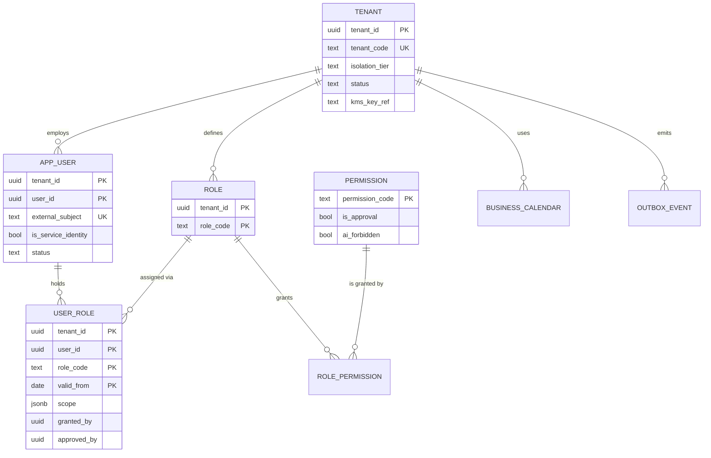

### ER-2 Scheme and product

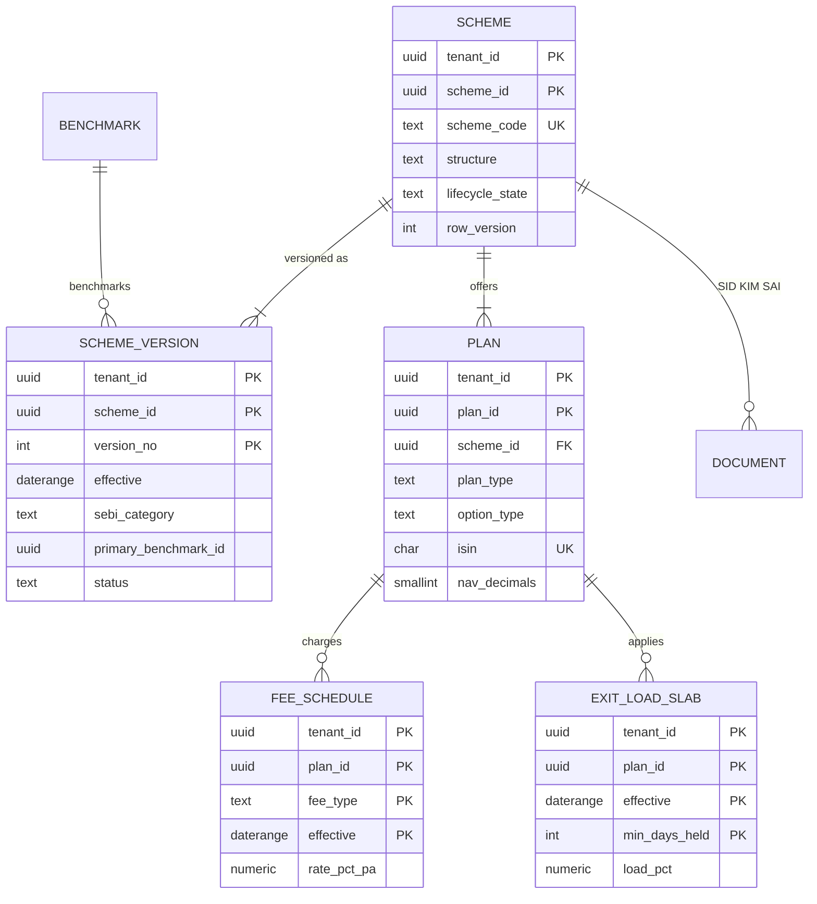

### ER-3 Security and issuer master

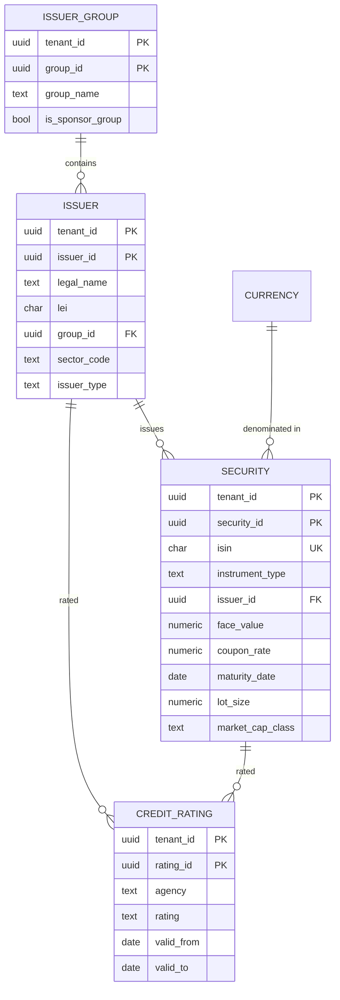

### ER-4 Portfolio and holdings

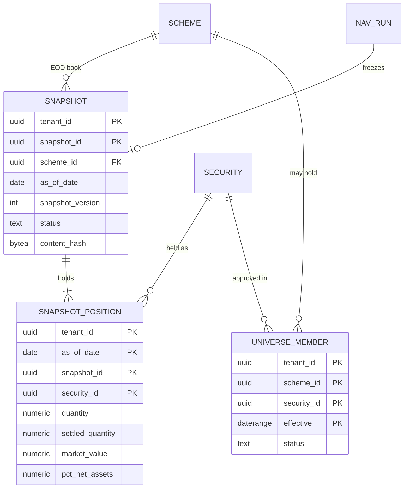

### ER-5 OMS and trading

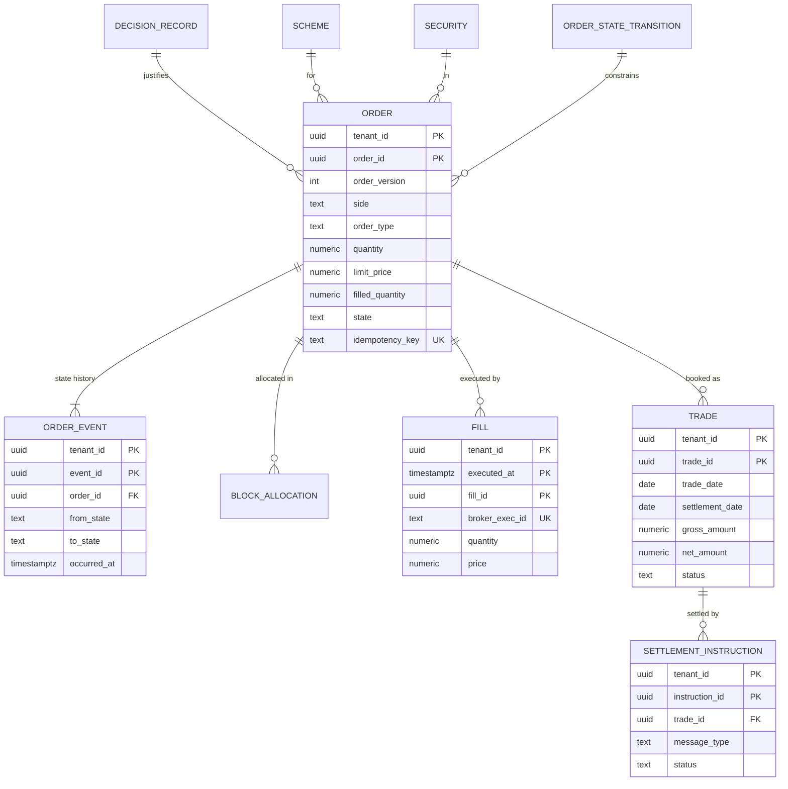

### ER-6 Compliance

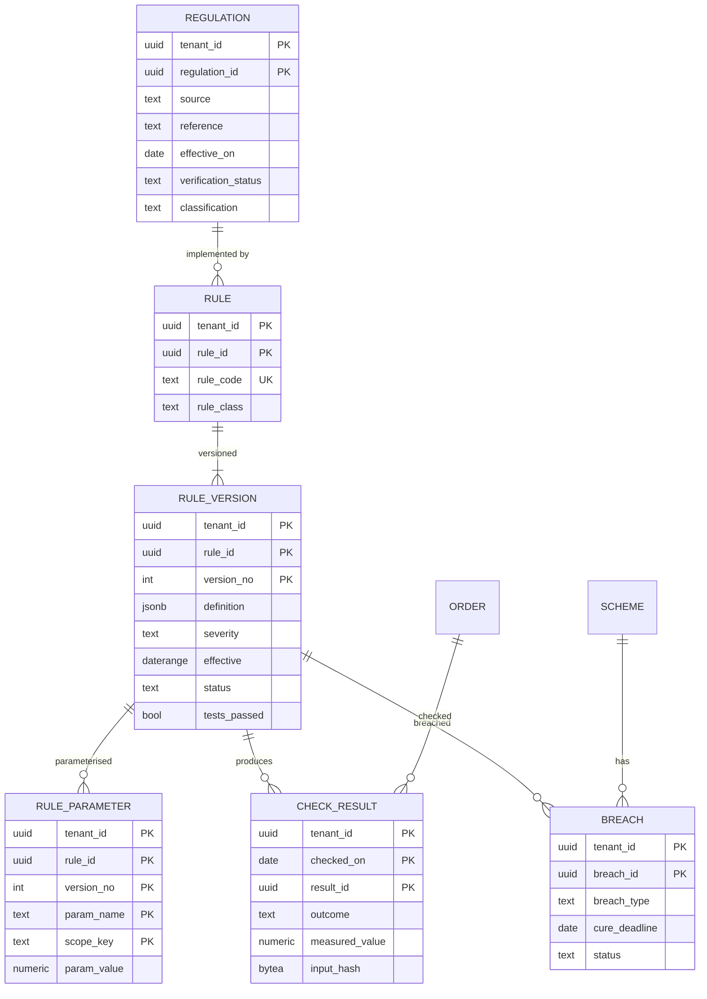

### ER-7 Risk

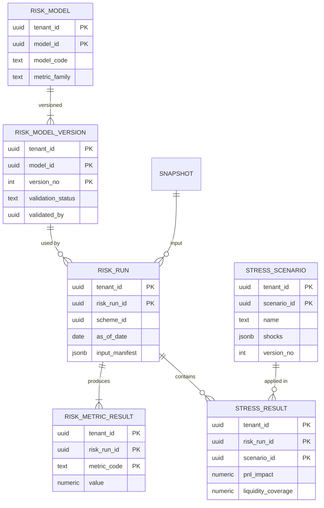

Risk tables are specified here but held back from the core DDL file because the bulk of risk time series lives in the analytical store; the OLTP tables above follow the same conventions and are added in migration 18.

### ER-8 Fund accounting

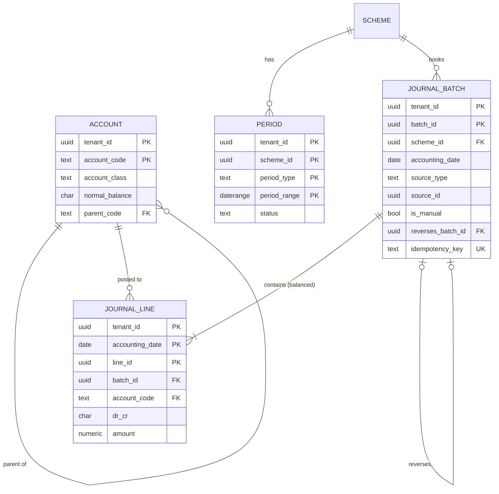

### ER-9 NAV and valuation

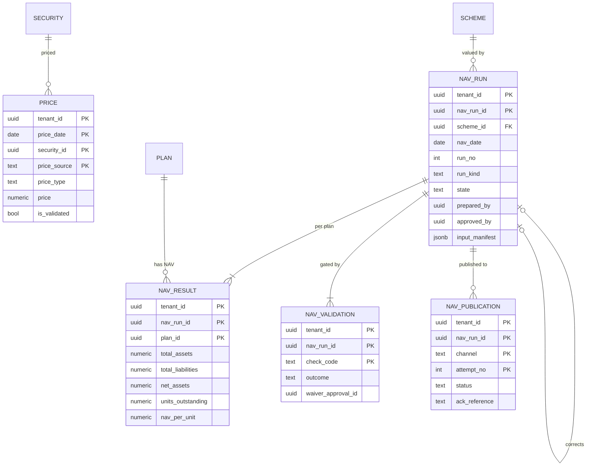

### ER-10 Investor and folio

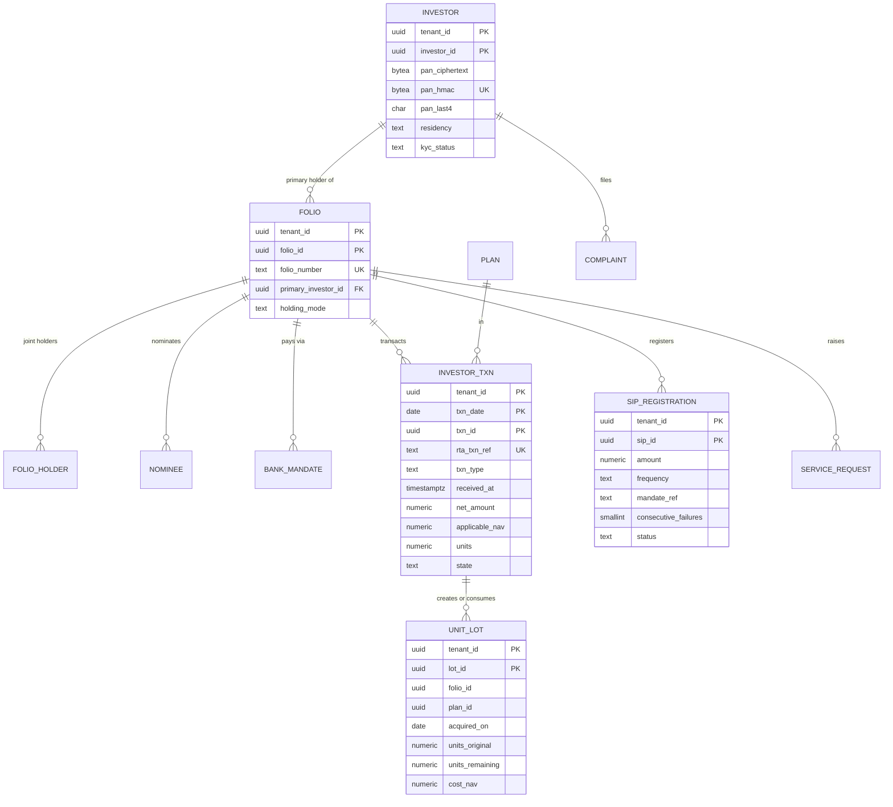

`FOLIO_HOLDER`, `NOMINEE`, `BANK_MANDATE`, `UNIT_LOT`, `SERVICE_REQUEST` and `COMPLAINT` follow the same key pattern and are added in migration 19 (Chapter 5).

### ER-11 Distribution

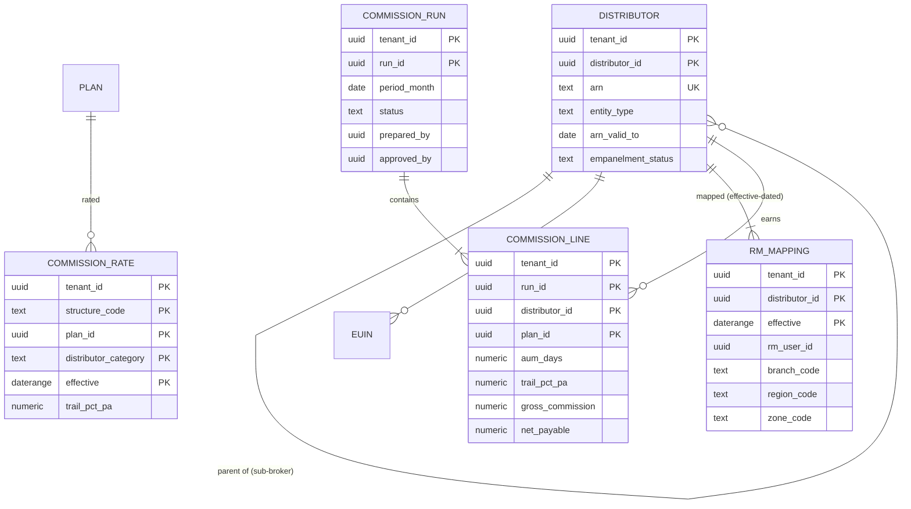

### ER-12 Workflow and approvals

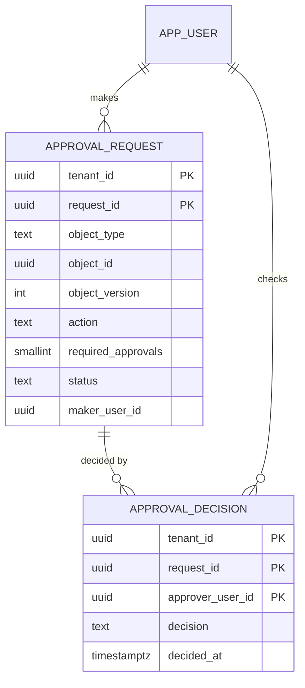

Any module object that needs maker-checker stores `approval_request_id`; the workflow schema enforces maker ≠ checker and "no service identity" in a trigger.

### ER-13 Audit and AI

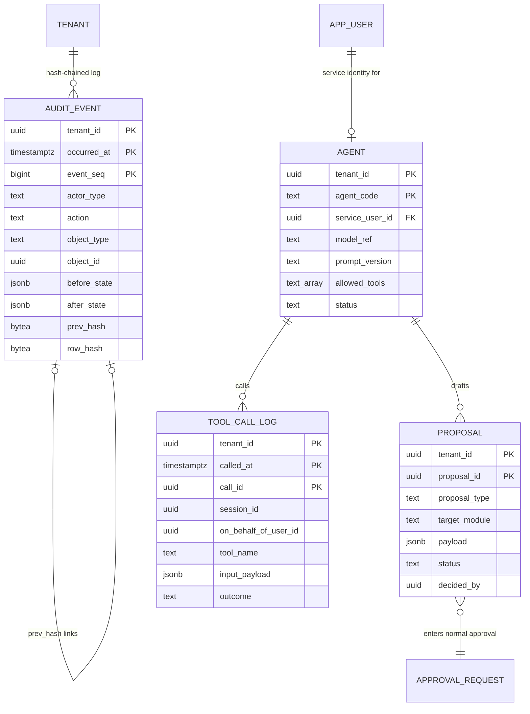

## Chapter 4 — Detailed Table Specifications

Ten core tables are specified in full below, in the requested attribute format. The remaining tables are listed in a register at the end with purpose, keys, partitioning and audit rule; their full column definitions are in the tested DDL file (Chapter 5), which is the authoritative source.

**Standard audit fields \[DES\]:** mutable tables carry `created_at`, `updated_at`, `row_version` (optimistic lock, bumped by trigger); every change also writes an `audit.audit_event`. Insert-only tables carry their event time and are guarded by an immutability trigger plus revoked UPDATE/DELETE grants.

### 4.1 `trading.order`

| Attribute | Value |
| --- | --- |
| Schema | `trading` (owner: OMS) |
| Purpose | One investment order for one scheme in one security, through its full lifecycle |
| Primary key | `(tenant_id, order_id)` |
| Foreign keys | `(tenant_id, scheme_id)` → product.scheme; `(tenant_id, security_id)` → master.security; `(tenant_id, decision_id)` → investment.decision\_record |
| Partition | None (≈ 1–5 million rows/tenant/year). Archive closed orders > 2 years to lake; keep in OLTP for retention period **\[VAL\]** |
| Tenant field | `tenant_id` (RLS forced) |
| Audit | `row_version`; every state change writes `trading.order_event` via trigger + audit event |

| Column | Type | Null | Default | Constraint | Index | Notes |
| --- | --- | --- | --- | --- | --- | --- |
| tenant\_id | uuid | No | — | RLS | PK lead | Owning AMC |
| order\_id | uuid | No | gen\_random\_uuid() | PK | PK | Stable ID across versions |
| order\_version | integer | No | 1 | — | — | Bumps on amend; compliance results bind to (order\_id, version) |
| scheme\_id | uuid | No | — | FK | `order_open_ix` | — |
| security\_id | uuid | No | — | FK | — | — |
| side | text | No | — | BUY / SELL | — | — |
| order\_type | text | No | — | MARKET, LIMIT, STOP\_LIMIT, VWAP, TWAP, NEGOTIATED, PRIMARY | — | — |
| quantity | numeric(24,6) | Yes | — | > 0; exactly one of quantity/amount | — | Units/shares/face value |
| amount | numeric(24,4) | Yes | — | > 0 | — | For amount-based (e.g., MF units, primary) |
| limit\_price | numeric(24,8) | Yes | — | > 0; required for LIMIT/STOP\_LIMIT | — | 8 dp covers debt clean prices |
| filled\_quantity | numeric(24,6) | No | 0 | 0 ≤ filled ≤ quantity | — | Maintained from fills |
| state | text | No | 'DRAFT' | Must follow `order_state_transition` (trigger) | `order_open_ix` partial | Lifecycle |
| decision\_id | uuid | No | — | FK | — | Every order must have a rationale |
| trade\_date | date | No | — | — | `order_trade_date_ix` | Business date |
| idempotency\_key | text | No | — | UNIQUE (tenant\_id, key) | UK | Prevents double orders on retry |
| created\_by / created\_at / updated\_at / row\_version | uuid / timestamptz / timestamptz / int | No | — | — | — | Audit fields |

### 4.2 `trading.order_event`

Insert-only history of every state change. PK `(tenant_id, event_id)`; FK to order; index `(tenant_id, order_id, occurred_at)`; columns `from_state`, `to_state`, `order_version`, `actor_user_id`, `detail jsonb` (broker message IDs, reasons — genuinely variable metadata), `occurred_at`. No partition initially; monthly partitions once > 50 million rows.

### 4.3 `accounting.journal_batch`

| Attribute | Value |
| --- | --- |
| Schema / purpose | `accounting`; one balanced accounting event for one scheme on one date |
| Primary key | `(tenant_id, batch_id)` |
| Foreign keys | scheme; self-reference `reverses_batch_id` |
| Partition | None (batches are few; lines are many) |
| Audit | Insert-only (trigger + revoked grants); deferred constraint trigger checks balance, same scheme/date for all lines, and period not CLOSED |

| Column | Type | Null | Default | Constraint | Notes |
| --- | --- | --- | --- | --- | --- |
| batch\_id | uuid | No | gen\_random\_uuid() | PK | — |
| scheme\_id | uuid | No | — | FK | — |
| accounting\_date | date | No | — | Period must not be CLOSED | NAV date the entry belongs to |
| source\_type / source\_id | text / uuid | No / Yes | — | — | Lineage to the business event (trade, accrual run, CA, investor flow) |
| posting\_rule\_version | text | Yes | — | — | Which posting template produced it |
| is\_manual | boolean | No | false | If true, `approval_request_id` NOT NULL | Manual journals always maker-checker |
| reverses\_batch\_id | uuid | Yes | — | FK self | Corrections only by reversal |
| idempotency\_key | text | No | — | UNIQUE | Event consumer replay safety |
| posted\_by / posted\_at | uuid / timestamptz | No | — | — | — |

### 4.4 `accounting.journal_line`

| Attribute | Value |
| --- | --- |
| Purpose | Single debit or credit line |
| Primary key | `(tenant_id, accounting_date, line_id)` — includes partition key |
| Foreign keys | `(tenant_id, batch_id)` → journal\_batch; `(tenant_id, account_code)` → account |
| Partition | RANGE (accounting\_date) monthly; default partition catches strays and is alarmed |
| Indexes | `(tenant_id, batch_id)`; covering TB index `(tenant_id, scheme_id, account_code, accounting_date) INCLUDE (dr_cr, amount)` |
| Audit | Insert-only |

| Column | Type | Null | Constraint | Notes |
| --- | --- | --- | --- | --- |
| dr\_cr | char(1) | No | 'D' or 'C' | Sign is carried here, amount is always positive (avoids sign errors) |
| amount | numeric(24,4) | No | > 0 | Paise precision + 2 guard digits |
| currency\_code | char(3) | No | default 'INR' | Multi-currency for overseas holdings |
| plan\_id | uuid | Yes | — | Plan-level expense and unit capital |
| security\_id, counterparty\_code | uuid, text | Yes | — | Sub-ledger dimensions |
| narration | text | Yes | — | Human-readable |

### 4.5 `distribution.commission_line`

PK `(tenant_id, run_id, distributor_id, plan_id)`. Key rule built into the table: `gross_commission = round(aum_days × trail_pct_pa / 100 / day_basis, 4)` and `net_payable = gross + gst − tds − clawback` (CHECK constraints) — the database refuses a commission line whose arithmetic is wrong, whoever wrote it. Example verified in tests: ₹10,00,000 × 30 days at 0.80% p.a. on 365 = ₹657.5342.

### 4.6 `nav.nav_run`

| Attribute | Value |
| --- | --- |
| Purpose | One attempt to compute, validate, approve and publish NAV for a scheme on a date |
| Primary key | `(tenant_id, nav_run_id)`; UNIQUE `(tenant_id, scheme_id, nav_date, run_no)` |
| Foreign keys | scheme; self `corrects_run_id` |
| Key constraints | `approved_by <> prepared_by`; approved states require `approved_by`; CORRECTION runs require `corrects_run_id`; partial unique index — only one APPROVED/PUBLISHING/PUBLISHED run per scheme-date; trigger — a PUBLISHED run may only become SUPERSEDED |
| Partition | None (≈ 250 runs/scheme/year) |
| Audit | `row_version`; audit event on every state change |

| Column | Type | Null | Notes |
| --- | --- | --- | --- |
| nav\_date | date | No | Business date valued |
| run\_no | integer | No | 1, 2, … for re-runs |
| run\_kind | text | No | REGULAR, CORRECTION, RECONSTRUCTION |
| state | text | No | 11 states (PRD Module 09) |
| prepared\_by / approved\_by / approved\_at | uuid / uuid / timestamptz | No / Yes / Yes | SoD enforced |
| input\_manifest | jsonb | Yes | Versions and hashes of every input (TB as-of, price set, snapshot, units file, rule versions). JSONB is justified: it is a manifest of references whose shape varies by instrument mix. |

### 4.7 `nav.nav_result`

PK `(tenant_id, nav_run_id, plan_id)`; FK run, plan. Columns: `total_assets`, `total_liabilities` numeric(26,4) ≥ 0; `net_assets` **generated** = assets − liabilities; `units_outstanding` numeric(26,6) > 0; `nav_unrounded` numeric(30,12) with CHECK `= round(net / units, 12)`; `nav_per_unit` numeric(20,6) with CHECK that it is `nav_unrounded` rounded once (to 2, 4 or 6 dp, per plan config). Insert-only. Index `(tenant_id, plan_id, nav_date)` for NAV history lookups.

### 4.8 `investor.investor_txn`

| Attribute | Value |
| --- | --- |
| Purpose | Every investor transaction mirrored from the RTA (mode A) or originated here (mode B) |
| Primary key | `(tenant_id, txn_date, txn_id)`; UNIQUE `(tenant_id, txn_date, rta_txn_ref)` for idempotent loads |
| Partition | RANGE (txn\_date) monthly; for very large tenants, sub-partition by HASH(tenant\_id) or move tenant to dedicated DB |
| Indexes | `(tenant_id, folio_id, txn_date)`; partial `(tenant_id, arn, txn_date) WHERE arn IS NOT NULL` for distribution MIS |
| Tenant / audit | RLS on parent and every partition; state changes audited |

| Column | Type | Null | Notes |
| --- | --- | --- | --- |
| txn\_type | text | No | 14 types incl. SWITCH\_IN/OUT, SIP, STP, SWP, IDCW, REVERSAL |
| received\_at | timestamptz | No | Time stamp that decides applicable NAV |
| gross\_amount, stamp\_duty, exit\_load, tds, net\_amount | numeric | Mixed | All NUMERIC |
| applicable\_nav | numeric(20,6) | Yes | Required once PROCESSED (CHECK) |
| units | numeric(24,6) | Yes | Signed: + in, − out; required once PROCESSED |
| state | text | No | 12 states (PRD Module 11) |
| reverses\_txn\_id / linked\_txn\_id | uuid | Yes | Reversal and switch-pair links |
| arn / euin | text | Yes | Distribution attribution as of transaction date |

### 4.9 `compliance.rule_version`

PK `(tenant_id, rule_id, version_no)`. `definition jsonb` holds the typed rule DSL — JSONB is justified because rule shapes differ (issuer limit vs allocation band vs rating floor) and the service validates it against a versioned JSON Schema before insert. `effective daterange` with an exclusion constraint: two APPROVED versions of one rule can never overlap in time. CHECK: status APPROVED requires `tests_passed = true` and an `approval_request_id`. Parameters live in the normalised `compliance.rule_parameter` table (numeric thresholds by scope), never inside the JSON, so thresholds are queryable and diffable.

### 4.10 `audit.audit_event`

PK `(tenant_id, occurred_at, event_seq)`; RANGE partitioned monthly on `occurred_at`. Columns: `actor_type` (USER, SERVICE, AI\_AGENT, SYSTEM, PLATFORM\_OPERATOR), `action` (permission code), `object_type`, `object_id`, `reason`, `before_state`/`after_state` (jsonb diff), `client_ip`, `correlation_id`, `prev_hash`, `row_hash` (SHA-256). A BEFORE INSERT trigger serialises per tenant with an advisory lock and chains each row's hash to the previous one, so any edit or deletion is detectable. UPDATE/DELETE blocked by trigger and grants. Daily chain heads are anchored to WORM object storage.

### 4.11 Register of all other tables

| Table | Purpose | PK | Partition | Mutability |
| --- | --- | --- | --- | --- |
| platform.tenant | AMC registry | tenant\_id | — | Mutable, platform admin only |
| platform.business\_calendar | Holidays per calendar | (tenant, calendar, date) | — | Mutable (MC) |
| platform.outbox\_event | Transactional outbox | (tenant, event\_id) | Daily drop after publish + 7 days | Insert, mark published |
| platform.idempotency\_key | API replay protection | (tenant, key) | — | TTL purge |
| identity.app\_user / role / permission / role\_permission / user\_role | Access control | composite | — | Mutable, audited, MC on grants |
| master.currency / issuer\_group / issuer / security / credit\_rating / benchmark | Golden reference data | composite | — | Effective-dated, versioned |
| product.scheme / scheme\_version / plan / fee\_schedule / exit\_load\_slab | Scheme definition | composite | — | Versioned; exclusion constraints on dates |
| workflow.approval\_request / approval\_decision | Maker-checker | composite | — | Decisions insert-only |
| investment.restricted\_list\_entry / universe\_member / decision\_record | Investment controls | composite | — | Effective-dated |
| portfolio.snapshot / snapshot\_position | EOD books | composite | Positions yearly | Frozen after NAV |
| trading.order\_state\_transition / block\_allocation | OMS | composite | — | Config / mutable |
| execution.fill | Broker fills | (tenant, executed\_at, fill\_id) | Monthly | Insert-only |
| settlement.trade / instruction | Settlement | composite | — | Status mutable, versioned |
| compliance.regulation / rule / rule\_parameter / check\_result / breach | Compliance | composite | check\_result yearly | Results insert-only |
| valuation.price | Prices by source | (tenant, date, security, source) | Yearly | No delete |
| accounting.account / period | COA and periods | composite | — | MC |
| nav.nav\_validation / nav\_publication | NAV gates and channels | composite | — | Insert, waiver MC |
| operations.inbound\_file / recon\_run / recon\_break | Ops | composite | — | Breaks mutable, write-off MC |
| investor.investor / folio / sip\_registration | Investor book | composite | — | PII encrypted |
| distribution.distributor / rm\_mapping / commission\_rate / commission\_run | Distribution | composite | — | Effective-dated |
| documents.document | Document metadata | (tenant, doc, version) | — | New version per change |
| analytics.metric\_definition | Metric registry | (tenant, metric, version) | — | Versioned, certified flag |
| ai.agent / tool\_call\_log / proposal | AI governance | composite | tool\_call\_log monthly | Log insert-only |

## Chapter 5 — Complete PostgreSQL DDL

The core DDL is delivered as `amc_os_ddl.sql` (≈ 1,500 lines, 23 schemas, 86 tables and partitions) with a companion test script `amc_os_tests.sql`. Both were run end to end on **PostgreSQL 16.15**: the DDL loads with no errors and all 24 test checks pass. Row-level security is forced on every tenant table and every partition (verified by catalogue query: the only table without it is `platform.tenant`, by design).

### 5.1 What the DDL includes

| Requirement from brief | Where in the DDL |
| --- | --- |
| CREATE SCHEMA | Section 00 — all 23 schemas |
| PRIMARY / FOREIGN / UNIQUE keys | Every table; FKs are composite `(tenant_id, id)` |
| CHECK, NOT NULL | Status enums, positive amounts, maker ≠ checker, NAV and commission arithmetic, settlement net amount |
| INDEX | Partial indexes for open orders/breaks, covering TB index, GiST for date ranges |
| PARTITIONING | audit\_event, fill, journal\_line, investor\_txn (monthly); snapshot\_position, price, check\_result (yearly); tool\_call\_log |
| ROW LEVEL SECURITY | `platform.apply_tenant_rls()` — idempotent, run after every migration |
| Functions | `current_tenant()`, `trial_balance()`, `apply_tenant_rls()` |
| Triggers | Order state machine + event log; journal balance (deferred constraint trigger); immutability; audit hash chain; SoD on approvals; published-NAV guard; optimistic locking |
| Materialized views | `analytics.mv_daily_aum`, exposed only through a security-barrier view because materialized views cannot carry RLS |
| UUID / NUMERIC / DATE / TIMESTAMPTZ / version fields / explicit statuses | Throughout; no float types anywhere |

### 5.2 Migration order and dependency handling

1. **00** extensions (pgcrypto, btree\_gist), roles, schemas
2. **01** platform (tenant, helpers, calendar, outbox, idempotency)
3. **02** identity → **03** audit → **04** master → **05** product
4. **06** workflow (needs identity for SoD trigger)
5. **07** investment → portfolio → trading → execution → settlement
6. **08** compliance → **09** valuation → **10** accounting → **11** nav
7. **12** operations → **13** investor → **14** distribution → **15** documents, analytics, ai
8. **16** RLS for all tenant tables → **17** grants and materialized views
9. **18+** (next migrations) risk tables, remaining investor child tables, finance tables — each migration ends by calling `platform.apply_tenant_rls()`

Tooling: Flyway or Sqitch with one versioned file per step; migrations run by a dedicated owner role; CI spins up PostgreSQL, applies all migrations, runs the test script, and runs a catalogue check that fails the build if any table with `tenant_id` lacks a forced policy. Monthly partitions are created 3 months ahead by a scheduled job (pg\_partman or an in-house function); a non-empty default partition raises an alert.

### 5.3 Test results (PostgreSQL 16.15)

| Test | What it proves | Result |
| --- | --- | --- |
| T1a–b | Tenant A cannot read tenant B rows, even by primary key | Pass |
| T1c | Insert with another tenant's ID rejected (RLS WITH CHECK) | Pass |
| T1d | Cross-tenant UPDATE touches 0 rows | Pass |
| T1e | No tenant context → no rows (fail closed) | Pass |
| T1f | Direct partition access is also filtered | Pass |
| T1g | Composite FK blocks pointing at another tenant's parent | Pass |
| T2a–c | Batch out by ₹0.01 rejected; balanced batch commits; TB nets to zero | Pass |
| T3a–c | Journals and audit cannot be changed; audit hash chain intact | Pass |
| T4a–c | Illegal order transition refused; transitions logged; duplicate Idempotency-Key refused | Pass |
| T5a–c | Maker cannot approve; AI service identity cannot approve; another human can | Pass |
| T6a–d | NAV preparer cannot approve; published NAV frozen; one live NAV per date; NAV exact to 4 dp | Pass |
| T7 | Commission arithmetic enforced by CHECK | Pass |

Testing caught one real defect, now fixed: the first NAV CHECK compared a 12-decimal stored value with an unrounded division and rejected valid NAVs. It now rounds explicitly at 12 places, and the published NAV must equal that value rounded once.

### 5.4 Key excerpt — balanced-journal enforcement

```sql
CREATE CONSTRAINT TRIGGER journal_batch_balanced
  AFTER INSERT ON accounting.journal_batch
  DEFERRABLE INITIALLY DEFERRED            -- checked once, at COMMIT
  FOR EACH ROW EXECUTE FUNCTION accounting.tg_check_batch();
-- tg_check_batch(): sum(D) - sum(C) must be 0; all lines share the batch's
-- scheme and date; the accounting period must not be CLOSED.
```

## Chapter 6 — Multi-Tenant Data Isolation

Isolation is enforced in five independent layers, so a bug in any one of them does not expose another AMC's data: (1) the API gateway binds the tenant from the signed token; (2) the service sets the tenant context per transaction; (3) PostgreSQL RLS filters every row; (4) composite foreign keys make cross-tenant references impossible; (5) storage, keys, caches and AI indexes are partitioned per tenant.

### 6.1 Tenant master and tiers

| Tier | Database | When to use | Isolation strength |
| --- | --- | --- | --- |
| SHARED | Shared cluster, RLS | Small and mid AMCs | Logical (RLS + composite FKs) |
| DEDICATED\_DB | Own PostgreSQL cluster, same app | Large AMCs, regulatory or contractual demand | Physical DB; same code |
| DEDICATED\_DEPLOYMENT | Own app + DB in own cloud account/VPC | Very large AMCs / own-cloud demands | Full stack |

The same schema and RLS run in all tiers (defence in depth even when alone). `platform.tenant.isolation_tier` drives connection routing.

### 6.2 Tenant context

```sql
-- In every transaction, from the service's DB session (never from user input):
BEGIN;
SET LOCAL app.tenant_id = '6f1c...';   -- from the verified JWT claim
SET LOCAL app.user_id   = '9a2b...';
-- ... business SQL ...
COMMIT;   -- SET LOCAL ends with the transaction, so pooled connections never leak context
```

`platform.current_tenant()` returns NULL when unset, and every policy compares `tenant_id = NULL`, which is never true — so a missed context returns nothing rather than everything.

### 6.3 Tenant-aware keys

Every tenant table's primary key starts with `tenant_id`, and every FK includes it:

```sql
FOREIGN KEY (tenant_id, scheme_id) REFERENCES product.scheme (tenant_id, scheme_id)
```

Even a superuser-level bug that inserted a child under tenant B pointing at tenant A's scheme fails with a foreign-key violation (test T1g). Leading `tenant_id` also makes every index naturally tenant-clustered.

### 6.4 RLS policy

```sql
ALTER TABLE trading."order" ENABLE ROW LEVEL SECURITY;
ALTER TABLE trading."order" FORCE ROW LEVEL SECURITY;   -- applies to the table owner too
CREATE POLICY tenant_isolation ON trading."order"
  USING (tenant_id = platform.current_tenant())
  WITH CHECK (tenant_id = platform.current_tenant());
```

Applied to parents **and** every partition: PostgreSQL applies a parent's policy only when queried through the parent, so a direct query on a partition would otherwise escape it. App roles never have `BYPASSRLS`; only `amc_platform_admin` does, and that role is used solely by break-glass tooling with tenant approval (PRD SOD-09).

### 6.5 Tenant-specific encryption

- Storage-level encryption (AES-256) for all volumes and backups.
- **Envelope encryption per tenant:** each tenant has its own KMS key (`platform.tenant.kms_key_ref`); PII columns (PAN, name, CKYC number, bank account) are encrypted in the application with data keys wrapped by that tenant key. Lookup uses a keyed HMAC column (`pan_hmac`), never the plaintext.
- Tenant offboarding can crypto-shred PII by destroying the tenant key after the retention period.

### 6.6 Object storage, cache and AI isolation

- **Object storage:** one bucket per tenant (or one prefix per tenant with bucket policy conditions on the prefix), SSE-KMS with the tenant key, object lock (WORM) for evidence and audit anchors. The document service builds the key; clients never supply paths.
- **Cache:** Redis keys prefixed `t:{tenant_id}:`; the cache client library refuses keys without a prefix.
- **AI:** vector chunks carry `tenant_id` and are stored in per-tenant partitions; the retrieval tool always filters by the session's tenant (bound by the platform, not the prompt). Shared public corpora (SEBI circulars) sit in a separate read-only index. LLM calls carry no cross-tenant context; prompts and outputs are logged per tenant.

### 6.7 Connection pooling

PgBouncer in **transaction mode**, one pool per module role. Because `SET LOCAL` is transaction-scoped, a pooled server connection cannot carry tenant context into the next client's transaction. Session-level `SET` is banned by a linter. Dedicated-DB tenants get their own pool.

### 6.8 Backup isolation

Shared-tier backups are cluster-level (PITR with WAL archiving). Per-tenant restore is done by restoring to a scratch cluster and extracting that tenant's rows with `tenant_id` filters (scripted, tested quarterly). Dedicated tiers have their own backups and keys. Backups are encrypted and stored in the India region with a copy in the DR region.

### 6.9 Tenant onboarding and offboarding

**Onboarding:** create tenant row and KMS key → create object-storage bucket/prefix and Redis namespace → seed roles, permissions, COA template, calendars, regulation register copy → create tenant admin user (MC by platform + AMC) → run isolation smoke tests with that tenant's credentials → status ACTIVE.

**Offboarding:** status OFFBOARDING (read-only) → full export in agreed formats (Parquet + PDF evidence) with checksums → retain for contractual/regulatory period **\[VAL\]** → delete rows by tenant, drop tenant partitions/buckets → destroy tenant KMS key (crypto-shred) → certificate of deletion → status ARCHIVED.

### 6.10 Negative security test cases (in CI)

1. Read another tenant's row by ID → 0 rows (T1a–b).
2. Insert with another tenant's `tenant_id` → RLS error (T1c).
3. Update/delete another tenant's rows → 0 rows affected (T1d).
4. No tenant context → 0 rows (T1e).
5. Query a partition directly → filtered (T1f).
6. Cross-tenant FK → FK violation (T1g).
7. API: object ID from tenant B in tenant A token → 404, alert raised.
8. Cache: read key with another tenant prefix → refused by client library.
9. Object store: pre-signed URL for tenant B with tenant A credentials → 403.
10. AI: tenant A prompt asks about tenant B scheme by name and by ID → retrieval and tools return nothing; leakage test passes.
11. Catalogue check: any table with `tenant_id` and no forced policy → build fails.

## Chapter 7 — Financial Transaction Data Model

Every money-moving object is either **insert-only** (facts that happened) or a **state machine** whose allowed transitions are stored as data and enforced by trigger. Corrections never edit history: they add a reversal or a new version linked to the original.

| Object | Table(s) | Model | States (→ allowed moves in PRD) | Correction method |
| --- | --- | --- | --- | --- |
| Order | trading.order, order\_event | State machine, versioned per amend | DRAFT → PENDING\_COMPLIANCE → … → CLOSED (18 states; table `order_state_transition`) | Amend = new `order_version`; cancel = state |
| Execution | execution.fill | Insert-only, idempotent on broker ExecID | — | Broker bust/correct = new fill with negative link (adjustment record) |
| Trade | settlement.trade | State machine | PENDING\_INSTRUCTION → INSTRUCTED → ACKNOWLEDGED → MATCHED → SETTLED / FAILED → … | Cancel + rebook with link |
| Settlement instruction | settlement.instruction | State machine | CREATED → SENT → ACK/NACK → MATCHED → SETTLED / FAILED / CANCELLED | New instruction; old CANCELLED |
| Investor transaction | investor.investor\_txn | State machine; partitioned | RECEIVED → … → PROCESSED → PAYOUT\_INITIATED → PAID / PAYOUT\_FAILED → REPROCESSED; REVERSED | REVERSAL txn with `reverses_txn_id` |
| Folio | investor.folio | Mutable master | ACTIVE / FROZEN / CLOSED | Audited update |
| Unit balance | investor.unit\_lot (+ derived balance view) | Lots created by inflows, consumed FIFO by outflows | — | Reversal restores lots |
| Journal batch / entry / lines | accounting.journal\_batch, journal\_line | Insert-only, balanced at commit | — | Reversal batch (`reverses_batch_id`) + new batch |
| Accrual | accounting batches with `source_type='accrual.run'` | Daily insert | — | Next-day true-up batch |
| Valuation | valuation.price + portfolio.snapshot\_position | Insert per date/source; snapshot frozen | Snapshot DRAFT → FROZEN → SUPERSEDED | New snapshot version |
| NAV calculation run | nav.nav\_run, nav\_result, nav\_validation | State machine + insert-only results | INITIATED → … → PUBLISHED → SUPERSEDED | CORRECTION run with `corrects_run_id` |
| NAV publication | nav.nav\_publication | Insert per attempt per channel | PENDING → SENT → ACKNOWLEDGED / FAILED | New attempt row |
| Reconciliation break | operations.recon\_break | State machine | OPEN → ASSIGNED → INVESTIGATING → PROPOSED\_RESOLUTION → RESOLVED / WRITTEN\_OFF (MC) / AUTO\_CLEARED | Re-open = new break linked |
| Commission | distribution.commission\_run, commission\_line | Run state machine + insert-only lines | DRAFT → CALCULATED → APPROVED → PAID / SUPERSEDED | Superseding run; claw-back lines next month |

### 7.1 How one buy trade flows through the tables

```mermaid
sequenceDiagram
  participant O as trading.order
  participant F as execution.fill
  participant T as settlement.trade
  participant J as accounting.journal_*
  participant S as portfolio.snapshot_position
  participant N as nav.nav_result
  O->>O: DRAFT ... ROUTED (order_event per step)
  F->>O: fills raise filled_quantity; state FILLED
  O->>T: allocation creates trade (T, T+1)
  T->>J: trade date: Dr Investments / Cr Payable to broker
  T->>J: settlement date: Dr Payable / Cr Bank
  J->>N: TB feeds NAV run for the day
  N->>S: NAV approved -> snapshot FROZEN
```

### 7.2 Worked posting example (illustrative)

Buy 10,000 shares at ₹1,520.50; brokerage ₹1,520.50, stamp duty ₹228.08, STT ₹15,205.00, GST ₹273.69 (rates illustrative, from the versioned tax table **\[VAL\]**). Gross = ₹1,52,05,000.00; net payable = ₹1,52,22,227.27.

| Date | Account | Dr (₹) | Cr (₹) |
| --- | --- | --- | --- |
| T | 1100 Investments – Equity (cost incl. charges per policy) | 1,52,22,227.27 |  |
| T | 2100 Payable for investments purchased |  | 1,52,22,227.27 |
| T+1 | 2100 Payable for investments purchased | 1,52,22,227.27 |  |
| T+1 | 1200 Bank |  | 1,52,22,227.27 |

Whether charges are capitalised into cost or expensed follows the scheme accounting policy and SEBI accounting norms **\[VAL\]**; the posting rule is versioned config, not code.

### 7.3 Transition restrictions (general rules)

1. Allowed transitions live in tables; triggers reject anything else with `ILLEGAL_*_TRANSITION`.
2. Terminal states (CLOSED, CANCELLED, SUPERSEDED, PAID, RESOLVED, WRITTEN\_OFF) never change.
3. A transition that needs approval checks for an APPROVED `workflow.approval_request` for that object and version in the same transaction.
4. Every transition writes an event row and an outbox event in the same transaction.

## Chapter 8 — Data Engineering Architecture

Data moves through six layers, each stored and versioned, so any report number can be traced back to the exact file or event it came from.

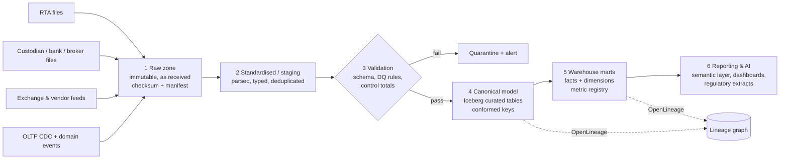

| Layer | Technology | Rules |
| --- | --- | --- |
| Source ingestion | Connector framework (SFTP pull, APIs, SWIFT gateway); Debezium CDC from PostgreSQL logical replication; Kafka | Every file registered in `operations.inbound_file` with SHA-256; duplicate = same sender + date + hash |
| Raw storage | Object storage, path `raw/{tenant}/{source}/{business_date}/{file}` | Write-once (object lock); never parsed in place |
| Staging | Iceberg `std_*` tables via Spark/Flink or Python (Polars) jobs | Typed columns, source row number kept, load ID on every row |
| Validation | Great Expectations / Soda style rules from `analytics` DQ registry | Completeness, validity, uniqueness, timeliness, control-total match; severity decides block vs flag |
| Transformation | dbt models (SQL), versioned in Git, CI-tested | Pure SQL, deterministic, idempotent by `(tenant, business_date)` partition overwrite |
| Canonical model | Iceberg `cur_*` tables | Conformed IDs (security\_id, plan\_id, folio\_id, distributor\_id); SCD2 dimensions |
| Warehouse | ClickHouse / cloud warehouse star schemas | `fct_investor_txn`, `fct_aum_daily`, `fct_holdings_daily`, `fct_nav`, `fct_journal`, `fct_commission`; dims `dim_scheme`, `dim_plan`, `dim_security`, `dim_distributor` (SCD2), `dim_rm`, `dim_branch`, `dim_date` |
| Reporting | Semantic layer (metric definitions from `analytics.metric_definition`) | Only certified metrics on CXO dashboards and AI answers |
| Lineage | OpenLineage events from dbt, Spark and ingestion jobs | Column-level, browsable from any report cell |
| Retention | Lifecycle policies by classification | Raw financial files and evidence kept for regulatory retention **\[VAL\]**; staging 90 days; marts rebuilt from canonical |

### 8.1 Source-to-target mapping example — RTA transaction feed → `investor.investor_txn` and `fct_investor_txn`

RTA field names below are placeholders; actual layouts differ per RTA and must be taken from the RTA's file specification **\[Confirm with CAMS / KFin\]**.

| Source field (RTA feed) | Transformation | Target column | DQ rule |
| --- | --- | --- | --- |
| `TRXN_NO` / unique ref | Trim; prefix RTA code | investor\_txn.rta\_txn\_ref | Not null; unique per tenant + date |
| `FOLIO_NO` | Lookup folio by (tenant, folio\_number); create if new (mode A) | folio\_id | Folio exists after load |
| `SCHEME_CODE` + `PLAN` + `OPTION` | Map via RTA scheme map to plan\_id | plan\_id | 100% mapped, else quarantine |
| `TRXN_TYPE` + `TRXN_SUBTYPE` | Code map table (versioned) to 14 canonical types | txn\_type | No unmapped codes |
| `TRADE_DATE` / NAV date | Parse DD-MM-YYYY to DATE | txn\_date | Business day per calendar |
| `TIME_STAMP` | Parse with IST zone to TIMESTAMPTZ | received\_at | ≤ load time |
| `AMOUNT`, `STAMP_DUTY`, `LOAD`, `TDS` | Parse as NUMERIC (no float) | gross\_amount, stamp\_duty, exit\_load, tds | Amount ≥ 0; net = gross − charges within ₹0.01 |
| `PURPRICE` / NAV | NUMERIC | applicable\_nav | Equals published NAV for plan/date (cross-check `nav.nav_result`) |
| `UNITS` | NUMERIC; sign by direction | units | units × NAV ≈ net amount within rounding tolerance |
| `BROKER_CODE` (ARN), `EUIN` | Normalise to `ARN-n` | arn, euin | ARN valid on txn\_date (distributor master) |
| file control total | Sum amounts and count rows | — | Equals trailer record; else whole file quarantined |

**Warehouse grain:** `fct_investor_txn` one row per txn, with keys to `dim_plan`, `dim_date`, `dim_distributor` (SCD2 version valid on txn\_date), `dim_rm` via `rm_mapping` effective on txn\_date — so historical MIS never changes when mappings change.

## Chapter 9 — High-Volume Database Engineering

Sizing assumption for the largest tenant (proposed): 10 million folios, 50 million investor transactions a year, 300 schemes × 2–4 plans, 1 million journal lines a day on peak days, 5 years online in OLTP.

| Technique | Where | How |
| --- | --- | --- |
| **Table partitioning** | audit\_event, fill, journal\_line, investor\_txn (monthly RANGE); price, snapshot\_position, check\_result (yearly) | Partition key = business/event date, always in the PK; partitions created ahead by job; old partitions detached and archived; very large tenants also sub-partition by HASH(tenant\_id) or move to dedicated DB |
| **Indexing** | All tables | `tenant_id` first in every index; partial indexes for "open" work (`order_open_ix`, `recon_break_open_ix`); GiST for date-range exclusion; BRIN on append-only timestamp columns of very large partitions |
| **Composite / covering indexes** | Trial balance, NAV history, MIS | `(tenant_id, scheme_id, account_code, accounting_date) INCLUDE (dr_cr, amount)` lets TB run as an index-only scan |
| **Query optimisation** | All services | Every query has an owner and an EXPLAIN baseline in CI; `pg_stat_statements` top-50 reviewed weekly; no `SELECT *`; keyset pagination (no OFFSET); avoid functions on indexed columns |
| **Bulk inserts** | RTA loads, prices, snapshots, accruals | `COPY` into an unlogged staging table → validate → `INSERT … SELECT … ON CONFLICT DO NOTHING` into target in batches of 10–50k rows; one transaction per batch for restartability |
| **Batch processing** | NAV, accruals, commission, risk | Partition work by (tenant, scheme); worker pool with advisory locks per scheme; each job idempotent by business key |
| **Incremental loading** | Warehouse | CDC offsets or `loaded_at` watermarks per table; dbt incremental models with `merge` on business key; late-arriving data handled by reprocessing affected date partitions |
| **Materialized views** | Daily AUM, distributor AUM, scorecards in OLTP-adjacent use | `REFRESH MATERIALIZED VIEW CONCURRENTLY` (unique index present) after NAV publish; always exposed through security-barrier views (MVs have no RLS) |
| **Read replicas** | Screens, exports, reconstruction | Separate pool; routing by query class; replica lag monitored (alert > 5 s); NAV approval and OMS always read primary |
| **Connection pooling** | All | PgBouncer transaction mode; per-module pools sized to cores × 2–4; statement timeout per role (e.g., 5 s OLTP, 30 min batch role) |
| **Archival** | Closed partitions beyond online window | Detach partition → export to Parquet/Iceberg with checksum → verify row counts and hash → drop; archived data queryable from warehouse; restoration runbook tested |
| **Compression** | Analytical and archive | Columnar compression in warehouse and Parquet (ZSTD); PostgreSQL TOAST lz4 for jsonb/text; no compression tricks on hot OLTP tables |
| **Concurrency control** | Mutable rows | Optimistic locking (`row_version`) for user edits; `SELECT … FOR UPDATE SKIP LOCKED` for job queues; advisory locks for per-scheme batch jobs and audit chain; SERIALIZABLE only where needed (cash ladder reservations) |
| **Vacuum and bloat** | Hot tables | Insert-only design minimises bloat; autovacuum tuned per table (lower scale factors on order, breach, trade) |

**Capacity check (rough):** 50 million investor txns/year × \~400 bytes/row with indexes ≈ 20 GB/year/large tenant; 250 million journal lines/year × \~250 bytes ≈ 60 GB/year. Five years online stays within a few hundred GB per large tenant — comfortable for one well-sized PostgreSQL cluster, with dedicated-DB tier for the largest AMCs.

## Chapter 10 — Backup, Security Hardening, Testing and Operations

The source brief stopped mid-word in Chapter 9 ("Archival. Co…"). This chapter covers the topics such a brief normally continues with; send the rest of the brief if it differs.

### 10.1 Backup and recovery

- Continuous WAL archiving + daily base backups (pgBackRest or managed PITR); retention 35 days online, monthly backups per retention policy **\[VAL\]**.
- Synchronous standby in a second availability zone (RPO ≈ 0 inside region); asynchronous replica in DR region (RPO ≤ 5 min).
- Quarterly restore drills: full cluster PITR, single-tenant extract, single-table restore; measured against RTO ≤ 2 h.
- Backups encrypted, stored in India; immutable copies (object lock) to resist ransomware. **\[REG — CSCRF backup and recovery expectations; VAL\]**

### 10.2 Database security hardening

- No public endpoint; private subnets; TLS 1.3 required (`hostssl` only); SCRAM-SHA-256 auth; IAM/short-lived credentials for services.
- Least-privilege roles per module; no app role owns tables; owner role used only by migrations.
- `pgaudit` for DDL, role changes and reads of PII tables; logs shipped to SIEM; log retention per CSCRF **\[VAL\]**.
- Secrets in a vault; credentials rotated automatically.
- PII field encryption with tenant keys (Chapter 6); masking views for non-privileged roles.
- Quarterly access review of DB roles; break-glass access time-boxed and reported.

### 10.3 Testing strategy for the data layer

| Test type | Scope | Gate |
| --- | --- | --- |
| Migration tests | Apply all migrations to empty DB and to a copy of production schema | Every PR |
| Constraint & trigger tests | `amc_os_tests.sql` pattern, extended per table | Every PR |
| RLS coverage check | Catalogue query: no tenant table without forced policy | Every PR (build fails) |
| Property-based tests | Journal balance, NAV formula, commission, unit rounding with random inputs | Nightly |
| Golden-data reconciliation | NAV, TB, commission vs known outputs from parallel run | Before each release |
| Performance tests | 2× projected peak volumes on production-like data | Before each release |
| Chaos / failover | Kill primary, network partition, replica lag | Quarterly |

### 10.4 Monitoring

Replication lag, connection saturation, long transactions, lock waits, bloat, partition-creation health, default-partition row counts (should be 0), outbox backlog, CDC lag, failed DQ rules, and business monitors (NAV not published by deadline, unbalanced batch attempts, cross-tenant access attempts) — each with an owner and runbook.

## Deliverable files

- `amc_os_ddl.sql` — core DDL, tested on PostgreSQL 16.15
- `amc_os_tests.sql` — 24 integrity and negative security checks (all passing)
