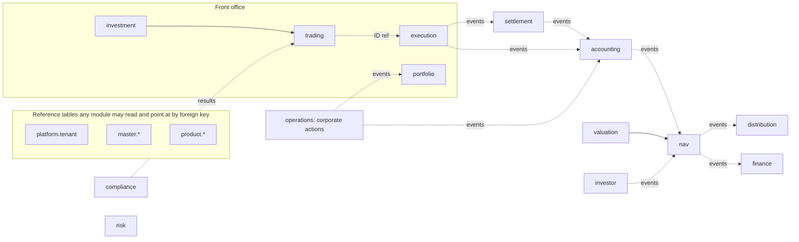

# DA-001 — Canonical Enterprise Data Model

This document is the one agreed list of the things AMC OS stores, which module owns each of them, how each is identified, how it changes over time, and how the pieces connect. It is master prompt §7 ("First create a canonical enterprise data model") and §14 Stage C items 1 ("Canonical enterprise data model") and 2 ("Entity relationship diagrams"). The diagrams are in [`architecture/erds/`](../../architecture/erds/README.md), one file per domain, as annexes of this document. Column-level detail for every table (data types, nullability, indexes, retention, sensitivity, example records) is the data dictionary DBE-001 (Step 17); the PostgreSQL DDL that implements this model is Step 16.

**Builds on Draft documents:** DA-000 v0.9, DDL-000 v0.9, DBT-000 v0.9, EA-001…EA-008, INT-001, ADR-0002, ADR-0003, ADR-0005, ADR-0006, ADR-0007, ADR-0008, ADR-0017, BA-001, BA-005, PRD-001…PRD-017 — allowed by owner decision D-3 ([GOV-008](../00_governance/GOV-008_build_loop.md) §2 rule 3). Nothing used here is Approved; EA-001…EA-008 and INT-001 are still waiting for the owner to merge. Owner decisions used: Q2 ([GOV-006](../00_governance/GOV-006_gap_analysis_and_delivery_plan.md) §4), D-14, D-16, D-26, D-29, D-33, D-40, D-44, D-53, D-60, D-62, D-70, D-73, D-76, D-77 ([LOOP_STATE.md](../../LOOP_STATE.md)).

**Status of every decision in this document:** **[DES]** — a design proposal for the owner (interim ARB) to accept or change, unless another label is shown. No regulatory fact is stated here; retention periods, statutory record lists and the like stay **[VAL]** for REG-001 (Step 25). No business rule (rate, threshold, cut-off, formula) is set here: where the data model needs one, the rule is an owner question and the model is built so the rule is **data**, not code.

**Depends on ADR-0020 (drafted and merged as Draft on 24 Nov 2026, not yet accepted by the owner; owner-only folder).** Three parts of this model move tables between schemas or change who may write a table: the trade record and allocation results move to `execution` (EA-003 T1), corporate actions move to `operations` (EA-003 T3), and every schema gets its own outbox, delivery, inbox, dead-letter and idempotency tables written only by its own database role (EA-003 T15, EA-007 D1–D6). GOV-002 §2 requires an ADR before such changes are built. This document shows the **target** model so the owner can see the whole picture; Step 16 must not build the moved tables or the per-module roles until ADR-0020 is accepted. Every such entity is marked **(ADR-0020)** in §4.

**Plain-language terms**

| Term | Meaning here |
| --- | --- |
| Entity | One kind of thing we keep records of (an order, a NAV run, a distributor). In the database it is a table |
| Canonical | The one agreed shape and name for a kind of data, used by every module, whatever outside system it came from |
| Owning module | The only module allowed to create or change rows of the entity (EA-003 B1) |
| Tenant key | The AMC's ID (`tenant_id`), the first part of every key, so one AMC's row can never point at another AMC's row |
| Effective-dated | The row says from when to when it is valid in business terms (for example a fee rate valid from 1 April) |
| Bi-temporal | Effective-dated **and** the row also records when we learned or corrected it, so we can answer "what did we believe on date X about date Y?" |
| Insert-only | Rows are only ever added; a mistake is fixed by adding a reversal or a new version, never by editing |
| State machine | The record moves through named states (for example `DRAFT → APPROVED`), and only the moves listed in a transition table are allowed |
| Provenance | Where a copy of outside data came from: which provider, which file or message, when, and with which adapter |
| Crosswalk | The list that maps our internal ID to every outside code for the same thing (ISIN, AMFI code, RTA code …) |
| ERD | Entity relationship diagram: boxes for entities, lines for "one … has many …" |

## 1. Modelling rules

These rules apply to every entity in §4. They take DA-000 Ch 1–2 and the master prompt §7 list of 18 design principles and make each one checkable. The last column says how Step 16 (DDL) and DBT tests prove it.

| # | Rule | Master prompt §7 principle | Proved by |
| --- | --- | --- | --- |
| M1 | **Internal IDs are UUIDs**, created once by the owning module and never changed or reused (GOV-001 §4). Business codes (scheme code, folio number, ARN) are separate columns with their own unique keys | 1 Stable internal UUID identifiers | DDL review; catalogue query in DBT |
| M2 | **Tenant key first.** Every tenant table's primary key starts with `tenant_id`; every foreign key between tenant tables is composite `(tenant_id, <id>)`; forced row-level security on the table and every partition (`platform.apply_tenant_rls()`) | 2 Tenant-aware relationships | DBT-000 T1a–T1g; catalogue check |
| M3 | **Rows that are not tenant rows** exist only in `platform` (product-level catalogue and release data, EA-005 §1, EA-008 §8), `master.currency` (D-62) and a few **product definition lists shipped with each release** that say how the product itself behaves: the permission list (`identity.permission`), state-transition tables (`<schema>.<entity>_transition`, M14; DDL-000's `trading.order_state_transition` keeps its name) and state-mapping tables between two state machines (`settlement.instruction_effect`, DM-10). These lists are read-only for every application role and change only by migration. Nothing else is shared between tenants | 2 | Catalogue query: every table without `tenant_id` is on this list |
| M4 | **Foreign keys are declared** inside a schema, and across schemas only to the stable reference tables `platform.tenant`, `master.*` and `product.*` (DA-000 Ch 2, EA-003 B2). Any other cross-schema link is an **ID reference** column named `<entity>_id`, checked by the owning module through the other module's interface and by reconciliation, so a module can later move to its own database. DDL-000 has two cross-schema keys that break this rule (§5 DM-20) | 3 Explicit foreign-key constraints | Catalogue query on `pg_constraint` |
| M5 | **Exact decimals only** (ADR-0005). ADR-0005 fixes the **scales**: amounts 4 decimals, units and quantities 6, prices 8, unrounded NAV 12, published NAV per plan configuration **[VAL with RTA]**. This model adds only a **minimum precision** per kind: amounts `numeric(24,4)`, units `numeric(24,6)`, prices `numeric(24,8)`, unrounded NAV `numeric(30,12)`; scheme-level totals and accumulators may be wider (DDL-000 already uses `numeric(26,4)`, `numeric(26,6)` and `numeric(30,4)`). Rates and percentages keep their DDL-000 scales until the FE specification that uses them sets one (Steps 20–23). Step 16 may **widen** precision, never narrow it and never change a scale. Column-by-column targets are in §3.7. No float type is used anywhere | 4 Decimal/Numeric financial fields | Catalogue query: no `real`, `double precision` or `money` type; every numeric column meets the §3.7 minimum |
| M6 | **Business validity** is a `daterange` column `valid_period` (inclusive start, exclusive end), with an exclusion constraint so two approved versions of the same thing never overlap (as DDL-000 already does for fees and rule versions). DDL-000 calls this column `effective`; Step 16 renames it to `valid_period` everywhere (also on tables marked E in §4), and replaces single `valid_from` / `valid_to` date pairs with it | 5 Effective-dated records | Exclusion constraints; DBT overlap tests |
| M7 | **Bi-temporal** for master data, rules, rates, mappings and configuration (code BT, §3.1): `valid_period` plus `recorded_at` and `superseded_at`. Rows are insert-only except that `superseded_at` may be set once, by trigger, when a correcting row is inserted. Because several rows then exist for one thing, a BT entity that other rows point at is split into an **anchor** (one row per ID, the foreign-key target) and **versions** (§3.1). Closes PRD-016 C6 (§5 DM-1) | 5, 12 | DBT test: "as known on X about Y" query returns the old belief after a correction |
| M8 | **Two kinds of time** on every fact: `occurred_at` / `recorded_at` (`timestamptz`, system time, set by the database) and a **business date** (`trade_date`, `nav_date`, `accounting_date`, `txn_date` …, type `date`, in the tenant's business calendar). Times are stored in UTC and shown in IST | 6 Event timestamps; 7 Business-effective dates | DDL review |
| M9 | **Provenance on every copy of outside data** (EA-003 §6 point 3; INT-001 §3): a row loaded from a provider carries `load_run_id`, `source_system`, `source_record_ref`, `source_as_of` and `licence_tag`; the load run carries connection, adapter version, raw-landing object reference and checksum (§3.3) | 8 Source-system identifiers; 17 Data lineage | DBT test: a loaded row without a load run is refused |
| M10 | **Crosswalks** map internal IDs to outside codes, one row per code, effective-dated and bi-temporal (§3.4) | 9 External identifier crosswalks | Unique key per code scheme and value per date |
| M11 | **Configuration and rule sets are versions**, never edited in place: a new version row with maker, checker, approval reference, state and `valid_period` (EA-008 §5–§6) | 10 Versioned configuration | DBT test: update of an approved version is refused |
| M12 | **Financial facts are insert-only** (executions, journals, NAV results, investor transactions, check results, commission lines, audit, AI tool calls). A correction is a reversal row or a new version linked to the one it corrects (`reverses_<x>_id`, `corrects_<x>_id`, `supersedes_<x>_id`) | 11 Immutable financial history | DDL-000 immutability triggers; DBT-000 T3a, T3b |
| M13 | **Reproducibility:** every calculated result stores the identifiers and versions of everything it used: input manifest (snapshot ID and hash, price set, rule and model versions, configuration version, engine version `FE-nn@<version>` as in EA-007 §13) | 12 Historical reproducibility | Replay test per engine (FE specifications) |
| M14 | **State machines as data:** a status column on a state-machine entity is checked against a transition table `<schema>.<entity>_transition (from_state, to_state, cause)`; the first state of a new row is a transition row with `from_state = '(NEW)'` (a fixed marker, because a key column cannot be empty), so a row cannot be born in a later state; the allowed states are exactly the states named in the transition table, checked by the same trigger on insert and update; every accepted move writes a history row and an outbox row in the same transaction (DA-000 §7.3). Self-moves (`A → A`) are not transitions (§5 DM-5) | 11 | DBT tests per state machine |
| M15 | **Every index starts with `tenant_id`**; open work has a partial index; append-only time columns of very large partitions may use BRIN. The index list per table is DBE-001 / DBE-002 (Steps 17, 19) | 13 Indexed query paths | `EXPLAIN` baselines (DA-000 Ch 9) |
| M16 | **Partitioning only where volume needs it** (§6): by business date (monthly or yearly); a unique business key that must hold across partitions is kept in a separate small **de-duplication key table** written in the same transaction (§5 DM-9) | 14 Controlled partitioning | DBT duplicate tests across partitions |
| M17 | **Retention class and sensitivity are attributes of the table** (recorded in DBE-001) and, for documents and raw files, of each object. The values (how many years) are **[VAL]** for REG-001 (Step 25); the model only makes sure each table has one (§7) | 15 Archival and retention | DBE-001 completeness check |
| M18 | **Loads are incremental and idempotent**: each load has a key (INT-001 §5) and a load-run record; reloading the same file or record changes nothing | 16 Incremental ingestion | INT-001 tests T-I1…T-I7 |
| M19 | **Every table is created only by a reviewed migration** (Alembic, Step 18) that ends with `platform.apply_tenant_rls()`; a table not in this model and DBE-001 is an undocumented table (master prompt §21) and fails review | 18 Migration governance | Schema-diff check in CI (Step 18) |
| M20 | **JSONB only for variable payloads**: event payloads, raw message bodies, before/after images in audit, rule definitions whose shape is the rule engine's (FE-04), AI tool inputs and outputs, input manifests. Never for amounts, quantities, states, keys or anything a query filters on routinely (master prompt §7) | — | DDL review |
| M21 | **Standard columns** on mutable rows: `created_at`, `created_by`, `updated_at`, `row_version` (optimistic locking, `platform.tg_bump_version`); on approved rows: `approval_request_id` (ID reference to `workflow.approval_request`, M4) | — | DDL review |
| M22 | **Personal data** (PAN, names, addresses, contact details, bank accounts, CKYC number) is held only in `investor` (investors), `distribution` (individual distributors and EUIN holders) and `identity` (users), encrypted with tenant data keys and searched by keyed hash (EA-005 §5). It never appears in event payloads, audit images, analytics marts or AI logs unmasked (PRD-013 NFR-SEC-004) | — | DBT test on audit images; data-classification scan |

**Naming.** Schemas and tables are lower-case `snake_case`, singular (`nav_run`, not `nav_runs`). The fully qualified table name is the table's ID (GOV-001 §4) and is never reused after a drop. `order` is a reserved word and stays quoted (`trading."order"`) as in DDL-000. State values are upper-case `SNAKE_CASE`.

## 2. Schemas and owners

The 23 schemas of master prompt §7, each written only by the module named (EA-003 §2). Counts are entities in §4 (existing in DDL-000 / new or moved in this model), not counting the standard per-schema tables of §3.2 or the implied `_version`, `_transition` and `_history` tables (§4 introduction). Totals: 67 entries from DDL-000 and 270 new or moved. DDL-000 has 67 tables (not counting partitions): 64 keep their names in §4, `settlement.trade` becomes `settlement.settlement` (DM-7), and `platform.outbox_event` and `platform.idempotency_key` are replaced by the §3.2 tables (DM-4); the other two DDL-000 entries are the `accounting.trial_balance()` function and the `analytics.mv_daily_aum` view.

| Schema | Owning module (EA-003 §2) | Domain | What it holds | Entities (from DDL-000 / new or moved) |
| --- | --- | --- | --- | --- |
| `platform` | Tenant | D01 | The tenant record **inside the cell** (EA-006 §1.3 — not the vendor control plane), cell, entitlements, organisation units, calendars, configuration catalogue and versions, schedule entries, removal authorisations | 2 / 18 |
| `identity` | Identity | D01 | Users, roles, rights, grants with scope, approval authorities, sessions, service accounts, recertification, break-glass grants | 5 / 8 |
| `audit` | Tenant (audit write function, EA-003 B8) | D01 | Hash-chained audit events, daily anchors, access log, import runs | 1 / 3 |
| `master` | Security master | D16 | Currencies, issuers, groups, securities, schedules, ratings, benchmarks, counterparties, crosswalk, stewardship | 6 / 10 |
| `product` | Product | D02 | Schemes, versions, plans, categories, mandates, fees, loads, benchmark mapping, NFO, scheme events | 5 / 8 |
| `investment` | Investment | D03 | Research, recommendations, universe, restricted list, IC meetings and votes, decisions, policies, house views | 3 / 12 |
| `portfolio` | Portfolio | D04 | Portfolios, position lots and events, snapshots, cash ladder, models, rebalance proposals, performance | 2 / 11 |
| `trading` | OMS | D05 | Orders and versions, order events, blocks, block membership, RFQ quotes, WARN acknowledgements | 4 / 5 |
| `execution` | Execution | D06 | Broker orders, raw messages, fills, **trades and allocations (ADR-0020)**, contract notes, brokers, rate tables, trade-charges table | 1 / 16 |
| `settlement` | Settlement | D07 | Settlement records (one per trade), obligations, instructions, payment instructions, fails, SSIs, bank details, cycles | 2 / 13 |
| `compliance` | Compliance | D08 | Regulation register, rules, versions, parameters, tests, check results, overrides, exemptions, breaches, reports | 6 / 13 |
| `risk` | Risk | D09 | Models, runs, results, scenarios, alert thresholds, alerts, packs (limits are Compliance rules, D-33) | 0 / 13 |
| `accounting` | Accounting | D10 | Chart of accounts, scheme accounts, periods, posting rules, journals, accruals, open items, mirror ledgers | 5 / 9 |
| `valuation` | Valuation | D11 | Prices, source hierarchy, overrides, policy, fair-value cases, valuation results | 1 / 9 |
| `nav` | NAV | D11 | NAV runs, components, results, validations, publications, custodian NAV, deadlines | 4 / 7 |
| `operations` | Operations | D12 | Connections, file registers, expected-file schedule, reconciliation, breaks, exceptions, day plan, cut-offs, checklists, **corporate actions (ADR-0020)** | 3 / 17 |
| `workflow` | Workflow | D12 | Approval requests and decisions, approval chains, human tasks, delegations | 2 / 4 |
| `documents` | Documents | D12 | Document metadata, versions, retention classes, legal holds | 1 / 3 |
| `investor` | Investor | D13 | Investors, folios, holders, nominees, bank accounts, mandates, transactions, unit lots, registrations, payouts, service requests, complaints, consents | 4 / 26 |
| `distribution` | Distribution | D14 | Distributors, EUINs, hierarchy, mappings, agreements, commission and incentive rules, runs, lines, payouts, segments, forecasts | 5 / 25 |
| `finance` | Finance | D15 | ERP exports, expenses, allocation keys and runs, budgets, plans, forecasts, management periods, board packs | 0 / 16 |
| `analytics` | Reporting | D16 | Metric registry, datasets, data-quality rules and results, certification, access requests, pipeline runs, lineage pointers | 2 / 9 |
| `ai` | AI | D17 | Assistant definitions and enablement, prompts, tools, sessions, tool calls, retrieval log, proposals, evaluations, models, kill switch, usage | 3 / 15 |
`platform` holds most of the rows that are not tenant rows; the full list of such tables is M3. `platform` is an in-cell schema of the Tenant module, as EA-006 §1.3 says; DA-000 Ch 2 called it "global control plane", which this document replaces.

Solid arrow: the later module reads the earlier one's data through its interface. Dotted: the link is an ID reference kept consistent by events (M4). The full call and event map is EA-003 §4 and EA-007 §8; this picture shows only the main data hand-offs.

## 3. Common building blocks

### 3.1 Time model codes used in §4

| Code | Meaning | Typical entities |
| --- | --- | --- |
| **BT** | Bi-temporal (M7): `valid_period` + `recorded_at` / `superseded_at`; insert-only apart from closing `superseded_at` | Securities, issuers, ratings, counterparties, crosswalk rows, SSIs, fee and load schedules, commission rates, RM mappings, calendars, chart of accounts |
| **VR** | Approved versions (M11): version number, maker, checker, approval reference, state `DRAFT → … → APPROVED → SUPERSEDED`, `valid_period` | Rule versions, posting rules, valuation policy, risk model versions, configuration versions, prompt versions |
| **SM** | State machine with a transition table (M14) and a history row per move | Orders, NAV runs, breaks, commission runs, settlement records, instructions |
| **IO** | Insert-only fact (M12); corrected by a linked reversal or new version | Fills, journal lines, NAV results, investor transactions, check results |
| **LOG** | Insert-only log, usually partitioned by time | Audit events, tool calls, raw messages, attempts |
| **MU** | Mutable record, every change audited through the audit write function (B8) | Folio status, user profile, connection settings |
| **DER** | Derived and rebuildable from other tables (may be a view) | Unit balances, exposure views |

**Keys of BT tables.** A BT table holds several rows for one thing (one per correction and per validity period), so its key cannot be the business ID alone:

1. **BT entity keyed by its own ID, or one that other rows point at by foreign key** (for example `master.security`, `master.issuer`, `master.counterparty`, `investor.investor`, `settlement.ssi`, `operations.connection`, `accounting.account`, `identity.user_role`) is two tables: the **anchor** `<schema>.<entity>` keyed `(tenant_id, <id>)`, which holds only what never changes (the ID or code, creation time, the owning tenant) and is the target of every foreign key; and the **versions** `<schema>.<entity>_version` keyed `(tenant_id, <id>, valid_period, recorded_at)`, with an exclusion constraint so that, among rows not superseded (`superseded_at IS NULL`), validity periods of one ID never overlap. A rule such as "the account must be valid on the line's date" is checked by the owning module's trigger in addition to the foreign key, never instead of it. Every BT row in §4 whose key is an ID alone (for example `master.credit_rating`, `investor.consent`, `investor.bank_account`, `workflow.delegation`) uses this pattern. §4 shows the anchor key; the `_version` table is implied and not counted separately.
2. **BT table that nothing points at by foreign key**, keyed by a business key plus a date or a validity period (for example `product.fee_schedule`, `distribution.rm_mapping`, `platform.business_calendar`, `master.security_schedule`), adds `recorded_at` to its key and gets the same exclusion constraint on rows not superseded. §4 shows these keys **without** `recorded_at`, which every one of them has. No separate anchor is needed.
3. **Business-code unique keys** on a BT entity (ISIN, PAN keyed hash, LEI of an issuer or counterparty) are exclusion constraints on the version table — `(tenant_id WITH =, <code> WITH =, valid_period WITH &&) WHERE (superseded_at IS NULL)` — so two current versions can never carry the same code for overlapping periods, the same mechanism as the crosswalk (§3.4). A code that can never change may instead be a plain unique key on the anchor.

### 3.2 Tables every module schema has (EA-003 T15, EA-007 D1–D6) — (ADR-0020)

Each module schema (all except `audit`) has the same five tables, written only by that module's database role. They replace DDL-000's one shared `platform.outbox_event` and `platform.idempotency_key`.

| Table | Key | Content | Time model |
| --- | --- | --- | --- |
| `<schema>.outbox_event` | `(tenant_id, event_id)` | The EA-007 §3 envelope as columns (`envelope_version`, `event_type`, `event_version`, `producer`, `aggregate_type`, `aggregate_id`, `aggregate_seq`, `occurred_at`, `business_date`, `correlation_id`, `causation_id`, `process_workflow_id`, actor fields, `data_classification`) plus `payload` (JSONB, M20); unique `(tenant_id, aggregate_type, aggregate_id, aggregate_seq)` keeps per-aggregate order (EA-007 E4) | LOG; **not partitioned**, so both unique keys hold; kept 35 days after delivery **[ASSUMPTION, Q75]**, then archived and removed in small batches by the module's own role |
| `<schema>.outbox_delivery` | `(tenant_id, event_id, handler)` | One row per event and subscribed handler: status, attempts, next attempt time, last error code | MU (by the relay only) |
| `<schema>.inbox_event` | `(tenant_id, event_id, handler)` | Events this module has processed, inserted in the same transaction as the effect (EA-007 D4) | LOG; **not partitioned**, so the unique key always stops a second delivery taking effect; kept at least as long as producers' outbox rows, then removed in small batches |
| `<schema>.dead_letter_event` | `(tenant_id, dead_letter_id)` | Event envelope, error, attempts, status (`OPEN → REPLAYED`, the only resolution EA-007 D7 allows), parked aggregate flag (EA-007 D6) | SM |
| `<schema>.idempotency_key` | `(tenant_id, idempotency_key)` | API replay protection and outbound-instruction keys (INT-001 §5, ADR-0017 Decision 3): request hash, stored response reference, expiry | MU; purged after expiry. Financial keys are never held only in the cache (ADR-0017) |

### 3.3 Provenance: load runs and loaded rows (M9, INT-001 §3)

Provenance is split so that each fact is stored once:

| Level | Where | Columns |
| --- | --- | --- |
| File or message | `operations.inbound_file` (exists) | Connection, provider file or batch reference, received time, raw-landing object reference, SHA-256 checksum, control totals, `parse_status` (DDL-000: `RECEIVED`, `PARSED`, `QUARANTINED`, `DUPLICATE`; this model adds `LOADED` once every load run from the file has finished) |
| Load run | `<owning schema>.load_run` (new, one per owning module that loads outside data) | `inbound_file_id` (ID reference, M4) or message session, adapter name and version, canonical family (INT-001 §3), business date, row counts loaded / quarantined, status |
| Loaded row | The owning module's own table (for example `valuation.price`, `investor.investor_txn`) | `load_run_id`, `source_system`, `source_record_ref`, `source_as_of`, `licence_tag` (INT-001 I11), `data_classification` |

Rows typed in by a person carry `source_system = 'AMC_OS_MANUAL'` and the approval reference instead of a load run. Rows produced by an engine carry the engine version and input manifest instead (M13).

### 3.4 Identifier crosswalk (M10; PRD-016 FR-D16-017)

| Table | Owner | Content |
| --- | --- | --- |
| `master.identifier_scheme` | Security master | The list of outside code types: ISIN, NSE symbol, BSE scrip code, LEI, CIN, AMFI scheme code, RTA scheme and plan codes, depository codes, custodian codes, vendor codes. Each with format check and issuing body. Tenant-scoped (licensed vendor code sets differ per AMC, D-62) |
| `master.external_identifier` | Security master | Crosswalk for entities Security master owns (security, issuer, issuer group, counterparty, benchmark): `(entity_type, entity_id, scheme_code, value, valid_period)`, BT, with provenance; unique on `(tenant_id, scheme_code, value, valid_period)` without overlap, so one outside code points to one entity on any date |
| `product.external_identifier`, `distribution.external_identifier`, `investor.external_identifier` | Product, Distribution, Investor | Same shape, for schemes and plans (AMFI and RTA codes, ISIN per plan option), distributors (ARN mapping history, RTA broker codes) and folios (RTA folio references where they differ) |

**Why not one crosswalk table:** FR-D16-017 asks for "one mapping per entity" in D16. A single `master` table would make Security master write rows about plans, distributors and folios, which belong to other modules (EA-003 B1, T9). The four tables share one shape and the code list in `master.identifier_scheme`; Reporting combines them into one crosswalk view in the analytical store for lineage and data-quality checks. An unmapped outside code in a load sends the row to quarantine (FR-D16-017) in every case. PRD-016 needs a one-line change to say this (§8).

### 3.5 Outbound instructions (INT-001 §6, EA-007 §9.3 class A2)

Every module that sends something able to move money, securities or published figures keeps it in its own instruction table with two separate status columns:

| Column group | Values | Meaning |
| --- | --- | --- |
| `delivery_state` | `READY`, `SENT`, `ACKNOWLEDGED`, `UNKNOWN_OUTCOME`, `INVESTIGATION` (INT-001 §6) | Did the provider get it? Same for every provider |
| Business status | Per entity (for example settlement `MATCHED`, `SETTLED`) | What the provider did with it |
| Keys | `idempotency_key` (workflow ID + activity + step), `client_reference` sent to the provider, `connection_id` (ID reference to `operations.connection`), `ack_deadline` | INT-001 §5, OUT3 |
| Attempts | `<schema>.<instruction>_attempt` (LOG): every send, ack, status query, decision and permitted resend with person and time | INT-001 OUT6, NFR-AUD-019 |

Instruction tables using this pattern: `execution.broker_order`, `settlement.instruction`, `settlement.payment_instruction`, `distribution.payment_file`, `nav.nav_publication`, `investor.platform_file` (only where the AMC, not the RTA, sends; INT-001 §6). Each has its `_attempt` table; §4 lists them and counts them. Human-task channels (scheme set-up, ISIN request, SEBI filing) are `workflow.task` rows instead.

### 3.6 Approvals

A record that needs maker-checker stores `approval_request_id` (ID reference to `workflow.approval_request`, M4) and the version it was approved at. The owning module checks in the same transaction that the request is `APPROVED` for that object and version before it changes state (DA-000 §7.3 rule 3). The Workflow module enforces maker ≠ checker, no service identity and no AI decision (DDL-000 trigger; BA-005 SOD rules).

### 3.7 Numeric columns of DDL-000 and their target (M5, DM-22)

Every numeric column in DDL-000, with what Step 16 does to it. "Keep" means precision and scale stay as they are. No column narrows and no scale changes.

| Kind (ADR-0005 scale) | Columns in DDL-000 | Today | Target |
| --- | --- | --- | --- |
| Amount (4) | `settlement.trade.gross_amount`, `net_amount`, `accrued_interest`; `trading."order".amount`; `portfolio.snapshot_position.book_cost`, `accrued_interest`, `market_value`; `accounting.journal_line.amount`; `investor.investor_txn.gross_amount`, `net_amount` | `numeric(24,4)` | Keep |
| Amount (4) | `settlement.trade.brokerage`, `stt`, `stamp_duty`, `gst`, `other_charges`; `investor.investor_txn.stamp_duty`, `exit_load`, `tds`; `investor.sip_registration.amount`; `distribution.commission_line.gross_commission`, `gst`, `tds`, `clawback`, `net_payable` | `numeric(20,4)` | Widen to `numeric(24,4)` |
| Amount (4), scheme totals | `nav.nav_result.total_assets`, `total_liabilities`, `net_assets` | `numeric(26,4)` | Keep |
| Amount × days (4) | `distribution.commission_line.aum_days` | `numeric(30,4)` | Keep |
| Units / quantity (6) | `trading."order".quantity`, `filled_quantity`; `trading.block_allocation.allocated_quantity`; `execution.fill.quantity`; `settlement.trade.quantity`; `portfolio.snapshot_position.quantity`, `settled_quantity`; `investor.investor_txn.units` | `numeric(24,6)` | Keep |
| Units (6), scheme totals | `nav.nav_result.units_outstanding` | `numeric(26,6)` | Keep |
| Amount or units in a reconciliation (6) | `operations.recon_break.our_value`, `their_value`, `difference` | `numeric(26,6)` | Keep (scale 6 holds both amounts and units) |
| Price (8) | `trading."order".limit_price`; `trading.block_allocation.average_price`; `execution.fill.price`; `settlement.trade.price`; `portfolio.snapshot_position.price`; `valuation.price.price` | `numeric(24,8)` | Keep |
| Unrounded NAV (12) | `nav.nav_result.nav_unrounded` | `numeric(30,12)` | Keep |
| Published NAV (stored at 6; the value is rounded to `product.plan.nav_decimals` **[VAL with RTA]**) | `nav.nav_result.nav_per_unit`; `investor.investor_txn.applicable_nav` | `numeric(20,6)` | Keep |
| Rates and percentages (scale set by the FE specification that uses them) | `product.fee_schedule.rate_pct_pa`, `master.security.coupon_rate`, `distribution.commission_rate.trail_pct_pa`, `distribution.commission_line.trail_pct_pa`, `trading.block_allocation.intent_pct` | `numeric(9,6)` | Keep |
| Rates and percentages | `product.exit_load_slab.load_pct` | `numeric(7,4)` | Keep |
| Rates and percentages | `portfolio.snapshot_position.pct_net_assets`, `valuation.price.yield_pct` | `numeric(12,8)` | Keep |
| Rule values | `compliance.rule_parameter.param_value` | `numeric(20,8)` | Keep |
| Rule values | `compliance.check_result.measured_value`, `threshold_value` | `numeric(24,8)` | Keep |
| Security and plan terms | `master.security.face_value` `numeric(20,6)`, `lot_size` `numeric(20,4)`, `tick_size` `numeric(12,6)`; `product.plan.face_value` `numeric(12,4)` | as shown | Keep; DBE-001 (Step 17) confirms each against the kind it belongs to |

Columns of new tables take the minimum of their kind (M5). Where a new column's kind is not clear (for example a ratio used by an engine), DBE-001 records it and the FE specification decides.

## 4. Entity catalogue

One table per schema. **Status:** **E** = in DDL-000, shape kept; **C** = in DDL-000, changes (decision in §5); **N** = new (listed in the PRD §10 "not yet in DDL-000" column or in an EA document); **M** = moves from another schema **(ADR-0020)**. **Time** codes are §3.1. **Key** is the primary key after `tenant_id` (every key starts with `tenant_id` unless the row says "no tenant"). Names of new tables are proposals for Step 16; the PRD or EA source is in the last column. The standard tables of §3.2 are not repeated. Also implied and not listed: the `_version` table of each anchored BT entity (§3.1), and the transition table and history table of each SM entity (M14) other than those listed (`trading.order_state_transition`, `trading.order_event`, `settlement.settlement_transition`, `risk.risk_alert_history`); their names are `<entity>_transition` and `<entity>_history`, and DBE-001 lists them. The `_attempt` tables of §3.5 are listed.

### 4.1 `platform` — Tenant module (D01) · ERD: [D01](../../architecture/erds/D01_platform_identity_audit.md)

| Entity | Purpose | Time | Key | Status | Source |
| --- | --- | --- | --- | --- | --- |
| `platform.tenant` | The AMC environment in this cell: legal names, isolation tier, hosting account, cell, region, plan, status (adds `MIGRATED_OUT`, DM-16), tenant key reference | MU | `tenant_id` (no tenant column above it) | C (DM-16) | DDL-000; FR-D01-001; EA-004 §11; EA-006 §1.3 |
| `platform.cell` | This cell's own identity: cell ID, kind (production, non-production, vendor test), shape (shared, dedicated), region. One row per cell | MU | `cell_id` (no tenant) | N | GOV-006 Step 16; EA-004 §1–§3 |
| `platform.tenant_status_history` | Every tenant status change, with who confirmed it in the cell (EA-006 §1.3) | IO | `(tenant_id, changed_at)` | N | FR-D01-002 |
| `platform.subscription` | Plan and modules the tenant has, as received from the control plane (signed desired state) | BT | `subscription_id` | N | PRD-001 §10; D-14 |
| `platform.tenant_entitlement` | Per module and limit: what the tenant may use, from when | BT | `(module_code, valid_period)` | N | PRD-001 §10; event `TENANT_ENTITLEMENT_CHANGED` |
| `platform.usage_meter` | Usage counts per tenant, module and day (counts only, sent to the control plane, EA-006 CP-4) | IO | `(meter_code, usage_date)` | N | PRD-001 §10; D-26 |
| `platform.organisation_unit` | Legal entities, departments, branches, cost centres in one tree, effective-dated | BT | `org_unit_id` | N | PRD-001 §10 (CAP-D01-007) |
| `platform.reporting_line` | Who reports to whom (person or unit), effective-dated | BT | `reporting_line_id` | N | PRD-001 §10 |
| `platform.business_calendar` | The one holiday calendar per calendar code (T17) | BT | `(calendar_code, calendar_date)` | C (bi-temporal columns added, M7) | DDL-000; T17 |
| `platform.config_item` | The configuration catalogue: one row per setting, loaded with each release | VR | `item_key, release` (no tenant; M3) | N | EA-008 §3, §8 |
| `platform.config_version` | One approved version of a tenant's configuration: maker, checker, approval reference, state, effective date | VR | `config_version_id` | N | EA-008 §5, §8 |
| `platform.config_value` | Value per setting key, scope (tenant or scheme) and version | VR | `(config_version_id, item_key, scope_type, scope_id)` | N | EA-008 §8 |
| `platform.config_promotion` | Each promotion between the tenant's UAT and production environments: bundle hash, source, target, time | IO | `promotion_id` | N | EA-008 §8; EA-006 §4 |
| `platform.code_list`, `platform.code_value` | Product-level reference code lists (countries, states, reason codes) shipped with releases | VR | `list_code` / `(list_code, value)` (no tenant; M3) | N | PRD-001 §10 |
| `platform.feature_flag` | Release-delivered flags and the tenant's state for each | VR | `(flag_key)` | N | PRD-001 §10 |
| `platform.schedule_entry` | Tenant-scoped schedule rows that start calendar-driven jobs (accrual run, expected files); created by an approved action; carries the tenant for the scheduler (EA-005 §2) | VR | `schedule_entry_id` | N | EA-005 §2, §9 |
| `platform.environment_release` | Releases and migration steps applied in this cell, as reported to the control plane | IO | `release_id` (no tenant: one row per cell release; M3) | N | PRD-001 §10 |
| `platform.notification_channel` | Where the tenant wants operational notices sent (role mailboxes, not personal data) | MU | `channel_id` | N | PRD-001 §10 |
| `platform.tenant_removal_authorisation` | Two-sided approved authorisation to remove one tenant's protected rows at exit or after a migration (DM-17) | SM | `authorisation_id` | N | EA-005 §2.1, G6 |

### 4.2 `identity` — Identity module (D01) · ERD: [D01](../../architecture/erds/D01_platform_identity_audit.md)

| Entity | Purpose | Time | Key | Status | Source |
| --- | --- | --- | --- | --- | --- |
| `identity.app_user` | A person or service identity (integration, AI assistant, system worker) known to the tenant; linked to the IdP subject. Users pushed from the AMC's identity provider (INT-001 §3, INT-015) carry provenance (M9): IdP connection, `provisioned_via`, the IdP's message or change ID and time — no load run, because changes arrive one at a time. `is_service_identity` is fixed at creation (DM-20) | MU | `user_id` | C (provenance columns; `is_service_identity` made unchangeable) | DDL-000; FR-D01-010 |
| `identity.permission` | Product-level list of rights, flags for approval rights and AI-forbidden rights | VR | `permission_code` (no tenant; M3) | E (already a product-level list) | DDL-000; BA-005 |
| `identity.role` | Roles of the tenant (ROLE-01…ROLE-27 seeded, BA-005) | MU | `role_code` | E | DDL-000 |
| `identity.role_permission` | Rights per role | BT | `(role_code, permission_code, valid_period)` | C (effective-dated) | DDL-000 |
| `identity.user_role` | Role grant to a user with scope attributes, granted and approved by two people (SOD-05); anchor per grant, versions per validity period (§3.1 rule 1) | BT | `grant_id`; versions `(grant_id, valid_period, recorded_at)` | C (DDL-000 key is `(user_id, role_code, valid_from)`; becomes a grant anchor so scope attributes can point at it) | DDL-000 |
| `identity.scope_attribute` | Named scope values a grant may carry (scheme, desk, branch, region) replacing free JSON in `user_role.scope` | BT | `(grant_id, attribute, value, valid_period)` | N | PRD-001 §10 |
| `identity.role_grant_request` | Request to grant or revoke a role, through WF-020 | SM | `request_id` | N | PRD-001 §10 |
| `identity.approval_authority` | Who may approve what, up to which limit, effective-dated (BA-005 approval authorities) | BT | `authority_id` | N | PRD-001 §10 |
| `identity.session` | Sign-in sessions (no tokens stored) | LOG | `session_id` | N | PRD-001 §10 |
| `identity.api_client` | Service accounts per integration and tenant (EA-002 §4.1) | MU | `client_id` | N | PRD-001 §10 |
| `identity.recertification_campaign`, `identity.recertification_item` | Periodic review of grants and each decision | SM | `campaign_id` / `(campaign_id, user_id, role_code)` | N | PRD-001 §10 |
| `identity.break_glass_grant` | Approved, time-limited support access to one tenant and scope, with its own login (EA-005 §6; DM-18) | SM | `grant_id` | N | EA-005 §6; WF-022 |

### 4.3 `audit` — Tenant module, audit write function (D01) · ERD: [D01](../../architecture/erds/D01_platform_identity_audit.md)

| Entity | Purpose | Time | Key | Status | Source |
| --- | --- | --- | --- | --- | --- |
| `audit.audit_event` | Hash-chained, append-only record of every action; written only through the audit write function (EA-003 B8) | LOG (monthly) | `(occurred_at, event_seq)` | C (DM-17: verified import path) | DDL-000; NFR-AUD-001 |
| `audit.chain_anchor` | Daily chain head per tenant, also written to WORM object storage | IO | `anchor_date` | N | PRD-001 §10 |
| `audit.access_log` | Reads of sensitive data (unmask, export, break-glass reads) | LOG (monthly) | `(accessed_at, access_id)` | N | PRD-001 §10; NFR-AUD-013 |
| `audit.import_run` | Each verified import of audit rows from another cell, with chain verification result (EA-005 §2.1) | IO | `import_run_id` | N | EA-005 §2.1, G6 |

### 4.4 `master` — Security master module (D16) · ERD: [D16](../../architecture/erds/D16_master_analytics.md)

| Entity | Purpose | Time | Key | Status | Source |
| --- | --- | --- | --- | --- | --- |
| `master.currency` | ISO currency list, shared by all tenants (D-62) | MU | `currency_code` (no tenant; M3) | E | DDL-000 |
| `master.issuer_group` | Issuer groups, incl. sponsor-group flag | BT | `group_id` | C (bi-temporal, DM-1) | DDL-000 |
| `master.issuer` | Issuer golden record (LEI, CIN, sector, type) | BT | `issuer_id` | C (DM-1) | DDL-000; FR-D16-012 |
| `master.security` | Security golden record (instrument type, issuer, face value, coupon, maturity, lot size, market-cap class, approval status) | BT | `security_id` | C (DM-1; ISIN moves to the crosswalk as its main code, kept as a column for speed) | DDL-000; FR-D16-013 |
| `master.security_schedule` | Coupon, call, put and redemption schedules of debt securities | BT | `(security_id, schedule_type, event_date)` | N | PRD-016 §10 |
| `master.credit_rating` | Ratings per agency for security or issuer | BT | `rating_id` | C (DM-1) | DDL-000 |
| `master.benchmark` | Benchmark and index definitions | BT | `benchmark_id` | C (DM-1) | DDL-000 |
| `master.benchmark_level` | Daily index levels (price and total return) | IO | `(benchmark_id, level_date, level_type)` | N | PRD-016 §10; INT-001 §3 |
| `master.benchmark_constituent` | Constituents and weights per date | IO | `(benchmark_id, as_of_date, security_id)` | N | PRD-016 §10 |
| `master.counterparty` | Counterparty golden record (custodians, banks, clearing corporations, brokers as legal entities, debt and repo counterparties) and non-broker empanelment status (T5) | BT | `counterparty_id` | N | EA-003 T5; PRD-016 §10 |
| `master.identifier_scheme` | Outside code types (§3.4) | MU | `scheme_code` | N | FR-D16-017 |
| `master.external_identifier` | Crosswalk for master entities (§3.4) | BT | `external_identifier_id` | N | FR-D16-017 |
| `master.source_precedence_rule` | Which provider wins for which field when sources disagree | VR | `(entity_type, field_name, version_no)` | N | PRD-016 §10 |
| `master.steward_request` | Request to create or change a golden record (WF-041), with evidence | SM | `request_id` | N | PRD-016 §10 |
| `master.match_candidate` | Possible duplicates found by matching, for a steward to decide; for D13/D14/D01 records only findings are returned to the owner's queue (T9) | SM | `candidate_id` | N | PRD-016 §10; T9 |
| `master.load_run` | Provenance of reference-data loads (§3.3) | IO | `load_run_id` | N | INT-001 §3 |

### 4.5 `product` — Product module (D02) · ERD: [D02](../../architecture/erds/D02_product.md)

| Entity | Purpose | Time | Key | Status | Source |
| --- | --- | --- | --- | --- | --- |
| `product.scheme` | Scheme master and lifecycle state | SM | `scheme_id` | E | DDL-000 |
| `product.scheme_version` | Versioned scheme attributes (category, benchmark, fund managers, fundamental attributes) | VR | `(scheme_id, version_no)` | E | DDL-000 |
| `product.plan` | Plans and options (regular / direct, growth / IDCW) with NAV decimals | MU | `plan_id` | E | DDL-000 |
| `product.category` | SEBI category list and its versions | VR | `(category_code, version_no)` | N | PRD-002 §10 |
| `product.scheme_mandate` | Asset-allocation ranges and permitted instruments per scheme version | VR | `(scheme_id, version_no, line_no)` | N | PRD-002 §10 |
| `product.benchmark_mapping` | Benchmark(s) per scheme, effective-dated (T18: data from Security master, mapping here) | BT | `(scheme_id, benchmark_role, valid_period)` | N | PRD-002 §10 |
| `product.fee_schedule` | TER and fee rates per plan | BT | `(plan_id, fee_type, valid_period)` | C (bi-temporal columns, M7) | DDL-000 |
| `product.exit_load_slab` | Exit-load slabs per plan | BT | `(plan_id, valid_period, min_days_held)` | C (M7) | DDL-000 |
| `product.nfo` | New fund offer record and the collections mirror | SM | `nfo_id` | N | PRD-002 §10; WF-001 |
| `product.scheme_event` | Lifecycle events: suspension, merger, winding-up, maturity, with effective dates | IO | `scheme_event_id` | N | PRD-002 §10 |
| `product.scheme_change_request` | Change request with fundamental-attribute flags and approvals | SM | `change_request_id` | N | PRD-002 §10 |
| `product.scheme_document_link` | Which `documents.document` version is the scheme's SID, KIM or SAI from when (content stays in Documents, BA-001 §4) | BT | `(scheme_id, document_type, valid_period)` | N | PRD-002 §10 |
| `product.external_identifier` | AMFI scheme code, RTA scheme and plan codes, ISIN per plan option (§3.4) | BT | `external_identifier_id` | N | FR-D16-017 |

### 4.6 `investment` — Investment module (D03) · ERD: [D03](../../architecture/erds/D03_investment.md)

| Entity | Purpose | Time | Key | Status | Source |
| --- | --- | --- | --- | --- | --- |
| `investment.universe_member` | Securities a scheme may hold | BT | `(scheme_id, security_id, valid_period)` | E | DDL-000 |
| `investment.restricted_list_entry` | Securities nobody may trade, with reason | BT | `entry_id` | E | DDL-000 |
| `investment.decision_record` | An investment decision that justifies orders | IO | `decision_id` | E | DDL-000 |
| `investment.research_note`, `investment.research_note_version` | Research notes and their versions (content in Documents) | VR | `note_id` / `(note_id, version_no)` | N | PRD-003 §10 |
| `investment.recommendation` | Buy / sell / hold recommendation with versions and thesis | VR | `(recommendation_id, version_no)` | N | PRD-003 §10 |
| `investment.coverage` | Which analyst covers which issuer or security | BT | `(analyst_user_id, issuer_id, valid_period)` | N | PRD-003 §10 |
| `investment.ic_meeting` | Investment committee meeting with agenda items and minutes link | SM | `meeting_id` | N | PRD-003 §10 |
| `investment.ic_agenda_item` | Items on an IC agenda | MU | `(meeting_id, item_no)` | N | PRD-003 §10 |
| `investment.ic_vote` | Each member's vote and conflict declaration | IO | `(meeting_id, item_no, member_user_id)` | N | PRD-003 §10; NFR-AUD-003 |
| `investment.credit_approval` | Approved credit limit per issuer with review date | VR | `(issuer_id, version_no)` | N | PRD-003 §10 |
| `investment.house_view`, `investment.scheme_strategy` | House view and per-scheme strategy versions | VR | `(view_id, version_no)` / `(scheme_id, version_no)` | N | PRD-003 §10 |
| `investment.investment_policy` | Investment policy versions (WF-031) | VR | `(policy_id, version_no)` | N | PRD-003 §10 |
| `investment.internal_limit_request` | Request to set a house limit, passed to Compliance as a rule change (WF-034) | SM | `request_id` | N | PRD-003 §10 |

### 4.7 `portfolio` — Portfolio module (D04) · ERD: [D04](../../architecture/erds/D04_portfolio.md)

| Entity | Purpose | Time | Key | Status | Source |
| --- | --- | --- | --- | --- | --- |
| `portfolio.portfolio` | Portfolio and sub-portfolio per scheme | MU | `portfolio_id` | N | PRD-004 §10 |
| `portfolio.position_lot` | Open lots per security (quantity, cost, acquisition date) | MU (each change has a position event) | `lot_id` | N | PRD-004 §10 |
| `portfolio.position_event` | Every change to a position, linked to its source event (trade, corporate action, transfer) | IO (monthly) | `(event_date, position_event_id)` | N | NFR-AUD-004 |
| `portfolio.snapshot` | End-of-day book per scheme and date, frozen when NAV is approved | SM | `snapshot_id` | E | DDL-000 |
| `portfolio.snapshot_position` | Positions in a snapshot | IO (yearly) | `(as_of_date, snapshot_id, security_id)` | E | DDL-000 |
| `portfolio.cash_ladder_entry` | Expected cash in and out per scheme and date | MU | `entry_id` | N | PRD-004 §10 |
| `portfolio.model_portfolio` | Targets and model portfolios with versions | VR | `(model_id, version_no)` | N | PRD-004 §10 |
| `portfolio.rebalance_proposal` | Proposed orders from a rebalance, before they become OMS orders | SM | `proposal_id` | N | PRD-004 §10 |
| `portfolio.performance_run` | One performance calculation run with input manifest and engine version (FE-10; event `PERFORMANCE_CALCULATED`) | SM | `performance_run_id` | N | PRD-004 §10 |
| `portfolio.performance_result` | Returns per scheme, plan and period with input and engine versions (FE-10) | IO | `(result_id)` | N | PRD-004 §10 |
| `portfolio.attribution_result` | Attribution per scheme, period and factor (FE-10) | IO | `(result_id, factor_code)` | N | PRD-004 §10 |
| `portfolio.exposure_view` | Exposure by issuer, group, sector, rating (derived) | DER | — | N | PRD-004 §10 |
| `portfolio.position` | Current position per portfolio and security, kept in step with the lots in the same transaction (event `HOLDINGS_UPDATED`) | MU (each change has a position event) | `position_id`; unique `(portfolio_id, security_id)` | N | PRD-004 §10 |

### 4.8 `trading` — OMS module (D05) · ERD: [D05](../../architecture/erds/D05_trading.md)

| Entity | Purpose | Time | Key | Status | Source |
| --- | --- | --- | --- | --- | --- |
| `trading."order"` | Order header and current state | SM | `order_id` | C (DM-5, DM-6, DM-20) | DDL-000 |
| `trading.order_version` | Each version of the order's terms; a new version on every amend (BRL-D05-004) | IO | `(order_id, order_version)` | N | PRD-005 §10; DM-6 |
| `trading.order_event` | Every state move of the order | IO | `event_id` | E | DDL-000 |
| `trading.order_state_transition` | Allowed moves, now with the cause (`STATE_CHANGE`, `AMEND`, `REROUTE`) and initial-state rows | VR (product data) | `(from_state, to_state, cause)` (no tenant; M3 — product-level rows; see DM-5) | C (DM-5) | DDL-000 |
| `trading.block` | A block of orders sent together | SM | `block_id` | N | PRD-005 §10 |
| `trading.block_allocation` | Which orders are in a block and the intended split (`intent_pct`); results move to `execution.allocation` | MU | `allocation_id` | C (DM-7) | DDL-000; T1 |
| `trading.compliance_result_ref` | Reference to the Compliance check result for each order version (ID reference, M4) | IO | `(order_id, order_version, check_kind)` | N | PRD-005 §10 |
| `trading.warn_acknowledgement` | A person's acknowledgement of a WARN result | IO | `ack_id` | N | PRD-005 §10 |
| `trading.rfq_quote` | Quotes received in a request for quote | IO | `quote_id` | N | PRD-005 §10 |

The override record belongs to Compliance (T7); the AI proposal link is `ai.proposal` → order (ID reference). The approval-threshold matrix is configuration (`platform.config_value`, EA-008).

### 4.9 `execution` — Execution module (D06) · ERD: [D06](../../architecture/erds/D06_execution.md)

| Entity | Purpose | Time | Key | Status | Source |
| --- | --- | --- | --- | --- | --- |
| `execution.broker_order` | The broker leg of an order, with the outbound-instruction states incl. unknown outcome (§3.5; EA-007 §10.6) | SM | `broker_order_id` | N | EA-007 §10.6 |
| `execution.broker_order_attempt` | Every send, ack, status query and decision (§3.5) | LOG | `attempt_id` | N | INT-001 OUT6 |
| `execution.raw_message` | Raw FIX and broker messages, unchanged | LOG (monthly) | `(received_at, message_id)` | N | PRD-006 §10; NFR-RET-003 |
| `execution.fill` | Executions from the broker | IO (monthly) | `(executed_at, fill_id)` | C (DM-9) | DDL-000 |
| `execution.fill_dedup_key` | One row per `(broker_code, broker_exec_id)`; stops the same report being stored twice across partitions | IO | `(broker_code, broker_exec_id)` | N | PRD-006 C16; DM-9 |
| `execution.trade` | The trade record with confirmation states and charges | SM | `trade_id` | M from `settlement.trade` (DM-7) | T1 |
| `execution.allocation` | Allocation results per order: quantity, average price, deviation approval | IO | `allocation_id` | M from `trading.block_allocation` columns (DM-7) | T1 |
| `execution.contract_note` | Contract notes received (document link and parsed fields) | IO | `contract_note_id` | N | T2 |
| `execution.contract_note_match` | Result of matching a contract note with trades and expected charges | IO | `match_id` | N | T2 |
| `execution.trade_exception` | Trade exceptions and breaks queue (event `TRADE_EXCEPTION_RAISED`) | SM | `break_id` | N | PRD-006 §10 |
| `execution.broker` | Broker-specific data keyed to the counterparty record: empanelment, codes | BT | `broker_id` | N | T5; PRD-006 §10 |
| `execution.broker_limit`, `execution.brokerage_rate` | Broker limits and brokerage rate schedules, versioned | BT | `(broker_id, …, valid_period)` | N | PRD-006 §10; D-29 |
| `execution.broker_evaluation` | Periodic broker evaluations | IO | `evaluation_id` | N | PRD-006 §10 |
| `execution.trade_charge_rate` | STT, stamp duty, GST and exchange-fee rates, maker Operations, checker Compliance (D-29, T6) | BT | `(charge_type, instrument_class, valid_period)` | N | T6 |
| `execution.external_trade_evidence` | Links to evidence for trades done outside the OMS | IO | `evidence_id` | N | PRD-006 §10 |
| `execution.load_run` | Provenance of broker loads (§3.3) | IO | `load_run_id` | N | INT-001 §3 |

### 4.10 `settlement` — Settlement module (D07) · ERD: [D07](../../architecture/erds/D07_settlement.md)

| Entity | Purpose | Time | Key | Status | Source |
| --- | --- | --- | --- | --- | --- |
| `settlement.settlement` | Settlement of one trade, keyed by the trade ID as EA-003 T1 says (`trade_id` is an ID reference to `execution.trade`, M4); status `PENDING_INSTRUCTION … SETTLED / CLOSED_OUT` | SM | `trade_id` | C (today `settlement.trade`; DM-7, DM-10) | T1; PRD-007 C4 |
| `settlement.settlement_transition` | Allowed moves of the settlement record, with cause (M14) | VR (product data) | `(from_state, to_state, cause)` (no tenant) | N | PRD-007 C4 |
| `settlement.instruction` | Instruction to the custodian, with delivery and business status (§3.5) | SM | `instruction_id` | C (DM-10) | DDL-000 |
| `settlement.instruction_effect` | Which settlement move each instruction status causes; one row per status column and value (DM-10) | VR (product data) | `(status_kind, status_value)` (no tenant) | N | PRD-007 C4 |
| `settlement.instruction_attempt` | Attempt log (§3.5) | LOG | `attempt_id` | N | INT-001 OUT6 |
| `settlement.obligation` | Gross and net obligations per clearing cycle | IO | `obligation_id` | N | PRD-007 §10 |
| `settlement.payment_instruction` | Funding payments where routed through AMC OS, with A2 states | SM | `payment_instruction_id` | N | PRD-007 §10; INT-001 §6 |
| `settlement.payment_instruction_attempt` | Attempt log (§3.5) | LOG | `attempt_id` | N | INT-001 OUT6 |
| `settlement.fail` | Failed settlement: reason, owner, ageing, penalty, close-out | SM | `fail_id` | N | PRD-007 §10; WF-027 |
| `settlement.ssi` | Standing settlement instructions per counterparty, with call-back record | BT | `ssi_id` | N | T4; WF-028 |
| `settlement.scheme_bank_account` | Scheme bank and demat accounts, with call-back record | BT | `account_id` | N | T4 |
| `settlement.settlement_cycle` | Settlement cycle and cut-off configuration per market and instrument | BT | `(market, instrument_class, valid_period)` | N | PRD-007 §10 |
| `settlement.holding_statement` | Custodian, depository and bank holdings and cash statements as loaded (reconciled by Operations) | IO | `(statement_date, statement_id)` | N | INT-001 §3 |
| `settlement.raw_message` | Custodian and bank messages, unchanged | LOG (monthly) | `(received_at, message_id)` | N | PRD-007 §10 |
| `settlement.load_run` | Provenance (§3.3) | IO | `load_run_id` | N | INT-001 §3 |

### 4.11 `compliance` — Compliance module (D08) · ERD: [D08](../../architecture/erds/D08_compliance.md)

| Entity | Purpose | Time | Key | Status | Source |
| --- | --- | --- | --- | --- | --- |
| `compliance.regulation` | Regulatory register entry (fields to be extended by REG-001) | BT | `regulation_id` | C (M7; REG-001 fields in Step 25) | DDL-000 |
| `compliance.rule` | Rule header with class `REGULATORY`, `MANDATE`, `INTERNAL_RISK`, `HOUSE_LIMIT` | MU | `rule_id` | C (DM-11) | DDL-000; PRD-008 C5 |
| `compliance.rule_version` | Versioned rule definition, effective range, tests flag | VR | `(rule_id, version_no)` | E | DDL-000 |
| `compliance.rule_parameter` | Threshold values per rule version and scope | VR | `(rule_id, version_no, param_name, scope_key)` | E | DDL-000 |
| `compliance.rule_test_case`, `compliance.rule_test_run` | Test cases per rule version and each run's result | IO | `test_case_id` / `test_run_id` | N | PRD-008 §10 |
| `compliance.backtest_result` | Back-test of a new rule version on past data | IO | `backtest_id` | N | PRD-008 §10 |
| `compliance.impact_assessment` | Impact of a regulatory change, linked to register entries | VR | `assessment_id` | N | PRD-008 §10 |
| `compliance.check_run` | One run of checks (pre-trade for an order version, end-of-day for a scheme, what-if), grouping its results (event `COMPLIANCE_CHECK_COMPLETED`) | IO | `check_run_id` | N | EA-007 catalogue |
| `compliance.check_result` | Result of every check (PRE_TRADE, POST_TRADE, WHAT_IF) with input hash | IO (yearly) | `(checked_on, result_id)` | E | DDL-000 |
| `compliance.pretrade_override` | Override request and decision for a BLOCK result (T7) | SM | `override_id` | N | T7 |
| `compliance.exemption` | Temporary exemption with expiry | SM | `exemption_id` | N | PRD-008 §10 |
| `compliance.breach` | Breach lifecycle | SM | `breach_id` | E | DDL-000 |
| `compliance.breach_investigation`, `compliance.cure_plan` | Investigation notes and cure-plan versions | VR | `(breach_id, version_no)` | N | PRD-008 §10 |
| `compliance.report_definition`, `compliance.report_run` | Regulatory report definitions, runs and filing acknowledgements | VR / SM | `report_code, version_no` / `report_run_id` | N | PRD-008 §10 |
| `compliance.evidence_pack` | Evidence packs (content in Documents) | IO | `pack_id` | N | PRD-008 §10 |
| `compliance.load_run` | Provenance of regulatory-source loads (INT-013) | IO | `load_run_id` | N | INT-001 §3 |

### 4.12 `risk` — Risk module (D09) · ERD: [D09](../../architecture/erds/D09_risk.md)

DDL-000 creates no risk tables (PRD-009 C7). Long time series of risk measures live in the analytical store (ADR-0007; §6); PostgreSQL keeps runs, summary results, models, alert thresholds and alerts; the risk limits themselves are Compliance rules of class `INTERNAL_RISK` (owner decision D-33).

| Entity | Purpose | Time | Key | Status | Source |
| --- | --- | --- | --- | --- | --- |
| `risk.risk_model` | Model inventory entry (metric family, owner) | MU | `model_id` | N | DA-000 ER-7; PRD-009 §10 |
| `risk.risk_model_version` | Model versions with validation status and validator | VR | `(model_id, version_no)` | N | DA-000 ER-7 |
| `risk.model_validation` | Validation records per model version | IO | `validation_id` | N | PRD-009 §10 |
| `risk.scenario` | Stress-scenario library with versions and shocks | VR | `(scenario_id, version_no)` | N | DA-000 ER-7 |
| `risk.risk_run` | One risk run per scheme and date with input manifest (M13); re-runs are new versions | SM | `risk_run_id` | N | DA-000 ER-7 |
| `risk.metric_result` | Summary result per run, measure and scope | IO | `(risk_run_id, metric_code, scope_key)` | N | DA-000 ER-7 |
| `risk.stress_result` | Result per run and scenario | IO | `(risk_run_id, scenario_id, version_no)` | N | DA-000 ER-7 |
| `risk.attribution_result` | Risk attribution per run | IO | `(risk_run_id, factor_code)` | N | PRD-009 §10 |
| `risk.alert_threshold` | Alert thresholds that make Risk raise an alert (early-warning levels). The **limits** themselves are Compliance rules of class `INTERNAL_RISK`, written by the Risk team and approved by the CRO inside the rule engine (owner decision D-33; PRD-009 BRL-D09-003) | VR | `(threshold_id, version_no)` | N | PRD-009 §10 ("alert thresholds (configuration)") |
| `risk.risk_alert` | Alerts with owner, status and escalation history | SM | `alert_id` | N | PRD-009 §10; WF-033 |
| `risk.risk_alert_history` | Each status change and escalation of an alert | IO | `(alert_id, changed_at)` | N | NFR-AUD-009 |
| `risk.report_pack` | Risk packs and their approval | SM | `pack_id` | N | PRD-009 §10 |
| `risk.counterparty_exposure` | Exposure per counterparty per date (T5), summary only | IO | `(as_of_date, counterparty_id)` | N | T5 |

### 4.13 `accounting` — Accounting module (D10) · ERD: [D10](../../architecture/erds/D10_accounting.md)

| Entity | Purpose | Time | Key | Status | Source |
| --- | --- | --- | --- | --- | --- |
| `accounting.account` | Chart of accounts of the tenant: anchor per account code (foreign-key target for journal lines, the parent link and scheme accounts), effective-dated versions with class and statement-line mapping (§3.1 rule 1) | BT | `account_code`; versions `(account_code, valid_period, recorded_at)` | C (DM-12) | DDL-000; PRD-010 C4 |
| `accounting.scheme_account` | Which accounts each scheme uses, from when (replaces "cloned per scheme") | BT | `(scheme_id, account_code, valid_period)` | N | DM-12 |
| `accounting.period` | Accounting periods per scheme with status and reopen record | SM | `(scheme_id, period_type, period_range)` | C (reopen reason and approval, DM-12) | DDL-000 |
| `accounting.posting_rule` | Posting rules with versions and test cases (accounting rule set) | VR | `(rule_code, version_no)` | N | PRD-010 §10 |
| `accounting.posting_rule_test` | Test cases per posting-rule version | IO | `test_id` | N | PRD-010 §10 |
| `accounting.journal_batch` | Balanced batch of lines from one source event, with posting-rule version, `accounting_date` and new `effective_date` | IO | `batch_id` | C (DM-12: `effective_date`, `posting_rule_version` as ID) | DDL-000 |
| `accounting.journal_line` | Debit or credit line with scheme, plan, security, counterparty dimensions | IO (monthly) | `(accounting_date, line_id)` | E | DDL-000 |
| `accounting.accrual_run` | Accrual runs with inputs and versions (M13) | SM | `accrual_run_id` | N | PRD-010 §10 |
| `accounting.open_item` | Receivable and payable open items with ageing | MU (each change has a journal) | `open_item_id` | N | PRD-010 §10 |
| `accounting.suspense_item` | Items in suspense accounts and their clearing | SM | `suspense_item_id` | N | PRD-010 §10 |
| `accounting.mirror_ledger_line` | Custodian ledger lines loaded in mirror mode (D-16, D-40) | IO | `(ledger_date, line_id)` | N | PRD-010 §10 |
| `accounting.mirror_trial_balance` | Custodian trial balance loaded in mirror mode | IO | `(scheme_id, tb_date, account_code)` | N | PRD-010 §10 |
| `accounting.load_run` | Provenance of mirror loads (§3.3) | IO | `load_run_id` | N | INT-001 §3 |
| `accounting.trial_balance` | Trial balance per scheme and date (function `accounting.trial_balance()`) | DER | — | E | DDL-000 |

The accounting mode per scheme (book of record or custodian mirror) is a configuration value (`platform.config_value`, EA-003 §6 point 2), not an accounting table.

### 4.14 `valuation` — Valuation module (D11) · ERD: [D11](../../architecture/erds/D11_valuation_nav.md)

| Entity | Purpose | Time | Key | Status | Source |
| --- | --- | --- | --- | --- | --- |
| `valuation.price` | Prices per security, date and source, with type and validation flags | IO (yearly) | `(price_date, security_id, price_source)` | C (provenance columns, M9) | DDL-000 |
| `valuation.source_hierarchy` | Which price source to use first, second … per instrument class | VR | `(hierarchy_id, version_no)` | N | PRD-011 §10 |
| `valuation.price_set` | The validated set of prices for one date and scope that valuation runs use (the "price set" of M13; event `PRICES_VALIDATED`) | SM | `price_set_id` | N | EA-007 catalogue |
| `valuation.price_override` | Manual price override with maker-checker | SM | `override_id` | N | PRD-011 §10 |
| `valuation.valuation_policy` | Valuation policy versions (valuation rule set) | VR | `(policy_id, version_no)` | N | PRD-011 §10 |
| `valuation.fair_value_case` | Fair-value case, evidence and committee decision | SM | `case_id` | N | PRD-011 §10 |
| `valuation.deviation_report` | Deviations from agency prices and their justification | IO | `report_id` | N | PRD-011 §10 |
| `valuation.valuation_result` | Value per position, date and run with the price used and fallback level (FE-03) | IO (yearly) | `(valuation_date, run_id, security_id)` | N | NFR-AUD-011 |
| `valuation.valuation_run` | One valuation run per scheme and date with input manifest | SM | `run_id` | N | PRD-011 §10 |
| `valuation.load_run` | Provenance of price loads | IO | `load_run_id` | N | INT-001 §3 |

### 4.15 `nav` — NAV module (D11) · ERD: [D11](../../architecture/erds/D11_valuation_nav.md)

| Entity | Purpose | Time | Key | Status | Source |
| --- | --- | --- | --- | --- | --- |
| `nav.nav_run` | One NAV run per scheme and date, kinds REGULAR / CORRECTION / RECONSTRUCTION, with input manifest | SM | `nav_run_id` | E | DDL-000 |
| `nav.nav_component` | Each component of NAV (assets, accruals, expenses, unit capital) with input hashes and versions | IO | `(nav_run_id, component_code, plan_id)` | N | NFR-AUD-011 |
| `nav.nav_result` | Result per plan: unrounded and published NAV | IO | `(nav_run_id, plan_id)` | E | DDL-000 |
| `nav.nav_validation` | Validation checks with waivers | IO | `(nav_run_id, check_code)` | E | DDL-000 |
| `nav.nav_movement` | Explanation of the change from the previous NAV | IO | `(nav_run_id, plan_id, driver_code)` | N | PRD-011 §10 |
| `nav.nav_publication` | Publication of a NAV run to one channel, with A2 delivery states (§3.5) | SM | `(nav_run_id, channel)` | C (DDL-000 keys it per attempt; attempts move to the table below) | DDL-000; INT-001 §6 |
| `nav.nav_publication_attempt` | Attempt log per publication (§3.5) | LOG | `(nav_run_id, channel, attempt_no)` | N | INT-001 OUT6 |
| `nav.custodian_nav` | Custodian NAV and components loaded in mirror mode (D-44) | IO | `(nav_date, scheme_id, plan_id, load_run_id)` | N | PRD-011 §10 |
| `nav.shadow_nav` | Shadow NAV computed for comparison | IO | `(nav_date, plan_id, shadow_run_id)` | N | PRD-011 §10 |
| `nav.publication_deadline` | Deadlines per channel (configuration-like, versioned) | BT | `(channel, valid_period)` | N | PRD-011 §10 |
| `nav.load_run` | Provenance of custodian NAV loads | IO | `load_run_id` | N | INT-001 §3 |

NAV mode per scheme and the AMFI submitter (D-44) are configuration values, not NAV tables (EA-003 §6). NAV runs are per scheme while results are per plan (PRD-011 §10 note; FE-01 confirms in Step 20).

### 4.16 `operations` — Operations module (D12) · ERD: [D12](../../architecture/erds/D12_operations_workflow_documents.md)

| Entity | Purpose | Time | Key | Status | Source |
| --- | --- | --- | --- | --- | --- |
| `operations.connection` | Connection register: provider, channel, owning module, credentials reference (never the secret), ack time limit, status (INT-001 §2, OUT3) | BT | `connection_id` | N | T16; INT-001 §14 |
| `operations.inbound_file` | Inbound file register with hash and duplicate key (§3.3) | SM | `file_id` | C (connection ID, `LOADED`) | DDL-000 |
| `operations.outbound_file` | Outbound file register: what was sent, to whom, checksum, link to the owning instruction | IO | `outbound_file_id` | N | PRD-012 §10 |
| `operations.expected_file` | Expected-file schedule: which file from whom by what time | BT | `expected_file_id` | N | PRD-012 §10; INT-001 §14 |
| `operations.expected_file_status` | For each business date, whether each expected file arrived, late or missing | IO | `(business_date, expected_file_id)` | N | PRD-012 §10 |
| `operations.recon_definition` | Reconciliation definitions and match rule sets, versioned; types incl. `ENTITLEMENT` and `BROKER_STATEMENT` (DM-23) | VR | `(definition_id, version_no)` | N | PRD-012 §10, C10; T11, T12 |
| `operations.recon_run` | One run of a definition version | SM | `recon_run_id` | C (definition version as ID; DM-23) | DDL-000 |
| `operations.recon_match` | Match results (which items matched which) | IO | `(recon_run_id, match_id)` | N | PRD-012 §10 |
| `operations.recon_break` | Breaks with states; write-off needs approval | SM | `break_id` | E | DDL-000 |
| `operations.break_action` | Actions taken on a break and links between breaks | IO | `action_id` | N | PRD-012 §10 |
| `operations.exception` | Operations exception queue item (incl. dead letters raised by any module, EA-007 D6) | SM | `exception_id` | N | PRD-012 §10; CAP-D12-008 |
| `operations.day_plan` | Operational day plan per business date | SM | `business_date` | N | PRD-012 §10 |
| `operations.cutoff` | Cut-off register on top of the holiday calendar (T17) | BT | `(cutoff_code, valid_period)` | N | PRD-012 §10 |
| `operations.checklist_definition`, `operations.day_close` | Checklist definitions and each day-close record | VR / SM | `checklist_id, version_no` / `business_date` | N | PRD-012 §10 |
| `operations.corporate_action` | Golden corporate-action record and its sources | SM | `corporate_action_id` | M from `settlement` (DA-000) — DM-8 | T3 |
| `operations.corporate_action_source` | Each source's announcement of the action, with provenance | IO | `(corporate_action_id, source_id)` | N | T3 |
| `operations.ca_entitlement` | Corporate-action entitlements per scheme and security | SM | `entitlement_id` | M (DM-8) | T3 |
| `operations.election` | Elections on voluntary actions, with approval | SM | `election_id` | M (DM-8) | T3 |
| `operations.load_run` | Provenance of corporate-action and statement loads | IO | `load_run_id` | N | INT-001 §3 |

### 4.17 `workflow` — Workflow module (D12) · ERD: [D12](../../architecture/erds/D12_operations_workflow_documents.md)

| Entity | Purpose | Time | Key | Status | Source |
| --- | --- | --- | --- | --- | --- |
| `workflow.approval_request` | One approval request for an object and version | SM | `request_id` | E | DDL-000 |
| `workflow.approval_decision` | Each approver's decision; maker ≠ checker, no service identity | IO | `(request_id, approver_user_id)` | C (DM-20: identity check without a cross-schema read) | DDL-000 |
| `workflow.approval_chain` | Approval-chain definitions (how many approvers, which authority) — process workflow definitions are **not** here (EA-003 §3.3) | VR | `(chain_code, version_no)` | N | EA-003 §3.3 |
| `workflow.task` | Human tasks and inbox items (incl. human-task channels, §3.5) | SM | `task_id` | N | PRD-012 §10 |
| `workflow.delegation` | Time-limited delegation of approval rights | BT | `delegation_id` | N | EA-003 §3.3 |
| `workflow.actor_ref` | Read model of users' service-identity flag and status, kept from Identity events (DM-20) | MU (by event handler) | `user_id` | N | DM-20 |

### 4.18 `documents` — Documents module (D12) · ERD: [D12](../../architecture/erds/D12_operations_workflow_documents.md)

| Entity | Purpose | Time | Key | Status | Source |
| --- | --- | --- | --- | --- | --- |
| `documents.document` | Document metadata and version: object-store key, hash, classification, retention class | IO (new version per change) | `(document_id, version_no)` | E | DDL-000 |
| `documents.retention_class` | Retention classes with period reference to REG-001 **[VAL]** | VR | `(class_code, version_no)` | N | EA-003 §3.4 |
| `documents.legal_hold` | Legal holds that stop disposal | SM | `hold_id` | N | EA-003 §3.4 |
| `documents.disposal_record` | Proof that a document was disposed of at the end of retention | IO | `disposal_id` | N | M17 |

### 4.19 `investor` — Investor module (D13) · ERD: [D13](../../architecture/erds/D13_investor.md)

In release 1 the investor register is the RTA's (owner decision Q2, mirror-and-check); AMC OS keeps checked copies with provenance (M9) and never corrects them except through the RTA (D-53).

| Entity | Purpose | Time | Key | Status | Source |
| --- | --- | --- | --- | --- | --- |
| `investor.investor` | Investor with encrypted PAN, keyed hash, last four, residency, KYC status | BT | `investor_id` | C (provenance, M7, M9) | DDL-000 |
| `investor.folio` | Folio, primary investor, holding mode, status | MU | `folio_id` | C (provenance) | DDL-000 |
| `investor.folio_holder` | Joint holders and their order | BT | `(folio_id, holder_seq, valid_period)` | N | DA-000 ER-10; PRD-013 §10 |
| `investor.nominee` | Nominees and shares | BT | `(folio_id, nominee_seq, valid_period)` | N | DA-000 ER-10 |
| `investor.bank_account` | Bank accounts per folio (encrypted) | BT | `bank_account_id` | N | PRD-013 §10 |
| `investor.mandate` | Payment mandates (for example for SIPs) | SM | `mandate_id` | N | PRD-013 §10 |
| `investor.investor_txn` | Investor transactions as reported by the RTA: one row per RTA record version (provisional, final, later status changes), each newer one linked by `supersedes_txn_id`; separate RTA status, check status and payout link (DM-13) | IO (monthly) | `(txn_date, txn_id)` | C (DM-13, DM-9) | DDL-000; PRD-013 C6 |
| `investor.code_map` | Versioned map from each RTA's transaction type and status codes to the canonical values (DA-000 §8.1) | VR | `(rta_code, code_kind, source_code, version_no)` | N | DA-000 §8.1; DM-13 |
| `investor.txn_dedup_key` | One row per RTA record version: `(rta_code, rta_txn_ref, feed_kind, rta_record_ref)` plus the record's content hash, so an exact replay is refused across monthly partitions while a newer version is accepted (DM-9) | IO | `(rta_code, rta_txn_ref, feed_kind, rta_record_ref)` | N | DM-9; INT-001 §5 |
| `investor.txn_current` | Pointer from each RTA transaction to its latest version, changed only by inserting a newer version | MU (by the load only) | `(rta_code, rta_txn_ref)` | N | DM-13 |
| `investor.txn_check_result` | Result of each unit, amount and IDCW check. Operations runs the checks with FE-07 on the rule sets it stores (T12) and publishes the outcome; Investor records the result it receives and flags the record (D-53) | IO | `(txn_date, txn_id, check_code)` | N | PRD-013 §10; T12 |
| `investor.data_flag` | A flag on an investor, folio or transaction record that a check or a person raised, until the RTA corrects the record (D-53; event `INVESTOR_DATA_FLAGGED`) | SM | `flag_id` | N | PRD-013 §10; EA-007 catalogue |
| `investor.flow_batch` | Daily flows per scheme and plan from the RTA feeds, provisional then final (events `INVESTOR_FLOWS_PROVISIONAL`, `INVESTOR_FLOWS_FINAL`) | SM | `flow_batch_id` | N | PRD-013 FR-D13-018; EA-007 catalogue |
| `investor.unit_lot` | Unit lots created by inflows and used by outflows, as mirrored | IO | `lot_id` | N | DA-000 ER-10 |
| `investor.unit_balance` | Units per folio and plan (derived from lots; checked against the RTA) | DER | — | N | DA-000 Ch 7 |
| `investor.sip_registration` | SIP registrations | SM | `sip_id` | E | DDL-000 |
| `investor.stp_registration`, `investor.swp_registration` | STP and SWP registrations | SM | `stp_id` / `swp_id` | N | PRD-013 §10 |
| `investor.idcw_expected` | Expected IDCW amounts per folio from the declaration (the declaration's owning module is not yet decided — §10 G10) | IO | `(declaration_id, folio_id, plan_id)` | N | PRD-013 §10 |
| `investor.payout` | Payout due date, status history and bank confirmation, separate from the transaction (DM-13) | SM | `payout_id` | N | PRD-013 §10 |
| `investor.service_request` | Service requests with status | SM | `request_id` | N | DA-000 ER-10 |
| `investor.complaint` | Complaints with SCORES or ODR references | SM | `complaint_id` | N | PRD-013 §10 |
| `investor.communication` | Messages sent to investors and delivery status (INT-018) | SM | `communication_id` | N | PRD-013 §10 |
| `investor.consent` | Consents per purpose | BT | `consent_id` | N | NFR-PRIV-002 |
| `investor.purpose` | Purpose register for personal data | VR | `(purpose_code, version_no)` | N | NFR-PRIV-002 |
| `investor.rights_request` | Data-principal rights requests and their deadlines | SM | `rights_request_id` | N | NFR-PRIV-002 |
| `investor.platform_file` | Files to MF platforms only where the AMC sends them (§3.5; default: the RTA sends) | SM | `platform_file_id` | N | INT-001 §6 |
| `investor.platform_file_attempt` | Attempt log (§3.5) | LOG | `attempt_id` | N | INT-001 OUT6 |
| `investor.external_identifier` | RTA folio references where they differ (§3.4) | BT | `external_identifier_id` | N | FR-D16-017 |
| `investor.load_run` | Provenance of RTA feed loads with control totals (§3.3) | IO | `load_run_id` | N | PRD-013 §10 ("feed-file register") |

Unmasking of personal data is logged in `audit.access_log` (one place for every module), not in a separate investor table.

### 4.20 `distribution` — Distribution module (D14) · ERD: [D14](../../architecture/erds/D14_distribution.md)

| Entity | Purpose | Time | Key | Status | Source |
| --- | --- | --- | --- | --- | --- |
| `distribution.distributor` | Distributor (ARN, entity type, validity) and empanelment state `APPLIED … TERMINATED / REJECTED` | SM | `distributor_id` | C (DM-14) | DDL-000; FR-D14-017 |
| `distribution.euin` | EUIN register per distributor | BT | `(distributor_id, euin, valid_period)` | N | PRD-014 §10 |
| `distribution.kyd_record`, `distribution.certification` | KYD and certification records with source file | BT | `record_id` | N | PRD-014 §10 |
| `distribution.hierarchy_link` | Parent-child links between distributors (sub-broker) | BT | `(parent_id, child_id, valid_period)` | N | PRD-014 §10 |
| `distribution.rm_mapping` | RM, branch, region, zone per distributor | BT | `(distributor_id, valid_period)` | C (M7) | DDL-000 |
| `distribution.channel`, `distribution.channel_assignment` | Channels and assignments | BT | `channel_code` / `(distributor_id, valid_period)` | N | PRD-014 §10 |
| `distribution.agreement` | Agreement versions with each distributor | VR | `(distributor_id, version_no)` | N | FR-D14-017 |
| `distribution.due_diligence_review` | Due-diligence category and reviews | IO | `review_id` | N | PRD-014 §10 |
| `distribution.commission_rate` | Commission rates per structure, plan and category | BT | `(structure_code, plan_id, distributor_category, valid_period)` | C (M7) | DDL-000 |
| `distribution.incentive_rule` | Incentive rules (FE-09 rule set) | VR | `(rule_id, version_no)` | N | PRD-014 §10 |
| `distribution.commission_run` | Monthly run with `supersedes_run_id` | SM | `run_id` | C (DM-14) | DDL-000 |
| `distribution.commission_line` | Lines with own line ID, line type and `adjusts_line_id` (claw-back, incentive, adjustment) | IO | `line_id` | C (DM-14) | DDL-000; PRD-014 C6 |
| `distribution.carry_forward_balance` | Amounts carried to the next month | IO | `(distributor_id, period_month)` | N | PRD-014 §10 |
| `distribution.rta_brokerage_line`, `distribution.brokerage_comparison` | Brokerage lines from the RTA and comparison results | IO | `(period_month, line_id)` / `comparison_id` | N | PRD-014 §10 |
| `distribution.statement` | Statements sent to distributors | IO | `statement_id` | N | PRD-014 §10 |
| `distribution.dispute` | Disputes raised by distributors | SM | `dispute_id` | N | PRD-014 §10 |
| `distribution.payment_file` | Commission payment files, where the AMC chooses to send them, with A2 states (§3.5) | SM | `payment_file_id` | N | INT-001 §6 |
| `distribution.payment_file_attempt` | Attempt log (§3.5) | LOG | `attempt_id` | N | INT-001 OUT6 |
| `distribution.distributor_flow` | Flows and AUM per distributor, plan and day, aggregated from investor-transaction events (event `DISTRIBUTOR_FLOW_UPDATED`; module aggregation, EA-007 E7) | IO | `(flow_date, distributor_id, plan_id, version_no)` | N | EA-007 catalogue |
| `distribution.staff_incentive_scheme`, `distribution.staff_incentive_result` | Staff incentive schemes and results (FE-09, T13) | VR / IO | `scheme_id, version_no` / `result_id` | N | PRD-014 §10; T13 |
| `distribution.segment_rule`, `distribution.segment_member` | Segment rules and membership | VR / IO | `rule_id, version_no` / `(rule_id, member_id, as_of_date)` | N | PRD-014 §10 |
| `distribution.sales_forecast`, `distribution.opportunity` | Sales forecasts and opportunities | VR / SM | `forecast_id, version_no` / `opportunity_id` | N | PRD-014 §10 |
| `distribution.external_identifier` | RTA broker codes and ARN history (§3.4) | BT | `external_identifier_id` | N | FR-D16-017 |
| `distribution.load_run` | Provenance of AMFI and RTA loads | IO | `load_run_id` | N | INT-001 §3 |

### 4.21 `finance` — Finance module (D15) · ERD: [D15](../../architecture/erds/D15_finance.md)

DDL-000 creates no finance tables (PRD-015 C7).

| Entity | Purpose | Time | Key | Status | Source |
| --- | --- | --- | --- | --- | --- |
| `finance.erp_export` | Exports to the corporate ERP with control totals | IO | `export_id` | N | PRD-015 §10 |
| `finance.expense_actual` | Operating-expense actuals by account and cost centre (from ERP, with provenance) | IO | `(period_month, expense_id)` | N | PRD-015 §10 |
| `finance.scheme_expense_borne` | Scheme expenses borne by the AMC | IO | `(period_month, scheme_id, expense_code)` | N | PRD-015 §10 |
| `finance.allocation_key` | Allocation key versions | VR | `(key_code, version_no)` | N | PRD-015 §10 |
| `finance.allocation_run`, `finance.allocation_result` | Allocation runs and results | SM / IO | `run_id` / `(run_id, result_id)` | N | PRD-015 §10 |
| `finance.revenue_result` | Management fee and revenue per scheme and period (FE-08) | IO | `(period_month, scheme_id, plan_id, run_id)` | N | PRD-015 §10 |
| `finance.budget_version`, `finance.budget_line` | Budget versions and lines | VR | `(budget_id, version_no)` / `(budget_id, version_no, line_no)` | N | PRD-015 §10 |
| `finance.plan_version`, `finance.plan_driver` | Multi-year plans, scenarios and drivers | VR | `(plan_id, version_no)` / `(plan_id, version_no, driver_code)` | N | PRD-015 §10 |
| `finance.forecast_version` | Forecast versions and accuracy records | VR | `(forecast_id, version_no)` | N | PRD-015 §10 |
| `finance.management_period` | Management period close and restatement versions (WF-040) | SM | `(period_month, version_no)` | N | PRD-015 §10 |
| `finance.aum_bridge_result` | AUM bridge results | IO | `(period_month, scheme_id, run_id)` | N | PRD-015 §10 |
| `finance.board_pack` | Board packs and commentary versions | VR | `(pack_id, version_no)` | N | PRD-015 §10 |
| `finance.load_run` | Provenance of ERP loads | IO | `load_run_id` | N | INT-001 §3 |

### 4.22 `analytics` — Reporting module (D16) · ERD: [D16](../../architecture/erds/D16_master_analytics.md)

| Entity | Purpose | Time | Key | Status | Source |
| --- | --- | --- | --- | --- | --- |
| `analytics.metric_definition` | Governed metric definitions with certified flag | VR | `(metric_code, version_no)` | E | DDL-000 |
| `analytics.dataset` | Dataset register: owner, classification, retention class, purpose tags, licence tag | VR | `(dataset_code, version_no)` | N | PRD-016 §10 |
| `analytics.catalogue_entry` | Catalogue entries (description, columns, links) | VR | `entry_id` | N | PRD-016 §10 |
| `analytics.dq_rule` | Data-quality rules with severity | VR | `(rule_code, version_no)` | N | PRD-016 §10 |
| `analytics.dq_result` | Result per rule, dataset and business date | IO (yearly) | `(business_date, result_id)` | N | PRD-016 §10 |
| `analytics.dq_exception` | Exceptions raised by failed rules, routed to the owner | SM | `exception_id` | N | PRD-016 §10 |
| `analytics.dataset_certification` | Certification state per dataset and date | SM | `(dataset_code, business_date)` | N | PRD-016 §10; WF-042 |
| `analytics.access_request` | Access requests and grants to datasets | SM | `request_id` | N | PRD-016 §10 |
| `analytics.pipeline_run` | Pipeline run log | LOG | `run_id` | N | PRD-016 §10 |
| `analytics.lineage_pointer` | Pointers to lineage records in the lineage store (OpenLineage) | IO | `pointer_id` | N | PRD-016 §10 |
| `analytics.mv_daily_aum` | Daily AUM materialised view behind a security-barrier view | DER | — | E | DDL-000 |

### 4.23 `ai` — AI module (D17) · ERD: [D17](../../architecture/erds/D17_ai.md)

| Entity | Purpose | Time | Key | Status | Source |
| --- | --- | --- | --- | --- | --- |
| `ai.assistant_version` | Assistant definition version (model reference, prompt version, allowed tools, risk tier, content hash). Delivered with a release and copied identically into each tenant (state `DELIVERED`); usable once approved under WF-043 (D-60), which raises `ASSISTANT_VERSION_RELEASED` (DM-15) | VR | `(assistant_code, version_no)` | N | D-60; D-73; FR-D17-024 |
| `ai.agent` | The tenant's switch-on of an assistant: which released `assistant_version`, status, service identity | SM | `agent_code` | C (DM-15, DM-20) | DDL-000 |
| `ai.prompt_version` | Prompt versions | VR | `(prompt_code, version_no)` | N | PRD-017 §10 |
| `ai.tool` | Tool registry: read and draft tools registered by owning modules (EA-003 B10) | VR | `(tool_name, version_no)` | N | PRD-017 §10 |
| `ai.session`, `ai.message` | Sessions and messages (insert-only, PII masked) | LOG | `session_id` / `(session_id, message_seq)` | N | PRD-017 §10; NFR-AUD-017 |
| `ai.tool_call_log` | Every tool call | LOG (monthly) | `(called_at, call_id)` | E | DDL-000 |
| `ai.retrieval_log` | Chunks retrieved for each answer | LOG (monthly) | `(retrieved_at, retrieval_id)` | N | PRD-017 §10 |
| `ai.proposal` | Draft proposals entering normal approval, with target workflow, evidence links, expiry | SM | `proposal_id` | C (target workflow, evidence, expiry) | DDL-000; PRD-017 §10 |
| `ai.feedback` | User feedback on answers | IO | `feedback_id` | N | PRD-017 §10 |
| `ai.evaluation_suite`, `ai.evaluation_result` | Evaluation suites and results (synthetic data only) | VR / IO | `suite_id, version_no` / `result_id` | N | PRD-017 §10 |
| `ai.model_registry` | Models, validation and monitoring records | VR | `(model_ref, version_no)` | N | PRD-017 §10 |
| `ai.corpus_document` | Documents in the retrieval corpus with source metadata (embeddings in the separate pgvector cluster, ADR-0007) | VR | `(corpus_document_id, version_no)` | N | PRD-017 §10 |
| `ai.kill_switch` | Kill-switch state per scope (all assistants, one assistant, one tool) with its change history (event `AI_KILL_SWITCH_CHANGED`) | SM | `kill_switch_id` | N | PRD-017 §10 |
| `ai.anomaly` | Anomalies flagged by the anomaly-detection models for a person to review (event `AI_ANOMALY_FLAGGED`); never changes a financial record | SM | `anomaly_id` | N | PRD-017 §10; EA-007 catalogue |
| `ai.usage_counter` | Usage and cost counters per day | IO | `(usage_date, agent_code)` | N | PRD-017 §10 |
| `ai.inventory_snapshot` | AI inventory snapshots | IO | `snapshot_id` | N | PRD-017 §10 |

Embeddings are not in this database: they sit in the separate pgvector cluster with `tenant_id` on every chunk (ADR-0007; DA-000 §6.6). Their table design is AIML-001 (Step 26).

### 4.24 Event aggregates and their entities (DM-25)

EA-007 §3 says an event's `aggregate_type` is the table of the aggregate root. The Draft catalogue in `contracts/events/` names 75 aggregate types. Each is mapped below. "Same" means the catalogue name is the §4 name (several §4 names were chosen to match the catalogue). "Rename" means the catalogue should use the §4 name in its next revision; `contracts/` is owner-only, so this step does not change it (§8). 11 renames are listed.

| Catalogue `aggregate_type` | Events | §4 entity | Match |
| --- | --- | --- | --- |
| `accounting.accounting_day` | `ACCOUNTING_DAY_CLOSED` | `accounting.period` | rename: the accounting day is the `DAY` period of a scheme |
| `accounting.accrual_run` | `ACCRUALS_POSTED` | `accounting.accrual_run` | same |
| `accounting.journal` | `JOURNAL_POSTED` | `accounting.journal_batch` | rename |
| `accounting.period` | `PERIOD_CLOSED`, `PERIOD_REOPENED` | `accounting.period` | same |
| `ai.anomaly` | `AI_ANOMALY_FLAGGED` | `ai.anomaly` | same |
| `ai.assistant_version` | `ASSISTANT_VERSION_RELEASED` | `ai.assistant_version` | same (renamed in this model) |
| `ai.kill_switch` | `AI_KILL_SWITCH_CHANGED` | `ai.kill_switch` | same (renamed in this model) |
| `ai.proposal` | `AI_PROPOSAL_CREATED` | `ai.proposal` | same |
| `analytics.dataset_certification` | `DATASET_CERTIFIED` | `analytics.dataset_certification` | same (renamed in this model) |
| `analytics.dq_exception` | `DQ_EXCEPTION_RAISED` | `analytics.dq_exception` | same |
| `analytics.metric_definition` | `METRIC_DEFINITION_CERTIFIED` | `analytics.metric_definition` | same |
| `compliance.breach` | `COMPLIANCE_BREACH_CLOSED`, `COMPLIANCE_BREACH_DETECTED` | `compliance.breach` | same |
| `compliance.check_run` | `COMPLIANCE_CHECK_COMPLETED` | `compliance.check_run` | same |
| `compliance.pretrade_override` | `PRETRADE_OVERRIDE_APPROVED` | `compliance.pretrade_override` | same |
| `compliance.rule_version` | `RULE_VERSION_APPROVED` | `compliance.rule_version` | same |
| `distribution.commission_run` | `COMMISSION_RUN_APPROVED`, `COMMISSION_RUN_CALCULATED` | `distribution.commission_run` | same |
| `distribution.distributor` | `DISTRIBUTOR_STATUS_CHANGED` | `distribution.distributor` | same |
| `distribution.distributor_flow` | `DISTRIBUTOR_FLOW_UPDATED` | `distribution.distributor_flow` | same |
| `documents.document_version` | `DOCUMENT_STORED`, `DOCUMENT_VERSION_APPROVED` | `documents.document` | rename: the key already includes the version |
| `execution.allocation` | `ALLOCATION_COMPLETED` | `execution.allocation` | same |
| `execution.broker` | `BROKER_STATUS_CHANGED` | `execution.broker` | same |
| `execution.execution` | `TRADE_EXECUTED` | `execution.fill` | rename |
| `execution.trade` | `TRADE_CONFIRMED`, `TRADE_CORRECTED` | `execution.trade` | same |
| `execution.trade_exception` | `TRADE_EXCEPTION_RAISED` | `execution.trade_exception` | same (renamed in this model) |
| `finance.allocation_run` | `COST_ALLOCATION_RUN_APPROVED` | `finance.allocation_run` | same |
| `finance.budget` | `BUDGET_APPROVED` | `finance.budget_version` | rename |
| `finance.management_period` | `MANAGEMENT_PERIOD_CLOSED` | `finance.management_period` | same |
| `identity.app_user` | `USER_DEPROVISIONED`, `USER_PROVISIONED` | `identity.app_user` | same |
| `identity.break_glass_grant` | `BREAK_GLASS_GRANTED` | `identity.break_glass_grant` | same |
| `identity.role_grant` | `ROLE_GRANTED`, `ROLE_REVOKED` | `identity.user_role` | rename |
| `investment.decision_record` | `INVESTMENT_DECISION_RECORDED` | `investment.decision_record` | same |
| `investment.investment_policy` | `INVESTMENT_POLICY_APPROVED` | `investment.investment_policy` | same |
| `investment.research_note` | `RESEARCH_APPROVED` | `investment.research_note` | same |
| `investment.restricted_list_entry` | `RESTRICTED_LIST_CHANGED` | `investment.restricted_list_entry` | same |
| `investment.universe_member` | `UNIVERSE_CHANGED` | `investment.universe_member` | same |
| `investor.complaint` | `COMPLAINT_RECEIVED` | `investor.complaint` | same |
| `investor.data_flag` | `INVESTOR_DATA_FLAGGED` | `investor.data_flag` | same |
| `investor.flow_batch` | `INVESTOR_FLOWS_FINAL`, `INVESTOR_FLOWS_PROVISIONAL` | `investor.flow_batch` | same |
| `investor.investor_transaction` | `INVESTOR_TRANSACTION_RECEIVED` | `investor.investor_txn` | rename (DDL-000 name kept) |
| `investor.service_request` | `SERVICE_REQUEST_CLOSED` | `investor.service_request` | same |
| `master.benchmark` | `BENCHMARK_LEVELS_LOADED` | `master.benchmark` | same; levels are rows of `master.benchmark_level` |
| `master.counterparty` | `COUNTERPARTY_CHANGED` | `master.counterparty` | same |
| `master.credit_rating` | `RATING_CHANGED` | `master.credit_rating` | same |
| `master.issuer` | `ISSUER_CHANGED` | `master.issuer` | same |
| `master.security` | `SECURITY_APPROVED`, `SECURITY_CHANGED` | `master.security` | same |
| `nav.nav_correction` | `NAV_CORRECTION_APPROVED` | `nav.nav_run` | rename: a correction is a NAV run of kind `CORRECTION` |
| `nav.nav_run` | `NAV_APPROVED`, `NAV_CALCULATED`, `NAV_PUBLISHED` | `nav.nav_run` | same |
| `operations.ca_entitlement` | `CORPORATE_ACTION_ENTITLEMENT_RECEIVED` | `operations.ca_entitlement` | same (renamed in this model) |
| `operations.corporate_action` | `CORPORATE_ACTION_ANNOUNCED`, `CORPORATE_ACTION_CONFIRMED`, `CORPORATE_ACTION_EFFECTIVE` | `operations.corporate_action` | same |
| `operations.day_plan` | `OPERATIONS_DAY_CLOSED` | `operations.day_plan` | same |
| `operations.inbound_file` | `FILE_QUARANTINED`, `FILE_RECEIVED` | `operations.inbound_file` | same |
| `operations.recon_break` | `RECONCILIATION_EXCEPTION_CREATED` | `operations.recon_break` | same |
| `operations.recon_run` | `RECONCILIATION_COMPLETED` | `operations.recon_run` | same |
| `platform.business_calendar` | `CALENDAR_CHANGED` | `platform.business_calendar` | same |
| `platform.config_version` | `CONFIG_VERSION_APPROVED`, `CONFIG_VERSION_EFFECTIVE` | `platform.config_version` | same |
| `platform.tenant` | `TENANT_ACTIVATED`, `TENANT_SUSPENDED` | `platform.tenant` | same |
| `platform.tenant_entitlement` | `TENANT_ENTITLEMENT_CHANGED` | `platform.tenant_entitlement` | same (renamed in this model) |
| `portfolio.performance_run` | `PERFORMANCE_CALCULATED` | `portfolio.performance_run` | same |
| `portfolio.position` | `HOLDINGS_UPDATED` | `portfolio.position` | same (now a table, not derived) |
| `portfolio.position_snapshot` | `POSITIONS_SNAPSHOT_TAKEN` | `portfolio.snapshot` | rename (DDL-000 name kept) |
| `portfolio.rebalance_proposal` | `REBALANCE_PROPOSED` | `portfolio.rebalance_proposal` | same |
| `product.nfo` | `NFO_CLOSED` | `product.nfo` | same |
| `product.scheme` | `SCHEME_ACTIVATED`, `SCHEME_AMENDED`, `SCHEME_WOUND_UP` | `product.scheme` | same |
| `product.scheme_mandate` | `SCHEME_MANDATE_CHANGED` | `product.scheme_mandate` | same (renamed in this model) |
| `risk.risk_alert` | `RISK_ALERT_ESCALATED`, `RISK_ALERT_RAISED` | `risk.risk_alert` | same (renamed in this model) |
| `risk.risk_model` | `RISK_MODEL_VALIDATED` | `risk.risk_model` | same |
| `risk.risk_run` | `RISK_RUN_COMPLETED` | `risk.risk_run` | same |
| `settlement.settlement` | `SETTLEMENT_FAILED`, `SETTLEMENT_INSTRUCTED`, `SETTLEMENT_STATUS_CHANGED`, `TRADE_SETTLED` | `settlement.settlement` | same (renamed in this model) |
| `trading.order` | `ORDER_APPROVED`, `ORDER_CANCELLED`, `ORDER_CREATED`, `ORDER_RELEASED`, `ORDER_VALIDATED` | `trading."order"` | same |
| `valuation.fair_value_case` | `FAIR_VALUE_DECIDED` | `valuation.fair_value_case` | same |
| `valuation.price_load` | `PRICES_LOADED` | `valuation.load_run` | rename: a price load is a load run (§3.3) |
| `valuation.price_set` | `PRICES_VALIDATED` | `valuation.price_set` | same |
| `valuation.valuation` | `VALUATION_APPROVED` | `valuation.valuation_run` | rename |
| `workflow.approval_request` | `APPROVAL_DECIDED`, `APPROVAL_REQUESTED` | `workflow.approval_request` | same |
| `workflow.task` | `TASK_ASSIGNED`, `TASK_OVERDUE` | `workflow.task` | same |

## 5. Data-model decisions on open points

Each row closes, or proposes how to close, an open point that earlier documents sent to DA-001. All are **[DES]**. Rows marked **(ADR-0020)** cannot be built before the owner accepts ADR-0020 (see the note at the top). "Closes" means closed in design; the PRD's own open-point table is updated in its next revision (§8).

| # | Topic | Decision | Closes / answers |
| --- | --- | --- | --- |
| DM-1 | Bi-temporal master data | Master, rule, rate, mapping and configuration tables get `valid_period` + `recorded_at` / `superseded_at` (M7, code BT in §4). Entities that other rows point at by foreign key become an anchor plus versions; the others add `recorded_at` to their key; business-code unique keys become exclusion constraints over versions not superseded (§3.1). DDL-000's `valid_from`-only columns become `valid_period` | PRD-016 C6; DA-000 Ch 1 principle 4 |
| DM-2 | Provenance of outside data | File → load run → row split of §3.3; every loaded row has `load_run_id` and the source columns | EA-003 §6 point 3; INT-001 §3 last paragraph, §14 |
| DM-3 | One crosswalk or several | One shape, four owning tables (§3.4), one combined view in the analytical store; quarantine on unmapped codes everywhere | PRD-016 FR-D16-017 (wording change, §8) |
| DM-4 | Outbox, delivery, inbox, dead letter, idempotency | Five standard tables per schema (§3.2), written only by that module's role; DDL-000's shared `platform.outbox_event` and `platform.idempotency_key` are retired after migration. **(ADR-0020)** | EA-003 T15; EA-007 §13 first row; ADR-0017 follow-up (DA-000 Ch 1 lists idempotency keys in the cache — they are in PostgreSQL) |
| DM-5 | State machines as data | Every state-machine table has a transition table with a `cause` column and initial-state rows (`from_state = '(NEW)'`, M14), so a row can only be born in its first state (for orders: `DRAFT`). The trigger also refuses any state not named in the transition table, on insert and on update (M14). Self-moves are removed: further partial fills only raise `filled_quantity` on the order (not a state move) and are recorded as `execution.fill` rows, which are already insert-only and carry the order link; the order event history records state moves only. This removes DDL-000's `PARTIALLY_FILLED → PARTIALLY_FILLED` row | PRD-005 C10 |
| DM-6 | Amended orders and re-routing | An amend creates a new `trading.order_version` row and moves the order to `PENDING_COMPLIANCE` through a transition with cause `AMEND`, so the compliance result of the old version never covers the new one (BRL-D05-004). Re-routing after `REJECTED_BY_BROKER` uses cause `REROUTE` and also creates a new version (PRD-006 FR-D06-021: never an automatic re-send). **Which states may be amended and where a re-route re-enters is a business rule** — owner question Q81. Interim rows **[ASSUMPTION — owner Q81]**: `AMEND` only from `PENDING_COMPLIANCE`, `COMPLIANCE_BLOCKED` and `PENDING_APPROVAL` (before anyone has approved the order; after approval the order is cancelled and a new order raised), and `REROUTE` from `REJECTED_BY_BROKER` to `PENDING_COMPLIANCE`, so the new version is checked and approved again. These are the narrowest choices; a change to a `DRAFT` order adds a version but no state move, because it has not been checked yet | PRD-005 C4; PRD-006 C5 |
| DM-7 | Trade record and allocation results | `execution.trade` (confirmation states and charges) and `execution.allocation` (allocated quantity, average price, deviation approval) are owned by Execution; `trading.block_allocation` keeps only the intended split; `settlement.trade` becomes `settlement.settlement`, keyed by `trade_id` as EA-003 T1 says (one settlement record per trade; the ID is a reference to `execution.trade`, not a foreign key, M4). **(ADR-0020)** | EA-003 T1, T2; PRD-005 C9; PRD-006 C3, C4; PRD-007 C3 (trade part); BA-004 §5.2 C2 |
| DM-8 | Corporate actions | `operations.corporate_action`, `operations.corporate_action_source`, `operations.ca_entitlement`, `operations.election` owned by Operations; other modules react to its events. DDL-000 has no corporate-action tables yet, so nothing is physically moved — only DA-000's placement changes. **(ADR-0020, because it changes DA-000's ownership)** | EA-003 T3; PRD-012 C2; PRD-007 C3 (corporate-action part); BA-001 §5 C3 |
| DM-9 | Duplicate keys across partitions | A partitioned table cannot enforce a unique key that leaves out the partition column. Two such keys exist: the broker execution ID on `execution.fill` and the RTA transaction reference on `investor.investor_txn` (DDL-000 makes both unique only together with the date). Each gets a small unpartitioned de-duplication table written in the same transaction as the fact. **Fills:** `execution.fill_dedup_key (broker_code, broker_exec_id)`; a broker correction or bust arrives with its own execution ID, so a repeat of the same ID is always a replay. **RTA records:** the RTA sends the same transaction more than once on purpose (provisional and final feeds, later status changes; PRD-013 FR-D13-018), so the key follows INT-001 §5: `investor.txn_dedup_key (rta_code, rta_txn_ref, feed_kind, rta_record_ref)` — an exact replay is refused, a newer version is stored as a new insert-only row that `supersedes_txn_id` the previous one, and `investor.txn_current` points at the latest. `rta_record_ref` is the RTA's own record version or sequence, **Confirm with CAMS / KFin** (INT-006, INT-007); where an RTA sends none, it is the business date of the file the record came in, as INT-001 §5 puts the business date in the key. In both cases a record whose content hash equals the current version's is a replay and is not stored again, so an unchanged record re-sent in a later file never becomes a "newer version". The same key with a **different** content hash (for example a corrected file for the same business date) is never refused silently and never overwrites: it goes to the INT-001 IN6 correction path (an exception and a task for a person), and once accepted is stored as a new version. The business date of the record is a column of every row and is part of the key whenever the RTA sends no version; when it does send one, its version already identifies the record, so the business date is not needed in the key | PRD-006 C16; same gap found in `investor.investor_txn` |
| DM-10 | Settlement status and instruction status | The settlement record has its own transition table (DDL-000's 11 states kept, with a `cause` column, M14). The instruction has the common `delivery_state` (§3.5) and a separate business status (`MATCHED`, `SETTLED`, `FAILED`, `REJECTED`, `CANCELLED`); DDL-000's `CREATED`, `ACK` and `NACK` become `READY`, `ACKNOWLEDGED` and business status `REJECTED`. The link is the product-level table `settlement.instruction_effect (status_kind, status_value → settlement move)`, where `status_kind` says which of the two columns the value belongs to. Examples: delivery `SENT` → `INSTRUCTED`; delivery `ACKNOWLEDGED` → `ACKNOWLEDGED`; business `MATCHED` → `MATCHED`; business `SETTLED` → `SETTLED`; business `FAILED` → `FAILED`; a new instruction after a fail → `RE_INSTRUCTED`. The full list is confirmed in the FE-06 specification (Step 22) | PRD-007 C4 |
| DM-11 | House limits | New rule class `HOUSE_LIMIT` for internal investment limits set through `investment.internal_limit_request` (WF-034), separate from `INTERNAL_RISK` (risk limits, which the Risk team writes and the CRO approves inside the rule engine — owner decision D-33) so reports and approvals can tell them apart. Who approves `HOUSE_LIMIT` rules stays as BA-005 says for internal investment limits. Risk keeps only alert thresholds (`risk.alert_threshold`), never a second copy of a limit | PRD-008 C5 |
| DM-12 | Chart of accounts and back-dated corrections | One chart of accounts per tenant, effective-dated (BT, with `account_code` as the anchor that journal lines keep pointing at by foreign key, as in DDL-000), plus `accounting.scheme_account` saying which accounts each scheme uses from when — this gives each scheme its own account set without copying the chart (PRD-000 "cloned per scheme"). `journal_batch` gets `effective_date` (the economic date a correction belongs to) next to `accounting_date` (the open period it is posted in). Periods record reopen reason and approval. **Whether a SOFT_CLOSED period accepts postings, and which ones, is a business rule** — owner question Q82; until answered, SOFT_CLOSED blocks postings like CLOSED **[ASSUMPTION — owner Q82; the stricter choice]**. The rule itself belongs to FE-02 (Step 21) | PRD-010 C4 |
| DM-13 | Investor transaction status in mirror mode | `investor_txn` keeps one row per RTA record version (DM-9) and three separate things: `rta_status` (the RTA's own status, copied as received, mapped through a versioned code map), `check_status` (AMC OS check result: `NOT_CHECKED`, `MATCHED`, `FLAGGED`, from `investor.txn_check_result`) and the payout in its own `investor.payout` state machine. The DDL-000 single `state` list mixing processing and payout steps is retired. AMC OS never moves the RTA's status itself (D-53); a later RTA status is a new version row. Daily provisional and final totals per scheme are `investor.flow_batch` | PRD-013 C6 |
| DM-14 | Distribution table fixes | Empanelment states as FR-D14-017 (`APPLIED`, `UNDER_REVIEW`, `ACTIVE`, `SUSPENDED`, `TERMINATED`, `REJECTED`). `commission_line` gets its own `line_id`, a `line_type` (values from the FE-09 specification) and `adjusts_line_id`, so claw-back, incentive and adjustment lines can point at the original line. `commission_run` gets `supersedes_run_id`; DDL-000's unique index "one APPROVED or PAID run per month" becomes "one current approved run per month", and approving a superseding run sets the old run to `SUPERSEDED` in the same transaction | PRD-014 C6 |
| DM-15 | Shared assistant definitions | Definitions are one shared, versioned list (owner decision D-73). Each version arrives with a release (EA-006 §2, distribution) and is copied identically into each tenant as `ai.assistant_version` (state `DELIVERED`, with a content hash), so no AI table holds rows shared between tenants (M3). It becomes usable in a tenant after the WF-043 approvals of D-60 (business owner, CTO, Information Security Officer; Risk Manager validates), which raise `ASSISTANT_VERSION_RELEASED`; the tenant then switches it on in `ai.agent` (FR-D17-024). D-60 does not say whether these approvals are given once by the vendor or by each AMC; the model supports approval in each AMC, the stricter reading **[ASSUMPTION — owner Q83]**. The risk-tier meaning stays with AIML-001 (PRD-017 C7) | PRD-017 C5 (database part) |
| DM-16 | Tenant record | `isolation_tier` values `SHARED` and `DEDICATED_DEPLOYMENT` only (if the owner accepts Q69), new `hosting_account` (`VENDOR`, `AMC`), `cell_id`; new status `MIGRATED_OUT` for the source copy of a tenant that moved to another cell (EA-004 §6), next to DDL-000's `ONBOARDING`, `ACTIVE`, `SUSPENDED`, `OFFBOARDING`, `ARCHIVED`; new `platform.cell`. Fields whose authoritative copy is the control plane (EA-006 §1.3) are written only by the cell agent applying a signed desired-state step | EA-004 §11 (DA-000 §6.1, DDL-000 rows); EA-006 §1.3; GOV-006 Step 16 (`platform.cell`) |
| DM-17 | Removing one tenant's protected rows; importing audit rows | **Removal:** option (a) of EA-005 §2.1 — a removal procedure owned by the migration-owner role deletes one tenant's posted journals and audit rows only when a `platform.tenant_removal_authorisation` row for that tenant is `APPROVED` (two-sided: AMC and vendor), not expired, and the tenant's status is `OFFBOARDING` or `MIGRATED_OUT` (DM-16); the immutability triggers allow `DELETE` only inside that procedure and only for that tenant; the run is audited in the control plane (CP-7) and ends with a deletion certificate. Option (b) (partition every protected table by tenant) is not chosen: it multiplies partitions in every shared cell. Option (c) (keep rows, shred personal data only) stays available where the contract or REG-001 requires keeping rows **[VAL]**. **Audit import:** an insert-only import function owned by a separate audit-import role writes rows with their original hashes and sequence numbers; the hash-chain trigger recomputes hashes for every other role but, for that role, checks instead that each imported row's hash matches the chain; the function then verifies the whole chain, records `audit.import_run` and moves the target cell's sequence past the highest imported number. **(ADR-0020)** | EA-005 §2.1 (two open points), §10 G6 |
| DM-18 | Break-glass without bypassing row-level security | Tenant policies are created `TO` the application and worker roles only; the per-grant break-glass login gets its own restrictive policy that allows rows of the one tenant in its active `identity.break_glass_grant` and only the schemas in its scope; views it may use are `security_invoker`. No application or break-glass role has `BYPASSRLS` (DA-000 §6.4 changes) | EA-005 §6, §9 (DA-000 §6.4 row and DDL-000 row point 1) |
| DM-19 | Audit images and keys | `audit_event.before_state` / `after_state` never hold tenant-key ciphertext or keyed-hash values; personal-data fields appear as `"<masked>"` with the field name, so crypto-shredding at exit leaves no readable copy in audit (M22) | EA-005 §9 (DDL-000 row point 3) |
| DM-20 | Cross-schema keys and reads in DDL-000 | Two foreign keys break M4: `trading."order"` → `investment.decision_record` and `ai.agent` → `identity.app_user`. Both become ID references checked by the owning module. The Workflow SoD trigger reads `identity.app_user` directly to refuse service identities; it reads instead its own read model `workflow.actor_ref`, kept from `USER_PROVISIONED` (which carries `is_service_identity`) and `USER_DEPROVISIONED`. Three safeguards make this safe: (1) Identity makes `is_service_identity` unchangeable after creation (trigger, with a DBT test), so the copied flag cannot go out of date; (2) the trigger **fails closed** — no `actor_ref` row, a row marked service identity, or a status other than `ACTIVE` refuses the decision, as DDL-000 does today with `coalesce(..., true)`; (3) `USER_DEPROVISIONED` is an access event, so it is never overtaken by later events of that user (EA-007 D6), and the approval API also checks the approver's current rights through the policy engine before the database trigger runs (EA-002 §2, §4.2), so the short delay before the read model is updated does not let a removed user approve. **(ADR-0020)** | EA-003 B1, B2; DA-000 Ch 2 |
| DM-21 | Configuration storage | `platform.config_item`, `config_version`, `config_value`, `config_promotion` as EA-008 §8; `platform.schedule_entry` for tenant-scoped schedules (EA-005 §2). Domain rule sets stay in their owning schemas (EA-003 T14), each with the VR time model | EA-008 §8; EA-005 §9 (schedule entries) |
| DM-22 | Numeric storage classes | M5 and §3.7: Step 16 widens the `numeric(20,4)` amount columns to `numeric(24,4)` and keeps every other numeric column as it is; nothing narrows and no scale changes, so no stored value changes. ADR-0005 is unchanged (it sets scales only) | ADR-0005 |
| DM-23 | Reconciliation types | `recon_definition` holds the type; values add `ENTITLEMENT` and `BROKER_STATEMENT` to DDL-000's list and `BANK` for the one-per-account bank reconciliation (T11). Each run points at the exact definition version it used (M13) | PRD-012 C10; EA-003 T11, T12 |
| DM-24 | Temporal workflows | No table holds process workflow definitions (they are code in the owning module, EA-003 §3.3). Rows created inside a process workflow carry `process_workflow_id` (EA-007 §3); the workflow ID contains the tenant ID (EA-005 §2) | EA-005 §9 (workflow IDs); EA-007 §9.2 |
| DM-25 | Event aggregates | Every `aggregate_type` in the Draft event catalogue (`contracts/events/`) is mapped to a §4 entity in §4.24. Where the catalogue name was the clearer one, the §4 entity takes it; where it differs, the renaming is listed for the next EA-007 / `contracts/` revision (owner-only) | EA-007 §3 (`aggregate_type` = root table), G8 |

## 6. Volumes, partitions and the analytical store

### 6.1 Partitioned tables

Partitioning follows DA-000 Ch 9 and adds the new high-volume logs. Outbox and inbox tables are deliberately **not** partitioned, so their unique keys (idempotency and per-aggregate order) always hold (§3.2); they are kept small by archiving and batch removal. Partition boundaries, creation ahead of time and archiving are DBE-002 (Step 19).

| Table | Partition by | Grain | Status |
| --- | --- | --- | --- |
| `audit.audit_event`, `audit.access_log` | `occurred_at` / `accessed_at` | Monthly | Exists / new |
| `execution.fill`, `execution.raw_message`, `settlement.raw_message` | `executed_at` / `received_at` | Monthly | Exists / new |
| `accounting.journal_line` | `accounting_date` | Monthly | Exists |
| `investor.investor_txn` | `txn_date` | Monthly | Exists |
| `portfolio.position_event` | `event_date` | Monthly | New |
| `ai.tool_call_log`, `ai.retrieval_log` | `called_at` / `retrieved_at` | Monthly | Exists / new |
| `portfolio.snapshot_position`, `valuation.price`, `valuation.valuation_result`, `compliance.check_result`, `analytics.dq_result` | Business date | Yearly | Exists / new |

### 6.2 Analytical store and Q65 **[DES]**

The canonical model in §4 is the operational one. The analytical model (lake zones raw / standardised / curated, conformed dimensions, fact tables, metric registry outputs) follows DA-000 Ch 8 and is designed in DA-002 (Step 19). Its conformed dimensions take their keys from this document: `dim_scheme` and `dim_plan` from `product`, `dim_security`, `dim_issuer`, `dim_counterparty` and `dim_benchmark` from `master`, `dim_distributor` and `dim_rm` from `distribution` (history kept, so past MIS never changes when a mapping changes), `dim_org_unit` from `platform`, `dim_date` from the business calendar. Investor and folio keys reach the analytical store only as tokens (PRD-016 NFR-PRIV-004).

Owner question Q65 asks whether the pilot needs ClickHouse from day one. Proposal for the owner:

1. **Pilot: PostgreSQL only for analytics**, in a separate analytics database fed from the operational database (not on the operational primary), with the marts written once in dbt so they can move unchanged. This follows the same reasoning as D-70 for Kafka: one AMC alone in its cell (Q71 default) is unlikely to need a columnar store at the start **[ASSUMPTION — confirm in the capacity test]**.
2. **Add ClickHouse when a measured trigger is reached** — mart refresh time or dashboard response times beyond the PRD targets, or the size of daily holdings and investor-transaction history; the trigger values are set in DBE-002 **[ASSUMPTION]**.
3. **When ClickHouse is used, one database per tenant** inside the cell's ClickHouse, with a database user per tenant, rather than row policies on shared tables: a shared cell has few tenants (EA-004 §4, 10 tenants **[ASSUMPTION]**), and a per-tenant database is the simpler isolation to test and to drop at exit. This closes EA-005 G2 in design.

ADR-0007 says ClickHouse is the analytics store; point 1 would change its timing, so it needs an ADR-0007 revision by the owner if accepted. Q65 stays open until the owner answers.

## 7. Retention, sensitivity and audit per table

Each table in §4 gets three attributes in the data dictionary (DBE-001, Step 17). This document fixes the lists of values; the periods are not set here.

| Attribute | Values | Source |
| --- | --- | --- |
| Data classification | `PUBLIC`, `INTERNAL`, `CONFIDENTIAL`, `RESTRICTED_PII` | PRD-016 FR-D16-008 |
| Retention class | One class per kind of record (for example books of account, investor records, order and execution records, communications, audit, operational logs, AI session records). Periods: **[VAL]** REG-001 (Step 25), as NFR-RET-001…NFR-RET-008 already say | PRD-001…PRD-017 §11 |
| Audit rule | `FULL` (before and after images through the audit write function), `EVENT` (the row itself is the audit record — insert-only facts and logs), `ACCESS` (reads also logged in `audit.access_log` — tables with `RESTRICTED_PII` columns) | NFR-AUD-001; M22 |

A table that has no classification, retention class and audit rule in DBE-001 is not complete and fails the Step 17 check.

## 8. Effects on other documents

| Document | Change needed | When |
| --- | --- | --- |
| ADR-0020 (owner-only, to be drafted) | Scope to include DM-4 (per-schema standard tables), DM-7 and DM-8 (table moves and ownership), DM-17 (removal procedure and audit import), DM-18 (break-glass policies), DM-20 (cross-schema keys, the Workflow read model, unchangeable `is_service_identity`, fail-closed check), in addition to what EA-003 §7, EA-005 §9 and EA-007 §13 already list | Owner, before Step 16 |
| ADR-0007 (owner-only) | Timing of ClickHouse if the owner accepts the §6.2 proposal | Owner (Q65) |
| `contracts/schemas/` (owner-only) | JSON Schemas of the INT-001 §3 canonical families, using the §4 entity names and the §3.3 provenance fields. Not written in this step because the path is owner-only (merge gate G2); the field lists are §3.3 plus the entity columns that DBE-001 defines | Owner, or with DBE-001 (Step 17) |
| DA-000 | Ch 2 (schema table), Ch 3 (ERDs), Ch 4.11 (register) and Ch 6.4 replaced by this document and the ERD annexes; Ch 7–10 remain inputs for Steps 16–19 | Now (DA-000 stays an input, status unchanged) |
| DDL (Step 16) | Build §4 rows marked N and C, and those marked M only after ADR-0020; §5 decisions; run `platform.apply_tenant_rls()` | Step 16 |
| DBE-001 (Step 17) | Columns, types, nullability, indexes, retention, sensitivity, audit rule and example rows for every §4 table | Step 17 |
| DA-002, DBE-002 (Step 19) | Lake zones and marts on the §6.2 dimensions; partition and index details; trigger values for ClickHouse; cache time-to-live (EA-003 G9) | Step 19 |
| PRD-005 C4, C9, C10; PRD-006 C3, C4, C5, C16; PRD-007 C3, C4; PRD-008 C5; PRD-009 C7; PRD-010 C4; PRD-011 C10; PRD-012 C2, C10; PRD-013 C6; PRD-014 C6; PRD-015 C7; PRD-016 C6; PRD-017 C5 | Mark closed in design by DA-001 §4–§5 | Next revision of each PRD |
| PRD-016 FR-D16-017 | Crosswalk held in four owning tables with one combined view (DM-3) | Next PRD-016 revision |
| EA-005 §10 G2, G6 | Closed in design by §6.2 point 3 and DM-17 | Next EA-005 revision |
| EA-007 §8 and `contracts/events/` (owner-only) | Rename the 11 `aggregate_type` values marked "rename" in §4.24; check payload field lists against §4 (EA-007 G8) | Owner; EA-007 revision |
| EA-007 D6–D7 | No change: dead letters are resolved only by replay (§3.2) | — |
| BA-001 CAP-D16-005 | Canonical data model delivered as DA-001 | Next BA-001 revision |
| ADR-0005 | No change: §3.7 keeps every scale; only precision is widened | — |
| PRD-009 §10 | Limits stay Compliance rules of class `INTERNAL_RISK` (D-33); Risk holds alert thresholds only (`risk.alert_threshold`) | Next PRD-009 revision |
| FE-02, FE-06, FE-09 specifications | Period-status posting rule (Q82); instruction-effect mapping (DM-10); commission line types (DM-14) | Steps 21–23 |

## 9. Non-functional requirements

No new NFR is proposed. The provenance rule (M9, §3.3) is already required by NFR-AUD-019 (INT-001 §13: every loaded record can be traced to the raw file or message and adapter version); reproducibility (M13) by NFR-AUD-008…NFR-AUD-011, NFR-AUD-014 and NFR-AUD-015 in the PRDs. DBT tests for M9 and M13 are added in Step 16.

## 10. Gaps and open points

| # | Gap | Closed by |
| --- | --- | --- |
| G1 | ADR-0020 is drafted (Draft) but not accepted; DM-4, DM-7, DM-8, DM-17, DM-18, DM-20 wait for it | Owner (owner-only folder) |
| G2 | Which order states may be amended, and where a re-route re-enters | Owner question Q81 |
| G3 | Postings to a SOFT_CLOSED period | Owner question Q82; FE-02 (Step 21) |
| G4 | Retention periods for every retention class | REG-001 (Step 25) **[VAL]** |
| G5 | ClickHouse timing for the pilot | Owner question Q65 (proposal in §6.2) |
| G6 | Canonical family JSON Schemas (INT-001 G7) not written: owner-only path | Owner, or Step 17 |
| G7 | Column-level detail, indexes and example rows | DBE-001 (Step 17) |
| G8 | Embedding store tables | AIML-001 (Step 26) |
| G9 | Tenant-defined tags or extra fields (EA-008 G4) — none in this model | Owner question Q68 |
| G10 | Which module owns the IDCW declaration (the record `investor.idcw_expected` points at): Product (scheme event) or Accounting (distributable surplus) | FE-02 (Step 21) and the next PRD-002 / PRD-010 revision |
| G11 | Whether the D-60 approvals of a new assistant version are given once by the vendor or by each AMC | Owner question Q83 |
| G12 | The RTA record sequence or version field used in the de-duplication key (DM-9) | Confirm with CAMS / KFin (INT-006, INT-007) |

## 11. Implementation notes from Step 16

Step 16 builds this model as SQL in parts (16a–16e, one per schema group). Where the DDL differs from a row in §4, the difference and the reason are listed here, so the next revision of §4 can take them in.

| Part | Entity | Difference from §4 | Reason |
| --- | --- | --- | --- |
| 16a ([DDL-001](../../database/ddl/DDL-001_step16a_foundation_platform_identity_audit_master.sql)) | `master.security` | The anchor keeps `isin` and `instrument_type` as well as the ID | A new ISIN is a new security (§3.1 rule 3 allows a never-changing code on the anchor); the instrument type decides which checks apply to every version |
| 16a | `master.benchmark`, `master.credit_rating` | The anchor keeps `variant` (benchmark) and subject, agency and scale (rating) | These never change for one benchmark or one rating line; the rating itself and the outlook are versioned |
| 16a | `master.benchmark_level`, `master.benchmark_constituent` | `version_no` added to the key | Insert-only facts need a correction path (M12); a vendor correction is a new version |
| 16a | `identity.recertification_item` | Key `(campaign_id, grant_id)` instead of `(campaign_id, user_id, role_code)` | With grant anchors one user can hold one role under two grants with different scopes; each grant is reviewed |
| 16a | All state-machine entities | The first state is the transition `(NEW) → <first state>` with cause `CREATE`; other moves use the cause in `app.transition_cause` (default `STATE_CHANGE`) | Makes M14's `cause` column checkable without one trigger per table |
| 16a | All bi-temporal version tables | Rules BT-1…BT-5 **[DES]**, BT-3 by owner decision D-76 (DDL-001 §00): (1) a version states the truth for its own period and closes every older current version of the same key that overlaps it; (2) what an older version said **outside** the new version's period — before its start and after its end — is kept (re-inserted as a continuation), so a version with an end date does not end the key; (3) **ending a key from a date** (revoking a grant, removing a right, retiring a code) is a separate `END` row in the table's closure table `<table>_closure`: it records who ended the key (`closed_by`, set by the database from the acting user), from which date (`end_date`), under which request (`request_id`) and why (`reason`); it never restates or re-signs the old content; it closes every current version of the key that reaches the end date or later, **including versions that start later**, and keeps only the part before the end date; (4) **retracting** one current version is a `RETRACT` row in the same closure table, with the same who / request / why; the application can never set `superseded_at` itself; (5) `recorded_at` and `superseded_at` are the database clock; one inserted version or one closure row uses one instant (the rows it closes and its continuations carry its `recorded_at`); several versions written in one transaction each get their own increasing instant, so an "as known at T" query for a T inside that transaction's few microseconds can see part of the change — such queries take T from committed data (a stored `recorded_at` or an audit time), never from a clock reading taken during someone else's transaction. Continuations are recognised **from data** as well as trigger depth (`platform.bt_is_continuation`: written inside a trigger, and a row of the same table closed at exactly its `recorded_at` has the same content over a period that contains it); only continuations skip today's signing and format checks, so a forged "continuation" is checked like any new version. **Rule for Steps 16b–16e:** no trigger other than `tg_bt_supersede` and `tg_bt_close` may insert into a version table or set `superseded_at`. **Concurrency:** a new version and an `END` / `RETRACT` of the same key never interleave: each takes a transaction lock on the key and a transaction that finds the key busy is refused with a serialization failure (retry); a new version is also refused if another transaction ended or retracted the key after this transaction began (DBT-001 T16, two sessions). Both rules need READ COMMITTED, so versions and closure rows are refused under REPEATABLE READ and SERIALIZABLE (T8l). Remaining window: an `END` row inserted before the writing transaction began, committed after it began and before its write, is not detected (there is no lock contention then) — modules keep `END` transactions short. **Closure rows:** `closed_by` must be an active user of the tenant; `request_id` is checked against `identity.role_grant_request` on the two grant closure tables and is an unchecked ID reference (M4) on every other closure table, like `approval_request_id` on versions, until the Workflow approval tables exist (ADR-0020). The "no overlap among current versions" constraints are checked at commit, so a module must not `SET CONSTRAINTS … IMMEDIATE` before it inserts a version | M7 asks for corrections and "as known on X" answers; D-76 (24 Nov 2026) chose a separate end-marker row so that a revocation neither re-signs nor copies the grant it ends, and records who ended it; review STEP-16a round 3 showed that an end-dated version left later versions current (a revoked role came back) |
| 16a | `platform.business_calendar`, `master.security_schedule` | One current row per date key is an exclusion constraint checked at commit (not a unique index) | A unique index is checked at insert, before the trigger can close the old row, so corrections would be impossible |
| 16a | History tables (`<entity>_history`) | A direct insert is refused; only the state-machine trigger writes them (it runs at trigger depth 2). Application roles have no `TEMPORARY` privilege and no `CREATE` on any schema, so they cannot run their own triggers | Forged history rows; done without a `SECURITY DEFINER` function, so it does not depend on ADR-0020 |
| 16a | Loaded rows (M9) | A new row may cite only a load run that is still `RUNNING` (read `FOR SHARE`); a run's identity, file and business date never change. The step that completes a run must lock it (`SELECT … FOR UPDATE`) before counting its rows | A finished or failed run takes no more rows, so its counts stay true |
| 16a | `platform.config_version` | Owner decision **D-77**: (a) a version holds the tenant's complete configuration; (b) it applies from its start date until a later version starts — periods are open-ended, no end dates; (c) the version in force on a business date is the latest version in `APPROVED`, `EFFECTIVE` or `SUPERSEDED` whose start is on or before that date (`platform.config_version_in_force`) — `SUPERSEDED` means "no longer the newest" (EA-008 §4) and still answers for past dates, so no two versions in those statuses may start on the same date, and `EFFECTIVE → SUPERSEDED` is allowed only when a later approved version exists; (d) `WITHDRAWN` (from `APPROVED`, with `withdrawal_request_id`) is for a version found wrong **before** its start date; it never counts; a version whose start date is today or earlier cannot be withdrawn — it is corrected by a new version and the domain correction process (EA-008 §5). `APPROVED → EFFECTIVE` is allowed only from the start date, and `EFFECTIVE → SUPERSEDED` only when a later version is already in force (EA-008 §5: "a newer version becomes effective"), so a version that superseded another can never be withdrawn. **Pending EA-008 change:** EA-008 §5's diagram and rules do not yet show `WITHDRAWN` or the D-77 lookup; its next revision takes them in. This replaces M6's "never overlap" for configuration versions. `approved_on` is set by the database to today's **India business date** (`platform.today_ist()`, Asia/Kolkata), whatever the session `TimeZone`, so no session can approve a version for a date that has already begun in India. The validator sends a hash of the values it checked and the move to `VALIDATED` is refused if they changed; content is frozen from `SUBMITTED`. There is no checker column: the checker is on the approval request (§3.6) | EA-008 §5 says a newer version becomes effective and the older one is superseded but does not say how a date's version is found; the owner answered Q85 with D-77 (24 Nov 2026); review STEP-16a round 3 showed that the session time zone could move "today" back by one day |
| 16a | `platform.subscription`, `subscription_version`, `tenant_entitlement`, `usage_meter`; `identity.permission`, `master.currency`, `trading.order_state_transition` | Not writable by the application role | Written by the cell agent or the migration owner only (DM-16, M3) until ADR-0020's roles exist |
| 16a | `platform.tenant` | New rule: a tenant that is not `ONBOARDING` must name its cell (`cell_id`) | DM-16 adds `cell_id`; a live tenant without a cell would be unplaceable |
| 16a | `platform.code_list`, `platform.code_value` | Keyed with `version_no` | Code lists are versioned (VR) |
| 16a | `platform.usage_meter` | `module_code` added to the key (default `ALL`) | Usage can be counted per module (D-26) |
| 16a | `platform.feature_flag`, `platform.schedule_entry` | Built as mutable rows with an approval reference, not as approved versions | Each change is approved and audited through the audit write function; a version table adds nothing until DBE-001 shows a need |
| 16a | `master.security` | No separate "approval status" column | The golden record is approved through the steward request (WF-041) and the approval reference on each version |
| 16a | `platform.organisation_unit_version` | The unit tree is checked for cycles at commit | — |
| 16a | M4 | Foreign keys to `platform.cell` are allowed (only `platform` tables point at it) | `platform.cell` is a product-level reference table like `platform.tenant` |
| 16a | States of `identity.role_grant_request`, `identity.recertification_campaign`, `identity.recertification_item`, `master.steward_request`, `master.match_candidate` | State lists are **[ASSUMPTION]** | No source document fixes them; they are rows in transition tables and can be changed by migration |
| 16a | `identity.scope_attribute`, `identity.role_grant_request` | A role-grant request carries the date its change takes effect (`effective_from`) and, for scope, `requested_scope` = `{"add":[{"attribute":…,"value":…}],"remove":[…]}` **[DES]**. `requested_by` is the acting user at insert and `approved_by` the acting user at the move to `APPROVED` (an active human, neither the requester nor the user receiving the role); typed-in values are ignored. A request that names a grant (`grant_id`) must name that grant's own `user_id` and `role_code`, so "the user receiving the role" is always the grant owner. From creation on a request's content is frozen — a changed request is a new request. Each scope row carries `request_id`: an `APPROVED` `GRANT` or `CHANGE_SCOPE` request for that grant whose `add` list names it; the row runs from `effective_from` with no end. Ending a scope row needs an `APPROVED` `CHANGE_SCOPE` request whose `remove` list names it, with an `END` row on `end_date` = `effective_from`; ending a grant needs an `APPROVED` `REVOKE` request, with an `END` row on `end_date` = `effective_from`; a `RETRACT` may remove only a row that starts on or after `effective_from`, and only in addition to that `END`, never instead of it. A grant version that names a request needs an `APPROVED` `GRANT` request for it and starts on `effective_from`. A request is applied in full and once: a row that names a request and passes its check (never the database's own continuation rows, which keep the request ID of the row they continue) records the request in `identity.request_use` for its transaction; at commit every listed add, `END` of a removed scope row, grant version or `END` of the grant must exist, otherwise the transaction is refused; the request then moves to `APPLIED`, which only this commit check can do (never a plain update), and an `APPLIED` request is refused. A grant or scope row made through a request can later be ended or corrected from any date like any other row. **Meaning of scope [ASSUMPTION — owner Q87]:** the current rows of one attribute list the values the grant is limited to on a date; an attribute with no current row does not limit the grant (as DDL-000's empty scope `'{}'`). So adding a row narrows access and ending the last row of an attribute widens it — both follow an approved request | FR-D01-017: scope is effective-dated and part of the grant that is approved; review STEP-16a round 3 found scope rows could change with no approval |
| 16a | Closure tables `<version table>_closure` (all bi-temporal tables) | New insert-only tables, one per version table, built by the same helper (`make_bitemporal`); not in §4 | BT-3 / BT-4 above (D-76) |
| 16b ([DDL-002](../../database/ddl/DDL-002_step16b_product_investment_portfolio_trading_execution_settlement.sql)) | Shared triggers (new in `platform`) | `tg_set_actor` (the author column is the acting user, never a typed value; fixed afterwards), `tg_parent_state_guard` (child rows change only while the parent is in listed states, parent read `FOR SHARE`), `tg_written_by_trigger_only`, `tg_instruction_keys_fixed`; session-local helpers `make_vr`, `make_load_run`, `make_attempt_table`, `make_raw_message`; `make_state_machine` takes an optional name for the transition and history tables and names its triggers after the state column | Two state machines on one row (§3.5 delivery state and business status); same rules in every module |
| 16b | Approved versions (VR) in `product`, `investment`, `portfolio` | Every VR table is frozen once `APPROVED` (`platform.tg_vr_frozen`), its status is a state machine with the §3.1 VR lifecycle, and the maker is the acting user | M11; review STEP-16a found typed-in makers |
| 16b | `product.scheme` | Lifecycle is a state machine (FR-D02-009 sequence and PRD-002 §6 diagram); an abandoned merger (`ABANDON_MERGER`) must return to the state held before the merger (checked from the history); `created_by` added. A scheme is born `DRAFT`, so live schemes of an AMC that moves onto AMC OS are loaded by the Step 18 migration, not by the application **[ASSUMPTION — owner Q91]** | M14; PRD-002 §6 |
| 16b | `product.category`, `product.scheme_version` | `category` key `(category_code, version_no)` as §4; a scheme version cites the exact approved category version `(category_code, category_version_no)` and DDL-000's free-text `sebi_category` / `sebi_subcategory` are dropped | M13: the version a scheme was classified under is reproducible |
| 16b | `product.scheme_mandate` | Lines of a scheme version; they change only while that version is `DRAFT` | Part of the approved version (M11) |
| 16b | `product.exit_load_slab` | Bi-temporal key per slab `(plan_id, min_days_held)`; in addition no two current slabs of one plan may cover the same holding day on the same date (exclusion on the day range); `approval_request_id` added | A new slab set must `END` the old slabs it does not replace (BT-3) |
| 16b | `product.load_run`; `master.identifier_scheme` | New `product.load_run` (provenance of `product.external_identifier`, §3.3); code types may now name `SCHEME` and `PLAN` | §3.4 names the AMFI and RTA codes as `master.identifier_scheme` rows |
| 16b | `investment.restricted_list_entry` | Anchor (ID, security / issuer) plus `restricted_list_entry_version` (§3.1 rule 1). DDL-000's `tstzrange` becomes a `daterange` `valid_period` (M6); the time of day a restriction became known is its `recorded_at`, so a pre-trade check "as known at" a time sees it from the minute it was entered | M6, M7 |
| 16b | `investment.decision_record` | Insert-only trigger added | Code IO in §4.6 |
| 16b | `investment.coverage` | Issuer coverage only, as §4.6's key `(analyst_user_id, issuer_id, valid_period)`; the purpose text "issuer or security" is narrowed to issuers | The key in §4.6 names only issuers |
| 16b | `created_by` columns of mutable rows | Informational only (default: the acting user); the authoritative "who" of a change is the audit trail (B8). Author columns that a control depends on (makers, requesters, voters, call-back makers) use `platform.tg_set_actor` or a module trigger | M21 |
| 16b | `investment.ic_vote` | The voter is the acting user; votes only while the meeting is `IN_SESSION`; agenda items change only while `SCHEDULED` or `IN_SESSION` | NFR-AUD-003 |
| 16b | `portfolio.model_portfolio_line`, `portfolio.rebalance_proposal_line` | New child tables (targets of a model version; proposed orders of a proposal), not in §4 | M20: amounts and quantities are columns, not JSON |
| 16b | `portfolio.position`, `position_lot`, `position_event` | At commit, each touched lot equals the sum of its events and each touched position the sum of its lots (quantity and cost) | §4.7: "kept in step … in the same transaction", "each change has a position event" |
| 16b | `portfolio.snapshot`, `snapshot_position` | Status is a state machine; `FROZEN` needs `content_hash` and `frozen_at`; a frozen snapshot's content never changes; its positions change only while `DRAFT`; foreign keys from positions to the snapshot and the security added | DDL-000 comment "immutable once frozen" was not enforced |
| 16b | `portfolio.exposure_view` | A view (security invoker, so the reader's row-level security applies) over the latest frozen snapshot per scheme, by issuer, group, sector and market-cap class; ratings come with FE-07 / FE-08 | Code DER |
| 16b | `trading."order"`, `trading.order_version` | The header keeps the current terms (DDL-000 columns); `order_version` holds every version's terms and is written only by the order's trigger (`CREATE`, `DRAFT_EDIT`, `AMEND`, `REROUTE`). Terms change only with `order_version + 1`; scheme, security, side, decision, author, trade date and key never change; `filled_quantity` never goes down. An amend while `PENDING_COMPLIANCE` is a new version with no state move **[ASSUMPTION — Q81]**. `order_event` gets `cause` and still records state moves only (DM-5). Leaving the compliance check (`PENDING_COMPLIANCE` or `OVERRIDE_APPROVED` → `PENDING_APPROVAL` / `COMPLIANCE_BLOCKED`) needs a `PRE_TRADE` row in `trading.compliance_result_ref` for the **current** version | DM-5, DM-6 (the old version's result never covers the new one); DBT-000 T4 unchanged |
| 16b | `trading.block_allocation` | Foreign key to the new `trading.block`; result columns stay until ADR-0020 (DM-7) | — |
| 16b | `execution.broker` | Anchor (ID, counterparty, `broker_code`) plus `broker_version` | §3.1 rule 1 and 3: the broker code never changes |
| 16b | `execution.trade_charge_rate` | `side` (`BUY`, `SELL`, `BOTH`) added to the key | Charges such as STT differ by side **[DES; rates are data]** |
| 16b | `execution.contract_note_match`, `trade_exception`, `external_trade_evidence` | `trade_id` is an ID reference (M4) until `execution.trade` exists (ADR-0020) | DM-7 |
| 16b | `execution.fill`, `execution.fill_dedup_key` | `broker_order_id` added; the de-duplication row is written by the fill's own trigger | DM-9 |
| 16b | `settlement.trade` | State machine of PRD-007 §4.3 on today's table; the transition and history tables already carry the DM-7 target names `settlement.settlement_transition` / `settlement.settlement_history` | DM-10 now, DM-7 rename with ADR-0020 |
| 16b | `settlement.instruction` | `status` replaced by `delivery_state` (§3.5) and `business_status` (`PENDING` = nothing reported yet **[DES]**, then DM-10 values); `instruction_ref` renamed `client_reference`; `approval_request_id` required (`READY` means approved, INT-001 §6; D-31); keys and terms fixed once created, `sent_at` set once; the SSI must have a current version valid on the trade's settlement date. On this table, `execution.broker_order` and `settlement.payment_instruction`: a business status other than `PENDING` needs `ACKNOWLEDGED` delivery, except `CANCELLED` while `READY`, so a cancelled instruction is never sent and one of unknown outcome is not cancelled until its outcome is known | DM-10; INT-001 §6 OUT2 |
| 16b | `settlement.instruction_effect` | Data only, DM-10's five examples; the Settlement module applies a move through the settlement state machine; FE-06 (Step 22) completes the list | DM-10 |
| 16b | `settlement.ssi`, `settlement.scheme_bank_account` | Anchor plus `_version`; the maker is the acting user (active); each version has a call-back by another active human user of the tenant (not a service identity). A payment instruction's account and beneficiary SSI need a current version valid on its value date | T4, WF-028, PRD-007 BRL-D07-001; §3.1 rule 1 |
| 16b | `settlement.holding_statement` | Yearly partitions; loaded rows only (no manual rows) | §4.10: "as loaded" |
| 16b | State lists of `product.nfo`, `scheme_change_request`; `investment.ic_meeting`, `internal_limit_request`; `portfolio.rebalance_proposal`, `performance_run`; `trading.block`; `execution.broker_order` (business), `trade_exception`; `settlement.instruction` (business), `payment_instruction` (business), `fail`; role and type lists of `product.benchmark_mapping`, `investment.coverage`, `portfolio.position_event`, `portfolio.cash_ladder_entry`, `execution.broker_version`, `execution.contract_note_match` | **[ASSUMPTION — owner Q90]** | No source document fixes them; they are rows in transition tables or CHECK lists and can be changed by migration |

## Sources

| # | Source | Used for |
| --- | --- | --- |
| S1 | [MASTER_BUILD_PROMPT.md](../../MASTER_BUILD_PROMPT.md) §3, §7, §14 Stage C, §21 | Required schemas, 18 design principles, table documentation list, "no undocumented tables" |
| S2 | [DA-000](DA-000_data_and_database_architecture_v0.9.md) Ch 1–9; [DDL-000](../../database/ddl/DDL-000_core_schema_v0.9.sql); [DBT-000](../../database/tests/DBT-000_integrity_and_isolation_tests_v0.9.sql) | Existing tables, keys, partitions, triggers, tests |
| S3 | [EA-003](../04_enterprise_architecture/EA-003_domain_boundaries_and_service_catalogue.md) §1, §2, §5, §6, §7 | Module ownership, boundary rules B1–B11, decisions T1–T19, provenance rule |
| S4 | [EA-004](../04_enterprise_architecture/EA-004_deployment_and_cell_architecture.md) §11; [EA-005](../04_enterprise_architecture/EA-005_multi_tenant_architecture.md) §1, §2, §5, §6, §9, §10; [EA-006](../04_enterprise_architecture/EA-006_control_plane_and_data_plane.md) §1.3 | Tenant record, cells, system workers, removal and import, break-glass, keys |
| S5 | [EA-007](../04_enterprise_architecture/EA-007_event_architecture_and_process_workflows.md) §3, §4 (D1–D10), §10.6, §13; [`USER_PROVISIONED.v1`](../../contracts/events/USER_PROVISIONED.v1.schema.json) | Envelope columns, outbox and inbox tables, broker-order states, `is_service_identity` |
| S6 | [EA-008](../04_enterprise_architecture/EA-008_configuration_over_customisation.md) §6, §8 | Configuration tables and rule sets |
| S7 | [INT-001](../07_api_and_integrations/INT-001_integration_architecture.md) §3, §5, §6, §14 | Canonical families, provenance fields, idempotency keys, outbound A2 states, connection and file registers |
| S8 | PRD-001…PRD-017 §10, §11, §13 ([PRD folder](../03_product_requirements/README.md)) | Entities per domain, retention and privacy NFRs, open points C-nn |
| S9 | [ADR-0005](../../architecture/adrs/ADR-0005_decimal_money.md), [ADR-0007](../../architecture/adrs/ADR-0007_data_stores.md), [ADR-0017](../../architecture/adrs/ADR-0017_cache.md) | Decimal scales, data stores, idempotency keys not only in cache |
| S10 | [LOOP_STATE.md](../../LOOP_STATE.md) owner decisions | Q2, D-14, D-16, D-26, D-29, D-33, D-40, D-44, D-53, D-60, D-62, D-70, D-73, D-76, D-77; open questions Q65, Q68, Q69, Q71, Q75; new questions Q81, Q82, Q83, Q84, Q87, Q90, Q91 |
