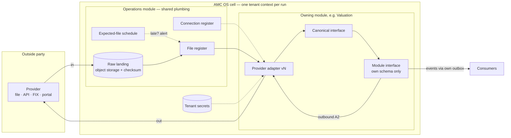
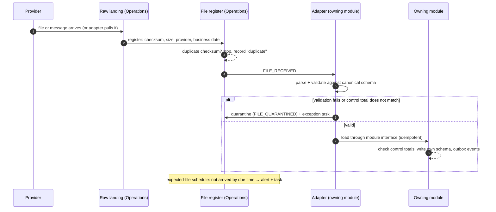
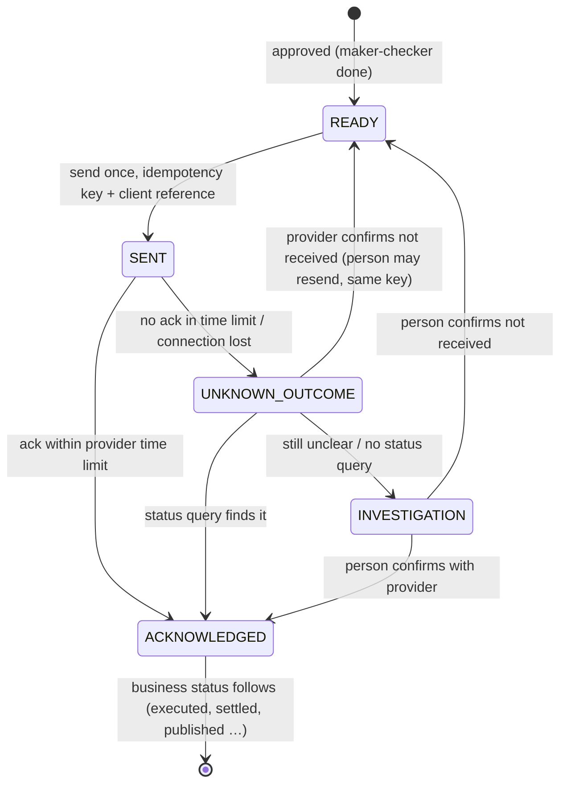

# INT-001 — Integration Architecture

This document says how AMC OS talks to every outside system: who owns each connection, how data comes in and goes out, how a provider's own format is kept away from the rest of the product, what happens when a file is late or a message gets no answer, and how each connection is watched and certified. It is master prompt §14 Stage B item 10 ("Integration architecture") and §10 ("External integration architecture"). The 17 provider specifications [INT-002](INT-002_amfi.md) … [INT-018](INT-018_investor_message_providers.md) fill in the 14 fields of master prompt §10 for each outside party in [EA-001](../04_enterprise_architecture/EA-001_system_context.md) §4 (X01–X16).

**Builds on Draft documents:** EA-001 §4–§5, EA-002, EA-003 (B9, T16, adapter rows of §3), EA-004 §9.2, EA-005 §5, EA-007 (§9.3 classes A1–A3, events `FILE_RECEIVED`, `FILE_QUARANTINED`), BA-002 §5–§6, BA-004 (hand-off rows), PRD-000 Ch 8, PRD-001…PRD-017 — allowed by owner decision D-3 ([GOV-008](../00_governance/GOV-008_build_loop.md) §2 rule 3). Nothing used here is Approved; EA-001…EA-008 are still waiting for the owner to merge. Owner decisions used: D-8, D-16, D-31, D-40, D-44, D-46, D-51, D-52, D-53, D-55, D-61, D-62, D-67, D-70, D-72 ([LOOP_STATE.md](../../LOOP_STATE.md)). The proposal branch `proposal/ai-orchestration-architecture` (INT-100) was read as input only; nothing in it is treated as approved.

**Status of every decision in this document:** **[DES]** — a design proposal for the owner (interim ARB) unless another label is shown. **No provider interface, file layout, message format, endpoint or credential is specified anywhere in INT-001…INT-018.** Where a provider has published a document that was found in this run, it is cited as **[IND]** (provider fact, not law) with the date it was seen; everything else is **Confirm with <provider>**. Numbers marked **[ASSUMPTION]** are starting values to be replaced.

**Plain-language terms**

| Term | Meaning here |
| --- | --- |
| Adapter | The piece of code that knows one provider's format and connection, and turns it into AMC OS's own shape (and back) |
| Canonical interface | AMC OS's own shape for a kind of data (a price, an execution, an investor transaction), the same whichever provider sent it |
| Raw landing | Keeping the file or message exactly as received, unchanged, before anything reads it |
| Control total | A count or sum the provider sends with a file (for example "120 rows, total 4,56,000 units") so we can check nothing was lost |
| Expected-file schedule | The list of files we expect, from whom, by what time; a file that has not come by then raises an alert |
| Quarantine | Holding a file or record that failed a check so nobody uses it until a person decides |
| Acknowledgement (ack) | The provider's reply saying "received" (not necessarily "done") |
| Status query | A way to ask the provider "did you get instruction X and what is its state?" |
| Unknown outcome | We sent an instruction and do not know whether it arrived (EA-007 §9.3 class A2) |
| Certification | The provider's own testing and sign-off before a connection may go live |

## 1. Scope and the specification set

Every outside system of EA-001 §4 has one specification. The owning module is the one that owns the data the adapter brings in or sends out (EA-003 B9, T16).

| X | Outside party | Spec | Owning module(s) of the adapter (EA-003 §3) | Stance (BA-002 §5) |
| --- | --- | --- | --- | --- |
| X01 | AMC identity provider (or Keycloak) | [INT-015](INT-015_identity_providers.md) | Identity | Connect |
| X02 | Brokers | [INT-009](INT-009_brokers.md) | Execution | Connect |
| X03 | Stock exchanges, clearing corporations | [INT-004](INT-004_nse.md) (NSE), [INT-005](INT-005_bse.md) (BSE) | Valuation (prices), Operations (corporate actions), Settlement (clearing obligations) | Connect |
| X04 | Depositories NSDL, CDSL | [INT-011](INT-011_depositories.md) | Product (ISIN requests); holdings via Settlement or Investor | Connect |
| X05 | Custodians | [INT-008](INT-008_custodians.md) | Settlement (instructions, status, holdings, cash), Accounting (custodian books, mirror mode), NAV (custodian NAV), Operations (corporate actions) | Connect / Mirror (D-40) |
| X06 | Banks | [INT-010](INT-010_banks.md) | Settlement (statements, payment status, payments where the AMC chooses), Distribution (commission payment files where used) | Connect |
| X07 | RTAs | [INT-006](INT-006_cams.md) (CAMS), [INT-007](INT-007_kfin_technologies.md) (KFin) | Investor (feeds, requests), Product (scheme set-up), NAV (NAV delivery), Distribution (brokerage feeds) | Mirror |
| X08 | KRAs and CKYC | [INT-012](INT-012_kra_and_ckyc.md) | Investor | Connect |
| X09 | MF transaction platforms (NSE, BSE) | INT-004, INT-005 | Investor (order and allotment data), Product (scheme set-up) | Connect |
| X10 | Data vendors (FactSet and others) | [INT-003](INT-003_factset_and_data_vendors.md) | Security master (reference), Valuation (prices) | Connect |
| X11 | Valuation and rating agencies | [INT-014](INT-014_valuation_and_rating_agencies.md) | Valuation (prices), Security master (ratings) | Connect |
| X12 | AMFI | [INT-002](INT-002_amfi.md) | NAV (NAV submission), Distribution (ARN, EUIN), Security master / Reporting (industry lists) | Connect |
| X13 | SEBI sources and portals | [INT-013](INT-013_sebi_regulatory_sources.md) | Compliance (circulars, reports), Investor (SCORES complaints) | Connect |
| X14 | AI model provider | [INT-016](INT-016_ai_model_provider.md) | AI (through the AI gateway only) | Connect |
| X15 | AMC corporate ERP | [INT-017](INT-017_corporate_erp.md) | Finance | Connect |
| X16 | Investor-message provider | [INT-018](INT-018_investor_message_providers.md) | Investor | Connect (provider sends, D-55) |

The brief's list (master prompt §10) is fully covered: AMFI (INT-002), FactSet (INT-003), NSE (INT-004), BSE (INT-005), CAMS (INT-006), KFin Technologies (INT-007), custodians (INT-008), brokers (INT-009), banks (INT-010), NSDL/CDSL (INT-011), KRA and CKYC (INT-012), regulatory information sources (INT-013). INT-014 … INT-018 cover the other outside systems of EA-001.

**Every specification has the same 14 fields** (master prompt §10), in this order: provider, business purpose, approved interface, authentication, data contract, ingestion schedule, error handling, retry logic, idempotency, reconciliation, monitoring, commercial dependency, certification requirements, operational ownership. Each also has an outbound-instruction table (EA-007 §9.3 A2) where it sends anything that can move money, securities or published figures, and a "Confirm with" list.

## 2. Adapter rules

| # | Rule **[DES]** | Source |
| --- | --- | --- |
| I1 | One adapter per provider **and** interface version. A new file layout or API version is a new adapter version, run side by side with the old one until the provider switches | PRD-000 Ch 8 common standards; EA-001 §4 rule 1 |
| I2 | The adapter's code sits **inside the owning module** (§1 table). The Operations module owns only the shared plumbing: connection register, file register, expected-file schedule and raw landing | EA-003 B9, T16 |
| I3 | Nothing outside the adapter knows the provider's format. After parsing, the adapter hands the owning module records in the **canonical interface** (§3) and writes only through that module's own interface — never into another module's schema | Master prompt §3.3, §10; EA-003 B1 |
| I4 | Inbound data is kept **raw first**: the unchanged file or message goes to object storage with a checksum before parsing (ADR-0007), so every loaded record can be traced back to the exact bytes received | EA-001 §4 rule 2; PRD-000 Ch 8 |
| I5 | Loads are **idempotent**: the same file or message loaded twice has no second effect (§5) | Master prompt §3.2 |
| I6 | Outbound financial instructions follow EA-007 §9.3 class A2: never retried automatically; idempotency key and client reference on every send; unknown outcome → status query → person (§6) | EA-007 §9.3 |
| I7 | **Credentials belong to one tenant** and live in that tenant's cell secrets manager under the tenant's key (EA-005 §5); an adapter reads them at run time and never writes them to logs, events or files | EA-001 §4 rule 3; EA-005 §5 |
| I8 | Every adapter run carries the tenant context from the schedule or workflow that started it (EA-005 §2); one run never mixes two tenants, even when two AMCs use the same provider | EA-005 §2 |
| I9 | A provider being slow or down never corrupts state: the waiting workflow waits, retries (A1 only) or raises an exception task; nothing is guessed or filled in | EA-001 §4 rule 4; master prompt §5 L4 |
| I10 | AMC OS never calculates an authoritative figure inside an adapter. An adapter parses, validates and checks totals; any calculation belongs to the engine in the owning module (FE-01…FE-10) | Master prompt §3.1 |
| I11 | Licensed data stays in the tenant whose licence paid for it (D-62). An adapter tags each record with its source and licence, and the AI gateway refuses data whose licence does not allow AI use **[VAL — per licence]** | D-62; PRD-016; ADR-0008 |
| I12 | A provider that offers a portal only (no file or API for the AMC) is handled as a **human step**: AMC OS prepares the file or report, a named person uploads or downloads it, and records the reference. AMC OS never stores or uses a person's portal password | EA-001 §2; PRD-000 Ch 8 (SEBI) |
| I13 | No external AI client reads AMC OS through MCP in release 1 (D-72). A provider's own MCP server (for example FactSet's, INT-003) is a possible **transport** for a data adapter, under the same rules I1–I12; it is not used in release 1 unless the owner decides so | D-72; proposal INT-100 §2 (input only) |

## 3. The common canonical interface

The canonical interface is AMC OS's own description of each kind of data that crosses the boundary. Adapters translate to and from it; modules see only it. The machine-readable versions will live in `contracts/schemas/` (owner-only path) and are written with the data model in Step 15 (DA-001); this table fixes the families and their owners now. Field lists come from the PRDs and the event payloads in `contracts/events/`, and are not final (EA-007 G8).

| Canonical family | Owning module | Main providers (spec) | Published after load (EA-007 catalogue) |
| --- | --- | --- | --- |
| Security and issuer reference | Security master | Data vendors (INT-003), exchanges (INT-004/005), depositories for ISINs (INT-011) | `SECURITY_CHANGED`, `ISSUER_CHANGED` |
| Rating | Security master | Rating agencies (INT-014), data vendors (INT-003) | `RATING_CHANGED` |
| Benchmark and index levels | Security master | Data vendors (INT-003), index providers via exchanges (INT-004/005) | `BENCHMARK_LEVELS_LOADED` |
| Price | Valuation | Exchanges (INT-004/005), valuation agencies (INT-014), data vendors (INT-003) | `PRICES_LOADED` |
| Corporate-action announcement and entitlement | Operations | Exchanges, data vendors, custodians (INT-004/005/003/008) | `CORPORATE_ACTION_ANNOUNCED`, `CORPORATE_ACTION_ENTITLEMENT_RECEIVED` |
| Order to broker / execution / contract note | Execution | Brokers (INT-009) | `TRADE_EXECUTED`, `TRADE_CONFIRMED`, `TRADE_EXCEPTION_RAISED` |
| Settlement instruction and status | Settlement | Custodians (INT-008) | `SETTLEMENT_INSTRUCTED`, `SETTLEMENT_STATUS_CHANGED`, `TRADE_SETTLED`, `SETTLEMENT_FAILED` |
| Clearing obligation | Settlement | Clearing corporations via exchanges or custodian (INT-004/005/008) | (input to WF-026; no event of its own in v1) |
| Holdings and cash statement | Settlement (load); Operations (reconciliation) | Custodians, banks, depositories (INT-008/010/011) | `FILE_RECEIVED`, then `RECONCILIATION_COMPLETED` |
| Custodian books and NAV (outsourced mode, D-40, D-44) | Accounting, NAV | Custodians (INT-008) | (mirror loads; checks raise `RECONCILIATION_EXCEPTION_CREATED`) |
| NAV publication record | NAV | AMFI (INT-002), RTAs (INT-006/007), exchanges | `NAV_PUBLISHED` |
| Investor, folio and transaction | Investor | RTAs (INT-006/007), MF platforms (INT-004/005) | `INVESTOR_TRANSACTION_RECEIVED`, `INVESTOR_FLOWS_PROVISIONAL`, `INVESTOR_FLOWS_FINAL` |
| KYC status | Investor | KRAs and CKYC, usually via the RTA (INT-012) | (part of investor record; `INVESTOR_DATA_FLAGGED` on mismatch) |
| Complaint | Investor | SEBI SCORES (INT-013), RTA (INT-006/007) | `COMPLAINT_RECEIVED` |
| Investor message request and delivery status | Investor | Message provider or RTA (INT-018) | (status on the message record) |
| Distributor registration (ARN, EUIN) and brokerage | Distribution | AMFI (INT-002), RTAs (INT-006/007) | `DISTRIBUTOR_STATUS_CHANGED`, `DISTRIBUTOR_FLOW_UPDATED` |
| Payment file and payment status | Settlement or Distribution (whoever owns the payment) | Banks (INT-010) | (status on the payment record) |
| Scheme set-up to outside parties | Product | RTAs, depositories, MF platforms (INT-006/007/011/004/005) | (task records, EA-007 §10.2) |
| Regulatory circular and filing record | Compliance | SEBI sources (INT-013) | (register entries; `RULE_VERSION_APPROVED` only after the CCO approves, D-32) |
| Management figures | Finance | ERP (INT-017) | (none in v1) |
| Sign-in and user changes | Identity | Identity providers (INT-015) | `USER_PROVISIONED`, `USER_DEPROVISIONED` |

Every canonical record carries: tenant, source provider and adapter version, raw-landing object reference and checksum, provider reference, business date, received time, licence tag (I11) and data classification (PRD-016) **[DES]**.

## 4. Inbound files and messages

| # | Rule **[DES]** |
| --- | --- |
| IN1 | **Expected-file schedule.** Each connection lists the files or messages it expects, with the tenant's business calendar (EA-003 §3.1) and a due time. A file that has not arrived by its due time raises an alert and a task for the operational owner (§10). Due times are tenant settings, set from the provider's published or agreed timing; AMC OS ships none **[DES; values Confirm with <provider>]** |
| IN2 | **Pull or push.** Where the provider puts files on its own server, the adapter pulls them; where the provider pushes to AMC OS, it pushes to a per-tenant drop point. Which one applies is "Confirm with <provider>" in each spec |
| IN3 | **Duplicate check.** A file with a checksum already registered for the same tenant and connection is recorded as a duplicate and not loaded |
| IN4 | **Validation.** Format, mandatory fields, code lists, dates against the business calendar, references to known securities, schemes, folios or orders. A file with any structural error is quarantined whole; a file with record-level errors is loaded only if the owning module's rule allows partial loads for that family (for example prices: no — the price set must be complete or it goes to the Valuation exception queue; WF-007) |
| IN5 | **Control totals.** Where the provider sends counts or sums, they are checked before the load is committed. Where it sends none, the module records "no control total" and relies on reconciliation (§7) |
| IN6 | **Corrections and re-sends.** A provider's corrected file is a new file (new checksum) that names the file it corrects, where the provider supports that **[Confirm with <provider>]**. The module applies it as a correction with its own approval rules (for example a price change after valuation approval goes through WF-035 / WF-017), never as a silent overwrite |
| IN7 | **Emailed documents** (for example a broker contract note as a PDF, BA-004 WF-025) are accepted only from a per-tenant mailbox allow-list, landed raw, parsed where possible and always checked by a person before use in release 1 **[DES; owner question Q79]** |
| IN8 | **Public website files** (for example AMFI NAV reports, INT-002; SEBI circular pages, INT-013) are fetched only where the site's terms allow automated download **[VAL — terms of use per site]**, with a polite schedule, and are treated as a source like any other (raw landing, checksum, validation) |

## 5. Idempotency

| Direction | Key **[DES]** | Where stored |
| --- | --- | --- |
| Inbound file | tenant + connection + file checksum; plus the provider's own file or batch reference where it has one | Operations file register |
| Inbound record | tenant + provider + provider record reference + business date (+ provider version or sequence where the provider sends one) | Owning module's load table |
| Inbound message (API, FIX) | tenant + session or connection + provider message ID (for FIX: the broker's ExecID on execution reports **[IND — FIX field; per-broker use Confirm with <broker>]**) | Owning module's inbox / load table |
| Outbound instruction | idempotency key = `workflow_id + activity name + step number` (EA-007 §9.3 A1/A2) and a **client reference** sent to the provider so that its status query can find the instruction | Called module's idempotency table in PostgreSQL (ADR-0017 Decision 3) |

## 6. Outbound instructions (EA-007 §9.3 class A2)

Anything sent to an outside party that can move money, securities or published figures follows one procedure. Each provider specification fills in the provider-specific cells.

| # | Rule **[DES]** |
| --- | --- |
| OUT1 | An instruction is sent only after the approvals its module requires (for example D-31: every settlement instruction has a second approver; commission payment files released by two bank-mandate signatories, EA-007 §10.5 step 6) |
| OUT2 | **Never re-sent automatically.** Transport-level retries that the protocol itself makes safe (for example FIX session-level resend of the same message sequence) are allowed only where the provider spec says so; a new business send never is |
| OUT3 | **Ack time limit** per provider and message type is a connection setting. Its value comes from the provider at onboarding **[ASSUMPTION — Confirm with <provider>]**; until it is set, the connection cannot send A2 instructions automatically and every instruction is released by a person |
| OUT4 | **Status query.** If the provider offers one, the adapter uses it (class A1, retried safely). If it offers none, the specification says so and names the manual check (phone, portal, email to a named desk), and the instruction is released only by a person **[VAL per provider]** (EA-007 §9.3) |
| OUT5 | After a regional failover, every instruction in SENT is put on hold for a person to check with the provider before any resend (EA-004 §9.2 step 5) |
| OUT6 | Every send, ack, status query, decision and resend is in the audit trail with the key, client reference, person and time (NFR-AUD-019) |

**Summary of outbound instructions (details in each spec)**

| Instruction | Spec | Owning module | Ack time limit | Status query | Manual check if none |
| --- | --- | --- | --- | --- | --- |
| Order to broker (and cancel / amend) | INT-009 | Execution | Confirm with <broker> | FIX defines an Order Status Request message **[IND]**; whether each broker supports it: Confirm with <broker> | Dealer calls the broker's desk; recorded on the order |
| Settlement instruction | INT-008 | Settlement | Confirm with <custodian> | Confirm with <custodian> | Operations Analyst checks the custodian portal or desk |
| Payment file (commission, AMC payments where the AMC chooses) | INT-010 | Distribution, Settlement | Confirm with <bank> | Confirm with <bank> | Finance / Operations checks bank portal |
| NAV file to RTA | INT-006, INT-007 | NAV | Confirm with <RTA> | Confirm with <RTA> | NAV team confirms with RTA operations desk |
| NAV submission to AMFI (where the tenant submits, D-44) | INT-002 | NAV | Confirm with AMFI | Public NAV report shows what AMFI published **[IND — INT-002]** | NAV team compares the AMFI published report with the approved NAV |
| Scheme set-up to RTA, depository, platforms | INT-006/007/011/004/005 | Product | Human task (EA-007 §10.2) | n/a | Product Manager confirms with each party |
| ISIN request | INT-011 | Product | Human task | n/a | As above |
| KYC upload (where the AMC uploads, not the RTA) | INT-012 | Investor | Confirm with <KRA> / CERSAI | Confirm | Investor Service checks the KRA / CKYC portal |
| Report filing to SEBI | INT-013 | Compliance | Human step (I12) | n/a | Compliance Officer records the portal acknowledgement |
| Investor message request | INT-018 | Investor | Confirm with <provider> | Confirm | Not a financial instruction: not class A2; resend rules in INT-018 |

## 7. Reconciliation

| # | Rule **[DES]** |
| --- | --- |
| R1 | Every inbound family is reconciled to something: the provider's control totals (IN5), a second source (for example price from exchange vs vendor; rating from agency vs vendor), or AMC OS's own records (holdings vs custodian, cash vs bank, units vs RTA) |
| R2 | Book-to-outside reconciliations (custodian holdings and cash, bank, broker, RTA units, depository units) are run by the Operations reconciliation engine (FE-07, WF-015) on data loaded by the owning modules; adapters do not reconcile across modules |
| R3 | Tolerances, materiality and two-source rules are tenant settings (D-46); AMC OS ships no values |
| R4 | A break raises `RECONCILIATION_EXCEPTION_CREATED` and a task; write-off follows D-50 |

## 8. Error handling and retries (inbound)

| Situation | Handling **[DES]** |
| --- | --- |
| Connection fails (SFTP, API timeout, FIX disconnect) | Class A1: retried with back-off; after the connection's retry budget **[ASSUMPTION — 5 tries over about 30 minutes, then alert; tenant setting]**, alert and task to the operational owner |
| File late | Alert at due time (IN1); the waiting workflow stays waiting (for example NAV waits for prices); escalation per tenant calendar |
| File malformed / control total wrong | Quarantine (`FILE_QUARANTINED`), task to operational owner, ask the provider for a corrected file; nothing from it is used |
| Record-level errors | Per family (IN4): rejected records listed in an exception queue with the reason; owning module decides whether the load may proceed |
| Unknown code or reference (new security, new folio) | Held in the owning module's exception queue; new securities go to WF-041 (golden record); never created silently |
| Provider says a previous file was wrong | Correction path (IN6) |
| Provider changes format without notice | Adapter validation fails → quarantine; a new adapter version is built and certified (I1, §11) |

## 9. Security of connections

| # | Rule **[DES]** |
| --- | --- |
| S1 | Transport encrypted in every case (TLS 1.2 or later, SFTP, or the provider's private network / leased line where it requires one) **[Confirm with <provider> which one]** |
| S2 | Files encrypted at rest in raw landing with the tenant's key (EA-005 §5); PGP on the file itself where the provider supports it (PRD-000 Ch 8) |
| S3 | Mutual TLS or key-based SFTP preferred over passwords; where the provider issues passwords or API keys, they sit in the tenant's secrets and are rotated on the provider's schedule or at least yearly **[ASSUMPTION]** |
| S4 | **Fixed outbound addresses per cell** so providers that allow-list IP addresses can do so; a tenant moving cells (EA-004 §6) triggers a re-allow-listing task with each provider before the move |
| S5 | Inbound push endpoints are per tenant, authenticated, and accept only the expected file types and sizes |
| S6 | No provider credential, file content or personal data in logs or events (NFR-SEC-007, NFR-SEC-008) |
| S7 | Provider data that includes personal data (RTA, KRA, bank) is classified as such (PRD-016) and handled under DPDP rules **[VAL — DPO]** |

## 10. Monitoring and operational ownership

Each connection shows, per tenant: last success, next expected file and due time, files late, quarantined files and records, open unknown-outcome instructions, error rate, and the adapter version in use. Alerts go to the connection's **operational owner** (a named AMC department, below) and, for platform faults (adapter crash, certificate expiry), to the vendor's Platform Operator (ROLE-20) without business data (EA-006 telemetry allow-list).

| Responsibility | Who **[DES]** |
| --- | --- |
| Commercial relationship and licence with the provider | The AMC (contract owner named per provider in its spec); data licences are per AMC (D-62) |
| Connection set-up, credentials, certificates, allow-listing | DEP-15 Technology (Technology Administrator ROLE-17) with the vendor; credential entry is maker-checker **[DES]** |
| Watching files and acting on exceptions | The department that owns the data (for example DEP-07 Fund accounting and NAV for prices and NAV; DEP-06 Fund operations for custodian and bank; DEP-08 Investor services for RTA; DEP-05 Dealing for brokers) — named in each spec |
| Adapter code, versions and certification evidence | AMC OS vendor (product engineering) |
| Adapter running and platform alerts | AMC OS vendor (Platform Operator, ROLE-20), no business-data access (EA-006) |

## 11. Certification and go-live

Every connection goes through the same steps before production use. This extends the PRD-000 Ch 8 checklist.

| # | Step **[DES]** | Evidence kept |
| --- | --- | --- |
| C1 | Interface documents obtained from the provider under the AMC's agreement; recorded with version and date in the connection register | Provider document reference (never copied into this repository if the provider restricts it) |
| C2 | Adapter built against a **provider simulator** that replays sample files and messages, including the provider's error codes | Contract tests in CI |
| C3 | Connectivity in the provider's test environment (where one exists) | Test log |
| C4 | Provider's own certification or test pack, where it has one (for example FIX certification per broker, payment-file certification per bank) | Provider sign-off |
| C5 | Volume test at the tenant's expected peak | Test report |
| C6 | Parallel run with the AMC's current process: at least one month for feeds that affect NAV or money (PRD-000 Ch 8), and for an AMC's first go-live inside the pilot parallel run (D-12) | Daily comparison report signed by the operational owner |
| C7 | Go-live approval by the operational owner and Technology, with a rollback plan (go back to the current process) | Approval record (WF-021 configuration change) |

## 12. Tests

| # | Test | When |
| --- | --- | --- |
| T-I1 | Same file loaded twice → no second effect (IN3, §5) | Build increment 1 |
| T-I2 | Control total mismatch → quarantine, nothing loaded | Build increment 1 |
| T-I3 | Late file → alert at due time; waiting workflow does not proceed | Build increment 1 |
| T-I4 | Outbound instruction with no ack → `UNKNOWN_OUTCOME`, no automatic resend (same as EA-007 T-E8) | Build increment 1, provider simulator |
| T-I5 | Two tenants on the same provider: credentials, files and loads never cross (EA-005 §8) | Build increment 1 |
| T-I6 | New adapter version runs side by side; records carry the version used | Before first provider format change |
| T-I7 | Adapter writes only through its owning module's interface (no cross-schema write) | Architecture test in CI |

## 13. Non-functional requirements proposed here

IDs continue from the next free numbers in LOOP_STATE. All are **Proposed [DES]** for the owner.

| ID | Requirement | Label |
| --- | --- | --- |
| NFR-OBS-005 | Every connection reports last success, files late, quarantines, unknown-outcome instructions and error rate per tenant; a late NAV- or money-affecting file raises an alert within **5 minutes** of its due time **[ASSUMPTION]** | **[DES]** |
| NFR-AUD-019 | Every loaded record can be traced to the raw file or message (object reference + checksum) and adapter version; every outbound instruction's send, ack, query and resend is in the audit trail | **[DES]** |
| NFR-SEC-008 | Provider credentials are per tenant, stored only in the tenant's secrets, never in code, logs, events or files, and rotated at least yearly or on the provider's schedule | **[DES]** |
| NFR-RET-008 | Raw inbound files and outbound instructions are kept unchanged for the retention period of the records they support **[VAL — period by record class, REG-001 Step 25]** | **[DES]** |
| NFR-AVAIL-005 | A provider outage affects only the flows that need that provider; other modules and tenants keep working | **[DES]** |

## 14. Effects on other documents

| Document | Change needed | When |
| --- | --- | --- |
| EA-002 §5.1 | Already changed by EA-003 B9; also point to INT-001 §2 for adapter rules | Next EA-002 revision |
| `contracts/schemas/` (owner-only) | Canonical families of §3 as JSON Schemas | Step 15 (DA-001) / owner |
| DA-001, DDL | Connection register, file register, expected-file schedule (Operations); per-module load tables with source columns (§3 last paragraph); outbound instruction tables with A2 states | Steps 15–16 |
| EA-007 G5 | Closed in design: each spec states ack limit and status query as "Confirm with <provider>" with the manual check; values come at onboarding | — |
| PRD-011 FR-D11-001 | Price adapters sit in Valuation (EA-003 B9) — already listed in EA-003 §7 | Next PRD-011 revision |
| SEC-001 | Fixed outbound addresses, certificate and key rotation, inbound endpoint hardening (§9) | Step 25 |
| REG-001 | Retention per record class (NFR-RET-008); website terms of use for automated download (IN8) | Step 25 |
| QA-001 | Tests T-I1…T-I7; provider simulators | QA-001 next revision |
| INF-001 | Outbound fixed IP per cell; SFTP endpoints; leased line / private connectivity where a provider requires it | Step 26 |

## 15. Gaps and open points

| # | Gap | Closed by |
| --- | --- | --- |
| G1 | No provider interface is confirmed for any AMC (EA-001 G1 stays open at provider level). Each spec lists what must be obtained | Pilot discovery; provider onboarding |
| G2 | Which providers the pilot AMC uses (custodian, banks, brokers, RTA, data vendors) | Owner question Q76 |
| G3 | Whether the AMC or the vendor holds each data licence | Owner question Q77 |
| G4 | SWIFT connectivity for custodians and banks in release 1 | Owner question Q78 |
| G5 | Emailed documents with human check in release 1 | Owner question Q79 |
| G6 | Automated fetching of public website files (AMFI, exchanges, SEBI) — terms of use | Owner question Q80; REG-001 **[VAL]** |
| G7 | Canonical schemas not yet written (`contracts/schemas/` is empty) | Step 15 |

## Sources

| # | Source | Used for |
| --- | --- | --- |
| S1 | [MASTER_BUILD_PROMPT.md](../../MASTER_BUILD_PROMPT.md) §3.1–§3.4, §5 L4, §10, §14 Stage B | Required fields, providers, principles |
| S2 | [EA-001](../04_enterprise_architecture/EA-001_system_context.md) §4–§7 | Outside systems X01–X16, rules, trust boundaries |
| S3 | [EA-003](../04_enterprise_architecture/EA-003_domain_boundaries_and_service_catalogue.md) §1 B9, §3 adapter rows, §5 T16 | Adapter ownership |
| S4 | [EA-004](../04_enterprise_architecture/EA-004_deployment_and_cell_architecture.md) §6, §9.2; [EA-005](../04_enterprise_architecture/EA-005_multi_tenant_architecture.md) §2, §5, §8 | Failover hold, tenant context, keys |
| S5 | [EA-007](../04_enterprise_architecture/EA-007_event_architecture_and_process_workflows.md) §9.3, §10, §14 G5 | Activity classes, unknown outcome |
| S6 | [PRD-000](../03_product_requirements/PRD-000_master_prd_v0.9.md) Ch 8 | Common standards, provider table, certification checklist |
| S7 | [BA-002](../02_business_architecture/BA-002_amc_operating_model.md) §4–§6; [BA-004](../02_business_architecture/BA-004_end_to_end_workflows.md) hand-off rows | Departments, stances, hand-offs |
| S8 | Proposal branch `proposal/ai-orchestration-architecture`, INT-100 (input only) | Rules INR-1…INR-6 compared; MCP note |
| S9 | Provider sources cited in INT-002…INT-018 | Provider facts |
| S10 | [LOOP_STATE.md](../../LOOP_STATE.md) owner decisions | D-8 … D-72 as listed |
